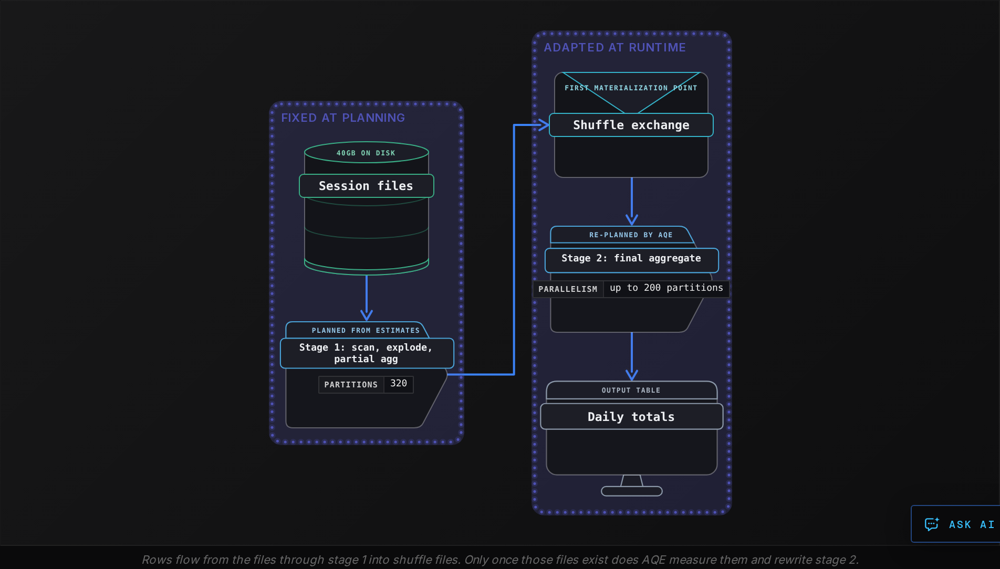
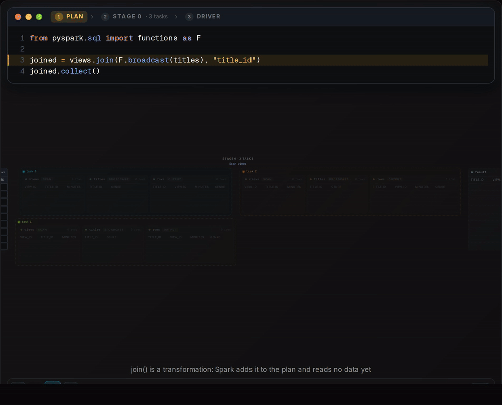
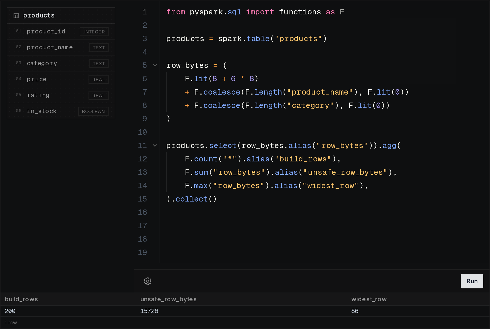
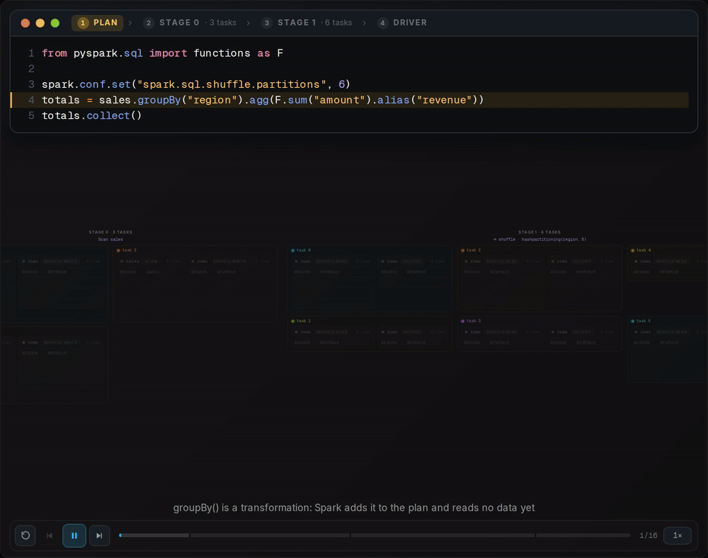
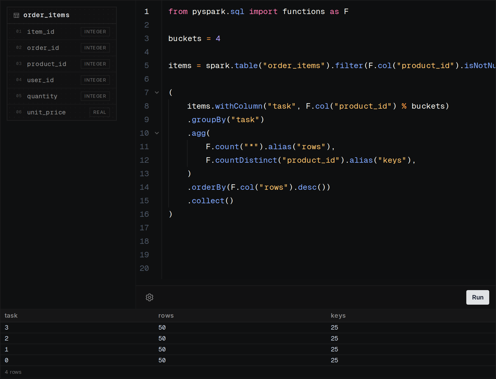
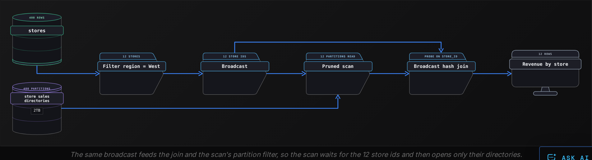
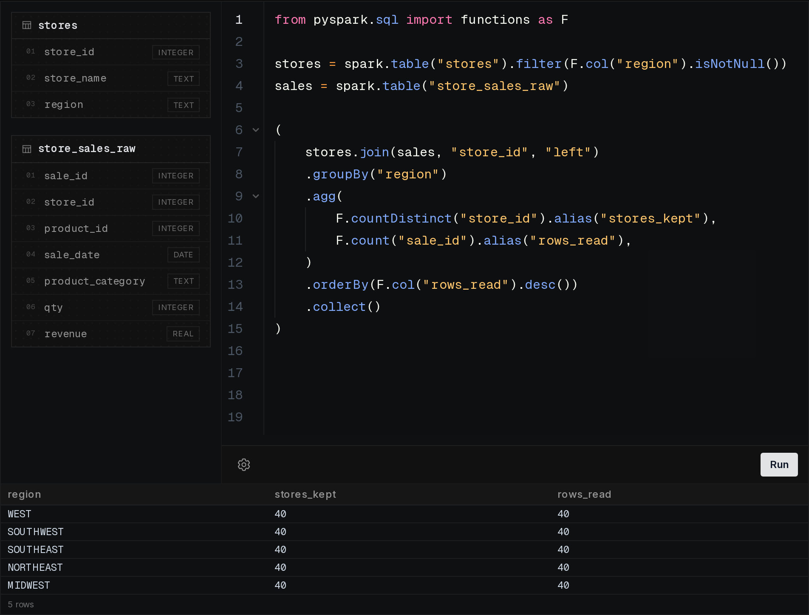

Advanced·Spark · 15 min · 15 challenges

# Adaptive Query Execution: Advanced

A nightly Netflix job joins a week of viewing events to the title catalog. Adaptive execution is on, and the job still dies at 2 a.m.: the broadcast it picked from 90MB of shuffle files decompressed into a hash table too big for its executors, and its slowest stage ran before the first shuffle, where nothing adapts. This lesson maps those blind spots.


<br>

---

## The Pre-Shuffle Blind Spot

AQE changes a plan at a single kind of moment: when an exchange finishes. A completed shuffle or broadcast hands the driver measured sizes, and Spark re-optimizes the stages that have not started. Everything that ran before the first exchange was compiled from estimates and executed as compiled. A read-filter-write job has no exchange at all, so it is never re-planned.


<br>

### What the first stage holds

The first stage of a job contains the scan, every filter and projection, any explode or withColumn work, and the map side of the first shuffle: the partial aggregate and the shuffle write. Its task count comes from the input splits, which Spark sizes from the file listing and spark.sql.files.maxPartitionBytes, 128MB by default. AQE sets neither number, because it has measured nothing when they are chosen.




<br>

### A worked case: skew that grows inside a stage

A subscriptions job reads 40GB of account intervals, a row per account with a start day and an end day. It expands each row into a row for every active day, then counts active accounts per day. Most intervals cover 30 days. A legacy import of accounts spanning 3,650 days each sits in 3 splits, written together in a single batch.

| Split group | Splits | Rows read per split | Days per row | Rows emitted per split | Task time |
| --- | --- | --- | --- | --- | --- |
| Ordinary | 317 | 2,000,000 | 30 | 60,000,000 | 40 s |
| Legacy import | 3 | 2,000,000 | 3,650 | 7,300,000,000 | 81 min |

Every split is the same 128MB, so the scan looked balanced. The skew forms inside the tasks, as explode multiplies rows by 30 in most splits and by 3,650 in 3 of them. AQE first sees the data when stage 1's shuffle files are complete, 81 minutes in. By then the stragglers have set the job's runtime, and no rule that acts at runtime can rerun stage 1 with a better layout.


<br>

### Routing each blind spot to a tool that reaches it

| Symptom | Why AQE misses it | Tool that reaches it |
| --- | --- | --- |
| A few first-stage tasks run far longer after `explode` or a heavy function | The skew forms before any exchange exists | `repartition(n)` before the expensive step, or salting the expansion |
| Thousands of read tasks that each finish in milliseconds | Scan splits are fixed at planning | Compaction, or a larger `spark.sql.files.maxPartitionBytes` |
| Every post-shuffle partition is 10GB, all about the same | Coalescing only merges, and skew splitting needs a partition 5 times the median | A higher `spark.sql.shuffle.partitions` or `initialPartitionNum` |
| One hot key stalls a `groupBy` | Skew splitting covers joins and leaves aggregations alone | Two-phase aggregation on a salted key |
| A read-filter-write job runs slowly | No exchange means no re-plan | Input split settings and the output file layout |

The first row's fix changes the plan itself. A round-robin repartition(2000) placed before the expansion shuffles the compact 40GB of intervals and scatters the legacy rows over 2,000 tasks, so each task emits roughly 20 million rows. The price is a single extra shuffle of small rows, paid before they multiply.

```sql
from pyspark.sql import functions as F

subs = spark.table("subscriptions")

daily = (
    subs.repartition(2000)
    .withColumn("day", F.explode(F.sequence("start_day", "end_day")))
    .groupBy("day")
    .agg(F.count("*").alias("active_accounts"))
)
```

This program runs 2 shuffles and 3 stages: the round-robin exchange, then the hash exchange on day that the groupBy needs, because round-robin output is spread evenly with no regard to day. The count is written as a number, and AQE leaves an explicit count alone, so all 2,000 tasks reach the expansion.

**AQE is on with default settings. Which of these slowdowns can it fix with no change to the code?**

- **A.** A first-stage task runs 80 minutes because its split holds rows that a regex parses slowly
- **B.** A groupBy stalls because a single key holds 40% of the rows reaching its final stage
- **C.** A join stalls because a single post-shuffle partition is 3GB while the median is 90MB
- **D.** A job runs 200 shuffle partitions of 9GB each, all about the same size as each other

<details>
<summary>Solution</summary>

**C.** A join stalls because a single post-shuffle partition is 3GB while the median is 90MB

3GB is more than 5 times the 90MB median and larger than 256MB, so the skew-join rule splits it and replicates the matching partition on the other side.

**Why the others are wrong**

- **A.** The parse runs before the first exchange, in tasks sized by the input splits. AQE has measured nothing when those tasks start, so a repartition before the parse is the fix.
- **B.** AQE splits skewed partitions for joins only. A hot aggregation key needs two-phase aggregation on a salted key.
- **D.** No partition is 5 times the median, so none counts as skewed, and coalescing only merges. Raise the starting partition count instead.

</details>

Pick the count from the rows the expansion will emit. Divide that total by the rows a task handles comfortably. The 3 legacy splits emit 7.3 billion rows each, so at around 20 million rows a task they need roughly 1,100 tasks on their own. The ordinary splits' 19 billion rows add about 950 more, and together they come to about 2,000. Place repartition immediately before the row-multiplying step. Placed after it, the rows have already multiplied inside the original tasks, and the stragglers are back.


<br>

---

## Broadcasts That Outgrow Memory

When a shuffle stage finishes, the driver holds its map output statistics: the bytes each map task wrote for each reducer. If a side of a pending sort-merge join sums to less than spark.sql.adaptive.autoBroadcastJoinThreshold, AQE rewrites the join as a broadcast hash join. That setting is unset by default, so it inherits spark.sql.autoBroadcastJoinThreshold, which is 10MB unless someone raised it.

Those bytes are shuffle blocks as they sit on disk: rows in binary row format, compressed, because spark.shuffle.compress is true by default. A broadcast holds the same rows uncompressed, inside a hash table built for lookups. So the measurement gives the exact size on disk and says nothing about the size in memory.


<br>

### From shuffle files to a copy in every executor

Take the title-catalog side of a nightly join. The team raised the broadcast threshold to 100MB for small lookup tables. Tonight the catalog side, after its filter, lands in a shuffle stage whose blocks compress about 7:1, because genre, rating and country values repeat row after row. The cluster runs 40 executors with 4 cores and 4GB of heap each.

- **90MB** — measured shuffle bytes
- **630MB** — rows in each executor's copy
- **24.6GB** — held across the cluster

| Holder | What it keeps | For how long |
| --- | --- | --- |
| Driver | Every build-side row collected from the shuffle files, then the built hash relation | While the relation is built and sent |
| Each executor | A deserialized copy of the relation, shared by all its tasks | Until the broadcast is cleaned up |
| Each task | Its own probe-side partition, streamed past the shared relation | For the life of the task |

A 630MB relation on a 4GB executor sits beside the execution memory its 4 tasks need for sorts and aggregates. Before that, the driver, 1GB by default through spark.driver.memory, has to collect the rows and build the relation. The hard check Spark runs on a built relation rejects only those of 8GB or more, so nothing stops this plan, and the job dies with OutOfMemoryError on the driver or the executors after AQE followed its rule exactly.

> Signs a runtime broadcast went wrong
>
> - The final plan shows a broadcast hash join where the initial plan had a sort-merge join
> - Executors fail with OutOfMemoryError in the stage that probes the broadcast
> - The driver's heap climbs while the build side's rows are collected
> - The build side's stage reports a shuffle write under the threshold, and the job fails right after it


<br>

### Watching a broadcast reach every task

The program below forces a broadcast so you can see the plan's shape: the small table goes whole to every task of the large side, and no row of the large side moves. The board draws titles reaching each task. In memory, the tasks on an executor share a single deserialized copy, so the example cluster holds 40 copies of 630MB, one per executor, rather than 160, one per task. The engine draws the plan as written, before any runtime rewrite.




<br>

### Sizing the runtime threshold

Size the adaptive threshold from memory, then divide by compression. Decide how much of each executor's heap a broadcast may take, say 175MB on these 4GB executors, and divide by the ratio you measured: 175MB at 7:1 allows 25MB of shuffle bytes. Set spark.sql.adaptive.autoBroadcastJoinThreshold to that and leave the static threshold alone, since it judges table statistics with errors of their own. For a join that must never broadcast, a merge hint on either side pins a sort-merge join, and AQE honours the hint.

The ratio is row bytes over shuffle bytes. Binary row format stores an 8-byte null bitset, 8 bytes per column, and each string's bytes after that. The cell below adds those up for products as if it were a build side, ignoring the padding of strings to 8-byte words. The 6 \* 8 is the 6 columns of products at 8 bytes each, so change the 6 to the column count of whatever side you are sizing. The cell gives the numerator only: its global agg shuffles a single partial row per task, so its own shuffle write says nothing about these rows.



```python
from pyspark.sql import functions as F

products = spark.table("products")

row_bytes = (
    F.lit(8 + 6 * 8)
    + F.coalesce(F.length("product_name"), F.lit(0))
    + F.coalesce(F.length("category"), F.lit(0))
)

products.select(row_bytes.alias("row_bytes")).agg(
    F.count("*").alias("build_rows"),
    F.sum("row_bytes").alias("unsafe_row_bytes"),
    F.max("row_bytes").alias("widest_row"),
).collect()
```

The denominator is the shuffle write of the same rows. In the real job, read it from the stage page of the build side's own stage, the stage AQE measured before converting the join. To measure it in isolation, run the build side through a shuffle with no other work, products.repartition(8).write.format("noop").mode("overwrite").save(), and read that stage's shuffle write. Divide the per-executor budget by the ratio, and set only the adaptive threshold, which reads shuffle bytes at runtime. The static threshold keeps judging table statistics at planning.

**A team runs with spark.sql.autoBroadcastJoinThreshold set to 200MB. AQE measures 150MB of shuffle bytes on a join's smaller side, converts the join, and executors fail with OutOfMemoryError. Which change stops this conversion while keeping static broadcasts of small, well-measured tables?**

- **A.** Set spark.sql.adaptive.autoBroadcastJoinThreshold to a lower value sized from decompressed row bytes
- **B.** Set spark.sql.shuffle.partitions lower so the smaller side measures fewer bytes at runtime
- **C.** Set spark.sql.adaptive.enabled to false so every join is chosen from planning estimates
- **D.** Raise spark.sql.adaptive.skewJoin.skewedPartitionFactor so the smaller side counts as skewed

<details>
<summary>Solution</summary>

**A.** Set spark.sql.adaptive.autoBroadcastJoinThreshold to a lower value sized from decompressed row bytes

The adaptive setting governs runtime conversion only, so static broadcasts keep the 200MB rule while AQE stops broadcasting sides whose decompressed rows exceed executor memory.

**Why the others are wrong**

- **B.** AQE sums bytes across every partition of the side. Fewer partitions hold the same 150MB, so the conversion still happens.
- **C.** It stops this conversion, but it also drops coalescing and skew splitting, and the 200MB static rule can still broadcast the same side from its estimate.
- **D.** The skew factor decides which partitions of a sort-merge join get split. It plays no part in the decision to broadcast a side.

</details>


<br>

---

## Over-Coalescing

Coalescing reads a single number per reducer partition, its shuffle bytes, and merges neighbouring partitions until each merged task approaches a target size. The target comes from 3 settings. spark.sql.adaptive.advisoryPartitionSizeInBytes is the ceiling, 64MB. spark.sql.adaptive.coalescePartitions.minPartitionSize is the floor, 1MB. spark.sql.adaptive.coalescePartitions.parallelismFirst, true by default, shrinks the target so the stage keeps about a task for every slot of the cluster's default parallelism. Set it to false, as the Spark docs advise for busy shared clusters, and every stage packs toward 64MB.


<br>

### The overhead coalescing trades away

Every reducer partition, even an empty one, launches a task and reports back to the driver, and coalescing merges neighbours to save that overhead. The board shows the plan before the runtime merge, so every reducer is drawn.



With 6 reducers on 3 regions, at least 3 of them are empty, and merging those saves 3 launches. Merging all 6 into a single task saves 2 more and puts the whole stage on 1 core while the other cores the job holds wait. Coalescing pays only while the merged task count stays at or above the cores free to run it. Below that line, each merge buys milliseconds of overhead with a core's worth of wall time, which is the trade the next table prices.


<br>

### When the target ignores what happens next

Shuffle bytes measure what a reducer reads, and a stage often spends its time on what it does with those rows afterwards. A stage that explodes arrays, joins to a fanned-out table or runs a heavy function can turn 64MB of input into minutes of CPU. Packing such a stage trades a few milliseconds of task overhead for idle cores.

Take a shuffle that delivers 2.3GB to a stage that expands each row 40 times, so the stage burns about 4 seconds of CPU per MB of input. The cluster has 400 cores, and spark.sql.shuffle.partitions is 200.

| Settings | Tasks | Input per task | Task time | Cores busy of 400 |
| --- | --- | --- | --- | --- |
| No coalescing | 200 | 11.8MB | 47 s | 200 |
| parallelismFirst true (default) | 200 | 11.8MB | 47 s | 200 |
| parallelismFirst false | 37 | about 64MB | 256 s | 37 |
| initialPartitionNum 800, parallelismFirst true | 400 | 5.9MB | 24 s | 400 |

With parallelismFirst false, the stage runs more than 5 times longer while 363 cores wait. The default leaves the stage at 200 tasks, which is no worse than static planning and no better, because coalescing merges partitions and never splits them. Only a larger starting count fills all 400 cores.

Packing can also create skew. Coalescing equalises bytes, so any cost that does not track bytes ends up uneven across fewer, larger tasks. Partitions whose keys compress well hold many more rows per MB, and a merged task built from 10 of them can carry several times the rows of its neighbour at the same 64MB. On the stage page this shows as task times spreading apart while shuffle read sizes stay level.

> **TIP**
>
> Before blaming coalescing, compare the slow stage's task count with the cores the job holds. Fewer tasks than cores, each running for minutes, is packing. One task with a far larger shuffle read than the rest is key skew. Level shuffle reads with task times spread apart is skew that packing made, from merged partitions with unequal rows per MB.


<br>

### Rebalancing a stage that was packed too tight

Fixes, narrowest first

- repartition(400, "page_id"): an explicit count pins that shuffle. AQE leaves a count you wrote untouched, and a following groupBy on the same key reuses the partitioning.
- A lower advisoryPartitionSizeInBytes for the job whose later stages expand rows.
- parallelismFirst left at true for jobs dominated by expanding stages.
- A higher initialPartitionNum so coalescing has partitions worth keeping.

```sql
from pyspark.sql import functions as F

events = spark.table("page_events")

per_page = (
    events.repartition(400, "page_id")
    .groupBy("page_id")
    .agg(F.count("*").alias("views"))
)
```

One shuffle and 2 stages: the groupBy finds its input already hashed on page_id and adds no exchange of its own, and the 400 stays 400 whatever the bytes measure. Pin a count when you know the stage's cost per byte. When input volume swings 10 times from day to day, pin the count that suits the largest day.


<br>

### Watch the largest task grow

The cell buckets order_items rows by product_id modulo buckets, a stand-in for reducer partitions. Run it with 4, then change buckets to 2 and to 1. The top row is the stage's slowest task: halving the bucket count roughly doubles it, which is what over-coalescing does to wall time when every core could have taken a share.



```python
from pyspark.sql import functions as F

buckets = 4

items = spark.table("order_items").filter(F.col("product_id").isNotNull())

(
    items.withColumn("task", F.col("product_id") % buckets)
    .groupBy("task")
    .agg(
        F.count("*").alias("rows"),
        F.countDistinct("product_id").alias("keys"),
    )
    .orderBy(F.col("rows").desc())
    .collect()
)
```

In the cell, buckets is a number you pick. In a real job that number is the explicit count in repartition(n, key), and the key you pass decides what follows. Pass the key the groupBy uses and the aggregate reads the existing partitioning with no exchange of its own. Pass a different key, or none, and the groupBy hashes the rows a second time, so the stage you pinned is no longer the one doing the work.


<br>

---

## Dynamic Partition Pruning

Static partition pruning, which you have used, needs a predicate on the partition column itself. With store_sales written by partitionBy("store_id"), a filter store_id = 17 skips every other directory at planning time. Star-schema queries filter a dimension instead: they ask for stores where region = 'West', and at planning time Spark has no idea which store ids those are. Dynamic partition pruning, DPP, closes that gap. It turns the dimension's filtered keys into a filter on the fact table's partition column, evaluated at runtime, before the fact's directories are read.


<br>

### The sequence at runtime



The fact table holds 2TB in 400 directories, and 12 stores sit in the West. The scan opens those 12 directories, about 61GB, and never touches the other 388. Without DPP the scan reads all 2TB, and the join discards 97% of the rows after paying to read and probe them.

```sql
from pyspark.sql import functions as F

sales = spark.table("store_sales")
stores = spark.table("stores")

west = (
    sales.join(stores.filter(F.col("region") == "West"), "store_id")
    .groupBy("store_name")
    .agg(F.sum("revenue").alias("revenue"))
)
```

One shuffle: the filtered stores is far under 10MB, so the join is a broadcast, and only the groupBy exchanges rows. That broadcast is what DPP reuses.

Where to confirm DPP ran

- In explain() output, the fact scan's PartitionFilters list dynamicpruningexpression(store_id IN dynamicpruning#...).
- A SubqueryBroadcast node shows the dimension's broadcast reused as the key list.
- In the SQL tab, the scan's number of partitions read shows 12 where a full read shows 400.


<br>

### What DPP needs

- The fact table is partitioned on disk by the join key, and the join compares that column directly, with no function wrapped around it.
- The join is an equi-join that drops unmatched rows on the pruned side: an inner or left semi join, or the null-supplying side of an outer join.
- The other side carries a filter, so its key set is smaller than the full domain.
- With spark.sql.optimizer.dynamicPartitionPruning.reuseBroadcastOnly at its default of true, the filtering side is planned as a broadcast, so its result can be reused.


<br>

### Where DPP meets AQE

The optimizer places DPP in the plan before the job starts, as a placeholder that resolves when the broadcast arrives, and since Spark 3.2 it runs alongside AQE. DPP and AQE decide broadcasts at different moments. DPP looks for a broadcast in the plan as compiled, from estimates. If the filtered stores was estimated above the threshold and planned as a sort-merge join, the pruning filter is dropped, and a later AQE conversion to broadcast does not bring it back. Accurate table statistics, or F.broadcast() on the filtered dimension, put the broadcast into the compiled plan where DPP can reuse it. This is how a runtime value reaches a scan that AQE itself never touches.


Treat store_sales_raw as if it were written with partitionBy("store_id"), so each store id is a directory of its own. The cell joins it to stores and, for each region, counts the stores a filter on that region would keep and the sales rows it would read. Add the rows across regions for the full table, and each region's share is what DPP would read.



```python
from pyspark.sql import functions as F

stores = spark.table("stores").filter(F.col("region").isNotNull())
sales = spark.table("store_sales_raw")

(
    stores.join(sales, "store_id", "left")
    .groupBy("region")
    .agg(
        F.countDistinct("store_id").alias("stores_kept"),
        F.count("sale_id").alias("rows_read"),
    )
    .orderBy(F.col("rows_read").desc())
    .collect()
)
```

Read the output as a pruning ratio: a region's rows_read over the sum of rows_read across all regions is the share of the fact table its scan would open. A region holding most of the rows saves little even when it keeps few stores, because DPP prunes directories, and each skipped directory saves only the rows inside it. A filter that keeps every store saves nothing at all.

**events is written with partitionBy("event_day"), and calendar is a 2KB table with columns event_day and is_holiday. Which query lets Spark prune events partitions at runtime?**

- **A.** events.join(calendar.filter(F.col("is_holiday") == 1), F.to_date(events.event_ts) == calendar.event_day)
- **B.** events.join(F.broadcast(calendar.filter(F.col("is_holiday") == 1)), "event_day", "left")
- **C.** events.join(calendar, "event_day").groupBy("event_day").agg(F.count("*").alias("n"))
- **D.** events.join(calendar.filter(F.col("is_holiday") == 1), "event_day")

<details>
<summary>Solution</summary>

**D.** events.join(calendar.filter(F.col("is_holiday") == 1), "event_day")

An inner join on the partition column with a filtered side under 10MB: the broadcast's holiday keys become a partition filter on the events scan.

**Why the others are wrong**

- **A.** The join compares a date computed from a timestamp, so the holiday keys cannot be mapped onto event_day directories.
- **B.** A left join keeps every events row, matched or not, so no events directory can be skipped.
- **C.** Nothing filters calendar, so its keys cover every day and DPP has nothing to prune with.

</details>


<br>

---

## Tuning and Disabling AQE

Every AQE default encodes a guess about workloads: 64MB makes a sensible task, 10MB fits in memory, and a partition 5 times the median is skew. Tune each threshold from a measured stage of your own job, change a single setting per run, and record the number that justified it.

| Setting | Default | What it decides | Move it when |
| --- | --- | --- | --- |
| `spark.sql.adaptive.coalescePartitions.initialPartitionNum` | Unset, uses `spark.sql.shuffle.partitions` | Reducer count before any merge | Partitions stay large after coalescing |
| `spark.sql.adaptive.advisoryPartitionSizeInBytes` | 64MB | Coalesce target, and the size skewed partitions split into | Later stages expand rows (lower) or do light work on a busy cluster (higher) |
| `spark.sql.adaptive.coalescePartitions.parallelismFirst` | true | Whether the core count shrinks the target | Tiny tasks crowd a shared cluster (false) |
| `spark.sql.adaptive.coalescePartitions.minPartitionSize` | 1MB | Smallest merged partition | Thousands of near-empty tasks remain |
| `spark.sql.adaptive.autoBroadcastJoinThreshold` | Unset, uses `spark.sql.autoBroadcastJoinThreshold` | Largest side converted to broadcast at runtime | Shuffle bytes unpack past your memory budget |
| `spark.sql.adaptive.skewJoin.skewedPartitionFactor` | 5 | Multiple of the median that marks skew | Hot partitions sit at 3 to 4 times the median and still stall |
| `spark.sql.adaptive.skewJoin.skewedPartitionThresholdInBytes` | 256MB | Size a skewed partition must also exceed | Small jobs stall on 150MB hot partitions |


<br>

### A tuned nightly job, setting by setting

The nightly title job runs on a shared 400-core cluster. Its largest shuffle moves 240GB, its stages after each shuffle do light per-row work, and its catalog shuffle compresses 7:1 against a 175MB per-executor budget for broadcasts.

```sql
spark.conf.set("spark.sql.adaptive.coalescePartitions.initialPartitionNum", 2000)
spark.conf.set("spark.sql.adaptive.coalescePartitions.parallelismFirst", "false")
spark.conf.set("spark.sql.adaptive.advisoryPartitionSizeInBytes", "128MB")
spark.conf.set("spark.sql.adaptive.autoBroadcastJoinThreshold", "25MB")
```

| Setting | Value | The measurement behind it |
| --- | --- | --- |
| initialPartitionNum | 2000 | 240GB over 2,000 partitions is about 123MB each, near the 128MB target, and smaller shuffles merge down from there |
| parallelismFirst | false | Light per-row work, so packing costs little and frees slots for other jobs |
| advisoryPartitionSizeInBytes | 128MB | Tasks of 64MB finished in under 10 seconds, leaving scheduling overhead visible |
| autoBroadcastJoinThreshold | 25MB | A 175MB budget divided by the 7:1 ratio |

> **TIP**
>
> Keep tuned values in the job's own code or submit command, next to a note naming the stage measurement that set each one. The next person who changes a threshold then sees what it was sized against, and a regression can be traced to a single changed setting.


<br>

### When to switch a piece off

Disabling is rare because the measured plan beats the estimated one in most stages of most jobs. Each case below turns off a single piece and keeps the rest, and each names what you would measure to justify it.

- **spark.sql.adaptive.autoBroadcastJoinThreshold = -1** *Runtime broadcasts keep failing on memory*\
  Use it while you measure a safe compression ratio. Static broadcasts from table statistics still happen.
- **spark.sql.adaptive.coalescePartitions.enabled = false** *Most stages in the job expand rows*\
  Use it when pinning each shuffle with an explicit count is impractical, and compare stage times before and after.
- **spark.sql.adaptive.skewJoin.enabled = false** *The other side's matching partition is also large*\
  Each split re-reads that partition. Compare the split plan's read volume with the unsplit plan's first.
- **spark.sql.adaptive.optimizer.excludedRules** *A single adaptive rule misbehaves*\
  List that rule's class name to skip it and keep every other adaptive decision.
- **spark.sql.adaptive.enabled = false** *Bisecting a regression*\
  A fixed plan makes 2 runs comparable. Turn it back on once the cause is found.

| ✓ Do | ✗ Don't |
| --- | --- |
| • Tune a single AQE setting per run and keep the stage metric that justified it<br><br>• Size the runtime broadcast threshold from decompressed row bytes<br><br>• Pin a stage's partition count with an explicit repartition when its cost per byte is known<br><br>• Set initialPartitionNum so the largest shuffle starts near the coalesce target | • Turn off all of AQE to fix a single stage<br><br>• Copy another team's thresholds without measuring your own stages<br><br>• Raise the broadcast threshold without checking executor and driver memory<br><br>• Expect AQE to split uniformly large partitions or hot aggregation keys |

**After a team sets parallelismFirst to false, a feature stage in their nightly job drops from 400 tasks to 31 and runs 6 times longer, while every other stage gets faster. What is the narrowest fix?**

- **A.** Set spark.sql.adaptive.enabled to false for the job so every stage keeps its planned partition count
- **B.** Pin the feature stage's shuffle with an explicit repartition(400, key) and keep parallelismFirst false
- **C.** Raise advisoryPartitionSizeInBytes to 256MB so the feature stage finishes its coalescing sooner
- **D.** Raise skewedPartitionFactor so fewer of the feature stage's partitions are treated as skewed

<details>
<summary>Solution</summary>

**B.** Pin the feature stage's shuffle with an explicit repartition(400, key) and keep parallelismFirst false

AQE leaves a partition count you wrote alone, so the expanding stage gets its 400 tasks back while the other stages keep their packing.

**Why the others are wrong**

- **A.** It restores the feature stage, but it gives up the faster coalesced stages, runtime broadcasts and skew splitting across the whole job.
- **C.** A larger target packs the stage into even fewer tasks, which makes the expanding work slower.
- **D.** The stage slowed from packing, and skew detection applies to joins only. Changing the factor leaves the 31 tasks as they are.

</details>


<br>

---

## Putting It All Together

A video streaming company rebuilds its weekly title-engagement table on a shared 400-core cluster with AQE on. The job reads 2TB of viewing sessions written with partitionBy("region_id"), explodes each session into a row per watched minute bucket, joins the rows to a filtered title catalog and a filtered region dimension, and aggregates per title.

- The explode runs in the first stage, so a round-robin repartition with an explicit count before it is what spreads the heavy sessions, because AQE first meets the data at the shuffle after it.
- The catalog side measures under the runtime broadcast threshold, so its decompressed size against the per-executor budget decides whether AQE's conversion is safe.
- The region filter prunes region_id directories through DPP only if the region dimension is a broadcast in the compiled plan, which a broadcast hint or accurate statistics guarantees.
- The per-title aggregation does light work, so parallelismFirst false packs it, while the explode stage keeps its pinned partition count.
- Each of those choices is a single setting justified by a single measured stage, so a slowdown next month can be traced to the change that caused it.


<br>

---

## Key Takeaways

- AQE re-plans only when an exchange completes, so the scan, the first stage and any job without a shuffle run exactly as compiled.
- Problems that form before the first exchange go to input split sizing, an explicit repartition, salting or layout fixes.
- Runtime broadcast conversion measures compressed shuffle bytes, so size spark . sql . adaptive . autoBroadcastJoinThreshold from decompressed row bytes and executor memory.
- Coalescing balances bytes. Stages whose cost grows after the read need parallelismFirst true, a higher starting count, or an explicit partition count.
- DPP turns a filtered dimension's broadcast into a partition filter on the fact scan, provided the broadcast is in the compiled plan.
- Tune a single threshold per run from a measured stage, and disable a single piece of AQE to fix a single stage.
