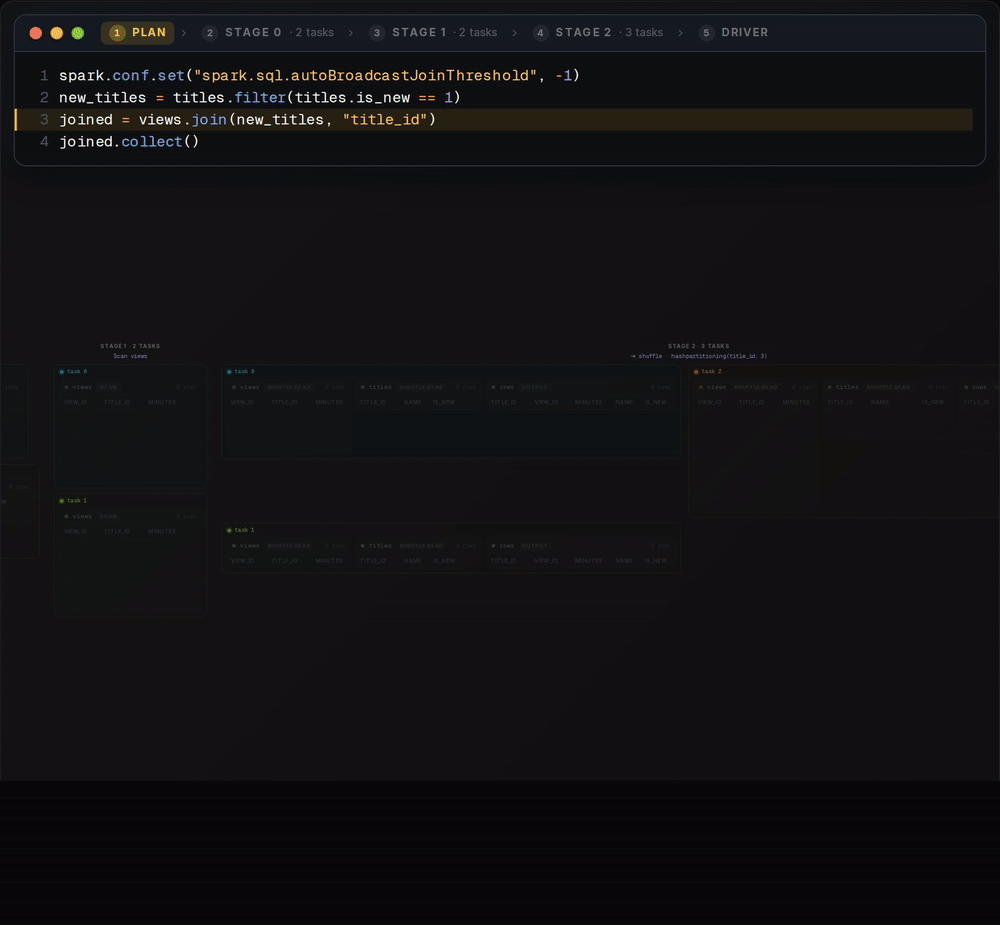
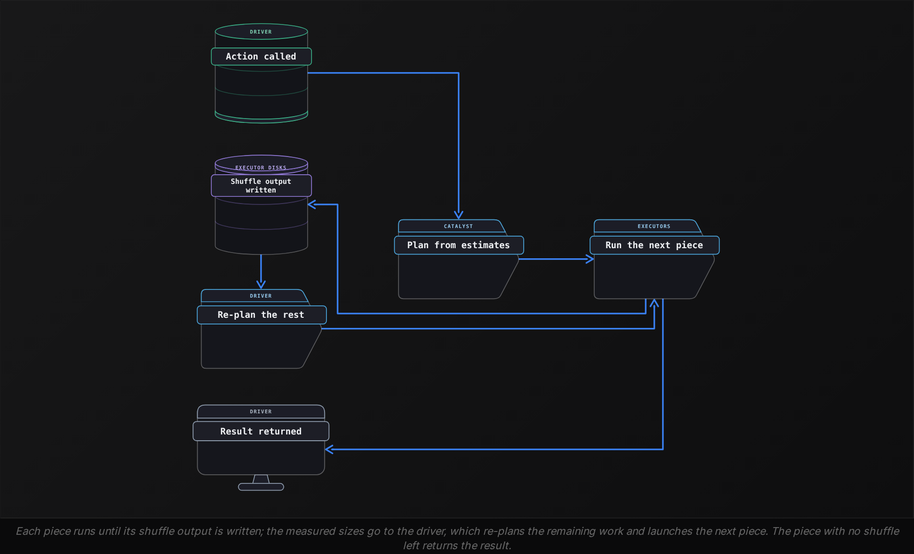
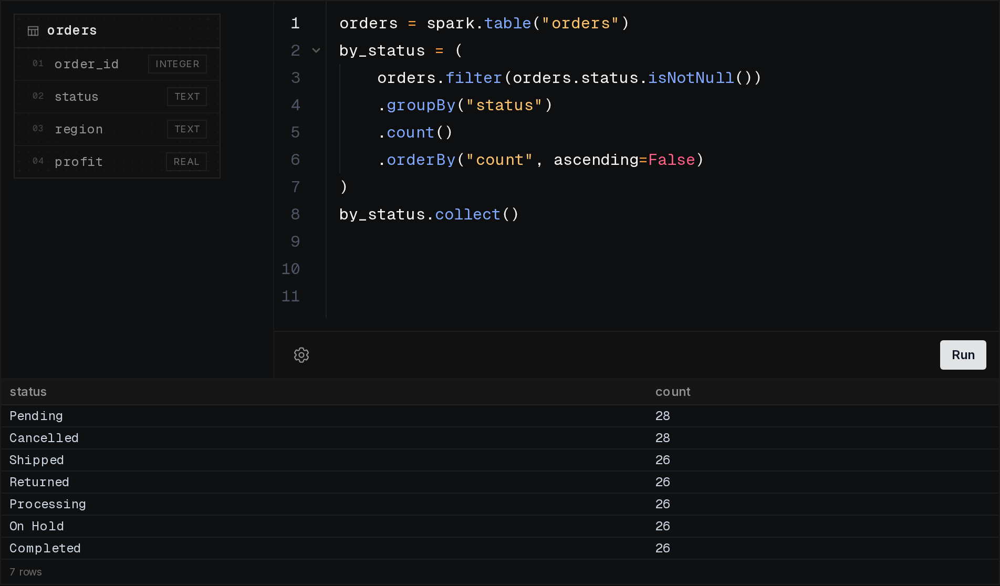

Beginner·Spark · 12 min · 11 challenges

# Adaptive Query Execution: Beginner

A Netflix engineer's nightly Spark job joins a huge table of viewing events to the titles catalog, filtered to this week's 40 new releases. The plan, fixed before a single row is read, sized that filtered catalog as if it were the whole file and chose to shuffle both sides. Whether the job finishes by breakfast depends on whether Spark can change its mind mid-run.


<br>

---

## The Static-Plan Problem

When an action runs, the driver turns your DataFrame code into a physical plan: which join strategy to use, where each shuffle goes, and how many partitions each shuffle produces. Without adaptive execution that plan is final. It is fixed in full before the first task starts, so every choice in it rests on what the driver can learn without reading any data.

Here is the job in code, reading 2 tables and joining on `title_id`:

```sql
views = spark.table("views")
titles = spark.table("titles")
new_titles = titles.filter(titles.is_new == 1)
joined = views.join(new_titles, "title_id")
joined.write.parquet("/out/new_title_views")
```

The `views` files hold 800GB. The `titles` files hold 2GB, and the filter keeps 40 of their 300,000 rows. You know those last numbers because you know the catalog. The driver knows only what storage and the code tell it.


<br>

### What the driver knows when it plans

| Decision | Input the driver uses | At plan time | Once data flows |
| --- | --- | --- | --- |
| Join strategy | Estimated size of `new_titles` against the 10MB broadcast threshold | About 2GB: sort-merge join, both sides shuffled | 48KB: small enough to broadcast |
| Reduce partitions | `spark.sql.shuffle.partitions` | 200 for every shuffle in the job | One side holds 800GB, the other 48KB |
| Rows per key | Nothing: the plan treats keys as evenly spread | Unknown | A hit title can hold far more views than the rest |

The first row decides most of the cost. Spark's default estimate for a filter's output is the estimate for its input: with no statistics collected on the table, the driver cannot know how many rows match without reading them. So `new_titles` is planned as a 2GB table, far over the threshold, and Spark picks a sort-merge join. That means hashing all 800GB of `views` across the network by `title_id`, sorting both sides, and merging them, to match against 40 rows that could have been copied to every executor.

- **~40,000x** — how far the estimate overshot
- **4GB** — of views per reduce task, on average
- **160+** — titles partitions with no rows

The second row is quieter. One setting fixes the reduce partition count for every shuffle in the job, and it is chosen before Spark knows any shuffle's size. On this join it hands the views side partitions far larger than a task handles comfortably, and it scatters 40 title rows across 200 buckets. The partitioning lessons showed both failures one at a time; a static plan produces them in a single join.

The optimizer did its part well: the filter runs right after the scan of `titles`, where it belongs. What it lacks is information, because every rewrite and strategy choice happens on the driver before that scan has returned a row.

> **TIP**
>
> Call `joined.explain()` with adaptive execution off and the physical plan shows `SortMergeJoin` with an `Exchange` beneath each side. That text is every decision the job will run with.


<br>

### The plan, played on small data

The animation runs the same shape on 10 view rows and 6 titles, 2 of them new. Its first line switches broadcasting off to stand in for the 2GB estimate; with 6 rows on the small side, Spark would otherwise broadcast at plan time. Watch which rows travel between tasks.



All 10 view rows are hashed by `title_id` and moved, and 3 of them find a match. Scale that to 800GB and the shuffle moves every view of every title to serve a join against 40 titles.

> Why the planner cannot fix this alone
>
> - Counting the rows a filter keeps means running the filter, and running it is the job.
> - File sizes come free from storage, so they become the estimate.
> - Map tasks split their output by the reduce partition count, so the count is set before they write.

So a static plan is a bet placed with the numbers on hand at the action. When the data looks like its files, the bet pays. When a filter, a join or a hot key reshapes the data mid-query, the plan runs on as if nothing happened.

**The countries files are 3GB on disk, the filter keeps 27 rows, no table statistics have been collected, and adaptive execution is off. Which join does Spark plan, and why?**

```python
events = spark.table("events")
countries = spark.table("countries")
eu = countries.filter(countries.region == "EU")
events.join(eu, "country_code").write.parquet("/out/eu_events")
```

- **A.** Broadcast hash join, because 27 rows come in far under the 10MB threshold.
- **B.** Broadcast hash join, because Spark runs the filter first to measure eu before planning.
- **C.** Sort-merge join, because the estimate for eu is its 3GB input, far over 10MB.
- **D.** Sort-merge join, because Spark never broadcasts a table that has a filter on it.

<details>
<summary>Solution</summary>

**C.** Sort-merge join, because the estimate for eu is its 3GB input, far over 10MB.

With no statistics, a filter's estimated output equals its input. That estimate is over the threshold, so both sides are planned to shuffle.

**Why the others are wrong**

- **A.** The real size is 27 rows, but nothing has measured it yet. The driver plans from the 3GB estimate.
- **B.** With adaptive execution off, no task runs until the plan is fixed. The filter runs inside the planned job.
- **D.** The strategy is right and the reason is wrong. A filtered table whose estimate fits under 10MB is broadcast.

</details>


<br>

---

## Re-Optimizing Mid-Run

Adaptive Query Execution, AQE for short, changes when the plan becomes final. Spark still builds a full plan from estimates when the action runs, then executes it in pieces cut at the shuffles. Once the tasks before a shuffle finish writing their output, Spark holds exact sizes for that output. It feeds those sizes back to the optimizer and re-plans everything downstream that has not started.

The sizes come from the shuffle write itself. Each map task splits its output into a block for each reduce partition and reports every block's size to the driver. The driver collected those numbers before AQE existed, mainly so reduce tasks would know where their blocks were and how big. AQE reads them as statistics: the bytes and rows each shuffle produced, and the bytes in each of its reduce partitions.

The driver treats each finished shuffle as an input of known size, called a query stage, and runs its planning rules again over everything above it. Work that has not started can change in any way those rules allow, while the finished stage is treated as data already on disk.




<br>

### The running job, re-planned

Here is the views and titles job from the previous section with AQE on. The starting plan shuffles both tables, so Spark launches both map sides together. Scanning and filtering 2GB of titles finishes long before 800GB of views does.

| Moment | What the driver knows | What it decides |
| --- | --- | --- |
| Action called | File sizes, with `new_titles` estimated at about 2GB | Sort-merge join over 200 reduce partitions |
| Titles shuffle written | `new_titles` measured at 48KB | Re-plan: broadcast those 48KB to every executor |
| Views shuffle written | 800GB, and the size of each of its 200 blocks | Read each views block where it was written and join it to the broadcast copy, with no sort |
| Join finishes | Rows written to the output | Nothing is left to re-plan |

The rule that chose sort-merge from a 2GB estimate now chooses broadcast from a 48KB measurement. The same rule ran twice, and only its input differed.

Notice what AQE could not change. The 800GB views shuffle was already running when the 48KB number arrived, and a shuffle write that has started stays written. AQE dropped the sort, the merge, and the fetch of views blocks across the network. Skipping the views shuffle altogether would have needed a broadcast decision at plan time, before any data moved; the last section of this lesson returns to that.


<br>

### What a re-plan can change

- Merge many small reduce partitions into fewer, so 200 tiny tasks become a handful of useful ones.
- Turn a planned sort-merge join into a broadcast join when a side measures under the threshold.
- Split an oversized join partition, caused by a hot key, into several tasks so none straggles.
- Replace an inner join with an empty result when a measured side holds 0 rows.

*All 4 changes rework the reduce side of a shuffle. None alters what the map tasks before it read or computed.*

The first 3 each get a section of their own in the intermediate AQE lesson. What they share is the point to hold now: every change waits for a shuffle to finish, and every change applies only to work after it.

| ✓ Re-planned from measurements | ✗ Fixed before the first shuffle |
| --- | --- |
| • Join strategy for a join fed by a shuffle<br><br>• How many partitions each shuffle is read as<br><br>• How an oversized join partition is divided | • How input files are read and split into partitions<br><br>• Filters and column choices from Catalyst's rewrite<br><br>• Any shuffle write that has already started |


**With AQE on, at which point can Spark first use a measured size to change how this job runs?**

```python
orders = spark.table("orders")
big_orders = orders.filter(orders.profit > 1000)
by_region = big_orders.groupBy("region").count()
by_region.write.parquet("/out/big_orders_by_region")
```

- **A.** When the map tasks of the groupBy shuffle finish writing, before any reduce task starts.
- **B.** When the action is called, because Spark first scans the files to size the filter's output.
- **C.** Right after the filter, because AQE measures each transformation as soon as it completes.
- **D.** After the job finishes, so the next run of the same job starts from better numbers.

<details>
<summary>Solution</summary>

**A.** When the map tasks of the groupBy shuffle finish writing, before any reduce task starts.

The shuffle write is the first moment exact sizes exist. Spark then re-plans the reduce side, such as how many partitions to read.

**Why the others are wrong**

- **B.** The action starts planning from estimates. No pre-scan measures what the filter keeps.
- **C.** The filter is narrow and runs inside the same tasks as the scan. Measurements come from shuffle writes.
- **D.** AQE works inside a single run. Every new run plans from estimates again.

</details>


<br>

---

## On by Default Since Spark 3.2

AQE shipped in Spark 3.0 behind a flag that defaulted to off, and Spark 3.2 flipped that default to on. Every release since, including the 4.x line, has kept it. On any cluster running 3.2 or later, queries are adaptive unless someone has turned the flag off.

| Version | First released | Default of spark.sql.adaptive.enabled |
| --- | --- | --- |
| 3.0 | June 2020 | `false` |
| 3.1 | March 2021 | `false` |
| 3.2 | October 2021 | `true` |
| 3.3 and later | June 2022 onward | `true` |

That default is where the value starts. A cluster's config files, the command that launched the job, or code in the session can each set the flag, and a platform team that once hit an AQE problem may have switched it off for every job. The version tells you the default; only the running session tells you the value.


<br>

### 3 checks, from broadest to most specific

The first 2 checks take a line of code each:

```sql
print(spark.version)
print(spark.conf.get("spark.sql.adaptive.enabled"))
```

`spark.conf.get` returns the value in force for your session after every config file and launch option has been applied, so its answer is the one that counts. Code can also change the flag mid-session, and the next query Spark plans picks up the new value:

```sql
spark.conf.set("spark.sql.adaptive.enabled", "true")
```

The third check reads a plan. Call `explain()` on a DataFrame whose query contains a shuffle, and with AQE on, the line under the physical plan header is `AdaptiveSparkPlan isFinalPlan=false`. The `false` marks the starting plan, built from estimates and open to change once the job runs.

```sql
orders = spark.table("orders")
orders.groupBy("region").count().explain()
```

One case catches people out. A query with no shuffle and no subquery, such as a filter followed by a write, prints no `AdaptiveSparkPlan` line even with the flag on. Spark leaves AQE out of such a plan because no measurement could ever arrive while there was work left to change. On a query like that, the missing node says nothing about the flag.

Set the flag to `false` in the same session and run that `explain()` again: the `AdaptiveSparkPlan` line is gone, and what remains is a static plan that will run exactly as printed.

> Which check answers which question
>
> - `spark.version`: which default applies when nobody set the flag
> - `spark.conf.get`: the value this session uses for its next query
> - `explain()`: whether this particular query was planned adaptively


<br>

### What the flip changed for existing jobs

When a cluster moves from 3.1 to 3.2 or later, jobs nobody edited start running adaptively. The difference often shows up in output files. A job that wrote right after a `groupBy` used to write up to 200 files, a file for each reduce partition, with default settings. After the upgrade it can write far fewer, because AQE merged small partitions before the write. Anything downstream that counted on the old file count sees a change it never asked for.

**A cluster runs Spark 3.1, nobody has set any adaptive setting, and your job groups a large table by customer. What happens to the job's reduce partition count?**

- **A.** AQE merges the small partitions after the shuffle, because every 3.x release runs adaptively.
- **B.** AQE measures the shuffle and picks a count, because grouping always switches AQE on.
- **C.** It stays at 200 for good, because Spark 3.1 cannot run adaptive queries at all.
- **D.** It stays at the spark.sql.shuffle.partitions value, because AQE defaults to off in 3.1.

<details>
<summary>Solution</summary>

**D.** It stays at the spark.sql.shuffle.partitions value, because AQE defaults to off in 3.1.

On 3.0 and 3.1 the flag defaults to false, so the count in the static plan is the count that runs.

**Why the others are wrong**

- **A.** AQE exists in 3.1, but its flag defaults to false there. The default flipped in 3.2.
- **B.** Grouping adds the shuffle AQE would work on, but the flag decides whether AQE runs at all.
- **C.** The fixed count is right, but 3.1 can run adaptively. Setting the flag to true turns it on.

</details>


> **TIP**
>
> When you move a job to a new cluster, run the 2 `print` lines before anything else. Knowing the version and the flag up front explains plan differences that would otherwise look like changes in the data.


<br>

---

## Seeing AQE in the Spark UI

`explain()` before the action shows the plan Spark starts with. With AQE on, the plan that ran can differ, and the place to see it is the Spark UI: a web page the driver serves while the application runs, on port 4040 by default. Its SQL tab, labeled SQL / DataFrame in newer releases, lists a row for each query the application has run.

Click a query's description and its page opens on a graph of the physical plan: a box for each plan node, each showing metrics its tasks reported, such as rows output and data size. Below the graph, a Details link expands the same plan as text. For an adaptive query that text starts with the `AdaptiveSparkPlan` node, and its flag tells you which version you are reading.

| isFinalPlan | When you see it | What the graph shows |
| --- | --- | --- |
| `false` | While the query runs | The plan as it stands: the starting plan plus any re-plans so far |
| `true` | After the query finishes | The plan that produced the result |

Open the page while a long query runs and reload it after a shuffle finishes: the graph is redrawn with the re-planned nodes, while the header reads `false` until the last piece completes.


<br>

### The nodes AQE leaves behind

| Node in the final plan | What happened while the query ran |
| --- | --- |
| `ShuffleQueryStage` | A shuffle ran and was measured; every re-plan after it used its sizes |
| `AQEShuffleRead coalesced` | Small reduce partitions were merged; its number of partitions metric is the count of tasks that read the shuffle |
| `AQEShuffleRead skewed` | An oversized join partition was split across several tasks |
| `AQEShuffleRead local` | Shuffle output was read on the executor that wrote it, usually after a join switched to broadcast |
| `BroadcastHashJoin` above a `ShuffleQueryStage` | A join planned as sort-merge became a broadcast once a shuffle measured one side small |

*On Spark 3.0 and 3.1 the read node is named CustomShuffleReader; Spark 3.2 renamed it AQEShuffleRead.*

The `Exchange` beneath a coalesced read still says 200 in its plan text, because every map task wrote 200 blocks. The number of partitions on the `AQEShuffleRead` box is the count of reduce tasks that actually ran. When those 2 numbers differ, AQE merged partitions at runtime.


<br>

### The running job, before and after

Starting plan, isFinalPlan=false

| Node | Under it |
| --- | --- |
| SortMergeJoin | a Sort on each side |
| Sort | views Exchange |
| Exchange hashpartitioning(title_id, 200) | views scan |
| Sort | titles Exchange |
| Exchange hashpartitioning(title_id, 200) | titles scan and filter |

Final plan, isFinalPlan=true

| Node | Under it |
| --- | --- |
| BroadcastHashJoin | views read locally, titles broadcast |
| AQEShuffleRead local | views ShuffleQueryStage |
| ShuffleQueryStage | views Exchange, 800GB written |
| BroadcastQueryStage | titles BroadcastExchange |
| ShuffleQueryStage | titles Exchange, 48KB written |

Read both tables from the top. The join node changed name, both `Sort` nodes are gone, and each `Exchange` now sits inside a `ShuffleQueryStage`. The header's flag moving from `false` to `true` confirms that the right-hand table is the plan that ran. The views `Exchange` survives because its 800GB write happened anyway.

Finding a runtime change

- Open the SQL tab and click the query whose duration matches the slow job.
- Expand Details and check that the header reads AdaptiveSparkPlan isFinalPlan=true.
- In the graph, find each AQEShuffleRead box and read its number of partitions.
- Compare join nodes with explain() output from before the run; a new join name is a runtime switch.

> When the plan shows no AQE changes
>
> - The query had no shuffle and no subquery, so no `AdaptiveSparkPlan` node appears at all.
> - The flag was off for that session, which `spark.conf.get` confirms.
> - AQE ran and measured, and every measurement agreed with the starting plan.

> **TIP**
>
> After `collect()` returns, calling `explain()` on the same DataFrame prints `isFinalPlan=true`, with the final plan above the initial one, so you can compare them without opening the UI.

**A finished query's plan text contains AdaptiveSparkPlan, HashAggregate, AQEShuffleRead coalesced and Exchange hashpartitioning(customer_id, 200). Which node records a decision Spark made while the query ran?**

- **A.** Exchange hashpartitioning(customer_id, 200), because AQE places every exchange in the plan.
- **B.** AQEShuffleRead coalesced, because only a re-plan merges partitions after a shuffle wrote them.
- **C.** HashAggregate, because aggregation sizes are measured before the plan is fixed.
- **D.** AdaptiveSparkPlan, because the header node itself is what AQE rewrites at runtime.

<details>
<summary>Solution</summary>

**B.** AQEShuffleRead coalesced, because only a re-plan merges partitions after a shuffle wrote them.

This node exists only in a re-planned adaptive query. It records that Spark measured the shuffle and merged small partitions.

**Why the others are wrong**

- **A.** Exchanges come from the code's joins and groupings at plan time. AQE measures them and never adds them.
- **C.** Aggregation nodes come from the starting plan, and nothing is measured before planning.
- **D.** The header shows AQE was applied, and its flag says which version you see. It records no decision.

</details>


<br>

---

## Measurements over Estimates

An estimate and a measurement answer the same question, how much data is here, from opposite ends of the run. The estimate is computed on the driver before any task starts, from file sizes, default rules such as a filter keeping every row, and table statistics if someone collected them. The measurement is counted by the tasks that wrote the data, after they wrote it.

| ✓ Plan-time estimate | ✗ Runtime measurement |
| --- | --- |
| • Exists before any task runs<br><br>• Built from file sizes, default rules and collected statistics<br><br>• Blind to what a filter keeps and how keys are spread<br><br>• Can keep a table from being shuffled at all, because it decides first | • Exists only once a shuffle has written<br><br>• Measured bytes for every reduce partition, and rows for the whole shuffle<br><br>• Close to exact for the data this run produced, far closer than any estimate<br><br>• Can change only the work that has not yet started |

The last line in each column is where the 2 differ most. A measurement comes from the data this run wrote, so for every decision downstream of a shuffle it outranks any estimate. It also arrives late: by the time the titles shuffle reported 48KB, the views shuffle was already writing 800GB. Only a decision made at plan time can spare a table from shuffling.


<br>

### Giving the estimate better information

When you know a side is small and the estimate cannot, say so in the code. A broadcast hint on the filtered side makes the plan-time choice for Spark, and the views table is never shuffled:

```sql
new_titles = titles.filter(titles.is_new == 1)
joined = views.join(new_titles.hint("broadcast"), "title_id")
```

A hint is a promise about every future run. If this week's releases ever grew from 40 rows to 40 million, the hint would still force a broadcast and executors could run out of memory, where AQE would have measured the large side and kept the sort-merge join. Estimates you supply hold authority up to the first shuffle; measurements hold it from there on.

| Decision | Who has authority | Why |
| --- | --- | --- |
| How input files split into partitions | File sizes from storage | Known before the read, and exact |
| Whether a large table gets shuffled at all | The estimate, or your hint | It is decided before anything can be measured |
| Reduce partition count after a shuffle | Measurement | Exact bytes per partition exist by then |
| Join strategy once the small side has shuffled | Measurement | The measured size replaces the estimate |
| Splitting a hot key's join partition | Measurement | Only the written sizes reveal which partition is huge |


<br>

### Measure it yourself

Spark's default estimate for `orders.filter(orders.status == 'Completed')` is every row in `orders`. Run the cell to see how many rows each status actually holds. The planner works from the full table, so it never sees the gap between those counts and the total.



```python
orders = spark.table("orders")
by_status = (
    orders.filter(orders.status.isNotNull())
    .groupBy("status")
    .count()
    .orderBy("count", ascending=False)
)
by_status.collect()
```

The `groupBy` moves rows by status, and its shuffle write reports the real split. The `orderBy` adds a second shuffle, over only the handful of grouped rows. Those written sizes are the numbers AQE works from on a real job: exact, and available only after the work that produced them.

| ✓ Do | ✗ Don't |
| --- | --- |
| • Leave AQE on, and confirm it with spark.conf.get on each new cluster<br><br>• Read the final plan in the SQL tab before tuning a slow query<br><br>• Hint a broadcast only for a side that stays small on every run | • Treat explain() output from before the run as the plan that ran<br><br>• Expect AQE to take back a shuffle write that already started<br><br>• Tune spark.sql.shuffle.partitions for a job before checking its coalesced read |

**A filter keeps 5MB of a 50GB table, which is then joined to a 2TB table. There is no hint and no table statistics, and AQE is on. What is the best outcome Spark can reach?**

- **A.** Both sides shuffle, then the join turns into a broadcast once the 5MB side is measured.
- **B.** Only the 5MB side shuffles, because AQE measures it before the 2TB side starts.
- **C.** The join is broadcast at plan time, because AQE reads the filter's 5MB result first.
- **D.** Both sides shuffle and the join stays sort-merge, because AQE never changes a join.

<details>
<summary>Solution</summary>

**A.** Both sides shuffle, then the join turns into a broadcast once the 5MB side is measured.

The 50GB estimate starts both shuffles. The 5MB measurement arrives in time to replace the sort-merge join, though the 2TB write still happens.

**Why the others are wrong**

- **B.** AQE launches both map sides from the starting plan, so the 2TB side is writing before any measurement arrives.
- **C.** Plan time comes before any measurement. With no hint, the plan reads the 50GB estimate.
- **D.** Both sides do shuffle, but AQE does change join strategies once a side measures under 10MB.

</details>


<br>

### Capstone: reading a plan that did not change

**A colleague's Spark 3.4 job joins clicks to a filtered campaigns table. explain() before the run showed SortMergeJoin under AdaptiveSparkPlan, and the finished plan in the SQL tab still shows SortMergeJoin. The filtered side's shuffle wrote 900MB. What explains the final plan?**

- **A.** AQE was off, because a join that did not change proves the flag was false.
- **B.** AQE could not measure the shuffle, because only broadcast sides report their sizes.
- **C.** AQE measured 900MB and switched to broadcast, and the UI still shows the old join name.
- **D.** AQE measured 900MB, far over the 10MB threshold, so sort-merge stayed the right choice.

<details>
<summary>Solution</summary>

**D.** AQE measured 900MB, far over the 10MB threshold, so sort-merge stayed the right choice.

The flag was on, as the header shows. The measurement confirmed the starting plan's choice, so the re-plan kept the join.

**Why the others are wrong**

- **A.** The AdaptiveSparkPlan node shows AQE was applied. Keeping the join unchanged is one result a re-plan can reach.
- **B.** Every shuffle write reports its sizes to the driver. Here the measurement existed, and it was 900MB.
- **C.** The measured size is right, but 900MB is far over 10MB, and the final plan shows the join that ran.

</details>


<br>

---

## Putting It All Together

A streaming service's nightly report joins every play event from the last day to the titles released that week, then groups minutes watched by title and writes the result. After the cluster is upgraded from Spark 3.1 to 3.4, the job finishes faster and writes far fewer files, and an engineer has to explain both changes to the team that reads the output.

- The starting plan sized the weekly titles from their files, so it planned a sort-merge join with both sides shuffled: the static-plan problem from the first section.
- After the upgrade AQE was on by default, so the titles shuffle reported its real size and the driver re-planned the join as a broadcast before any merge ran.
- The grouped write read its shuffle through a coalesced read, so fewer reduce tasks ran and fewer files landed, which is the change the downstream team noticed.
- In the SQL tab the engineer finds isFinalPlan = true , a BroadcastHashJoin above a ShuffleQueryStage , and an AQEShuffleRead coalesced box whose partition count is close to the new file count.
- The play events shuffle still ran in full, so a broadcast hint on the weekly titles is the change that removes it, at the price of a promise that the side stays small.


<br>

---

## Key Takeaways

- A static plan is fixed from file sizes and default rules before any task runs, so a filter that keeps 40 rows of a 2GB table is still planned as 2GB.
- AQE re-plans the remaining query each time a shuffle finishes writing, using the measured bytes and rows of that output.
- A re-plan can merge small partitions, switch a join to broadcast, or split a hot key's partition, but it cannot undo a shuffle write that has started.
- AQE has been on by default since Spark 3.2, and spark . conf . get ( " spark . sql . adaptive . enabled " ) gives the value your session uses.
- In the SQL tab, isFinalPlan = true marks the plan that ran, and an AQEShuffleRead node or a changed join name marks a runtime change.
- Estimates and hints hold authority before the first shuffle; measurements hold it after.
