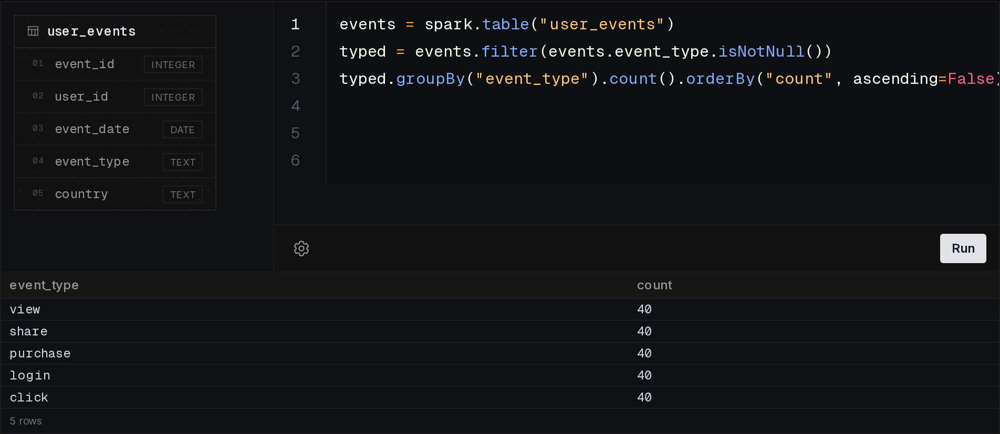
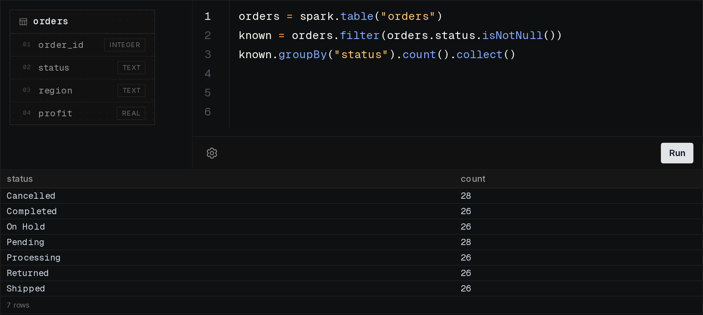
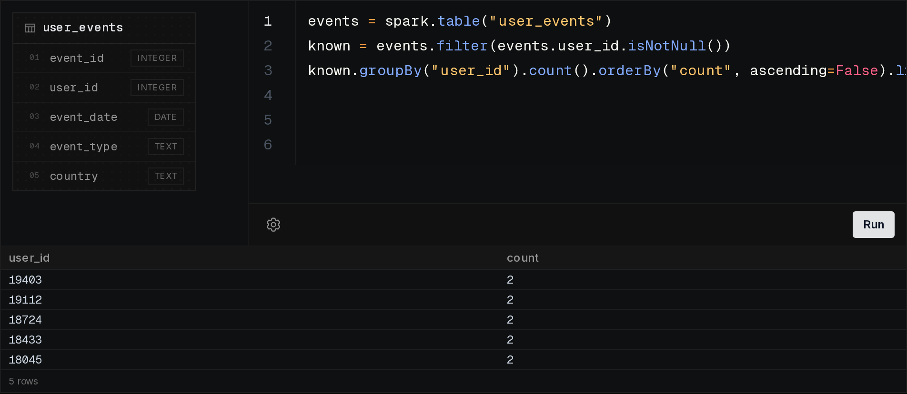

Intermediate·Spark · 14 min · 11 challenges

# Adaptive Query Execution: Intermediate

On the morning after New Year's Eve at Uber, the nightly Spark job joining trips to pricing events and rider accounts ran on the same code as every other night, but one corporate account had booked a tenth of all trips and a filter shrank the pricing side to a few megabytes. Whether the job finished by breakfast came down to what Spark measured between its stages.


<br>

---

## Materialization Points

AQE can change a plan only at a materialization point: a moment when a stage has finished and its output is complete, with its size known. Those moments are the exchanges: a shuffle exchange's output is its shuffle files, a broadcast exchange's is a table collected to the driver. Between 2 exchanges the plan is fixed, because nothing finished exists there to measure.


<br>

### Query stages and the AQE loop

With AQE on, the physical plan sits under an AdaptiveSparkPlan node. Spark cuts that plan at every Exchange into **query stages**. A query stage below a shuffle exchange is the map side of that shuffle: it reads its input, runs every narrow operation pipelined into a task per partition, and writes shuffle files. A broadcast exchange forms a query stage too, one that collects a small table and sends it to every executor.

The loop the driver runs, once per finished stage

- Submit every query stage whose inputs are complete.
- Wait until a running stage finishes.
- Swap the estimates for that stage for its measured output.
- Re-run logical and physical planning over the stages not yet started, then apply AQE's own rules: coalescing, the local read, skew splitting.
- Repeat until the stage that produces the result has run.

> **TIP**
>
> Spark submits the scan stages of both join sides together, and the smaller side usually finishes first. AQE re-plans the moment it does, using measured numbers for the finished side and estimates for the side still running.

The board below plays a sort-merge join followed by a count per country, with broadcasting switched off so both sides shuffle. Count the stages as it runs. The 2 scans each write shuffle files keyed on `customer_id`. The join stage reads them, counts per country inside each task, and writes a second shuffle keyed on `country`. A last stage finishes the count. That makes 4 stages and 3 exchanges: 3 moments where output is complete on disk before anything downstream reads it.

https://github.com/user-attachments/assets/6691eef2-bf35-446d-9b20-aa2cf423029b

*The board draws the plan Spark builds before the job starts. AQE's rewrites are what the rest of this lesson covers, and the board does not show them.*


<br>

### The sizes a finished stage reports

When a map task finishes, it reports to the driver the size of every block it wrote, a block per shuffle partition. When the whole stage finishes, the exchange also holds its totals: the bytes and rows it wrote. Those numbers replace the planner's guesses for that branch of the plan.

| Statistic | Where it comes from | Which rewrite uses it |
| --- | --- | --- |
| Bytes per shuffle partition | Block sizes reported by each map task, summed per partition | Coalescing, skew splitting |
| Total data size | The exchange's data size metric | Switching a join to broadcast |
| Row count | Records written by the map tasks | Re-planning, such as dropping a join whose input came back with 0 rows |


<br>

### Where AQE cannot re-plan

- Inside a stage: narrow operations are pipelined into a single task, so nothing finishes between them.
- Scan stages before the first exchange: they run on the static plan, since nothing has been measured yet.
- A stage that has started: its tasks keep the plan they were handed.
- A query with no exchange: a filter and a select over one table form a single stage and give AQE nothing to measure.

Call `explain()` before the action and the top node of the plan reads `AdaptiveSparkPlan isFinalPlan=false`: that is the starting plan. Call it on the same DataFrame after the action and the node reads `isFinalPlan=true`, with the final plan printed above the initial one.


**A job filters events, joins the result to users with a sort-merge join, and writes the output. When can AQE first replace the sort-merge join with a different strategy?**

- **A.** While the filter on events runs, as soon as it sees how many rows pass.
- **B.** When the driver builds the physical plan, before any task has run.
- **C.** When a join side's map stage finishes and its measured output is known.
- **D.** After the join stage finishes, once the size of the joined output is known.

<details>
<summary>Solution</summary>

**C.** When a join side's map stage finishes and its measured output is known.

The finished stage is a materialization point: its shuffle files are complete and their sizes replace the estimate, so AQE re-plans the join above it.

**Why the others are wrong**

- **A.** The filter is pipelined into the scan stage. Nothing finishes until the stage does, so there is no complete output to measure mid-filter.
- **B.** That is the static planner working from estimates. AQE's changes come only after a stage has run and been measured.
- **D.** Measured sizes are the right input, but this is too late: by then the join has already run with the strategy it was handed.

</details>


<br>

---

## Coalescing Small Partitions

Every shuffle in an application starts with the same number of reducers, `spark.sql.shuffle.partitions`, whether it moves 2TB or 300MB. On the small shuffle that means hundreds of tasks that each spend longer being scheduled than working, and a tiny file per partition if the stage writes its output. Sizing Shuffle Partitions had you pick that count per job. Coalescing picks it per shuffle, from sizes measured after the map stage.

Once the map stage has finished, Spark knows the bytes headed to every reducer. It merges neighbouring partitions until each merged one is near a target size, and the plan records the step as an `AQEShuffleRead` node labelled `coalesced`. The switch for it, `spark.sql.adaptive.coalescePartitions.enabled`, is on by default.


<br>

### Merging neighbours toward a target

Take a shuffle of 12 partitions holding 276MB on a 4-core cluster, with a target of 64MB. Spark walks the partitions in ID order. It adds the next partition to the current group while the group stays at or under the target, and starts a new group when the next partition would push it over.

Before: 12 shuffle partitions

| Partition | MB |
| --- | --- |
| 0 | 20 |
| 1 | 30 |
| 2 | 10 |
| 3 | 50 |
| 4 | 5 |
| 5 | 5 |
| 6 | 40 |
| 7 | 30 |
| 8 | 60 |
| 9 | 8 |
| 10 | 6 |
| 11 | 12 |

After: 6 coalesced partitions

| Task | Reads partitions | MB |
| --- | --- | --- |
| 0 | 0 to 2 | 60 |
| 1 | 3 to 5 | 60 |
| 2 | 6 | 40 |
| 3 | 7 | 30 |
| 4 | 8 | 60 |
| 5 | 9 to 11 | 26 |

Partitions 6 and 7 stay apart because together they would reach 70MB. The task reading partition 7 (30MB) and the task reading partitions 9 to 11 (26MB) would fit in a single 56MB task, but Spark merges only neighbours, so they stay separate.


<br>

### The merge moves no rows

No row moves to make a coalesced partition. Each map task already wrote a data file with its blocks laid out in partition order, plus an index of where each block starts. A task that reads partitions 0 to 2 asks every map output for blocks 0, 1 and 2, which sit side by side in the file. With `spark.sql.adaptive.fetchShuffleBlocksInBatch` on, its default, Spark fetches such a run in a single request when the codec allows it. The whole cost of coalescing is the driver adding up block sizes.

Keeping to neighbours is what keeps it cheap: merging partitions 7 and 10 would mean 2 separate reads from every map file. It also keeps joins correct. When a stage reads 2 shuffles, as a sort-merge join does, Spark adds partition i's size across both sides and applies one set of ranges to both, so partition i on the left still meets partition i on the right.


<br>

### The settings behind the target

The target comes from 3 settings under `spark.sql.adaptive.`. `advisoryPartitionSizeInBytes` is the size Spark aims for, `coalescePartitions.minPartitionSize` is the smallest merged partition it will plan, and `coalescePartitions.parallelismFirst` decides whether the cluster's core count can lower the target.

- **64MB** — advisoryPartitionSizeInBytes default
- **1MB** — minPartitionSize default

```sql
def coalesce_target(total_bytes, cores, parallelism_first=True):
    advisory = 64 * 1024 * 1024
    minimum = 1024 * 1024
    floor_count = cores if parallelism_first else 1
    return max(minimum, min(advisory, total_bytes // floor_count))
```

With `parallelismFirst` at its default, `true`, Spark will not plan fewer coalesced partitions than the cluster's default parallelism, normally its total core count, unless that pushes them under the minimum. The 12-partition shuffle holds 276MB on 4 cores: 276 / 4 is 69MB, so the advisory 64MB is smaller and wins. Put a 2,048MB shuffle on 40 cores and 2,048 / 40 is roughly 51MB, so Spark aims at 51MB and plans at least 40 tasks instead of at least 32. Setting `parallelismFirst` to `false` makes the advisory size the target, which the Spark configuration docs recommend on a busy shared cluster.

> **TIP**
>
> AQE leaves alone a shuffle whose partition count you gave as a number: `repartition(400)` keeps 400 partitions. `repartition("customer_id")` with no number is coalesced like any other shuffle.

Run the cell. Each row is one `event_type` value, and every row with the same key hashes to the same shuffle partition. Work out how many of the default 200 reducers receive any data, then how many tasks AQE plans for this aggregation.



```python
events = spark.table("user_events")
typed = events.filter(events.event_type.isNotNull())
typed.groupBy("event_type").count().orderBy("count", ascending=False).collect()
```

*Answer: no more reducers than there are rows in the result receive data, and the rest are empty. The whole shuffle is far below the 1MB minimum, so the target is 1MB and every partition merges into a single task.*

**A 200-partition shuffle writes 1,200MB on a 12-core cluster with every AQE setting at its default. What target size does coalescing use?**

- **A.** 100MB, because 1,200MB spread across 12 cores gives each core that much.
- **B.** 64MB, because the advisory size is smaller than 1,200MB divided by 12.
- **C.** 6MB, the 1,200MB divided across the original 200 shuffle partitions.
- **D.** 1MB, because the minimum partition size always becomes the target.

<details>
<summary>Solution</summary>

**B.** 64MB, because the advisory size is smaller than 1,200MB divided by 12.

The target is max(1MB, min(64MB, 100MB)). The advisory size binds, so Spark plans at least 19 tasks.

**Why the others are wrong**

- **A.** 1,200 / 12 is 100MB, but the target is the smaller of that and the advisory size, and the advisory size is 64MB.
- **C.** That is the average size before coalescing. The target comes from the core count and the advisory size, never from the original partition count.
- **D.** The minimum takes over only when total bytes divided by cores falls below it, as on the tiny shuffle in the cell above.

</details>


<br>

---

## Switching to Broadcast Mid-Run

Joins: Intermediate showed the 10MB threshold deciding a join's strategy at planning time, from Catalyst's estimate. With AQE on, Spark checks a threshold a second time, after a join side's map stage finishes, against the bytes that side actually produced. A side that looked large on paper and measured small is broadcast for the rest of the join.


<br>

### Why the estimate misses

Without column statistics, Catalyst estimates a filter's output at the full size of its input, and a `groupBy` from the size of its input, scaled only for the columns it keeps. Both guesses can be off by orders of magnitude. Take a 4GB `campaigns` table filtered to the active campaigns of one advertiser: the planner sees 4GB, far above 10MB, and plans a sort-merge join against an 800GB `page_views` table. At runtime the filtered side writes 6MB of shuffle output.

Initial plan, from estimates

| Operator | Input |
| --- | --- |
| SortMergeJoin | both sides |
| Sort | page_views side |
| Exchange | page_views, 800GB |
| Sort | campaigns side |
| Exchange | campaigns, 4GB estimated |

Final plan, from measurements

| Operator | Input |
| --- | --- |
| BroadcastHashJoin | both sides |
| AQEShuffleRead local | page_views shuffle files |
| ShuffleQueryStage | page_views, 800GB |
| BroadcastQueryStage | campaigns, sent to every executor |
| ShuffleQueryStage | campaigns, 6MB measured |

Both Sort operators are gone, the small side now goes to every executor, and the large side arrives through a local read, the subject of the next section. The `page_views` exchange stays. Spark submitted both map stages together, the 6MB side finished first and triggered the re-plan, and the final plan reads the shuffle files the 800GB stage goes on to write.


<br>

### The threshold that governs the switch

The runtime check reads `spark.sql.adaptive.autoBroadcastJoinThreshold`, added in Spark 3.2. Left unset, it takes the value of `spark.sql.autoBroadcastJoinThreshold`, so both checks use 10MB out of the box. The number it compares is the measured data size of that side's shuffle output.

| Static threshold | Adaptive threshold | Planning-time broadcast | Runtime switch |
| --- | --- | --- | --- |
| 10MB | unset | under 10MB estimated | under 10MB measured |
| -1 | unset | never | never |
| -1 | 10MB | never | under 10MB measured |
| 10MB | -1 | under 10MB estimated | never |

The third row suits a team burned by bad estimates: Spark never broadcasts on a guess, yet still broadcasts a side it has measured. The fourth row keeps planning-time broadcasts and stops AQE from adding new ones.

> Saved and still paid after a runtime switch
>
> - Saved: the sort on both sides, which a broadcast hash join does not need.
> - Saved: fetching the large side's blocks over the network, through the local read.
> - Still paid: writing the large side's shuffle files, since the final plan reads them.
> - Still paid: the small side's shuffle, followed by collecting it to the driver and broadcasting it.

That is why a planned broadcast beats a runtime one when you can get it: with good statistics or a `broadcast()` hint, the large side is never shuffled at all. The runtime switch covers the joins where the estimate was wrong.


<br>

### Seeing the switch

In the SQL tab, a switched join shows `BroadcastHashJoin` in the final graph, where `explain()` before the run showed `SortMergeJoin`. The Exchange node under the small side shows its `data size`: compare it with 10MB to see why the switch happened, or why it did not.

Catalyst plans `orders.filter(orders.status == "Completed")` as if every row survived. Run the cell and work out the share of rows that carry `Completed`. Then suppose `orders` is 30MB, so Catalyst estimates the filtered side at 30MB: would the static plan broadcast it, and would AQE?



```python
orders = spark.table("orders")
known = orders.filter(orders.status.isNotNull())
known.groupBy("status").count().collect()
```

*Answer: the static plan sees 30MB and never broadcasts. If under a third of the rows are Completed, the filtered side measures under 10MB and AQE switches the join.*

**campaigns is 4GB on disk and the filter keeps 3MB of it. With these settings, which join does this program run?**

```python
spark.conf.set("spark.sql.autoBroadcastJoinThreshold", -1)
spark.conf.set("spark.sql.adaptive.autoBroadcastJoinThreshold", "10MB")
active = campaigns.filter(campaigns.status == "active")
result = page_views.join(active, "campaign_id")
result.write.parquet("/out/active_views")
```

- **A.** A sort-merge join for the whole run, since -1 switches broadcasting off everywhere.
- **B.** A broadcast hash join from the start, since the adaptive threshold applies during planning.
- **C.** A sort-merge join throughout, because measured sizes feed only the coalescing rule.
- **D.** A sort-merge join in the initial plan, replaced by a broadcast once the filtered side measures 3MB.

<details>
<summary>Solution</summary>

**D.** A sort-merge join in the initial plan, replaced by a broadcast once the filtered side measures 3MB.

This is the third row of the table: no planning-time broadcast, but the measured 3MB is under the 10MB adaptive threshold.

**Why the others are wrong**

- **A.** The static setting governs planning only. The adaptive threshold is set on its own, so the runtime check still runs.
- **B.** Planning uses the static threshold, which is -1. The adaptive threshold is read only after a map stage has run.
- **C.** Measured sizes feed the broadcast switch too: a 3MB side under a 10MB adaptive threshold gets switched.

</details>


<br>

---

## The Local Shuffle Read

After a runtime switch, the large side of the join sits in shuffle files, split by hash of the join key across its map tasks' output. A broadcast hash join has no use for that split: every task holds the whole small side, so any slice of the large side can be joined on any executor. The local shuffle read uses that freedom to keep the large side off the network.

| ✓ Regular shuffle read | ✗ Local shuffle read |
| --- | --- |
| • Task i fetches block i from every map output in the cluster.<br><br>• Most of those blocks were written on other executors, so most bytes cross the network.<br><br>• The sort-merge join then sorts each task's input on the join key. | • Each task reads blocks written by a single map task.<br><br>• Spark prefers to run the task on the executor that wrote them, so the bytes come off local disk.<br><br>• The task streams its rows past the broadcast hash table, with no sort. |


<br>

### Which blocks each task reads

Take 4 map tasks and 4 reducers on 2 executors: map tasks M0 and M1 ran on executor A, M2 and M3 on executor B. Each map task wrote 4 blocks, a block per reducer partition.

| Task | Regular read fetches | Local read fetches |
| --- | --- | --- |
| 0 | block 0 from M0, M1 (A) and M2, M3 (B) | blocks 0 to 3 from M0, on A |
| 1 | block 1 from M0, M1 (A) and M2, M3 (B) | blocks 0 to 3 from M1, on A |
| 2 | block 2 from M0, M1 (A) and M2, M3 (B) | blocks 0 to 3 from M2, on B |
| 3 | block 3 from M0, M1 (A) and M2, M3 (B) | blocks 0 to 3 from M3, on B |

In the regular read, whichever executor a task runs on, half its blocks live on the other one: 8 of the 16 fetches cross the network. In the local read, each task takes all 4 blocks of a map output from the disk of the executor that wrote them, so 0 of the 16 cross the network, as long as each task runs there. On a cluster of 50 executors, a regular read pulls about 49 of every 50 bytes from another machine.

Real shuffles have more partitions than this. Spark keeps roughly the parallelism the join would have had: if 20 map tasks wrote a 200-partition shuffle, each map output is cut into 10 contiguous ranges of 20 partitions, giving 200 local-read tasks of 20 blocks each.

**After a runtime switch, 25 map tasks wrote the join's large side into a 200-partition shuffle. How does the local read lay out its tasks?**

- **A.** 25 tasks, each reading all 200 blocks of a single map output.
- **B.** 200 tasks, each reading block i from all 25 map outputs.
- **C.** 200 tasks, each reading a run of 25 neighbouring blocks from a single map output.
- **D.** 8 tasks, each reading 25 neighbouring blocks from every map output.

<details>
<summary>Solution</summary>

**C.** 200 tasks, each reading a run of 25 neighbouring blocks from a single map output.

200 / 25 gives 8 ranges of 25 partitions per map output, so 25 x 8 = 200 tasks, each read where it was written.

**Why the others are wrong**

- **A.** That cuts the parallelism to 25. Spark keeps it near 200 by cutting each map output into ranges.
- **B.** That is the regular shuffle read, with most blocks fetched from other executors.
- **D.** 8 is the number of ranges per map output, and reading from every map output brings the network back.

</details>


<br>

### When Spark keeps the regular read

A local read gives up the hash partitioning of the large side, and sometimes a later step depends on it. Take a join on `customer_id` followed by `groupBy("customer_id")`. Under the sort-merge plan, the join's output is already partitioned by `customer_id`, so the aggregation reuses it with no exchange, as Reusing Shuffle Output showed. A local read would scatter those keys and force a new shuffle. AQE checks for this: when a rewrite would add an exchange the plan did not have, Spark keeps the broadcast join but reads the large side the regular way.

In the SQL tab, a probe side read the local way shows an `AQEShuffleRead` node labelled `local`. On the join stage's page, the shuffle read metrics separate remote bytes from the total, and after a local read the remote figure should sit close to 0. The behaviour is controlled by `spark.sql.adaptive.localShuffleReader.enabled`, which is on by default.

**The final plan shows a BroadcastHashJoin whose probe side reads straight from a ShuffleQueryStage, with no AQEShuffleRead local node between them, and the join stage's remote shuffle bytes are close to its total shuffle read. What best explains this?**

- **A.** A later step depends on the probe side's hash partitioning, so a local read would have added a shuffle.
- **B.** The broadcast table travels as shuffle blocks, so the remote bytes are the small side.
- **C.** A runtime switch never uses a local read while the static threshold is still 10MB.
- **D.** Local reads are reported as remote bytes in the UI whenever the shuffle files are compressed.

<details>
<summary>Solution</summary>

**A.** A later step depends on the probe side's hash partitioning, so a local read would have added a shuffle.

AQE drops a rewrite that would add an exchange. The join stays a broadcast, and the large side is read the regular way, over the network.

**Why the others are wrong**

- **B.** A broadcast goes through the broadcast mechanism and does not appear in shuffle read metrics.
- **C.** The static threshold plays no part in the read layout. The local read depends on its own setting and on the partitioning check.
- **D.** Compression does not change how bytes are counted. Local reads show as local bytes, which is why remote near 0 marks one.

</details>


<br>

---

## Splitting Skewed Partitions

Data Skew: Intermediate fixed hot keys by salting and isolating them in your own code. AQE does a version of the same work inside the join: once both sides' map stages have finished, it knows every join partition's size before a single join task starts, and it can break the straggler into pieces.


<br>

### The 2 skew tests

A partition on one side of the join counts as skewed when it passes both tests. It must be larger than `skewedPartitionFactor` times the median partition size on that side, 5 times by default. And it must be larger than `skewedPartitionThresholdInBytes`, 256MB by default. Both settings sit under `spark.sql.adaptive.skewJoin.`, and `spark.sql.adaptive.skewJoin.enabled` turns the rule on, as it is by default.

| Partition | Side's median | 5 x median | Above 256MB? | Skewed? |
| --- | --- | --- | --- | --- |
| 3.2GB | 40MB | 200MB | yes | yes |
| 180MB | 20MB | 100MB | no | no |
| 300MB | 80MB | 400MB | yes | no |

The factor alone would flag a 3MB partition beside a 0.5MB median in a tiny job, where splitting saves nothing. The byte threshold alone would flag every partition of a job that is large everywhere. Requiring both catches partitions that are big in absolute terms and out of line with their neighbours.


<br>

### Splitting a skewed partition by map task

Partition 17 on the left side is made of blocks, a block from each left-side map task. AQE groups those blocks into contiguous runs of map tasks, each run close to a target size, and gives each run its own task. The target is the larger of the advisory partition size and the average size of that side's non-skewed partitions.

Because the split follows map tasks, a single hot key gets divided too: its rows reached partition 17 from many map tasks, so each run holds a share of them. The smallest piece AQE can make is a single map task's block, so a block that is huge on its own stays whole.

The board plays a sort-merge join in which customer 1 owns 9 of the 12 orders. Watch the task that receives customer 1 after the shuffle: that is the partition AQE would split. The `customers` block that lands beside it is the one each piece would need a copy of.

https://github.com/user-attachments/assets/2f051ac6-48e6-4fd8-ad68-3c234d359529

<br>

### The cost of copying the other side

Each piece of left partition 17 still has to meet every right-side row with the same keys, so every piece reads all of right partition 17. Take a left side of 200 partitions with a 40MB median and a non-skewed average of 40MB, partition 17 at 3.2GB, and a right partition 17 of 30MB. The target is the larger of 64MB and 40MB.

- **about 50** — split tasks for partition 17
- **about 1.5GB** — right-side bytes read for the copies

The slowest task drops from a 3.2GB read to about 64MB plus its copy of the right side. The price is paid in reads of the side that was not split, and it multiplies when both sides are skewed on the same partition: a left split into 4 and a right split into 3 run as 12 tasks, one for every pairing.

**A sort-merge join's left side has 200 partitions with a 30MB median and a 30MB average outside one partition of 900MB. The matching right partition is 20MB, and every setting is at its default. What does AQE do with the 900MB partition?**

- **A.** It splits it into about 15 pieces near 64MB, and each piece reads the whole 20MB right partition.
- **B.** It splits it into about 15 pieces, and cuts the 20MB right partition into 15 matching pieces.
- **C.** It leaves it alone, because 900MB is not more than 5 times the 256MB threshold.
- **D.** It merges it with its neighbours first, since coalescing runs before skew handling.

<details>
<summary>Solution</summary>

**A.** It splits it into about 15 pieces near 64MB, and each piece reads the whole 20MB right partition.

900MB clears both 5 x 30MB = 150MB and 256MB. The target is max(64MB, 30MB), so 900 / 64 gives roughly 15 pieces, each reading the full right partition.

**Why the others are wrong**

- **B.** The piece count is right, but each left piece needs every right row with its keys, so the right stays whole.
- **C.** The factor multiplies the median, not the byte threshold. Against a 30MB median, 900MB is 30 times larger.
- **D.** Coalescing cannot merge a partition already over the target. This one passes both skew tests, so it is split.

</details>


<br>

### Which joins can be split

| Join type | Split the left side | Split the right side |
| --- | --- | --- |
| Inner, cross | yes | yes |
| Left outer, left semi, left anti | yes | no |
| Right outer | no | yes |
| Full outer | no | no |

A left outer join emits a null-filled row for each left row with no match. If the right side were split, a left row would find its match in one piece and miss it in the others, producing null rows that should not exist. A `groupBy` on a hot key gets no help from this rule at all: it splits join partitions only. In the SQL tab, a split join shows as `SortMergeJoin(skew=true)`, and the `AQEShuffleRead` above it reports the number of skewed partitions and the splits made from them.

Run the cell for the heaviest `user_id` values in `user_events`, with row counts standing in for bytes. The skew test compares partitions, and each of 200 partitions holds every key hashed into it. Change the last line to `known.count()` for the total: the hot key's partition holds its rows plus about total / 200, the median partition about total / 200. Is the first over 5 times the second? A real partition would also need to clear 256MB.



```python
events = spark.table("user_events")
known = events.filter(events.user_id.isNotNull())
known.groupBy("user_id").count().orderBy("count", ascending=False).limit(5).collect()
```


<br>

### Capstone: reading a whole run

This question draws on every section: what each finished stage measured, and which rewrite that triggered.

**A nightly job's final plan contains an AQEShuffleRead labelled coalesced above one exchange, a BroadcastHashJoin whose probe side reads through AQEShuffleRead local, and a SortMergeJoin(skew=true). Which statement about this run holds?**

- **A.** The broadcast join was planned before the job started, which is why its probe side could use a local read.
- **B.** The coalesced partitions were made by rewriting the shuffle files into 64MB chunks before the next stage read them.
- **C.** The local read means the broadcast side was read from local disk on each executor instead of being sent to them.
- **D.** Each of the 3 rewrites was decided at a materialization point, from output that a finished stage had measured.

<details>
<summary>Solution</summary>

**D.** Each of the 3 rewrites was decided at a materialization point, from output that a finished stage had measured.

Coalescing and skew splitting used the block sizes of finished map stages, and the switch used the small side's measured size.

**Why the others are wrong**

- **A.** A local read appears only after a runtime switch. A join planned as a broadcast from the start has no shuffle on its large side to read.
- **B.** Coalescing rewrites nothing. It changes which neighbouring blocks each task reads from the existing files.
- **C.** The local read applies to the large, probe side. The small side is still collected and broadcast.

</details>


<br>

---

## Putting It All Together

Back to the morning after New Year's Eve at Uber. The nightly job joins trips to pricing events on city_id, joins trips to a large rider accounts table on account_id, then aggregates fares per rider. The pricing side, filtered to the night's surge windows, measures 4MB after its map stage, under 10MB, so AQE swaps the planned sort-merge join for a broadcast and reads the trip shuffle files locally. In the accounts join, the corporate account's partition on the trips side comes back at 2.4GB against a 35MB median: over 5 times the median and over 256MB, so AQE splits it into pieces near 64MB, each reading its own copy of the matching accounts partition. The per-rider aggregation then shuffles 900MB across 200 partitions on a 30-core cluster: 900 / 30 is 30MB, under 64MB, so coalescing aims at 30MB and plans at least 30 tasks.

- Every decision waited for a materialization point: the broadcast switch for the pricing side's map stage, the skew split and the coalescing for the map stages feeding their join and aggregation.
- The broadcast switch and the local read are one move in 2 parts: the switch frees the trips side from its hash partitioning, and the read layout turns that into local disk reads.
- Coalescing and skew splitting are opposite answers to one measurement, bytes per shuffle partition: too small merges neighbours, too large splits by map task.
- Each rewrite works on shuffle files already written, which is why AQE costs so little and why it cannot take back a shuffle write the static plan already paid for.


<br>

---

## Key Takeaways

- AQE re-plans only at exchanges, after a query stage has written its full output. Inside a stage and before the first exchange, the static plan runs.
- A finished stage hands AQE the bytes in each shuffle partition, plus the total data size and row count of its output.
- Coalescing merges neighbouring shuffle partitions toward max(1MB, min(64MB, total bytes / cores)), and costs only the driver's arithmetic because no row moves.
- A join side measuring under spark . sql . adaptive . autoBroadcastJoinThreshold , 10MB unless set, is broadcast mid-run: the sorts are saved, the large side's shuffle write is not.
- The local shuffle read lets each task read a single map output from local disk, unless losing the hash partitioning would add a shuffle.
- A join partition is split when it is over 5 times its side's median and over 256MB, and the other side's matching partition is read once per piece.
