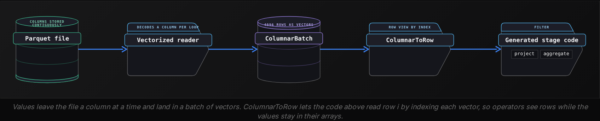
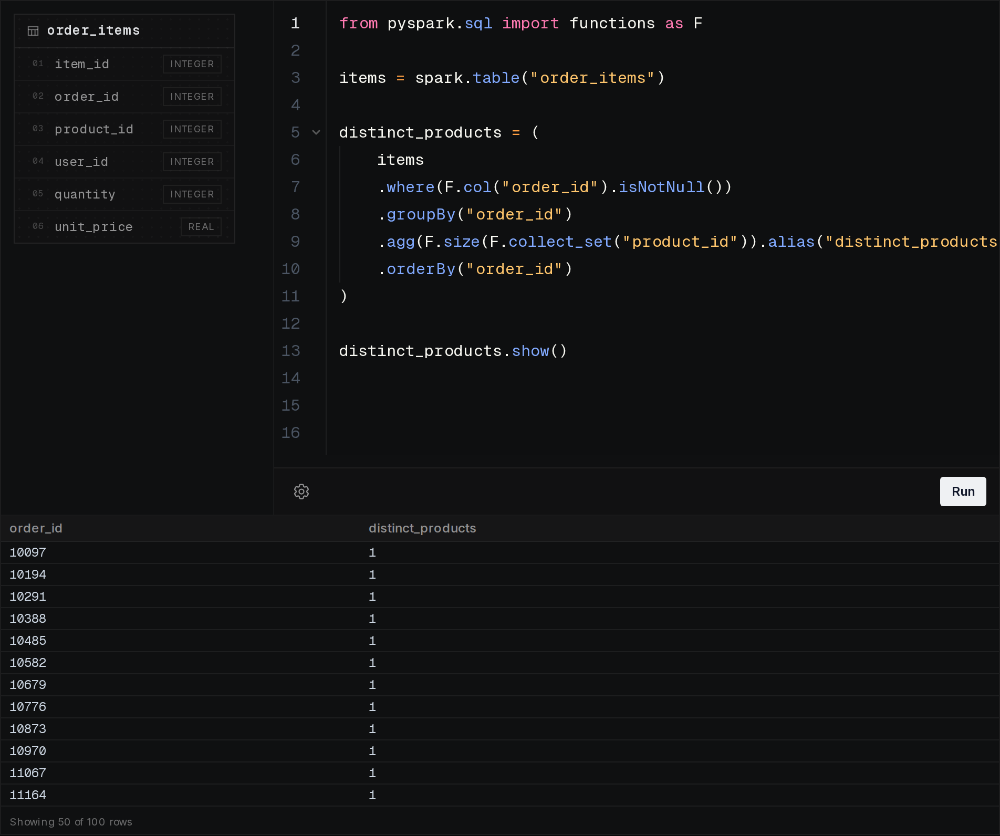

Advanced·Spark · 15 min · 11 challenges

# Catalyst Optimizer: Advanced

A Netflix engineer runs 2 jobs on viewing history. Both read 3 columns and filter them, then shuffle once to aggregate by title. One finishes in 6 minutes. Its twin swaps a count for a list of profile IDs and takes 25. The list version shuffles and holds every ID instead of one number per title, and its aggregate also drops out of Spark's generated code.


<br>

---

## Vectorized Columnar Reads

Every operator in a stage consumes whatever the scan hands it. If the scan builds a Java object per record, each operator above it pays to read those objects. If the scan fills packed arrays of values, the operators can run tight loops over them. The plan shows which one you got, and a table wider than 100 columns can quietly switch you from one to the other.


<br>

### Rows on disk and columns on disk

A row-oriented file such as CSV writes each record's fields side by side, then moves to the next record. A columnar file such as Parquet or ORC writes all of one column's values together, then the next column. A query that names 3 of a table's 40 columns can skip the other 37, and the values it reads arrive as long runs of a single type.

Row layout, in file order

| Record | Stored together |
| --- | --- |
| 1 | 1001, Completed, East, 120.0 |
| 2 | 1002, Pending, West, 40.0 |
| 3 | 1003, Completed, West, 75.5 |
| 4 | 1004, Completed, North, 60.0 |

Columnar layout, in file order

| Column | Stored together |
| --- | --- |
| order_id | 1001, 1002, 1003, 1004 |
| status | Completed, Pending, Completed, Completed |
| region | East, West, West, North |
| profit | 120.0, 40.0, 75.5, 60.0 |


<br>

### 2 readers for one file

Spark ships 2 readers for these files. The row-at-a-time reader walks the file record by record and calls a converter for each value to assemble a row before any operator sees it. The vectorized reader decodes one column for a whole batch of records in a single loop, writing into a ColumnVector: a flat array of primitive values plus a null mask, where the values are int in one vector and long or double in others. The vectors for the same records form a ColumnarBatch, and batches are what a vectorized scan emits.

| Setting | Default | Controls |
| --- | --- | --- |
| `spark.sql.parquet.enableVectorizedReader` | true | Vectorized decoding of Parquet |
| `spark.sql.orc.enableVectorizedReader` | true | Vectorized decoding of ORC |
| `spark.sql.parquet.columnarReaderBatchSize` | 4096 | Rows per Parquet batch |
| `spark.sql.orc.columnarReaderBatchSize` | 4096 | Rows per ORC batch |

Take the profit column, a DOUBLE. A batch of 4096 values at 8 bytes each is one contiguous 32KB array. For each value the loop that fills it decodes 8 bytes and stores them, the same few instructions every time, and it allocates nothing. For the same records the row-at-a-time reader makes a converter call per value per column and produces rows the garbage collector later has to reclaim.




<br>

### Reading the scan line in a plan

In explain() output the scan line names its reader. A vectorized scan prints Batched: true, and the plan places a ColumnarToRow node directly above it, prefixed with \*(1), a marker the code generation section decodes. A row-at-a-time scan prints Batched: false and has no ColumnarToRow above it.

| Plan line | What it tells you |
| --- | --- |
| `\*(1) ColumnarToRow` | Batches are read by row index inside generated code |
| `FileScan parquet [status,region,profit] Batched: true` | Vectorized reader, 3 columns decoded |
| `FileScan parquet [...] Batched: false` | Row-at-a-time reader, rows built per record |


<br>

### Why a scan stops returning batches

When a scan line reads Batched: false, check these

- **The reader is switched off** *enableVectorizedReader set to false*\
  Check the job's own config and the cluster defaults it inherits.
- **More than 100 fields** *spark.sql.codegen.maxFields, default 100*\
  Spark returns batches only when the scan's output schema, nested fields counted, stays within this limit.
- **Nested types** *struct, array and map columns*\
  Spark before 3.3 decodes them row by row. From 3.3, Parquet batches them only with spark.sql.parquet.enableNestedColumnVectorizedReader on.
- **Code generation turned off** *spark.sql.codegen.wholeStage set to false*\
  Generated code is what consumes batches, so disabling it disables batched scans.

> **TIP**
>
> On a slow wide-table job, read the scan line first. A job that selects 120 columns loses batched reads and code generation together, and selecting only the 30 it uses brings both back.

**The source table below has 140 flat columns, and every setting is at its default. The plan's scan line reads Batched: false. Why?**

```python
events = spark.read.parquet("/data/events_wide")

flagged = events.filter(events.is_flagged == 1)

flagged.write.mode("overwrite").parquet("/data/flagged_events")
```

- **A.** The filter on is_flagged forces the reader to build rows so it can test each record
- **B.** The scan returns 140 fields, past the 100-field limit for generated code, so no batches
- **C.** A write action reads its input row by row so output files keep the source's order
- **D.** Vectorized reading needs each file to hold at least 4096 rows, one full batch

<details>
<summary>Solution</summary>

**B.** The scan returns 140 fields, past the 100-field limit for generated code, so no batches

Spark batches a scan only when its schema fits under spark.sql.codegen.maxFields, 100 by default. The write needs every column, so all 140 are read.

**Why the others are wrong**

- **A.** The filter runs above the scan and reads batches by row index. A filter never decides which reader the scan uses.
- **C.** The action does not pick the reader. The same scan feeding collect() would also print Batched: false, because of its width.
- **D.** The batch size of 4096 is the most rows a batch holds. A file with fewer rows is read as one short batch.

</details>


<br>

---

## UnsafeRow and Binary Format

Operators that hash a grouping key, write a shuffle file or sort need whole records, and Spark packs each record into an UnsafeRow. An UnsafeRow is one run of bytes with a layout fixed by the schema, and engine code reads a field by computing its offset. The name comes from the JVM's sun.misc.Unsafe class, which Spark uses to read and write those bytes directly.


<br>

### 3 regions, in order

- Null bitset: 1 bit per field, rounded up to whole 8-byte words, so up to 64 fields need 8 bytes and 65 to 128 need 16.
- Fixed-length region: an 8-byte slot per field. INT, BIGINT, DOUBLE, DATE, TIMESTAMP and BOOLEAN values sit in their slot directly.
- Variable-length region: the bytes of strings, binary values and nested data, each padded to a multiple of 8. The field's slot holds an offset in its upper 32 bits and a length in its lower 32.


<br>

### One order, byte by byte

Take an order with order_id 1001 as an INT, status 'Completed' as a STRING and profit 42.5 as a DOUBLE. The 3 fields need 1 bitset word and 3 slots, and the 9 bytes of 'Completed' are padded to 16.

| Bytes | Region | Holds |
| --- | --- | --- |
| 0 to 7 | Null bitset | 3 bits used, all 0, so no field is null |
| 8 to 15 | Slot for order_id | 1001 |
| 16 to 23 | Slot for status | offset 32 and length 9 |
| 24 to 31 | Slot for profit | 42.5 as an 8-byte IEEE 754 double |
| 32 to 40 | Variable region | 'Completed' as 9 UTF-8 bytes |
| 41 to 47 | Padding | 7 zero bytes to reach a multiple of 8 |

Reading profit is one 8-byte load at offset 24. Reading status loads the slot at offset 16, splits it into offset and length, and wraps those 9 bytes in place with no Java String built. Every offset is known from the schema when the query is planned, so the code that reads fields holds them as constants.

#### Slots you can overwrite

Fixed slots can also be overwritten in place. Hash aggregation keeps each group's running sum or count in an UnsafeRow buffer and rewrites the 8-byte slot for every input row, allocating nothing. A buffer that has to grow, such as a list of values, can't fit a fixed slot, and the fallback section shows what Spark plans instead.


<br>

### The same order as Java objects

*Sizes on a 64-bit JVM with compressed references: each object's header plus its fields, rounded up to a multiple of 8 bytes.*

| Object | Bytes |
| --- | --- |
| Row wrapper | 16 |
| Object[] holding 3 references | 32 |
| Integer for 1001 | 16 |
| Double for 42.5 | 24 |
| String for 'Completed' | 24 |
| byte[] holding 9 characters | 32 |

- **48 bytes** — The order as an UnsafeRow
- **144 bytes** — The order as Java objects


<br>

### What binary rows buy the engine

| ✓ Work on an UnsafeRow | ✗ Work on Java object rows |
| --- | --- |
| • Key equality is a byte comparison<br><br>• Hashing reads the key's fields from its bytes in place<br><br>• A shuffle write copies the row's bytes into the file<br><br>• A shuffle read points at the bytes it reads, with no per-field parsing | • Key equality calls equals() on every field object<br><br>• Hashing calls hashCode() on every field object<br><br>• A shuffle write serializes every field object first<br><br>• A shuffle read rebuilds every field object from bytes |

The shuffle lessons priced a shuffle by bytes written and read. With UnsafeRow those bytes are the rows themselves, so the uncompressed size of a shuffled row can be computed from its schema: 8 bytes of bitset per 64 fields, 8 bytes per field, each string's length rounded up to a multiple of 8, plus a 4-byte length the serializer writes before each row.

> **TIP**
>
> A string costs its slot plus its bytes padded to 8. A 2-letter country code takes 16 bytes per row as a STRING and 8 as an INT code, a difference that shows up in every hash map and shuffle file the column passes through.

**How many bytes does this record take as an UnsafeRow? user_id BIGINT 77, country STRING 'Netherlands', sessions INT 12, score DOUBLE 0.83.**

- **A.** A total of 48 bytes: 8 for the bitset, 32 for 4 slots and 8 for the string
- **B.** A total of 51 bytes: 8 for the bitset, 32 for 4 slots and 11 unpadded string bytes
- **C.** A total of 40 bytes: the string lives outside the row, so only bitset and slots count
- **D.** A total of 56 bytes: 8 for the bitset, 32 for 4 slots and 16 for the padded string

<details>
<summary>Solution</summary>

**D.** A total of 56 bytes: 8 for the bitset, 32 for 4 slots and 16 for the padded string

The 4 fields need 1 bitset word and 4 slots, 40 bytes in all, and the 11 bytes of 'Netherlands' pad to 16.

**Why the others are wrong**

- **A.** 'Netherlands' is 11 bytes, and padding rounds it up to 16, so an 8-byte share can't hold it.
- **B.** The variable region pads each value to a multiple of 8 so every row stays word-aligned, which turns 11 bytes into 16.
- **C.** The string's bytes sit in the row's own variable region. Only their offset and length go in the slot.

</details>


<br>

---

## Whole-Stage Code Generation

### The iterator model it replaced

Before Spark 2.0, every physical operator was an iterator with a next() method returning one row, the design known as the Volcano model. A HashAggregate called next() on its Project, which called next() on its Filter, which called the scan. For every row, every operator made a virtual call, read fields through a generic row interface and built an output row for its parent. With 4 operators and a billion rows, that is 4 billion calls spent moving rows between operators.

```sql
class Filter:
    def __init__(self, child, predicate):
        self.child = child
        self.predicate = predicate

    def next(self):
        row = self.child.next()
        while row is not None and not self.predicate(row):
            row = self.child.next()
        return row


class Project:
    def __init__(self, child, columns):
        self.child = child
        self.columns = columns

    def next(self):
        row = self.child.next()
        if row is None:
            return None
        return {name: row[name] for name in self.columns}
```


<br>

### One generated function per stage

Whole-stage code generation collapses a chain of operators into one function. When the query runs, each operator emits Java source for its share of the work, Spark stitches the pieces into a single loop, and the Janino compiler turns that source into JVM bytecode, once on the driver as a check and again on each executor. The JVM's JIT then compiles the hot loop to machine code. Values pass between operators as local variables, which the JIT can keep in CPU registers.

```sql
def stage_1(batch, sums):
    for i in range(batch.num_rows):
        status = batch.status[i]
        if status != "Completed":
            continue
        region = batch.region[i]
        sums[region] = sums.get(region, 0.0) + batch.profit[i]
```

| ✓ Iterator model | ✗ Whole-stage code generation |
| --- | --- |
| • 1 virtual call per operator per row<br><br>• An output row built by every operator<br><br>• Fields read through a generic interface<br><br>• Operator code shared by every query | • 1 loop per stage, no calls between operators<br><br>• Values handed over in local variables<br><br>• Field offsets compiled in as constants<br><br>• Code generated for this query's schema |


<br>

### Where a generated function ends

A generated function lives inside a stage, so every shuffle ends one: the Exchange writes rows out, and a new function reads them back on the other side. Inside a stage, the chain also breaks at any operator that cannot emit code. explain() marks each fused operator with \*(n), and lines sharing the same n belong to one function. That n is code generation's own counter and does not match the stage ids in the Spark UI.

| Plan line, top to bottom | Generated function |
| --- | --- |
| `\*(2) HashAggregate(keys=[region], functions=[sum(profit)])` | 2 |
| `Exchange hashpartitioning(region, 200)` | none, this is the shuffle |
| `\*(1) HashAggregate(keys=[region], functions=[partial_sum(profit)])` | 1 |
| `\*(1) Project [region, profit]` | 1 |
| `\*(1) Filter (isnotnull(status) AND (status = Completed))` | 1 |
| `\*(1) ColumnarToRow` | 1 |
| `FileScan parquet [status,region,profit] Batched: true` | feeds function 1 |

The animation runs this query on 12 orders read as 3 partitions. Each map task runs function 1 over its partition and keeps one partial sum per region it saw, so the rows that cross the shuffle are partial sums. Each reduce task then runs function 2 to merge the partials for its regions.

https://github.com/user-attachments/assets/76abaa85-b3d5-4e5e-a818-f3116abae858

On a real job, open the query in the SQL tab of the Spark UI. In its graph, each generated function is a box with its own duration metric. The first is labeled WholeStageCodegen (1) and the next WholeStageCodegen (2), and any operator outside codegen gets a box of its own. To read the Java source itself, call df.explain(mode="codegen").


**How many generated functions does this job run, and what ends the first one?**

```python
from pyspark.sql import functions as F

orders = spark.read.parquet("/data/orders")

top_regions = (
    orders
    .filter(F.col("status") == "Completed")
    .groupBy("region")
    .agg(F.sum("profit").alias("total_profit"))
    .orderBy(F.desc("total_profit"))
)

top_regions.collect()
```

- **A.** Three functions: the groupBy's hash shuffle ends the first, and the orderBy's range shuffle splits the rest
- **B.** One function: the filter, the aggregate and the sort fuse into a single loop per task
- **C.** Two functions: the orderBy sorts inside the second, so only the groupBy's shuffle splits the work
- **D.** Four functions: every wide transformation and the final collect() each start one of their own

<details>
<summary>Solution</summary>

**A.** Three functions: the groupBy's hash shuffle ends the first, and the orderBy's range shuffle splits the rest

Filter and partial sum fuse into function 1 ahead of the hash Exchange. The final sum is function 2, and the Sort after the range Exchange is function 3.

**Why the others are wrong**

- **B.** A shuffle always ends a generated function, and this job has 2 shuffles, so a single function cannot cover it.
- **C.** The orderBy adds a range shuffle ahead of its Sort. That Exchange ends function 2, and the Sort starts function 3.
- **D.** The collect() action adds no operator to the plan. Only the 2 shuffles split the work, which leaves 3 functions.

</details>


<br>

---

## Cache Locality

Column vectors and packed binary rows exist because of one hardware fact, and so do fused loops. A CPU core can add and compare far faster than main memory can feed it values, so a stage's speed depends on how often the next value is already sitting in the core's caches.


<br>

### The memory hierarchy in numbers

| Level | Typical size | Typical load latency |
| --- | --- | --- |
| L1 data cache | 32KB to 48KB per core | about 1 ns |
| L2 cache | 256KB to 2MB per core | about 3 to 5 ns |
| L3 cache | megabytes, shared across cores | about 10 to 20 ns |
| Main memory | many GB | about 80 to 100 ns |

Memory moves between these levels in cache lines, 64 bytes on the x86 and ARM server cores Spark usually runs on. Loading 1 byte brings in its whole line. When a core sees addresses climbing in order, its hardware prefetcher requests the following lines before the code asks for them, hiding most of the trip to main memory.

- **8** — DOUBLE values in one cache line
- **512** — Cache lines in a 4096-value batch


<br>

### Sequential columns, scattered objects

Summing a batch of profit values walks one array from start to end. Every line it loads is fully used, the prefetcher stays ahead of the loop, and the whole batch fits in L2, so the loop runs close to the speed of the additions themselves. Summing the same values from Java object rows follows a reference from each row to its field array, then another to a separate Double, each placed wherever the heap had room when it was allocated. Any hop can land on a cold line, and no prefetcher can guess the next address.

| Layout | Memory touched for 4096 profits | Access pattern |
| --- | --- | --- |
| Column vector | 32KB in 1 array | Sequential and prefetched |
| UnsafeRows of the order | 192KB, 48 bytes a row | Sequential when rows share a buffer |
| Java object rows | 576KB across 24,576 objects | Pointer chasing |


<br>

### Registers beat even L1

Fusion pays off for the same reason. In the iterator model the Filter stores each surviving row and the Project loads it back one call later. In a generated loop, status and region are local variables, and so is profit. The comparison works on values the JIT holds in registers, as do the projection and the add, and nothing reaches memory until the aggregate updates its buffer.


<br>

### Where aggregation loses locality

A hash aggregate jumps to an unpredictable slot for every input row: hash the key, find its buffer, update it. With 4 regions the 4 buffers stay in L1 for the whole partition, and every update hits. With 20 million distinct user_id values in one task's hash map, the map dwarfs L3, and most updates wait on main memory. 2 jobs can read the same rows and still cost very different amounts per row, because the cost follows the number of distinct keys each task holds.

Spark's Sort operator, the one that runs after an orderBy's range shuffle, keeps most of its work sequential. It sorts an array of 8-byte record pointers, each paired with an 8-byte prefix of the sort key, and compares prefixes first. Most comparisons finish inside that sequential array without following a pointer into a row.

> **TIP**
>
> When a groupBy stage is slow and its input looks modest, estimate distinct keys per task as well as rows per task. Millions of keys per task means most updates miss the caches, and the cost per row climbs with no setting changed.

**2 jobs read the same 2 billion page views on the same cluster with the same partition count. Job A groups by device, which has 4 values. Job B groups by user_id, which has 300 million. Both partial aggregation stages read identical bytes. Why does job B spend more time per input row?**

- **A.** Job B's INT keys skip the binary row format, so each key is boxed into an object
- **B.** Job B's generated code is larger because the plan compiles a branch for each key value
- **C.** Job B's hash map outgrows the CPU caches, so most key updates wait on main memory
- **D.** Job B's scan falls back to row-at-a-time reads because user_id has more distinct values

<details>
<summary>Solution</summary>

**C.** Job B's hash map outgrows the CPU caches, so most key updates wait on main memory

Job A's 4 buffers stay in L1. Job B's map holds millions of keys per task, so each update jumps to a cold slot.

**Why the others are wrong**

- **A.** An INT key sits in an 8-byte UnsafeRow slot like any fixed-width value. Key type gives job B no extra boxing.
- **B.** Generated code depends on the schema and operators, never on the data's values. Both jobs compile code of the same shape.
- **D.** The reader is chosen from the schema and settings. The number of distinct values in a column plays no part.

</details>


<br>

---

## When Codegen Falls Back

Generated code is the default, but some operators cannot take part, and some plans produce code the JVM rejects or will not optimize. Spark then runs that part of the plan in the iterator model. The operator is called once per row and builds an output row for its parent, so it loses fusion with its neighbours. Its expressions still compile through per-expression generated code by default. An expression falls back to walking its tree for every row only if it has no code generation, like reflect, or if its compile fails. The results stay identical and only the speed changes, which is why a fallback goes unnoticed until someone reads the plan.


<br>

### The missing asterisk

A fallback shows up first as a plan line without \*(n). Take a job that collects every viewer of a title. collect_list keeps a growing list per group, a buffer that cannot sit in UnsafeRow's fixed 8-byte slots, so Spark plans an ObjectHashAggregate, which holds Java objects per group and has no code generation. Swap it for count and the same job plans a fused HashAggregate.

count, fused

| Plan line, top to bottom |
| --- |
| \*(2) HashAggregate(keys=[title_id], functions=[count(profile_id)]) |
| Exchange hashpartitioning(title_id, 200) |
| \*(1) HashAggregate(keys=[title_id], functions=[partial_count(profile_id)]) |
| \*(1) ColumnarToRow |

collect_list, interpreted

| Plan line, top to bottom |
| --- |
| ObjectHashAggregate(keys=[title_id], functions=[collect_list(profile_id)]) |
| Exchange hashpartitioning(title_id, 200) |
| ObjectHashAggregate(keys=[title_id], functions=[partial_collect_list(profile_id)]) |
| \*(1) ColumnarToRow |


<br>

### Why a plan leaves generated code

- **The operator has no code generation** *ObjectHashAggregate, Window*\
  collect_list and collect_set keep object buffers, so those aggregates run interpreted. Window functions also run interpreted. In both cases the operators below can still fuse.
- **More than 100 fields** *spark.sql.codegen.maxFields, default 100*\
  An operator whose input or output schema passes 100 fields, nested fields counted, stays out of generated code. A scan that wide also stops returning batches.
- **A generated method over 64KB** *spark.sql.codegen.fallback, default true*\
  The JVM caps one method's bytecode at 64KB. Janino fails with 'grows beyond 64 KB', the driver log records a warning, and Spark reruns that subtree interpreted.
- **An expression without generated code** *for example reflect*\
  A few built-in functions exist only in interpreted form, and an operator that evaluates one loses its asterisk.

**Apart from the Exchange, which operator in this job's physical plan has no *(n) marker?**

```python
from pyspark.sql import functions as F
from pyspark.sql.window import Window

views = spark.read.parquet("/data/page_views")

by_user = Window.partitionBy("user_id").orderBy("viewed_at")

ranked = (
    views
    .filter(F.col("dur_ms") > 1000)
    .withColumn("view_rank", F.row_number().over(by_user))
)

ranked.collect()
```

- **A.** The Filter on dur_ms, because a filter running ahead of a shuffle is evaluated row by row
- **B.** The Window computing view_rank, because Spark's Window operator has no code generation
- **C.** The Sort on user_id and viewed_at, because a sort must see every row before emitting any
- **D.** The scan's ColumnarToRow, because a window function forces the row-at-a-time reader

<details>
<summary>Solution</summary>

**B.** The Window computing view_rank, because Spark's Window operator has no code generation

Window runs outside generated code over the rows the starred Sort hands it. The Sort and the filter keep their markers.

**Why the others are wrong**

- **A.** The filter fuses with ColumnarToRow into *(1). A shuffle ends the generated function above it and leaves the operators below it fused.
- **C.** An operator that buffers its input can still be generated: the Sort collects its rows in generated code and keeps its *(n) marker.
- **D.** The reader depends on the schema and settings. The scan still returns batches, and ColumnarToRow keeps its *(1).

</details>


<br>

### Generated methods too large for the JIT

A generated method can compile and still run slowly. HotSpot, the JVM most clusters run, does not JIT-compile any method whose bytecode exceeds 8000 bytes, so an oversized generated function stays in the bytecode interpreter for the entire job. spark.sql.codegen.hugeMethodLimit sets the size at which Spark abandons generated code. Its default, 65535, catches only methods the JVM would reject anyway, and the Spark documentation suggests 8000 on HotSpot to match the JIT. The usual source is a single select with dozens of computed columns or hundreds of when branches.

In the Spark UI's SQL tab, a fallback appears as an operator drawn outside every WholeStageCodegen box. To price it, run the job once with the operator and once without it on the same input. Then compare the stage's median task duration in the Stages tab and its shuffle write, because a list aggregate also moves more bytes than a count. The difference between the 2 runs is what the fallback costs on your data.


<br>

### Getting back into generated code

| ✓ Do | ✗ Don't |
| --- | --- |
| • Count with count or countDistinct instead of size(collect_set(...))<br><br>• Select only needed columns early so every operator stays at or under 100 fields<br><br>• Search the driver log for 'grows beyond 64 KB' after adding wide expressions<br><br>• Try hugeMethodLimit 8000 on HotSpot when a stage full of computed columns is slow | • Don't set spark.sql.codegen.fallback to false; a method over 64KB then fails the query<br><br>• Don't disable spark.sql.codegen.wholeStage to dodge one bad plan; batched scans go with it<br><br>• Don't treat a missing asterisk as a wrong result; the output is correct, only slower |

Run the cell below on the practice data. It counts each order's distinct products with size(collect_set(...)), which plans an ObjectHashAggregate. Then replace the aggregate with F.countDistinct("product_id") and run it again: every row keeps its number, and the plan moves back into fused HashAggregate operators.



```python
from pyspark.sql import functions as F

items = spark.table("order_items")

distinct_products = (
    items
    .where(F.col("order_id").isNotNull())
    .groupBy("order_id")
    .agg(F.size(F.collect_set("product_id")).alias("distinct_products"))
    .orderBy("order_id")
)

distinct_products.show()
```

Both versions return the same count for every order. collect_set keeps a growing Java set of product IDs per order, which no fixed slot can hold. countDistinct is rewritten into a chain of HashAggregate operators. The first groups by order_id and product_id, so each distinct pair becomes one fixed-width row, and a later one counts those rows into an 8-byte slot per order. A total works the same way: sum of quantity overwrites one slot per order. Building a collect_list of quantities to add up later keeps an object buffer per order instead.


<br>

---

## Putting It All Together

Back at Netflix, the 25-minute twin builds collect_list(profile_id) per title only so a later step can take each list's size. Its plan shows Batched: true on the scan, \*(1) on ColumnarToRow, and ObjectHashAggregate with no asterisk on both sides of the shuffle. Replacing the list with count(profile_id) gives the same numbers and a plan where every operator except the Exchange sits inside a generated function, the shape of the 6-minute job.

- Vectorized reads: both twins print Batched : true , so their 3 columns arrive as 4096-row vectors and the scan is the same in each.
- Binary rows: a count is an 8-byte slot that hash aggregation overwrites in place, while a list must grow, so no UnsafeRow slot can hold it.
- Whole-stage code generation: the fast plan fuses ColumnarToRow through the partial count into \* ( 1 ) and runs the final count as \* ( 2 ) after the Exchange.
- Cache locality: the fused loop updates a small table of fixed buffers, while the object aggregate appends to Java lists scattered across the heap for every row.
- Fallback: the missing asterisks on ObjectHashAggregate , and the operators drawn outside every WholeStageCodegen box in the SQL tab, point straight at the line to change.


<br>

---

## Key Takeaways

- A scan line reading Batched : true means Parquet or ORC values arrive as 4096-row column vectors; Batched : false means rows are built per record.
- An UnsafeRow is a null bitset, an 8-byte slot per field and a padded variable region, so its width can be computed from the schema.
- Whole-stage code generation fuses the operators between shuffles into one loop, and \* ( n ) in explain ( ) marks which operators share a function.
- Contiguous columns win because they keep the next value in cache, as do binary rows and values held in registers. Hash maps with millions of keys per task lose that.
- An operator without \* ( n ) runs interpreted. Object-buffer aggregates and Window always do. Other operators drop out when a schema passes 100 fields or a method grows past 64KB, and expressions without generated code fall back too.
- Fallback never changes results, so you find it by reading the plan or by checking the WholeStageCodegen boxes in the SQL tab.
