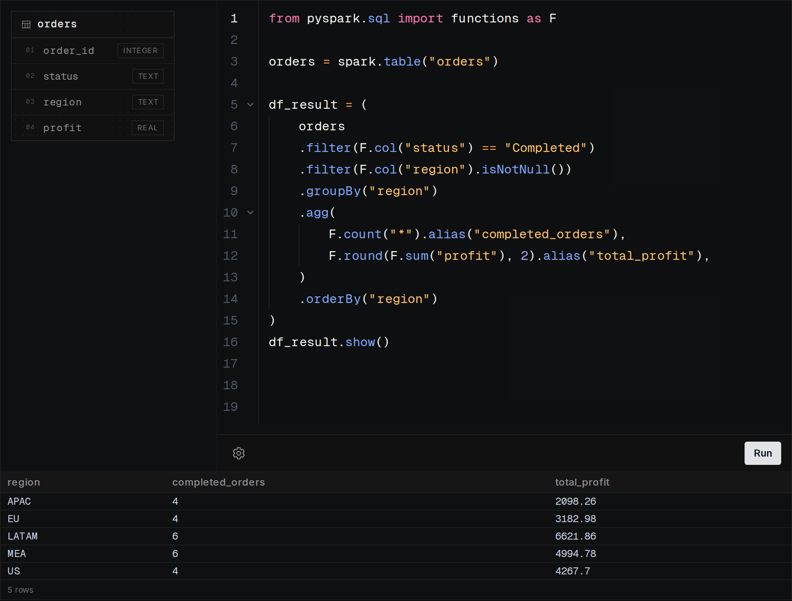
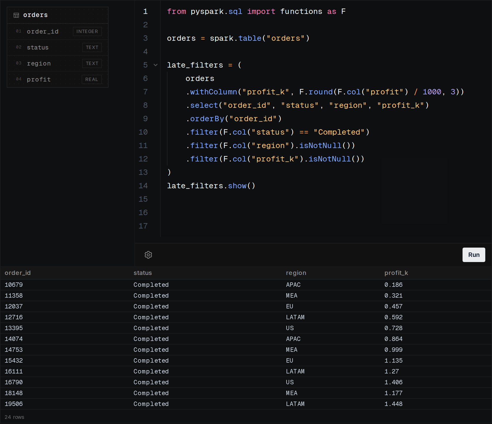
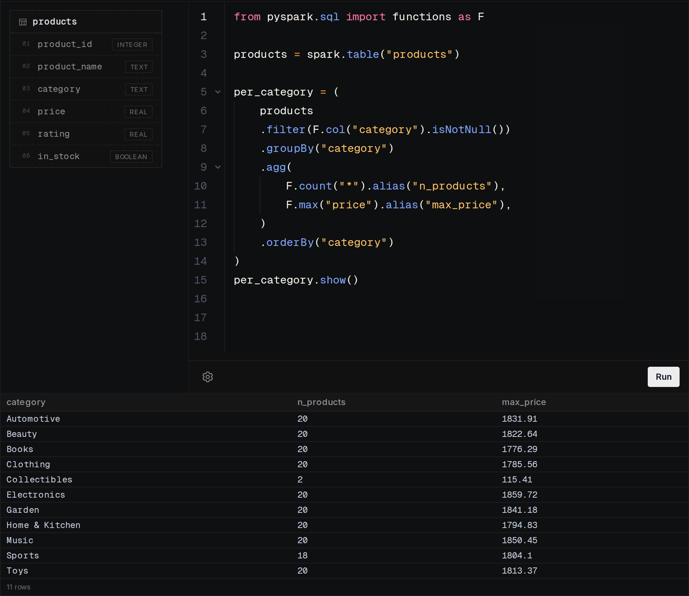

Beginner·Spark · 13 min · 12 challenges

# Catalyst Optimizer: Beginner

Say 2 Netflix engineers each build the nightly job that totals yesterday's viewing minutes per title. One chains Python lambdas over an RDD. The other writes the same logic with DataFrame columns. They use the same cluster and the same input, and the DataFrame job finishes first, because Spark rewrote it before any task started. This lesson shows what that rewrite does and how to watch it happen.


<br>

---

## DataFrames over RDDs

Every transformation you write adds a step to a plan, and nothing runs until an action. What Spark can do with that plan before the action depends on what each step is made of. A step is either an RDD operation, which takes a Python function, or a DataFrame operation, which takes column expressions. Written both ways, one business question can look almost identical on the page.

Here is a single question, total profit of completed orders per region, in both styles. orders_rdd holds tuples of (order_id, status, region, profit), and orders is a DataFrame with those same 4 columns.

```sql
rdd_result = (
    orders_rdd
    .filter(lambda row: row[1] == "Completed")
    .map(lambda row: (row[2], row[3]))
    .reduceByKey(lambda a, b: a + b)
)

df_result = (
    orders
    .filter(F.col("status") == "Completed")
    .groupBy("region")
    .agg(F.sum("profit").alias("total_profit"))
)
```


<br>

### Lambdas hide their logic, expressions show it

Run either chain and you get the same totals. The difference is what Spark knows before running them. To Spark, lambda row: row[1] == "Completed" is a compiled Python function. Spark can call it on an element and get a value back, and that is all it can do. It can't tell which field the function reads, that the test is an equality, or that position 1 holds a status string. The DataFrame filter hands Spark the expression itself: = applied to the column status and the literal Completed.

| Known before running | RDD chain | DataFrame chain |
| --- | --- | --- |
| Column names | None, only tuple positions | order_id, status, region, profit |
| Column types | Unknown until an element is processed | Fixed by the schema |
| What the filter tests | Nothing, it is a function to call | status = 'Completed' |
| Columns later steps read | Unknown, so every field is kept | status, region, profit |
| What executes the logic | Python code on each executor, element by element | Spark's engine, on its compact row format |

If Spark can read a step, it can change that step. The DataFrame chain is built from expressions over named columns, so Spark passes the whole plan through its optimizer, called **Catalyst**, before scheduling the first task. Catalyst notices that order_id is never used and leaves it unread, and it chooses how the grouping is carried out. The RDD chain gets none of this. Spark runs each lambda exactly where you placed it, on every field of every element, in the written order.

| ✓ RDD: Spark follows your steps | ✗ DataFrame: Spark plans your steps |
| --- | --- |
| • Each step is a function Spark can call but cannot inspect<br><br>• Steps run in the order written, with nothing reordered<br><br>• Every field of every element travels through every step<br><br>• Elements are Python objects handled by Python code | • Each step is an expression over named, typed columns<br><br>• Catalyst may reorder or merge steps when the rows stay the same<br><br>• Columns no step reads are cut from the plan<br><br>• Rows stay in Spark's binary format inside its engine |

**Spark receives this step in an RDD chain. Before any task runs, what can Spark determine about it?**

```python
big_orders = orders_rdd.filter(lambda row: row[3] > 1000)
```

- **A.** That it reads field 3 and compares it to 1000, so the test can move earlier
- **B.** That field 3 holds a number, since a comparison with 1000 requires one
- **C.** Only that it is a function to call on each element; what it reads stays hidden
- **D.** That the other 3 fields go unused, so it can drop them before this step

<details>
<summary>Solution</summary>

**C.** Only that it is a function to call on each element; what it reads stays hidden

Right. Spark can call the function and keep or drop the element, but it can't inspect what the function reads or tests.

**Why the others are wrong**

- **A.** Spark never parses the body of a lambda. The field index and the comparison are hidden inside compiled Python code.
- **B.** An RDD carries no schema, so Spark has no idea what type sits at any position until the function runs on a real element.
- **D.** Dropping unused fields needs to know which fields the step reads, and a lambda does not reveal that.

</details>


<br>

### Laziness gives the optimizer its chance

You already know Spark waits for an action before doing any work. That wait is what gives Catalyst room to act. When you call collect() or count(), Spark holds the full chain from the read to the result, so it can optimize all of it at once. With DataFrames, a messy chain of 10 steps and a tidy chain of 4 can come out as the same plan. With RDDs, 10 steps run as 10 steps.

> **TIP**
>
> Make the DataFrame API the default for every new Spark job. Use RDD operations only for a step that has no column-expression form. The RDD Escape Hatch section below covers those cases.

Run the DataFrame version on the practice orders table. The extra filter drops orders that have no region, which would otherwise form a group of their own. Then change "Completed" to "completed". The query still runs, but every group disappears, because string comparison is case-sensitive.



```python
from pyspark.sql import functions as F

orders = spark.table("orders")

df_result = (
    orders
    .filter(F.col("status") == "Completed")
    .filter(F.col("region").isNotNull())
    .groupBy("region")
    .agg(
        F.count("*").alias("completed_orders"),
        F.round(F.sum("profit"), 2).alias("total_profit"),
    )
    .orderBy("region")
)
df_result.show()
```


<br>

---

## Your Query Gets Rewritten

Once an action needs a DataFrame's result, Catalyst takes the chain you built and produces a new plan that returns exactly the same rows with less work. You describe the result, and Catalyst picks the order of operations. It works through rules, each a rewrite that is safe to apply wherever its pattern appears in the plan. Nearly every job you write will hit 4 of them. 2 cut data early by moving filters toward the read and pruning unused columns; the other 2 fold constants and combine filters.

| Rewrite | You wrote | Catalyst runs |
| --- | --- | --- |
| Filter pushdown | `withColumn`, then `orderBy`, then a `filter` on status | The status `filter` first, then `withColumn` and `orderBy` |
| Column pruning | Read all 6 product columns, group by category, average the price | A read of `category` and `price` only |
| Constant folding | A filter on `F.date_sub(F.lit("2024-03-15"), 7)` | The date `2024-03-08`, computed once during planning |
| Filter combining | `.filter(a)` followed by `.filter(b)` | A single filter testing `a AND b` |


<br>

### Filters move toward the read

The rewrite with the biggest payoff moves a filter as early as the plan allows. Take a report of Completed orders sorted by profit, written in the order its author thought of the steps:

```sql
ranked = (
    orders
    .withColumn("profit_k", F.col("profit") / 1000)
    .orderBy(F.col("profit_k").desc())
    .filter(F.col("status") == "Completed")
)
```

Read literally, this chain sorts every order and then throws most of them away. A global sort needs a shuffle: every row crosses the network so that each task owns a slice of the sorted range. Catalyst sees that the filter reads only status. That column exists before withColumn and the sort leaves it untouched, so testing it first can't change which rows come out. Catalyst moves the filter below the sort and below withColumn, right after the read. Say orders holds 8,000,000 rows and 2,000,000 of them are Completed. As written, the sort would shuffle all 8,000,000. After the rewrite it shuffles 2,000,000.

- **75%** — of orders never enter the shuffle

The animation runs that chain on 8 orders read as 2 partitions. Watch where the Cancelled and Pending orders disappear. The read tasks drop them, so only the 4 Completed orders cross the shuffle to be sorted, and order 3, with a profit of 4500, comes out on top.

https://github.com/user-attachments/assets/d7e40d9e-c734-4818-aead-c87ca687c908

#### When a filter cannot move

A filter moves below a step only when that step can't affect its answer. Put a filter on region after groupBy("region") and it moves below the grouping, because removing a region's rows before grouping removes exactly that region's group. A filter on total_profit > 5000 after the same grouping stays where it is. total_profit does not exist until the grouping has run, and a rule cannot test a value nobody has computed yet.

You can apply the rule yourself. A filter runs earlier only if it can be written in columns that exist at that earlier point. A derived column qualifies when its formula reads such columns, so Catalyst rewrites profit_k > 2 as profit / 1000 > 2 and moves it too. An aggregate's result never qualifies, because computing it takes every row of the group.

**Which filter can Catalyst run before the shuffle that this groupBy needs?**

```python
totals = (
    orders
    .groupBy("region")
    .agg(F.sum("profit").alias("total_profit"))
    .filter(F.col("region") != "Test")
    .filter(F.col("total_profit") > 5000)
)
```

- **A.** Only the region filter: region exists before grouping, and total_profit comes from it
- **B.** Both filters, because Catalyst moves every filter down to the read
- **C.** Only the total_profit filter, because it removes more rows than the other
- **D.** Neither, because a filter written after groupBy always runs after it

<details>
<summary>Solution</summary>

**A.** Only the region filter: region exists before grouping, and total_profit comes from it

Right. Dropping a region's rows early removes exactly that region's group, while total_profit only exists once the grouping has run.

**Why the others are wrong**

- **B.** Catalyst moves a filter only when it can be written in columns available earlier. total_profit is not available before the sum.
- **C.** How many rows a filter removes plays no part in whether it can move. Which columns it reads decides that.
- **D.** Written order does not bind Catalyst. A filter on a grouping column moves below the aggregate.

</details>


<br>

### Columns nobody reads are never carried

The second rewrite works on columns. Catalyst walks the plan from the result back to the source and records which columns each step needs. A column that no step needs is cut at the read, so it is never carried between steps and never shuffled. When the files store each column separately, Spark also skips reading that column from disk. Wide tables are where this pays: a query that touches 3 columns of a 120-column events table moves 3 columns' worth of data through its shuffles.

In the next animation the query averages price by category over a 6-column products table. Catalyst dropped product_id and product_name before the first task ran, along with supplier and weight_kg, so none of those 4 columns crosses the shuffle. Kitchen comes out at (45 + 60 + 35) / 3, about 46.67.

https://github.com/user-attachments/assets/728bfc3f-5d09-44ce-924e-14c5f29d348b

<br>

### The guarantee and its limit

Every rewrite returns the rows your written chain would have returned. That's why Catalyst applies them without asking you. Its limit is that it can only rewrite what it can read. It cannot remove a shuffle your logic requires: a groupBy still groups and an orderBy still sorts. It also can't see inside a Python function. Write the query in whatever order reads clearest, and spend your effort on the steps Catalyst cannot change.

Run this version, where every filter comes last. Then move the status and region filters up to sit right after spark.table("orders") and run again: the rows match. Now try moving the profit_k filter up as well. Spark rejects it at once, because profit_k does not exist at that point in your code. Catalyst can make that move by rewriting the filter in terms of profit, but your code cannot.



```python
from pyspark.sql import functions as F

orders = spark.table("orders")

late_filters = (
    orders
    .withColumn("profit_k", F.round(F.col("profit") / 1000, 3))
    .select("order_id", "status", "region", "profit_k")
    .orderBy("order_id")
    .filter(F.col("status") == "Completed")
    .filter(F.col("region").isNotNull())
    .filter(F.col("profit_k").isNotNull())
)
late_filters.show()
```


<br>

---

## The RDD Escape Hatch

Every DataFrame has an .rdd attribute. It returns the same data as an RDD of Row objects, and from there map accepts any Python function, as do filter and reduceByKey. Engineers reach for it when a step reads more naturally as a lambda, or out of habit carried over from older code.

```sql
orders = spark.read.parquet("/data/lake/orders")

totals = (
    orders.rdd
    .filter(lambda r: r.status == "Completed")
    .map(lambda r: (r.region, r.profit))
    .reduceByKey(lambda a, b: a + b)
    .toDF(["region", "total_profit"])
)
```

This produces the totals you saw in the DataFrames over RDDs section, at a higher price. The expression orders.rdd is a wall in the plan. Catalyst optimizes what lies before the wall, here the bare read, and then hands every row across it. Everything past the wall stays out of Catalyst's view until toDF builds a fresh DataFrame from the result.


<br>

### The cost of the .rdd wall

- **Every column is read** *No pruning*\
  The lambdas never read the fourth column, but Spark cannot see that, so it produces all 4 columns of every row. On a 120-column table, all 120 come along.
- **Every row is converted** *Engine format to Python object*\
  Each row leaves Spark's compact internal format and becomes a Python Row object before a lambda can run on it.
- **The filter stays put** *No reordering*\
  The status test runs inside Python once that conversion is done. Catalyst can neither move it earlier nor combine it with another filter.
- **The plan goes dark** *Hidden from explain()*\
  After toDF, the new DataFrame starts from an existing RDD. Its plan shows none of the steps that built it, including the shuffle inside reduceByKey.

**A job reads a 120-column table, calls .rdd, and its lambdas read 2 fields. How many columns does Spark produce for each row it hands to the lambdas?**

- **A.** 2, because Spark traces which fields the lambdas access
- **B.** 3, the 2 fields used plus a row index Spark attaches
- **C.** 120 for the first row, then 2 once it sees the fields used
- **D.** 120, because Catalyst cannot see which fields the lambdas read

<details>
<summary>Solution</summary>

**D.** 120, because Catalyst cannot see which fields the lambdas read

Right. Past the .rdd wall nothing can be pruned, so every column of every row is produced and converted.

**Why the others are wrong**

- **A.** Spark has no view into a lambda's body, so it cannot trace field access and cannot prune.
- **B.** Spark attaches no index here, and it still can't tell which fields the lambdas use.
- **C.** Spark fixes the plan before any row is read and never adapts it from what a lambda does.

</details>

Where you place the wall decides how much you lose. DataFrame operations written before .rdd are still optimized. Filter and select first, and less crosses the wall:

```sql
completed = (
    orders
    .filter(F.col("status") == "Completed")
    .select("region", "profit")
)

totals = (
    completed.rdd
    .map(lambda r: (r.region, r.profit))
    .reduceByKey(lambda a, b: a + b)
    .toDF(["region", "total_profit"])
)
```

Now only Completed rows cross the wall, carrying 2 columns each, so far fewer Python objects get built. The better fix keeps the job on the near side of the wall entirely, since each of these lambdas has a DataFrame equivalent.


<br>

### Translating lambdas back to columns

| RDD habit | DataFrame equivalent |
| --- | --- |
| `.map(lambda r: (r.region, r.profit))` | `.select("region", "profit")` |
| `.filter(lambda r: r.profit > 0)` | `.filter(F.col("profit") > 0)` |
| `.map(lambda r: r.region.upper())` | `.select(F.upper("region"))` |
| `.reduceByKey(lambda a, b: a + b)` on region pairs | `.groupBy("region").agg(F.sum("profit"))` |
| `.sortBy(lambda r: r.profit, ascending=False)` | `.orderBy(F.col("profit").desc())` |
| `.map(lambda r: 1).sum()` | `.count()` |


<br>

### Jobs that need the RDD API

Some jobs have no column-expression form, and those are what .rdd exists for:

- Checking layout: df.rdd.getNumPartitions() returns a fresh DataFrame's partition count without reading rows.
- Setup per partition: mapPartitions opens 1 connection or loads 1 model per partition, not once per row.
- Libraries that only accept whole Python objects, called on rows a DataFrame step has already filtered and trimmed.
- Legacy code mid-migration, kept as an RDD step until each lambda is rewritten as a column expression.

> **TIP**
>
> Before writing a lambda, search the functions module you import as `F`. It holds hundreds of built-ins. String and date functions are there, and so are math and array functions and conditionals, and Catalyst can see every one of them.

This cell does the job of an old RDD program that counted products and found the top price per category with map and reduceByKey. Run it, then compare: F.max skips products whose price is NULL, while Python's max given a None would raise a TypeError and fail the task.



```python
from pyspark.sql import functions as F

products = spark.table("products")

per_category = (
    products
    .filter(F.col("category").isNotNull())
    .groupBy("category")
    .agg(
        F.count("*").alias("n_products"),
        F.max("price").alias("max_price"),
    )
    .orderBy("category")
)
per_category.show()
```


<br>

---

## DataFrame, Dataset, and RDD

Spark exposes 3 APIs over a single engine. They differ in what a unit of data is, how much of your code the optimizer can see, and when a mistake in your code gets caught. That last difference matters more than it sounds, because it decides whether a typo costs you a second at your desk or 40 minutes of cluster time.

| Question | RDD | DataFrame | Dataset |
| --- | --- | --- | --- |
| Unit of data | Any object | A Row with named, typed columns | An object of a class you define |
| Optimized by Catalyst | No | Yes, every step | Column steps yes, lambda steps no |
| A wrong column or field name fails | At the action, inside a task | When the line runs, before any job | Typed field access at compile time, column names when the line runs |
| Available from Python | Yes | Yes | No |


<br>

### A DataFrame is a Dataset of rows

Dataset is the typed API in Spark's compiled JVM languages. You declare a class, say Order with 4 fields, and get a distributed collection of Order objects. The compiler then rejects code that reads a field the class lacks. A DataFrame is the same structure with the generic Row type standing in for your class, which is why Spark's documentation describes a DataFrame as a Dataset of Row. Python has no compile step that could check field names, so it gets DataFrames only. Every DataFrame you have written in these lessons is this untyped form: rows whose column names Spark checks when each line runs, with no compiler involved.

The typed API has a catch that mirrors the escape hatch. A Dataset step written with column expressions is optimized like any DataFrame step. A step written as a lambda over your class is opaque. Spark must rebuild each row as an object of your class before it can call the function, then convert the result back, and Catalyst cannot move a filter past that step or prune columns through it. Typing buys earlier error checks, and the lambdas still cost what lambdas cost.


<br>

### A typo caught at once or 40 minutes in

Suppose a teammate types statuss for status. Here is where each of the 2 Python APIs stops them.

```sql
completed_rdd = orders.rdd.filter(lambda r: r.statuss == "Completed")
n = completed_rdd.count()

completed_df = orders.filter(F.col("statuss") == "Completed")
```

The RDD line is accepted without complaint, because Spark does not inspect a lambda when you define it. The mistake surfaces at count(), when a task first calls the lambda on a row and Python raises an AttributeError. If that filter sits after a 40-minute stretch of work in the same job, the job runs for 40 minutes before failing. The DataFrame line fails the moment it executes, with an AnalysisException that names statuss and points to the columns that do exist, and no job ever starts.

*This holds for a standard Spark session, where your program runs inside the driver. A session that talks to a remote Spark server through a thin client can defer the check until the first action or the first schema lookup.*

**A nightly job fails 35 minutes in with AttributeError: statuss, raised inside a task. Which API did the failing step use?**

- **A.** A DataFrame filter, because column mistakes appear when tasks run
- **B.** An RDD lambda, because its field access is first tried when a task runs it
- **C.** A Dataset lambda, because typed code checks its fields at runtime
- **D.** Any of the 3, since every API checks names only at the action

<details>
<summary>Solution</summary>

**B.** An RDD lambda, because its field access is first tried when a task runs it

Right. Nothing inspects the lambda at definition, so the bad attribute surfaces only when a task calls it on a Row.

**Why the others are wrong**

- **A.** A DataFrame raises AnalysisException when the line executes, before any task exists.
- **C.** Dataset field names are checked by the compiler, and Dataset isn't available from Python at all.
- **D.** Each API checks at a different moment. The earliest is compile time; the others wait until the line runs or until a task runs.

</details>


<br>

### Choosing between them

| ✓ Do | ✗ Don't |
| --- | --- |
| • Write new jobs with DataFrames so every step reaches Catalyst<br><br>• Filter and select before any .rdd call to shrink what crosses<br><br>• Use .rdd for partition counts and setup done once per partition<br><br>• Check printSchema() before typing column names into a long job | • Copy old RDD code line by line into a new job<br><br>• Convert to .rdd to express a filter or a sum<br><br>• Expect a plan to show work done before an RDD conversion<br><br>• Assume a typed lambda is optimized because its data is typed |

One rule covers most cases. Start every job with DataFrames. Drop to an RDD for one step only when that step has no column-expression form, and do it after the filters and selects. Datasets make sense in a typed JVM codebase, where compile-time field checks are worth having, and even there the optimizer helps only their column-expression steps.

**You're writing a Python job and want Spark to check column names before reading any data, and to optimize every step. Which API meets both needs?**

- **A.** RDD, with each column referenced by its tuple position
- **B.** Dataset, imported into the Python session for its types
- **C.** RDD converted with toDF at the end of the chain
- **D.** DataFrame, whose column expressions Catalyst checks and optimizes

<details>
<summary>Solution</summary>

**D.** DataFrame, whose column expressions Catalyst checks and optimizes

Right. Names are resolved when each line executes, and every step is open to Catalyst's rewrites.

**Why the others are wrong**

- **A.** Tuple positions carry no names to check, and RDD steps never reach Catalyst.
- **B.** The typed Dataset exists only in the compiled JVM languages, so Python can't import it.
- **C.** toDF comes after the lambdas have run, so those steps are neither checked early nor optimized.

</details>


<br>

---

## Seeing It with explain()

Everything so far happens inside Spark, out of sight. explain() prints the plan Catalyst produced for a DataFrame. It starts no job and reads no rows, so you can call it on a query over a huge table before you commit any cluster time.

```sql
from pyspark.sql import functions as F

orders = spark.read.parquet("/data/lake/orders")

west = (
    orders
    .groupBy("region")
    .agg(F.sum("profit").alias("total_profit"))
    .filter(F.col("region") == "West")
)
west.explain()
```

The filter is written last, after the grouping. The printed plan is a tree, drawn with the result at the top and the read at the bottom. Data flows upward, so start at the bottom line. The numbers after # are internal ids that change from run to run, and long lines are trimmed here to their first part.

| Read | Plan line | What it tells you |
| --- | --- | --- |
| 6th | `AdaptiveSparkPlan isFinalPlan=false` | A wrapper from a feature a later lesson covers. Start reading on the line below it. |
| 5th | `HashAggregate(keys=[region#2], functions=[sum(profit#3)])` | The final total per region, computed after rows are grouped. |
| 4th | `Exchange hashpartitioning(region#2, 200)` | The shuffle. Rows with the same region go to the same task, across 200 partitions, the default. |
| 3rd | `HashAggregate(keys=[region#2], functions=[partial_sum(profit#3)])` | A subtotal per partition before the shuffle. A later lesson explains this 2-step aggregation. |
| 2nd | `Filter (isnotnull(region#2) AND (region#2 = West))` | Your last line, now running right after the read and before the shuffle, with a NULL check Catalyst added. |
| 1st | `FileScan parquet [region#2,profit#3] ... ReadSchema: struct<region:string,profit:double>` | The read. Only 2 of the 4 columns load: `order_id` and `status` were pruned. |


<br>

### 3 questions for every plan

- **Which columns does the scan read?** The bracketed list on the scan line and its ReadSchema should hold only what your query uses. A long list means something above needs those columns, often the final result itself.
- **Where does each filter sit?** A filter next to the scan is cheap. One that stays above an Exchange reads a column that only exists after it, such as an aggregate's output.
- **How many Exchange lines are there?** Each is a shuffle. A groupBy adds a hash shuffle, an orderBy adds a range shuffle, and narrow steps add none.

**You wrote a status filter at the end of a chain that groups by region. Which sign in the physical plan confirms Catalyst moved it ahead of the shuffle?**

- **A.** A Filter testing status that appears below the Exchange line, near the scan
- **B.** A Filter testing status printed at the top, above the final aggregate
- **C.** The Exchange line listing status inside its hashpartitioning(...)
- **D.** The word Completed appearing anywhere in the plan's printed text

<details>
<summary>Solution</summary>

**A.** A Filter testing status that appears below the Exchange line, near the scan

Right. Data flows upward, so a Filter below the Exchange runs before any row is shuffled.

**Why the others are wrong**

- **B.** The top of the plan runs last, so a Filter there runs after the shuffle has already happened.
- **C.** hashpartitioning lists the shuffle key, region here. It says nothing about where a filter runs.
- **D.** The literal shows up wherever the filter sits, so its presence says nothing about the position.

</details>


<br>

### Before and after the rewrite

explain(mode="extended") prints 4 plans. The parsed plan comes first and is your chain as written. After the analyzed plan comes the optimized plan, which is what Catalyst turned it into, and the physical plan prints last. Comparing the parsed and optimized plans shows each rewrite in action.

Parsed: as you wrote it

| Operator, top to bottom |
| --- |
| 'Filter ('region = West) |
| Aggregate [region#2], [region#2, sum(profit#3) AS total_profit#10] |
| Relation [order_id#0,status#1,region#2,profit#3] parquet |

Optimized: what Catalyst kept

| Operator, top to bottom |
| --- |
| Aggregate [region#2], [region#2, sum(profit#3) AS total_profit#10] |
| Project [region#2, profit#3] |
| Filter (isnotnull(region#2) AND (region#2 = West)) |
| Relation [order_id#0,status#1,region#2,profit#3] parquet |

On the left, the filter sits above the aggregate. On the right it has dropped below it and gained a NULL check, and a Project now keeps only region and profit. The relation still lists 4 columns at this level, and the physical planner turns that Project into the 2-column scan from the table above.


<br>

### Spotting the RDD wall

Call explain() on the totals DataFrame from the escape-hatch section, and you get a short plan whose bottom line reads Scan ExistingRDD[region#20,total_profit#21]. The 3 lambdas and the shuffle inside reduceByKey are all missing, because Catalyst received the RDD as a finished source. A plan that starts at Scan ExistingRDD tells you 2 things: the steps between .rdd and toDF were not optimized and don't appear here, and counting its Exchange lines undercounts the job's shuffles. Any DataFrame work before .rdd was optimized on its own and isn't shown in this plan either.

> **TIP**
>
> After a job has run, the Spark UI's SQL tab draws this same plan as a graph with row counts on each operator. If a filter you expected near the scan sits above an Exchange there, start your fix with that filter.

**How many shuffles does the physical plan for this query contain?**

```python
report = (
    orders
    .filter(F.col("status") == "Completed")
    .withColumn("profit_k", F.col("profit") / 1000)
    .groupBy("region")
    .agg(F.sum("profit_k").alias("total_k"))
    .orderBy(F.col("total_k").desc())
)
report.explain()
```

- **A.** 1, because Catalyst folds the sort into the grouping's shuffle
- **B.** 3, one each for the filter, the groupBy and the orderBy
- **C.** 2: a hash Exchange for groupBy and a range Exchange for orderBy
- **D.** 0, because explain() shows no shuffles until the job has run

<details>
<summary>Solution</summary>

**C.** 2: a hash Exchange for groupBy and a range Exchange for orderBy

Right. The filter and withColumn are narrow, so only the grouping and the sort add Exchange lines.

**Why the others are wrong**

- **A.** Sorting by total_k needs its own range shuffle, and no rewrite merges it into the hash shuffle on region.
- **B.** A filter is a narrow step. Each task tests its own rows, so nothing crosses the network.
- **D.** explain() prints the plan Spark intends to run, and Exchange lines appear in it before any job starts.

</details>


<br>

---

## Putting It All Together

A ride-hailing company's finance team needs weekly revenue per city from a 90-column trips table. The job they inherited calls .rdd right after the read, parses the fare field with a lambda, filters to completed trips, sums fares per city with reduceByKey, and sorts cities by revenue. It is slow, and a renamed column once broke it 30 minutes into a run.

- DataFrames over RDDs: the lambda chain hands Spark functions it can't inspect, so no part of the job reaches Catalyst.
- The RDD wall: because . rdd comes first, all 90 columns of every trip become Python objects before the filter drops a single cancelled trip.
- Rewriting: with F . col expressions in place of the lambdas, Catalyst prunes the read to the 3 columns used and moves the completed-trips filter next to the scan.
- The 3 APIs: a misspelled fare column now raises AnalysisException when the line executes, before any job starts, where it once failed 30 minutes in.
- explain(): the new plan should show a 3-column scan, a Filter below the first Exchange, and 2 Exchange lines, one for the city grouping and one for the sort.


<br>

---

## Key Takeaways

- A DataFrame step is an expression Spark can read. An RDD step is a function Spark can only call, so only DataFrame code reaches Catalyst.
- Catalyst rewrites your chain into a plan with the same rows and less work. Filters move toward the read and unused columns are pruned; Catalyst also folds constants and combines filters.
- A filter can run earlier only when it can be written in columns that exist at that earlier point. A filter on an aggregate's result stays after the shuffle.
- Calling . rdd builds a wall in the plan: every column is produced, every row becomes a Python object, and nothing past it is optimized or shown by explain().
- Python has DataFrames and RDDs. The typed Dataset belongs to the compiled JVM languages, and its lambda steps are as opaque to Catalyst as RDD lambdas.
- Read explain ( ) from the bottom up: check the scan's columns, find where each filter sits, and count Exchange lines to count shuffles.
