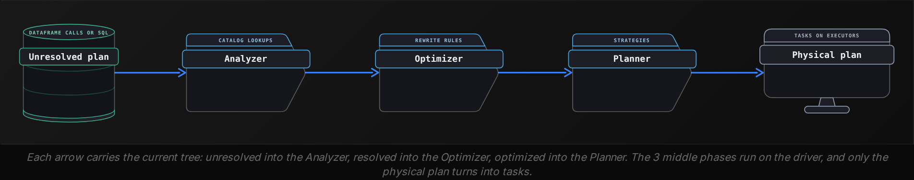
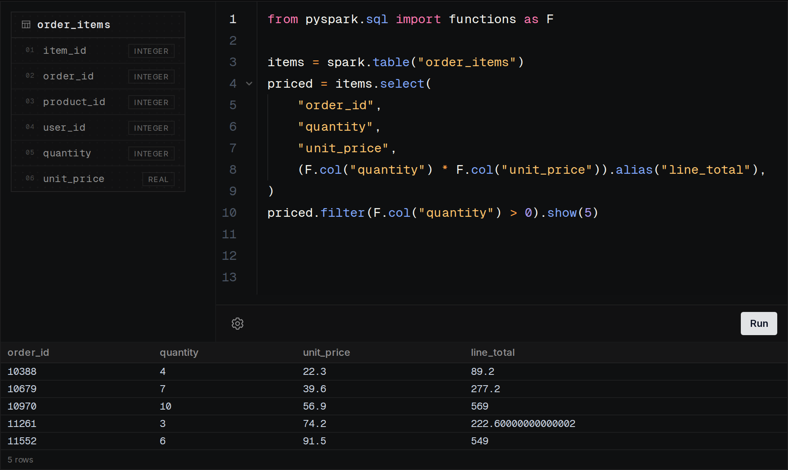
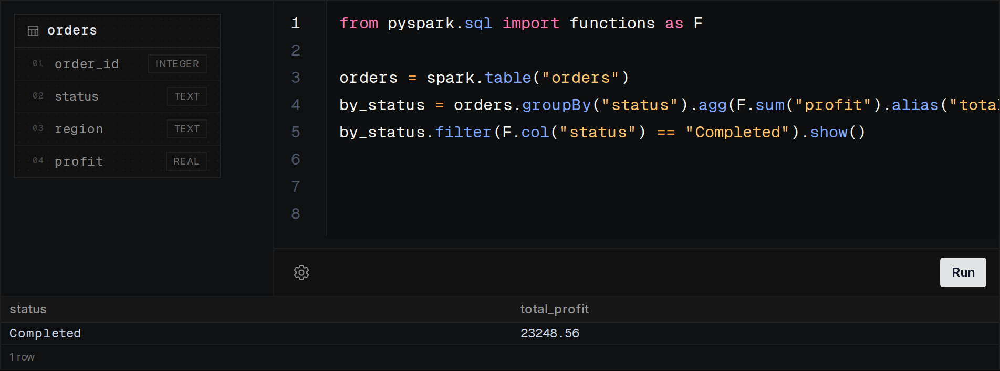
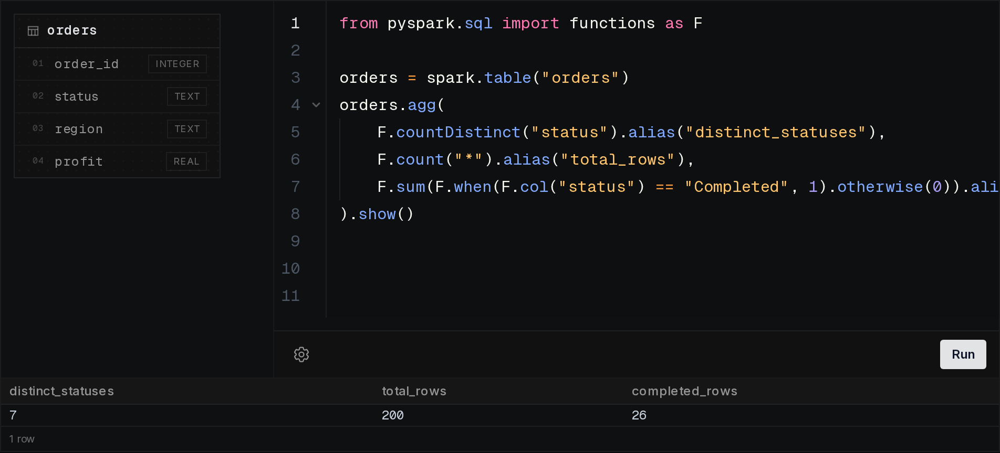
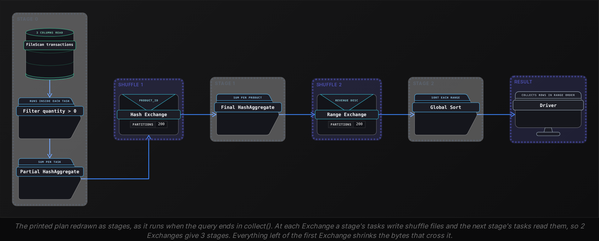

Intermediate·Spark · 14 min · 14 challenges

# Catalyst Optimizer: Intermediate

A Netflix engineer's Spark job totals viewing hours per country and title, then keeps only Brazil. Read literally, it shuffles viewing data from every country. In practice only Brazil's data crosses the network, because Spark rewrote the query before any task started. Whether a rewrite like that happens, and where each shuffle lands, is what this lesson teaches you to read from the plan.


<br>

---

## Analysis

Every DataFrame call you chain, and every SQL string you hand to spark.sql, first becomes a tree of names Spark has not checked. The tree mentions a relation called order_items and a column called quantity, but nothing in it says whether either exists or what type the column holds. Analysis settles those questions. The driver walks the tree and resolves each name against the catalog, the registry of tables, views and functions your session knows about. No executor takes part.




<br>

### What the analyzer fills in

Take a query that totals each order's line items, run against an order_items table whose quantity is an int and whose unit_price is a double. Calling explain(extended=True) prints the tree after every phase, and the first 2 trees show the analyzer's work.

```sql
query = """
SELECT
  order_id,
  SUM(quantity * unit_price) AS order_total
FROM order_items
GROUP BY order_id
"""
totals = spark.sql(query)
totals.explain(extended=True)
```

| Parsed plan shows | Analyzed plan shows | What the analyzer did |
| --- | --- | --- |
| 'UnresolvedRelation [order_items] | Relation spark_catalog.default.order_items[...] parquet | Found the table in the catalog and attached its columns and files |
| 'quantity | quantity#5 | Matched the name to a column of that table and gave it an ID |
| 'SUM(...) | sum(...) | Found the function and resolved the type of its argument |
| ('quantity \* 'unit_price) | (cast(quantity#5 as double) \* unit_price#6) | Cast the int side to double so both operands share a type |
| no schema line | order_id: int, order_total: double | Worked out the type of every output column |

Watch for 2 marks. A leading apostrophe, as in 'quantity, means unresolved: a name with no column behind it yet. A # number, as in quantity#5, is an expression ID. Your session will print different numbers. What holds everywhere is that 2 columns printing the same name with different IDs are different columns, and every later phase tracks a column by its ID.

The cast in the fourth row is type coercion. Multiplication needs both operands to share a type, so the analyzer widens the int side to double. That cast exists in the analyzed plan and nowhere in your code, which makes the analyzed plan the first place to look when a comparison or a calculation behaves differently from what you wrote.


<br>

### Analysis errors arrive before the action

The laziness lessons showed failures that wait for an action: the plan builds and the error appears once tasks run. Analysis keeps a different schedule. A DataFrame is analyzed when it is created, so a misspelled column raises an AnalysisException on the line that names it, before any job exists. When an error fires tells you which kind of mistake you are looking at.

| ✓ Raised as the line runs | ✗ Raised at the action |
| --- | --- |
| • A column name the input does not have<br><br>• A table or view missing from the catalog<br><br>• A function name Spark does not recognize<br><br>• In SQL, a selected column that is neither grouped nor aggregated | • A file deleted between planning and reading<br><br>• A value that breaks a cast with spark.sql.ansi.enabled on<br><br>• An executor running out of memory<br><br>• A corrupt file in the input path |

*On a Spark Connect session the client sends the plan to the server without analyzing it, so the same misspelling raises at the first action or the first call that needs the schema.*

**Which call raises an exception, and at what moment?**

```python
from pyspark.sql import functions as F

orders = spark.table("orders")
completed = orders.filter(F.col("status") == "Completed")
totals = completed.groupBy("regoin").agg(F.sum("profit"))
rows = totals.collect()
```

- **A.** collect(), because Spark checks nothing until an action starts a job
- **B.** groupBy, as it is called: the analyzer cannot resolve regoin among the columns
- **C.** groupBy, but only once an executor task tries to read the regoin field
- **D.** No call raises; Spark adds a null regoin column and groups every row under it

<details>
<summary>Solution</summary>

**B.** groupBy, as it is called: the analyzer cannot resolve regoin among the columns

Right. Resolving the grouping column happens while the DataFrame is built, so an AnalysisException stops the program on that line and no job ever starts.

**Why the others are wrong**

- **A.** Laziness delays execution. The analyzer still resolves regoin when groupBy builds its DataFrame, so the failure comes on that earlier line.
- **C.** The line is right and the mechanism is wrong. Analysis runs on the driver against the schema, and no task exists yet when the error is raised.
- **D.** Spark never invents a column for a reference it cannot find. An unresolved name always ends analysis with an error.

</details>

Run the cell as written: it reads order_items, multiplies quantity by unit_price, and prints the first 5 rows. Then rename unit_price in the select to unit_prise and run again. The error arrives before show is reached, and it lists the columns it could have meant.



```python
from pyspark.sql import functions as F

items = spark.table("order_items")
priced = items.select(
    "order_id",
    "quantity",
    "unit_price",
    (F.col("quantity") * F.col("unit_price")).alias("line_total"),
)
priced.filter(F.col("quantity") > 0).show(5)
```


<br>

---

## Logical Optimization

With every name resolved, the optimizer rewrites the tree into one that returns the same rows for less work. It works through rules. Each rule looks for a pattern, such as a Filter above an Aggregate, and swaps in an equivalent shape. Rules are grouped into batches, and most batches repeat until a full pass changes nothing or they reach spark.sql.optimizer.maxIterations, 100 by default. No rule reads data: the same tree gets the same rewrite whether the table holds 10 rows or 10 billion.


<br>

### Rules you will meet in most plans

| Rule | Before | After | What it saves |
| --- | --- | --- | --- |
| PushDownPredicates | A Filter above a Project or Aggregate | The Filter moved beneath it | Rows dropped before later steps touch them |
| ColumnPruning | Every column of the table carried upward | Only the columns the query uses | Bytes carried through every step and shuffle |
| ConstantFolding | profit > 10 \* 100 | profit > 1000.0 | Arithmetic done once on the driver, not per row |
| CombineFilters | 2 filter calls in a row | 1 Filter joined by AND | 1 operator |
| CollapseProject | 3 chained withColumn calls | 1 Project | 2 operators |
| InferFiltersFromConstraints | status = 'Completed' | isnotnull(status) AND status = 'Completed' | An explicit null test later steps can rely on |


<br>

### A filter that moves below the groupBy

This program groups first and filters second, the order you might write it after deciding late that only the West matters.

```sql
from pyspark.sql import functions as F

orders = spark.table("orders")
by_region = orders.groupBy("region").agg(F.sum("profit").alias("total_profit"))
west = by_region.filter(F.col("region") == "West")
west.explain(extended=True)
```

Analyzed logical plan

| Plan line |
| --- |
| Filter (region#2 = West) |
| +- Aggregate [region#2], [region#2, sum(profit#3) AS total_profit#9] |
| +- SubqueryAlias spark_catalog.default.orders |
| +- Relation spark_catalog.default.orders[order_id#0,status#1,region#2,profit#3] parquet |

Optimized logical plan

| Plan line |
| --- |
| Aggregate [region#2], [region#2, sum(profit#3) AS total_profit#9] |
| +- Project [region#2, profit#3] |
| +- Filter (isnotnull(region#2) AND (region#2 = West)) |
| +- Relation spark_catalog.default.orders[order_id#0,status#1,region#2,profit#3] parquet |

The optimizer fired 4 rules. EliminateSubqueryAliases removed the SubqueryAlias line, which only recorded the name the table was read under. PushDownPredicates moved the filter beneath the Aggregate, which is legal because the test reads only region, the grouping key: every row that lands in the West group started as a West row, so dropping the rest first cannot change West's total. InferFiltersFromConstraints added isnotnull(region#2). ColumnPruning inserted a Project so order_id and status stop travelling upward. The saving shows up at the shuffle the groupBy needs, which now receives West rows only.

The run below plays that program on 12 orders spread over 3 regions, ending in `collect()`. Watch each map task drop its East and North rows before computing a partial sum, so the shuffle carries only West sums.

https://github.com/user-attachments/assets/35e00637-9046-4595-a43b-3f0751555191

<br>

### When a filter has to stay

A filter can move to a lower point only if every row there carries what the test reads. Below an Aggregate, a row has its grouping keys but no totals yet.

| ✓ Moves lower in the plan | ✗ Stays where you wrote it |
| --- | --- |
| • region == 'West' after groupBy('region'): it reads a grouping key only<br><br>• margin > 5 after withColumn('margin', profit \* 0.1): rewritten as profit \* 0.1 > 5<br><br>• The status test in status == 'Completed' AND total_profit > 0 after groupBy('status') | • total_profit > 500 after the agg: the total exists only once the group is complete<br><br>• status == 'Completed' OR total_profit > 0: an OR has no half that is safe to move alone<br><br>• Any filter on a DataFrame rebuilt from an RDD: Catalyst cannot see into the RDD code |

**Which filter on summary does the optimizer move below the Aggregate?**

```python
from pyspark.sql import functions as F

summary = orders.groupBy("status", "region").agg(
    F.sum("profit").alias("total"),
    F.count("*").alias("n"),
)
```

- **A.** summary.filter(F.col("total") > 1000), because numeric comparisons are cheap to run early
- **B.** summary.filter(F.col("n") > 5), because a count can be tallied from each row as it arrives
- **C.** summary.filter((F.col("status") == "Completed") | (F.col("total") > 0)), since 1 branch tests a key
- **D.** summary.filter(F.col("region") != "Test"), because it reads only a grouping column

<details>
<summary>Solution</summary>

**D.** summary.filter(F.col("region") != "Test"), because it reads only a grouping column

Right. Every row of a group shares its region, so testing rows before grouping keeps exactly the groups the later filter would keep, with fewer rows shuffled.

**Why the others are wrong**

- **A.** The cost of the test plays no part. total exists only after every row of a group has been summed, so the filter must sit above the Aggregate.
- **B.** Each row adds to n, but the test needs the finished count for the group, which only the final aggregate knows.
- **C.** An OR keeps a row when either branch holds. Applying the status branch alone before grouping would drop groups whose total qualifies, so nothing moves.

</details>

> **TIP**
>
> Filters on grouping keys can go wherever they read best, since Catalyst moves them for you. Filters on aggregated values belong after the `agg`, and no rewrite, yours or Spark's, can run them sooner.

The cell groups the practice orders by status and keeps the Completed group. Run it, then move the filter above the groupBy and run again. The row that comes back is identical, and that equality is the whole licence the optimizer needs to make the move on its own.



```python
from pyspark.sql import functions as F

orders = spark.table("orders")
by_status = orders.groupBy("status").agg(F.sum("profit").alias("total_profit"))
by_status.filter(F.col("status") == "Completed").show()
```


<br>

---

## Physical Planning

The optimized logical plan still says nothing about partitions, tasks or shuffles. The planner supplies those. It runs a list of strategies, each able to turn certain logical operators into physical ones, and produces a tree that can run as tasks. A logical Aggregate becomes 2 HashAggregate operators: a partial one that sums inside each task, then a final one that merges those sums per key. That pair is the combine-before-shuffle pattern you already know, chosen here by the planner.

| Logical operator | Physical operator | What changes |
| --- | --- | --- |
| Relation | FileScan | Reads the pruned columns, 1 task per input partition |
| Filter | Filter | The same test, run inside each task |
| Aggregate | Partial HashAggregate, then final HashAggregate | Sums per task, then sums per key |
| Sort from orderBy | Sort with global set to true | Rows ordered across every partition |
| Sort from sortWithinPartitions | Sort with global set to false | Rows ordered inside each partition only |
| Repartition on a column | Exchange hashpartitioning | The shuffle you asked for, on your key |


<br>

### Where the Exchanges come from

The logical plan never contained a shuffle. Exchange, the physical operator that performs one, is added after the strategies run, by a rule named EnsureRequirements. Each physical operator declares the partitioning it needs from its child and the partitioning it outputs. A final HashAggregate on region needs every row of a region inside 1 partition, while a FileScan outputs partitions that know nothing about region. Wherever a need meets an output that fails it, EnsureRequirements inserts an Exchange, and wherever an operator needs sorted input it lacks, a Sort.

| Operator | Needs from its child | Inserted when the need is unmet |
| --- | --- | --- |
| Final HashAggregate on region | Every row of a region in 1 partition | Exchange hashpartitioning(region, 200) |
| Global Sort on total DESC | Partitions holding consecutive ranges of total | Exchange rangepartitioning(total DESC, 200) |
| Sort from sortWithinPartitions | Nothing across partitions | No Exchange |
| Filter or Project | Nothing | No Exchange |

The 200 is spark.sql.shuffle.partitions, the default number of shuffle partitions, and the run below uses 3 so every task fits on screen. Before you play it, predict the Exchanges: the final aggregate needs each region clustered, and the global sort needs ranges of totals. The range shuffle also needs boundaries, so Spark samples the totals in a short job of its own, which your action triggers before the job that returns your rows.

https://github.com/user-attachments/assets/af3d7ddc-39cc-45ac-a93e-c9677f37b582

<br>

### When a requirement is already met

EnsureRequirements adds an Exchange only where the child's partitioning fails the need. After repartition(8, "region"), the rows of each region already sit in 1 partition, so a following groupBy("region") adds no shuffle. The test is looser than it first looks. Hashing on region also satisfies groupBy("region", "status"), because rows that share both values share region. The reverse fails: hashing on both columns scatters a single region across many partitions.

| Child partitioned by | Then groupBy on | New Exchange? |
| --- | --- | --- |
| hash(region) | region | No |
| hash(region) | region, status | No: equal pairs already share a region |
| hash(region, status) | region | Yes: a region spans many partitions |
| A file scan | region | Yes: input partitions ignore region |

> **TIP**
>
> A `repartition("region")` placed right before `groupBy("region")` slows the job. Its `Exchange` ships every raw row, while the groupBy's own `Exchange` would have shipped 1 partial sum per region per task. Repartition first only when several wide steps share that key and can reuse the 1 shuffle.

*The planner's interface can return several candidate physical plans, but Spark takes the first. Choices between operators are made by checks inside each strategy, many of them comparing size estimates, the subject of the next section.*

**How many Exchange operators does the physical plan for this program contain?**

```python
by_status = orders.repartition(6, "status")
counts = by_status.groupBy("status", "region").count()
ranked = counts.orderBy("count")
rows = ranked.collect()
```

- **A.** 2: the repartition's hash Exchange, which the groupBy reuses, plus a range Exchange for orderBy
- **B.** 3: 1 for the repartition, 1 for the groupBy on 2 columns, and 1 range Exchange for orderBy
- **C.** 1: the repartition's Exchange serves the groupBy, and orderBy sorts within those 6 partitions
- **D.** 2: the groupBy's hash Exchange plus a range Exchange, with the repartition removed as redundant

<details>
<summary>Solution</summary>

**A.** 2: the repartition's hash Exchange, which the groupBy reuses, plus a range Exchange for orderBy

Right. Hashing on status keeps every (status, region) pair in 1 partition, so the aggregate needs no new shuffle. The global sort still needs ranges.

**Why the others are wrong**

- **B.** The groupBy's need is already met. Rows sharing both status and region share status, so EnsureRequirements inserts nothing there.
- **C.** orderBy asks for a global order, which hash partitions on status cannot give, so a range Exchange is added above the aggregate.
- **D.** The count matches, but the repartition's Exchange stays in the plan. The groupBy reuses it and never gets a shuffle of its own.

</details>


<br>

---

## Cost-Based Optimization

The logical rules fire on the shape of the tree alone. Other choices need sizes: how many rows survive a filter, how many groups an aggregate yields, which of 2 inputs is the small one. For those, Catalyst attaches a Statistics estimate to every logical operator. Cost-based optimization covers how the estimates are computed and what is decided from them. With spark.sql.cbo.enabled at its default of false, Spark estimates byte sizes only.


<br>

### Where the numbers come from

| Statistic | Where Spark gets it | There without ANALYZE? |
| --- | --- | --- |
| Size in bytes of a file table | Total size of its files | Yes |
| Row count | ANALYZE TABLE ... COMPUTE STATISTICS | No |
| Distinct count, null count, average and max length | ANALYZE TABLE ... COMPUTE STATISTICS FOR COLUMNS | No |
| Min and max | The column command, for numeric, date and timestamp columns | No |
| Histogram | The column command with spark.sql.statistics.histogram.enabled on, same types | No |

```sql
from pyspark.sql import functions as F

spark.sql("ANALYZE TABLE orders COMPUTE STATISTICS FOR COLUMNS status, profit")
spark.conf.set("spark.sql.cbo.enabled", "true")

completed = spark.table("orders").filter(F.col("status") == "Completed")
completed.explain(mode="cost")
```

explain(mode="cost") prints the optimized logical plan with a Statistics(sizeInBytes=..., rowCount=...) entry on every line: the numbers the planner acts on.


<br>

### Estimates with and without column statistics

Without column statistics, Spark propagates bytes alone, and its assumption for a filter is that every row survives: the filtered table is estimated at the full table's size. A Project scales the bytes by how much narrower its rows are, and an aggregate with no grouping keys is estimated at 1 row. With CBO on and column statistics present, Spark estimates what fraction a filter keeps. An equality test on a string keeps the row count divided by the distinct count. A range test on a number assumes values spread evenly between min and max, and tests joined by AND multiply their fractions.

Take an orders table of 40,000,000 rows in 1.6 GB of files, where status has 4 distinct values and profit runs from -50 to 950. In the real data, 28,000,000 orders are completed.

| Plan step | Bytes only | CBO with column stats | Real rows |
| --- | --- | --- | --- |
| Relation orders | 1.6 GB | 40,000,000 rows | 40,000,000 |
| Filter status = 'Completed' | 1.6 GB | 10,000,000 rows | 28,000,000 |
| Filter profit > 100 | 1.6 GB | 34,000,000 rows | 31,000,000 |
| Both filters, joined by AND | 1.6 GB | 8,500,000 rows | 24,000,000 |

- **2.8x** — undercount for status = 'Completed'
- **18M** — Completed rows the estimate misses

The status estimate misses because strings get no histogram, so Spark gives each of the 4 values an equal share while most real orders complete. The AND row misses for a second reason: Spark multiplies the fractions as if the 2 tests were unrelated, when completed orders are the ones that carry profit. Neither error is visible until a decision built on the estimate goes wrong.

**CBO is on and orders was analyzed for columns this morning, with no rows added since. It holds 10,000,000 rows, and status has 5 distinct values and no nulls. What row count does Spark estimate for orders.filter(F.col("status") == "Cancelled")?**

- **A.** 10,000,000, since a filter leaves the estimate at its child's size
- **B.** No estimate, since Spark cannot know the count before a job counts it
- **C.** 2,000,000: the row count times 1 over the 5 distinct values
- **D.** 2,000,000, read from a histogram of how often each status appears

<details>
<summary>Solution</summary>

**C.** 2,000,000: the row count times 1 over the 5 distinct values

Right. With no histogram for strings, an equality test keeps 1 in every 5 rows, however many cancelled orders the table really holds.

**Why the others are wrong**

- **A.** That is the rule when Spark has byte sizes alone. With CBO on and column stats present, it estimates the fraction the filter keeps.
- **B.** Estimating before running is the purpose of statistics. The optimized plan already has a row count before any task starts.
- **D.** The number matches, but Spark builds histograms only for numeric, date and timestamp columns, so this figure comes from the distinct count.

</details>


<br>

### Statistics that go stale

Statistics are a snapshot saved in the catalog when ANALYZE runs. When Spark itself writes to the table, it discards the snapshot, or recomputes the size alone if spark.sql.statistics.size.autoUpdate.enabled is on. Files added by another process leave the old snapshot in place, and the planner trusts it: a table analyzed at 40,000,000 rows that has since tripled still plans as 40,000,000.

| ✓ Do | ✗ Don't |
| --- | --- |
| • Re-run ANALYZE after loads that change a table's size or the spread of its values<br><br>• Collect column stats on the columns your filters and grouping keys use<br><br>• Read explain(mode="cost") when a plan choice surprises you | • Switch on spark.sql.cbo.enabled for unanalyzed tables and expect a change<br><br>• Trust a distinct-count estimate on a column where 1 value dominates<br><br>• Let other processes add files to a table whose stats the planner still reads |

> **TIP**
>
> These estimates change plans mostly where the planner compares a size to a threshold to pick an operator, and the costliest such pick is how 2 tables get joined, which the joins lessons build on.

The cell measures the practice orders the way column statistics would. Divide total_rows by distinct_statuses to get the estimate for status = 'Completed', then set it beside completed_rows, the real count. The gap is the error any plan built on that estimate would carry.



```python
from pyspark.sql import functions as F

orders = spark.table("orders")
orders.agg(
    F.countDistinct("status").alias("distinct_statuses"),
    F.count("*").alias("total_rows"),
    F.sum(F.when(F.col("status") == "Completed", 1).otherwise(0)).alias("completed_rows"),
).show()
```


<br>

---

## Reading a Physical Plan

explain() with no arguments prints the physical plan alone: the tree the executors will run. Read it from the bottom. The most indented line is where data enters, and each line above consumes the output of the line beneath it. A +- marks a child, and when an operator has 2 children, as a union does, the first hangs from :-.

```sql
from pyspark.sql import functions as F

txns = spark.table("transactions")
top_products = (
    txns.filter(F.col("quantity") > 0)
    .groupBy("product_id")
    .agg(F.sum("total_amount").alias("revenue"))
    .orderBy(F.desc("revenue"))
)
top_products.explain()
```

On a recent Spark version it prints the tree below, shown with its lines numbered in reading order.

| Read | Line as printed | What it tells you |
| --- | --- | --- |
| top | AdaptiveSparkPlan isFinalPlan=false | A wrapper for re-planning during the run, covered later; read the tree under it |
| 7 | +- Sort [revenue#30 DESC NULLS LAST], true, 0 | Sorts within each range; true marks a global sort |
| 6 | +- Exchange rangepartitioning(revenue#30 DESC NULLS LAST, 200), ENSURE_REQUIREMENTS, [plan_id=61] | Range shuffle for orderBy, a stage boundary |
| 5 | +- HashAggregate(keys=[product_id#22], functions=[sum(total_amount#24)]) | Final revenue per product |
| 4 | +- Exchange hashpartitioning(product_id#22, 200), ENSURE_REQUIREMENTS, [plan_id=58] | Hash shuffle the final aggregate needs, a stage boundary |
| 3 | +- HashAggregate(keys=[product_id#22], functions=[partial_sum(total_amount#24)]) | Partial revenue per product inside each task |
| 2 | +- Filter (isnotnull(quantity#23) AND (quantity#23 > 0)) | Your filter plus the inferred null test |
| 1 | +- FileScan parquet [product_id#22,quantity#23,total_amount#24] | Reads 3 columns; the full line goes on to list files and filters |

Make 3 checks in every reading. Count the Exchange lines: 2 here, so the main work runs as 3 stages. The range boundaries add a short sampling job of their own, which reads the final aggregate's output once it is ready and finishes before the range shuffle writes. Read the tag after each Exchange: ENSURE_REQUIREMENTS means the planner inserted it to meet an operator's need, while REPARTITION_BY_COL (you passed only columns) or REPARTITION_BY_NUM (you passed a count) means a repartition in your code put it there. Then look below the first Exchange: the filter and the partial sum both run before any byte crosses the network, the cheapest place in the job for work to happen.

**Which call sorts by_product by total_amount and leaves the repartition's Exchange as the only one in the plan?**

```python
by_product = spark.table("transactions").repartition("product_id")
```

- **A.** by_product.orderBy("total_amount"), since the rows are already hash-partitioned
- **B.** by_product.orderBy("total_amount"), once the optimizer drops the repartition
- **C.** by_product.sortWithinPartitions("total_amount"), sorting inside each partition

<details>
<summary>Solution</summary>

**C.** by_product.sortWithinPartitions("total_amount"), sorting inside each partition

Right. Its Sort has global set to false and needs nothing across partitions, so no Exchange is added.

**Why the others are wrong**

- **A.** A global order needs ranges of total_amount, which hash partitions on product_id lack, so a range Exchange is added.
- **B.** The repartition stays in the plan, and orderBy still adds its range Exchange: 2 shuffles in all.

</details>

*You will also meet plans whose operators carry a \*(1) or \*(2) prefix, such as the plan of a finished query. The number groups operators Spark compiles into 1 function, a topic for a later lesson, and it never marks a shuffle.*



**A query you wrote with no repartition call prints a plan with 2 Exchange lines, both tagged ENSURE_REQUIREMENTS: a hashpartitioning lower down and a rangepartitioning above it. What does that plan tell you?**

- **A.** 2 stages, 1 per Exchange; the hash shuffle serves an aggregate and the range shuffle a global sort
- **B.** 3 stages; the tags record repartition calls that Spark copied out of your code for you
- **C.** 1 stage; these Exchanges move rows within each executor, so no stage boundary forms
- **D.** 3 stages; the planner inserted both shuffles, most likely for an aggregate and then a global sort

<details>
<summary>Solution</summary>

**D.** 3 stages; the planner inserted both shuffles, most likely for an aggregate and then a global sort

Right. The 2 Exchanges cut the main work into 3 stages, and the tags say each was added to meet a need: clustered keys for an aggregate, ordered ranges for a sort.

**Why the others are wrong**

- **A.** The reasons fit, but an Exchange sits between stages. Work below, between and above the 2 shuffles makes 3 stages.
- **B.** A repartition you write is tagged REPARTITION_BY_COL or REPARTITION_BY_NUM. ENSURE_REQUIREMENTS means the planner added the shuffle itself.
- **C.** Every Exchange writes shuffle files that the next stage reads over the network, so each one ends a stage.

</details>


<br>

### From the plan to the Spark UI

The plan predicts the stages, and the Spark UI confirms them. In the Stages tab, each stage boundary should match an Exchange you counted. The tab also lists stages beyond those 3: the sampling job's, and some marked skipped because the run is split across several jobs, so match each stage to the shuffle it writes or reads. In the SQL tab, named SQL / DataFrame on recent versions, the same operator tree is drawn after the run with measured numbers on each box: output rows on the Filter, records and bytes written on each Exchange, rows out of each HashAggregate. When the query is slow, those numbers answer what the plan raised: did the filter cut as much as expected, did the partial aggregate shrink the rows before the shuffle, and how large was each shuffle.

> A plan-reading checklist
>
> - Count the `Exchange` lines; for a plan with 1 input, the main work runs in 1 more stage than that
> - For each `Exchange`, note its key, its partition count and whether its tag names you or the planner
> - Find each filter you wrote and confirm it sits below every shuffle it is allowed to pass
> - Look for a partial `HashAggregate` beneath each hash `Exchange` that feeds an aggregate
> - Check the scan's column list against the columns the query uses

**This program draws on every phase of the lesson. Which description of its physical plan is right?**

```python
from pyspark.sql import functions as F

events = spark.table("user_events")
per_country = (
    events.repartition("country")
    .groupBy("country", "event_type")
    .agg(F.count("*").alias("n"))
    .filter(F.col("country") == "US")
)
per_country.explain()
```

- **A.** 2 Exchanges: the repartition's, then another for the groupBy on 2 columns, with the filter applied last
- **B.** 1 Exchange tagged REPARTITION_BY_COL, with the country filter beneath it, so only US rows are shuffled
- **C.** 1 Exchange tagged REPARTITION_BY_COL, with the country filter above the final aggregate, as written
- **D.** 1 Exchange tagged ENSURE_REQUIREMENTS for the groupBy, after the optimizer drops the repartition

<details>
<summary>Solution</summary>

**B.** 1 Exchange tagged REPARTITION_BY_COL, with the country filter beneath it, so only US rows are shuffled

Right. The filter reads only a grouping key, so the optimizer pushes it under the aggregate and the repartition, and the repartition's hashing meets the aggregate's need.

**Why the others are wrong**

- **A.** Hashing on country already keeps every (country, event_type) pair together, and the filter tests a grouping key, so it moves down the plan.
- **C.** The Exchange count and tag are right. The filter tests only country, a grouping key, so the optimizer moves it below the aggregate and the repartition.
- **D.** The repartition stays and keeps its tag. The groupBy reuses its partitioning, so the planner never needs an Exchange of its own.

</details>


<br>

---

## Putting It All Together

At Netflix, a nightly Spark job totals viewing hours per country and title, keeps Brazil, and ranks the titles by hours for a regional dashboard.

- Analysis resolves country, title and hours against the catalog and types the sum of the int hours column as bigint before any task runs, so a renamed column fails the job on the line that names it.
- The Brazil filter tests a grouping key, so the optimizer pushes it under the aggregate and only Brazil's rows reach the shuffle.
- The planner splits the aggregate into partial and final HashAggregates, inserts a hash Exchange on country and title, then a range Exchange for the ranking.
- If the viewing table's statistics were collected before a large backfill, every estimate built on them is wrong, so the pipeline re-runs ANALYZE after each load.
- The plan shows 2 Exchanges tagged ENSURE_REQUIREMENTS and 3 stages, and the SQL tab confirms how many rows the Brazil filter kept.


<br>

---

## Key Takeaways

- Analysis resolves every name against the catalog on the driver, so a DataFrame with a bad column fails on the line that builds it.
- The analyzed plan shows what Spark decided for you: an expression ID on every column and the casts that type coercion inserted.
- Optimizer rules rewrite the tree without reading data, and a filter moves below a groupBy only when it tests grouping keys alone.
- Shuffles enter at physical planning, where EnsureRequirements inserts an Exchange wherever a child's partitioning fails its parent's need.
- Hash partitioning on a subset of the grouping keys already satisfies the groupBy, so no new Exchange appears.
- Size estimates come from file sizes, and from ANALYZE when CBO is on; string equality uses 1 over the distinct count, and a stale snapshot misleads the planner.
- Read a physical plan from the bottom, count Exchanges to get stages, read each tag to see who added the shuffle, and confirm the cheap work sits below the first one.
