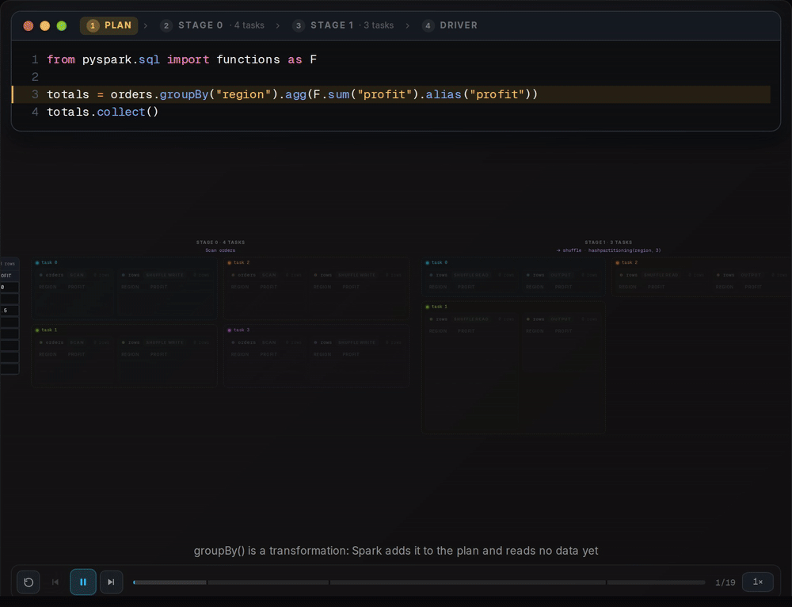
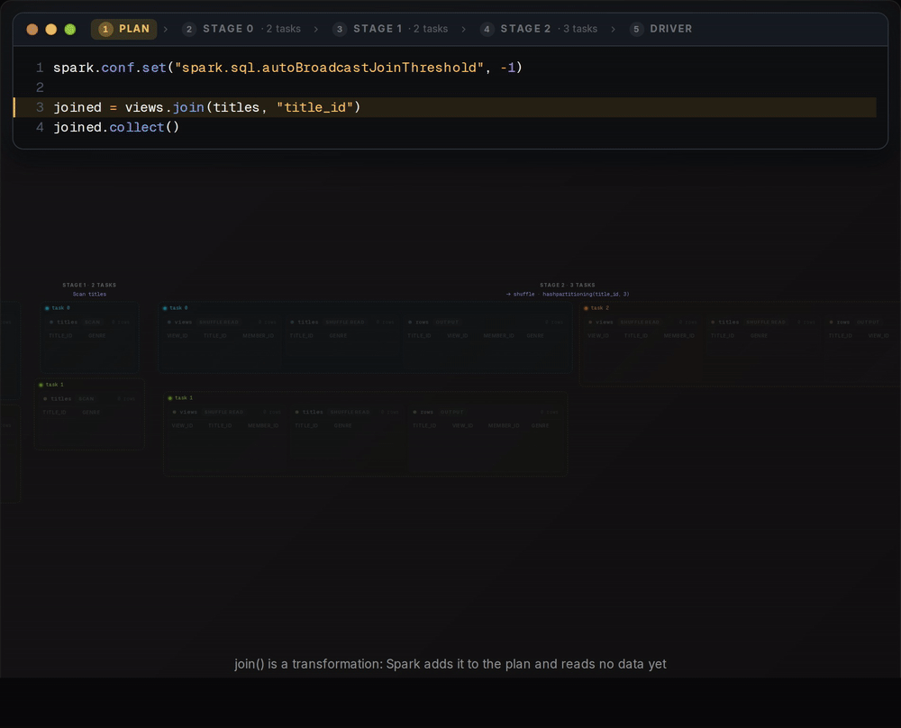
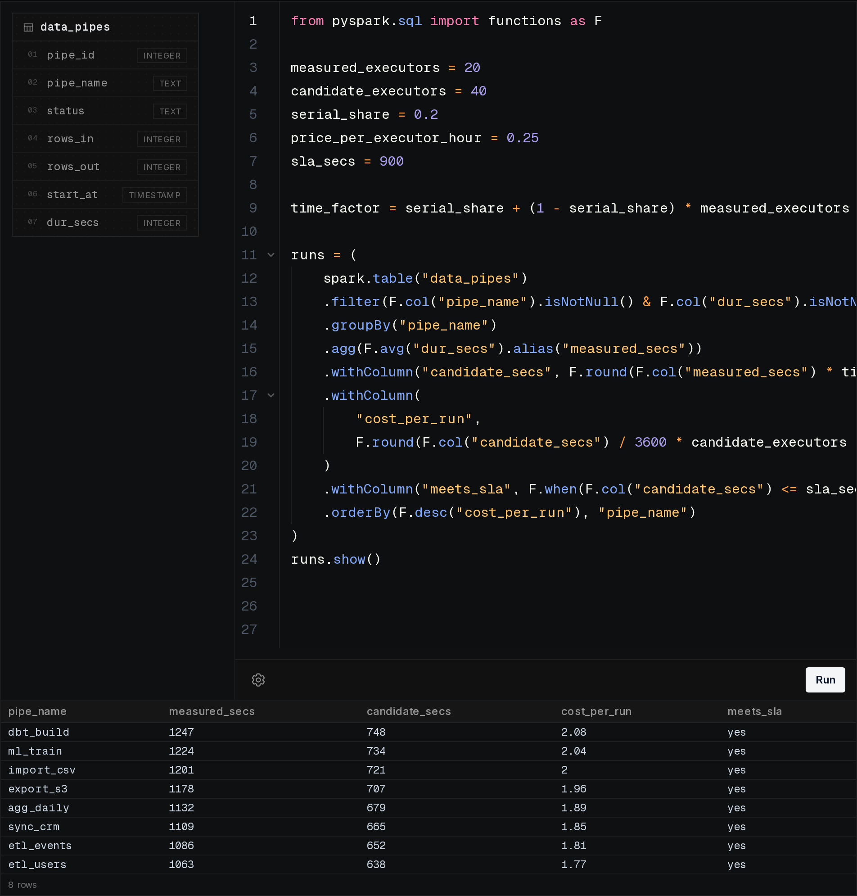

Advanced·Spark · 14 min · 13 challenges

# Cluster Sizing: Advanced

Take the 2 a.m. job at Netflix that rebuilds every member's viewing history: it must land within 45 minutes, before morning dashboards read it. It runs on cheap spot nodes and grows from 2 executors to 50 in seconds. At 2:20 the cloud reclaims a node holding shuffle files its last stage needs. Whether the job finishes, and what each run costs, was decided in its config before it started.


<br>

---

## Dynamic Allocation

On a fixed cluster you choose spark.executor.instances at startup and pay for every executor until the application exits, busy or not. Dynamic allocation hands that count to the driver, which watches its own task queue, requests executors from the cluster manager when tasks wait, and releases executors that have nothing to run. Cluster size then follows the work in flight, stage by stage.


<br>

### The number the driver targets

At any moment the driver knows how many tasks are running and how many are pending. One executor runs spark.executor.cores divided by spark.task.cpus tasks at once, usually 4 divided by 1. Divide running plus pending tasks by that and round up: the result is the executor count that would run every task in a single wave. Spark multiplies it by executorAllocationRatio (1 by default), caps it at maxExecutors and floors it at minExecutors. A ratio of 0.5 asks for half as many executors and accepts 2 waves instead of 1.

```sql
from pyspark.sql import SparkSession

spark = (
    SparkSession.builder
    .appName("nightly_rollup")
    .config("spark.executor.cores", "4")
    .config("spark.dynamicAllocation.enabled", "true")
    .config("spark.dynamicAllocation.shuffleTracking.enabled", "true")
    .config("spark.dynamicAllocation.minExecutors", "2")
    .config("spark.dynamicAllocation.maxExecutors", "50")
    .config("spark.dynamicAllocation.executorIdleTimeout", "60s")
    .config("spark.dynamicAllocation.schedulerBacklogTimeout", "1s")
    .getOrCreate()
)
```

Most of the risk sits in 3 of these lines. maxExecutors defaults to unlimited, so a stage of 10,000 tasks on 4-core executors asks for 2,500 of them. minExecutors defaults to 0, and every executor below the floor is one the next job waits for. The shuffle line is there because releasing an executor deletes the shuffle files it wrote, and later stages still read them. Spark runs dynamic allocation only when something protects those files. That is usually the external shuffle service serving them from each node, or shuffle tracking, which keeps an executor alive while a running job still needs its files. Decommissioning with shuffle migration also qualifies. Name one explicitly so the behaviour does not shift between Spark versions.


<br>

### Ramp-up doubles every round

Once tasks have waited schedulerBacklogTimeout (1 second by default), the driver requests 1 more executor. If tasks are still waiting after sustainedSchedulerBacklogTimeout (also 1 second), it adds 2, then 4, then 8, doubling each round until it reaches the target. Starting at 1 keeps a short burst from setting off a large request, and doubling reaches a large target within a few rounds. Here is the rollup's 800-task first stage on the settings above, starting from the floor of 2:

| Round | Seconds after tasks queue | Executors added | Total requested |
| --- | --- | --- | --- |
| 1 | 1 | 1 | 3 |
| 2 | 2 | 2 | 5 |
| 3 | 3 | 4 | 9 |
| 4 | 4 | 8 | 17 |
| 5 | 5 | 16 | 33 |
| 6 | 6 | 17 | 50 |

800 tasks over 4 slots would need 200 executors, so the cap of 50 binds and round 6 adds 17 instead of 32. All 6 requests go out within 6 seconds. Idle nodes start executors within seconds, but a new machine takes a minute or more to arrive after its request. The machines from different rounds provision in parallel, so the ramp waits about one provisioning delay, and stage 1 runs on whatever has landed.


<br>

### Drain-down waits on the idle timer

An executor that has run no task for executorIdleTimeout, 60 seconds by default, is released unless one of 3 things holds it: the minExecutors floor, shuffle files a running job still needs under shuffle tracking, or cached blocks, which have a timer of their own. Drain is slower than ramp by design: a full minute of quiet passes before anything leaves.

The animation runs a groupBy over 4 input partitions with 3 shuffle partitions. Count the tasks in each stage as it plays: 4 map tasks, then 3 reducers. That per-stage count, divided by slots per executor, is what the driver chases, so the target moves at every stage boundary that changes the task count.



Scale it up to a job with a map stage of 800 tasks, a groupBy stage of 200, then a final stage of 8 tasks after repartition(8) that writes 8 files. With a cap of 50 the target runs 50, 50, then 2. The fate of the other 48 depends on how shuffle files are protected, because the final stage reads the 200-task stage's output from every executor that wrote it.

| ✓ External shuffle service | ✗ Shuffle tracking |
| --- | --- |
| • The service on each node serves the 200-task stage's output<br><br>• The idle executors leave 60 seconds after their last task<br><br>• A 20-minute final stage runs on 2 executors | • The output lives only inside the executors that wrote it<br><br>• All 48 hold shuffle data the running job needs, so they stay<br><br>• A 20-minute final stage pays for 50 executors, roughly 15 extra executor-hours |

> **TIP**
>
> The Jobs page of the Spark UI has an event timeline marking each executor added and removed. Read it against the stage bars to see whether ramp-up lagged the first stage or executors outlived the work.

**A job runs with spark.executor.cores=4, minExecutors=0, maxExecutors=30 and the default backlog timeouts, on a cluster with idle capacity. A stage submits 200 tasks. How many executors has the driver requested 4 seconds after the tasks queue, and where does the target settle?**

- **A.** Requested 7 at 4 seconds; the target settles at 50, since 200 tasks need 50 executors of 4 slots
- **B.** Requested 15 at 4 seconds; the target settles at 30, the maxExecutors cap
- **C.** Requested 15 at 4 seconds; the target settles at 50, since the cap limits only the first round
- **D.** Requested 30 after 1 second, because Spark asks for the full target at once when capacity is free

<details>
<summary>Solution</summary>

**B.** Requested 15 at 4 seconds; the target settles at 30, the maxExecutors cap

Rounds at 1, 2, 3 and 4 seconds add 1, 2, 4 and 8. The next round would add 16 but stops at 30, below the 50 the tasks would need.

**Why the others are wrong**

- **A.** Rounds of 1, 2, 4 and 8 add up to 15, and the cap of 30 overrides the 50 that full parallelism would ask for.
- **C.** The count at 4 seconds is right, but maxExecutors caps the target for the whole application, so it stops at 30.
- **D.** Free capacity speeds how fast executors arrive. Requests still start at 1 and double each round.

</details>


<br>

---

## Scale-Down With Cached Data

One setting decides whether a cache can shrink a cluster: spark.dynamicAllocation.cachedExecutorIdleTimeout. Its default is infinity. An executor holding a single cached block never reaches the idle rule, however long it waits for a task. Spark keeps it because removal would destroy data you asked it to keep, and Spark has no way to know whether you will read that data again.


<br>

### One cache freezes the cluster at its peak

Cached blocks live on the executors that ran the tasks computing them. Cache a 400-partition DataFrame while 50 executors are running, and roughly 8 partitions land on each. Every one of the 50 now holds a block, so every one is exempt from removal. Whatever size the cluster had when the cache filled is the size it keeps.

A weekly member-scoring job shows the pattern. It caches active titles, uses them in an early join, runs a 2-hour scoring step that never touches them, and reads them once more for a final report.

```sql
titles = spark.read.parquet("/warehouse/titles").filter("is_active").cache()
titles.count()

daily = events.join(titles, "title_id").groupBy("title_id", "event_day").count()
daily.write.mode("overwrite").parquet("/warehouse/daily_title_counts")

scores = score_members(members)
scores.write.mode("overwrite").parquet("/warehouse/member_scores")

report = scores.join(titles, "title_id").groupBy("genre").count()
report.write.mode("overwrite").parquet("/warehouse/genre_report")
```

The count() fills the cache across all 50 executors. The scoring step's tasks occupy 4 executors for 2 hours, so the target drops to 4 and the other 46 run nothing. With the default timeout all 46 stay, because each holds part of titles. The table prices the 2-hour step at $0.25 per executor-hour under 3 choices.

| Choice | Executors held during scoring | Executor-hours | Cost of the step |
| --- | --- | --- | --- |
| Default, timeout infinite | 50 | 100 | $25.00 |
| `cachedExecutorIdleTimeout=5min` | 4, after 5 minutes | 11.8 | $2.96 |
| `unpersist()` after the daily write | 4, after 60 seconds | 8.8 | $2.19 |

- **92%** — idle share of default executor-hours

Both releasing choices pay a recompute: the final report reads titles again and rebuilds the missing partitions from lineage, which here means re-reading one filtered table. Releasing cached executors is cheap when the cached data is cheap to rebuild, and expensive when it sits at the end of hours of joins.

**A notebook session uses dynamic allocation with every other setting at its default. At 9:00 it caches a 200-partition DataFrame while 40 executors are running, runs 3 queries on it by 9:20, and then sits open with no activity. How many executors does it hold at 15:00?**

- **A.** Only minExecutors: every executor that ran no task after 9:20 passed the 60-second rule and left
- **B.** Holds 40 until 9:50, then drops to minExecutors once a default 30-minute cache expiry frees the blocks
- **C.** Holds 20, because Spark releases half of the cached executors and migrates their blocks to the rest
- **D.** All 40: each one holds cached blocks, and cachedExecutorIdleTimeout is infinite by default

<details>
<summary>Solution</summary>

**D.** All 40: each one holds cached blocks, and cachedExecutorIdleTimeout is infinite by default

The 200 partitions spread across all 40 executors, so every one is exempt from idle removal until the blocks are released.

**Why the others are wrong**

- **A.** The 60-second rule never applies to an executor holding cached blocks while cachedExecutorIdleTimeout is infinite.
- **B.** Cached blocks have no expiry. They stay until unpersist(), eviction or a finite cachedExecutorIdleTimeout.
- **C.** Spark migrates blocks only during decommissioning, and only from executors it has already chosen to remove.

</details>


<br>

### 4 ways to release them

- unpersist() after the last read that needs the blocks. The 60-second rule applies again at once. Best when the cache has a clear last use.
- A finite cachedExecutorIdleTimeout. Executors that run no task for that long leave with their blocks, and later reads recompute them. Set it longer than the gap between stages that read the cache.
- A write and read-back in place of the cache. The data lives in storage, so no executor holds it; a reliable checkpoint() behaves the same, while localCheckpoint() keeps blocks on executors and pins them like a cache.
- A finite timeout plus spark.decommission.enabled, spark.storage.decommission.enabled and spark.storage.decommission.rddBlocks.enabled: from Spark 3.1, an executor released this way copies its cached blocks to survivors first. Survivors need free storage memory, or the copies evict other blocks.

*Locality sends each task that reads a cached partition to the executor holding it, so while stages keep reading the cache, those executors stay busy and neither idle timer fires on them.*

With the external shuffle service, spark.shuffle.service.fetch.rdd.enabled=true serves DISK_ONLY cached blocks after their executor leaves, so executors whose blocks sit only on disk follow the 60-second rule. Blocks in memory still pin.


<br>

---

## Spot Instances

Spot capacity is a provider's spare machines, sold at a discount that providers advertise at up to 90 percent below on-demand prices, on condition that the provider can take them back. Notice runs from 30 seconds to 2 minutes depending on the provider, and then the node is gone with every executor on it and every file on its local disks.


<br>

### What one reclaim takes

| Lost with the node | What Spark does | What it costs |
| --- | --- | --- |
| Tasks running on it | Reschedules them on other executors | The work those tasks had done |
| Shuffle files it wrote | Reducers hit fetch failures; Spark reruns the lost map tasks, then retries the stage | Those map tasks plus a stage attempt |
| Its external shuffle service | Nothing to fall back on: the service died with the node | Same as the shuffle files |
| Cached blocks | Recomputes them from lineage at the next read | Lineage back to the last durable copy |
| The driver, if it ran there | The application ends | The whole run |

The shuffle row is where jobs die. Each fetch failure fails the reading stage's attempt, and spark.stage.maxConsecutiveAttempts (4 by default) aborts the job after 4 consecutive failed attempts of one stage. A reclaim wave that takes several nodes over a few minutes can fail the same stage repeatedly, because each retry reruns map tasks on nodes that may go next.

Each map task writes its shuffle output to the executor it ran on. In the join below broadcast is off, so both tables shuffle by title_id, and each of the 3 reducers fetches its share from every map task. Whichever node holds a map task's output is a dependency of every reducer.



If the executor that ran one views map task is reclaimed after the map stage, each reducer misses the rows that task wrote. Spark reruns that single map task, then the reducer attempts that failed. Lose 1 node out of 12 and about a twelfth of the map stage reruns; lose 4 at once and a third of it reruns while the reducers wait.


<br>

### 4 decisions for a spot fleet

- **Driver on on-demand** *Never discount the one process the job cannot lose*\
  Losing the driver ends the application. Every other node can come and go.
- **An on-demand floor** *Its size sets the worst case*\
  Decide how long the job may take if every spot node vanishes, and keep enough on-demand executors to meet that.
- **Several spot pools** *Mix machine types and zones*\
  Reclaims follow demand for one machine type in one zone, so 4 pools of 5 nodes lose 5 at a time where 1 pool of 20 can lose all 20.
- **Smaller nodes** *Fewer executors per reclaim*\
  A node with 8 executors takes 8 executors' shuffle files with it; 2 nodes of 4 halve each loss.


<br>

### Turn the notice into a migration

Graceful decommissioning, available since Spark 3.1, uses the notice. The executor stops accepting tasks and, with storage decommissioning on, copies its shuffle files and cached blocks to other executors, or to a fallback path in durable storage when no peer has room. Reducers then fetch from the new location and no map task reruns. This works only if the cluster manager passes the notice to Spark and the copy finishes inside the window, and an executor holding 30GB of shuffle output may not make it in 30 seconds. The config below also raises maxConsecutiveAttempts to 8, so a reclaim wave gets more attempts before the job aborts.

```sql
from pyspark.sql import SparkSession

spark = (
    SparkSession.builder
    .appName("nightly_rollup")
    .config("spark.decommission.enabled", "true")
    .config("spark.storage.decommission.enabled", "true")
    .config("spark.storage.decommission.shuffleBlocks.enabled", "true")
    .config("spark.storage.decommission.rddBlocks.enabled", "true")
    .config("spark.storage.decommission.fallbackStorage.path", "file:///mnt/shared/spark-fallback/")
    .config("spark.stage.maxConsecutiveAttempts", "8")
    .getOrCreate()
)
```

For a job whose late stages sit on hours of earlier work, a reliable checkpoint() or a write and read-back at the midpoint puts a durable copy outside the cluster. A reclaim after that point recomputes from the copy instead of from the source. Spot lowers the price of each executor-hour and raises the expected rework; durable midpoints cap the rework.


<br>

### Price the fleet, including the rework

Size the rollup's fleet at 25 executors, where it runs in 28 minutes, against a deadline of 45 minutes. Take on-demand executors at $0.25 an hour and spot at $0.08, and assume reclaims stretch any run with spot in it by 15 percent, to about 32 minutes.

| Fleet | Fleet price per hour | Expected runtime | Expected cost | If every spot node vanishes |
| --- | --- | --- | --- | --- |
| 25 on-demand | $6.25 | 28 min | $2.92 | No effect |
| 15 on-demand + 10 spot | $4.55 | 32 min | $2.43 | 15 executors finish in 43 min |
| 8 on-demand + 17 spot | $3.36 | 32 min | $1.79 | 8 executors finish in about 69 min |
| 25 spot | $2.00 | 32 min | $1.07 | Stalls until spot capacity returns |

Every spot fleet is cheaper per run, but the last column tells you which ones you may use. If the 45-minute deadline must hold on the worst night, 15 on-demand executors is the smallest floor that keeps it, and spot can only add speed on top. If the deadline can slip on a bad night, the 8-executor floor saves another 64 cents a run.

**A 3-hour job runs 40 spot executors on 5 large nodes, with its driver on on-demand and the external shuffle service enabled. In its last hour, reclaims hit 2 nodes a few minutes apart during the final shuffle stage, and the job aborts. Which change most directly keeps it alive?**

- **A.** Spread the executors over more, smaller nodes in several spot pools, so each reclaim loses fewer shuffle files
- **B.** Keep the nodes and rely on the external shuffle service to serve their files after a reclaim
- **C.** Spread over smaller nodes, and set spark.stage.maxConsecutiveAttempts to 1 so failures surface sooner
- **D.** Move the driver onto spot as well, so it restarts lost stages closer to the executors

<details>
<summary>Solution</summary>

**A.** Spread the executors over more, smaller nodes in several spot pools, so each reclaim loses fewer shuffle files

Each node took 8 executors' shuffle output. Smaller nodes in separate pools shrink each loss, so the stage's retries can finish before the next reclaim.

**Why the others are wrong**

- **B.** The service runs on the node. When the node goes, the service and its files go with it.
- **C.** Smaller nodes help, but 1 attempt aborts the job on the first fetch failure. Spot jobs need more attempts.
- **D.** Driver location does not speed retries, and losing the driver ends the application.

</details>


<br>

---

## Batch Scales, Streaming Does Not

Dynamic allocation is built for one load shape: work comes in stages whose task counts jump, and between stages or between jobs, executors go quiet for longer than a minute. Batch jobs have that shape. A streaming application has the opposite one: it stays up for days and starts a small job every few seconds as new input arrives, so every executor is touched again and again and none goes quiet.


<br>

### A stream never trips the idle timer

Take a stream that starts a job every 10 seconds, each finishing in 4 seconds across all executors. No executor ever goes 60 seconds without a task, so none is released. At 8 p.m. input doubles, tasks queue, and the driver requests more executors. Say provisioning takes 2 minutes: that is 12 of the stream's 10-second windows, and the backlog grows while help is on its way. Once the new executors land they receive tasks every 10 seconds like the rest, and they stay through the quiet night. The cluster ratchets up to its largest spike and never comes back down.

| ✓ Nightly batch job | ✗ Always-on stream |
| --- | --- |
| • Ends after 30 minutes to a few hours and releases everything<br><br>• Work arrives as stages whose task counts are known when each starts<br><br>• Quiet gaps after wide stages let idle executors pass 60 seconds<br><br>• A 2-minute wait for new nodes delays a 28-minute run by under 10 percent | • Runs for weeks with no end point at which to release resources<br><br>• Work arrives every few seconds and follows the input rate<br><br>• Every executor gets a task in each window, so none reaches 60 seconds idle<br><br>• A 2-minute wait for new nodes spans 12 windows of a 10-second stream |


<br>

### Sizing the fixed cluster a stream needs

Size a stream from its peak. Measure the task-seconds one window needs at the busiest hour, divide by the window length to get the slots that must be busy, and add headroom so a slow window or a restart can be caught up while new input keeps arriving.

| Step | Value |
| --- | --- |
| Peak work in one 10-second window | 180 task-seconds |
| Slots busy at peak | 180 / 10 = 18 |
| With 50% headroom | 18 x 1.5 = 27 slots |
| Executors of 4 cores | 7, giving 28 slots |
| Time used per window at peak | 180 / 28 = 6.4 of 10 seconds |

The headroom is what clears a backlog. At peak, 28 slots do 28 task-seconds of work each second while 18 arrive, so the cluster works off 10 task-seconds of backlog per second. With no headroom, a backlog formed at peak lasts until input falls.


<br>

### Deciding per workload

| Workload | Load shape | Cluster | Starting settings |
| --- | --- | --- | --- |
| Nightly batch with uneven stages | One 800-task stage, then far fewer | Dynamic | min 2, max at the deadline size |
| Shared notebook, ad hoc queries | Bursts with long quiet gaps | Dynamic | min 0, cached timeout 30min |
| Tight-deadline batch, same every night | Predictable, little slack | Dynamic with min at the deadline size, or fixed | No ramp wait at the start |
| Many jobs under a minute each | Short bursts | Fixed and small | Ramp would outlast the work |
| Iterative training on a cache | Steady, cache-bound | Fixed | Cached executors stay anyway |
| Always-on stream | Follows the input rate | Fixed, peak plus headroom | No dynamic allocation timer fires |

> **TIP**
>
> Keep a stream fixed and run its reprocessing and backfills as separate batch applications with dynamic allocation, so their extra capacity leaves when they finish.

**Which of these workloads gains the most from dynamic allocation, on a cluster that runs the external shuffle service?**

- **A.** A stream that processes payment events every 5 seconds, around the clock
- **B.** A 3-minute job that runs every 5 minutes all day on the same data
- **C.** A nightly backfill whose first stage has 2,000 tasks and whose last writes 16 files over 40 minutes
- **D.** A training job that caches its input once and then reads it in 50 passes

<details>
<summary>Solution</summary>

**C.** A nightly backfill whose first stage has 2,000 tasks and whose last writes 16 files over 40 minutes

Demand swings from hundreds of executors to 4, and the shuffle service lets the idle ones leave during the long last stage.

**Why the others are wrong**

- **A.** Every executor gets a task every 5 seconds, so none is idle long enough to leave, and new ones arrive too late for a spike.
- **B.** Each 2-minute gap releases executors the next run must request again, so every run pays a ramp-up. A small fixed cluster fits better.
- **D.** Every executor holds cached blocks and keeps getting tasks, so the cluster never shrinks. A fixed cluster gives the same bill with fewer moving parts.

</details>


<br>

---

## Cost per Run

Cost per run is executor-hours times the price of one executor-hour, plus the driver's node for the whole runtime. On a fixed cluster, executor-hours is executor count times runtime. Under dynamic allocation it is the area under the executor timeline, which grows during wide stages and shrinks during quiet ones.


<br>

### Runtime from waves

Each stage runs in waves, ceil(tasks / slots) of them, each as long as one task, so stage time is waves times task duration. Add serial time, the minutes when 1 task or only the driver is working: planning, a single-file write, a final collect(). Runtime is the sum, and on a fixed cluster cost is executors times runtime times price.

Apply it to the nightly rollup: stage A has 800 tasks of 1.5 minutes, stage B has 200 tasks of 3 minutes, and 10 minutes are serial. Executors have 4 cores and cost $0.25 per hour. The deadline is 45 minutes.

| Executors | Slots | Stage A | Stage B | Runtime | Cost per run | Meets 45 min |
| --- | --- | --- | --- | --- | --- | --- |
| 10 | 40 | 20 waves, 30 min | 5 waves, 15 min | 55 min | $2.29 | No |
| 15 | 60 | 14 waves, 21 min | 4 waves, 12 min | 43 min | $2.69 | Yes |
| 20 | 80 | 10 waves, 15 min | 3 waves, 9 min | 34 min | $2.83 | Yes |
| 25 | 100 | 8 waves, 12 min | 2 waves, 6 min | 28 min | $2.92 | Yes |
| 50 | 200 | 4 waves, 6 min | 1 wave, 3 min | 19 min | $3.96 | Yes |
| 100 | 400 | 2 waves, 3 min | 1 wave, 3 min | 16 min | $6.67 | Yes |

The cheapest size that meets the deadline is 15 executors. Cost climbs with size for 2 reasons the table shows. The 10 serial minutes are billed at the full cluster, so every executor added pays for them while it waits. Partial waves add the rest: at 15 executors the last wave of stage A runs 20 tasks on 60 slots, and at 100 executors stage B's 200 tasks leave half of 400 slots idle. Work that fills whole waves costs the same at any size, while idle slots grow with it.

- **$4.17 of $6.67** — paid during serial time at 100 executors


<br>

### What dynamic allocation changes

With dynamic allocation, the external shuffle service, a 60-second idle timeout and minExecutors=1, serial time stops costing the full cluster: 1 executor runs the serial task and the rest leave after a minute. Set maxExecutors to the size, and the bill becomes the parallel executor-minutes plus a small serial tail:

| maxExecutors | Parallel executor-minutes | Serial executor-minutes | Cost per run | Runtime |
| --- | --- | --- | --- | --- |
| 15 | 495 | 24 | $2.16 | 43 min |
| 25 | 450 | 34 | $2.02 | 28 min |
| 50 | 450 | 59 | $2.12 | 19 min |

The cheapest size is now 25, faster than 15 and cheaper. Its 100 slots divide stage A's 800 tasks into exactly 8 waves and stage B's 200 into exactly 2, so no slot waits in a partial wave; at 15 the partial waves cost 45 executor-minutes. Under dynamic allocation, pick maxExecutors so the largest stages divide into whole waves. The model ignores ramp-up, and if the serial step reads stage B's shuffle output under shuffle tracking, all 25 stay through it and the saving disappears. The driver adds its own price per minute: $0.12 on the 28-minute run, $0.18 on the 43-minute one.


<br>

### Try it on recorded runs

The cell applies the same model to data_pipes, whose dur_secs column records each pipeline run's duration. It assumes every run was measured on 20 executors with 20 percent of its time serial, projects each pipeline's average onto a candidate size, and prices it. Run it at 40, then set candidate_executors to 10: runtime grows and cost falls. At 80, runtime shrinks toward the serial floor while cost grows, because the serial share is billed at every executor.



```python
from pyspark.sql import functions as F

measured_executors = 20
candidate_executors = 40
serial_share = 0.2
price_per_executor_hour = 0.25
sla_secs = 900

time_factor = serial_share + (1 - serial_share) * measured_executors / candidate_executors

runs = (
    spark.table("data_pipes")
    .filter(F.col("pipe_name").isNotNull() & F.col("dur_secs").isNotNull())
    .groupBy("pipe_name")
    .agg(F.avg("dur_secs").alias("measured_secs"))
    .withColumn("candidate_secs", F.round(F.col("measured_secs") * time_factor, 0))
    .withColumn(
        "cost_per_run",
        F.round(F.col("candidate_secs") / 3600 * candidate_executors * price_per_executor_hour, 2),
    )
    .withColumn("meets_sla", F.when(F.col("candidate_secs") <= sla_secs, "yes").otherwise("no"))
    .orderBy(F.desc("cost_per_run"), "pipe_name")
)
runs.show()
```

Choosing the cluster, step by step

- Measure 1 run: tasks and median task time for each stage, and the serial minutes.
- Tabulate runtime and cost for 4 to 6 candidate sizes.
- Drop every size that misses the deadline once you add margin for ramp-up and retries.
- Take the cheapest of the rest; under dynamic allocation, set maxExecutors so big stages fill whole waves.
- Price spot last: fleet price times runtime stretched by your measured rework, against the floor you can accept.

**The nightly rollup must finish within 45 minutes even if every spot node disappears. On-demand executors cost $0.25 an hour and spot $0.08, and spot in the fleet stretches a run by around 15 percent. Which of these designs meets that at the lowest expected cost?**

- **A.** Run 25 spot executors and an on-demand driver: $1.07 a run, the lowest price of the four
- **B.** Run 8 on-demand plus 17 spot: $1.79 a run, with an on-demand floor that keeps the job alive
- **C.** Run 15 on-demand plus 10 spot on a fixed cluster: $2.43 a run, and the 15 alone finish in 43 minutes
- **D.** Run 25 on-demand under dynamic allocation with maxExecutors 25: about $2.02 a run, with no spot to lose

<details>
<summary>Solution</summary>

**D.** Run 25 on-demand under dynamic allocation with maxExecutors 25: about $2.02 a run, with no spot to lose

No spot means no worst case to cover, and releasing executors during serial time saves more than the spot discount here: $2.02 against $2.43.

**Why the others are wrong**

- **A.** Cheapest, but with no on-demand floor the job stalls when spot vanishes, which breaks the 45-minute promise.
- **B.** The floor keeps the job alive, but 8 executors alone take about 69 minutes, past the deadline.
- **C.** It keeps the deadline in the worst case, but it pays for 25 executors through the 10 serial minutes.

</details>


<br>

---

## Putting It All Together

A video streaming company runs 2 Spark workloads on one cluster manager: an always-on stream that counts playback starts per title, and the nightly rollup that rebuilds viewing history before morning dashboards. Finance asks why last month's compute bill doubled. The job history shows the weekly scoring job holding 50 executors through its 2-hour scoring step, the stream grown to 3 times its usual size after a holiday spike, and the rollup failing twice on spot nodes reclaimed during its final shuffle.

- The scoring job kept 50 executors because its early cache pinned them; a finite cachedExecutorIdleTimeout or a write and read-back releases 46 of them.
- The stream ratcheted up because no executor ever sat idle for 60 seconds; it moves to a fixed 7-executor cluster, and backfills run as separate elastic applications.
- The rollup's failures came from shuffle files lost with reclaimed spot nodes. Priced against its 45-minute deadline, the spot fleet that stays safe saves less than releasing serial time does, so the rollup moves off spot to all on-demand executors.
- Under dynamic allocation with maxExecutors at 25, those on-demand executors leave during serial time, so the rollup costs roughly $2.02 a run against $2.43 for the safe spot fleet and finishes in 28 minutes, inside its 45-minute deadline.


<br>

---

## Key Takeaways

- Dynamic allocation targets running plus pending tasks divided by slots per executor, capped by maxExecutors ; requests start at 1 and double each round.
- Executors leave after 60 idle seconds unless the floor, shuffle files a running job needs, or cached blocks hold them.
- cachedExecutorIdleTimeout is infinite by default, so a cache pins the cluster at the size it had when the cache filled.
- A spot reclaim destroys the node's shuffle files, its shuffle service and its cached blocks; the driver belongs on on-demand, and the on-demand floor sets the worst case.
- A stream touches every executor every few seconds, so dynamic allocation only ratchets it upward; give it a fixed cluster sized to peak plus headroom.
- Cost per run is the area under the executor timeline, and serial minutes and partial waves are what make bigger clusters cost more.
