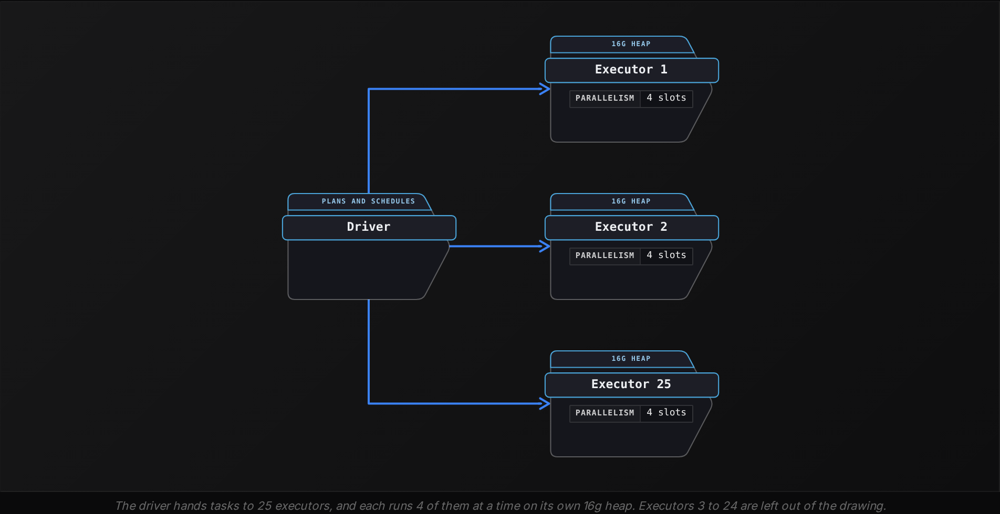
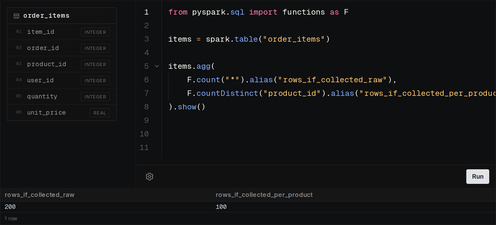

Beginner·Spark · 12 min · 11 challenges

# Cluster Sizing: Beginner

At Netflix, a data engineer's nightly Spark job rolls a day of playback events, about 200GB, into watch minutes per title. On its tuned cluster the rollup took a few minutes. Copied into a fresh notebook that sets no resources, it is still running at breakfast, with 2 tasks moving out of 1,600. The whole gap comes down to 3 settings, chosen before the session starts.


<br>

---

## Executors, Cores, and Memory

An executor is a JVM process that the cluster starts for your application and keeps running until the application ends. Each executor owns some CPU cores and a fixed block of memory, and the driver sends it work as tasks, 1 task per partition. Spark lets you choose how many executors start, how many cores each one gets, and how much memory each one gets, through 3 settings. This lesson calls them the 3 knobs, because together they decide how much of the cluster your job can use.

| Knob | What it sets | What it limits |
| --- | --- | --- |
| `spark.executor.instances` | How many executor processes start | The job's totals, by multiplying the other 2 knobs |
| `spark.executor.cores` | CPU cores in each executor | How many tasks 1 executor runs at the same moment |
| `spark.executor.memory` | Heap size of each executor's JVM | How much data the tasks on that executor hold at once |


<br>

### Cores turn into slots

Each core runs 1 task at a time. An executor with 4 cores works on 4 partitions side by side, and its next task waits until one of those 4 finishes. Across the whole job, executors multiplied by cores gives the slot count, the ceiling on how many tasks run at any instant. A machine in the cluster that these knobs did not claim adds nothing to that count, however many cores it has.


<br>

### Memory belongs to the executor

`spark.executor.memory` sets the heap of 1 executor JVM. Every task running on that executor draws from it, and so does any data you cached there. Tasks on different executors share nothing: a task on executor 3 cannot borrow free memory from executor 7. Spark reads the value as a size string such as `16g` or `512m`; write the unit every time, so the next reader doesn't have to guess it.


<br>

### A configured session

This is the session for the nightly rollup from the intro. The knobs go on the builder, before `getOrCreate()` starts the application, and each value is passed as a string.

```sql
from pyspark.sql import SparkSession

spark = (
    SparkSession.builder
    .appName("nightly_watch_time")
    .config("spark.executor.instances", "25")
    .config("spark.executor.cores", "4")
    .config("spark.executor.memory", "16g")
    .getOrCreate()
)
```

Executors times cores bounds how fast a stage moves, and executors times memory bounds how much data the job can hold across the cluster at once. Between them, those 2 products tell you what this session can do.

- **100** — tasks running at once
- **400GB** — executor heap across the job




<br>

### Reading a config at a glance

Configs found in older notebooks read the same way. Here are 3, each reduced to its 2 products:

| Instances | Cores | Memory | Slots | Total heap |
| --- | --- | --- | --- | --- |
| 4 | 8 | 32g | 32 | 128GB |
| 50 | 2 | 8g | 100 | 400GB |
| 10 | 16 | 16g | 160 | 160GB |

The middle row matches the nightly rollup on both products, carved into 50 smaller executors where the rollup uses 25 larger ones. The last row has the most slots and the least memory, which the Memory per Core section shows is the shape most likely to run out of room.

To confirm the knobs took effect, open the Executors tab of the Spark UI, which lists 1 row per executor with its core count. Its memory column shows less than the heap you set, because it counts only the part Spark manages for running tasks and cached data; a later lesson takes that part apart.

> **TIP**
>
> Change the 3 knobs as a set. Raising `spark.executor.cores` while memory stays put loads more tasks onto the same heap, and the Memory per Core section shows how that turns a passing job into a failing one.

**A job runs on 10 executors, each with 2 cores and 8g of memory. You change only spark.executor.cores to 4 and restart. What does the job get now?**

- **A.** Total memory doubles to 160GB, because each added core brings its own share of heap.
- **B.** Slots double from 20 to 40, while total executor memory stays at 80GB.
- **C.** Slots double to 40, and each executor's heap grows to 16GB to feed them.
- **D.** Nothing changes until spark.executor.instances is raised as well.

<details>
<summary>Solution</summary>

**B.** Slots double from 20 to 40, while total executor memory stays at 80GB.

Slots are executors times cores, so 10 times 4 gives 40. Memory is executors times 8g, and neither of those changed.

**Why the others are wrong**

- **A.** Memory is set per executor by spark.executor.memory, which you left at 8g. The 10 executors still hold 80GB between them.
- **C.** The slot count is right, but heap size comes only from spark.executor.memory. Each executor keeps 8g, now shared by 4 tasks instead of 2.
- **D.** Each knob acts on its own. More cores per executor raises the slot count with the executor count fixed at 10.

</details>


<br>

---

## The Default Resources

Leave every resource setting out of the builder and Spark still starts, using values from its documentation. Those values are small, so an application that asks for nothing can start on almost any cluster, including a busy shared one. The same small request is also what your production job receives when nobody overrides it.

| Setting | Default | What the job gets |
| --- | --- | --- |
| `spark.executor.instances` | 2 | 2 executors |
| `spark.executor.cores` | 1 | 1 slot in each executor, 2 in the job |
| `spark.executor.memory` | 1g | 1GB of heap per executor |
| `spark.driver.memory` | 1g | 1GB of heap for the driver |

*These defaults apply when executors are requested at a fixed count. In standalone mode an executor takes every free core on its worker unless spark.executor.cores is set, and local[\*] on a laptop runs 1 process with a slot per CPU core.*


<br>

### 2 slots against 1,600 tasks

Put the nightly rollup on those defaults. It reads 200GB of Parquet in 128MB partitions, so its first stage has 1,600 tasks. Suppose each task takes 20 seconds whichever executor runs it. With 2 slots, the stage completes 2 tasks every 20 seconds and needs 800 turns to get through them all. The configured session from the previous section completes 100 per turn and needs 16.

- **4h 27m** — first stage on the defaults
- **5m 20s** — first stage on the configured session

No knobs set

| Resource | Value |
| --- | --- |
| Executors | 2 |
| Cores each | 1 |
| Slots | 2 |
| Heap each | 1GB |
| Turns for 1,600 tasks | 800 |

Nightly rollup config

| Resource | Value |
| --- | --- |
| Executors | 25 |
| Cores each | 4 |
| Slots | 100 |
| Heap each | 16GB |
| Turns for 1,600 tasks | 16 |

The job in this calculation never errors out. It runs, writes correct output, and finishes hours late, which is why the defaults go unnoticed: there's no error message to search for, only a stage whose progress bar barely moves.


<br>

### The cluster sits idle

The slot count caps speed, whatever hardware sits behind it. Run the defaults on a cluster of 10 machines with 16 cores each and the job occupies 2 of the 160 cores; the other 158 stay free for other teams' jobs, or for nobody. Adding machines changes nothing either, since the job never asked for them.


<br>

### Memory runs short too

Each default executor has a 1GB heap, and Spark keeps part of every heap for its own use before any task sees it. A task that only reads and filters passes rows through and needs little. A task that groups, joins or sorts holds rows while it works, and a 128MB Parquet partition takes more room once it is decompressed and decoded. On the defaults that task slows down or fails with an out-of-memory error, and adding executors does nothing for what 1 task can hold.


<br>

### Spotting the defaults

> Signs a job is running on defaults
>
> - The Executors tab lists 2 executors, each showing 1 core.
> - A stage's progress bar never shows more than 2 tasks running.
> - The session code and the launch command contain no `spark.executor.*` setting.
> - Each task's duration looks normal while the stage as a whole takes hours.

**A job reads 40GB in 128MB partitions, each task takes 30 seconds, and the session sets no resource knobs. Roughly how long does the first stage take?**

- **A.** About 8 minutes, since 320 tasks split across the cluster's machines run in parallel.
- **B.** About 40 minutes, since 2 executors with 2 cores each give the job 4 slots.
- **C.** About 160 minutes, since the 2 executors take turns running 1 task each.
- **D.** About 80 minutes: 320 tasks on 2 slots take 160 turns of 30 seconds.

<details>
<summary>Solution</summary>

**D.** About 80 minutes: 320 tasks on 2 slots take 160 turns of 30 seconds.

40GB in 128MB pieces is 320 tasks. The 2 slots finish 2 tasks every 30 seconds, so 160 turns take 4,800 seconds.

**Why the others are wrong**

- **A.** Only requested slots run tasks. The defaults request 2, so machines beyond them do no work for this job.
- **B.** The default is 1 core per executor, so the job has 2 slots. With 4 slots the stage would take half the real figure.
- **C.** The 2 executors run at the same time, each on its own core. Taking turns would double the real figure.

</details>


<br>

---

## Memory per Core

Every task an executor is running draws from that executor's 1 heap. Put 4 cores in an executor and 4 tasks share its memory; put 8 cores in it and 8 tasks share the same amount. The number that decides whether a task has room is the executor's memory divided by the tasks running on it, which, with the default of 1 core per task, is memory divided by cores.


<br>

### How Spark splits the heap between tasks

Spark gives memory to running tasks from a pool it sets aside inside the heap. It caps each task at 1/N of that pool, where N is the number of tasks running on the executor right now, and a task that cannot get at least 1/(2N) waits until another task releases some. With 4 tasks running, each holds at most a quarter of the pool; when 3 of them finish and 1 is left, that last task may grow into the whole pool.

The pool is smaller than the heap, since Spark also keeps room for cached data and its own bookkeeping. The table below divides the whole heap to keep the ratio visible, so read each figure as an upper bound on what 1 task can hold.

| Executor memory | Cores | Tasks at once | Heap per task, at most |
| --- | --- | --- | --- |
| 1g (the default) | 1 | 1 | 1GB |
| 16g | 2 | 2 | 8GB |
| 16g | 4 | 4 | 4GB |
| 16g | 8 | 8 | 2GB |
| 32g | 8 | 8 | 4GB |

**An executor has spark.executor.memory at 24g and spark.executor.cores at 6. One task needs about 5GB of working memory for its partition. What happens while all 6 cores are busy?**

- **A.** The task is capped near a sixth of the pool, under 4GB, so it cannot hold its 5GB at once.
- **B.** The task borrows heap from an idle executor elsewhere until it has the 5GB it needs.
- **C.** The task can use the whole 24GB, because all tasks on 1 executor share a single heap.
- **D.** The task gets its 5GB, because the 1/N cap applies only to cached data on the executor.

<details>
<summary>Solution</summary>

**A.** The task is capped near a sixth of the pool, under 4GB, so it cannot hold its 5GB at once.

The 6 running tasks share 1 heap, and Spark caps each at 1/6 of the pool. A 24GB heap gives at most 4GB per task, below the 5GB this one needs.

**Why the others are wrong**

- **B.** Executors share no memory. A task draws only from the heap of the executor it runs on.
- **C.** Sharing 1 heap is right, but Spark caps each running task at 1/N of the pool so that 1 task cannot starve the other 5.
- **D.** The 1/N cap governs memory for running tasks. Cached data is held separately and does not lift the cap.

</details>


<br>

### More cores, less memory each

Say the nightly rollup runs well on `16g` executors with 4 cores. Someone raises the cores to 8 to finish sooner and leaves the memory alone. Slots double, and every task's ceiling drops from 4GB to 2GB. Tasks that read and filter keep working. Tasks on the reduce side of the shuffle that used up to 4GB now spill: when a task reaches its ceiling, Spark writes part of its working data to local disk and reads it back later. The job still finishes, but the stage slows down and can give back the time the extra slots were meant to save. Data a task cannot write out in pieces, such as a very large row, can make it fail with an out-of-memory error instead, and a task that fails the same way on every retry takes the job down with it.

16g, 4 cores

| Running task | Ceiling |
| --- | --- |
| task 1 | 4GB |
| task 2 | 4GB |
| task 3 | 4GB |
| task 4 | 4GB |

16g, 8 cores

| Running task | Ceiling |
| --- | --- |
| task 1 | 2GB |
| task 2 | 2GB |
| task 3 | 2GB |
| task 4 | 2GB |
| task 5 | 2GB |
| task 6 | 2GB |
| task 7 | 2GB |
| task 8 | 2GB |

The change that keeps the extra slots is to raise memory along with the cores: `32g` with 8 cores puts every ceiling back at 4GB. Memory per core is the ratio to hold steady whenever an executor's shape changes.


<br>

### Which tasks need the room

A task's memory need comes from what it does with its partition. A 128MB Parquet partition is compressed on disk, so the same rows take more space once a task decodes them. A filter or a projection handles rows one after another and holds few of them at a time. A groupBy that sums or counts keeps 1 running total per key, so its need grows with the number of distinct keys a task receives, and 1 million rows of a single key still share 1 total. A join builds a lookup table from one side's rows and a sort holds rows until it can order them, so both keep every row they receive, and the reduce side of a join or a sort is where the per-core ratio gets tested hardest.


<br>

### Giving each task more memory

Raise `spark.executor.memory`, or run fewer tasks at once on the same heap. Fewer tasks comes from lowering `spark.executor.cores`, or from raising `spark.task.cpus`, which sets how many cores each task claims and defaults to 1. An executor with 8 cores and `spark.task.cpus` at 2 runs 4 tasks at a time, each with up to a quarter of the pool.

**Executors run with 16g and 8 cores, and grouping tasks are running out of memory. Which single change raises the memory ceiling of each running task?**

- **A.** Raise spark.executor.instances from 20 to 40 so the work spreads wider.
- **B.** Raise spark.driver.memory so the driver can hold the grouped rows.
- **C.** Lower spark.executor.cores from 8 to 4, keeping 16g per executor.
- **D.** Raise spark.sql.shuffle.partitions so each reduce task gets a bigger share.

<details>
<summary>Solution</summary>

**C.** Lower spark.executor.cores from 8 to 4, keeping 16g per executor.

Four tasks now share the 16g heap, so each can hold up to 4GB instead of 2GB. Each executor runs fewer tasks at once in exchange.

**Why the others are wrong**

- **A.** More executors add slots, but each new one has the same 16g shared by 8 tasks. The ceiling per task stays at 2GB.
- **B.** Grouping runs on the executors. The driver's heap belongs to a separate process and gives executor tasks nothing.
- **D.** More shuffle partitions make each partition smaller, which lowers what a task needs. The ceiling per task stays at 2GB.

</details>


<br>

---

## Sizing the Driver

The driver runs your Python program, plans each query, and schedules every task, while the executors do the reading and the computing. Planning and scheduling take little memory. What fills a driver's heap is data the job sends back to it, so you size a driver from the output of a job, and the size of its input barely enters into it.


<br>

### Data that travels back to the driver

| What the job does | What lands on the driver |
| --- | --- |
| `collect()` or `toPandas()` | Every row of the result |
| `take(10)` or `first()` | The rows asked for, and no more |
| `count()` | One number from each task, added up |
| A broadcast join | The whole small side, gathered before it goes out to the executors |
| Every finished task | A status report with the task's metrics |

A broadcast join collects the whole small table on the driver before sending a copy to every executor, so broadcasting a 2GB table makes the driver hold all 2GB. Status reports are small one at a time, but a stage with 100,000 tasks sends 100,000 of them.


<br>

### Watching the result shrink

The animation below rolls 12 view rows up into minutes per title and collects the result. Count the rows at each step: the groupBy shuffles them by title across 3 tasks, and the driver receives 1 row per title, 4 in all.

https://github.com/user-attachments/assets/0989e0b7-194d-46d7-93ac-05314af71520

Every reduction placed before `collect()` runs on the executors and shrinks what crosses to the driver. Put the same `collect()` ahead of the groupBy and all 12 rows arrive; at production scale that is the gap between a few kilobytes and many gigabytes.

Run the cell to compare the 2 results you could collect from `order_items`. The first column counts the rows a raw `collect()` would bring back; the second counts the rows the driver receives after a groupBy on `product_id`.



```python
from pyspark.sql import functions as F

items = spark.table("order_items")

items.agg(
    F.count("*").alias("rows_if_collected_raw"),
    F.countDistinct("product_id").alias("rows_if_collected_per_product"),
).show()
```

Those 2 counts are the 2 sizes a `collect()` could bring back from the same table. Which one the driver gets depends on where the action sits in the chain: `items.collect()` sends every line item, while `items.groupBy("product_id").agg(F.sum("quantity")).collect()` runs the grouping on the executors first and sends 1 row per product. Everything chained before the action runs on the executors, and only the action's result crosses to the driver.


<br>

### Driver limits that both start at 1GB

`spark.driver.memory` sets the driver's heap and defaults to `1g`. `spark.driver.maxResultSize` caps the total serialized size of the results 1 action pulls from all partitions, and it also defaults to `1g`. When a `collect()` goes over the cap, Spark aborts the job with an error that names the setting and the size reached, before the driver's heap overflows. Setting the cap to 0 removes it, which trades that clear error for a driver that can run out of memory.


<br>

### Estimating the result before you collect

Multiply rows by bytes per row. The nightly rollup's day holds about 1 billion view events, and 3 columns of a view come to roughly 60 bytes once serialized:

| What you collect | Rows | Serialized size | Within the 1g defaults? |
| --- | --- | --- | --- |
| Raw views, 3 columns | 1,000,000,000 | 60GB | No: far over `maxResultSize` |
| Minutes per title per hour | 480,000 | 28.8MB | Yes |
| Minutes per title | 20,000 | 1.2MB | Yes |

The serialized size is what `maxResultSize` measures. Once the rows land, the driver turns them into objects that take several times that space, and a Python program then copies them into Python rows in its own process. Leave room for both when you size the driver, set `maxResultSize` a little above the largest result you mean to collect, and keep both at `1g` when the largest thing coming back is a summary.

`spark.driver.cores` defaults to 1. The driver schedules tasks and runs your own code between actions, so extra driver cores pay off only when that code does heavy work on collected data. A job that writes its output from the executors rarely needs more than 1 or 2.

| ✓ Do | ✗ Don't |
| --- | --- |
| • Aggregate or filter on the executors before any collect()<br><br>• Write large results to storage from the executors with df.write<br><br>• Raise driver memory and maxResultSize together, sized from the result<br><br>• Use take(n) to inspect a few rows instead of collecting the whole result | • Set maxResultSize to 0 to make the error go away<br><br>• Give the driver 64g so that a billion-row collect() survives<br><br>• Size the driver from the input; the output is what reaches it<br><br>• Broadcast a table of several GB, which the driver gathers first |

**A notebook calls toPandas() on a 2.5GB result and fails with an error naming spark.driver.maxResultSize. Which plan fixes it?**

- **A.** Raise spark.executor.memory, since the executors produced the result.
- **B.** Aggregate before toPandas(), or raise both driver limits well past 2.5GB.
- **C.** Set maxResultSize to 0 and keep the driver heap at 1g.
- **D.** Raise spark.sql.shuffle.partitions so each partition's result is smaller.

<details>
<summary>Solution</summary>

**B.** Aggregate before toPandas(), or raise both driver limits well past 2.5GB.

Shrinking the result removes the problem at its source. If every row must come back, maxResultSize must exceed 2.5GB and the heap needs room for the rows as objects.

**Why the others are wrong**

- **A.** The executors produced it without trouble. The limit that tripped belongs to the driver, which receives the whole result.
- **C.** With the cap gone, 2.5GB arrives at a 1GB heap, and the driver runs out of memory instead of failing with a clear message.
- **D.** The cap counts the total from all partitions in 1 action. Splitting the same 2.5GB more ways leaves that total unchanged.

</details>


<br>

---

## Knobs Fixed at Startup

When `getOrCreate()` starts a session, Spark asks the cluster for executors of the shape you configured, and the cluster launches each as a JVM whose heap size and core count are fixed on the command line that starts it. A running JVM cannot raise its maximum heap, and the cluster has reserved those exact cores and that memory on particular machines. So Spark reads the executor knobs once, at launch, and the executors keep them until the session stops.

SQL settings live somewhere else. Catalyst reads settings such as `spark.sql.shuffle.partitions` each time it plans a query, and a query is planned when an action runs, so a value changed between 2 actions shapes the second one.

| Setting | Read when | Changed on a running session |
| --- | --- | --- |
| `spark.executor.instances` | The session starts | Refused with an error |
| `spark.executor.cores` | Executors launch | Refused with an error |
| `spark.executor.memory` | Executors launch | Refused with an error |
| `spark.driver.memory` | The driver process starts | Refused with an error |
| `spark.sql.shuffle.partitions` | Each query is planned | Applies from the next action |
| `spark.sql.autoBroadcastJoinThreshold` | Each query is planned | Applies from the next action |
| `spark.sql.adaptive.enabled` | Each query is planned | Applies from the next action |


<br>

### Trying to change them in place

```sql
spark.conf.set("spark.sql.shuffle.partitions", "400")

spark.conf.set("spark.executor.memory", "32g")
```

The first line takes effect at the next action, whose groupBy plans 400 shuffle partitions instead of 200. The second raises an `AnalysisException` saying it cannot modify the value of a Spark config, `spark.executor.memory`, and the executors keep their `16g`.

A second attempt fails quietly. Calling the builder again with a new `spark.executor.memory` and then `getOrCreate()` hands back the session that already exists. Spark applies the runtime SQL settings from the builder, logs a warning about the rest, and the executors keep running at their old size. In a notebook the cell looks like it succeeded.


<br>

### Changing executor resources for real

Stop the session and start a new one with the new values:

```sql
from pyspark.sql import SparkSession

spark.stop()

spark = (
    SparkSession.builder
    .appName("nightly_watch_time")
    .config("spark.executor.instances", "25")
    .config("spark.executor.cores", "4")
    .config("spark.executor.memory", "32g")
    .getOrCreate()
)
```

`spark.stop()` releases every executor, and everything they held goes with them, cached DataFrames included. The new session waits for the cluster to launch fresh executors, then recomputes any cache the first time it is used. Driver memory is fixed even earlier: the driver is already running when this code runs, so `spark.driver.memory` belongs in the launch command or the cluster's configuration, where it is read before the driver starts.

| ✓ Fixed when the session starts | ✗ Read each time a query is planned |
| --- | --- |
| • spark.executor.instances, spark.executor.cores, spark.executor.memory<br><br>• spark.driver.memory and spark.driver.cores<br><br>• Changed only by stopping the session and starting a new one<br><br>• A restart drops the executors and their cached data | • spark.sql.shuffle.partitions<br><br>• spark.sql.autoBroadcastJoinThreshold<br><br>• spark.sql.adaptive.enabled<br><br>• Changed with spark.conf.set, in effect from the next action |

*A few spark.sql.\* settings are static as well. spark.sql.warehouse.dir is read once when the session starts, and setting it later raises an error saying it can't modify a static config.*

> **TIP**
>
> Decide the executor knobs before the session starts, from the heaviest stage the job will run, and leave live tuning to the SQL settings. A slow query in a running notebook can then be fixed with `spark.conf.set`, without a restart that throws away the cache.

**A notebook session started with 16g executors and spark.sql.shuffle.partitions at 200. A teammate runs this cell, then reruns a slow groupBy. What does the groupBy run with?**

```python
spark = (
    SparkSession.builder
    .config("spark.executor.memory", "32g")
    .config("spark.sql.shuffle.partitions", "800")
    .getOrCreate()
)
```

- **A.** 32g executors and 800 shuffle partitions, since the builder sets both values.
- **B.** 16g executors and 200 shuffle partitions, since the builder changed nothing.
- **C.** An error, since getOrCreate() refuses executor settings on a live session.
- **D.** 16g executors, as before, and 800 shuffle partitions from the builder.

<details>
<summary>Solution</summary>

**D.** 16g executors, as before, and 800 shuffle partitions from the builder.

The session already exists, so its executors keep 16g. The shuffle setting is a runtime SQL setting, which the builder applies to the existing session.

**Why the others are wrong**

- **A.** getOrCreate() returns the running session, whose executors launched at 16g. A running JVM cannot grow its heap.
- **B.** The executor setting is ignored, but runtime SQL settings from the builder are applied to the existing session.
- **C.** Only spark.conf.set refuses a core setting with an error. The builder logs a warning and carries on.

</details>


<br>

---

## Putting It All Together

A food-delivery company's pricing team runs a daily job that reads 300GB of order events, joins them to a 5MB table of delivery zones, groups by zone and hour, and pulls the result into a notebook to chart surge pricing. The first run came from a notebook with no resource settings and was still going hours later.

- 300GB in 128MB partitions is 2,400 tasks, and the defaults' 2 slots need 1,200 turns for them, so the first change is the 3 executor knobs, set before the session starts.
- The 5MB zone table sits under the 10MB broadcast threshold, so the join adds no shuffle, and the driver gathers those 5MB before sending them to every executor.
- Each reduce task keeps 1 running total per zone-hour key it receives, so its memory grows with distinct keys rather than with orders in a busy zone; what 8 cores on 16 g do shrink is every task's ceiling, 2GB against 4GB at 4 cores.
- A few hundred zones times 24 hours is a result of thousands of rows, far under the 1GB driver limits, while collecting the raw orders would trip maxResultSize .
- Raising spark . sql . shuffle . partitions between runs works in the live notebook, while moving to 32 g executors means spark . stop ( ) and a new session.


<br>

---

## Key Takeaways

- spark . executor . instances , spark . executor . cores and spark . executor . memory set how many executors start, how many tasks each runs at once, and the heap those tasks share.
- With no knobs set, a job gets 2 executors with 1 core and 1GB each: 2 slots, however large the cluster is.
- A running task can hold at most its executor's memory divided by the tasks running beside it, so raising cores alone shrinks every task's share.
- Size the driver from what comes back to it: collected rows, broadcast sides and task reports. Both driver limits start at 1GB.
- Executor and driver resources are fixed when the session starts; spark . sql . \* settings are read at every query and can change between actions.
