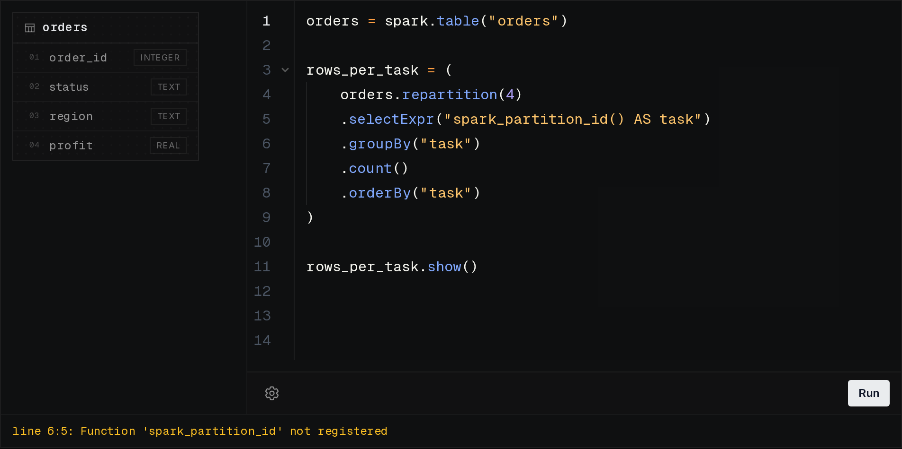
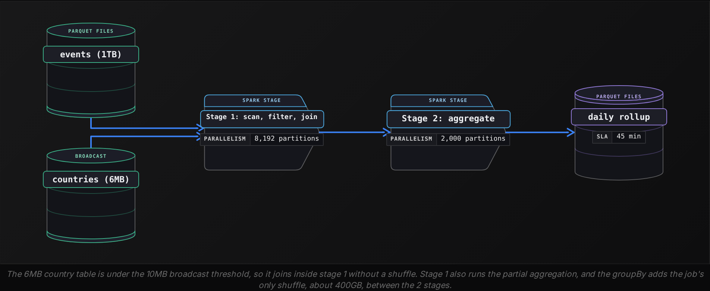

Intermediate·Spark · 14 min · 12 challenges

# Cluster Sizing: Intermediate

Picture a nightly Spark job at Netflix that rolls up a day of viewing events before the morning dashboards refresh. It runs on 2 executors with 30 cores each, and when one of them dies, half the running work dies with it. The fix could be more executors, bigger ones, or a different shape. This lesson gives you the arithmetic to choose before the next run.


<br>

---

## The 5-Core Rule

An executor is a single JVM with a fixed number of cores and a fixed heap, and every executor in an application gets the same shape. A budget of cores and memory can be cut many ways: lots of small executors, a few large ones, or something between. The cut decides how much memory goes to fixed costs, how many copies of shared data the cluster holds, and how much in-flight work a crash throws away.


<br>

### Three ways to spend 60 cores

Take a budget of 60 cores and 360GB of heap, which is 6GB per core, and a 40MB lookup table the job broadcasts after raising the broadcast threshold. Here are 3 shapes that spend the whole budget, each giving its executors 6GB of heap per core.

| Per shape | Tiny | Balanced | Fat |
| --- | --- | --- | --- |
| Executors × cores | 60 × 1 | 12 × 5 | 2 × 30 |
| Heap per executor | 6GB | 30GB | 180GB |
| Reserved memory, 300MB each | 18GB | 3.6GB | 0.6GB |
| Copies of the 40MB broadcast | 60, 2.4GB | 12, 480MB | 2, 80MB |
| Tasks sharing one JVM | 1 | 5 | 30 |
| Tasks rerun if one executor dies | 1 | 5 | 30 |

#### What tiny executors cost

Fixed costs are paid per executor, whatever its core count. Spark holds back 300MB of every heap as reserved memory, and every container also carries spark.executor.memoryOverhead, which by default is 10% of the heap and never less than 384MB. A broadcast table lands once in every executor, so the tiny shape stores the lookup table 60 times. Anything held in memory belongs to the JVM that holds it: a cached partition or a broadcast copy serves only the tasks running in that executor, and with 1 core per executor that is a single task.

#### What fat executors cost

A 30-core executor runs 30 tasks inside a single process. They share a single storage client and a single pool of network connections, and storage clients lose throughput when too many concurrent tasks read and write through them, so the extra cores wait on I/O. Garbage collection on a 180GB heap pauses all 30 tasks at once, and those pauses lengthen as the heap grows. A crash reruns 30 tasks, half of everything the cluster had in flight.


<br>

### Why 5 lands in the middle

Five cores per executor sits where the 2 cost curves cross. Fixed costs split 5 ways, so reserved memory and broadcast copies fall to a fifth of the tiny shape's. Each JVM stays small enough that a crash or a pause touches only 5 tasks, and its storage client serves as many concurrent readers as it handles at full speed. Treat 5 as a starting shape: 4 or 6 behave about the same, and the rule steers you away from 1 and 30.

Cores in the same executor also compete for its execution memory. With N tasks running, Spark guarantees each task at least 1/(2N) of the execution pool and caps it at 1/N. Raising spark.executor.cores without raising spark.executor.memory shrinks every task's share, and the first symptom is spill.


> **TIP**
>
> To price an inherited job built on 1-core executors, multiply its executor count by 300MB of reserved heap plus the 384MB overhead floor. At 200 executors that is about 137GB committed before a single row is read.

**A teammate proposes 4 executors of 25 cores with 150GB of heap each, 100 cores in total. Which reshaping fixes that shape's problems while keeping 100 cores and 6GB of heap per core?**

- **A.** One hundred executors of 1 core and 6GB, which quiets each storage client but multiplies fixed costs and broadcast copies by 25
- **B.** Twenty executors of 5 cores and 30GB, which keeps 5 tasks per storage client and splits fixed costs across 20 JVMs
- **C.** Four executors with heaps raised to 300GB, which doubles memory per task but still leaves 25 tasks on each storage client
- **D.** Two executors of 50 cores and 300GB, which halves broadcast copies but doubles the running tasks lost to each crash

<details>
<summary>Solution</summary>

**B.** Twenty executors of 5 cores and 30GB, which keeps 5 tasks per storage client and splits fixed costs across 20 JVMs

Twenty executors of 5 cores make 100 cores, and 30GB over 5 cores is 6GB per core. Each JVM stays small enough for short pauses and healthy I/O.

**Why the others are wrong**

- **A.** Each executor holds 1 task, so I/O contention disappears, but 100 heaps each reserve 300MB, pay the overhead floor and keep their own broadcast copy.
- **C.** This breaks the 6GB-per-core budget, and more heap does nothing for 25 tasks sharing a single client. A larger heap also lengthens the pauses that stop all 25.
- **D.** Fewer, larger executors make every fat-executor cost worse: 50 tasks on a single storage client, longer pauses, and half the job's running tasks rerun after a crash.

</details>


<br>

---

## Partitions, Tasks, and Waves

A stage runs 1 task per partition, and the cluster runs 1 task per slot at a time. Slots are executors × spark.executor.cores. Together those facts turn a data size into a schedule you can read before submitting anything: count the tasks in each stage, divide by the slots, and round up. The result is the wave count, the number of rounds the slots work through to finish the stage.


<br>

### Tasks in a read stage

A file scan cuts its input into splits of at most spark.sql.files.maxPartitionBytes, 128MB by default, measured in bytes on disk. A full read of a 300GB Parquet table gives about 300 × 1024 ÷ 128 = 2,400 splits, so 2,400 tasks. Partition pruning drops whole files, so count only the partitions the query reads. Column projection makes each task read fewer bytes but leaves the task count alone, because splits are cut from file sizes.

*On small inputs Spark shrinks the split so every core gets a share of the data. The 128MB arithmetic holds once the input is larger than 128MB per core in the cluster.*


<br>

### Tasks in a shuffle stage

After a shuffle, the stage runs spark.sql.shuffle.partitions tasks, 200 unless you set it. Size it from the shuffle write at roughly 100MB to 200MB per partition: a stage that writes 120GB of shuffle data at 200MB per partition wants about 600. With AQE on, Spark measures the shuffle output and can merge small partitions, so the stage may run fewer tasks than the setting says.

The board below reads a 12-row table as 6 input partitions and groups it into 4 shuffle partitions. Watch each stage's task count: 6 tasks read and 4 tasks aggregate, and a shuffle partition that receives no keys still gets a task. The board draws the plan as written, with no AQE merging.

https://github.com/user-attachments/assets/a3d402c9-c0a0-4d30-a05b-6be219418c82

Run this on the practice data. It repartitions orders into 4 partitions and counts the rows in each, so every output row is 1 task of the stage that follows the repartition. Change 4 to 3 and run it again: the number of rows follows.



```python
orders = spark.table("orders")

rows_per_task = (
    orders.repartition(4)
    .selectExpr("spark_partition_id() AS task")
    .groupBy("task")
    .count()
    .orderBy("task")
)

rows_per_task.show()
```


<br>

### Waves

With 20 executors of 5 cores the cluster has 100 slots. The 2,400-task read stage runs in 2,400 ÷ 100 = 24 waves, and the 600-task shuffle stage in 6. If a read task takes 20 seconds, the read stage needs roughly 24 × 20 = 480 seconds, 8 minutes. A slot picks up its next task the moment it frees, so waves blur together in practice, but when tasks are similar in size the total stays close to waves × task time.

| Tasks | Slots | Waves | Tasks in last wave | Idle slots in last wave |
| --- | --- | --- | --- | --- |
| 200 | 100 | 2 | 100 | 0 |
| 250 | 100 | 3 | 50 | 50 |
| 300 | 100 | 3 | 100 | 0 |
| 2,400 | 100 | 24 | 100 | 0 |
| 2,450 | 100 | 25 | 50 | 50 |

**A job reads 64GB of Parquet in full on 10 executors with 4 cores each. Roughly how many waves does the read stage take?**

- **A.** Two waves: 64 tasks, 1 for each GB of input, spread over 40 slots
- **B.** Fifty-two waves: 512 tasks spread over 10 slots, 1 slot per executor
- **C.** Thirteen waves: 512 tasks over 40 slots, with 32 tasks in the last wave
- **D.** Five waves: 200 tasks, the shuffle partition default, over 40 slots

<details>
<summary>Solution</summary>

**C.** Thirteen waves: 512 tasks over 40 slots, with 32 tasks in the last wave

At 128MB per split, 64GB is 512 tasks. Forty slots finish 480 of them in 12 waves, and the remaining 32 run in a thirteenth.

**Why the others are wrong**

- **A.** Splits are cut at 128MB, so 64GB is 512 splits. Counting a task per GB undercounts by a factor of 8.
- **B.** The task count is right, but each executor has 4 cores and therefore 4 slots, giving 40 slots in all.
- **D.** A read stage takes its task count from file splits; spark.sql.shuffle.partitions only sets the count for stages that follow a shuffle.

</details>

A partly filled last wave is where slots go to waste. At 250 tasks the third wave takes as long as a full one while half the cluster waits. Two fixes: make the task count a multiple of the slot count, or run enough waves that a single partial one is a small share of the stage. With 25 waves, a half-empty last wave wastes 2% of the stage's slot time; with 3 waves it wastes 17%. Fewer tasks than slots is worse still: 60 tasks on 100 slots run in 1 wave with 40 slots idle from start to finish.


<br>

---

## Scale Count Before Size

Once an executor shape works, a job that needs more capacity can get it 2 ways: more executors of that shape, or bigger executors. Reach for more executors first. The validated shape keeps its memory per core, its broadcast cost and its crash radius, and the slot count rises in step with the executor count.


<br>

### What doubling the count buys

Take the 2,400-task read stage again, with tasks of 20 seconds. On 100 slots it runs 24 waves and takes 8 minutes; on 200 slots it runs 12 waves in 4 minutes. The capacity consumed stays the same: 100 slots for 8 minutes and 200 slots for 4 minutes are both 800 slot-minutes. While tasks outnumber slots, more executors buy speed at a flat cost.

| Executors of 5 cores | Slots | Waves | Stage time | Slot-minutes |
| --- | --- | --- | --- | --- |
| 10 | 50 | 48 | 16 min | 800 |
| 20 | 100 | 24 | 8 min | 800 |
| 40 | 200 | 12 | 4 min | 800 |
| 80 | 400 | 6 | 2 min | 800 |
| 160 | 800 | 3 | 1 min | 800 |
| 600 | 3,000 | 1 | 20 s | 1,000 |

The flat line ends when slots outnumber tasks. At 3,000 slots the stage still has 2,400 tasks, so it runs a single 20-second wave with 600 slots idle, and the run pays for all 3,000. Each stage hits this ceiling at its own task count: in a job with a 2,400-task read and a 600-task shuffle, the shuffle stage stops gaining at 600 slots, long before the read stage does. Past a stage's ceiling, only more partitions make it faster.

#### Why not more cores per executor

The tempting shortcut is to double spark.executor.cores from 5 to 10 on the same executors. Slots double too, but the job walks back into the fat-executor costs: 10 tasks per storage client, a heap with twice the tasks behind every pause, and twice the work rerun per crash. Unless memory doubles with it, each task's share of execution memory halves as well.

**A job's slowest stage has 180 tasks of about 2 minutes each, running on 24 executors of 5 cores with no spill. What does moving to 48 executors of the same shape do to that stage?**

- **A.** It drops from 2 waves to 1, about 4 minutes to 2, with 60 of the 240 slots idle
- **B.** It drops from 2 waves to 1, but per-task memory halves, so the tasks start to spill
- **C.** Nothing changes, because the stage's 180 tasks are fixed and so is its runtime
- **D.** It drops from 4 waves to 2, since each added executor adds 5 tasks to the stage

<details>
<summary>Solution</summary>

**A.** It drops from 2 waves to 1, about 4 minutes to 2, with 60 of the 240 slots idle

Twenty-four executors give 120 slots, so 180 tasks need 2 waves. At 240 slots all 180 run at once, and 60 slots have nothing to do.

**Why the others are wrong**

- **B.** The wave count is right, but per-task memory comes from heap per core inside each executor, and the executor shape did not change.
- **C.** The 180 tasks are fixed, but runtime follows the wave count, and doubling slots from 120 to 240 halves it.
- **D.** Executors add slots, never tasks. The stage keeps its 180 tasks, and only the number of rounds needed to run them changes.

</details>


<br>

### When size is the right lever

Bigger executors help when a single task needs more memory than it gets. A task's memory comes from its own executor's unified pool, shared with the other tasks running beside it, so it depends on heap per core and never on how many executors exist. Adding 50 executors leaves every task with the memory it had. Before raising memory per core, try to shrink the task's input: more shuffle partitions, or a salted hot key. When the input can't shrink, raise spark.executor.memory with cores held at 5, or keep the heap and drop to 4 cores.

| ✓ Add executors | ✗ Grow each executor |
| --- | --- |
| • The stage has more tasks than slots<br><br>• Tasks finish without spilling<br><br>• Many short waves make up the stage time<br><br>• The goal is a shorter run at about the same cost | • One task spills or fails on memory<br><br>• Its partition can't be split any further<br><br>• A large broadcast takes much of each heap<br><br>• Memory per task, not slot count, is the limit |

> When more executors won't help
>
> - The stage already has fewer tasks than slots, so the new slots get no work.
> - One straggler holds the stage open: the other tasks finish sooner and the stage still waits on it.
> - The driver is the bottleneck, as with a large `collect()`, and executors idle while it works.
> - The source caps read throughput, so extra readers queue behind the same limit.

**A stage has 2,000 shuffle partitions of about 200MB. One task processes 9GB for a single customer ID and spills heavily while the others finish cleanly. Which change targets the problem?**

- **A.** Double the executor count, since more slots give the 9GB task more memory
- **B.** Raise shuffle partitions to 4,000, since smaller partitions will split the 9GB key
- **C.** Double cores per executor, which gives the hot task more threads to work with
- **D.** Salt the hot customer ID so its rows spread over many tasks, then combine the pieces

<details>
<summary>Solution</summary>

**D.** Salt the hot customer ID so its rows spread over many tasks, then combine the pieces

Salting splits the 9GB across several tasks of normal size, which fixes the input size instead of buying memory for one oversized task.

**Why the others are wrong**

- **A.** New executors run other tasks. The hot task still draws on its own executor's execution memory, the same share as before.
- **B.** Every row with the same key hashes to the same partition, so the 9GB lands in a single task no matter how many partitions exist.
- **C.** A task runs on 1 core. More cores per executor add neighbours that compete for the same execution memory, so the hot task gets less.

</details>


<br>

---

## What a Node Keeps for Itself

Executors run on nodes, and no node hands all of its hardware to Spark. These processes need CPU and memory on every machine before any executor starts:

- Operating system services and the kernel's page cache
- The cluster manager's node agent, which launches and monitors containers
- Log shippers forwarding executor logs off the machine
- Metrics and monitoring collectors
- Storage daemons, when the same nodes also hold data

The cluster manager offers containers only what remains after them. An executor request bigger than that remainder either stays pending or fits on fewer nodes than you planned.


<br>

### The reservation and the container

This lesson plans with 1 core and 8GB held back on every 16-core, 128GB node, a common starting reservation; nodes that also run storage or monitoring daemons keep more. The cluster manager's configuration lists what it actually offers to containers, so read the numbers there instead of the hardware spec. Each container is larger than the heap inside it: it holds spark.executor.memory plus spark.executor.memoryOverhead, which defaults to 10% of the heap with a 384MB floor and covers off-heap buffers, thread stacks and, in Python jobs, the Python worker processes.

Hold back a core as well as memory. When executors claim every core, the node agent competes with a busy task on each of them for CPU time, and its heartbeats to the cluster manager can fall behind.


<br>

### Fitting executors on the node

| Step | Cores | Memory |
| --- | --- | --- |
| Node hardware | 16 | 128GB |
| Held back for OS and daemons | 1 | 8GB |
| Offered to containers | 15 | 120GB |
| Per 5-core executor container | 5 | 40GB |
| Executor heap, container ÷ 1.10 |  | 36GB |
| Overhead, 10% of heap |  | 3.6GB |
| Left unclaimed per container |  | 0.4GB |

Fifteen offered cores make 3 executors of 5. The 120GB splits into 3 containers of 40GB, and since a container is its heap plus 10%, the heap can be at most 40 ÷ 1.1 ≈ 36.4GB. Round down to 36GB and the overhead is 3.6GB, leaving 0.4GB of slack in each container.

- **7.2GB** — heap per core on this node
- **6.25%** — node memory held back

Inside each 36GB heap, Spark keeps its 300MB reserve and gives spark.memory.fraction, 0.6 by default, of the rest to the unified pool: 36GB less 0.3GB, times 0.6, is about 21.4GB. With 5 tasks running and nothing cached, each can claim up to about 4.3GB.

*The same 2 divisions work on any node: offered cores ÷ 5 gives executors per node, and offered memory ÷ that count gives each container's size.*


<br>

### The container that doesn't fit

Ask for a 40GB heap instead and the container grows to 44GB. Three of those need 132GB, more than the 120GB on offer, so the cluster manager places 2 per node. Each node now runs 10 tasks on 15 offered cores, and a third of the capacity you pay for sits idle. A request that looked like 11% more memory per executor cost a third of the slots.

36GB heap

| Measure | Value |
| --- | --- |
| Containers per node | 3 |
| Container memory per node | 120GB |
| Cores in use per node | 15 of 15 |
| Slots across 14 nodes | 210 |

40GB heap

| Measure | Value |
| --- | --- |
| Containers per node | 2 |
| Container memory per node | 88GB |
| Cores in use per node | 10 of 15 |
| Slots across 14 nodes | 140 |

#### The driver takes a space too

In cluster mode the driver runs in a container on one of the worker nodes, in room an executor could have used. Give the driver a container no larger than an executor's and subtract 1 executor from the cluster's capacity. On 14 nodes that costs 1 space in 42; on 2 nodes it costs 1 in 6.

> **TIP**
>
> Check any node plan by dividing offered memory by offered cores. Here 120GB over 15 cores is 8GB of container per core, so a 5-core executor gets a 40GB container and a heap a little over 36GB.

**A node has 32 cores and 256GB. You hold back 2 cores and 16GB for the OS and daemons, run 5-core executors, and keep the default 10% overhead. What is the largest heap that still packs the most executors onto the node?**

- **A.** A 36GB heap, since 6 containers of 39.6GB use 237.6GB of the 240GB on offer
- **B.** A 40GB heap, since 6 containers of 44GB fit inside the 240GB on offer
- **C.** A 42GB heap, from dividing the full 256GB among 6 executors
- **D.** A 24GB heap, since smaller heaps let 10 executors share the node

<details>
<summary>Solution</summary>

**A.** A 36GB heap, since 6 containers of 39.6GB use 237.6GB of the 240GB on offer

Thirty offered cores make 6 executors. Dividing 240GB by 6 gives 40GB per container, and a 36GB heap plus 10% is 39.6GB, which fits.

**Why the others are wrong**

- **B.** Six containers of 44GB need 264GB, more than the 240GB offered, so only 5 fit and 5 offered cores sit unused.
- **C.** This ignores both the reservation and the overhead. Each container would be about 46GB, and only 5 of them fit in 240GB.
- **D.** Thirty offered cores hold 6 executors of 5 cores however small the heap, so the smaller heap leaves memory unused.

</details>


<br>

---

## A Worked Sizing

Here is the whole method on a single job. A daily batch reads 1TB of Parquet events, filters them, joins a 6MB country table, aggregates by day and title, and writes the result. It must finish within 45 minutes of starting, and the team keeps a third of that as headroom, so the compute target is 30 minutes.




<br>

### Step 1: bytes to tasks

At 128MB per split, 1TB on disk, which is 1,024GB, becomes 8,192 read tasks. A test run on a 10% sample wrote 40GB of shuffle data, which scales to about 400GB for the full input. At roughly 200MB per partition that calls for 2,048 partitions; round to 2,000, a count that will divide evenly into the slot count chosen below, and set spark.sql.shuffle.partitions to it.


<br>

### Step 2: measure task time

Task durations come from a measurement. On the sample run a stage 1 task took about 30 seconds and a stage 2 task about 45, with shuffle partitions set to 200 so each held close to 200MB. Task time depends on the bytes a task handles, and the sample's tasks handled the same sizes as the full run's will, so the durations carry over even though the sample had a tenth as many tasks.


<br>

### Step 3: pick the slot count

| Slots | Stage 1 waves | Stage 1 time | Stage 2 waves | Stage 2 time | Total |
| --- | --- | --- | --- | --- | --- |
| 100 | 82 | 41 min | 20 | 15 min | 56 min |
| 150 | 55 | 27.5 min | 14 | 10.5 min | 38 min |
| 200 | 41 | 20.5 min | 10 | 7.5 min | 28 min |
| 300 | 28 | 14 min | 7 | 5.3 min | 19.3 min |

The 200-slot row is the smallest that meets the 30-minute target, and its stage 2 runs exactly 10 full waves. Stage 1's last wave holds 192 tasks on 200 slots, so even its tail keeps 96% of the slots busy. The 300-slot row finishes under 9 minutes sooner at almost the same cost: 300 slots for 19.3 minutes is about 5,790 slot-minutes against 5,600, roughly 3% more. That 3% is idle time in partial waves, since stage 2's seventh wave holds only 200 tasks and a third of the cluster waits through it. Both rows meet the deadline, so take the smaller cluster: fewer nodes to place, and no partial wave in stage 2.

- **93 task-hours** — total task time in one run

Spread across 200 slots, that work comes to about 28 minutes, which agrees with the wave arithmetic when every wave is full.


<br>

### Step 4: slots to executors to nodes

At 5 cores each, 200 slots are 40 executors. The node from the previous section, 16 cores and 128GB with 1 core and 8GB reserved, holds 3 executors with 36GB heaps, which gives each task about 4.3GB of execution memory; the sample run showed no spill at that size. Forty executors need 14 nodes, since 40 ÷ 3 rounds up to 14. Those nodes hold 42 executor spaces, the driver takes 1 in cluster mode, and 41 remain for the 40 the plan needs.

| Decision | Value | Where it came from |
| --- | --- | --- |
| Read tasks | 8,192 | 1TB ÷ 128MB splits |
| Shuffle partitions | 2,000 | 400GB at about 200MB each |
| Slots | 200 | Smallest count inside 30 minutes |
| Executors | 40 × 5 cores, 36GB heap | The 5-core rule and the node fit |
| Nodes | 14, each 16 cores and 128GB | 3 executors per node, plus the driver |
| Expected runtime | 28 min | 20.5 min + 7.5 min |


<br>

### Step 5: check the first real run

Planning numbers are predictions, so set them beside the first full run in the Spark UI: the task count of each stage, the median task duration in each, and any spill. If stage 2 shows fewer than 2,000 tasks, AQE merged small partitions after measuring them. If median task times came in above 30 and 45 seconds, redo the slot arithmetic with the measured values before adding nodes; if spill appears, revisit memory per core.

**Next quarter the events grow to 2TB. Per-task times stay the same, and the shuffle write doubles to 800GB at the same partition size. Which plan keeps the run near 28 minutes?**

- **A.** Forty executors of 10 cores on the same 14 nodes, since doubling cores doubles the slots
- **B.** Eighty executors of 5 cores on 27 nodes with 4,000 shuffle partitions, giving the same 41 and 10 waves
- **C.** Eighty executors on 27 nodes with shuffle partitions left at 2,000, since partition count ignores data size
- **D.** Forty executors with 72GB heaps on the same 14 nodes, since larger heaps make each task finish twice as fast

<details>
<summary>Solution</summary>

**B.** Eighty executors of 5 cores on 27 nodes with 4,000 shuffle partitions, giving the same 41 and 10 waves

Doubling data doubles the tasks to 16,384 and 4,000. Doubling slots to 400 keeps both wave counts, and 27 nodes hold 81 executor spaces, 1 of them taken by the driver.

**Why the others are wrong**

- **A.** Fourteen nodes offer 210 cores, so 400 slots can't fit on them, and 10-core executors bring back the fat-executor costs.
- **C.** The executors are right, but 2,000 partitions of 800GB hold about 400MB each, double the target, so stage 2 tasks run longer and risk spill.
- **D.** A 72GB heap with its overhead fits only once per node, and more memory per task does not double task speed when nothing was spilling.

</details>


<br>

---

## Putting It All Together

Picture the Netflix viewing rollup from the intro after a re-plan. The team measures task times on a 10% sample, counts 8,192 read tasks for 1TB and 2,000 shuffle partitions for 400GB, picks 200 slots to land inside the morning deadline, and replaces the 2 fat executors with 40 executors of 5 cores placed 3 to a node on 14 nodes. When a holiday doubles the viewing data, they double the executors and the shuffle partitions together and keep the 28-minute runtime.

- The 5-core rule fixed the executor shape, so every later change was a change of executor count alone.
- Wave arithmetic turned 8,192 read tasks and 2,000 shuffle tasks into a 28-minute estimate before the first full run.
- The node reservation set 3 executors per 16-core, 128GB node, and keeping the heap at 36GB kept all 3 placed.
- Doubled data doubled the tasks, and doubling executors alongside them held the waves at 41 and 10, so scaling count beat scaling size.


<br>

---

## Key Takeaways

- About 5 cores per executor balances fixed per-executor costs against crowded JVMs: 4 to 6 work, 1 and 30 do not.
- A read stage gets 1 task per 128MB split of the files it reads; a stage after a shuffle gets spark . sql . shuffle . partitions tasks, or fewer once AQE merges them.
- Waves are tasks ÷ slots, rounded up. A thin last wave, or fewer tasks than slots, leaves paid-for cores idle.
- Scale by adding executors of a proven shape while tasks outnumber slots; raise memory per core only when one task's input can't shrink.
- Plan nodes from what the cluster manager offers after the OS and daemons, and size each container as heap plus overhead so the planned count fits.
- Size from measured task times: bytes to tasks, tasks and a time target to slots, slots to executors, executors to nodes.
