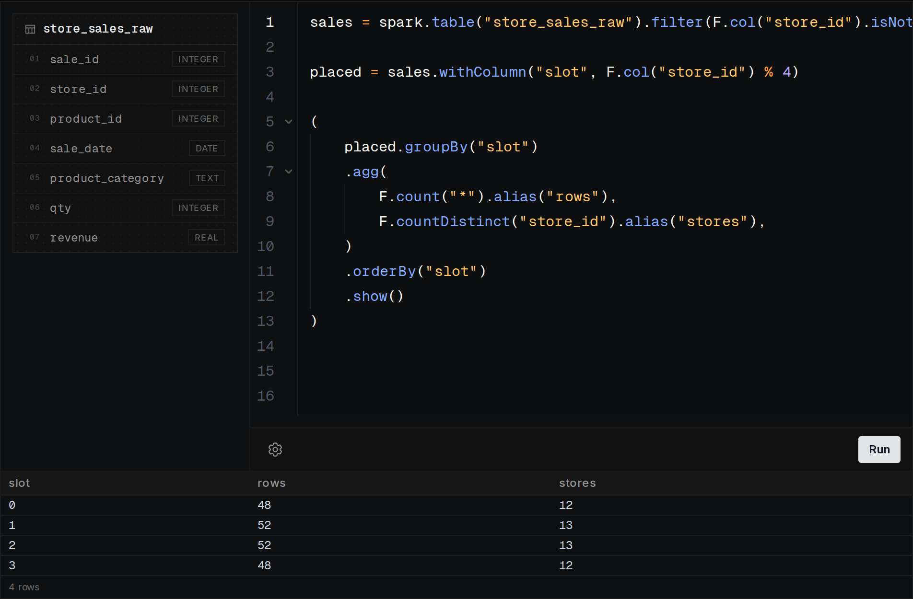
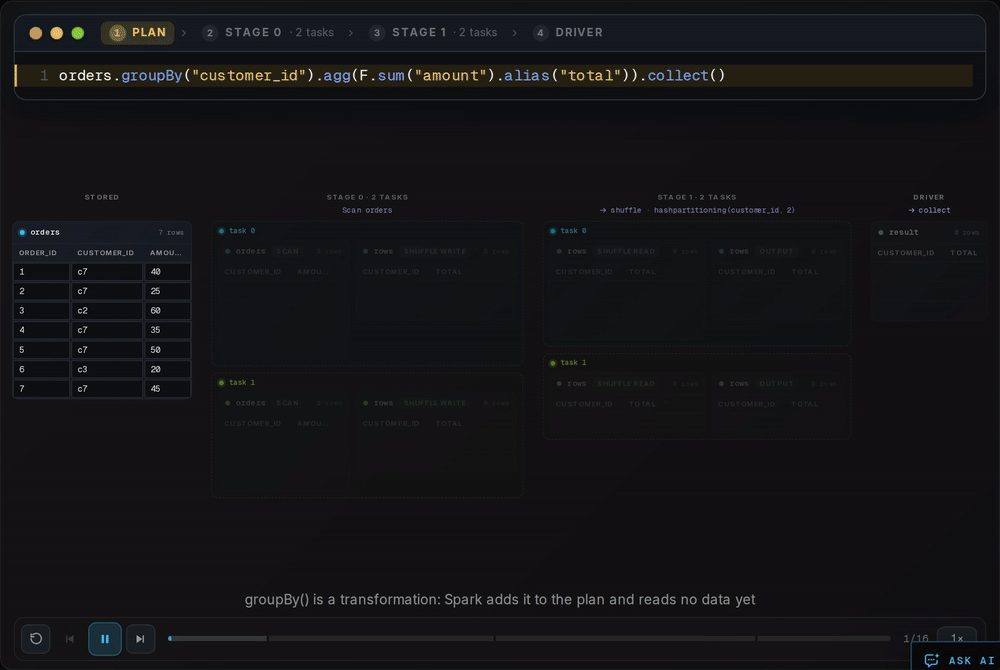
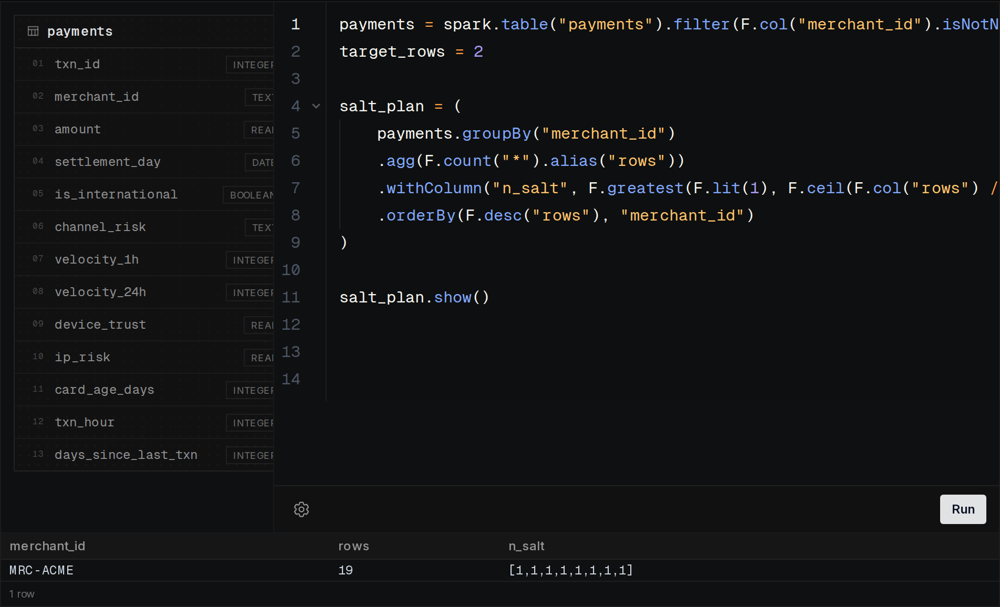
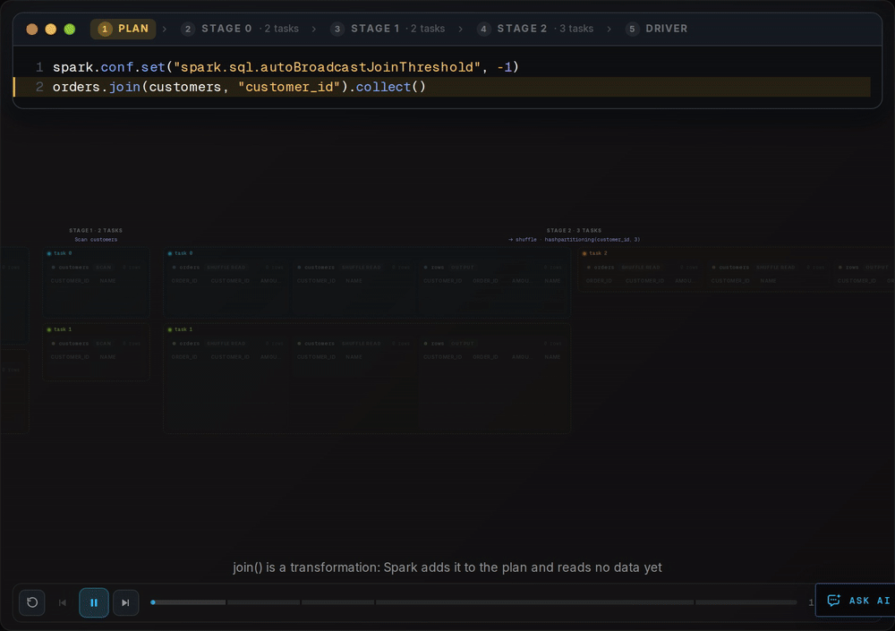

Advanced·Spark · 15 min · 15 challenges

# Data Skew: Advanced

It is the night before Spotify Wrapped, and the job that joins a year of plays to artist metadata has run 6 hours. Of its 4,000 tasks, 3,999 finished in under 2 minutes. The last one holds every play of the year's biggest artist, and Spark's built-in skew fix never fired. Before the slides go live, you decide which technique takes over.


<br>

---

## Skew Before the First Shuffle

Every skewed stage you have fixed so far sat after a shuffle, where a hot key hashed to 1 reducer. The first stage of a job can skew with no key involved, because its task sizes come from the way the input splits. Spark cuts splittable files into pieces of at most spark.sql.files.maxPartitionBytes (128MB by default) and runs 1 task per piece. When the pieces come out unequal, or the work each piece triggers is unequal, the stage has a straggler before a single row has been hashed.


<br>

### Four ways a first stage goes uneven

| Source | What the tasks see | Rebalance at |
| --- | --- | --- |
| Unsplittable file | A 6GB gzip CSV is read as 1 partition by 1 task while its neighbours read 128MB each | Right after the read, or rewrite the source in a splittable form |
| Uneven layout | One date directory holds 40 times the rows of a typical date | The write that made the layout; after the read until then |
| Uneven fan-out | explode() turns most rows into 3 rows and a few into 50,000 | After the explode |
| Uneven filter | A filter keeps 90% of some files and 1% of others | Before the next expensive step |

Gzip is unsplittable because a decompressor must start at the first byte, so a 6GB file holds 1 task for as long as 1 core needs to inflate and parse all of it. The fan-out case is the subtle one. Pipelining puts the read, any filter and the explode into the same task, so the task that reads a partition also produces everything the explode emits. Take 128MB partitions of about 1M rows each, where a typical row carries 3 tags. One partition also holds 300 rows whose tags array has 50,000 entries. Its neighbours emit 3M rows; it emits 18M, 6 times as many, from an input the same size as theirs.


<br>

### Diagnosing it

The tell is a straggler in a stage that reads input and no shuffle. In that stage's task list, compare the slow task's input bytes and output records with the median task's. Large input points at the file or the layout; normal input with huge output points at fan-out. To see row counts per partition from code, tag each row with the partition that holds it:

```sql
per_partition = (
    events
    .withColumn("pid", F.spark_partition_id())
    .groupBy("pid")
    .count()
)
per_partition.orderBy(F.desc("count")).show(5)
```


<br>

### Rebalancing on purpose

repartition(n) with no column deals each map task's rows round-robin across n partitions, so every output partition ends up with nearly the same row count whatever the keys look like. It is a full shuffle: a 400GB stage writes 400GB and reads it back, so place it once, at the line where the imbalance first appears. Two similar-looking calls do not balance. coalesce(n) merges neighbouring partitions without moving rows across the network, so a 6GB partition merged with 2 small ones becomes a larger straggler. repartition(n, "page_id") hashes a column, which copies whatever skew that column carries into the new layout.

**A first stage reads 300 files: 299 Parquet files of around 128MB, and 1 gzip CSV of 6GB that lands in a single partition. Store 1 holds a third of all rows. Which line, placed right after the read, gives the next stage partitions of nearly equal row count?**

- **A.** coalesce(200), which merges partitions in place and so avoids writing a shuffle
- **B.** repartition(200, "store_id"), which hashes the rows across 200 new partitions
- **C.** repartition(200), which deals each map task's rows round-robin across 200 partitions
- **D.** spark.sql.files.maxPartitionBytes set to 32MB, which cuts every input file into smaller pieces

<details>
<summary>Solution</summary>

**C.** repartition(200), which deals each map task's rows round-robin across 200 partitions

Round-robin ignores keys, so each partition gets about 1/200 of the rows. The 6GB read itself still runs in 1 task.

**Why the others are wrong**

- **A.** Merging keeps every row where it was, so the 6GB partition stays whole and may absorb its neighbours too.
- **B.** Every row of store 1 hashes to the same partition, so that partition holds a third of the data.
- **D.** A gzip file cannot be cut, so it stays 1 piece while only the Parquet pieces shrink.

</details>

For fan-out, the right line depends on how concentrated it is. A round-robin repartition(200) before the explode spreads the 300 fat rows to about 1 or 2 per task, which is enough here. It cannot help when the fan-out sits in a handful of rows: 1 row with 20M tags explodes inside whichever task receives it. A repartition after the explode always balances what follows, because it moves output rows; the exploding task still emits all 20M, so only the work downstream of it gets spread.

> **TIP**
>
> When 1 enormous row drives the fan-out, the explode itself needs splitting: replicate that row k times with a chunk index and explode a different slice of its array in each copy, so k tasks share its output.

**A job reads 2,000 even Parquet files of messages and calls explode("recipients"). One announcement row lists 30M recipients; every other row lists under 10. The step after the explode builds a delivery record per recipient. Where does a repartition(400) do the most good?**

- **A.** Before the explode, so the announcement row moves off its crowded partition and its recipients are shared out
- **B.** After the explode, so the 30M recipient rows are dealt across 400 tasks before delivery records are built
- **C.** Swap it for coalesce(400) after the explode, which skips the shuffle and still evens out the partitions
- **D.** Before the explode, keyed on recipient_id, so each recipient's rows are hashed onto a task of their own

<details>
<summary>Solution</summary>

**B.** After the explode, so the 30M recipient rows are dealt across 400 tasks before delivery records are built

The repartition moves output rows, so the per-recipient step runs on 400 even partitions. The exploding task still emits all 30M rows, which the chunking trick addresses.

**Why the others are wrong**

- **A.** A single row moves as a whole, so its 30M recipients still come out of 1 task, wherever that task runs.
- **C.** coalesce merges neighbours in place, so the partition holding 30M rows stays at least that large.
- **D.** recipient_id only exists after the explode, and hashing a column copies its skew instead of removing it.

</details>


<br>

---

## Custom Partitioners

Every hash shuffle on a DataFrame places a row by pmod(murmur3(key), n): the key's hash, modulo the partition count. With thousands of mid-sized keys the hash spreads load evenly enough. With a few giant keys it runs a lottery you never see, because the hash knows nothing about key sizes and 2 giant keys can draw the same partition.

Take a table of 100M events from 10,000 tenants. Tenant A has 30M rows, B has 28M, C has 25M, and the other 9,997 share the last 17M. Shuffled into 8 partitions, the average partition holds 12.5M rows. The 3 big tenants draw partitions independently, so the chance that all 3 land apart is 8 x 7 x 6 out of 8 x 8 x 8. When A and B do share a partition, that task starts with 58M rows, more than 4.6 times the average.

- **34%** — at least 2 big tenants share a partition

A partitioner decides where whole keys go and cannot cut 1 key across tasks. The best placement here gives A, B and C a partition each and spreads the tail over the rest. At 16 partitions, that is 3 dedicated partitions plus 13 sharing 17M rows, about 1.3M each. The slowest task is then A's 30M rows, and no partitioner goes below that floor; splitting A itself takes salting. Reach for a custom partitioner when the biggest single key is acceptable and the collisions or the packing are what hurts. Placement also matters when the output layout is the goal, such as 1 partition per tenant before a write.

**Which problem can a custom partitioner fix on its own, with no salting?**

- **A.** One tenant holds 30M of 100M rows, and the task that owns it runs far longer than the rest
- **B.** A single 6GB gzip input file makes the first stage of the job run its read in 1 task
- **C.** Every key is small, but the stage has 8 partitions for a cluster with 64 free cores
- **D.** Two large tenants hash to the same partition, so 1 task carries both of them at once

<details>
<summary>Solution</summary>

**D.** Two large tenants hash to the same partition, so 1 task carries both of them at once

Dedicating a partition to each large tenant keeps them apart, which hash placement cannot promise.

**Why the others are wrong**

- **A.** A partitioner sends every row of a key to 1 partition, so the 30M rows stay together. Splitting 1 key takes salting.
- **B.** That straggler comes from how the file splits, before any key is hashed, so no partitioner is involved.
- **C.** That is a partition count problem: raising n fixes it, and hash placement is fine for small keys.

</details>


<br>

### Writing one

The DataFrame API has no partitioner hook: repartition(n, col) always hashes. Exact placement goes through the RDD API. On an RDD of key-value pairs, partitionBy(numPartitions, partitionFunc) calls your function on each key and sends the record to partition partitionFunc(key) % numPartitions.

```sql
import zlib

N = 16
DEDICATED = {"tenant_a": 0, "tenant_b": 1, "tenant_c": 2}
TAIL_SLOTS = N - len(DEDICATED)


def place(tenant_id):
    if tenant_id in DEDICATED:
        return DEDICATED[tenant_id]
    if tenant_id is None:
        return len(DEDICATED)
    return len(DEDICATED) + zlib.crc32(tenant_id.encode()) % TAIL_SLOTS


placed = (
    events.rdd
    .map(lambda row: (row["tenant_id"], row))
    .partitionBy(N, place)
)
```

> What the placement function must guarantee
>
> - Same answer in every process: Python's built-in `hash()` on strings is seeded per process, so 2 executors would send 1 tenant to 2 partitions. `zlib.crc32` is stable everywhere.
> - An int for every key, `None` included: a function that raises on a null key fails the task, and every retry fails the same way.
> - Cheap per call: it runs once per record in Python, outside the optimizer and its generated code.
> - Built from data: `DEDICATED` comes from per-key counts measured on the current data.

The price is the RDD escape hatch you already know. Once rows leave the DataFrame, Catalyst cannot see the placement, so a DataFrame rebuilt from placed reports no partitioning and a later groupBy("tenant_id") shuffles again. Use the placement where it pays directly: per-partition processing with mapPartitions, or a write that should produce 1 file set per partition.

*A DataFrame-only approximation computes a slot column with the same rules and calls repartitionByRange(N, "slot"). Range boundaries come from a sample, so placement lands close to the plan without a guarantee of 1 slot per partition.*

The cell below places store_sales_raw rows the way a partitioner keyed on store_id % 4 would, and counts rows and stores per slot. Run it and find the heaviest slot. To find the store that makes it heavy, change groupBy("slot") to groupBy("slot", "store_id") and run again: in that slot, the row with the largest rows names the store. Then give that store a slot of its own: change the expression to F.when(F.col("store_id") == 1, 0).otherwise(1 + F.col("store_id") % 3), replace 1 with that store's id, group by "slot" alone again, and compare the counts.



```python
sales = spark.table("store_sales_raw").filter(F.col("store_id").isNotNull())

placed = sales.withColumn("slot", F.col("store_id") % 4)

(
    placed.groupBy("slot")
    .agg(
        F.count("*").alias("rows"),
        F.countDistinct("store_id").alias("stores"),
    )
    .orderBy("slot")
    .show()
)
```


<br>

---

## Two-Phase Aggregation

A two-phase aggregation computes each key's result in 2 rounds: a partial pass produces a small result per piece of the key, and a final pass per key combines the pieces. Before writing one by hand, check whether Spark already runs it. The animation below groups 7 orders by customer_id and sums amount. Five of the orders belong to c7, and the table is read as 2 partitions. Watch what each map task writes before the shuffle.



Each map task sums its own c7 rows before writing, so the reducer that owns c7 receives at most 2 rows for it, 1 per input partition, and adds them to 195. The physical plan shows the same split: a HashAggregate with partial_sum(amount) below the Exchange, and a final HashAggregate with sum(amount) above it. Scale it up: 40M rows of a hot key read by 2,000 map tasks reach their reducer as 2,000 partial sums. That task was never slow, so a hand-salted version of this query adds a second shuffle and a second aggregation and buys nothing. The same holds for count, min, max and avg, which carries a sum and a count through the shuffle.


<br>

### When the partial pass cannot shrink

The partial pass shrinks a key only when the partial result is smaller than the rows behind it. collect_list and collect_set break that: their partial result holds the values themselves, so all 40M values of a hot key still cross the shuffle to 1 task. Here are the top 5 payment amounts per merchant, written the direct way:

```sql
top5 = payments.groupBy("merchant_id").agg(
    F.slice(F.sort_array(F.collect_list("amount"), asc=False), 1, 5).alias("top5")
)
```

A split works only when the final answer can be computed from the partial answers. For top 5 it can. A value in the overall top 5 is beaten by fewer than 5 values in the whole set, so by fewer than 5 inside its own piece, which keeps it in that piece's top 5. Phase 1 keeps 5 values per (merchant_id, salt) group; phase 2 picks 5 from at most 5 times N survivors per merchant.

```sql
N = 32

phase1 = (
    payments
    .withColumn("salt", F.col("txn_id") % N)
    .groupBy("merchant_id", "salt")
    .agg(F.slice(F.sort_array(F.collect_list("amount"), asc=False), 1, 5).alias("top5"))
)

top5 = phase1.groupBy("merchant_id").agg(
    F.slice(F.sort_array(F.flatten(F.collect_list("top5")), asc=False), 1, 5).alias("top5")
)
```

The hot merchant's 40M amounts now arrive as 32 groups of about 1.25M. Those groups hash across the reducers, so each reducer holds 1 or a few of them instead of all 40M rows, and the merchant's phase-2 task receives at most 160 values. The salt comes from txn_id, a column every row already carries, so each row lands in the same group on every run.

**Phase 1 below keeps the top 3 revenues per (store_id, salt) group. Which phase 2 returns each store's exact top 3 revenues?**

```python
phase1 = (
    sales
    .withColumn("salt", F.col("sale_id") % 16)
    .groupBy("store_id", "salt")
    .agg(F.slice(F.sort_array(F.collect_list("revenue"), asc=False), 1, 3).alias("top3"))
)
```

- **A.** phase1.groupBy("store_id", "salt"), slicing top3 again so each salted group keeps 3 values
- **B.** phase1.groupBy("store_id"), then flatten the collected top3 lists, sort them and keep 3
- **C.** sales.groupBy("store_id"), collecting revenue again, sorting it and keeping the first 3
- **D.** phase1.groupBy("store_id"), then keep the top3 list of whichever salt group comes first

<details>
<summary>Solution</summary>

**B.** phase1.groupBy("store_id"), then flatten the collected top3 lists, sort them and keep 3

Each store's at most 48 survivors include its overall top 3, so sorting and slicing them gives the exact answer.

**Why the others are wrong**

- **A.** Grouping by the salt again leaves up to 16 rows per store, 1 per piece, never combined into 1 answer.
- **C.** That is the direct version: it ignores phase 1, and the hot store's task collects every value once more.
- **D.** One piece's top 3 misses larger values sitting in the other 15 pieces of the same store.

</details>

> Before you split an aggregation by hand
>
> - Does the plan already show a `partial_` aggregate below the `Exchange`? Then Spark has made the split for you.
> - Can the final answer be built from per-piece answers? Top-k can; an exact median cannot, since a median of medians is a different number.
> - Is each per-piece answer much smaller than its piece? Five values out of 1.25M is; a full list of values is not.
> - Would a combinable built-in do? `percentile_approx` merges small sketches across map tasks, so a skewed median rarely needs a manual split.

**A key holds 40M of a table's rows. For which aggregation does a hand-written salted two-phase version cut the work on that key's reducer?**

- **A.** F.max("amount"), because the reducer that owns the key still receives it from every map task
- **B.** F.avg("amount"), because an average cannot be rebuilt from the averages of separate pieces
- **C.** The top 3 amounts via collect_list and sort_array, because the partial list keeps every value
- **D.** F.count("*"), because counting 40M rows is too much work for a single task to finish

<details>
<summary>Solution</summary>

**C.** The top 3 amounts via collect_list and sort_array, because the partial list keeps every value

The partial list ships all 40M values. Keeping 3 per salted group first sends the reducer 3 values per group.

**Why the others are wrong**

- **A.** Each map task sends 1 partial max for the key, so the reducer compares 1 value per map task.
- **B.** Spark carries a sum and a count per piece, and those combine exactly.
- **D.** Map tasks count their own rows and ship 1 number each, so the reducer adds a few thousand numbers.

</details>


<br>

---

## Adaptive Salting

Salting with 1 global N gives every key N salt values and replicates every row of the other side N times. Skewed data usually follows a steep curve, with a handful of keys far above the rest, so most of that replication copies tail keys that were never slow. Pick N for the biggest key and the replication cost balloons; pick it for a middling key and the biggest stays a straggler. Adaptive salting gives each key its own factor, from its measured row count: n_salt = max(1, ceil(rows / target)), where target is the row count of a well-sized partition. If a 128MB shuffle partition holds about 1M of these rows, the target is 1M. A key at or below the target keeps a factor of 1 and joins as it always did.

| merchant_id | fact rows | n_salt | rows per sub-key |
| --- | --- | --- | --- |
| m_001 | 48,000,000 | 48 | 1,000,000 |
| m_002 | 9,000,000 | 9 | 1,000,000 |
| m_003 | 2,600,000 | 3 | about 867,000 |
| 1,999,997 others | 400,000 or fewer each | 1 | unchanged |

The dimension side, a merchants table of 2,000,000 rows and far past the broadcast threshold, needs 1 copy of each merchant per salt value. Compare a single N large enough for m_001 with the per-key plan:

- **96,000,000** — dim rows with a global N of 48
- **2,000,057** — dim rows with per-key salt factors


<br>

### Building the salted join

```sql
TARGET = 1_000_000

salt_plan = (
    payments.groupBy("merchant_id").count()
    .withColumn("n_salt", F.ceil(F.col("count") / TARGET).cast("int"))
    .filter(F.col("n_salt") > 1)
    .select("merchant_id", "n_salt")
)

facts = (
    payments
    .join(F.broadcast(salt_plan), "merchant_id", "left")
    .withColumn("salt", F.col("txn_id") % F.coalesce(F.col("n_salt"), F.lit(1)))
)

dims = (
    merchants
    .join(F.broadcast(salt_plan), "merchant_id", "left")
    .withColumn(
        "salt",
        F.explode(F.sequence(F.lit(0), F.coalesce(F.col("n_salt"), F.lit(1)) - 1)),
    )
)

joined = facts.join(dims.drop("n_salt"), ["merchant_id", "salt"])
```

The 2 salt expressions must agree. A payment for m_001 with txn_id 1,000,001 gets salt 1,000,001 % 48 = 17 and meets the copy of m_001 whose exploded salt is 17; a tail merchant gets salt 0 on both sides. Each payment matches exactly 1 copy of its merchant, so the result holds the same rows the unsalted join would produce.


<br>

### When the distribution moves

The factors are as current as the counts behind them. A count taken in the same run costs 1 extra pass over the facts and is always current. Yesterday's counts cost nothing today but miss any key that turned hot overnight: that key gets a factor of 1, and its full weight lands on 1 task. A sample, such as payments.sample(0.01) scaled by 100, still reads every row but shuffles roughly 1% of them; a key near a boundary may get a factor 1 lower than it needs, which a target set below the ideal partition size absorbs. Whatever the source, a stale plan changes how even the tasks are, never which rows the join returns.

| ✓ One global N | ✗ Per-key factors |
| --- | --- |
| • Every key gets N salts and N dimension copies<br><br>• N fits 1 key well and misfits the rest<br><br>• No counting pass<br><br>• Sized by a guess | • Only keys above the target get extra copies<br><br>• Each hot key gets the split its size needs<br><br>• One extra counting pass, or a sample<br><br>• Drifts as the distribution shifts |

**A salt plan built from yesterday's counts uses a target of 500,000 rows. Merchant m_042 had 3.2M payments yesterday and has 7M today. What does today's salted join do with m_042?**

- **A.** It uses factor 7, from ceil(3.2M / 500,000), so each of its sub-keys carries about 1M rows, twice the target
- **B.** It uses factor 14, from ceil(7M / 500,000), because the join recounts each merchant as it reads payments
- **C.** It uses factor 1 because m_042 grew since the plan was built, so all 7M of its rows land on a single task
- **D.** It drops some of m_042's rows, because the fact side and the dimension side now disagree on its salts

<details>
<summary>Solution</summary>

**A.** It uses factor 7, from ceil(3.2M / 500,000), so each of its sub-keys carries about 1M rows, twice the target

Factors come from the plan's counts, so m_042 splits 7 ways and each piece is about twice the planned size.

**Why the others are wrong**

- **B.** Nothing recounts during the join; the factors are fixed when the plan is built.
- **C.** m_042 was already hot yesterday, so the plan holds a factor above 1 for it.
- **D.** Both sides read the same plan, so every payment still meets exactly 1 copy of its merchant.

</details>

The cell computes factors on the practice payments table with a target of 2 rows per sub-key, small because the table is small. Run it, then raise target_rows to 4 and watch the factors drop toward 1.



```python
payments = spark.table("payments").filter(F.col("merchant_id").isNotNull())
target_rows = 2

salt_plan = (
    payments.groupBy("merchant_id")
    .agg(F.count("*").alias("rows"))
    .withColumn("n_salt", F.greatest(F.lit(1), F.ceil(F.col("rows") / target_rows)))
    .orderBy(F.desc("rows"), "merchant_id")
)

salt_plan.show()
```


<br>

---

## Where AQE Skew-Join Stops

Adaptive query execution (AQE) waits for a shuffle's map side to finish, reads the real size of every reduce partition it wrote, and re-plans the rest of the query with those sizes. It has been on by default since Spark 3.2, through spark.sql.adaptive.enabled. One of its rules, switched by spark.sql.adaptive.skewJoin.enabled (also on by default), targets the hot reduce task of a sort-merge join. The animation shows that task: the 7 orders from Two-Phase Aggregation join 3 customers on customer_id with broadcasting turned off, so both sides shuffle and every c7 row from both tables meets in 1 reduce task.




<br>

### When a partition counts as skewed

AQE marks a reduce partition skewed when it is larger than skewedPartitionFactor (5) times the median partition size and also larger than skewedPartitionThresholdInBytes (256MB); both settings live under spark.sql.adaptive.skewJoin. It then cuts that partition into chunks of about spark.sql.adaptive.advisoryPartitionSizeInBytes (64MB), or of the average non-skewed partition if that is larger, and joins each chunk with its own copy of the matching partition from the other side.

| Stage | Median partition | Largest partition | AQE's decision |
| --- | --- | --- | --- |
| 200 partitions | 80MB | 3GB | Skewed: 3GB passes both 400MB and 256MB, so it splits into about 38 chunks near 80MB |
| 20 partitions | 2GB | 8GB | Left alone: 8GB is 4 times the median, under the factor of 5 |

**A sort-merge join stage has 20 partitions. The median is 2GB and the largest is 8GB. With default settings, what does AQE do with the 8GB partition?**

- **A.** Leaves it as 1 task, because 8GB is 4 times the median and the factor is 5
- **B.** Splits it into 64MB chunks, because 8GB is far over the 256MB threshold
- **C.** Splits it into 4 chunks of 2GB, because the median sets the chunk size
- **D.** Flags it as skewed, then keeps 1 task because 20 partitions fill the cores

<details>
<summary>Solution</summary>

**A.** Leaves it as 1 task, because 8GB is 4 times the median and the factor is 5

Both conditions must hold. 8GB passes 256MB but fails the factor test, so the task runs about 4 times longer than its peers.

**Why the others are wrong**

- **B.** The byte threshold alone flags nothing; the partition must also exceed 5 times the median.
- **C.** Nothing is split here. When AQE does split, chunks aim for 64MB or the non-skewed average, whichever is larger.
- **D.** Splits run as extra tasks whatever the core count; here the factor test fails, so nothing is flagged.

</details>


<br>

### Where the rule stops

| Situation | Why AQE leaves it | Take over with |
| --- | --- | --- |
| Hot key on the side an outer join fills with nulls | Inner joins split either side, left joins only the left, right joins only the right, full outer joins neither | Isolate the hot keys and join them on their own |
| Hot rows written by 1 map task | Chunks are cut at map-output block boundaries, and 1 block cannot be divided | A round-robin repartition of the input, or salting |
| Below the thresholds | Under 5 times the median, or under 256MB | Lower the settings, or salt |
| Small inputs, huge output | Sizes are input bytes, so a duplicate-key blowup on 100MB partitions looks normal | Per-key salting sized on the rows the key produces |
| No exchange to measure | Broadcast joins, bucketed joins and first stages read no shuffle | Rebalance the input |
| Split would need an extra shuffle | A later operator needs the join's output partitioning, so AQE drops the split | `spark.sql.adaptive.forceOptimizeSkewedJoin`, or salting |
| Skewed groupBy or window | The rule covers joins only | Partial aggregation or a two-phase split |

The block rule ties back to Skew Before the First Shuffle. A reduce partition is a list of blocks, 1 from each map task, and AQE groups consecutive blocks into chunks. If 2,000 map tasks each wrote around 1.5MB of the hot key, the 3GB partition cuts into fine pieces. If 1 file held the hot key, so 1 map task wrote nearly all 3GB as a single block, there is nothing to cut, and the partition runs as 1 task.

To confirm what happened, read the plan after the action. A pre-run explain() prints AdaptiveSparkPlan isFinalPlan=false, because the decision waits for shuffle sizes. After the run, the final plan's AQEShuffleRead node reports the number of skewed partitions and the splits made from them, and a join that was split prints as SortMergeJoin(skew=true).

> Predict it before the run
>
> - Does the join read a shuffle on the hot side? Broadcast and bucketed joins read none.
> - Can the join type split the hot side?
> - Is the hot partition over 5 times the median and over 256MB?
> - Did many map tasks write the hot key, or 1 file's worth?
> - Does anything after the join need its partitioning?

**AQE is on with its default settings. A sort-merge left join keeps every session and attaches bot events. Of the bot_events rows, 90% belong to user_id 0, and that partition is 30 times the median. The stage still has 1 slow task. Which change lets AQE split it?**

```python
sessions.join(bot_events, "user_id", "left")
```

- **A.** Rewrite it as bot_events.join(sessions, "user_id", "right"), which moves the hot table to the left
- **B.** Raise spark.sql.shuffle.partitions from 200 to 2,000, so the hot partition falls under the factor
- **C.** Lower skewedPartitionFactor from 5 to 2, so the hot partition gets flagged even more readily
- **D.** If only sessions with bot events are needed, an inner join, which AQE can split on either side

<details>
<summary>Solution</summary>

**D.** If only sessions with bot events are needed, an inner join, which AQE can split on either side

Inner joins allow splitting either side. If unmatched sessions must stay, isolate user 0 instead.

**Why the others are wrong**

- **A.** A right join can split only its right side, which is now sessions, so the hot side stays unsplittable.
- **B.** All of user 0's rows still hash to 1 partition, and more partitions shrink the median, so the ratio grows.
- **C.** It is already flagged at 30 times the median; the join type is what forbids splitting the right side.

</details>


<br>

---

## Putting It All Together

Back at the Spotify Wrapped job: it left-joins a year of plays to artist metadata, then builds each artist's top 5 listening days. The biggest artist's plays arrived in 1 unsplittable gzip export, so 1 map task read them and wrote nearly all of that artist's shuffle data as a single block, and AQE's skew split had nothing to cut.

- A round-robin repartition ( n ) right after the read leaves the read itself in 1 task, which still inflates the whole export alone. It spreads the export's rows, so the join's shuffle gets many map-output blocks AQE can group into chunks. Removing the read straggler takes rewriting the export in a splittable form.
- Plays are the preserved side of the left join, so once the blocks are spread, AQE can split the hot partition; if that partition sits under 5 times the median, per-key salt factors take over.
- Top 5 days per artist uses collect_list , whose partial result keeps every value, so it gets a salted phase 1 and a phase 2 over at most 5 times N survivors.
- If the output must be 1 file set per top artist, a custom partitioner places the 3 largest artists alone and packs the rest into the remaining partitions.


<br>

---

## Key Takeaways

- A straggler in a stage with no shuffle read comes from the input: unsplittable files, layout, fan-out or filters. Rebalance with a round-robin repartition ( n ) at the line where the imbalance starts.
- Hash placement ignores key sizes. A custom partitioner fixes collisions and packing, and the largest single key stays the floor.
- Spark already runs sum, count, min, max and avg in 2 phases. Split by hand only when the partial result does not shrink and the answer can be rebuilt from pieces.
- Per-key factors, max ( 1 , ceil ( rows / target ) ) , replicate only hot keys; stale counts cost balance, never correctness.
- AQE splits a sort-merge join partition only past 5 times the median and 256MB, on a splittable side, at map-block boundaries, when no extra shuffle follows.
