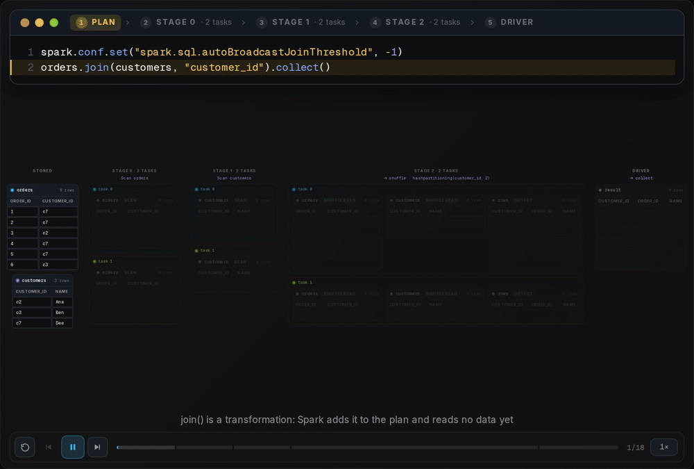
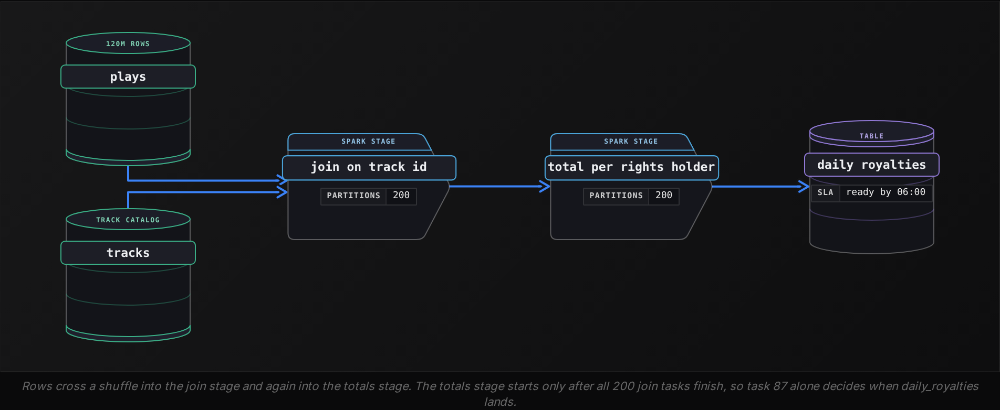
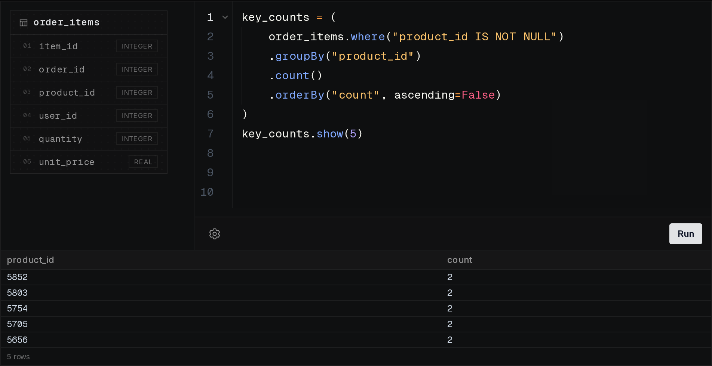
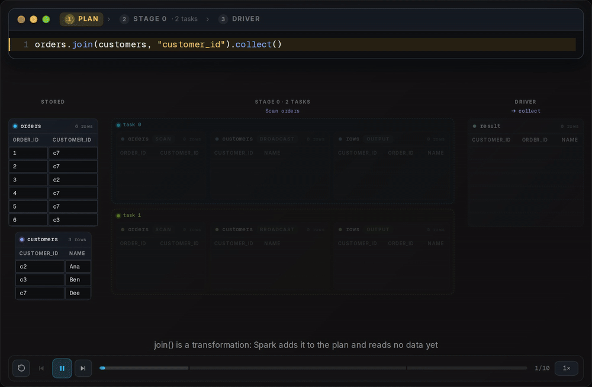

Beginner·Spark · 12 min · 14 challenges

# Data Skew: Beginner

On the morning after a superstar drops an album on Spotify, the overnight Spark job that joins every play to its track's records shows 199 of 200 tasks finished in 2 minutes, while the last one is still grinding at minute 46. That last task holds every play of the album's lead single. Adding machines will not move it. This lesson shows why.


<br>

---

## What Skew Is

Data skew means the partitions coming out of a shuffle differ wildly in size: most hold a normal share of rows, and a few hold many times more. The cause is the rule a shuffle uses to place rows. Spark hashes the key column, divides the hash by the number of shuffle partitions, and sends the row to the partition named by the remainder. Two rows with the same key always produce the same remainder, so they always land together. When every key owns a similar number of rows, the partitions come out similar. When a single key owns a tenth of the table, whichever partition it hashes to receives that tenth on top of its ordinary share.


<br>

### Watching a join pile rows onto a single task

The program below joins 6 orders to 3 customers on customer_id. Customer c7 placed 4 of the 6 orders. The first line sets spark.sql.autoBroadcastJoinThreshold to -1, which turns broadcasting off, so both tables are shuffled by key the way 2 large tables would be. Each table is read as 2 input partitions, and the shuffle writes 2 output partitions.



Before the shuffle, the orders sit in 2 input partitions of 3 rows each, an even split. After it, every c7 row has moved to whichever task c7 hashed to: 4 orders plus Dee's customer row, which is 5 of the 9 rows in the job. The c2 and c3 rows go wherever their own hashes send them, which may be the other task or the same crowded one. The input split was balanced and the shuffle undid it, because the shuffle places rows by key and c7 owns most of the orders.


<br>

### The same shape at 120 million rows

Now scale it up. A plays table holds 120 million rows, a row for every song played, and a nightly job joins it to a tracks table on track_id. Both tables are far too large to broadcast, so Spark shuffles both into 200 partitions, the default value of spark.sql.shuffle.partitions. If plays were spread evenly, each partition would hold 600,000 of them. On this day, a hit track drew 12 million plays.

Plays spread evenly

| partition | plays |
| --- | --- |
| 0 | 600,000 |
| 1 | 600,000 |
| 87 | 600,000 |
| 199 | 600,000 |
| all 200 | 120,000,000 |

With the hit track

| partition | plays |
| --- | --- |
| 0 | 540,000 |
| 1 | 540,000 |
| 87 | 12,540,000 |
| 199 | 540,000 |
| all 200 | 120,000,000 |

The right-hand table shows 4 of the 200 partitions after the real shuffle. The 108 million plays of all the other tracks still spread evenly, 540,000 to a partition. The hit track hashed to partition 87, so its 12 million plays went there too, leaving partition 87 with 12,540,000 rows: 23 times the size of each neighbour. The other 199 partitions came out a little smaller than the even split, and partition 87 came out enormous.

> Signs of skew after a shuffle
>
> - Sizes: after the same shuffle, a few partitions hold many times the rows of the typical partition.
> - A key: the shuffle placed rows by a column's value, and rows sharing a value had nowhere else to go.
> - A shuffle: input partitions follow how the files were split, so the skew in this lesson begins where rows are exchanged by key.

> **TIP**
>
> Skew belongs to a pair: the data and the key you shuffle it by. Shuffled by `play_id`, which is unique for every row, the plays table lands in 200 even partitions. Shuffled by `track_id`, the same rows produce partition 87.

**A job shuffles a 100-million-row events table by user_id into 200 partitions. Which situation is data skew?**

- **A.** All 200 partitions hold about 500,000 rows, and each task takes 6 minutes because 500,000 rows is a heavy load.
- **B.** 199 partitions hold about 460,000 rows and the last holds 8.5 million, because a single user_id owns 8 million rows.
- **C.** The input files were read as 200 equal partitions, and the shuffle by user_id then wrote 200 partitions of about 500,000 rows.
- **D.** All 200 partitions hold about 500,000 rows, but task 37 runs slowly because its executor's disk is failing.

<details>
<summary>Solution</summary>

**B.** 199 partitions hold about 460,000 rows and the last holds 8.5 million, because a single user_id owns 8 million rows.

A single key owns 8 million rows, the hash sends all of them to the same partition, and that partition ends up roughly 18 times the size of its neighbours.

**Why the others are wrong**

- **A.** Every partition is the same size, so nothing here is skewed. The tasks are slow together, which is a different problem from a few tasks being slow alone.
- **C.** Both the read and the shuffle produced even partitions. Skew needs a few partitions far larger than the rest.
- **D.** Task 37 is slow, but its partition is the same size as the others. A sick machine slows a normal-sized task, while skew hands a task an oversized partition.

</details>


<br>

---

## The Straggler Task

A straggler is a task still running long after the rest of its stage has finished. A stage is the group of tasks that run between 2 shuffles, each doing the same work on a different partition, and skew is the most common way a stage ends up with a straggler. In the plays join, task 87 received the 12,540,000-row partition. The other 199 tasks each read 540,000 rows and finish in about 2 minutes, while task 87 works through 23 times as many rows at the same pace and needs about 46 minutes. These timings assume time grows in step with rows, which holds closely enough for a join like this.


<br>

### What the straggler looks like while it runs

In an interactive shell, Spark prints a progress line for each running stage. For the join stage it reads like [Stage 4:===================>(199 + 1) / 200]: 199 tasks done, 1 running, 200 in total. At minute 2 the line reaches (199 + 1) / 200 and then stops moving. The bar looks 99.5% full while 44 of the stage's 46 minutes are still ahead.

| task | rows read | duration |
| --- | --- | --- |
| 0 | 540,000 | 2 min |
| 1 | 540,000 | 2 min |
| 87 | 12,540,000 | 46 min |
| 199 | 540,000 | 2 min |
| 196 others | 540,000 each | 2 min each |

Spark records how many rows and bytes each task read alongside how long it ran, and those 2 numbers together identify a skew straggler. Task 87 read 23 times the rows of a typical task and took 23 times as long. A long duration paired with an oversized input points at the data. A long duration paired with a normal input points somewhere else.

*Since Spark 3.2, Spark splits an oversized join partition by default when certain size conditions hold, a feature that dates from Spark 3.0. That feature and where it stops come in a later lesson; the timings here describe the join running without it.*


<br>

### Why the whole job waits on it

A stage is finished only when its last task is. The next stage, which totals royalties per rights holder, reads the join's output through another shuffle, so it cannot start until task 87 hands over its rows, and every stage after that waits in turn. Say the join stage starts at 05:15 and a dashboard reads the daily royalties table at 06:00. With balanced keys the join is done by about 05:17, and the table lands well before the dashboard looks. With task 87, the totals stage cannot start until 06:01, so the dashboard shows yesterday's royalties.



| ✓ Skew straggler | ✗ Slow-machine straggler |
| --- | --- |
| • Read many times the rows of its neighbours<br><br>• Slow again on every run, on any machine<br><br>• The same partition lags each time the data repeats its key mix<br><br>• Its rows share a single hot key | • Read about the same rows as its neighbours<br><br>• Normal speed when the job runs on other machines<br><br>• Slowness stays with a host across tasks and runs<br><br>• Its rows look like any other task's |


<br>

### When the straggler fails

A task holds the rows it is working on in the memory of a single executor. A partition 23 times the usual size can outgrow the memory available to it, and the task fails with an out-of-memory error. Spark retries a failed task a few times before failing the job, and every retry receives the same 12,540,000 rows, because the hit track still hashes to partition 87. This is a failure a retry cannot fix: the cause sits in the data, and the data has not changed.

**A stage has 100 tasks with a median duration of 90 seconds and a median input of 60 MB. Which task fits the signature of a skew straggler?**

- **A.** Task 12: ran 31 minutes and read 4.1 GB, against the 60 MB median read.
- **B.** Task 40: ran 30 minutes and read 62 MB, close to the 60 MB median.
- **C.** Task 77: ran 95 seconds and read 64 MB, a little above the median read.
- **D.** Task 3: finished first, in 20 seconds, after reading 9 MB.

<details>
<summary>Solution</summary>

**A.** Task 12: ran 31 minutes and read 4.1 GB, against the 60 MB median read.

A long duration together with an input about 70 times the median is the skew signature: the partition was oversized before the task began.

**Why the others are wrong**

- **B.** Task 40 is a straggler, but its input is normal. A slow executor or a busy host is the likelier cause, and a run on another machine would probably finish on time.
- **C.** A 95-second task against a 90-second median is ordinary variation between tasks, with no straggler here at all.
- **D.** A small partition makes a fast task. It finishes early and never holds up the stage.

</details>


<br>

---

## Where Hot Keys Come From

A key runs hot when it owns far more rows than the table's row count divided by the number of shuffle partitions. For plays, that even share is 120 million divided by 200, or 600,000, and the hit track's 12 million is 20 times it. You can find suspects before any job runs by asking what each value of the key column stands for and how the world produces it. Hot keys come from 4 sources again and again.


<br>

### Popularity: a few values take most of the activity

Activity piles onto a few winners: a hit song, a celebrity's account, a viral video, the largest seller on a marketplace, a company that runs 50,000 employees through a single account_id. Any key that names who or what produced a row inherits that shape. Columns like track_id, creator_id, seller_id and account_id deserve a hot-key check before any join or window on them.


<br>

### Placeholders: every missing value becomes a single value

Upstream systems often fill a missing value with a default, such as 'unknown', '', 0, -1 or '1970-01-01'. A website that logs every logged-out visitor as user_id = 0 has made 0 its busiest user, often by a wide margin. Placeholders are the sneakiest source because they stand for no real entity, so a team reasoning about real customers skips past them. A missing key stored as NULL gathers into a single group in the same way, and it gets its own lesson later.


<br>

### Few distinct values: the key cannot fill the partitions

A device column with 4 values (ios, android, web, tv) can fill at most 4 of the 200 shuffle partitions, and fewer when 2 values hash to the same partition. At least 196 tasks receive no rows at all, and the busy ones are as unequal as the device mix: if 70% of rows come from ios, a single task does 70% of the work. Columns such as country, status, plan and event_type carry the same risk.


<br>

### Bursts and machines: spikes in time and in traffic

Time keys run hot on the days that matter: a launch date, the hour a campaign goes out, the evening of a championship final. Machine traffic does the same to identity keys, since a load-testing rig or a scraping bot can send millions of events under a single device_id or ip_address. These keys look balanced on an ordinary day and spike on the day the job most needs to finish.

| column | likely hot value | source |
| --- | --- | --- |
| track_id | the day's biggest hit | popularity |
| user_id | 0 for logged-out visitors | placeholder |
| country | the largest market | few distinct values |
| event_date | launch day | burst in time |
| device_id | a load-testing rig | machine traffic |
| play_id | none: each value appears once | unique key |

**Your next job shuffles a 50-million-row orders table into 200 partitions. Which key is the strongest hot-key suspect?**

- **A.** order_id, because 50 million distinct values is the largest key space in the table.
- **B.** customer_id, because large customers place more orders and each of them fills a partition alone.
- **C.** created_at to the second, because many orders arrive in the same busy second.
- **D.** coupon_code, because orders placed without a coupon all carry the placeholder 'NONE'.

<details>
<summary>Solution</summary>

**D.** coupon_code, because orders placed without a coupon all carry the placeholder 'NONE'.

If most orders use no coupon, 'NONE' may own tens of millions of rows, and all of them hash to a single partition. Placeholders are often the hottest keys a table has.

**Why the others are wrong**

- **A.** Each order_id appears once, so every key owns a single row and the hash spreads them evenly. Unique keys are the safest to shuffle on.
- **B.** Large customers do lean the counts, but filling a partition alone takes more than 250,000 orders from a single customer. Count before blaming this column.
- **C.** A busy second might hold a few hundred orders, far below the 250,000 even share. Fine-grained timestamps spread rows widely.

</details>


<br>

### Measuring before you run

The check is a count of rows per key, sorted with the biggest first, compared with the even share. A grouped count stays cheap even when a key is hot, for a reason the next section explains.

```sql
key_counts = (
    plays.groupBy("track_id")
    .count()
    .orderBy("count", ascending=False)
)
key_counts.show(10)
```

Read the top rows against the even share of 600,000. A top count in the millions, like the hit track's, means a single partition will dwarf the rest and a straggler is coming. A top count of 3,000 means track_id is safe to shuffle on.

Run the same check on the practice order_items table. The cell lists the 5 products with the most order lines. Then change both product_id references to user_id and see whether customers concentrate order lines more than products do.



```python
key_counts = (
    order_items.where("product_id IS NOT NULL")
    .groupBy("product_id")
    .count()
    .orderBy("count", ascending=False)
)
key_counts.show(5)
```

Each line of the count does one job. groupBy names the key column whose values you are testing. count() turns each group into a single row holding the key and its number of rows, in a column named count. orderBy with ascending=False puts the biggest counts first, and that matters because show(5) prints only the first rows: sorted the default ascending way, those first rows are the rarest keys, and the hot one hides at the bottom.

**A teammate checks user_id on a 40-million-row events table with the count below. The output lists 5 users with 1 row each. What does that tell them?**

```python
counts = events.groupBy("user_id").count().orderBy("count")
counts.show(5)
```

- **A.** user_id is safe to shuffle on, since the 5 users at the top of the output own 1 row each.
- **B.** user_id is hot, since 5 users with 1 row each means the other rows must pile onto a few users.
- **C.** Nothing about hot keys yet: the sort is ascending, so these are the rarest users and the hottest sit at the bottom.
- **D.** Nothing about hot keys yet, because show(5) prints 5 random groups instead of the first rows of the sort.

<details>
<summary>Solution</summary>

**C.** Nothing about hot keys yet: the sort is ascending, so these are the rarest users and the hottest sit at the bottom.

Without ascending=False, show(5) prints the 5 smallest counts. Sorting descending puts the biggest owners first, where they can be compared with the even share.

**Why the others are wrong**

- **A.** The sort runs ascending, so the top of the output holds the smallest counts. A hot user could still own millions of rows at the bottom.
- **B.** A handful of rare users says nothing about the common ones. Millions of users with a few rows each would print the same 5 lines.
- **D.** show(5) prints the first 5 rows of the sorted result, which here are the rarest users. The fix is the sort direction.

</details>


<br>

---

## Which Operations Skew Hurts

A hot key does damage only at a step that sends rows to partitions by that key. For any line of code, ask whether the step shuffles by the key, and whether every row of the key travels to the receiving task or only a summary of those rows. The table sorts the common operations by those answers.

| operation | shuffles by the key? | effect of a hot key |
| --- | --- | --- |
| `filter`, `select`, `withColumn` | no | none: each task keeps its own input partition |
| join to a table under 10MB (broadcast) | no, the large side stays put | none |
| `count()` on the whole DataFrame | no key involved | none |
| `groupBy(k)` with `sum`, `count`, `avg` | yes | softened: a summary per input partition travels |
| `groupBy(k)` with `collect_list` | yes | full: every value reaches the hot task |
| join of 2 large tables (sort-merge) | yes, both sides | full, plus extra output rows when keys repeat |
| window with `partitionBy(k)` | yes | full: every row reaches the hot task |


<br>

### Untouched: steps with no key shuffle

Narrow steps like filter and withColumn run on each input partition where it sits, so key frequencies never come into play. A broadcast join is narrow on its large side: every executor receives a full copy of the small table, and each task joins the large-side rows it already holds. Here is the orders and customers join from the first section without the conf line. Deleting that line does not undo a setting that already ran: the threshold is back at its 10MB default only in a fresh session or after spark.conf.unset("spark.sql.autoBroadcastJoinThreshold"). At the default, the customers table is far under the threshold, so Spark broadcasts it.



No order rows move. Each of the 2 input tasks holds 2 of the c7 orders and matches them against its own copy of customers, so c7's popularity stays spread exactly as the input split spread it. Writing the join as `orders.join(F.broadcast(customers), "customer_id")` asks for the broadcast by name, whatever the threshold is set to. A hot key in a broadcast join costs nothing extra, which is one more reason to broadcast whenever the small side fits.

**orders has 80 million rows, and a single customer_id owns 10 million of them. customers is 3MB. What does the hot customer do to this join?**

```python
joined = orders.join(F.broadcast(customers), "customer_id")
```

- **A.** Nothing extra: each task joins the orders it already holds against its own copy of customers, so the hot rows stay spread.
- **B.** It creates a straggler, because the broadcast still sends all 10 million of that customer's orders to a single task.
- **C.** It slows a single task, because customers is shuffled by key and the hot customer's row lands on one task.
- **D.** Nothing extra, because F.broadcast first sorts orders by customer_id and splits the hot customer evenly.

<details>
<summary>Solution</summary>

**A.** Nothing extra: each task joins the orders it already holds against its own copy of customers, so the hot rows stay spread.

A broadcast join never shuffles the large side. The hot customer's 10 million orders stay in whichever input partitions they were read into.

**Why the others are wrong**

- **B.** The broadcast copies customers to every executor. The orders rows do not move, so no task gathers the hot customer.
- **C.** customers is copied whole to every executor, not shuffled by key, and a single customer row is no load for any task.
- **D.** The outcome is right but the reason is wrong: no sort or split happens. The large side simply stays where it was read.

</details>


<br>

### Softened: sums, counts and averages

A groupBy("track_id").count() on plays does shuffle by the hot key, but Spark first counts each key inside every input partition and ships only those partial counts. If plays is read as 960 input partitions, the hit track reaches its task as at most 960 small rows, which that task adds up in moments. The same holds for sum, avg, min and max. That pre-totaling is why the per-key count from the previous section stays cheap; how it works is a later lesson's subject.


<br>

### Hit in full: joins, windows and row lists

When both sides of a join are too large to broadcast, Spark shuffles both by the join key and joins them partition by partition, a strategy called sort-merge join. Every one of the hit track's 12 million plays travels to partition 87. The damage multiplies when the key repeats on both sides: joined to a track_credits table with 40 rows for the hit track (writers, producers, performers), those 12 million plays become 480 million output rows, all produced by task 87. That is the duplicate-key blowup from the joins lesson, concentrated on a single task.

A window partitioned by a key gathers every row of that key into a single task too, because the window function needs all of them in order. The program below numbers each play of a track by time:

```sql
w = Window.partitionBy("track_id").orderBy("played_at")
ranked = plays.withColumn("play_rank", F.row_number().over(w))
```

collect_list behaves the same way: its result keeps every value, so every value reaches the hot key's task, and no partial total can shrink a list.

> **TIP**
>
> When a job with a known hot key is slow, find the step that shuffles by that key and look up its row in the table above. A hot key that only passes through a broadcast join and a sum cannot explain the slowness, so look elsewhere.

**plays has 120 million rows and a hit track_id. tracks and track_credits are both far above the broadcast threshold. Which line does the hit track slow the most?**

```python
br = plays.where(F.col("country") == "BR")
per_track = br.groupBy("track_id").agg(F.sum("ms_played"))
titled = per_track.join(tracks, "track_id")
credited = plays.join(track_credits, "track_id")
```

- **A.** Line 1: the filter must scan every play of the hit track to test its country.
- **B.** Line 4: every raw play of the hit track meets its credit rows in a single task.
- **C.** Line 2: the sum shuffles by track_id, sending all 12 million rows to a single task.
- **D.** Line 3: the join to tracks is sort-merge, so the hit track's rows pile onto a single task.

<details>
<summary>Solution</summary>

**B.** Line 4: every raw play of the hit track meets its credit rows in a single task.

Line 4 shuffles both sides by track_id with no partial totals, sending 12 million plays to a single task, and the repeated credit rows multiply its output.

**Why the others are wrong**

- **A.** A filter is narrow. Each task tests the rows of its own input partition, and the hit track's plays are spread across all of them.
- **C.** The shuffle is by track_id, but Spark totals each input partition first, so the hit track sends a single partial sum per input partition.
- **D.** It is a sort-merge join, but per_track holds a single row per track after the sum, so no key piles up on that side.

</details>


<br>

---

## Why Skew Wastes the Cluster

The plays join runs on 50 executors with 4 cores each, which gives 200 slots. Each of the stage's 200 tasks takes a slot at minute 0. From there, the cluster's time splits like this:

| minutes | busy slots | idle slots |
| --- | --- | --- |
| 0 to 2 | 200 | 0 |
| 2 to 46 | 1 | 199 |

Count cost in slot-minutes, 1 slot held for 1 minute. On a fixed-size cluster, which this job runs on, the executors stay allocated for all 46 minutes, so the job pays for 200 slots times 46 minutes, or 9,200 slot-minutes. The work actually done is 199 tasks at 2 minutes plus 1 task at 46, which comes to 444 slot-minutes. Spread evenly over 200 slots, those 444 slot-minutes would take roughly 2.2 minutes of wall-clock time.

- **95%** — of paid slot time spent idle
- **21x** — stage time versus a balanced split

An idle slot costs the same per minute as a busy one, so the bill follows the 46 minutes of wall-clock time and ignores how little work filled them. On a shared cluster, the jobs queued behind this one wait out the extra 44 minutes as well.


<br>

### Why more hardware leaves the stage at 46 minutes

A task runs on a single core and works through its partition's rows in sequence. Task 87's 12,540,000 rows go through 1 core whether the cluster has 200 slots or 2,000. Double the executors to 100 and the stage still has 200 tasks: 200 new slots sit idle from minute 0, task 87 still finishes at minute 46, and the bill doubles. Doubling the cores per executor does the same. Giving executors more memory can keep task 87 from failing, but its rows still pass through a single core at the same pace.

| cluster | slots | stage time | slot-minutes paid |
| --- | --- | --- | --- |
| 50 executors x 4 cores | 200 | 46 min | 9,200 |
| 100 executors x 4 cores | 400 | 46 min | 18,400 |
| 50 executors x 8 cores | 400 | 46 min | 18,400 |
| 50 executors x 4 cores, balanced keys | 200 | about 2.2 min | about 444 |

Only the last row changes the stage time, and it changes how rows are distributed across tasks while leaving the hardware alone. Every remedy for skew works on that distribution by stopping the hot key's rows from landing on a single task. The intermediate skew lesson covers how.

> Questions before adding machines
>
> - Are most tasks of the slow stage finished while a few still run?
> - Did the long tasks read far more rows than the typical task?
> - Which key does that stage shuffle by, and how many rows does its biggest value own?
> - If the answers point to a hot key, extra hardware raises the bill and leaves the runtime where it is.

| ✓ Do | ✗ Don't |
| --- | --- |
| • Count rows per key before shuffling a new table by that key<br><br>• Compare the slowest task's input rows with a typical task's before tuning<br><br>• Broadcast the small side of a join whenever it fits under the threshold<br><br>• Treat placeholder values like 0 and 'unknown' as suspects in every key column | • Add executors to speed up a stage that is waiting on a single task<br><br>• Read 199 of 200 tasks done as a stage that is almost finished<br><br>• Rerun a skew failure and expect the retry to succeed<br><br>• Assume a balanced input read stays balanced after a shuffle |

**To bring the 46-minute join stage under 10 minutes, a teammate proposes moving the job from 50 executors to 150, each with 4 cores. What happens?**

- **A.** The stage drops to about 15 minutes, since 3 times the slots cuts every task's time to a third.
- **B.** The stage drops below 10 minutes because the new executors take over part of task 87's rows.
- **C.** The stage still takes about 46 minutes, and the slot-minutes paid roughly triple to about 27,600.
- **D.** The stage still takes about 46 minutes, but the cost stays flat because idle executors are not billed.

<details>
<summary>Solution</summary>

**C.** The stage still takes about 46 minutes, and the slot-minutes paid roughly triple to about 27,600.

Task 87 still runs on a single core over 12,540,000 rows, and the 600 slots are paid for all 46 minutes: 600 x 46 = 27,600.

**Why the others are wrong**

- **A.** A task's duration depends on its partition and its single core. Extra slots add no speed to the work on partition 87.
- **B.** A running task keeps its whole partition. New executors can only run tasks, and this stage has no other tasks left to give them.
- **D.** The runtime part is right, but allocated executors are paid for whether or not they run a task, so the bill rises with the slot count.

</details>


<br>

---

## Putting It All Together

A retailer's holiday clickstream job reads 900 million page views. It joins them to a 4MB page catalog, numbers each visitor's views with a window partitioned by user_id, and totals spend per user. Every logged-out visitor carries user_id = 0, and a price-scraping bot sent 30 million views under a single id. The job ran fine in October and stalls on the holiday weekend.

- The user_id = 0 placeholder and the bot are the hot keys, and a per-key count run before the holiday would have shown both.
- The 4MB catalog join is broadcast, so the hot visitors pass through it untouched.
- The per-user spend total ships partial sums from each input partition, so it stays fast.
- The window partitioned by user_id sends every view of user 0 to a single task, which becomes the straggler with an oversized input.
- Doubling the cluster for the holiday leaves that stage's runtime alone and doubles its bill, so the remedy has to move user 0's rows apart.


<br>

---

## Key Takeaways

- Skew is unequal partition sizes created when a shuffle places rows by a key that a few values dominate.
- A skew straggler pairs a long duration with an oversized input, and every later stage waits for it.
- Popularity, placeholders, few distinct values, and bursts of time or machine traffic make keys hot.
- Narrow steps and broadcast joins ignore hot keys, sums and counts soften them, and sort-merge joins, per-key windows and collect_list feel them in full.
- An idle slot costs as much as a busy one, and extra hardware cannot speed up a task bound to a single core.
