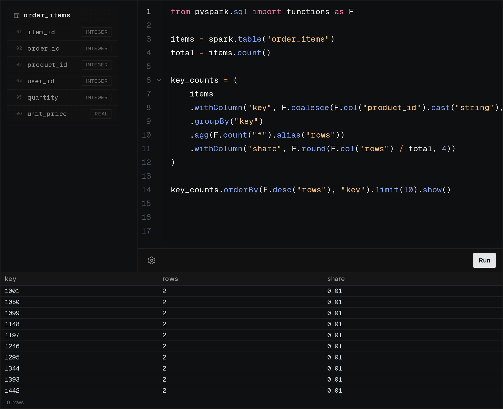
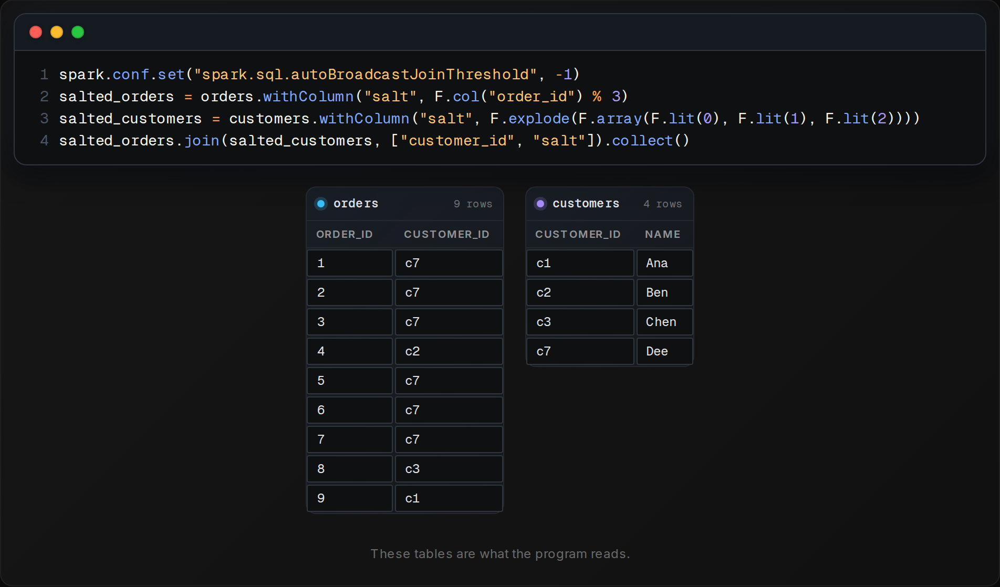
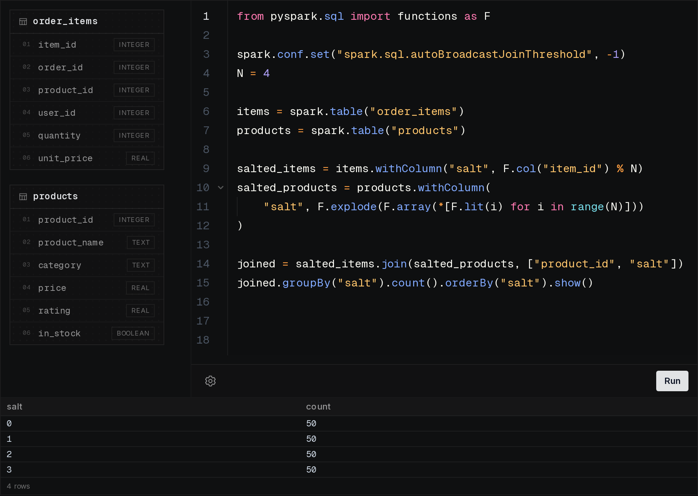
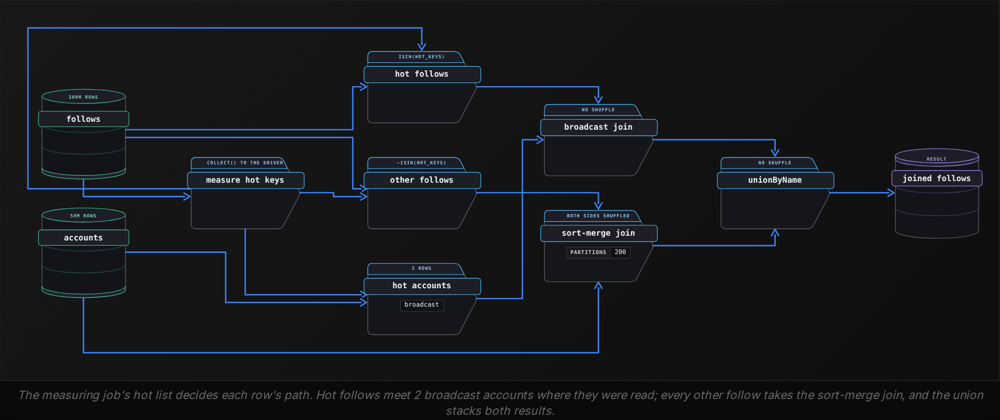
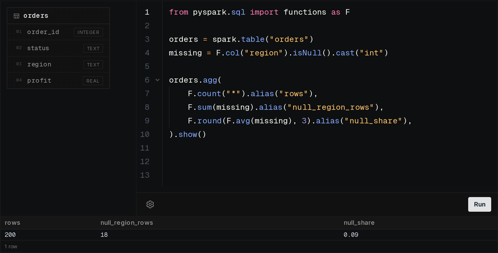
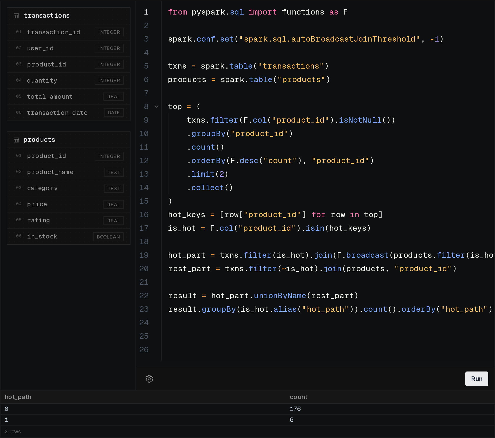

Intermediate·Spark · 14 min · 15 challenges

# Data Skew: Intermediate

You're a data engineer at Instagram, and the nightly job that joins every follow edge to the account being followed has stalled at 199 of 200 tasks. The last task holds every edge pointing at Cristiano Ronaldo, the most-followed person on the platform. Doubling the partition count changes nothing. This lesson shows you how to measure that key, split it, and finish the stage on time.


<br>

---

## Measuring Skew

Skew lives in the data before Spark touches it: a few values of the join or grouping key carry far more rows than the rest. The shuffle turns that imbalance into task time, because hash partitioning sends every row of a key to the same reducer. The most useful measurement is therefore a row count per key, taken on the side that will be shuffled and ranked from heaviest down.


<br>

### Rank the keys by row count

The cell below ranks `order_items` by `product_id`. A `groupBy` already gathers every missing key into a group of its own. The `cast` and `coalesce` give that group the string label `NULL` and give every key 1 type, so the missing value ranks, sorts and displays like any other key. Each key's `share` divides its rows by the table's total, which the first `count()` fetches as a job of its own. Run it and read the top row: that value sets the minimum load of whichever task receives it.



```python
from pyspark.sql import functions as F

items = spark.table("order_items")
total = items.count()

key_counts = (
    items
    .withColumn("key", F.coalesce(F.col("product_id").cast("string"), F.lit("NULL")))
    .groupBy("key")
    .agg(F.count("*").alias("rows"))
    .withColumn("share", F.round(F.col("rows") / total, 4))
)

key_counts.orderBy(F.desc("rows"), "key").limit(10).show()
```

This measurement stays cheap on a huge table. `count` combines before the shuffle, so each map task sends a single partial count per key it saw, never the rows themselves. Because `limit(10)` follows the `orderBy`, Spark also keeps a running top 10 in each partition instead of range-shuffling every key, and the ranking job runs with only the shuffle that `groupBy` needs.


<br>

### From a count to a verdict

A row count becomes a verdict when you compare it with what a task normally receives. Take a `follows` table of 300M rows, shuffled into 200 partitions on `followee_id`. Spread evenly, each task would get 1.5M rows: the even share. Any key holding more than the even share is hot, because its task can't finish before it has processed that key's rows, however the other keys fall.

| followee_id | rows | share | verdict |
| --- | --- | --- | --- |
| acct_1001 | 30,000,000 | 10.0% | hot: 20 times the even share |
| NULL | 12,000,000 | 4.0% | hot: 8 times the even share |
| acct_2002 | 2,400,000 | 0.8% | hot: 1.6 times the even share |
| acct_3003 | 1,100,000 | 0.37% | below the 1.5M even share |

- **3** — hot values among 300M rows
- **14.8%** — of all rows held by those 3 values

Run the count on both sides of a join. A key that is hot on both sides compounds: if the 30M follows rows of `acct_1001` met 5 matching rows on the other side, the join would emit 150M rows, every one built on that key's task. That is the duplicate-key blowup and skew at once, and only per-key counts on each side reveal it before the job runs.

The ranking names the exact values to fix, which the running job cannot. Once the stage runs, the straggler shows up as a single task reading far more shuffle data than its peers, but that figure is a partition's total: the hot key mixed with every other key that hashed alongside it. The per-key count tells you which value it is and how many rows it brings.


<br>

### Measure what each task will get

```sql
from pyspark.sql import functions as F

per_task = (
    follows
    .repartition(200, "followee_id")
    .groupBy(F.spark_partition_id().alias("task"))
    .count()
    .orderBy(F.desc("count"))
)
```

This version answers the task-level question directly. It hashes `followee_id` into the same 200 partitions the join would use, then counts the rows that landed in each. Its top row is the straggler's load, neighbours included, before the real job ever runs. It pays for that with a full shuffle of the table, so run the per-key ranking first and reach for this one when you need partition totals.

**A join shuffles 400M rows into 400 partitions. The per-key count of its join key returns these top values: k1 with 9M rows, k2 with 3M, k3 with 800K and k4 with 600K. Which values are hot?**

- **A.** k1, k2 and k3, because each holds more than 0.1% of the table's rows
- **B.** Only k1, because a key needs more than 2% of the rows to slow a stage
- **C.** k1 and k2, because each holds more rows than the 1M-row even share
- **D.** All 4 values, because each one stands at the top of the per-key ranking

<details>
<summary>Solution</summary>

**C.** k1 and k2, because each holds more rows than the 1M-row even share

Spread over 400 partitions, 400M rows give each task 1M. k1 holds 9 times that and k2 3 times, while k3 and k4 fit inside an ordinary task.

**Why the others are wrong**

- **A.** A percentage of the table is the wrong bar. The even share is 400M / 400 = 1M rows per task, and k3 at 800K sits below it.
- **B.** No fixed percentage decides it. k2 holds 3M rows, 3 times the 1M-row even share, so its task runs well past its peers.
- **D.** The top of a ranking only means heaviest. k3 and k4 carry fewer rows than the 1M a task receives anyway.

</details>


<br>

---

## Salting a Hot Key

A hot key has a single hash value, so it has a single destination. Salting gives it several. Add a `salt` column holding a number from 0 to N-1 to every row of the big side, then join on the key and the salt together. The 30M rows of `acct_1001` now form N separate join keys, and each of those hashes to a partition independently of the others.

The small side has to keep up. A `follows` row salted 7 can only match an account row that also carries salt 7, so every small-side row is copied N times, once per salt value. The join's output stays the same: each big-side row still meets exactly 1 copy of its partner.

orders, salt = order_id % 3

| order_id | customer_id | salt |
| --- | --- | --- |
| 1 | c7 | 1 |
| 2 | c7 | 2 |
| 3 | c7 | 0 |
| 5 | c7 | 2 |
| 6 | c7 | 0 |
| 7 | c7 | 1 |

customers, copied once per salt

| customer_id | name | salt |
| --- | --- | --- |
| c7 | Dee | 0 |
| c7 | Dee | 1 |
| c7 | Dee | 2 |
| c1 | Ana | 0 |
| c1 | Ana | 1 |
| c1 | Ana | 2 |

The tables above show the `c7` rows of each side and the copies of `c1`. The animation runs the whole join on 9 orders, 6 of them for customer `c7`, with 3 shuffle partitions and broadcasting switched off so both sides shuffle. The salt `order_id % 3` splits `c7` into 3 keys of 2 rows each: orders 3 and 6 carry salt 0, orders 1 and 7 salt 1, orders 2 and 5 salt 2. The 4 customers become 12 rows. Watch where the 3 `c7` keys land.



Each `(customer_id, salt)` pair hashes on its own, so the 3 `c7` keys are free to reach different tasks, and 2 of them can still share one: salting spreads a key across up to N tasks, never a guaranteed N. Salting adds no shuffle either. The plan still has 1 exchange per side, hashing on 2 columns instead of 1. The output holds the same 9 rows the unsalted join returns; drop `salt` once the join is done.


<br>

### Choosing N

Pick N so each salted piece is about the size of an ordinary task. With section 0's numbers, `acct_1001` holds 30M rows against a 1.5M-row even share, so N = 30M / 1.5M = 20, and each piece carries roughly what every other task carries. The bill arrives on the small side: an `accounts` table of 50M rows, copied 20 times, enters the shuffle 20 times larger.

- **1B** — account rows entering the shuffle

That copy cost makes salting a second resort. If the small side fits under the broadcast threshold, broadcast it instead: the big side never shuffles, so no task ever collects a key. Salt when the small side is too big to broadcast and the hot key is too big for a single task. Section 2 copies only the hot keys' partners instead of the whole table.


<br>

### Every salt needs a partner

A salted join returns the right rows only when the small side carries every salt the big side can produce. If the big side computes `order_id % 20` while the small side is copied over 0 to 18, every row salted 19 finds no partner, and an inner join drops it without an error. Build both sides from the same N. Derive the salt from a column with many distinct values, such as a unique id, so a row gets the same salt on every run, and never from the join key, which would hand every row of the hot key the same salt.

**This salted join runs without an error. What happens to the order rows whose order_id % 8 equals 7?**

```python
salted_orders = orders.withColumn("salt", F.col("order_id") % 8)
salted_customers = customers.withColumn(
    "salt", F.explode(F.array(*[F.lit(i) for i in range(7)]))
)
joined = salted_orders.join(salted_customers, ["customer_id", "salt"])
```

- **A.** They vanish from the result, because no customer copy carries salt 7 for them to match
- **B.** They match the copy salted 6, because Spark rounds a missing salt down to the nearest one
- **C.** They all land on a single task, because rows without a partner gather on one reducer
- **D.** The join fails at the action, because the 2 salt columns cover different ranges of values

<details>
<summary>Solution</summary>

**A.** They vanish from the result, because no customer copy carries salt 7 for them to match

range(7) yields 0 to 6, so the small side has 7 copies while the big side produces 8 salts. The inner join silently drops every row salted 7, about 1 order in 8.

**Why the others are wrong**

- **B.** Spark matches equal values only. A row salted 7 looks for a partner salted 7 and finds none.
- **C.** Unmatched rows hash like any others. The (customer_id, 7) pairs spread across tasks and then produce no output.
- **D.** Spark never compares value ranges between join sides. The plan runs, and the rows salted 7 produce nothing.

</details>

The cell salts a join of `order_items` to `products` with N = 4. The products table is tiny, so the cell turns broadcasting off to get the sort-merge join a 50M-row table would get. The output counts joined rows per salt value.



```python
from pyspark.sql import functions as F

spark.conf.set("spark.sql.autoBroadcastJoinThreshold", -1)
N = 4

items = spark.table("order_items")
products = spark.table("products")

salted_items = items.withColumn("salt", F.col("item_id") % N)
salted_products = products.withColumn(
    "salt", F.explode(F.array(*[F.lit(i) for i in range(N)]))
)

joined = salted_items.join(salted_products, ["product_id", "salt"])
joined.groupBy("salt").count().orderBy("salt").show()
```


<br>

---

## Isolating Hot Keys

Salting copies the whole small side N times to rescue a few keys. When the measurement names only a handful of hot values, split the big side by those values instead and send each part down its own path. The hot rows join through a broadcast of the few small-side rows that match them, and the rest join as before, with no key left that is too big for its task.



```sql
from pyspark.sql import functions as F

hot_rows = (
    follows
    .filter(F.col("followee_id").isNotNull())
    .groupBy("followee_id")
    .count()
    .filter(F.col("count") > 1_500_000)
    .collect()
)
hot_keys = [row["followee_id"] for row in hot_rows]

hot_part = (
    follows.filter(F.col("followee_id").isin(hot_keys))
    .join(
        F.broadcast(accounts.filter(F.col("account_id").isin(hot_keys))),
        F.col("followee_id") == F.col("account_id"),
    )
)
rest_part = (
    follows.filter(~F.col("followee_id").isin(hot_keys))
    .join(accounts, F.col("followee_id") == F.col("account_id"))
)

result = hot_part.unionByName(rest_part)
```

The `collect()` runs the measuring job first, on its own, and returns 2 ids, `acct_1001` and `acct_2002`; the `isNotNull` filter keeps NULL out of the list, and section 3 handles it. The hot path broadcasts the 2 matching accounts to every executor, so the 32.4M hot follows join on the tasks that read them, spread however the input was split, and no task gathers a key. The rest path is the original sort-merge join over every other follow, and its largest key is now `acct_3003` at 1.1M rows, under the 1.5M even share.

The hot path broadcasts only because of the `F.broadcast` hint. Without column statistics, Spark estimates a filtered table at its unfiltered size, so it sees all 50M accounts instead of 2 rows and plans a sort-merge join. The hint states what the measuring job already proved.

Count the plan's shuffles: 2, a shuffle for each side of the rest join. The hot path adds a broadcast and no exchange, and `unionByName` stacks the 2 results without moving a row. The new costs are the measuring job and a second scan of `follows`, because each filter reads the table on its own. Both are even passes with no straggler.

**In the isolation code above, accounts holds 50M rows, far over the broadcast threshold, and hot_keys holds 2 ids. How many shuffle exchanges does the plan for result contain?**

- **A.** 0, because the broadcast hint removes every shuffle from the plan
- **B.** 2, a shuffle for each side of the rest path's sort-merge join
- **C.** 3, both sides of the rest join plus a shuffle for unionByName
- **D.** 4, because both paths join follows to accounts and each shuffles twice

<details>
<summary>Solution</summary>

**B.** 2, a shuffle for each side of the rest path's sort-merge join

The hot path broadcasts 2 account rows and joins in place, and unionByName moves no rows. Only the rest join shuffles, once per side.

**Why the others are wrong**

- **A.** The hint applies only to the hot path's join. The rest path joins all 50M accounts, so it plans a sort-merge join that shuffles both sides.
- **C.** A union stacks the partitions of both inputs and adds no exchange. The count stays at the rest join's 2.
- **D.** The hot path's join is a broadcast. Its follows rows stay where they were read, and only the 2 filtered accounts travel.

</details>

| ✓ Salting the join | ✗ Isolating hot keys |
| --- | --- |
| • Copies every small-side row N times<br><br>• A single plan for every key, with no list to maintain<br><br>• Spreads a hot key over up to N tasks<br><br>• Works when a hot key's partners are too many to broadcast | • Copies nothing and broadcasts only the hot keys' partners<br><br>• Needs a measuring job to build the hot list<br><br>• Hot rows join where they were read, with no shuffle<br><br>• Scans the big side twice, once per path |


<br>

### Keep the hot list fresh

Measure the hot list on every run instead of pasting ids into the code. Hot keys move: a celebrity joins, an account goes viral, a promotion makes a single product the week's top seller. A hardcoded list goes stale in silence, and the next new hot key lands back on a single task. The measuring job stays cheap because its counts combine before the shuffle.

When a hot key's partners are too many to broadcast, as when both sides of a many-to-many join are hot, keep the split and salt only the hot path. The copies then cover the hot keys' partner rows alone, a small set of rows copied N times instead of the whole small side.

**An isolation job runs with a hot list pasted into the code last month: ['acct_1001', 'acct_2002']. This week acct_5005 goes viral and gains 25M follows. What happens to its rows on tonight's run?**

- **A.** They take the broadcast path, because isin matches every key above the even share
- **B.** The job fails at the action, because a key missing from the list is over the broadcast threshold
- **C.** They take the rest path's sort-merge join, and all 25M land on a single task
- **D.** They spread over the 200 partitions, because the rest path hashes on 2 columns

<details>
<summary>Solution</summary>

**C.** They take the rest path's sort-merge join, and all 25M land on a single task

The stale list sends acct_5005 down the normal join, where its single hash puts 25M rows, about 17 times the 1.5M even share, on one task. Measuring each run catches it.

**Why the others are wrong**

- **A.** isin matches only the ids in the list. acct_5005 is not in it, so its rows fail the hot filter.
- **B.** Spark never checks the list against the data. The plan runs, and the rows of acct_5005 join on the rest path.
- **D.** The rest path joins on followee_id alone. Only a salted join hashes on 2 columns, and this path carries no salt.

</details>


<br>

---

## Null-Key Skew

In section 0's ranking of `follows`, the second-hottest value was NULL, with 12M rows. Missing keys pile up because a single cause creates them in bulk: follows of deleted accounts, events from logged-out visitors, orders written before the customer id was captured. Every null hashes to the same value, so a shuffle on that column sends all of them to a single partition.


<br>

### Inner joins drop them, left joins keep them

A null key can never satisfy an equality, so an inner join has nothing to find for it. Catalyst knows this: during logical optimization it adds an `isnotnull` filter on each join key, and null-keyed rows are discarded before the shuffle. A left join cannot discard them. It must return every left row, matched or not, so its null-keyed rows travel through the exchange and pile onto a single reducer that will match none of them.

The animation runs a left join of 7 orders to 3 customers with broadcasting off and 2 shuffle partitions. Four of the 7 orders have no `customer_id`. Watch the 4 null rows: they leave their input tasks for the same reducer, and each comes out with a null `name`.

https://github.com/user-attachments/assets/85c2be8b-c8b0-479f-9194-4c9ddf935444

At scale that reducer holds the 12M null follows plus its share of real keys, and the work is pure overhead: each output row is the input row with nulls appended. A `groupBy` on the same column also builds a null group, but a combining aggregate such as `count` keeps it to a partial per map task, so the left join is where null skew costs the most.


<br>

### Send the nulls around the join

```sql
from pyspark.sql import functions as F

has_key = orders.filter(F.col("customer_id").isNotNull())
no_key = orders.filter(F.col("customer_id").isNull())

joined = has_key.join(customers, "customer_id", "left")
result = joined.unionByName(no_key, allowMissingColumns=True)
```

The null rows skip the join altogether. `unionByName` with `allowMissingColumns=True`, available since Spark 3.1, fills the customer columns with nulls for them, which is what the left join would have produced. Only keyed rows can enter an exchange, and the reducer that used to collect every null now gets an ordinary share.

Sentinel values such as `''`, `'unknown'`, `0` or `-1` behave like a real key. Catalyst infers only `isnotnull`, so an inner join shuffles every sentinel row to the same task whether it finds a partner, and a matching placeholder row in the dimension also multiplies the output on that task. Count them like any hot key and isolate them. The isolation filter from section 2 also drops nulls: `~F.col("followee_id").isin(hot_keys)` evaluates to null on a null key, and `filter` discards null. In an inner join that loses nothing; in a left join the rest path needs `F.col("followee_id").isNull() | ~F.col("followee_id").isin(hot_keys)` to keep those rows.

> **TIP**
>
> To see Catalyst drop null keys, call `explain()` on an inner join and find `isnotnull(customer_id)` in the `Filter` on each side. On a left join that filter appears on the right side only, a sign that the left side's nulls will shuffle.

**A job left-joins page_views to users on user_id with 400 shuffle partitions, and 40% of page views have a null user_id. Which rewrite returns the same rows while shuffling none of the null-keyed page views?**

- **A.** Raise spark.sql.shuffle.partitions from 400 to 4,000 so the null rows spread out
- **B.** Switch the left join to an inner join, which filters null keys before the shuffle
- **C.** Salt both sides with N = 40 so the null keys hash to 40 different partitions
- **D.** Join only the non-null rows, then unionByName the null rows with allowMissingColumns=True

<details>
<summary>Solution</summary>

**D.** Join only the non-null rows, then unionByName the null rows with allowMissingColumns=True

The null rows never enter the exchange, and the missing users columns come back as nulls, as the left join returned them.

**Why the others are wrong**

- **A.** Every null hashes alike, so all 40% still reach a single partition, and every one of them still crosses the network.
- **B.** The straggler goes away, and so does 40% of the result, because an inner join returns no unmatched rows.
- **C.** Salting would spread the null rows, but each one still shuffles, and users grows 40 times over for rows that can never match.

</details>

Before choosing a fix, measure how much of the key is missing. The cell computes it as a single global aggregate: 1 row holding the total, the null count and the null share, with no row per region and no separate `count()` job to divide by.



```python
from pyspark.sql import functions as F

orders = spark.table("orders")
missing = F.col("region").isNull().cast("int")

orders.agg(
    F.count("*").alias("rows"),
    F.sum(missing).alias("null_region_rows"),
    F.round(F.avg(missing), 3).alias("null_share"),
).show()
```


<br>

---

## Why More Partitions Won't Help

Raising `spark.sql.shuffle.partitions` is the right fix when every task is too big because the data is big. It is the wrong fix for a hot key, and the reason is a single line of arithmetic. Hash partitioning places a row in partition `pmod(hash(key), P)`. A key has a single hash, so for every P it maps to a single partition, and every row carrying it goes there. Raising P divides the other keys more finely and leaves the hot key whole.

| shuffle partitions | even share per task | hot task, at least | hot task vs even share |
| --- | --- | --- | --- |
| 200 | 1.5M rows | 30M rows | 20x |
| 2,000 | 150K rows | 30M rows | 200x |
| 20,000 | 15K rows | 30M rows | 2,000x |

A stage ends when its slowest task ends. At 200 partitions the hot task holds the 30M rows of `acct_1001` plus its share of the other 270M, around 1.35M more. At 2,000 partitions that share falls to about 135K, so the straggler loses roughly 4% of its rows while the stage now schedules 10 times as many tasks. The stage barely speeds up.

The animation replays section 1's 9 orders without the salt, at 6 shuffle partitions, twice the 3 used there. The 6 orders for `c7` still meet on a single task. The other 3 orders land wherever their keys hash, and at least 2 of the 6 tasks receive nothing at all.

https://github.com/user-attachments/assets/e6bedac4-3170-48cb-9675-0acdd0c871db

**A sort-merge join's stage runs 41 minutes, 40 of them spent waiting on a single task. A teammate raises spark.sql.shuffle.partitions from 200 to 1,000, and the stage now runs 40 minutes. What explains the result?**

- **A.** The slow task holds a hot key, which hashes to a single partition at any count, so only its neighbours moved
- **B.** The extra partitions added scheduling overhead that cancelled out the split of the hot key's rows
- **C.** The setting changes only groupBy stages, so the join kept hashing into its old 200 partitions
- **D.** The hot key split into 5 pieces, and each piece still runs longer than the remaining tasks

<details>
<summary>Solution</summary>

**A.** The slow task holds a hot key, which hashes to a single partition at any count, so only its neighbours moved

At 1,000 partitions the hot key still has a single destination. The rows that left were the other keys sharing its partition, worth about a minute.

**Why the others are wrong**

- **B.** There was no split to cancel. Every row of the hot key still hashes to the same partition, whatever the count.
- **C.** The setting governs joins too, and the minute saved shows the join did use more partitions. The hot key ignored them.
- **D.** Raising the count splits no key. Splitting a key takes a change to the key itself, such as a salt or an isolated path.

</details>


<br>

### Pick the fix from the measurement

| What the measurement shows | The fix |
| --- | --- |
| The small side fits under the broadcast ceiling | Broadcast it, so the big side never shuffles |
| A handful of hot keys with few partner rows | Isolate them on a broadcast path and union back |
| Hot keys whose partners are too many to broadcast | Salt the join, with N = hot rows / even share |
| NULL is the hot value in a left join | Route the null rows around the join |
| A hot key in a sum or count aggregation | Often nothing: partial results shrink it before the shuffle |
| No hot key, but every task is too big | Raise spark.sql.shuffle.partitions |

A `groupBy` with `sum` or `count` combines before the shuffle, so the hot key's reducer receives at most a partial result from each map task: 30M rows read by 200 map tasks arrive as no more than 200 partials. Skew bites the aggregations whose partial result doesn't shrink, such as `collect_list`, which ships every value it gathers.

**A left join of events (2B rows, 1,000 shuffle partitions) to a 20GB devices table is stuck on a straggler. The per-key count of device_id returns NULL at 300M rows and dev_0, a placeholder id, at 40M rows; every other value is under 2M. Which plan fixes it without changing the output?**

- **A.** Salt the whole join with N = 150, because NULL holds 150 times the even share
- **B.** Raise the partition count to 10,000, so the even share falls to 200K rows a task
- **C.** Send the null rows around the join, isolate dev_0 on a broadcast path, and union the 3 parts
- **D.** Switch to an inner join to drop the nulls, then broadcast the 20GB devices table

<details>
<summary>Solution</summary>

**C.** Send the null rows around the join, isolate dev_0 on a broadcast path, and union the 3 parts

Nulls skip the exchange and get their device columns back as nulls. The single dev_0 device row broadcasts, and the rest join with no key above the 2M even share.

**Why the others are wrong**

- **A.** The 20GB devices table would enter the shuffle 150 times over, and the null rows, which match nothing, would still all cross the network.
- **B.** NULL and dev_0 each keep a single partition at any count, so their tasks stay at 300M and 40M rows.
- **D.** The inner join removes 300M rows from the output, and a 20GB table is far past what a broadcast can carry.

</details>

The capstone puts sections 0 to 2 together on the practice data. It measures the 2 heaviest `product_id` values in `transactions`, sends their rows down a broadcast path, joins the rest with a sort-merge join, and counts the rows each path produced. Broadcasting is switched off so the rest path really shuffles, and the `F.broadcast` hint overrides that setting on the hot path. On a table this small, hot only means heaviest, but the plan is the one you would ship.



```python
from pyspark.sql import functions as F

spark.conf.set("spark.sql.autoBroadcastJoinThreshold", -1)

txns = spark.table("transactions")
products = spark.table("products")

top = (
    txns.filter(F.col("product_id").isNotNull())
    .groupBy("product_id")
    .count()
    .orderBy(F.desc("count"), "product_id")
    .limit(2)
    .collect()
)
hot_keys = [row["product_id"] for row in top]
is_hot = F.col("product_id").isin(hot_keys)

hot_part = txns.filter(is_hot).join(F.broadcast(products.filter(is_hot)), "product_id")
rest_part = txns.filter(~is_hot).join(products, "product_id")

result = hot_part.unionByName(rest_part)
result.groupBy(is_hot.alias("hot_path")).count().orderBy("hot_path").show()
```


<br>

---

## Putting It All Together

Back at Instagram, the follows job left-joins every follow edge to the profile of the account being followed. Measuring followee_id shows 2 values far above the even share: the account of Cristiano Ronaldo, the most-followed person on the platform, and NULL, left behind by edges that point at deleted accounts. The fix that ships routes the null edges around the join, sends Ronaldo's edges through a broadcast of his single profile row, joins everything else as before, and unions the 3 parts.

- The per-key count from section 0 names Ronaldo's account and NULL as the hot values, by comparing each with the even share of total rows over shuffle partitions.
- The null edges take the route from section 3, because a left join would shuffle all of them to a single task even though none can match a profile.
- Ronaldo's edges take the isolated path from section 2, joining a broadcast profile row where they were read, so no task gathers them and the profile table is never copied.
- Had his edges met too many partner rows to broadcast, the salt from section 1, applied to that path alone, would spread them across up to N tasks.
- Section 4 explains why the first attempt, doubling the partition count, changed nothing: each hot value keeps a single partition at any count.


<br>

---

## Key Takeaways

- Measure skew as rows per key on the side being shuffled. A key is hot when it holds more rows than the even share: total rows over shuffle partitions.
- Salting turns a hot key into N join keys, spread over up to N tasks, by copying the small side N times. Choose N as hot rows over the even share, and give the small side every salt.
- Isolating sends a handful of measured hot keys through a broadcast join and the rest through the normal join, then unions the parts without copying anything.
- Inner joins drop null keys before the shuffle; left joins shuffle them onto a single task, so route them around the join and add the missing columns back.
- A key has a single hash and so a single partition at any count: more shuffle partitions shrink every task except the straggler.
