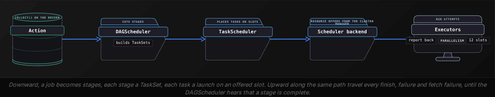
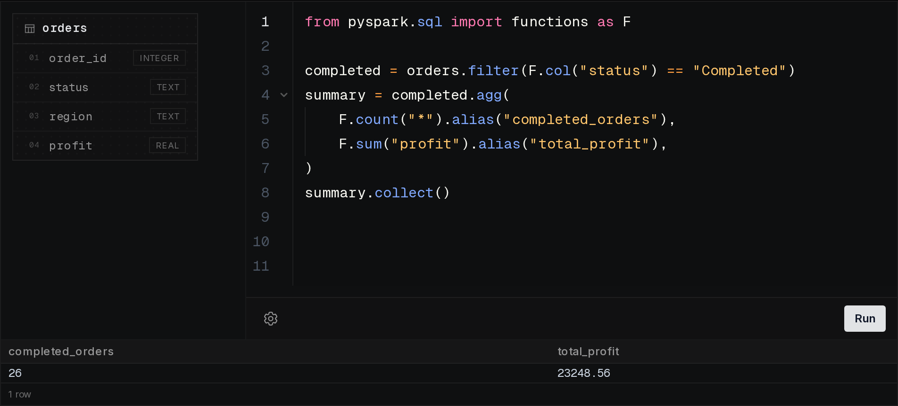
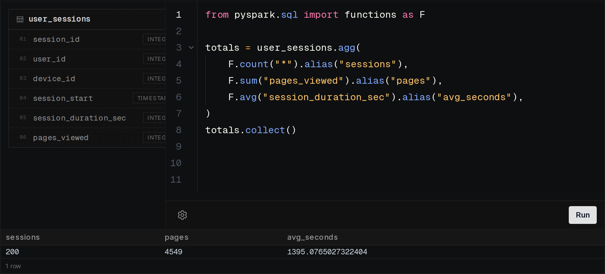

# Execution Model: Advanced

Picture the nightly Spark job behind Netflix's Top 10 row fanning out into 2,000 tasks. One night 1,999 of them finish in 3 minutes and the last runs for 40 on a failing disk. Whether the row refreshes before breakfast depends on 2 components inside the driver: the one that cuts stages, and the one that hands out tasks, retries them, and launches a copy of the straggler.


<br>

---

## DAGScheduler vs TaskScheduler

### Two schedulers in one driver

An action turns a chain of transformations into a job, and 2 components inside the driver split the work of running it. The DAGScheduler takes the chain, walks it backwards from the result, and cuts it at every shuffle into stages. It submits those stages in dependency order, each one as a TaskSet holding 1 task per partition. The TaskScheduler receives each TaskSet and does the placing: it matches tasks to free slots on executors, launches them, hears back when each attempt finishes or fails, and reports the finished set to the DAGScheduler, which then releases the next stage.

The split is by unit. The DAGScheduler reasons in stages and knows nothing about which executor runs anything. The TaskScheduler reasons in tasks and slots and knows nothing about shuffle boundaries. Retries, speculation and locality, the subjects of the next sections, all live in the TaskScheduler, because each is a decision about 1 task on 1 slot. A lost shuffle output is the exception, and it lands on the DAGScheduler because repairing it means re-running a stage.

| Question | DAGScheduler | TaskScheduler |
| --- | --- | --- |
| Unit it reasons in | Stages | Tasks |
| What it receives | A job, from an action | A TaskSet, from the DAGScheduler |
| What it decides | Where stage boundaries fall and which stage runs next | Which executor slot runs each task, and when |
| On a task failure | Nothing, until the retry budget is spent | Re-launches the task as a new attempt |
| On lost shuffle output | Re-runs the parent stage for the lost partitions | Nothing, hands the FetchFailed upward |
| What it tracks | Map output locations per shuffle | Running, finished and failed attempts per task |




<br>

### The 2 handoffs in a 2-stage job

The program below groups 9 rides by city and sums fares, reading the table as 3 partitions with 3 shuffle partitions. The DAGScheduler finds 1 shuffle, in the groupBy, and cuts 2 stages: a ShuffleMapStage of 3 tasks that hash each row's city and write shuffle files, and a ResultStage of 3 tasks that each sum the cities hashing to their partition, so 1 reducer may get 2 cities and another none. Stage 0 goes to the TaskScheduler as a TaskSet of 3 tasks, and only when the 3rd map output is registered does the DAGScheduler submit stage 1, so no reducer starts before every map file exists. The driver collects 3 rows: SF at 55.0, NYC at 42.5 and LA at 65.5. This walkthrough and the log below assume adaptive execution is off; with it on, the map stage runs as a job of its own and the small reduce partitions may be merged.

https://github.com/user-attachments/assets/7a381a7b-e027-493b-b34b-0484d3af570c

<br>

### Reading the handoff in the driver log

Both schedulers log at INFO under their own class names, so the driver log shows the handoff line by line. A task label reads index.attempt: task 2.0 is the first attempt at partition 2, and stage 0.1 is the DAGScheduler's second attempt at stage 0. Those 2 attempt counters are what the next sections turn.

| Logger | Line | What happened |
| --- | --- | --- |
| DAGScheduler | Got job 0 (collect at ...) with 3 output partitions | The action arrived; the final stage has 3 partitions |
| DAGScheduler | Submitting 3 missing tasks from ShuffleMapStage 0 | Stage 0 became a TaskSet of 3 tasks |
| TaskSetManager | Starting task 0.0 in stage 0.0 (TID 0) (executor 1, partition 0, PROCESS_LOCAL) | Attempt 0 of task 0 was placed on executor 1 |
| TaskSetManager | Finished task 2.0 in stage 0.0 (TID 2) in 412 ms (3/3) | The last map task reported back |
| DAGScheduler | ShuffleMapStage 0 finished in 0.611 s | All 3 map outputs are registered |
| DAGScheduler | Submitting 3 missing tasks from ResultStage 1 | The handoff repeats for the reduce stage |

> **TIP**
>
> The attempt number after the dot is the first thing to read in a slow stage. `task 7.3` means task 7 is on its 4th try, and `stage 0.1` means the DAGScheduler re-submitted a whole stage. The first points at a slot, the second at a lost shuffle output.

**A reducer in stage 1 fails with FetchFailed because the executor holding stage 0's output for partition 2 died. Which component acts, and how?**

- **A.** The TaskScheduler re-launches the failed reducer on another executor, which reads the same shuffle files from where they were written.
- **B.** The DAGScheduler marks partition 2's map output missing and re-submits stage 0 for that partition, then re-submits stage 1.
- **C.** The TaskScheduler re-launches all 3 map tasks of stage 0 as a new TaskSet that it assembles itself from the lost partitions.
- **D.** The DAGScheduler re-launches the failed reducer, which recomputes partition 2 of the map side inside the reducer task.

<details>
<summary>Solution</summary>

**B.** The DAGScheduler marks partition 2's map output missing and re-submits stage 0 for that partition, then re-submits stage 1.

Lost shuffle output is a stage-level problem: only the DAGScheduler knows which stage produced it and re-runs the missing partitions.

**Why the others are wrong**

- **A.** The shuffle files died with the executor, so a relaunched reducer would fail the same fetch.
- **C.** The TaskScheduler never builds TaskSets and never reasons about which stage wrote a shuffle file.
- **D.** A reducer only reads shuffle blocks; map work runs in map tasks, so a stage is re-submitted.

</details>


<br>

---

## Task Failure and Retry

### Four attempts, then the job dies

A task fails when its code throws, when its executor dies, or when a heartbeat timeout fires. Each failure arrives at the TaskSetManager that owns the stage, and the manager answers by scheduling the same partition again as a new attempt: the index stays, the attempt counter moves, so task 7.0 becomes task 7.1. The budget is `spark.task.maxFailures`, default 4, counted per task: 4 attempts, so 3 retries. The 4th failure of the same task aborts the stage, the DAGScheduler fails the job, and the exception surfaces at the line that called the action. Failures on different tasks do not add up. A stage of 400 tasks where each fails once and then succeeds is a slow job with 400 retries, and it finishes. One task failing 4 times kills it.

| What failed | Scope | Who handles it | What re-runs |
| --- | --- | --- | --- |
| Exception in task code (bad record, cast error) | 1 task | TaskSetManager | The same partition, as a new attempt |
| Executor killed (memory limit, preemption) | Every task running on it | TaskSetManager | Each of those tasks, as new attempts elsewhere |
| Shuffle output lost with the executor | Reducers that read from it | DAGScheduler | The parent stage, only for the lost map partitions |
| Same task fails 4 times | The job | DAGScheduler | Nothing; the job aborts and the action throws |


<br>

### A retry pays only for a cause outside the task

A new attempt helps when the cause was the machine: a container killed for memory, a preempted node, a network blip during a shuffle read. It does nothing for a cause inside the data. A task that throws a cast error on a malformed row throws the same error on attempts 1, 2 and 3, wherever they land, and a 10-minute task spends 40 minutes proving it before the job aborts. Read the stack trace of attempt 0 in the stage's task table: when the error names a column, a cast or a null, the retries are already wasted and the fix is upstream of the job.


<br>

### When a shuffle output disappears

Map tasks write their shuffle files to the local disk of the executor that ran them. When that executor dies, those files go with it unless an external shuffle service holds them. Every reducer that later asks for a block from that executor gets a FetchFailedException. This failure skips the TaskSetManager's retry budget. The manager marks its TaskSet as a zombie, lets reducers already running finish, and passes the failure to the DAGScheduler, which marks that executor's map outputs missing, re-submits the ShuffleMapStage as attempt 1 with only the lost partitions, and then re-submits the reduce stage for the partitions that had not finished. Each round is a stage attempt, bounded by `spark.stage.maxConsecutiveAttempts`, default 4. In the UI the stage appears twice in the job's stage list, once per attempt.

Lose 1 executor of 20 that held 5% of the map output and the re-run is 5% of the map tasks plus the unfinished reducers. Lose another executor during attempt 1 and the DAGScheduler runs attempt 2, and 4 consecutive failed attempts abort the job. Preemption or memory kills every few minutes can spend all 4 on a stage that never had a bug.


<br>

### Setting the budgets

```sql
from pyspark.sql import SparkSession

spark = (
    SparkSession.builder
    .appName("nightly_totals")
    .config("spark.task.maxFailures", "4")
    .config("spark.stage.maxConsecutiveAttempts", "4")
    .config("spark.excludeOnFailure.enabled", "true")
    .getOrCreate()
)
```

The scheduler reads these 3 settings once, when the session starts, so they belong in the builder or in a submit-time `--conf`, and a `spark.conf.set` afterwards leaves them unchanged. The third one, exclusion, is off by default. Without it, attempt 1 of a task that died on a sick executor can be placed right back on that executor. With it on, a task that failed on an executor is kept off that executor for the rest of the stage, and an executor that fails 2 different tasks in 1 stage is kept out of that stage altogether.

> **TIP**
>
> A retry that lands on the same executor and fails the same way within seconds is the signature of a sick node. Enabling exclusion turns 4 identical failures in 1 place into 1 failure there and 3 attempts somewhere healthy.

**A stage of 400 map tasks finished 38 minutes ago and its reducers are mid-run when executor 9, which ran 20 of those map tasks, dies. There is no external shuffle service and the config is default. What happens?**

- **A.** The job aborts, because losing an executor counts as 20 task failures at once and that exceeds spark.task.maxFailures.
- **B.** The TaskScheduler retries each failing reducer up to 4 times, and each retry fetches the lost blocks from the 19 surviving executors.
- **C.** Reducers hit FetchFailed; the DAGScheduler re-runs the 20 lost map tasks as stage 0 attempt 1, then re-submits the reduce stage for its unfinished partitions.
- **D.** The DAGScheduler re-runs all 400 map tasks as stage 0 attempt 1, since a stage attempt always restarts from its first partition.

<details>
<summary>Solution</summary>

**C.** Reducers hit FetchFailed; the DAGScheduler re-runs the 20 lost map tasks as stage 0 attempt 1, then re-submits the reduce stage for its unfinished partitions.

Only the lost map partitions are recomputed, and reducers that finished keep their results.

**Why the others are wrong**

- **A.** maxFailures is counted per task, and a fetch failure does not count against it at all.
- **B.** The 19 survivors never had executor 9's blocks. A fetch failure goes to the DAGScheduler, which must regenerate them.
- **D.** The DAGScheduler tracks map outputs per partition and re-submits only the missing ones.

</details>


<br>

---

## Speculative Execution

### A second copy of the slowest task

Speculation is the TaskSetManager launching a duplicate attempt of a task that is still running while most of its stage has finished. The 2 attempts run the same partition on different executors. The first to finish wins, its result is accepted, and the manager kills the other. It is off by default, through `spark.speculation`, and when on it follows 3 rules: it waits until a fraction of the stage's tasks have finished, it takes the median duration of those finished tasks, and it marks any still-running task as a straggler once its runtime passes a multiple of that median, re-checking on a fixed interval.

- **0.75** — of tasks done before any copy
- **1.5** — times the median marks a straggler
- **100 ms** — between straggler checks

| Setting | Default | What it controls |
| --- | --- | --- |
| spark.speculation | false | Master switch |
| spark.speculation.quantile | 0.75 | Fraction of the stage's tasks that must finish before any copy launches |
| spark.speculation.multiplier | 1.5 | A running task is a straggler once its runtime exceeds this times the median |
| spark.speculation.interval | 100ms | How often the TaskSetManager re-checks running tasks |
| spark.speculation.minTaskRuntime | 100ms | Tasks shorter than this are never speculated (Spark 3.2 and later) |


<br>

### Worked: 200 tasks and 1 slow disk

A stage has 200 tasks on 160 slots, each task reading about the same 300 MB. Executor 6 has a disk that reads at a tenth of its rated speed. Every task takes close to 40 s, except the ones on executor 6. Here is the timeline for task 137, which landed there at the start.

| Time | Event |
| --- | --- |
| 0 s | 160 tasks launch, 137.0 among them on executor 6; 40 tasks wait for slots |
| 40 s | Over 150 of 200 tasks are done and the quantile gate opens; with a median near 40 s, the straggler threshold is 60 s |
| 60 s | 137.0 passes 60 s, still reading its 300 MB |
| 60.1 s | The next check fires; the manager launches 137.1 on executor 12 |
| 101 s | 137.1 finishes in 41 s; 137.0 is killed; the stage completes |

Without speculation the stage ends when 137.0 ends, near 400 s. With it, the stage ends at 101 s, and the costs are 41 s of 1 extra slot plus the 60 s executor 6 burned for nothing. The gate matters: before 150 tasks had finished there was no trustworthy median, and a copy launched at 10 s would have duplicated a healthy task.


<br>

### Speculation fixes a slow machine, never a heavy partition

Now suppose task 137 was slow for a different reason: its partition holds 3 GB where the others hold 300 MB. The copy 137.1 reads the same 3 GB on executor 12 and takes as long, so the original still finishes first, the stage ends no sooner, and 137.1 is killed after holding a second slot for most of the run. Before enabling speculation, compare the straggler's input or shuffle-read bytes against the median in the task table. Same bytes and 10 times the duration points at the machine, and speculation wins. Ten times the bytes points at skew, which belongs to a different fix.

A copy also repeats side effects, because both attempts run the task's code in full. File writes are safe: Spark's commit protocol lets only 1 attempt commit its output. A task that posts a row to an external service inside a `foreachPartition` posts it twice. Enable speculation for jobs whose tasks read, shuffle and write files, and leave it off when a task calls out to anything that remembers the call.

```sql
spark = (
    SparkSession.builder
    .config("spark.speculation", "true")
    .config("spark.speculation.multiplier", "2")
    .config("spark.speculation.quantile", "0.9")
    .getOrCreate()
)
```

*spark.speculation.task.duration.threshold, added in Spark 3.0, speculates any task past an absolute duration before the quantile gate opens, and applies only when a stage has no more tasks than 1 executor has slots.*

> **TIP**
>
> In the stage page's task table, a speculative attempt shows the same index as the original with an attempt number of 1 or more. The loser is listed as KILLED with the reason "another attempt succeeded", which is how you confirm speculation fired and which copy won.

**Speculation is on with defaults in a stage of 1,000 tasks. Task 412 has run for 4 times the median; its shuffle read is 9 GB while the median task reads 300 MB. What does speculation do?**

- **A.** Launches 412.1 at once, since 4 times the median exceeds the multiplier regardless of how many tasks have finished, and 412.1 finishes quickly on a fresh executor.
- **B.** Splits partition 412 across 2 executors so that 412.0 and 412.1 each read half of the 9 GB and the stage finishes near the median.
- **C.** Does nothing, because speculation skips any task whose shuffle read exceeds the stage median by more than the multiplier.
- **D.** Launches 412.1 once 750 tasks have finished and 412.0 is past 1.5 times the median; 412.1 reads the same 9 GB and finishes about as late, so the stage gains nothing.

<details>
<summary>Solution</summary>

**D.** Launches 412.1 once 750 tasks have finished and 412.0 is past 1.5 times the median; 412.1 reads the same 9 GB and finishes about as late, so the stage gains nothing.

The copy runs the same heavy partition. Thirty times the bytes is skew, and speculation only doubles the cost of it.

**Why the others are wrong**

- **A.** No copy launches before 750 tasks have finished, and a fresh executor still has 9 GB to read.
- **B.** A speculative attempt is a full duplicate of the same partition, never a split of it.
- **C.** Speculation looks only at runtime, never at bytes, which is why it cannot tell skew from a slow machine.

</details>


<br>

---

## The Driver as Bottleneck

### Everything in this lesson runs on 1 process

Both schedulers live in the driver, and so does every result an action brings home. The driver builds the plan, creates each TaskSet, serializes every task and sends it over the network, receives every task's completion message with its metrics, updates both schedulers through a single event loop, and holds whatever `collect()` returns. Executors scale out to hundreds of machines. The driver scales up to 1 machine and stops. It saturates in 3 ways: too many rows coming back, too many tasks to launch, and too much coordination state to hold.


<br>

### Too many rows coming back

The program below filters 12 events to the 7 from the US and collects them, with the table read as 4 partitions. The filter runs as 4 tasks, each keeping its own US rows. Then each task serializes its rows, ships them to the driver, and the driver deserializes all 4 result sets into 1 list. For 12 rows this costs nothing. For 400 million rows of 200 bytes it is 80 GB arriving at a process with 8 GB of heap, and the shape of the picture stays the same: every row passes through the JVM that is also running both schedulers.

https://github.com/user-attachments/assets/3d1d496d-74c8-4fc8-a844-e0ef5d9c4c7d

Spark guards this with `spark.driver.maxResultSize`, default 1g. The driver adds up the serialized size of results as they arrive and aborts the job once the total crosses the limit, with an error naming how many tasks' results exceeded it. Raising the limit moves the failure from an error message to an out-of-memory crash of the driver. The fix is to reduce on the executors first and move only the reduction. The cell below reads every completed order on the executors and brings back 1 row.



```python
from pyspark.sql import functions as F

completed = orders.filter(F.col("status") == "Completed")
summary = completed.agg(
    F.count("*").alias("completed_orders"),
    F.sum("profit").alias("total_profit"),
)
summary.collect()
```


<br>

### Too many tasks to launch

Every task costs the driver a fixed amount of work regardless of how much data it processes: build the task description, serialize it, send it, then on completion deserialize the result and metrics and update the TaskSetManager and the DAGScheduler, the last part on a single thread. A driver launches on the order of a few thousand tasks per second. A stage of 3 million 20 ms tasks, from 3 million small files or from `spark.sql.shuffle.partitions` left at a huge value across many stages, keeps 400 slots waiting on that thread. The Spark tuning guide puts the floor for an efficient task near 200 ms, and the tell in the UI is Scheduler Delay climbing while executor CPU stays low and the driver's CPU sits at 100%.


<br>

### Too much state to hold

The driver also keeps the map of where every shuffle block lives. A shuffle with M map tasks and R reduce partitions produces M map statuses, each describing R block sizes. At 50,000 maps and 50,000 reducers that is 2.5 billion sizes. Spark switches to a compressed status, a bitmap of empty blocks plus an average size, once reduce partitions pass `spark.shuffle.minNumPartitionsToHighlyCompress`, default 2000, which is why a very wide shuffle costs the driver memory rather than crashing it. Broadcast variables are built on the driver too: a 2 GB broadcast is 2 GB of driver heap before any executor sees a byte of it.

> Sizing the driver for the job it coordinates
>
> - `spark.driver.memory` must hold the plan, the map statuses, every broadcast, and the largest result that will ever come back.
> - `spark.driver.cores`: scheduling runs mostly on 1 thread, so 2 to 4 cores cover serialization and the UI, and more buys little.
> - `spark.driver.maxResultSize` stays below the heap, so an oversized collect fails with a message instead of an out-of-memory crash.
> - Client mode over a slow link adds that link's latency to every task launch; run the driver inside the cluster for large stages.

**A stage of 3 million tasks, each 20 ms, runs with executors mostly idle and the driver's CPU pinned at 100%. Which change fixes it?**

- **A.** Add executors, since more slots let the driver launch tasks in parallel and drain the 3 million faster.
- **B.** Raise spark.driver.maxResultSize so the driver stops throttling task completions while the stage is running.
- **C.** Coalesce the input so each task runs for a few hundred milliseconds; fewer, larger tasks cut the driver's launch and completion work per byte processed.
- **D.** Enable speculation so copies of the 20 ms tasks finish on idle executors before the driver gets to the originals.

<details>
<summary>Solution</summary>

**C.** Coalesce the input so each task runs for a few hundred milliseconds; fewer, larger tasks cut the driver's launch and completion work per byte processed.

The per-task cost on the driver is fixed. Processing the same bytes in 30,000 tasks of 2 s each costs the driver a hundredth of the scheduling work.

**Why the others are wrong**

- **A.** The driver's launch rate is the limit. More idle slots change nothing about it.
- **B.** maxResultSize caps collected bytes and aborts jobs; it never slows a stage.
- **D.** Speculation adds launches, and tasks under 100 ms are never speculated anyway.

</details>


<br>

---

## Locality and Scheduling Delay

### Each task names where it would rather run

When the TaskScheduler places a task, it reads the task's preferred locations, which come from the data the task will read. A cached partition prefers the executor whose memory holds it. A block in a distributed filesystem prefers the hosts that hold a replica. A reducer prefers the executor holding most of its map output, when 1 executor holds more than a fifth of it and the shuffle has fewer than 1,000 partitions on each side. A read from an object store over the network prefers nothing. The scheduler then grades each possible placement at 1 of 5 levels.

| Level | Meaning | Typical case |
| --- | --- | --- |
| PROCESS_LOCAL | The same executor JVM holds the data | A cached partition, or map output this executor wrote |
| NODE_LOCAL | The same machine, a different process | A filesystem block replica stored on this host |
| NO_PREF | The task has no preferred place | Reading from an object store over the network |
| RACK_LOCAL | The same rack, a different machine | A block replica 1 switch away |
| ANY | Anywhere | The fallback when no closer slot frees up |


<br>

### The wait before falling back

When the preferred slot is busy and a lower-level slot is free, the TaskSetManager does not take it. It waits, on the chance that a slot at the preferred level frees up, and only when the wait expires does it step down 1 level and start waiting again. The wait is `spark.locality.wait`, default 3 s, and each level has its own override: `spark.locality.wait.process`, `.node` and `.rack`. A task graded NO_PREF skips every wait, which is why object-store jobs rarely feel this setting at all.

| Second | What the manager does with task 41, cached on executor 3 |
| --- | --- |
| 0 | Executor 3 is busy; a slot is free on executor 9, graded ANY; the manager waits for PROCESS_LOCAL |
| 3 | The PROCESS_LOCAL wait expires; executor 3 is still busy; the manager now accepts NODE_LOCAL and waits again |
| 6 | The NODE_LOCAL wait expires; nothing on executor 3's host is free; the manager accepts ANY |
| 6 | Task 41 launches on executor 9 and reads the partition over the network in 0.4 s |

Task 41 ran for 0.4 s after waiting 6 s for a slot that never came. The timer belongs to the stage's task set, not to task 41: it runs per level and restarts whenever the set launches a task at the current level. Over cached data, the pattern is fast tasks on the executors holding the cache and a cluster of late launches at ANY. When the network copies a partition about as fast as memory serves it, setting the node and rack waits to 0 and keeping the process wait cuts task 41's stall from 6 s to 3 s.

```sql
spark = (
    SparkSession.builder
    .config("spark.locality.wait", "0s")
    .config("spark.locality.wait.process", "3s")
    .getOrCreate()
)
```


<br>

### Scheduler Delay in the task table

Scheduler Delay is a per-task metric in the stage page's task table, shown under the additional metrics toggle. It is the task's wall time minus everything the executor accounts for: run time, task deserialization, result serialization and fetching a large result. What remains is the launch message's trip from driver to executor and the completion message's trip back, a few milliseconds on a healthy cluster. Three things stretch it: the saturated driver of the previous section, a slow link such as client mode with a distant driver, and an oversized launch message, such as a partition with huge metadata.

A heavy closure shows in a different column. A task's function and everything it closes over travel inside the stage's task binary, which the driver serializes and broadcasts once per stage, and every task deserializes it: a filter referencing a 50 MB dictionary built on the driver raises Task Deserialization Time on all 2,000 tasks. Holding the dictionary in a broadcast variable lets each executor deserialize it once. The cell below returns 1 row of totals, so a long Scheduler Delay on its stage would sit on the launch side.



```python
from pyspark.sql import functions as F

totals = user_sessions.agg(
    F.count("*").alias("sessions"),
    F.sum("pages_viewed").alias("pages"),
    F.avg("session_duration_sec").alias("avg_seconds"),
)
totals.collect()
```

| ✓ Do | ✗ Don't |
| --- | --- |
| • Read Locality Level and Scheduler Delay together before touching spark.locality.wait<br><br>• Keep the process-level wait when a stage reads cached data it will reuse<br><br>• Broadcast any object over a few hundred KB that a task function closes over | • Raise spark.locality.wait on object-store jobs; NO_PREF tasks never waited<br><br>• Read a long Scheduler Delay as a slow executor; it is driver, network or task size<br><br>• Blame locality for a stall when the Locality Level column shows NO_PREF |

**A stage reads from an object store. Its tasks run for 300 ms, the median Scheduler Delay is 450 ms, and executors sit mostly idle. What is the cause and fix?**

- **A.** The driver is saturated by many short tasks, each costing it a fixed launch and completion trip; coalesce the input into fewer, longer tasks.
- **B.** Locality wait: object-store tasks wait 3 s per level for a NODE_LOCAL slot, so set spark.locality.wait to 0 to let them launch.
- **C.** A heavy closure: a large object the task function closes over ships with every launch, so wrap it in a broadcast variable.
- **D.** Executor garbage collection: the delay is time the executor spent collecting before each task could start running.

<details>
<summary>Solution</summary>

**A.** The driver is saturated by many short tasks, each costing it a fixed launch and completion trip; coalesce the input into fewer, longer tasks.

Scheduler Delay is the launch and completion trip, which a pinned driver stretches; fewer tasks cut its per-task work.

**Why the others are wrong**

- **B.** Object-store tasks are NO_PREF and never wait for a locality level.
- **C.** The closure rides in the stage's task binary, and its cost lands in Task Deserialization Time, which Scheduler Delay subtracts.
- **D.** GC inside a task lands in executor run time, which Scheduler Delay subtracts out.

</details>


<br>

---

## Putting It All Together

Picture a nightly Spotify job that aggregates a day of listening events into per-country totals across 12,000 tasks on preemptible machines. At minute 30, 2 executors are reclaimed mid-stage, a third has a disk that reads at a tenth of its speed, and the last step collects the totals into a dashboard feed.

- The 2 reclaimed executors take their shuffle files with them; reducers hit FetchFailed, and the DAGScheduler re-runs only their map partitions as stage attempt 1 rather than the whole stage.
- Tasks that were running on those executors come back as attempt 1 through the TaskSetManager, and with exclusion on they never return to a node that failed them.
- The slow disk shows as a task with median bytes and 10 times the median runtime; speculation launches a copy on a healthy executor and kills the original when the copy wins.
- The dashboard feed collects a few hundred country rows, so the driver receives kilobytes; collecting the raw events instead would cross spark.driver.maxResultSize and abort the job.
- Because the events sit in an object store, every task is NO_PREF and locality wait never fires; a rising Scheduler Delay there would point at the driver or a slow link to it, never at the data's location.


<br>

---

## Key Takeaways

- The DAGScheduler cuts a job into stages and submits each as a TaskSet; the TaskScheduler places every task on a slot and owns each attempt.
- A task retries up to spark.task.maxFailures attempts, 4 by default, counted per task; a lost shuffle output re-runs the parent stage through the DAGScheduler instead.
- Speculation launches a copy of a running task once 75% of the stage is done and the task passes 1.5 times the median; it beats a slow machine and doubles the cost of a heavy partition.
- Every launch, completion and collected row passes through the driver; aggregate on executors, keep tasks above a few hundred milliseconds, and size the driver for its map statuses and broadcasts.
- A task waits spark.locality.wait at each level before falling back; Scheduler Delay measures the launch and completion trip, which a saturated driver and a slow driver-executor link stretch.
