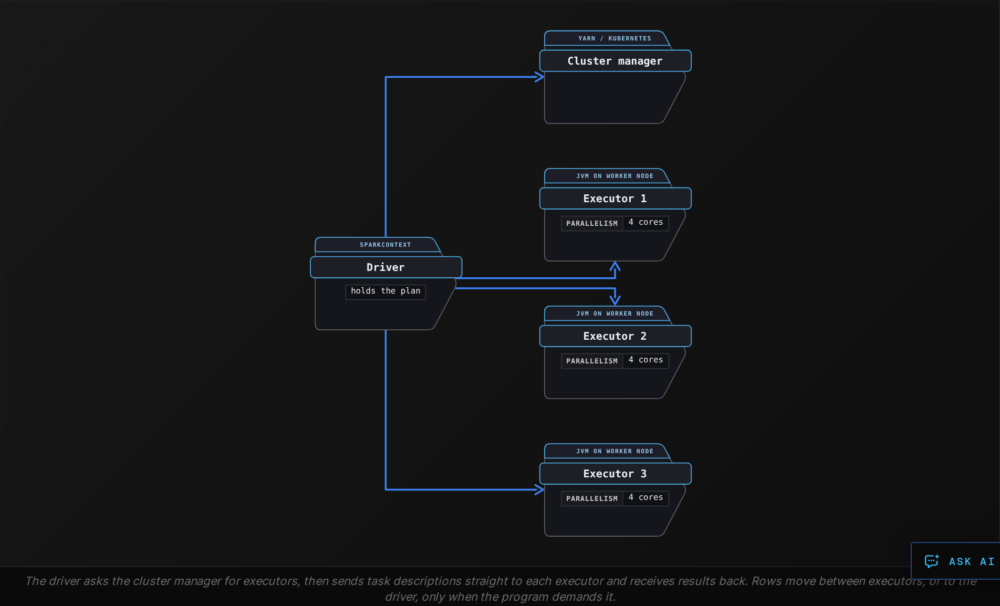
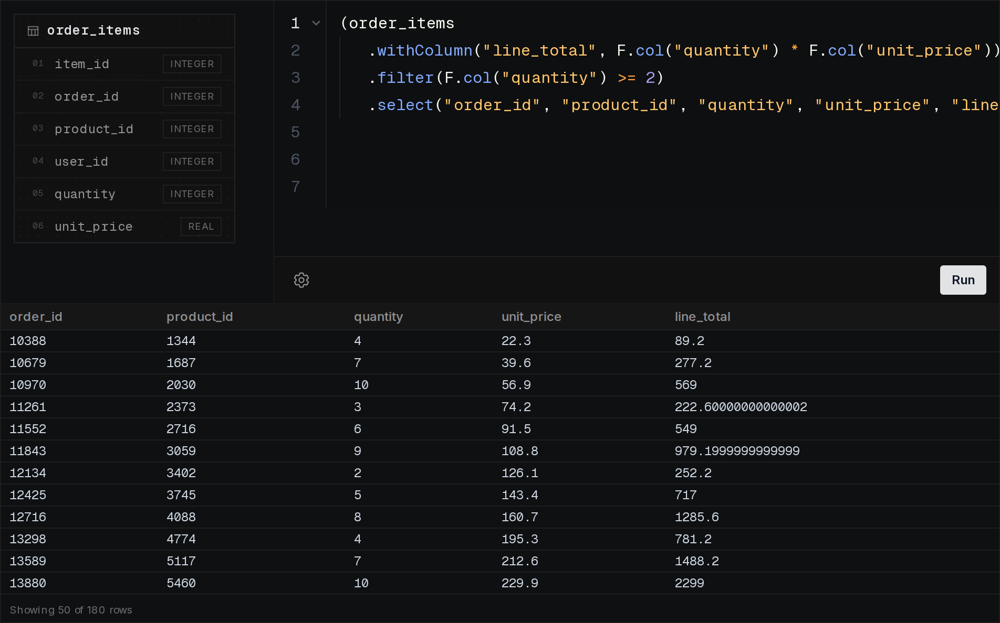
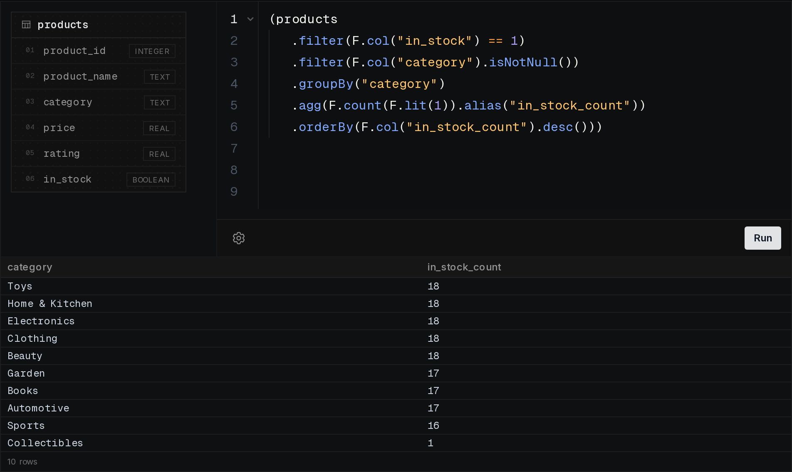
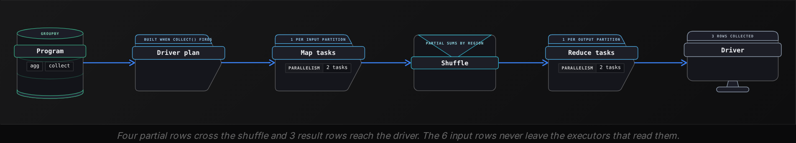

Beginner·Spark · 12 min · 11 challenges

# Execution Model: Beginner

A `GROUP BY` over 2 TB of Parquet finishes in 4 minutes on a 100-machine cluster. The identical code on the identical cluster can also take 90 minutes with 96 machines idle, and the Spark UI shows exactly why. Reading that screen takes 4 pieces of vocabulary: driver, executor, partition and slot. The first section starts with the processes every Spark program runs as.


<br>

---

## Driver, Executors, and Tasks

A SQL database runs as 1 engine: 1 process parses the statement, plans it and scans the rows, on 1 machine. Spark splits that engine into separate processes with separate responsibilities, and a Spark application is the conversation between them. Nearly every surprising thing Spark does, from a `collect()` that crashes to a cluster of 100 machines running slower than a laptop, is a statement about which process was asked to do what.

> The 3 processes in every Spark application
>
> - Driver: the process running the program. It holds the code, turns it into a plan of tasks, hands the tasks out and gathers results. 1 driver per application.
> - Executor: a JVM process on a worker machine that holds a slice of the data in memory and runs tasks on it. A cluster has many, often 1 per machine or several per large one.
> - Cluster manager: the layer that owns the machines, which is YARN, Kubernetes or Spark's standalone manager. The driver asks it for executors at startup, and it grants what it can.




<br>

### The work travels to the data

The driver never scans the data. It reads the code, builds a plan, ships small task descriptions to the executors and waits for them to report back. The data sits in distributed storage such as S3 or HDFS. Each task reads its own slice straight into the executor that runs it, and the rows stay there unless the program asks for them elsewhere. A task description is a few kilobytes, so sending 8,000 of them costs almost nothing. Pulling a 2 TB table to 1 machine would take close to half an hour over a 10 Gbit link, and the table would fit in no driver's memory in the first place.

collect() is the most common way rows reach the driver, alongside toPandas() and the building of a broadcast table. What makes collect() dangerous is that it pulls every row: each executor sends its whole share into the driver's memory. Spark aborts a job whose collected result passes spark.driver.maxResultSize, 1 GB by default, and once that limit is raised, a driver that receives more than it can hold dies of an out-of-memory error that reads as if the cluster failed. The cluster was fine. The wrong process was handed the rows.


<br>

### What a task is

A task is the unit of work the driver ships: 1 chain of operations applied to 1 slice of the data, run by 1 thread on 1 executor. The driver creates the tasks, records which executor took each one, notices when 1 fails, and collects each task's report when it finishes. An executor runs several tasks at once, each in its own thread, and knows nothing about the tasks running on other executors. The split of data into slices is the next section's subject, and it decides how many tasks there are.

| ✓ SQL engine | ✗ Spark |
| --- | --- |
| • 1 process plans the query and scans the rows<br><br>• All rows sit on 1 machine's disks<br><br>• Faster by buying a bigger machine<br><br>• The planner reads the rows itself | • The driver plans, the executors scan<br><br>• Rows spread across many machines<br><br>• Faster by adding executors<br><br>• The planner never touches the data |


<br>

### Which process is busy

Because separate processes share the job, the first question about a slow Spark job is which one is busy. A driver at 100% CPU with idle executors means the program asked the driver to do data work, usually a `collect()` or a large broadcast being serialised. Executors at 100% with a long queue of waiting tasks mean the job needs more capacity, or was given too little memory and is spilling to disk. Executors that never arrived mean the cluster manager had nothing to grant, and the job runs on the 2 executors it received instead of the 20 it asked for. Naming the process is most of the diagnosis, and the Spark UI's Executors tab shows all 3 states in 1 glance.

**A nightly job reads 400 GB of order lines, aggregates them and writes a summary. It normally finishes in 20 minutes with 20 executors; tonight it has run for 3 hours. The Executors tab shows 2 executors alive, each at 100% CPU, and the driver idle. Which process is the bottleneck?**

- **A.** The cluster manager, which granted 2 executors instead of 20
- **B.** The driver, because it is coordinating too many tasks
- **C.** The executors, because they are at 100% CPU
- **D.** The data, because 400 GB is too much for Spark

<details>
<summary>Solution</summary>

**A.** The cluster manager, which granted 2 executors instead of 20

The same 400 GB is being processed by a tenth of the usual executors. Each one is working flat out and the driver has nothing to do but wait. The fix is capacity or a queue setting at the manager, and nothing in the program.

**Why the others are wrong**

- **B.** With 2 executors the driver has fewer tasks in flight than on a normal night, and the tab shows it idle. Nothing in the symptoms points at driver CPU or memory.
- **C.** Full CPU on an executor is the healthy state: it is doing exactly the work it was given. The problem is how few executors there are.
- **D.** The job finishes in 20 minutes on a normal night. The data has not changed; the executor count has.

</details>

Executors do the work, and the unit they work in is smaller than a table. Spark cuts every dataset into partitions and assigns 1 task to each, and that split decides how many executors can be busy at the same moment.


<br>

---

## Partitions and Parallelism

A table never arrives at an executor whole. When Spark reads a dataset it cuts the rows into partitions, each a slice that 1 task reads and processes, and the default target for a partition read from files is 128 MB, set by spark.sql.files.maxPartitionBytes. One task processes exactly 1 partition, never half of one and never 2, so the partition count of a dataset is also the task count of the work that reads it.

- **8,192** — partitions in a 1 TB Parquet read

The animation below runs the smallest version of this. The order_items table holds 8 rows and is read as 4 partitions, so each partition carries 2 rows. The program adds a line_total column, quantity times unit price, and collects the result.

https://github.com/user-attachments/assets/210c7728-3087-48c9-8bc4-2d4ff6741442

Four tasks ran, 1 per partition, and all 4 ran at the same moment. Each task computed its 2 line totals from the rows it already held: the first partition produced 30 and 40 for order 1, the second produced 24 for order 2 and 120 for order 3, the third 20 and 50 for orders 4 and 5, and the fourth 60 and 15 for orders 6 and 7. No row left its partition, because a line total needs nothing from any other row, and a transformation with that property is called narrow. At the end the driver collected 8 rows, the 1 moment data crossed from executors to the driver. Multiply the table by 1 million and the job keeps its shape: 8 million rows in 4 partitions still run as 4 tasks, each a million times longer.


<br>

### The ceiling on parallelism

Since each task is 1 partition, the partition count is a hard ceiling on how many tasks can run at once. A dataset in 4 partitions runs as 4 tasks, and a cluster with 200 cores assigns 4 of them and leaves 196 idle for as long as that work lasts. The opposite case also fails. A dataset in 500,000 partitions of 2 KB each produces 500,000 tasks, and every task costs the driver a few milliseconds to schedule and record, so the driver spends more time on bookkeeping than the executors spend on rows. A SQL engine makes this decision internally. Spark exposes it, which is why partition count is the first thing to check when a job is slow and the cluster is quiet.

| Partition count | What runs | What the Executors tab shows |
| --- | --- | --- |
| Too few | A handful of huge tasks grind while most cores idle | Low cluster CPU, long tasks, out-of-memory errors |
| Too many | Scheduling overhead outweighs the row work | Busy driver, task durations in milliseconds |
| Right-sized | Every core busy, tasks finish in seconds | Steady high CPU across the cluster |


<br>

### Where the count comes from

The count on read comes from the files. A folder of 80 Parquet files at 128 MB each reads as 80 partitions, and a 1 GB Parquet file reads as 8, because the reader splits a file at 128 MB boundaries. A single 10 GB gzip file reads as 1 partition, because gzip cannot be split mid-stream, and that 1 task runs on 1 core for the several minutes it takes to decompress 10 GB, while every other core in the cluster waits. Snappy-compressed Parquet splits cleanly, which is one reason it is Spark's default output format. The count can be changed after the read with `repartition` and `coalesce`, which a later lesson covers, and a grouping changes it again, as the last section shows.

The cell below runs a narrow chain on the practice seed's full `order_items` table: it computes each line's total, keeps the lines with a quantity of 2 or more, and selects the columns worth reading. Every step runs inside the task that holds the row, as the animation showed, with no task waiting on another.



```python
(order_items
   .withColumn("line_total", F.col("quantity") * F.col("unit_price"))
   .filter(F.col("quantity") >= 2)
   .select("order_id", "product_id", "quantity", "unit_price", "line_total"))
```

Every row in that result was produced by the task holding its partition, and no task coordinated with another. What the cell hides is when those 3 steps ran, and the next section shows that none of them ran at the line where it was written.


<br>

---

## Transformations vs Actions

df.filter(...).groupBy(...).agg(...) runs nothing. Spark reads no rows, starts no tasks and contacts no executor, because each of those calls is a transformation: it adds a step to a plan the driver is holding and returns at once. Twenty of them can be chained and the cluster stays idle throughout. Work starts when an action is called, such as count(), collect() or write, and the action runs the whole accumulated plan in 1 burst.

| ✓ Transformations | ✗ Actions |
| --- | --- |
| • filter, select, groupBy, join, withColumn<br><br>• Return a new DataFrame at once<br><br>• Append a step to the driver's plan<br><br>• Free to chain, nothing runs | • count, collect, write, show, take<br><br>• Block until the executors finish<br><br>• Run every transformation above them<br><br>• Each one starts at least 1 job in the Spark UI |


<br>

### Why the plan waits

The gap exists so the driver sees the whole chain before committing to a plan. Seeing all of it lets the Catalyst optimizer collapse adjacent steps and push filters down into the file read. A program that reads a 2 TB `transactions` table, filters to 1 day and sums the amounts never loads 2 TB: the filter travels down into the scan, the Parquet reader skips every file whose date range excludes that day, and the executors read the 6 GB that match. Had `filter` run eagerly on the line where it was written, 2 TB would already be in memory before the planner saw the next line.


<br>

### The error surfaces at the action

Because nothing runs until the action, the line that throws is almost never the line that is wrong. A UDF that fails on 1 malformed row, written 30 lines up, sits in the plan untouched by any data until the `write` at the bottom forces execution, and the stack trace points at the `write`. The same holds for slowness: an action that takes 40 minutes is paying for every transformation above it, and the expensive step, usually a join or a `groupBy`, is somewhere in the chain.

> **TIP**
>
> Treat the action as the bill and the transformations as the purchases. When an error or a 40-minute wait appears at write(), read upward through the chain: the cost or the bug sits in a transformation above, and the action is where the total arrived.


<br>

### Actions cost different amounts

`take(20)` and `count()` are both actions, and they cost wildly different amounts. On a chain of narrow transformations, `take(20)` needs 20 rows, so Spark starts 1 task on 1 partition. If the first partition has not yielded 20 rows, Spark launches another job over more partitions, which is why 1 `take` can show as several jobs in the UI. `count()` needs every row, so it runs 1 task per partition. A chain that ends in `take(20)` and finishes in 2 seconds says nothing about the same chain ending in `count()`. A notebook that feels fast because every cell ends in `show()` can hide a job that takes an hour in production. Spark does as much work as each action demands and no more.

The cell below filters `products` to in-stock rows with a known category and counts them per category. Each line adds to the plan. The editor's display is the action, and when it fires, the 2 filters, the grouping and the sort run together.



```python
(products
   .filter(F.col("in_stock") == 1)
   .filter(F.col("category").isNotNull())
   .groupBy("category")
   .agg(F.count(F.lit(1)).alias("in_stock_count"))
   .orderBy(F.col("in_stock_count").desc()))
```

Change the sort direction and run again. The plan is rebuilt from the top and executed again, because Spark kept no intermediate result. The Jobs tab shows more than 1 job for this cell, since `orderBy` first runs a small sampling job to pick the boundaries between sorted partitions. Every action re-runs the full chain unless the program has cached a step, which is a lesson of its own.

**A notebook cell defines df = products.filter(F.col("in_stock") == 1).groupBy("category").agg(F.count(F.lit(1))) and the next cell calls df.count(). At which call does Spark first read a row from products?**

- **A.** count(), the action in the second cell
- **B.** filter(), because it is the first call that touches the table
- **C.** groupBy(), because grouping has to move rows between partitions

<details>
<summary>Solution</summary>

**A.** count(), the action in the second cell

Every call in the first cell is a transformation: each appends a step to the plan and returns at once. count() is the action that forces the plan to run, and only then do the executors open the files.

**Why the others are wrong**

- **B.** filter() returns a new DataFrame describing the filtered rows and reads nothing. The read happens when an action runs the plan, with the filter pushed down into the scan.
- **C.** groupBy() is lazy like every other transformation. The movement of rows it describes happens when the action runs, not when the line is written.

</details>

An action turns the plan into tasks, and how many of those tasks run at the same moment is set by a number the program never mentions: the cores each executor was given.


<br>

---

## Cores and Slots

An executor is a JVM with a fixed number of cores, and each core runs 1 task at a time. Spark calls that capacity a slot: an executor with 4 cores has 4 slots, and 20 such executors give the application 80 slots, so at most 80 tasks run at any instant no matter how many the plan contains. A task occupies its slot from the moment it is scheduled until it reports back, and the next waiting task takes the slot the instant it frees.

Two settings fix the number. spark.executor.cores sets the cores per executor, and on YARN and Kubernetes it defaults to 1, so an application that never sets it runs 1 task per executor however large the machine. spark.executor.instances sets how many executors the driver asks for. Slots are the product of the 2, and the cluster manager can grant fewer executors than requested, which shrinks the product without any change to the code.


<br>

### Tasks run in waves

When a plan has more tasks than slots, the tasks run in waves. A 400 GB Parquet read at 128 MB per partition is 3,200 partitions and so 3,200 tasks. On 80 slots that is 40 waves, and if each task takes 15 seconds the read takes 40 times 15, 600 seconds, 10 minutes. Doubling the executors to 40 halves the waves to 20 and the time to 5 minutes, because each wave still takes 15 seconds. The same 3,200 tasks on 1 executor with 4 cores would take 800 waves and over 3 hours. Nothing about the data changed between those 3 runs; only the slot count did.

| Wave | Tasks running | Slots idle | Elapsed at end |
| --- | --- | --- | --- |
| 1 | 80 | 0 | 15 s |
| 2 | 80 | 0 | 30 s |
| 40 | 80 | 0 | 600 s |
| 41 (if 3,210 tasks) | 10 | 70 | 615 s |

The last wave is where slots go to waste. With 3,210 tasks instead of 3,200, wave 41 runs 10 tasks and leaves 70 slots idle for a full 15 seconds. That costs as much as a whole wave, for only 10 tasks' worth of rows. A task count that is an exact multiple of the slot count keeps the final wave full, and a count a few tasks over a multiple pays almost a wave for nothing. Uneven tasks hurt the same way. If 1 task in a wave takes 90 seconds, its 79 neighbours finish at 15 and their slots pick up the next wave, but the stage cannot end before that 1 task does. In practice slots free one by one and waves blur into each other, and total task seconds divided by slots still sets the floor on elapsed time.


<br>

### Memory is shared by the cores

spark.executor.memory is per executor, and every core in that executor draws from the same heap. Spark sets aside about 300 MB and gives roughly 60% of the rest, set by spark.memory.fraction, to a pool that running tasks share for processing and caching, so a 16 GB heap leaves about 9.4 GB in that pool. With 4 cores, each running task works in roughly 2 GB of it, and the same 16 GB with 8 cores halves that to about 1 GB. A 128 MB Parquet partition can expand to several hundred megabytes of decoded rows in memory, and a task that groups or sorts them needs working space on top. Adding cores to an executor without adding memory is how a job that ran clean at 4 cores starts spilling to disk at 8. The slot count sets how many tasks run at once, and the memory per slot sets whether each of them finishes without spilling.

> What sets how many tasks run at once
>
> - Executors granted by the cluster manager, which can be fewer than the number requested
> - Cores per executor, spark.executor.cores, 1 by default on YARN and Kubernetes
> - Partitions in the data, since there is never more than 1 task per partition
> - The smaller of slots and partitions is the parallelism the job actually gets

**A read produces 240 tasks of about 30 seconds each. The application has 10 executors with 8 cores each, all granted. Roughly how long does the read take?**

- **A.** About 90 seconds
- **B.** About 30 seconds
- **C.** About 2 hours
- **D.** About 4 minutes

<details>
<summary>Solution</summary>

**A.** About 90 seconds

10 executors times 8 cores is 80 slots. 240 tasks on 80 slots is 3 full waves, and each wave takes the 30 seconds of its tasks, so the read ends after about 90 seconds with no slot idle.

**Why the others are wrong**

- **B.** That would need 240 slots so every task runs in the first wave. The application has 80, so the tasks queue into 3 waves.
- **C.** 240 tasks times 30 seconds is 7,200 seconds, which is what 1 slot would take. With 80 slots running at once the elapsed time divides by 80.
- **D.** The application has 10 times 8 = 80 slots, not 30, so the 240 tasks need 3 waves, not 8.

</details>

With processes, partitions, laziness and slots in hand, the last section follows 1 program through all of them, from the line that calls the action to the rows that reach the driver.


<br>

---

## A Job's Life, End to End

The program below sums profit per region and collects the result, 3 lines that touch every idea in this lesson. Following it from the keystroke to the result shows the order the pieces fire in, and the order is the same for a 6-row table and a 6-billion-row one.

- 1. The 2 transformations append steps to the driver's plan; no executor is contacted
- 2. collect() is the action: the driver turns the plan into tasks and sends them to the executors it already holds
- 3. Each executor reads its partitions and runs 1 task per partition, summing profit per region locally
- 4. Rows for the same region travel across the network to the task that owns that region
- 5. The receiving tasks add the partial sums into 1 row per region
- 6. Each task's result rows travel to the driver, which hands them back to the program

The animation runs it on 6 orders rows read as 2 partitions of 3 rows, across the regions EU, US and APAC, with the shuffle set to 2 output partitions. The first partition holds orders 1 to 3 and the second orders 4 to 6, so the 2 US rows sit in different partitions.

https://github.com/user-attachments/assets/8fe57e54-c15e-413a-a959-92f549cbea8f

Two things happened before any row moved. Each of the 2 map tasks first computed a partial sum per region from its own rows, so the partition holding both EU orders sent 1 EU row of 55 instead of 2 rows, alongside a US row of 25; the other partition sent US 35 and APAC 30. Then each task wrote its partial rows to local disk, grouped by destination, and that is the moment the first set of tasks finished. The 2 reduce tasks each fetched their rows across the network and added the partials together, which is where the 2 halves of US, 25 and 35, met to make 60 while EU stayed at 55 and APAC at 30. The driver collected 3 rows. That redistribution of rows by key is a shuffle, and it splits a job into 2 sets of tasks, the ones before it and the ones after, which the next tier of this topic takes apart as stages.




<br>

### Counting what moved

Before the shuffle, the map tasks turned 6 rows into 4 partial rows. Across the network travelled those 4 rows, and 3 reached the driver, so the cluster moved 7 rows for a 6-row input. Scale the table to 6 billion rows over the same 3 regions and the arithmetic holds: each map task still emits at most 3 rows, so a 3,200-partition read sends at most 9,600 partial rows across the network, a few hundred kilobytes, and 3 rows reach the driver. The same job grouped by `order_id` instead has nothing to combine on the map side, and all 6 billion rows cross the network. Which column a job groups by decides how much moves, and the code for the 2 jobs differs by 1 word.


<br>

### Where it shows in the Spark UI

Each action starts at least 1 job on the Jobs tab, and this program's `collect()` is job 0. Opening it shows the task count, 4 here: 2 map tasks and 2 reduce tasks. The task table on each stage's detail page shows which executor ran every task and how long it took. The Executors tab shows how many executors the application holds, with their totals. A first diagnosis is 3 reads of those pages. The job list says which actions fired, the task count says how many partitions the data was in, and the executor count says what the cluster manager granted.

Swap `collect` for `first` and the job still runs the full grouping, because no region's total exists until every row for that region has been added up; the action only changes how many result rows travel to the driver afterwards.

| ✓ Do | ✗ Don't |
| --- | --- |
| • Name which process is busy before touching code: the driver, the executors or the manager's grant<br><br>• Check the partition count against the slot count before asking for more executors<br><br>• End every notebook cell with the action production will use, so its timing means something<br><br>• Read upward from the failing action to find the transformation that caused the error<br><br>• Keep memory per core in view whenever spark.executor.cores goes up | • Don't collect() a DataFrame whose size has not been estimated against the driver's memory<br><br>• Don't read a job's speed from take(20) and expect count() to match it<br><br>• Don't assume a transformation ran because its line returned without error<br><br>• Don't expect a 100-core cluster to parallelise a 1-partition gzip file |


<br>

---

## Putting It All Together

An e-commerce analytics team runs a nightly PySpark job that reads 400 GB of order lines from Parquet, sums revenue per region and writes 3 rows to a dashboard table. It normally takes a little over 10 minutes on 20 executors with 4 cores each. On Monday it took about 100 minutes. The Spark UI shows 3,200 tasks reading the files, each about 15 seconds as usual, and the Executors tab shows 2 executors with 4 cores each.

- The Executors tab answers the process question from section 0. The cluster manager granted 2 executors instead of 20, so the program and its data are unchanged and the capacity is what moved.
- The 3,200 read tasks are 3,200 partitions from a 400 GB read at 128 MB, the arithmetic of section 1. After the shuffle, a second set of tasks adds the per-region totals, as many as spark . sql . shuffle . partitions sets (200 by default), which is the job shape of section 4.
- Two executors with 4 cores each is 8 slots, so section 3's wave count went from 40 on 80 slots to 400. At 15 seconds a wave that is 6,000 seconds, the 100 minutes, without any change to the code.
- The write at the end is the action. Section 2 says every transformation above it ran when that write fired, which is why the lines above it show no work of their own in the UI.
- No rows reach the driver: the reduce tasks write the 3 result rows straight to the dashboard table, and the driver receives only the commit's bookkeeping. The map-side partial sums kept the shuffle to at most 9,600 rows, so the fix lives at the cluster manager rather than in the program.


<br>

---

## Key Takeaways

- The driver plans and the executors run; the cluster manager decides how many executors exist. Diagnosis starts by naming which one is busy.
- One task per partition: the partition count caps parallelism, and the files decide the count on read.
- Transformations build a plan and actions run it, so errors and cost surface at the action and belong to the chain above it.
- Slots are executors times cores; extra tasks run in waves, and running tasks split a pool of about 60% of executor memory.
- A grouping moves rows by key across the network, and the column chosen decides whether 9,600 rows or 6 billion travel.
