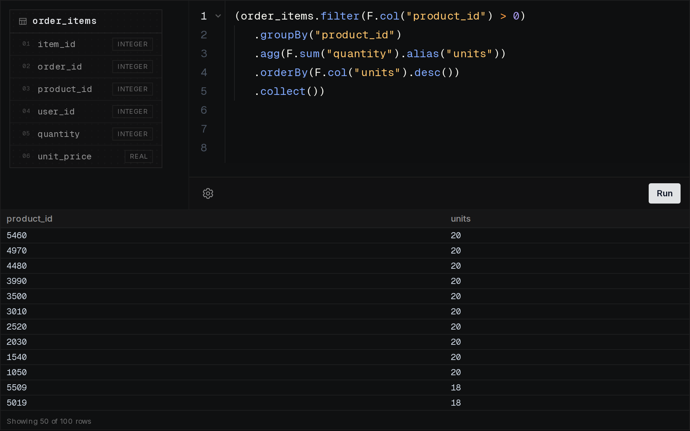
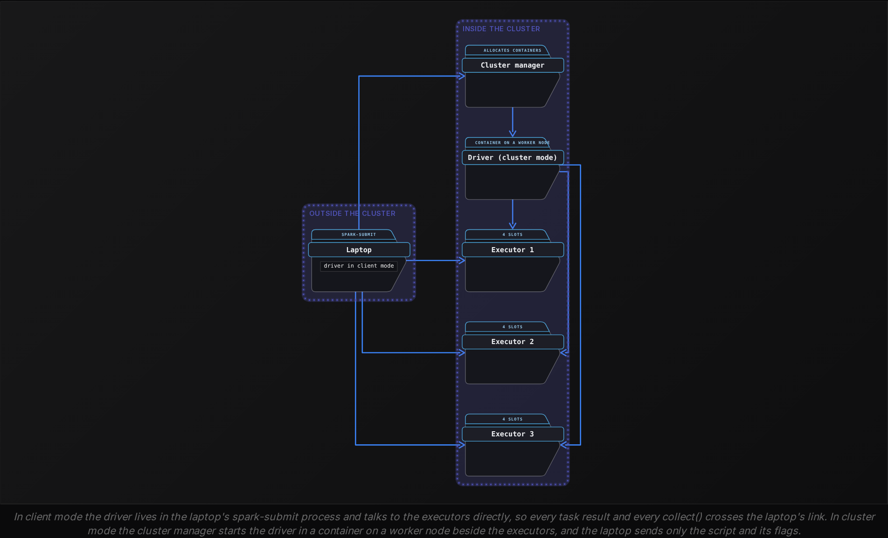

Intermediate·Spark · 12 min · 12 challenges

# Execution Model: Intermediate

Netflix's nightly viewing report aggregates every play event from the last 24 hours into one table per region. One Monday it takes 3 hours instead of 40 minutes. The Spark UI shows 1 job, 3 stages, and a second stage with 200 tasks where 197 finish in under a second. Reading that screen correctly tells you where the time went, and what flag to change.


<br>

---

## Job, Stage, Task

### One action, one job

Every action you call sends 1 job to the cluster. Spark walks back through the transformations that feed the action, cuts the chain wherever rows have to move between partitions, and calls each piece a stage. Inside a stage the work is a set of tasks, 1 task per partition, every task running the same code on its own slice of the data. A job of 3 stages whose stages hold 8, 200 and 200 partitions is 408 tasks, and the Jobs tab counts them exactly that way.

| Level | Started by | How many | What one of them is |
| --- | --- | --- | --- |
| Job | an action: collect, count, write | 1 per action | the whole computation behind that action |
| Stage | a point where rows must move between partitions | shuffles + 1 | code that runs on a partition without needing another |
| Task | a partition inside a stage | partitions in that stage | the stage's code applied to 1 partition on 1 slot |

A task is the unit the scheduler ships: the stage's code, serialized once, plus the identity of the partition it owns. A stage of 200 tasks is 200 copies of the same work that differ only in which partition they read. Stage ids count up across the whole application, so the first stage of your second job may be stage 3; the number names the stage, nothing more.


<br>

### One program, 3 stages

The program below reads 6 orders as 2 partitions. The filter and the net column need nothing from any other row, so they run inside the first stage's 2 tasks; 5 rows survive the filter. The groupBy needs every EU row on 1 task, so rows move: that boundary ends stage 0 and starts stage 1, which has 2 tasks because the run uses 2 shuffle partitions. The orderBy needs the regions arranged by revenue across the whole result, which moves the rows once more into stage 2. The job runs 3 stages and 6 tasks, and the driver receives 3 rows: US 210, EU 145, APAC 75.

https://github.com/user-attachments/assets/de239aff-c5ed-4c38-a857-7ebca03f46db

| Stage | Tasks | Rows in | Shuffle write | Shuffle read | Ends with |
| --- | --- | --- | --- | --- | --- |
| 0 | 2 | 6 from the files | 5 rows | 0 | groupBy on region |
| 1 | 2 | 5 from stage 0 | 3 rows | 5 rows | orderBy on revenue |
| 2 | 2 | 3 from stage 1 | 0 | 3 rows | collect to the driver |


<br>

### The Jobs tab and the stage page

The Jobs tab lists 1 row per action with a Stages column that reads 3/3 once every stage succeeded. Clicking the job opens its stages in order, each described by the line of code that ended it, and the stage page lists every task with its duration, input size and shuffle bytes. When a job is slow, the stage list tells you which stage took the time, and the task list tells you whether every task was slow or only a few. Both questions have to be answered before any flag is worth changing.

> Counting tasks for a job
>
> - First stage: 1 task per input partition, decided by how the input files are split
> - Each stage after a shuffle: 1 task per shuffle partition, 200 by default, with adaptive execution off as this lesson assumes
> - Whole job: add the stages, so 8 + 200 + 200 = 408 tasks for a read, a groupBy and an orderBy

> **TIP**
>
> Count stages before you run: the operations that regroup rows by key or by order, plus 1. A filter, 2 column expressions, a groupBy and an orderBy is 3 stages, whatever the data size.

**How many stages does this job run, and where is the boundary?**

```python
(sales.filter(F.col("qty") > 0)
   .withColumn("total", F.col("qty") * F.col("price"))
   .groupBy("store").agg(F.sum("total").alias("revenue"))
   .collect())
```

- **A.** 1 stage: the filter, the new column and the groupBy all run inside the task that read each partition
- **B.** 2 stages: the filter and the new column run in the first, and the groupBy moves rows by store into the second
- **C.** 3 stages: one for the filter, one for the new column, and one for the groupBy that sums them
- **D.** 2 stages: the filter runs in the first and the new column starts the second, because it changes the schema

<details>
<summary>Solution</summary>

**B.** 2 stages: the filter and the new column run in the first, and the groupBy moves rows by store into the second

Filter and withColumn work on 1 row at a time inside the reading task. The groupBy regroups rows by store, which starts a second stage of tasks, 1 per shuffle partition.

**Why the others are wrong**

- **A.** The groupBy needs every row of a store on 1 task, and those rows start out spread across all partitions, so they have to move; a stage ends where rows move.
- **C.** Spark does not start a stage per operation. The filter and the new column need only the row in hand, so they run back to back in the same task.
- **D.** Adding a column changes the row's shape, never its location. Rows stay in the task that read them until the groupBy, which is the only boundary here.

</details>


<br>

---

## Why Stages Exist

### A task only sees its partition

A task runs on 1 slot with 1 partition in hand, and it can see nothing else. It reads a row, tests it, computes a new column from it, and passes it on, because everything those operations need is in that row. Spark chains such operations so a row flows through filter, then withColumn, then select without being written anywhere in between. A partition of 500,000 rows passes through 4 such operations in a single sweep, producing 1 output partition from 1 input partition, and the task next to it does the same with its own rows at the same time.

The program below has that shape. It reads 6 events as 3 partitions; each task keeps the clicks, multiplies seconds into milliseconds, and hands its rows straight to the driver. The 3 tasks have nothing to wait for, so the job is 1 stage and collects 4 rows.

https://github.com/user-attachments/assets/497925f0-ecf9-4c48-bd4e-ab3afccb825e

<br>

### The operation that needs every partition

A groupBy on region breaks the pattern. The EU rows sit in every partition, and the EU total needs all of them in one place, so no task can produce it from the partition it holds. Spark's answer is the shuffle. Every task in the running stage writes its rows into buckets on local disk, 1 bucket per destination partition, choosing the bucket by hashing the key. Then a fresh set of tasks starts, and each reads 1 bucket from every writer over the network. A reader's bucket is complete only when the last writer has finished, so Spark holds the readers back until the whole writing stage is done. That hold is the stage boundary, and it is the only reason stages exist: a stage is the longest run of work that can proceed without waiting on any other task.

| Operation | Needs rows from other partitions? | Effect on stages |
| --- | --- | --- |
| filter, select, withColumn, drop | no, each row is handled on its own | stays in the current stage |
| union of 2 DataFrames | no, partitions are stacked end to end | stays in the current stage |
| groupBy, agg, distinct | yes, all rows of a key together | ends the stage with a hash shuffle |
| join on a key, both sides large | yes, matching keys together | ends the stage, both sides shuffled |
| join to a table under 10MB | no, the small table is copied to every task | stays in the current stage |
| orderBy, sort | yes, rows arranged by range | ends the stage with a range shuffle |
| repartition(n) | yes, rows dealt into n new partitions | ends the stage |

The join rows deserve a second look. A join needs the matching keys of both tables on 1 task. When both sides are shuffled by the key, the stage ends. When Spark instead broadcasts a small side, copying it whole to every task, the large side's rows never move and the join runs inside the stage that read it. The same join keyword adds 2 shuffles or none, depending on which of those strategies Spark picks, and a later lesson covers how it decides.


<br>

### Stage boundaries cost time and bytes

A stage waits for the stages that feed it, and the tasks of a stage run side by side. In a chain of dependent stages, each starts when the one before it ends, so the chain's time is the sum of their times. Stages with no dependency between them, such as the 2 shuffled sides of a join on large tables, run at the same time, and only the join stage waits on both. A stage's time is set by its last task to finish. Take stage 0 with 40 tasks on 40 slots, 39 taking 30 seconds and 1 taking 4 minutes: stage 1 starts at 4 minutes, and 39 slots idle for 3 and a half minutes because their next work is behind the boundary. The boundary is also where disk and network enter. The writers put their buckets on local disk and the readers pull them across the network, so a stage that shuffles 50GB writes 50GB and reads 50GB before the next stage computes a single row. Both costs scale with the bytes that cross the boundary, which is why the shuffle columns on the stage page are the first numbers to read.

| ✓ Inside a stage | ✗ At a boundary |
| --- | --- |
| • rows flow between operations in memory, 1 row at a time<br><br>• a task finishing early frees its slot for the next task of the same stage<br><br>• cost scales with the rows in each partition<br><br>• nothing is written to disk | • every row is written to local disk and read back over the network<br><br>• the next stage waits for the slowest task of this one<br><br>• cost scales with the bytes shuffled<br><br>• the task count resets to the shuffle partition setting |

**How many stages does this job run?**

```python
(mon_events.union(tue_events)
   .filter(F.col("secs") > 0)
   .groupBy("country").agg(F.sum("secs").alias("total"))
   .orderBy(F.col("total").desc())
   .collect())
```

- **A.** 4 stages: the union, the groupBy and the orderBy each end a stage
- **B.** 2 stages: the groupBy ends the first, and the orderBy sorts inside the second
- **C.** 3 stages: the groupBy ends the first, and the orderBy ends the second
- **D.** 3 stages: the union ends the first, and the groupBy ends the second

<details>
<summary>Solution</summary>

**C.** 3 stages: the groupBy ends the first, and the orderBy ends the second

The union and filter run in the reading tasks. The groupBy shuffles by country, and the orderBy shuffles by range.

**Why the others are wrong**

- **A.** A union stacks partitions end to end. No row moves, so no stage ends there.
- **B.** The orderBy needs 1 order across all partitions, so rows move by range into a third stage.
- **D.** The union moves no rows. The orderBy, which needs a range shuffle, is the second boundary.

</details>

> **TIP**
>
> When a job runs 3 stages and 2 of them finish in seconds, the stage page of the slow one answers the next question: shuffle read in GB tells you how much data crossed the boundary, and the task durations tell you whether it crossed evenly.


<br>

---

## Reading Parallelism

### Where the task count comes from

The first stage of a job gets 1 task per input partition, and Spark fixes that count when it plans the read. Each input split is at most 128MB, the default of `spark.sql.files.maxPartitionBytes`, and smaller when the total bytes divided by the cluster's cores is smaller, so a small read is spread across every core. A single 1.2GB file on a 32-core cluster is cut into pieces of roughly 38MB, about 32 of them; the same file on a 4-core laptop is cut into 128MB pieces, 10 of them. A directory of 10 gzip files of 120MB each reads as 10 partitions on any cluster, because a gzip file can't be split and each one becomes 1 task. Every stage after a shuffle gets 1 task per shuffle partition, and that count comes from 1 setting, `spark.sql.shuffle.partitions`, which is 200 unless you change it. With adaptive execution off, the setting this lesson's examples assume, the data has no vote: a groupBy over 3 distinct keys still runs 200 tasks, and 197 of them open an empty bucket, find nothing, and finish in a few milliseconds each. With adaptive execution on, 200 is the starting count and Spark may merge empty and small buckets into fewer tasks, which a later lesson covers.

The program below sets 4 shuffle partitions and groups 9 hits read as 3 partitions. Stage 0 runs 3 tasks, 1 per input partition. Stage 1 runs 4 tasks, 1 per shuffle partition, and because only 3 devices exist, at least 1 of the 4 tasks reads an empty bucket and contributes nothing. The driver receives mobile 4, desktop 3, tv 2.

https://github.com/user-attachments/assets/135ae901-a374-4039-a40c-1ff21607f0b8

<br>

### Tasks, slots and waves

The cluster offers a fixed number of slots: executors times cores per executor. A stage with more tasks than slots runs in waves, and the wave count is tasks divided by slots, rounded up. A cluster of 8 executors with 4 cores each has 32 slots. A first stage reading the 10 gzip files runs 10 tasks as 1 wave and leaves 22 slots idle for its whole duration. A second stage of 200 tasks runs as 7 waves, since 200 divided by 32 is 6.25, and the seventh wave carries 8 tasks on 32 slots, so a quarter of the cluster works while 3 quarters wait for the stage to end. Set the shuffle partitions to 64 and the same stage runs as 2 full waves with every slot busy.

| Stage | Tasks | Slots | Waves | Slots idle in the last wave |
| --- | --- | --- | --- | --- |
| read, 10 gzip files | 10 | 32 | 1 | 22 |
| groupBy, default setting | 200 | 32 | 7 | 24 |
| groupBy, 64 shuffle partitions | 64 | 32 | 2 | 0 |
| groupBy, 3 keys, default setting | 200 | 32 | 7 | 24, and 197 tasks carry no rows |


<br>

### Reading it on the stage page

The stage page states the count in its summary line, Tasks: 200/200 succeeded, and the Event Timeline draws each task as a bar on the row of the executor that ran it. Waves appear as columns of bars that start together; 200 bars on 32 rows draw 7 columns, the last one short. A task that received no rows draws as a sliver with 0 bytes of shuffle read beside it in the task table. When a stage is slow, the first thing to read is tasks against slots, because a stage of 10 tasks on 32 slots cannot use the cluster however fast each task runs, and a stage of 200 tasks on 32 slots pays for a last wave that is mostly empty.

**A job reads a directory as 6 input partitions, groups by customer with spark.sql.shuffle.partitions at its default, and collects. The cluster has 12 executors with 4 cores each. How many tasks run in each stage, and in how many waves?**

- **A.** Stage 0 runs 6 tasks in 1 wave with 42 slots idle; stage 1 runs 200 tasks in 5 waves
- **B.** Stage 0 runs 48 tasks in 1 wave with no idle slot; stage 1 runs 200 tasks in 5 waves
- **C.** Stage 0 runs 6 tasks in 1 wave; stage 1 runs 6 tasks in 1 wave, because the shuffle keeps the partition count
- **D.** Stage 0 runs 6 tasks in 1 wave with 42 slots idle; stage 1 runs 200 tasks in 4 waves, since 200 over 48 is barely above 4

<details>
<summary>Solution</summary>

**A.** Stage 0 runs 6 tasks in 1 wave with 42 slots idle; stage 1 runs 200 tasks in 5 waves

Input partitions set the first stage's tasks and the shuffle setting sets the second's. The cluster has 48 slots, and 200 divided by 48 is 4.17, which rounds up to 5 waves.

**Why the others are wrong**

- **B.** The task count comes from the partitions, 6 here, and never from the slots. Slots only decide how many of those tasks run at once.
- **C.** A shuffle doesn't keep the input partition count. The stage after it has as many tasks as spark.sql.shuffle.partitions, 200 by default.
- **D.** Waves round up: 4 full waves cover 192 tasks and the remaining 8 need a fifth wave, however small it is.

</details>

Run the program below on the practice tables, then count without looking at any output. The first stage runs 1 task per partition of order_items. With adaptive execution off, the groupBy on product_id starts a second stage of 200 tasks, 1 per shuffle partition, however many products exist. The orderBy starts a third stage of another 200 tasks, this time holding ranges of units. That makes 3 stages, and the driver collects the sorted rows from the last one.



```python
(order_items.filter(F.col("product_id") > 0)
   .groupBy("product_id")
   .agg(F.sum("quantity").alias("units"))
   .orderBy(F.col("units").desc())
   .collect())
```


<br>

---

## Where the Driver Lives

### One process, 2 places to run it

The driver is the process that owns your SparkSession: it turns the code into stages, hands tasks to executors, and receives whatever an action returns. spark-submit can put that process in 2 places. In client mode the driver runs inside the process that ran spark-submit, on the machine where you typed the command: a laptop, a gateway host, or the kernel behind a notebook. In cluster mode spark-submit hands the application to the cluster manager and returns, and the manager starts the driver on 1 of the cluster's own nodes, beside the executors. The executors do the same work either way. What changes is the network path between the driver and them, and what happens to the driver when the machine you launched from goes away.




<br>

### Driver placement and collect()

| Concern | Client mode | Cluster mode |
| --- | --- | --- |
| Where collect() rows land | in the launching machine's memory, over its link to the cluster | in a cluster node's memory, on the datacenter network |
| Closing the laptop or the SSH session | kills the driver, and the job with it | changes nothing, the driver keeps running |
| Driver stdout and print() output | in your terminal or notebook | in the cluster manager's log for the driver container |
| A local file path read by the driver | reads from your disk | reads from the cluster node's disk, where the file may not exist |
| Driver RAM | your machine's, sized with --driver-memory | a cluster node's, sized with --driver-memory |
| Typical use | notebooks and debugging | scheduled production jobs |

The `collect()` row matters most day to day. An action that returns 800MB of rows sends 800MB to the driver, and in client mode that 800MB crosses whatever link the launching machine has to the cluster: on a 100Mb/s VPN it is around 64 seconds of transfer before a result appears, while in cluster mode the same 800MB stays on a 10Gb/s datacenter link and arrives in under a second. The executors finished their tasks at the same moment in both runs; the job's stages are identical, and only the last hop differs. The driver's memory is the other half of the same story: those 800MB have to fit in the driver's heap wherever it lives, which is what `--driver-memory` sizes. A `collect()` larger than 1GB also needs `spark.driver.maxResultSize` raised, because at its default of 1g Spark aborts the job once the serialized results pass that size.

A notebook is client mode by construction: the kernel is the driver, so restarting the kernel discards every DataFrame you built, and a large collect() lands in the kernel's memory on the notebook host. A job that runs every night from a scheduler belongs in cluster mode, so that a patch reboot or a dropped session on the scheduler host can't take the driver down, and so that the driver's log is kept next to the executor logs where the on-call engineer looks first.

*Local mode, started with --master local[4], runs the driver and 4 task threads in one process on your machine, with no separate executor processes and no cluster. It's the right setting for a unit test on sample data and the wrong one for anything you time.*

> 3 questions that tell you where the driver is
>
> - Does closing your terminal kill the job? Then the driver is in client mode on your machine
> - Does print() output appear in the cluster manager's log instead of your screen? Then it's cluster mode
> - Does a local path in the script read a file that only exists on your laptop? Only in client mode

**A nightly job is launched from a gateway host with --deploy-mode client. The gateway reboots for patches at 03:00 and the job dies every time. The job's last step calls collect() on an 800MB result. What does switching to --deploy-mode cluster change?**

- **A.** The executors move onto the gateway host, so the reboot kills them instead of the driver
- **B.** The driver still runs on the gateway, but the cluster manager restarts the job from its last stage after the reboot
- **C.** The collect() result is written straight to the executors' disks, so nothing crosses the network to any driver
- **D.** The driver runs on a cluster node, so the reboot no longer kills it, and the 800MB result lands in that node's memory rather than the gateway's

<details>
<summary>Solution</summary>

**D.** The driver runs on a cluster node, so the reboot no longer kills it, and the 800MB result lands in that node's memory rather than the gateway's

Cluster mode hands the driver to the cluster manager, which starts it on a node inside the cluster. The job survives the gateway's reboot, and collect() delivers its rows to that node, which needs enough driver memory to hold them.

**Why the others are wrong**

- **A.** Deploy mode places the driver and nothing else. Executors run on cluster nodes in both modes, allocated by the cluster manager.
- **B.** In cluster mode the driver leaves the gateway entirely. Nothing in either mode resumes a job from a stage after its driver is lost.
- **C.** collect() always returns rows to the driver. Changing where the driver runs changes where those rows go, never whether they travel.

</details>


<br>

---

## The spark-submit Config Surface

### The flags that shape a job

spark-submit is the command that ships your script to a cluster, picks where the driver runs, and asks the cluster manager for executors. Everything the earlier sections counted, slots, waves and the driver's address, is decided by a handful of its flags, and each flag is also a property you can set in a defaults file or in code. The table maps one to the other, because the Environment tab of the UI shows the property name, never the flag.

| Flag | Property | What it sets |
| --- | --- | --- |
| --master | spark.master | which cluster manager runs the job, or local[N] for one machine |
| --deploy-mode | spark.submit.deployMode | client or cluster: where the driver process runs |
| --num-executors | spark.executor.instances | how many executor processes to request |
| --executor-cores | spark.executor.cores | slots per executor |
| --executor-memory | spark.executor.memory | heap per executor, such as 8g |
| --driver-memory | spark.driver.memory | heap for the driver, where collect() results must fit |
| --conf key=value | that key | any property, such as spark.sql.shuffle.partitions=64 |
| --py-files | spark.submit.pyFiles | extra Python modules shipped to every executor |

A full command for a nightly report reads spark-submit --master yarn --deploy-mode cluster --num-executors 8 --executor-cores 4 --executor-memory 8g --driver-memory 4g --conf spark.sql.shuffle.partitions=64 daily_report.py. Written as properties, which is how a defaults file and the Environment tab both show it:

```sql
spark.master: yarn
spark.submit.deployMode: cluster
spark.executor.instances: 8
spark.executor.cores: 4
spark.executor.memory: 8g
spark.driver.memory: 4g
spark.sql.shuffle.partitions: 64
```

The command describes a cluster of 8 executors times 4 cores, which is 32 slots, so the 64 shuffle partitions run in 2 full waves with no idle slot, where the default 200 would have run in 7 waves with a last wave of 8 tasks. The driver gets 4g because the job ends with a collect() of a few hundred MB that must fit in its heap. Each executor gets 8g, which is 2g for each of its 4 slots to work in. The job runs in cluster mode because it is scheduled and nobody's laptop should be in the path. Every one of those choices is a number you read off the previous 3 sections.


<br>

### Code beats flag beats defaults file

A property can be set in 3 places, and when they disagree the order is fixed: a value set in code through `SparkSession.builder.config` beats a spark-submit flag, which beats the cluster's defaults file. One exception matters more than the rule. Driver settings in code arrive too late, because the driver process they describe is already running by the time your script executes, so `--driver-memory` and `--deploy-mode` take effect only on the command line or in the defaults file. Executor settings and `spark.sql.shuffle.partitions` in code do take effect, since executors are requested and plans are built after the session exists. The Environment tab shows the value in force, so a stage with 200 tasks after you asked for 64 on the command line means a value set in code overrode the flag, and the tab shows which value won.

```sql
spark = (SparkSession.builder
    .appName("daily_report")
    .config("spark.sql.shuffle.partitions", 64)
    .getOrCreate())
```

| ✓ Do | ✗ Don't |
| --- | --- |
| • Set spark.sql.shuffle.partitions to a multiple of your slot count, so the last wave is full<br><br>• Put --driver-memory and --deploy-mode on the command line, where they take effect<br><br>• Open the Environment tab after launch to confirm which value won<br><br>• Submit scheduled jobs in cluster mode and keep client mode for notebooks | • Don't leave 200 shuffle partitions for a groupBy over 3 keys and then read 197 empty tasks<br><br>• Don't set spark.driver.memory in builder.config and expect the driver to grow<br><br>• Don't request more slots than your biggest stage has tasks; the extras idle<br><br>• Don't change 3 flags at once; change 1, rerun, and read the stage page again |

> **TIP**
>
> The Jobs, Stages and Environment tabs, read in that order, answer most slowness questions: which stage took the time, how many tasks it ran against how many slots, and which setting put those numbers there.

**A job is submitted with --num-executors 6 --executor-cores 5 --conf spark.sql.shuffle.partitions=90, and its script sets nothing. Its groupBy stage: how many tasks, how many slots, how many waves?**

- **A.** 90 tasks on 6 slots, 15 waves, since each executor runs 1 task at a time
- **B.** 200 tasks on 30 slots, 7 waves, because a --conf flag applies only in client mode
- **C.** 90 tasks on 30 slots, 3 full waves with no idle slot in the last
- **D.** 30 tasks on 30 slots, 1 wave, because Spark caps a stage's tasks at the slot count

<details>
<summary>Solution</summary>

**C.** 90 tasks on 30 slots, 3 full waves with no idle slot in the last

Tasks come from the shuffle setting, slots from 6 times 5, and 90 divided by 30 is exactly 3, so every wave uses every slot.

**Why the others are wrong**

- **A.** An executor runs as many tasks at once as it has cores: 5 here, so 6 executors offer 30 slots, 5 times as many as this option assumes.
- **B.** A --conf flag sets the property in both deploy modes. With 90 set and nothing in code to override it, the stage runs 90 tasks.
- **D.** Slots never cap tasks. A stage with more tasks than slots runs them in waves; the setting decides the count and the cluster decides the pace.

</details>


<br>

---

## Putting It All Together

Back at Netflix, the engineer opens the Jobs tab for the 3-hour viewing report: 1 job, 3 stages, and stage 1 holds 2 hours 40 minutes of it. Its page reads Tasks: 200/200 on 8 executors with 4 cores, so 7 waves, and the Event Timeline shows 197 tasks finishing in under a second while 3 tasks read most of the shuffle bytes and run for hours. The launch command says --deploy-mode client from a gateway host, and the final 800MB collect() crawls over that gateway's link. She sets shuffle partitions to 64, which trims a few seconds of empty-task scheduling and tidies the timeline, and resubmits in cluster mode with --driver-memory 6g, which takes the gateway out of the last hop. Neither change touches the 2 hours 40 minutes: the 3 heavy tasks still set the stage's time, and the stage page has now isolated them as the one problem left.

- The Jobs tab turned 3 hours into a stage, and the stage page turned the stage into a task count against a slot count.
- With 200 tasks on 32 slots the stage runs 7 waves, and with 64 it runs 2, but waves of sub-second tasks cost seconds, so the flag tidied the timeline without recovering the lost time.
- The 3 heavy tasks cost the same in any wave count, which is why the stage boundary waited on them before and after the change.
- The 800MB collect ( ) moved from the gateway's link to a cluster node once the driver did, and --driver-memory grew so the result fits in its heap.


<br>

---

## Key Takeaways

- An action starts 1 job; the job splits into stages at every point where rows must move between partitions; a stage runs 1 task per partition.
- Stages exist because a shuffle's readers cannot start until every writer has finished, so a stage is the longest run of work with no waiting.
- The first stage has as many tasks as input partitions; with adaptive execution off, every stage after a shuffle has spark . sql . shuffle . partitions tasks, 200 by default, whatever the data holds.
- Waves are tasks divided by slots, rounded up; a last wave of 8 tasks on 32 slots leaves 3 quarters of the cluster idle.
- Client mode runs the driver where you launched; cluster mode runs it on a cluster node; collect ( ) results and driver logs follow the driver.
- spark-submit flags map to properties; code beats flags, flags beat the defaults file, except driver settings, which only the command line or the defaults file can set.
