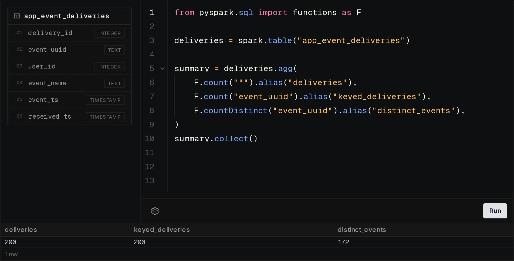
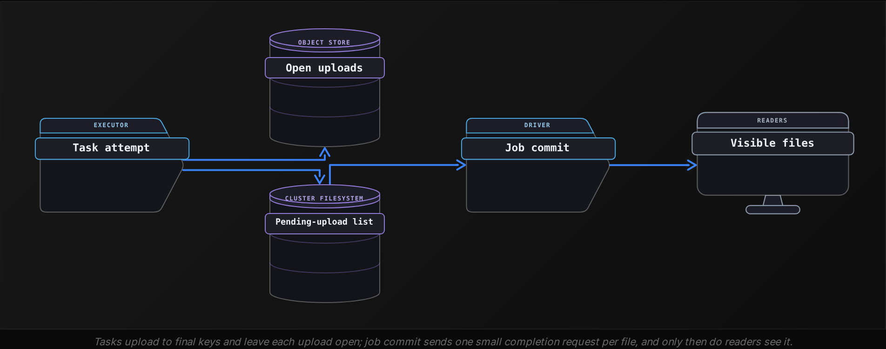
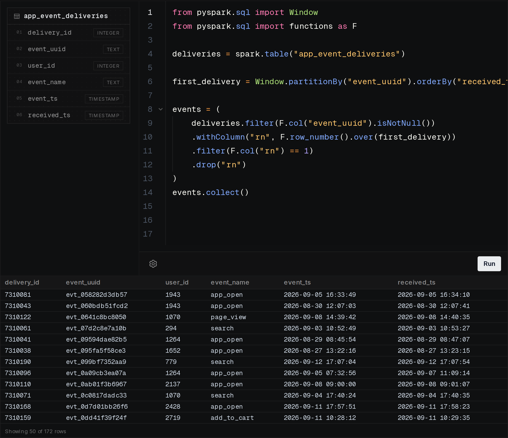
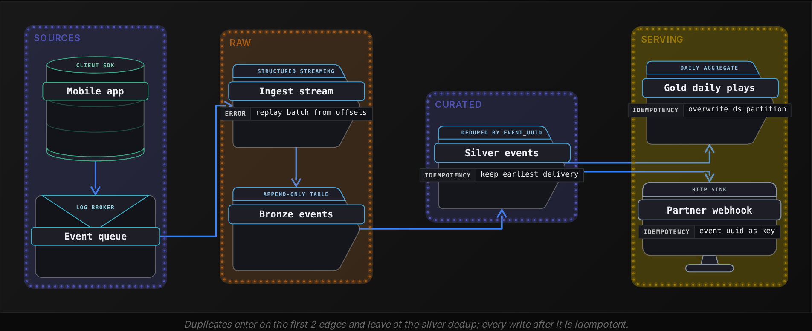

Advanced·Spark · 15 min · 15 challenges

# Fault Tolerance: Advanced

Say Netflix's overnight Spark job rolls up viewing hours per title for the Top 10 rows. At 3am a spot node vanishes, Spark replays 40 tasks, and the job finishes green. Whether the morning's rankings double-count a hit show comes down to one question: did each replayed task's output land once, or twice?


<br>

---

## Effects That Land Once

Spark reprocesses data as a matter of routine. A failed task gets up to 4 attempts. A speculative copy races a slow task. A fetch failure sends a stage back to rebuild its map output, and a restarted streaming query replays its last micro-batch. Each of these runs the same records through the same code more than once.

That is acceptable because the guarantee people want concerns effects. Exactly-once promises that whatever a record changes outside the job, a table row, an account balance, a message to a user, changes one time, however many times the record was processed.


<br>

### Processing count vs effect count

| Semantics | Times processed | Times the effect lands | What goes wrong |
| --- | --- | --- | --- |
| At-most-once | 0 or 1 | 0 or 1 | A crash between read and write loses the record |
| At-least-once | 1 or more | 1 or more | A retry after a partial write lands the effect twice |
| Exactly-once | 1 or more | Exactly 1 | Nothing, while all 3 legs below hold |

An exactly-once pipeline still processes some records 2 or 3 times; it arranges for the extra runs to leave no trace. That is why engineers often call it effectively-once: the work repeats, the outcome does not.


<br>

### The 3 legs

Exactly-once needs all 3

- **Replayable source** *Read the same records again*\
  After a failure the job can request exactly the records it read before, by offset, file list or table snapshot.
- **Deterministic processing** *Same input, same output*\
  The replay must produce the rows the first run produced. A rand(), a current_timestamp() or an order-dependent first() breaks this.
- **Idempotent or transactional sink** *A repeat changes nothing*\
  Either writing the same output twice leaves the sink unchanged, or the write and the progress record commit together, so a replay finds its work already done.

Break any leg and the guarantee falls to at-least-once or worse. A replayable source plus Spark's record of what it read covers the first leg, and deterministic code covers the second. The third is where most pipelines lose the guarantee: the sink lives outside Spark, and Spark cannot roll it back.


<br>

### Effects inside Spark and outside it

Inside its own boundary, Spark already makes effects land once. Shuffle files from a failed attempt are discarded, and when 2 speculative attempts of one write task both finish, the driver's `OutputCommitCoordinator` authorizes only one of them to commit its partition. The other attempt's files never become output.

Accumulators show where that boundary sits. For an accumulator updated inside an action such as `foreach`, Spark applies each task's update once. Inside a transformation, such as a `map` or a UDF, every successful run of a task applies its update, so a stage resubmitted after a fetch failure, or recomputed by a second action, counts its rows again.

**A job counts malformed rows with an accumulator incremented inside a UDF and writes the clean rows to files. A lost node causes a fetch failure, and Spark resubmits a map stage whose tasks had already succeeded. Which numbers can you trust?**

- **A.** Both: Spark hides every re-execution from accumulators and output alike
- **B.** Neither: re-execution duplicates both the counter and the written rows
- **C.** The written rows; the counter may count the resubmitted tasks' rows twice
- **D.** The counter; the written rows may hold copies from the recomputed tasks

<details>
<summary>Solution</summary>

**C.** The written rows; the counter may count the resubmitted tasks' rows twice

Output commit publishes 1 attempt per partition, while the UDF's accumulator applies its update on every successful run, so recomputed tasks count again.

**Why the others are wrong**

- **A.** Committed output is protected, but a UDF's accumulator applies the update of every successful run, resubmitted ones included.
- **B.** Rows reach the output only through the commit protocol, which publishes 1 attempt per partition.
- **D.** This reverses them: recomputed work reaches files only through the commit protocol, and a counter in a transformation has no protection.

</details>

```sql
import requests


def send_receipts(rows):
    session = requests.Session()
    for row in rows:
        session.post(
            "https://payments.internal/receipts",
            json={"user_id": row.user_id, "amount": row.amount},
        )


receipts.foreachPartition(send_receipts)
```

This job runs `foreachPartition`, an action, so Spark's own accounting is exact, and users still get duplicate receipts. The effect left Spark when the HTTP call returned. The retry reprocesses the whole partition, and the receiving service cannot tell the second POST from a new receipt.

```sql
import requests


def send_receipts(rows):
    session = requests.Session()
    for row in rows:
        session.post(
            "https://payments.internal/receipts",
            json={"user_id": row.user_id, "amount": row.amount},
            headers={"Idempotency-Key": row.event_uuid},
        )
```

The guarantee now sits at the sink. The key comes from the record, so every attempt sends the same one, and the receiver turns repeats into no-ops. Spark still processes those 300 rows twice; their effect lands once. The key must be deterministic: a UUID generated inside the task differs on each attempt and dedups nothing.

The practice table `app_event_deliveries` holds 1 row per delivery an ingestion endpoint received. Run the cell: rows with no `event_uuid` account for the gap between the first 2 counts, and duplicate deliveries for the gap between the last 2, duplicates the pipeline must absorb before a single Spark retry adds more.



```python
from pyspark.sql import functions as F

deliveries = spark.table("app_event_deliveries")

summary = deliveries.agg(
    F.count("*").alias("deliveries"),
    F.count("event_uuid").alias("keyed_deliveries"),
    F.countDistinct("event_uuid").alias("distinct_events"),
)
summary.collect()
```


<br>

---

## Sink Taxonomy

Once the sink carries the guarantee, every sink design falls into one of 3 families, and each puts the cost in a different place.


<br>

### Transactional sinks

A transactional sink commits the output and the record of progress in one atomic step. Spark's streaming file sink works this way: each micro-batch writes its files, then appends an entry for batch N to the `_spark_metadata` log in the output directory. A batch that crashed before that entry leaves files that no entry names, so a Spark reader skips them, and on restart the query sees batch N uncommitted and rewrites it.

The cost lands on readers: any tool that lists the directory without consulting `_spark_metadata` sees the failed attempt's orphan files and double counts.


<br>

### Idempotent sinks

An idempotent sink makes the second write harmless instead of preventing it. The write is keyed by something deterministic, and writing a key twice leaves one result: a put to a key-value store, an upsert on a primary key, an overwrite of the partition `ds=2024-03-14`. The sink needs no transaction, only a key the replay reproduces exactly.

In Structured Streaming, `foreachBatch` is where most jobs build one. On its own it promises at-least-once, and Spark's documentation names the `batchId` it passes in as the key that closes the gap.

```sql
def write_batch(batch_df, batch_id):
    (
        batch_df.write.mode("overwrite")
        .parquet(f"/lake/payouts/batch_id={batch_id}")
    )


query = (
    payouts.writeStream.foreachBatch(write_batch)
    .option("checkpointLocation", "/chk/payouts")
    .start()
)
```

Legs 1 and 2 do the work here: the checkpointed offsets make the replayed batch 812 hold the same rows, and deterministic code turns them into the same output.

A table with no partition to overwrite gets an insert-if-absent instead: keep only incoming rows whose key the table does not already hold. The animation replays a batch of 6 postings against a ledger that already holds 2 of them. Broadcasting is off so the price shows: both sides shuffle by `txn_ref`, so matching keys meet on one task.

https://github.com/user-attachments/assets/c881c97c-29ba-4ffd-8093-ae54e59b0abf

The 2 replayed postings meet their ledger twins on one reducer and drop out; the 4 new ones pass. In production the ledger is large, so every write pays a scan of the ledger's keys and a shuffle of both sides.


<br>

### Downstream dedup

The third family gives up on the sink. The writer appends at-least-once, duplicates included, and every record carries a unique key such as `event_uuid`. Readers dedup by that key, or a scheduled job writes a clean copy.

```sql
SELECT
  event_uuid,
  user_id,
  event_name,
  event_ts
FROM (
  SELECT
    event_uuid,
    user_id,
    event_name,
    event_ts,
    ROW_NUMBER() OVER (
      PARTITION BY event_uuid
      ORDER BY received_ts
    ) AS rn
  FROM app_event_deliveries
) AS ranked
WHERE rn = 1
```

Downstream dedup asks nothing of the sink, so it works where neither transactions nor keyed writes exist. The bill goes to readers: each pays a shuffle on the key, and a reader who forgets the dedup gets inflated numbers and no error.


<br>

### Choosing and defending a design

| Design | Sink must offer | Who pays | Misuse looks like |
| --- | --- | --- | --- |
| Transactional | Atomic commit of data and progress | The writer, plus reader discipline | A reader bypassing the log sees orphan files |
| Idempotent | A deterministic key with upsert or overwrite | The writer, on every write | A key that changes between attempts |
| Downstream dedup | Append only | Every reader, every query | One reader skips the dedup and overcounts |

Defend a choice by starting from the sink's capability. If it commits atomically and every reader goes through the commit, use that. If it accepts keyed writes and records carry a stable key, make writes idempotent: this survives replays, reruns and manual backfills alike. Fall back to downstream dedup when the sink can only append, and materialize the deduped table once so no reader can skip it.

**A nightly job writes revenue per merchant into a table that can overwrite 1 ds partition at a time but has no multi-partition transactions. Each run owns exactly 1 day, and records carry a stable txn_id. Which design fits?**

- **A.** Idempotent: overwrite the run's ds partition, so a rerun replaces that day exactly
- **B.** Transactional: add a commit log, because no rerun is safe without one
- **C.** Downstream dedup: append every run and let dashboards dedup by txn_id
- **D.** Idempotent: upsert each row by txn_id, since overwrites break on rerun

<details>
<summary>Solution</summary>

**A.** Idempotent: overwrite the run's ds partition, so a rerun replaces that day exactly

The sink offers replacement at the grain each run owns, so a rerun converges with no work for readers.

**Why the others are wrong**

- **B.** A single-partition overwrite already makes the rerun converge; a log adds nothing here.
- **C.** It would work, but it bills every reader a shuffle when the sink can already overwrite.
- **D.** Upserts would work, but the reason is wrong: overwriting the day is exactly what makes a rerun safe.

</details>


<br>

---

## The Object-Store Commit

The commit protocol you already know assumes renaming a directory is one atomic metadata operation. Tasks write under `_temporary`, task commit renames each attempt directory, job commit renames the results into place, and `_SUCCESS` appears last. On a cluster filesystem such as HDFS each rename edits the namenode's metadata and finishes in milliseconds.

An object store has no directories and no rename. A path like `/sales/ds=2024-03-14/part-00007.parquet` is one key in a flat namespace, and the slashes are ordinary characters. Renaming means copying each object to a new key and deleting the old one, so a rename costs time in proportion to bytes, and renaming a directory becomes thousands of independent copies that can stop halfway.


<br>

### What the rename turns into

| Commit step (algorithm v1) | On a cluster filesystem | On an object store |
| --- | --- | --- |
| Task commit | Rename the attempt directory: one metadata edit | Copy and delete every file the task wrote |
| Job commit | Rename each task's output: metadata edits | Copy and delete every file again, issued by the driver |
| Crash mid-commit | Each rename is all or nothing | Some files moved, some not |

Put numbers on it. A job writes 1,000 files of 128MB each. Algorithm v1 copies that output twice, and the job-commit copies run from the driver. Assume the store copies 100MB/s per object and the driver works through files one at a time.

- **256GB** — bytes copied by v1's 2 renames
- **21 min** — job commit time on the driver

Algorithm v2 drops the second copy by having task commit move files straight into the destination. The job runs faster and loses its job-level guarantee: readers can see a half-finished job's output, and an attempt that fails mid-commit can leave some files in the destination with nothing recording them. On an object store, v1 is slow and v2 is unsafe.


<br>

### Committers built for object stores

The replacement uses something object stores do offer: multipart upload. A client uploads an object's parts, and the object appears at its final key only when the client sends a completion request. Until then readers see nothing, and the completion is atomic per object.



The staging and magic committers both build on this. The staging committer writes each task's output to local disk, starts the uploads at task commit without completing them, and saves the pending-upload list through the classic v1 committer on a cluster filesystem. The magic committer skips the local copy: the store client spots a special path inside the output directory and turns writes there into pending uploads at the final keys. Either way, job commit completes each upload with a metadata request instead of copying bytes, and an aborted job cancels its uploads before any reader saw them.


Fast job commit narrows the danger window without closing it: a driver that dies after completing 600 of 1,000 uploads leaves 600 files visible. The guarantee is per file, and `_SUCCESS` is still the only sign that a directory is whole.


<br>

### Table formats commit a pointer

Table formats with a transaction log take the directory out of the question. Writers put data files under unique names, and no file belongs to the table until a commit lists it. The commit is one atomic metadata operation, appending log entry N or swapping the current-snapshot pointer, done as a conditional write that fails if another writer committed first.

| ✓ Rename-based commit | ✗ Log-based commit |
| --- | --- |
| • Visibility follows which files sit in the directory<br><br>• Commit cost grows with bytes written<br><br>• A crash mid-commit can leave a partial directory<br><br>• Readers trust _SUCCESS by convention | • Visibility follows which files the log lists<br><br>• Commit cost is one metadata write<br><br>• A crash leaves unreferenced files no reader sees<br><br>• Readers resolve a snapshot and get all or nothing |

A failed job in a table format leaves orphan files and an intact table, and a maintenance job later deletes files no snapshot references. Task retries are harmless for the same reason: only files reported by winning attempts reach the log.

**A job of 2,000 tasks, each writing 1 file, runs with algorithm v2 on an object store. The driver crashes after 1,200 task commits. What does a reader listing the destination see?**

- **A.** Nothing: v2 publishes files at job commit, which never ran
- **B.** All 2,000 files: the store finishes the remaining uploads itself
- **C.** Only _SUCCESS, because the destination is cleaned when the driver dies
- **D.** About 1,200 files and no _SUCCESS: a partial dataset

<details>
<summary>Solution</summary>

**D.** About 1,200 files and no _SUCCESS: a partial dataset

Each task commit already moved its file into place. The missing marker is the only sign the dataset is incomplete.

**Why the others are wrong**

- **A.** That describes v1. Under v2, each task commit moves files straight into the destination.
- **B.** Plain v2 starts no multipart uploads, and nothing runs the 800 tasks that never committed.
- **C.** No cleanup runs when the driver dies, and _SUCCESS is written at job commit.

</details>


<br>

---

## Checkpoint Frequency

Every checkpoint is a bet. You pay its write cost on every run and collect only on runs where something fails after it. Checkpoint too rarely and a failure throws away hours; too often and the writes cost more than the failures they insure against. The interval follows from 2 numbers you can measure: what a single checkpoint costs, and how often the failure it guards against happens.


<br>

### Which failure is the checkpoint for?

| Failure | How Spark recovers | What a checkpoint saves |
| --- | --- | --- |
| Task failure | Retries the task from its stage's inputs | Nothing: the retry reads input that already exists |
| Executor or node loss | Recomputes lost partitions from lineage, plus shuffle files lost with a node | The walk back through a long lineage |
| Driver loss | It does not: the application ends | Everything since the last reliable write, if the rerun resumes from it |

Task failures need no checkpoint. Executor loss needs one only where lineage runs long, mostly in iterative loops. The failure that sets a pipeline's interval is the one that restarts it from its last reliable write: a lost driver, a cluster terminated mid-run, a spot reclaim of the driver's node.


<br>

### Young's interval

In 1974 John Young published a first-order approximation of the checkpoint interval that minimizes expected lost time: T = sqrt(2 × C × M), where C is the cost of a single checkpoint and M is the mean time between restart-forcing failures. It balances 2 losses: each checkpoint costs C, and each failure throws away about half an interval of work.

Work an example. A daily pipeline runs 6 hours of compute, writing its intermediate state to reliable storage costs 5 minutes, and the run history shows a restart every 8 hours on average. Young gives sqrt(2 × 5 × 480) minutes, roughly 69, so cut the 6 hours into 5 segments of 72 minutes.

| Checkpoint plan | Segments | Run time, no failures | Expected run time |
| --- | --- | --- | --- |
| None | 1 | 6.00 h | 8.94 h |
| Every 3 hours | 2 | 6.17 h | 7.52 h |
| Every 72 minutes (Young) | 5 | 6.42 h | 6.96 h |
| Every 10 minutes (habit) | 36 | 9.00 h | 9.14 h |

The expected times use the standard model of failures arriving at random, in which a segment of length S, checkpoint included, takes M × (e^(S/M)-1) on average, assuming instant restarts. Checkpointing every 10 minutes loses to not checkpointing at all, because 36 writes add 3 hours to every run whether anything fails or not. The curve is also flat near the optimum: 3-hour segments cost only about half an hour more than Young's, so a rough M is good enough.

> **TIP**
>
> Measure M from your run history: hours the job ran over a few months divided by how many times it had to restart. Measure C as the duration of a checkpoint write in the Spark UI. Both drift, so recompute the interval when the cluster type or data volume changes.


<br>

### Inside a job: lineage depth

Executor loss inside an iterative job follows the same logic at smaller scale. Iteration 30 depends on all 29 before it, so after a node loss Spark may recompute lost partitions back to iteration 1. With 40 spot executors, each reclaimed every 20 hours on average, the job loses an executor every 30 minutes. Taking the recompute as the lost work and 1 minute as the cost of a reliable checkpoint, sqrt(2 × 1 × 30) gives about 8 minutes: with 3-minute iterations, a checkpoint every 3 iterations. Use a reliable checkpoint here, since a local checkpoint keeps its blocks on the very executors spot reclaims take away.

```sql
spark.sparkContext.setCheckpointDir("/chk/rank_iterations")

ranks = initial_ranks
for i in range(1, 31):
    ranks = update(ranks, links)
    if i % 3 == 0:
        ranks = ranks.checkpoint()
```

The same reasoning sets how often a multi-step pipeline writes intermediate tables. Each write splits the pipeline into steps an orchestrator can rerun on their own, which caps what a failure costs, and each write costs storage plus a scan for the next step. Materialize where the work behind the write would hurt to repeat, and skip writes that protect a few minutes of compute.

**A 20-hour job faces a restart-forcing failure every 50 hours on average, and a reliable checkpoint costs 4 minutes. Roughly how often should it checkpoint?**

- **A.** Every 4 minutes, matching the interval to the checkpoint's cost
- **B.** Every 2.5 hours, the square root of 2 × 4 × 3,000 minutes
- **C.** Every 25 hours, half the mean time between failures
- **D.** Never, since a failure every 50 hours is too rare to matter

<details>
<summary>Solution</summary>

**B.** Every 2.5 hours, the square root of 2 × 4 × 3,000 minutes

Twice 4 × 3,000 is 24,000, whose square root is roughly 155 minutes, and that cuts the expected run from about 24.6 hours to roughly 21.

**Why the others are wrong**

- **A.** That spends half the run writing checkpoints, the 10-minute habit's mistake made worse.
- **C.** Half of M ignores the checkpoint cost; Young's interval grows with the square root of M, so it is far shorter.
- **D.** With no checkpoint, the 20-hour job runs about 24.6 hours on average, so failures cost over 4 hours per run.

</details>


<br>

---

## Choosing At-Least-Once

Exactly-once machinery has running costs. A transactional sink adds a commit to every batch, which sets a floor on latency and on batch size. An idempotent sink needs a stable key and a lookup or overwrite on every write. Both tie the pipeline to sinks that support them. The duplicates they prevent appear only when something fails: if 1 task attempt in 500 fails after writing, replays touch roughly 0.2% of the rows, while the commit is paid on every batch.


<br>

### Duplicates upstream of Spark

Exactly-once covers the edges it is built on and nothing upstream. A phone sends an event, loses its connection before the acknowledgement, and sends it again: the duplicate exists before Spark reads anything. Spark can carry both copies from the queue into a table with flawless exactly-once semantics, and the table holds both. The `app_event_deliveries` table from the first section models this case: 1 row per delivery, each tagged with the `event_uuid` its sender assigned.

Any pipeline fed by client retries therefore needs dedup by a record key somewhere. Once that dedup exists, it also absorbs every duplicate a Spark retry or replayed batch adds, and exactly-once machinery between the queue and the dedup step buys little. That is the case for at-least-once plus dedup: one mechanism handles both sources of duplicates.


<br>

### Pricing the dedup

Dedup by key needs every copy of a key on one task, so it costs a shuffle. In the animation, the 2 input partitions each hold copies whose twins sit in the other partition. Each task first drops repeats within its own rows, then the shuffle routes each `event_uuid` to one reducer, where the remaining copies meet and collapse.

https://github.com/user-attachments/assets/068f6990-4f80-4e2d-96a1-21e46f068eff

The 10 deliveries became 6 events. Look at which `received_ts` survived for `e-01`: `dropDuplicates` keeps whichever copy its aggregation meets first, and that depends on task and partition order. When copies differ in any column, rank them explicitly so a replay keeps the same row. Duplicates are rare on a real table, so nearly every row survives the per-task step, and deduping 500GB of events is roughly a 500GB shuffle: pay it once in a materialized table rather than in every query.

Run the explicit version on the practice table. Rows with no `event_uuid` are filtered out first: a window would put them all in one partition and keep 1 of them at random. The window keeps the earliest `received_ts` per `event_uuid` and breaks ties on `delivery_id`, so every run keeps the same row.



```python
from pyspark.sql import Window
from pyspark.sql import functions as F

deliveries = spark.table("app_event_deliveries")

first_delivery = Window.partitionBy("event_uuid").orderBy("received_ts", "delivery_id")

events = (
    deliveries.filter(F.col("event_uuid").isNotNull())
    .withColumn("rn", F.row_number().over(first_delivery))
    .filter(F.col("rn") == 1)
    .drop("rn")
)
events.collect()
```

The result has 1 row per `event_uuid`, as many as the `distinct_events` count from the first section. The tie-break is what makes a rerun keep the same row: 2 copies received in the same second tie on `received_ts`, and without `delivery_id` a rerun could keep the other one.


<br>

### Streaming dedup needs a bound

A streaming dedup must remember every key it has seen, and that state grows without limit unless a watermark bounds it. With a 2-hour watermark on `event_ts`, Spark forgets keys once the watermark passes them, so a copy arriving more than roughly 2 hours after its twin slips through. Spark 3.5 added `dropDuplicatesWithinWatermark`, which bounds state this way without putting event time in the dedup key.

```sql
events = (
    raw_events.withWatermark("event_ts", "2 hours")
    .dropDuplicatesWithinWatermark(["event_uuid"])
)
```

The bound turns the guarantee into a sentence with a number in it: copies of an event arriving within 2 hours of each other are removed. Size it from observed behavior; if client retries finish within minutes and replays within one batch, 2 hours leaves wide margin.


<br>

### State the guarantee per edge

Guarantees belong to edges. Each edge carries its own, set by the mechanism on it, and the end-to-end promise is whatever survives the weakest edge once the dedup steps after it have run.



| Edge | Guarantee | Mechanism |
| --- | --- | --- |
| App to queue | At-least-once | Client retries until acknowledged |
| Queue to bronze | At-least-once | Append; replays and client copies both land |
| Bronze to silver | Once per `event_uuid` | Rank by key, keep the earliest delivery |
| Silver to gold | Exactly-once per `ds` | Deterministic aggregate, partition overwrite |
| Silver to webhook | Once-only effect | Sends repeat; `event_uuid` is the idempotency key |

Written this way, the guarantee is something a teammate can check. Bronze promises nothing about duplicates and says so; anyone counting events reads silver. Gold is exact because its only input is deduplicated and its write is idempotent. Exactly-once machinery is worth its cost on an edge with no dedup after it, such as a payment or a notification, where no later step can take the duplicate back.

| ✓ Do | ✗ Don't |
| --- | --- |
| • Give every record a unique key where it is created<br><br>• Dedup once, into a materialized table every reader uses<br><br>• Size streaming dedup watermarks from observed retry delays | • Generate dedup keys inside a Spark task<br><br>• Claim end-to-end exactly-once from one transactional edge<br><br>• Use dropDuplicates when copies differ and the survivor matters |

**A team wants to make the queue-to-bronze edge transactional so the pipeline becomes exactly-once. Events come from mobile clients that retry, and silver already dedups by event_uuid. What does the change buy?**

- **A.** Exactly-once end to end, since the transaction removes duplicates at their source
- **B.** A simpler silver step, since silver no longer has to dedup client retries
- **C.** Little: bronze loses replay copies, which silver's dedup already removed
- **D.** Safety on the webhook edge, which then no longer needs an idempotency key

<details>
<summary>Solution</summary>

**C.** Little: bronze loses replay copies, which silver's dedup already removed

Every duplicate the transaction prevents was already removed downstream, so it trades a commit per batch for a slightly smaller bronze.

**Why the others are wrong**

- **A.** The transaction covers Spark's own replays. Client retries reach the queue as separate records and land anyway.
- **B.** Client retries still reach bronze, so silver's dedup stays exactly as it is.
- **D.** The webhook's own sends can still repeat on retry, so its idempotency key stays necessary.

</details>


<br>

---

## Putting It All Together

Picture a team at Netflix computing daily viewing hours per title from playback events that phones and TVs send. Devices retry on flaky networks, the ingest stream runs on spot executors, the daily rollup lands in an object store, and a webhook tells partner teams when a title passes 1 million hours in a day.

- Device retries put duplicate events in the queue before Spark sees them, so the edge from app to bronze is at-least-once and documented that way.
- Silver dedups by event_uuid with a watermark sized from observed retry delays, which also absorbs every duplicate a Spark replay adds.
- The daily rollup is deterministic and overwrites its ds partition through a table format's log commit, so a rerun converges and no reader sees half a day.
- The rollup's intermediate tables are written at intervals set from measured restart rates and checkpoint costs, rather than after every step.
- The webhook is the one external effect with no dedup after it, so each notification carries the title and day as its idempotency key.


<br>

---

## Key Takeaways

- Exactly-once is a promise about effects: records may be processed several times, and the sink makes the repeats leave no trace.
- It needs 3 legs: a replayable source, deterministic processing, and a sink that is idempotent or transactional.
- Transactional sinks need every reader to honor the commit, idempotent sinks need a deterministic key, and downstream dedup bills every reader a shuffle.
- On an object store a rename is a copy, so object-store committers complete multipart uploads and table formats commit a single metadata pointer instead.
- Set checkpoint intervals with sqrt(2 × C × M); checkpointing far more often than that can cost more than the failures it insures against.
- Client retries make dedup necessary anyway, so at-least-once plus one materialized dedup often beats exactly-once machinery, with the guarantee stated per edge.
