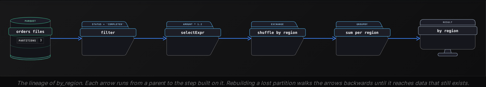
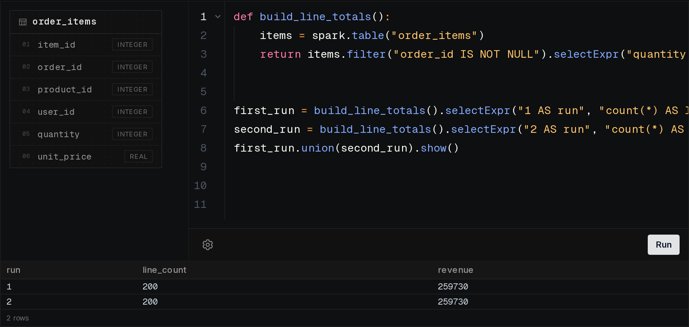
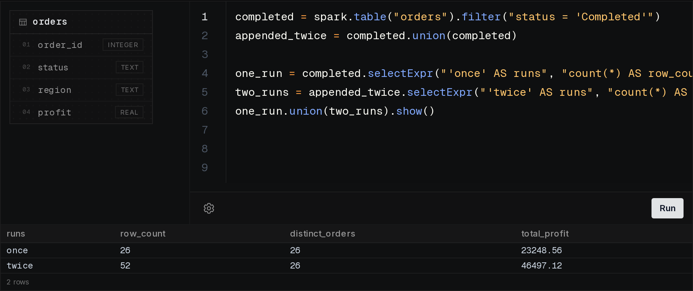
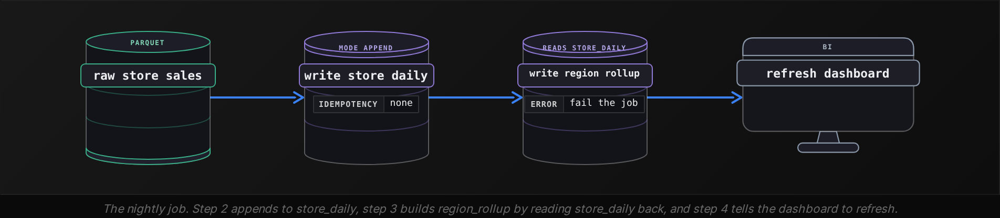
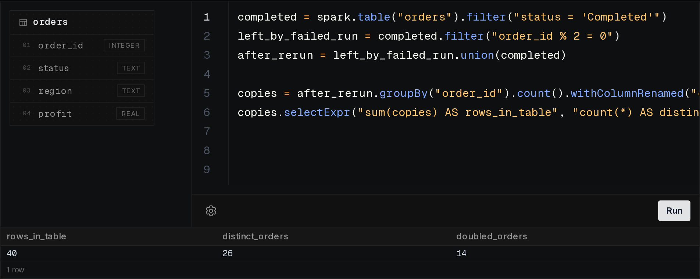

Beginner·Spark · 12 min · 12 challenges

# Fault Tolerance: Beginner

Netflix kills its own production servers at random to prove its systems survive failure. Suppose a Spark job there counts last night's plays per title. At 2 a.m. an executor vanishes, and Spark rebuilds the lost work. At 3 a.m. the job fails on a malformed title ID. An engineer patches the parser, reruns the whole job, and every count on the morning dashboard doubles. This lesson explains why.


<br>

---

## Failures a Retry Cannot Fix

Machines fail during jobs: a cloud provider reclaims a node, a process runs out of memory, a read from storage times out. When a task fails, Spark launches the same task again on the same input partition, usually on a different executor, and the job carries on. Retries make a cluster far more dependable than any single machine in it.

The setting behind this is spark.task.maxFailures, which defaults to 4: any single task may fail 4 times before Spark stops retrying and aborts the whole job. A retry repeats the work exactly: same partition, same rows, same code. That fact sorts every failure into 2 groups.


<br>

### What changes between attempts

| ✓ Can differ on the next attempt | ✗ Identical on every attempt |
| --- | --- |
| • The executor and machine running the task<br><br>• The network path to storage and to other executors<br><br>• Memory used by other tasks on the same executor | • The input partition, row for row<br><br>• Your transformations and the UDFs they call<br><br>• The size of the partition and of each key in it |

A failure caused by something on the left is **transient**: the next attempt lands somewhere healthier and succeeds. A failure caused by something on the right is **deterministic**: the next attempt meets the same rows, code and sizes, and fails the same way. Spark can't tell the 2 kinds apart, so it retries both, and a deterministic failure burns all 4 attempts before the job aborts. Each attempt redoes the work up to the crash, so that abort can take a long time to arrive.

| Failure | Root cause | On retry | What the error shows |
| --- | --- | --- | --- |
| Executor lost | Machine reclaimed or process killed | Rescued | `ExecutorLostFailure` |
| Storage read times out | Brief network trouble | Rescued | `SocketTimeoutException` |
| Shuffle data unreachable | The executor holding it died | Rescued once the data is rebuilt | `FetchFailedException` |
| UDF raises on a bad value | A malformed row in the input | Repeats on all 4 attempts | `PythonException` with the traceback |
| Out of memory on a single task | A hot key makes a partition huge | Usually repeats | `OutOfMemoryError`, or the executor is killed |


<br>

### A deterministic failure, attempt by attempt

This daily cleanup job receives quantities as text and converts them with a Python UDF.

```sql
@F.udf("int")
def parse_qty(raw):
    return int(raw)


sales = spark.read.parquet("/raw/store_sales/2024-03-14/")
clean = sales.withColumn("qty", parse_qty("qty_text"))
clean.write.parquet("/clean/store_sales/2024-03-14/")
```

One input file holds a row whose qty_text is 'N/A'. The task that reads it calls int('N/A'), which raises ValueError. Spark reschedules the task on another executor. That attempt reads the same file, reaches the same row and raises the same error. After the 4th failure the driver aborts with a message like Task 37 in stage 2.0 failed 4 times, most recent failure: Lost task 37.3 in stage 2.0.

The number after the dot is the attempt, counted from 0, so 37.3 is the 4th attempt at task 37. The same task index failing with the same error on 4 different executors is the signature of a deterministic failure. More executors, more memory and more retries change nothing. The fix goes into the code:

```sql
@F.udf("int")
def parse_qty(raw):
    if raw is None or not raw.strip().isdigit():
        return None
    return int(raw)
```

Now 'N/A' becomes a null, the partition finishes on its first attempt, and the job completes. Count the nulls in qty afterwards so bad input stays visible.


<br>

### The skewed partition that runs out of memory

An out-of-memory error looks like hardware trouble, which tempts people to trust the retry. If a single key holds 40% of the rows, the partition holding that key is the same size on every attempt and needs the same memory. The retry may land on an executor with slightly more free memory, but usually it dies at the same point, 4 times in a row. An OOM that keeps hitting the same task index is skew, and no retry can shrink a partition.

**A nightly job fails. Which of these failures would Spark's automatic task retry most likely rescue?**

- **A.** A UDF calls float() on the value '12,50' stored in one input file
- **B.** The cloud provider reclaims the machine running an executor mid-task
- **C.** A customer ID holds 40% of the rows feeding a join, and that task runs out of memory
- **D.** The input path has a typo, and the read raises an error for a missing path

<details>
<summary>Solution</summary>

**B.** The cloud provider reclaims the machine running an executor mid-task

The partition is still readable from storage, and the next attempt runs on a healthy executor and succeeds.

**Why the others are wrong**

- **A.** The value is still in the file on the next attempt, so float('12,50') raises the same ValueError 4 times.
- **C.** The partition is the same size on every attempt, so it needs the same memory and usually fails the same way.
- **D.** The path is missing on every attempt. This error is raised before any task runs, so there's no task to retry.

</details>


<br>

### Telling them apart in the Spark UI

- Stages tab: open the failed stage, sort its task table by Status, and read the Attempt and Errors columns.
- Same task index, same error, attempts 0 to 3 on different executors: deterministic. Fix the code or the data.
- Executors tab: dead executors around the failure time point to lost machines, a transient cause retries handle.

**The driver log ends with Task 12 in stage 5.0 failed 4 times, most recent failure: Lost task 12.3 in stage 5.0. All 4 attempts show the same ArithmeticException, on 4 different executors. What should you do?**

- **A.** Raise spark.task.maxFailures to 8 so the task gets more chances
- **B.** Add executors so the task lands on fresh hardware next time
- **C.** Rerun the job unchanged in the morning, when the cluster is quieter
- **D.** Find the input row behind the exception and handle it in the code

<details>
<summary>Solution</summary>

**D.** Find the input row behind the exception and handle it in the code

Same task, same error, 4 executors: a deterministic failure. Only a change to the code or the data changes the outcome.

**Why the others are wrong**

- **A.** Attempts 5 to 8 meet the same input and the same code, so they fail the same way and the abort only arrives later.
- **B.** The task already ran on 4 different executors. Hardware was never the cause.
- **C.** Cluster load does not change the row or the arithmetic that raised the exception.

</details>


<br>

---

## Lineage as a Recipe

Retrying a task assumes its input still exists. A dead executor takes things with it: every partition it had cached, the task it was halfway through, and the shuffle files on its local disk. Spark keeps no second copy of any of these by default, so before it can retry, it has to recreate whatever the task needs.


<br>

### Every DataFrame knows how it was made

A DataFrame is a description: the transformation that produces it and the parent DataFrame that transformation applies to. Following those parent links back ends at the files the job read. That chain is the DataFrame's lineage, and it works like a recipe: with the ingredients still in the pantry, the dish can be cooked again at any time.

```sql
orders = spark.read.parquet("/raw/orders/")
completed = orders.filter("status = 'Completed'")
gross = completed.selectExpr("region", "amount * 1.2 AS gross_amount")
by_region = gross.groupBy("region").sum("gross_amount")
```




<br>

### Replicas versus recipes

| ✓ Keep copies (replication) | ✗ Keep the recipe (lineage) |
| --- | --- |
| • Every block stored 2 or 3 times on different machines<br><br>• Recovery reads a surviving copy, which is fast<br><br>• Pays the storage cost on every run, failure or not<br><br>• Works even if the original source is gone | • The steps are stored once, a few lines of plan<br><br>• Recovery recomputes the lost partition, which costs CPU<br><br>• Pays only when something actually fails<br><br>• Needs the source files to still be readable |

Spark keeps recipes for intermediate data because almost every partition survives its job, and copying every intermediate result 3 times would slow every job to guard against a rare loss. The source files sit on storage that keeps its own copies, so every recipe starts from ingredients that last.


<br>

### A narrow chain rebuilds one partition

In that code, filter and selectExpr are narrow: partition 2 of gross comes only from partition 2 of completed, which comes only from split 2 of the files. If the executor holding partition 2 of gross dies, Spark reruns 1 task that reads split 2, filters it and computes gross_amount. No other partition is touched.


<br>

### Behind a shuffle, the rebuild reaches wider

The groupBy adds a shuffle, so the job runs as 2 stages. In the first, each map task filters its split, adds up a partial sum for each region it saw, and writes those partial sums to local disk in buckets by region. In the second, each reduce task fetches its region's partial sums from every map task and adds them. A cut-down version of the job plays below: watch each region's partial sums cross between the stages.

https://github.com/user-attachments/assets/6defab04-1ad3-452d-ab29-196d21a4049a

The reducer that produces EU's total of 90 fetched from every map task, because any of them could hold EU rows. That's what a wide dependency costs on recovery. If a reduce task dies while every map output is still on a healthy executor's disk, Spark reruns that reduce task alone, and it fetches the same buckets again. If the executor that died also held map output, the reducers trying to fetch it fail with FetchFailedException. Spark then reruns the lost map tasks from the files, using their lineage, and reruns the reducers after them.

| What was lost | What Spark reruns |
| --- | --- |
| A task in a narrow chain | That task, from its own input split |
| A reduce task, with every map output intact | That reduce task, fetching the same shuffle files |
| An executor holding output from 20 of 200 map tasks | Those 20 map tasks, then the reduce tasks that could not fetch |
| A cached partition | The steps from the nearest parent that still exists, and the result is cached again |
| The source files | Nothing: the recipe has no ingredients left |

**The map stage of this job ran 200 tasks across 10 executors. During the reduce stage, a machine fails and takes 1 executor with it. That executor had run 20 of the map tasks and was running 3 reduce tasks. What does Spark rerun?**

```python
events = spark.read.parquet("/raw/events/")
clicks = events.filter("event_type = 'click'")
per_user = clicks.groupBy("user_id").count()
per_user.write.parquet("/out/clicks_per_user/")
```

- **A.** All 200 map tasks and every reduce task, since the shuffle output is now incomplete
- **B.** Only the 3 reduce tasks that were running, since the map stage had already finished
- **C.** The 20 map tasks whose output was lost, then the 3 reduce tasks and any others that failed to fetch
- **D.** Nothing, because shuffle files are copied to a second executor as they are written

<details>
<summary>Solution</summary>

**C.** The 20 map tasks whose output was lost, then the 3 reduce tasks and any others that failed to fetch

Lineage rebuilds the 20 lost map outputs from the input files, and then the affected reducers run again.

**Why the others are wrong**

- **A.** Map output on the 9 healthy executors is still on their disks. Spark rebuilds only what was lost.
- **B.** Those reducers, and others, need buckets from the 20 lost map outputs, which no longer exist anywhere.
- **D.** Spark keeps no copy of shuffle output by default. Recovery comes from the recipe.

</details>

> **TIP**
>
> Storage levels ending in `_2`, such as `MEMORY_AND_DISK_2`, are the opt-in replica: Spark keeps a second copy of each cached partition on another executor. Use one when a cached result took several shuffles to build and losing it would cost more than the extra memory.

**A result built through 3 shuffles is persisted with MEMORY_AND_DISK. An executor holding 6 of its cached partitions is lost. What happens the next time an action reads the result?**

- **A.** Spark reads the 6 partitions from a copy on another executor
- **B.** The action fails, because cached data cannot be rebuilt
- **C.** Spark recomputes every partition of the result from the source files
- **D.** Spark rebuilds the 6 lost partitions from lineage and caches them again

<details>
<summary>Solution</summary>

**D.** Spark rebuilds the 6 lost partitions from lineage and caches them again

Lineage recomputes the lost partitions. A _2 level would have read a copy instead.

**Why the others are wrong**

- **A.** Only a _2 level keeps a second copy. This level keeps one.
- **B.** A cached partition has lineage like any other and can be recomputed.
- **C.** The other partitions are still cached. Only what was lost is rebuilt.

</details>


<br>

---

## Why Replays Are Safe

Lineage means a task can run 2, 3 or 4 times inside a single job. Running work twice is the classic way data gets doubled, like a payment sent twice. Spark's own computation never doubles, and the reason is 3 design choices working together.

> Why a replayed task cannot double anything
>
> - Reading never changes the input, so attempt 1 sees what attempt 0 saw.
> - A transformation builds new rows from its input and writes nothing in place.
> - Each attempt's output stays private until Spark accepts exactly 1 attempt per partition.


<br>

### The input is identical on every attempt

Calling orders.filter("status = 'Completed'") reads the orders files and leaves them as they were. A transformation produces new rows from its input and writes nothing back into it, so a rerun task finds the same split, holding the same rows, that the failed attempt started from.


<br>

### Same rows in, same rows out

A filter, a selectExpr and a groupBy with a sum each compute their output from their input and nothing else. Give attempt 1 the partition attempt 0 had, and it produces the rows attempt 0 would have produced. A replay recomputes a value from scratch, with nothing earlier to add onto.

*This holds while the computation depends on its input alone. Functions that read something else, such as rand() without a seed or the current time, can give a replay different values, and a later lesson covers them.*


<br>

### One accepted result per partition

The driver tracks each task by its partition index. A task's result travels to the driver as a single package when the task finishes, never row by row, so a task that dies midway has sent nothing. When an attempt succeeds, the driver marks that partition done and ignores any other attempt's result for it. Suppose the task reading orders 5 to 8 runs on executor 3, which is lost partway through, and the retry runs on executor 5:

Attempt 0, executor 3 (lost)

| order_id | status | what happened |
| --- | --- | --- |
| 5 | Completed | kept, in executor memory |
| 6 | Cancelled | dropped by the filter |
| 7 | Completed | never reached |
| 8 | Completed | never reached |

Attempt 1, executor 5 (succeeded)

| order_id | status | what happened |
| --- | --- | --- |
| 5 | Completed | kept |
| 6 | Cancelled | dropped by the filter |
| 7 | Completed | kept |
| 8 | Completed | kept |

The executor's memory, and the order 5 it held, disappeared together. The driver receives orders 5, 7 and 8 exactly once, from attempt 1.

The animation below runs the same filter over 12 orders and collects the 9 completed ones. No shuffle is involved: each task filters its own partition and sends its rows to the driver as 1 result, and the driver assembles them in partition order.

https://github.com/user-attachments/assets/f15e5fc3-5ec9-411d-a821-ff3d7dcdb319

A rerun of any of those tasks would leave the board unchanged: 1 result per partition, 9 rows in total. Shuffle output follows the same rule. A rerun map task writes its buckets again, and the driver records a single output location per map task, so reducers read each map task's rows once.

**A count() runs over 50 partitions. The task for partition 9 fails twice with executor-lost errors and succeeds on its 3rd attempt. How many times are partition 9's rows included in the count?**

- **A.** Once, because the driver accepts 1 successful result per partition index
- **B.** Three times, because each attempt read the partition's rows from storage
- **C.** Twice, because the 2 failed attempts sent partial counts before dying
- **D.** Once in the result, but the job then fails because the attempts disagree

<details>
<summary>Solution</summary>

**A.** Once, because the driver accepts 1 successful result per partition index

The failed attempts sent nothing, and the successful one is the only result recorded for partition 9.

**Why the others are wrong**

- **B.** Reading isn't counting. Failed attempts sent no result, so their reads never reached the driver.
- **C.** A task's result goes to the driver as a single package at the end. An attempt that dies has sent nothing.
- **D.** Spark does not compare attempts. The first successful attempt for the partition is the one it keeps.

</details>


<br>

### Written files follow the same rule

When a stage writes files, each task attempt writes into its own temporary directory under the destination. Only the attempt Spark accepts has its files moved into the final location, and the temporary directory is cleaned up when the job finishes, so a task that died after writing half a file leaves that half where no reader looks.

Try a replay yourself. The cell below runs the same recipe over the practice order_items table twice, as 2 separate computations, and summarises each run in a row.



```python
def build_line_totals():
    items = spark.table("order_items")
    return items.filter("order_id IS NOT NULL").selectExpr("quantity * unit_price AS line_total")


first_run = build_line_totals().selectExpr("1 AS run", "count(*) AS line_count", "round(sum(line_total), 2) AS revenue")
second_run = build_line_totals().selectExpr("2 AS run", "count(*) AS line_count", "round(sum(line_total), 2) AS revenue")
first_run.union(second_run).show()
```


<br>

---

## Idempotent Re-runs

Everything so far happened inside a single job, and Spark's protection ends where the job ends. When an orchestrator retries a failed job, or you rerun last night's job after fixing a bug, Spark starts a fresh job with no memory of the earlier one. Whatever the earlier run wrote is still at the destination, and the new run's write lands on top of it.

The property to check is **idempotence**: an operation is idempotent when running it twice leaves the same result as running it once. Setting a light switch to off is idempotent; flipping it is not. Whether a Spark job is idempotent depends almost entirely on its final write.


<br>

### What each write mode does to existing output

| Mode | If the destination already holds data | Running the same job twice |
| --- | --- | --- |
| `errorifexists` (the default) | The write fails with an error | The second run fails loudly, and the first run's output is untouched |
| `append` | New files are added beside the old ones | Every row appears twice |
| `overwrite` | Old files are removed, new ones written | Same output as a single run |
| `ignore` | Nothing is written, and no error is raised | The first run's output stays, even if the new input changed |


<br>

### The append that doubles revenue

This job writes a summary row per store for a day of sales.

```sql
daily = spark.read.parquet("/raw/store_sales/2024-03-14/")
summary = daily.groupBy("store_id").sum("revenue")
summary.write.mode("append").parquet("/warehouse/store_daily/")
```

The first run writes 1,200 rows, a row per store. Suppose a later step fails and the orchestrator retries the job. The retry computes those 1,200 rows correctly and appends them beside the first copy, so the table now holds every store twice. Nothing raises an error, and a dashboard that sums revenue per store reports exactly double.

store_daily after 1 run

| store_id | sum(revenue) |
| --- | --- |
| 101 | 4820.5 |
| 102 | 3115 |
| 103 | 2760.25 |

store_daily after 2 runs

| store_id | sum(revenue) |
| --- | --- |
| 101 | 4820.5 |
| 102 | 3115 |
| 103 | 2760.25 |
| 101 | 4820.5 |
| 102 | 3115 |
| 103 | 2760.25 |


<br>

### Make the destination belong to the run

```sql
run_date = "2024-03-14"
daily = spark.read.parquet(f"/raw/store_sales/{run_date}/")
summary = daily.groupBy("store_id").sum("revenue")
summary.write.mode("overwrite").parquet(f"/warehouse/store_daily/{run_date}/")
```

Run this once or 5 times and /warehouse/store_daily/2024-03-14/ holds the same output, because the date fixes the destination and overwrite replaces it whole.

> Four questions for any write
>
> - Is the destination fixed by the run's input, such as its date, and nothing else?
> - Does the mode replace existing output or add to it?
> - Does any part of the path or the data come from the clock, like `datetime.now()`?
> - Would a rerun read the same input the first run read?

| ✓ Do | ✗ Don't |
| --- | --- |
| • Pass the logical date in as a parameter and build paths from it<br><br>• Overwrite a destination that holds exactly one run's output<br><br>• Keep errorifexists where a second run should never happen | • Append a whole job's output to a shared path with no guard<br><br>• Put the current time into an output path<br><br>• Use ignore when a rerun is meant to apply a fix |

The practice data shows the append damage. The cell below treats the completed orders as 1 run's output, unions them with themselves to stand in for a table after 2 appends, and summarises both.



```python
completed = spark.table("orders").filter("status = 'Completed'")
appended_twice = completed.union(completed)

one_run = completed.selectExpr("'once' AS runs", "count(*) AS row_count", "count(DISTINCT order_id) AS distinct_orders", "round(sum(profit), 2) AS total_profit")
two_runs = appended_twice.selectExpr("'twice' AS runs", "count(*) AS row_count", "count(DISTINCT order_id) AS distinct_orders", "round(sum(profit), 2) AS total_profit")
one_run.union(two_runs).show()
```

The extra rows repeat existing order_id values, which is the tell. In a table where each ID should appear once, comparing the row count with the distinct ID count is the cheapest check for an append that ran twice.

**A reporting job ends with this write, and the dashboard reads every directory under /warehouse/store_daily/. Is the job safe to run twice?**

```python
from datetime import datetime

stamp = datetime.now().strftime("%Y-%m-%d-%H%M")
summary.write.mode("overwrite").parquet(f"/warehouse/store_daily/{stamp}/")
```

- **A.** Yes, because overwrite replaces whatever the earlier run wrote there
- **B.** No, because the second run lands in a new timestamped directory beside the first
- **C.** Yes, because each run writes to its own directory and never touches another
- **D.** No, because overwrite deletes the other days' directories under the parent

<details>
<summary>Solution</summary>

**B.** No, because the second run lands in a new timestamped directory beside the first

The clock makes the path new on each run, so the write behaves like an append and readers count the data twice.

**Why the others are wrong**

- **A.** Overwrite replaces only its own destination. A second run at a later minute has a different destination.
- **C.** Leaving the old output in place is the problem. The dashboard reads both directories and counts both runs.
- **D.** Overwrite targets the full path it is given, the timestamped directory, so the other days survive.

</details>


<br>

---

## The Half-Finished Job

Most jobs write more than once: a detail table, then a rollup, then a signal telling a dashboard to refresh. A failure partway through leaves some of those writes done and the rest missing. That state is incomplete, but it is honest: no row is duplicated, and the gap is visible to anyone who looks. The damage comes later, from the rerun.




<br>

### Run by run

| Moment | store_daily rows for 2024-03-14 | region_rollup | State of the data |
| --- | --- | --- | --- |
| Before the job | 0 | empty | Nothing written yet |
| Run 1 fails in step 3 | 1,200 | empty | Incomplete, every row correct |
| Run 2, a full rerun, succeeds | 2,400 | 4 regions, revenue doubled | Corrupted, and the dashboard shows it |

Run 1 died in step 3, after step 2 had written 1,200 correct rows. Run 2 started again from step 1, added those rows a second time, and then built region_rollup by reading store_daily back, so the doubling spread into the rollup. The failure cost an hour of delay. The rerun produced wrong numbers that look plausible, which costs far more.


<br>

### A single write can stop halfway too

A write is many tasks, so it can stop partway. Spark writes an empty file named _SUCCESS into the output directory only after the whole write completes, so a directory without it may hold partial output. What the half-done state looks like depends on the mode:

| ✓ A failed append | ✗ A failed overwrite |
| --- | --- |
| • The old data is intact<br><br>• Depending on how the write is committed, files from tasks that finished may already sit in the destination<br><br>• A full rerun adds a complete copy beside them<br><br>• Duplicates stay until someone finds and removes them | • The old data was removed before the new files were written<br><br>• The destination is empty or partial until the next success<br><br>• A full rerun replaces it whole<br><br>• Readers during the gap see missing data, never doubled data |

Neither failure, on its own, leaves damage that a successful run can't repair. The append's rerun is what turns a gap into lasting duplicates. That's the pattern to spot: a step that adds to its destination, inside a job that can fail after that step.


<br>

### The backfill loop

Backfills put the same hazard in a loop. This script rebuilds a week of store summaries, a day at a time.

```sql
from datetime import date, timedelta

start = date(2024, 3, 8)
for offset in range(7):
    day = (start + timedelta(days=offset)).isoformat()
    sales = spark.read.parquet(f"/raw/store_sales/{day}/")
    summary = sales.groupBy("store_id").sum("revenue")
    summary.write.mode("append").parquet("/warehouse/store_daily/")
```

The loop dies on its 4th day, 2024-03-11. March 8 to 10 are complete in the table, and March 11 may have partial files. Rerunning the script from the top appends March 8, 9 and 10 a second time, and March 11 on top of its partial files. Restarting from March 11 avoids the first problem and keeps the second. Writing each day to its own directory with overwrite makes the loop safe to restart from any day.

| ✓ Do | ✗ Don't |
| --- | --- |
| • Write each logical date to its own directory, replaced whole on every run<br><br>• Check for _SUCCESS before a downstream step reads a directory<br><br>• Count rows and distinct IDs after a rerun to confirm nothing doubled | • Rerun an appending job without checking what the failed run already wrote<br><br>• Build a rollup by reading back a table the same job appended to<br><br>• Treat a quiet, successful rerun as proof the data is right |

**A nightly job reads raw events, appends a cleaned copy to /warehouse/events/, then writes a per-user count with overwrite. Tonight an executor was lost during the cleaning stage, and the job still finished. Last night the count step failed, and the on-call engineer reran the whole job. Which run put duplicates in /warehouse/events/?**

- **A.** Tonight's run, because the lost executor's tasks wrote their rows twice
- **B.** Neither run, because lineage rebuilt the lost work in both cases
- **C.** Last night's rerun, because it appended the cleaned events a second time
- **D.** Both runs, because any failure during an append leaves duplicate rows

<details>
<summary>Solution</summary>

**C.** Last night's rerun, because it appended the cleaned events a second time

The failed run had already appended the events. The rerun appended them again, and nothing in Spark checks for that.

**Why the others are wrong**

- **A.** Retried tasks inside a job are safe: a single attempt per partition is kept, and failed attempts' files are discarded.
- **B.** Lineage covers tasks within a job. The rerun was a new job, and its append met the first run's output.
- **D.** A failure leaves a gap. Duplicates need a second write of the same rows, which only the rerun made.

</details>

The cell below rebuilds that situation on the practice data. Even-numbered completed orders stand in for the files a failed run left behind, and the full set stands in for the rerun's append. Read the 3 numbers it returns and decide which of them would have warned you.



```python
completed = spark.table("orders").filter("status = 'Completed'")
left_by_failed_run = completed.filter("order_id % 2 = 0")
after_rerun = left_by_failed_run.union(completed)

copies = after_rerun.groupBy("order_id").count().withColumnRenamed("count", "copies")
copies.selectExpr("sum(copies) AS rows_in_table", "count(*) AS distinct_orders", "sum(CASE WHEN copies > 1 THEN 1 ELSE 0 END) AS doubled_orders").show()
```

The row count on its own looks like a plausible table. The warning is rows_in_table running ahead of distinct_orders, and doubled_orders names how many orders the rerun wrote twice. When every extra row is an exact copy of another, dropDuplicates(["order_id"]) keeps 1 row for each order_id and brings the table back to what a single run wrote.

**After a rerun, a table that should hold 1 row per order_id has 1,500 rows and 1,200 distinct order IDs. Every extra row is an exact copy. What brings it back to a single run's output?**

- **A.** dropDuplicates(["order_id"]), keeping 1 row for each order
- **B.** Rerun the whole job once more with append to even it out
- **C.** Filter out every row whose order_id appears more than once
- **D.** Divide every revenue value in the table by 2 to undo the doubling

<details>
<summary>Solution</summary>

**A.** dropDuplicates(["order_id"]), keeping 1 row for each order

Exact copies collapse to 1 row each, leaving 1,200 rows.

**Why the others are wrong**

- **B.** Another append adds a further copy of every row.
- **C.** That drops the originals too, losing 300 orders entirely.
- **D.** Only 300 orders doubled, so halving corrupts the other 900.

</details>


<br>

---

## Putting It All Together

Picture Netflix's nightly plays job: it reads the previous day's playback events, cleans them, appends the cleaned rows to an events table, and then writes play counts per title for the morning dashboard. At 2 a.m. a machine is reclaimed mid-stage. At 3 a.m. the count step fails on a malformed title ID. The on-call engineer patches the parser and reruns the whole job, and the morning counts come out doubled.

- The 2 a.m. reclaimed machine was a transient failure: retries ran its tasks on healthy executors, and lineage rebuilt the map output it held from the source files.
- Those retried tasks could not double any play, because each partition's result was accepted once and failed attempts' files were discarded.
- The 3 a.m. malformed title ID failed 4 times on 4 executors, a deterministic failure that only the parser fix could get past.
- The failed run had already appended the cleaned events, so the full rerun appended them a second time and every count built from that table doubled.
- Writing each night's events to its own directory with overwrite would have made the same rerun harmless, and checking rows against distinct event IDs would have caught the doubling before the dashboard did.


<br>

---

## Key Takeaways

- A retry reruns the same partition with the same code, so it rescues failures caused by machines and networks and repeats failures caused by data, code or partition size.
- The same task index failing with the same error across 4 attempts is a deterministic failure: fix the code or the data, because more retries change nothing.
- Spark rebuilds lost partitions from lineage, the recipe of steps back to the source files, and keeps no copy of intermediate data unless you choose a _2 storage level.
- Behind a shuffle, losing an executor reruns the map tasks whose output it held, then the reducers that couldn't fetch it.
- Replays inside a job are safe: inputs stay unchanged, transformations depend only on their input, and the driver keeps 1 result per partition.
- A rerun of a whole job is a new job, and its safety depends on the final write: append doubles the output, while overwrite on a per-date path does not.
- A failure leaves a gap. The rerun of an append is what turns that gap into duplicates.
