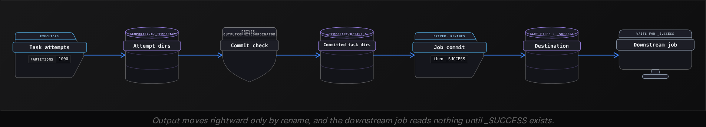
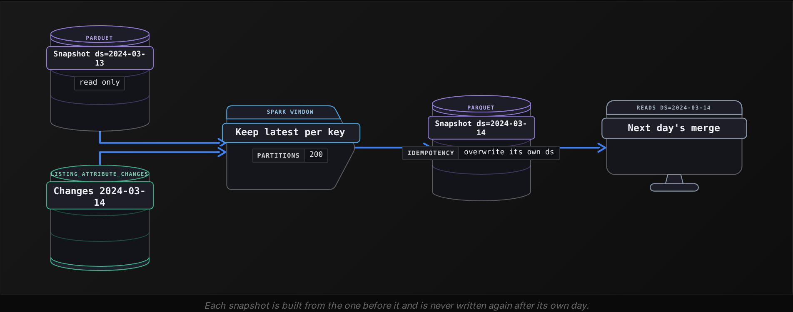
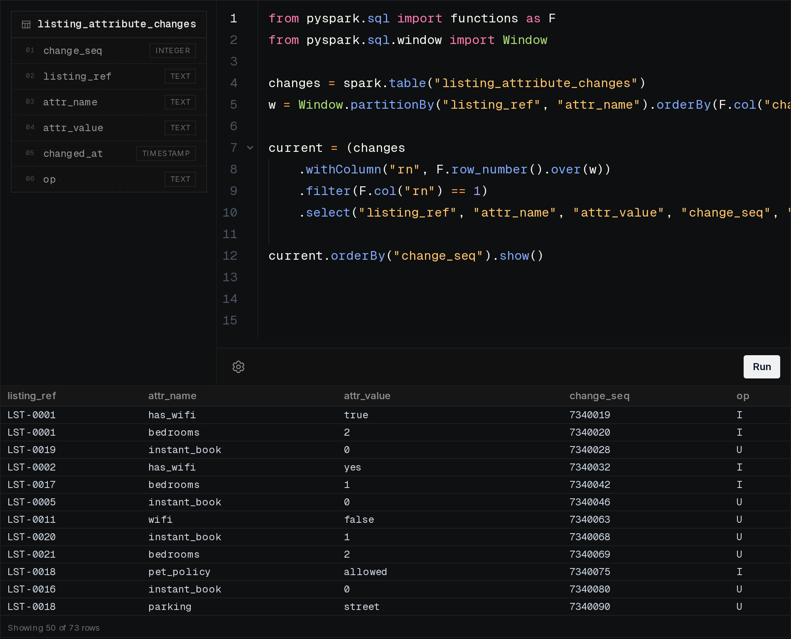
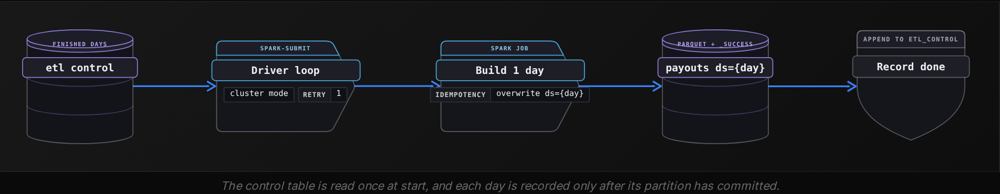
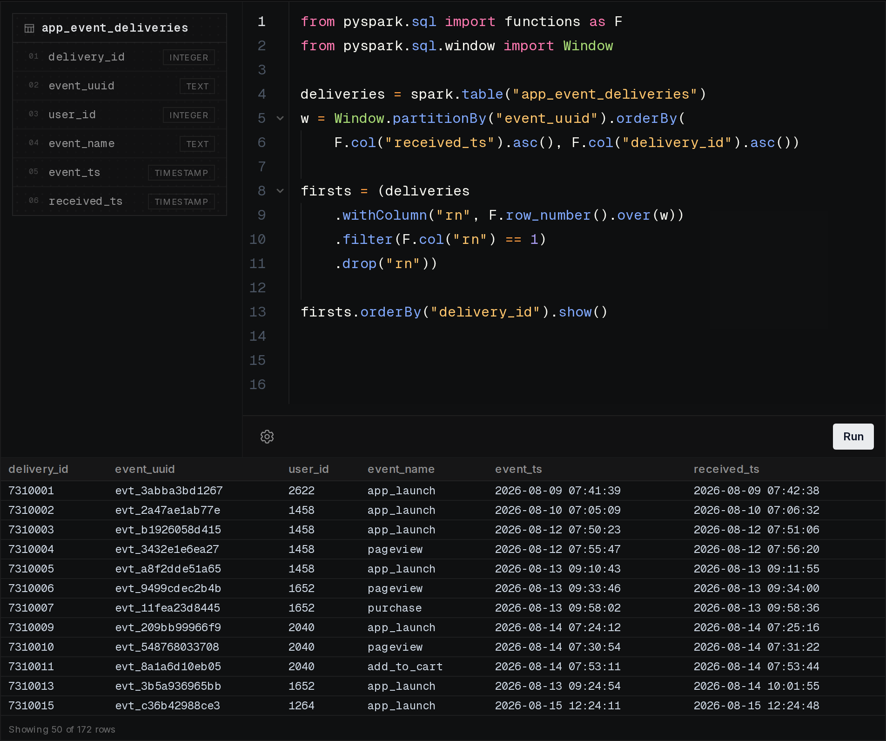

Intermediate·Spark · 14 min · 17 challenges

# Fault Tolerance: Intermediate

Say the nightly Spark job at Airbnb totals yesterday's bookings per host into a payouts table that finance reads at 6am. At 02:40 its driver runs out of memory mid-write and the job fails. The on-call engineer presses rerun. Whether a host ends up paid twice or only partly depends on how that job commits files and replaces partitions, and on how it merges changes when its work is replayed.


<br>

---

## Atomic Writes

Writing a 1,000-partition DataFrame runs 1,000 tasks, and each task writes its own Parquet file. Those tasks finish minutes apart and some of them fail and run again. The job itself can die at any moment. If every task wrote straight into the destination, a reader polling it would see 400 files at 02:01 and 700 at 02:03. A crash would leave a table that is 70% complete and looks finished, and a retried task could leave 2 copies of the same part file. Spark prevents all 3 problems with a commit protocol: tasks write where no reader looks, and the driver publishes the result at the end.


<br>

### Write first, publish later

For file sources, Spark writes through a committer, FileOutputCommitter, using its algorithm version 1 by default. Task output lives under a hidden _temporary directory inside the destination until the job finishes. When Spark lists a table it skips every path whose name starts with _ or ., so nothing under _temporary is ever read as data.

| Step | Runs on | What happens | Readers see it |
| --- | --- | --- | --- |
| Task write | Executor | The attempt writes `part-00042-\*.parquet` under `_temporary/0/_temporary/attempt_\*/` | No |
| Task commit | Executor, once the driver agrees | The attempt directory is renamed to `_temporary/0/task_\*/` | No |
| Job commit | Driver, after the last task | Each committed file is renamed into the destination, then `_temporary` is deleted | File by file |
| Marker | Driver | An empty `_SUCCESS` file is written in the destination | Yes: the output is complete |




<br>

### One winner per task

A task can run more than once. An attempt that throws partway is retried on another executor, and an executor that stops answering heartbeats is presumed dead even though it may still be writing. So 2 attempts of task 42 can each finish a complete file. Before renaming its directory, an attempt asks the driver for permission. The driver's `OutputCommitCoordinator` says yes to the first attempt that asks for each partition and no to every later one. A refused attempt aborts, and anything it left behind goes when job commit deletes `_temporary`. Exactly 1 `part-00042` reaches the destination.


<br>

### What a crash leaves behind

| The job dies during | The destination holds | A reader waiting for _SUCCESS |
| --- | --- | --- |
| Task writes | `_temporary` only | Sees nothing |
| Task commits | `_temporary`, with some task directories committed | Sees nothing |
| Job commit | Some part files and no `_SUCCESS` | Keeps waiting and never reads the partial files |
| Nothing: it finished | Every part file and `_SUCCESS` | Reads the complete output |

Job commit is a loop on the driver, 1 rename per file. Each rename is atomic and the loop is not, which is the third row. The all-or-nothing view a downstream job gets comes from the marker: Spark writes `_SUCCESS` after the last rename, so a consumer that waits for it reads every file or none. A consumer that only checks whether the directory exists can read part of a job.


<br>

### Algorithm version 2

| ✓ Version 1, the default | ✗ Version 2 |
| --- | --- |
| • Task commit renames into _temporary/0/task_\*<br><br>• Job commit renames every file on the driver<br><br>• Nothing appears in the destination before job commit<br><br>• Job commit slows as the file count grows | • Task commit renames straight into the destination<br><br>• Job commit does little beyond writing _SUCCESS<br><br>• Finished tasks' files are visible mid-job and after a crash<br><br>• Spark's configuration docs warn it may cause a correctness issue |

The setting is spark.hadoop.mapreduce.fileoutputcommitter.algorithm.version. Version 2 removes the driver's rename loop, which shortens commits for jobs with many files, and gives up the property this section is about: a reader can see half a job's output with no marker to warn it. Keep version 1 for any table someone reads while you write it.

> **TIP**
>
> In the Spark UI, when every task of a write has finished but the job keeps running, the driver is in job commit, renaming files. That gap grows with the file count, so 40,000 small files cost far more there than 400 large ones.

**A job writing 1,000 part files with the default committer dies after the driver has renamed 600 of them into the destination. A downstream job checks the destination every minute. What does it find, and what should it do?**

- **A.** It finds all 1,000 files, because job commit publishes them in 1 atomic step
- **B.** It finds no files, because Spark deletes the destination when a job fails
- **C.** It finds 600 part files and no _SUCCESS, so it should keep waiting
- **D.** It finds 600 part files and a _SUCCESS, so it can read what is there

<details>
<summary>Solution</summary>

**C.** It finds 600 part files and no _SUCCESS, so it should keep waiting

The marker is written after the last rename. Its absence is the signal that the directory holds part of a job.

**Why the others are wrong**

- **A.** Job commit renames files 1 at a time on the driver. A crash in the middle leaves only the files already renamed.
- **B.** Nothing removes the 600 renamed files on failure. They stay until a later overwrite replaces them.
- **D.** _SUCCESS is written only after every rename succeeds, so a job that died mid-commit never writes it.

</details>


<br>

---

## Overwrite vs Append

The commit protocol makes a single run all-or-nothing. Pipelines run many times: the job for 2024-03-14 fails at 01:00 and is rerun at 03:00, a bug fix triggers a backfill of 30 days, a scheduler retries a run it thought had hung. Each rerun writes into a table that already holds data, and the save mode decides what happens to the rows that are there. Here is a daily job that counts views per page for 1 day of `clickstream_raw`.

```sql
from pyspark.sql import functions as F

run_day = "2024-03-14"
daily = (spark.table("clickstream_raw")
    .filter(F.col("event_day") == run_day)
    .groupBy("event_day", "page_id")
    .agg(F.count("*").alias("views")))

daily.write.mode("append").partitionBy("event_day").parquet("/warehouse/page_counts")
```

The first run adds its part files under `event_day=2024-03-14`. The rerun adds a second set: each write names its files with an id unique to that job, so the new files land beside the old ones without replacing any. The day now holds every row twice, and a dashboard summing `views` reports double.

event_day=2024-03-14 after 1 run

| file | page_id | views |
| --- | --- | --- |
| part-00000-a1f3 | 7 | 120 |
| part-00001-a1f3 | 9 | 45 |

After a rerun with append

| file | page_id | views |
| --- | --- | --- |
| part-00000-a1f3 | 7 | 120 |
| part-00001-a1f3 | 9 | 45 |
| part-00000-c7d2 | 7 | 120 |
| part-00001-c7d2 | 9 | 45 |


<br>

### Overwrite deletes more than the day

Switching to mode("overwrite") stops the duplication and introduces a worse failure. With partitionBy, overwrite follows spark.sql.sources.partitionOverwriteMode, whose default is static. In static mode Spark deletes every partition matching the write's partition spec before writing, and a DataFrame write carries no spec, so it matches all of them. The run for 2024-03-14 empties the table and leaves 1 day in it.

Before: partitions on disk

| event_day | files |
| --- | --- |
| 2024-03-12 | 2 |
| 2024-03-13 | 2 |
| 2024-03-14 | 2 |

After a static overwrite for 2024-03-14

| event_day | files |
| --- | --- |
| 2024-03-14 | 2 |


<br>

### Dynamic mode replaces the days you wrote

```sql
spark.conf.set("spark.sql.sources.partitionOverwriteMode", "dynamic")

daily.write.mode("overwrite").partitionBy("event_day").parquet("/warehouse/page_counts")
```

In dynamic mode, tasks write into a staging directory, `.spark-staging-` plus the job id, under the destination. At job commit the driver deletes each partition directory the job produced rows for and moves the new one into its place, while partitions the job never wrote stay as they were. Rerunning 2024-03-14 swaps that day's files for new files holding the same rows; the table after 5 runs is identical to the table after 1. A 30-day backfill becomes 1 job that filters the 30 days and writes them once, replacing each partition exactly once.

> A rerunnable daily write
>
> - Reads a slice of input fixed by a parameter, `run_day`, instead of whatever arrived since the last run
> - Writes the partitions that slice maps to, with the partition value taken from the rows
> - Replaces each of those partitions whole; dynamic overwrite does this, and so does writing to the partition's own path
> - Never overwrites the path it reads from, which can delete its own input mid-job


<br>

### When the fixed day has no rows

Dynamic mode replaces only partitions that receive rows. Suppose 2024-03-14 was loaded from a corrupt file and the fixed rerun filters out every row. The job writes nothing for that day, so nothing is replaced, and the corrupt partition outlives a run that reported success. When a day must equal the job's output even if that output is empty, write to the partition's path:

```sql
(daily.drop("event_day")
    .write.mode("overwrite")
    .parquet(f"/warehouse/page_counts/event_day={run_day}"))
```

Overwrite on that path clears the directory whatever the row count. Dropping `event_day` keeps the column out of the files, since a reader of the table takes it from the directory name.

| Write | A rerun of 2024-03-14 | Watch for |
| --- | --- | --- |
| `append` | Adds the day's rows again | Duplicates on every retry |
| `overwrite`, static, with `partitionBy` | Deletes every day, writes 1 | It is the default setting |
| `overwrite`, dynamic, with `partitionBy` | Replaces 2024-03-14 only | A day with 0 rows is left untouched |
| `overwrite` to `event_day=2024-03-14` | Replaces that day, even with 0 rows | 1 partition per write |

**A job runs with default settings and ends with out.write.mode("overwrite").partitionBy("ds").parquet(path). The table at path holds 90 days. The job is rerun for ds 2024-03-10 to fix a bug. What does the table hold afterwards?**

- **A.** It keeps 90 days with 2024-03-10 replaced, because overwrite touches only the days in the output
- **B.** It holds 90 days with 2024-03-10 written twice, because overwrite adds the rerun beside the first copy
- **C.** It still holds 90 days, unchanged, because overwrite refuses to run against a partitioned path
- **D.** It holds 1 day, because the default static mode deletes every partition before writing

<details>
<summary>Solution</summary>

**D.** It holds 1 day, because the default static mode deletes every partition before writing

With no partition spec, static mode matches every partition, so only 2024-03-10 remains.

**Why the others are wrong**

- **A.** That is dynamic mode. The default is static, which deletes every partition the write's empty spec matches.
- **B.** Copies side by side come from append. Overwrite deletes before it writes.
- **C.** Overwrite runs on partitioned paths. What it deletes first is set by partitionOverwriteMode.

</details>


<br>

---

## Idempotent Upserts

Day partitions work when every row belongs to the day it arrived. A listings table breaks that: it holds 1 row per listing, and a listing created on March 2 can change price on March 14 and again on March 15. No day owns that row, so appending each day's changes leaves 3 versions of it, and overwriting a day keeps only the listings that changed that day. The table needs an upsert: insert new keys and update existing ones.


<br>

### Rebuild from inputs that never change

A Parquet file is written once and never edited, so in plain files an upsert is a rewrite. Read yesterday's snapshot, union today's changes, keep the newest version of each key, and write the result as today's snapshot in a directory of its own. Since yesterday's snapshot is never touched, rerunning the 2024-03-14 merge sees exactly the inputs the first attempt saw, and its output at `ds=2024-03-14` comes out the same however many times it runs.



The animation runs that merge on a snapshot of 3 listings and 5 change rows. One change arrived twice because the upstream feed redelivered it.

https://github.com/user-attachments/assets/e716f0d5-80d9-4bca-a0ec-ef921377f979

`Window.partitionBy("listing_ref")` hash-shuffles the union by key, so every version of `L2` lands on 1 task whichever input it came from. That task sorts its rows by `change_seq` descending, and `row_number` keeps the first. The redelivered change gives 2 identical `L2` rows at `change_seq` 7; either can take number 1 and the surviving row is the same. Feeding the output back in with the same changes returns the output unchanged.


<br>

### Merges that converge

Keep latest by change_seq

| changes applied | L2 price |
| --- | --- |
| once | 240 |
| twice | 240 |
| 5 times | 240 |

Add +30 to a balance of 100

| changes applied | balance |
| --- | --- |
| once | 130 |
| twice | 160 |
| 5 times | 250 |

A merge converges when applying a change twice equals applying it once. Keep-latest by sequence number has that property, and so does set union; max and min do too. Adding to a stored total lacks it: a balance updated with `+ 30` on every run drifts 30 higher per retry. For sums and counts, store the deduplicated events as the state and recompute the total from them, so a rerun recomputes a number instead of adding to one.

**A daily job maintains each user's total spend from transactions, and the job for 2024-03-14 may run twice. Which design leaves the same result after 1 run or 2?**

- **A.** Append each user's spend for the day as a new row, and have readers sum a user's rows at query time
- **B.** Store transactions deduplicated by transaction_id, recompute each total from them, and overwrite ds=2024-03-14
- **C.** Add the day's sums to the stored totals in place, since a rerun of the day reads the same transactions
- **D.** Recompute each total from all stored transactions, then append the new totals beside the old ones

<details>
<summary>Solution</summary>

**B.** Store transactions deduplicated by transaction_id, recompute each total from them, and overwrite ds=2024-03-14

Deduplication makes the stored rows a set, and recomputing the total from a set gives the same number on every run.

**Why the others are wrong**

- **A.** A rerun appends the day's rows again, so every reader's sum doubles for that day.
- **C.** Reading the same input does not help an additive update: the second run adds the day's sums a second time.
- **D.** The totals are right, but appending keeps every earlier total too, so each rerun adds another row per user.

</details>


<br>

### The ordering comes from the source

Keep-latest needs an ordering column that sorts the same way on every run. `change_seq` is assigned by the system that produced the change, so a replay sorts identically. A load timestamp stamped by your job is a poor substitute: a rerun stamps fresh times, and a redelivered old change can outrank a newer one that loaded first. When 2 versions can share an ordering value with different contents, add a second column to the ordering so exactly 1 row ranks first.

Run the cell. It applies keep-latest to the change log in `listing_attribute_changes`, ranking each listing attribute by `change_seq` and keeping rank 1. The `op` column records the kind of each change, and when the winning row is a delete, the attribute no longer exists, so the snapshot drops it instead of keeping its last value. Then change `.desc()` to `.asc()` and run again: the cell returns the earliest value still in the change log for each attribute, because the sort direction decides which version wins.



```python
from pyspark.sql import functions as F
from pyspark.sql.window import Window

changes = spark.table("listing_attribute_changes")
w = Window.partitionBy("listing_ref", "attr_name").orderBy(F.col("change_seq").desc())

current = (changes
    .withColumn("rn", F.row_number().over(w))
    .filter(F.col("rn") == 1)
    .select("listing_ref", "attr_name", "attr_value", "change_seq", "op"))

current.orderBy("change_seq").show()
```

> **TIP**
>
> Keep the last week of snapshot directories. A bad merge is then repaired by fixing the code and rerunning from the last good `ds`, since every later snapshot is derived from it.


<br>

---

## When the Driver Dies

When an executor dies, Spark reruns its lost tasks from lineage and the job carries on. When the driver dies, the application ends. The driver is the single process that knows what the job is, and it keeps that knowledge in its own memory, where no successor can read it.

| The driver holds | After it dies |
| --- | --- |
| The DAG, and which stages and tasks finished | Gone: it lived only in driver memory |
| Which executor holds each shuffle block | Gone, so no reducer can find its input |
| The executors' registrations | Each executor exits once it loses its driver |
| Cached partitions and broadcast variables | Gone with the executors that held them |
| A running write's commit state | `_temporary` stays on disk and no `_SUCCESS` is written |
| Temp views and session settings | Gone with the session |


<br>

### A restarted driver is a rerun

Spark can relaunch a driver in cluster mode: on YARN the application gets up to spark.yarn.maxAppAttempts attempts, and the standalone manager relaunches drivers submitted with --supervise. Either way the new driver runs your program from its first line and builds a fresh DAG. The last attempt's shuffle output is gone, and so is any record of what that attempt finished. That's why the overwrite and upsert patterns above matter beyond manual reruns: they make an automatic relaunch safe.

> Relaunches nobody asked for
>
> `spark.yarn.maxAppAttempts` defaults to YARN's own limit, `yarn.resourcemanager.am.max-attempts`, which is 2 unless your cluster sets otherwise. A cluster-mode job whose driver runs out of memory therefore runs a second time with no one pressing rerun. A job that appends writes its output twice; a job that overwrites its partitions lands it once.


<br>

### Resume by skipping finished chunks

The new driver remembers nothing, so whatever the job needs to remember has to live outside Spark: in durable outputs, plus a record of which ones are complete. Split a long job into chunks that each end in a committed write, such as 1 day or 1 month of a backfill, or 1 region. On start, the driver reads which chunks are done and runs only the rest.

```sql
days = ["2024-03-%02d" % d for d in range(1, 13)]
done = {r.load_date for r in spark.table("etl_control")
        .filter("status = 'done'")
        .select("load_date")
        .collect()}

for day in days:
    if day in done:
        continue
    build_day(day).write.mode("overwrite").parquet(f"/warehouse/payouts/ds={day}")
    record_done(day)
```

The guarantee depends on the order of the last 2 lines. `record_done` runs only after `write` returns, and `write` returns only after job commit and `_SUCCESS`. If the driver dies between them, the day is written but unrecorded, and the next attempt rebuilds it with an overwrite that changes nothing. Swap the 2 lines and a crash can record a day that was never written, which every later attempt skips.

Take a backfill of 12 days that runs for 4 hours and whose driver runs out of memory partway through the last day.

- **3h 40m+** — redone after the crash, as 1 job
- **20 min** — redone at most, as 12 chunks




<br>

### Streaming resumes the same way

A Structured Streaming query survives a driver restart because its checkpoint directory has this pattern built in. Before a micro-batch runs, the driver writes the batch's offsets to the offset log, and after the sink finishes it adds an entry to the commit log. A new driver started with the same `checkpointLocation` finds the last batch with offsets and no commit, runs that batch again, and continues. A batch job gets the same recovery only when you write the control record and the idempotent chunk write yourself.

**A job in cluster mode on YARN, with default settings, appends a result after each of its 6 hourly chunks. Its driver runs out of memory during chunk 5. What happens next?**

- **A.** A second driver reruns the program from the start, so chunks 1 to 4 are appended a second time
- **B.** A second driver resumes at chunk 5, because the scheduler recorded which chunks had finished
- **C.** The executors keep working on chunk 5 and report to the new driver once it registers
- **D.** The application fails with no retry, so the table holds chunks 1 to 4 exactly once

<details>
<summary>Solution</summary>

**A.** A second driver reruns the program from the start, so chunks 1 to 4 are appended a second time

YARN allows 2 attempts by default, and the new driver knows nothing of the first, so the appends repeat.

**Why the others are wrong**

- **B.** Finished chunks lived only in the dead driver's memory. A new attempt starts at the first line of the program.
- **C.** Executors exit when they lose their driver. The new attempt requests fresh executors and starts over.
- **D.** The table does hold them once at that moment, but YARN's default of 2 attempts relaunches the job.

</details>


<br>

---

## Determinism on Replay

Every recovery in this lesson replays work: Spark recomputes a lost partition, a relaunched driver reruns the program, a backfill rebuilds a day. Each replay assumes that evaluating the same expression on the same input gives the same rows. Some expressions break that assumption, and the failure is silent: the job succeeds and the numbers are wrong.


<br>

### Expressions that change between evaluations

| Expression | What it depends on | Replace it with |
| --- | --- | --- |
| `F.rand()` after a shuffle | Row order inside a partition, which a shuffle does not fix | A hash of a stable key, such as `F.xxhash64("user_id")` |
| `F.current_date()`, `F.current_timestamp()` | The clock when the run starts | The run's date, passed in as a parameter |
| `F.monotonically_increasing_id()` | Partition index and row position | An id from the source, or a hash of the natural key |
| `dropDuplicates(["event_uuid"])` | Which copy reaches the task first | `row_number()` over a complete ordering |
| `row_number()` ordered on a column with ties | Arrival order among the tied rows | A unique column added to the ordering |
| `F.first("event_type")` in a `groupBy` | Which row reaches the task first | `F.max`, `F.min`, or a ranked pick |
| `limit(n)` with no `orderBy` | Which rows reach the limit first | An `orderBy` on a unique column before the limit |


<br>

### How a partial recompute corrupts a count

`F.rand()` fixes its seed when the query is planned and runs a generator per partition, so the value a row gets depends on its position in the partition. A file scan reads rows in the same order every time. A shuffle does not: a reducer fetches blocks from many map tasks in whatever order they arrive. Take a job that reads `user_events`, repartitions by `user_id` (shuffle 1), tags each row with `F.when(F.rand() < 0.5, "A").otherwise("B")`, and counts rows per bucket (shuffle 2). Map task 7 of the middle stage reads 10,000 rows and writes 2 partial counts. Its executor dies after the bucket A reducer has fetched them and before the bucket B reducer does. Spark reruns task 7, which fetches its rows again in a new order and draws new numbers.

| Task 7's output | Attempt 1 | Recomputed | Used by the reducer |
| --- | --- | --- | --- |
| Bucket A | 5,012 | 4,991 | 5,012 |
| Bucket B | 4,988 | 5,009 | 5,009 |
| Total | 10,000 | 10,000 | 10,021 |

The job reports 10,021 rows from a task that read 10,000. The Spark UI shows a fetch failure and a stage retry, the same as for any lost executor, and every task finishes successfully.

> **TIP**
>
> Spark guards 1 case itself: before `repartition(n)` deals rows out round-robin, it sorts them within each partition (`spark.sql.execution.sortBeforeRepartition`, true by default), so a retried map task sends each row to the reducer it went to before. An expression you write, such as `rand()`, gets no such check.


<br>

### Reruns need a fixed clock

`F.current_date()` is fixed once per query, so every row of a run agrees. The trouble is the next run. A job that processes `F.date_sub(F.current_date(), 1)` and runs on 2024-03-15 handles March 14. Rerun it on 2024-03-16 to repair March 14 and it processes March 15 instead and overwrites that partition. The job reports success while March 14 stays broken. Pass the date the run is for as a parameter, like the `run_day` of the overwrite section, and a rerun reads and writes the same day whenever it happens.

**This job is rerun on the same input for the same run_day. Which expression can make the rerun write different rows?**

```python
events = spark.table("user_events")
daily = (events
    .filter(F.col("event_date") == run_day)
    .withColumn("sample", F.xxhash64("user_id") % 10 == 0)
    .groupBy("country", "sample")
    .agg(F.countDistinct("user_id").alias("users"),
         F.first("event_type").alias("example_event")))
```

- **A.** The filter on event_date, because run_day can differ between runs
- **B.** The xxhash64 sample flag, because the hash is reseeded on every run
- **C.** The countDistinct, because distinct counts depend on arrival order
- **D.** The first("event_type"), because the first row to arrive varies

<details>
<summary>Solution</summary>

**D.** The first("event_type"), because the first row to arrive varies

first() returns whichever row reaches the aggregating task first, and arrival order after a shuffle changes between runs.

**Why the others are wrong**

- **A.** run_day is a parameter, so a rerun for the same day passes the same value and filters the same rows.
- **B.** xxhash64 uses a fixed seed, so the same user_id hashes to the same value on every run.
- **C.** A distinct count depends only on which values are present, never on the order rows arrive.

</details>


<br>

### Deduplicate with a complete ordering

The same `event_uuid` can appear on several rows of `app_event_deliveries`, 1 per delivery, with different `received_ts` values. `dropDuplicates(["event_uuid"])` keeps 1 row per event, but which row depends on which copy reached the task first after the shuffle, so a rerun can keep a different `received_ts` and move an event into a different hour. Ranking by `received_ts` and then `delivery_id` gives every pair of rows a strict order, so rank 1 is the same row on every run. Run the cell. Then delete `F.col("delivery_id").asc()` from the ordering and work out whether 2 deliveries with equal `received_ts` could still trade places.



```python
from pyspark.sql import functions as F
from pyspark.sql.window import Window

deliveries = spark.table("app_event_deliveries")
w = Window.partitionBy("event_uuid").orderBy(
    F.col("received_ts").asc(), F.col("delivery_id").asc())

firsts = (deliveries
    .withColumn("rn", F.row_number().over(w))
    .filter(F.col("rn") == 1)
    .drop("rn"))

firsts.orderBy("delivery_id").show()
```

| ✓ Do | ✗ Don't |
| --- | --- |
| • Pass the date a run is for into the job as a parameter<br><br>• End every ranking order with a unique column, such as delivery_id<br><br>• Build sample buckets and synthetic ids from a hash of a stable key<br><br>• Pick 1 row per group with max or min, or with a row_number over a full ordering | • Read current_date() in a job that may be rerun on a later day<br><br>• Feed rand() computed after a shuffle into a later shuffle<br><br>• Count on dropDuplicates or first() to choose a particular row<br><br>• Join other tables on monotonically_increasing_id() |

**This job keeps 1 delivery per event_uuid from app_event_deliveries. Two deliveries of one event share the received_ts 2024-03-14 09:00:00 and carry different delivery_id values. Which change to the window keeps the same delivery on every rerun?**

```python
from pyspark.sql import functions as F
from pyspark.sql.window import Window

w = Window.partitionBy("event_uuid").orderBy(F.col("received_ts").asc())

firsts = (spark.table("app_event_deliveries")
    .withColumn("rn", F.row_number().over(w))
    .filter(F.col("rn") == 1)
    .drop("rn"))
```

- **A.** Order by received_ts descending, so the latest delivery of each event ranks first
- **B.** Order by event_uuid and then received_ts, so the ordering covers the window key too
- **C.** Order by received_ts and then delivery_id, so every pair of deliveries has a strict order
- **D.** Keep the ordering and set shuffle partitions to 1, so every delivery reaches a single task

<details>
<summary>Solution</summary>

**C.** Order by received_ts and then delivery_id, so every pair of deliveries has a strict order

delivery_id is unique, so the 2 deliveries with equal received_ts always rank the same way and rank 1 is the same row.

**Why the others are wrong**

- **A.** Reversing the direction changes which end wins, but the 2 tied deliveries are still tied and trade places by arrival order.
- **B.** Every row in the window has the same event_uuid, so adding it breaks no tie between the 2 deliveries.
- **D.** One reducer still fetches map output in whatever order it arrives, so the tied rows can swap between runs.

</details>


<br>

---

## Putting It All Together

Picture the Airbnb host payouts job from the intro, now backfilling 12 days after a currency bug. It runs in cluster mode on YARN, builds 1 day per chunk from immutable booking changes, and writes a payouts table partitioned by ds. On day 9 the driver runs out of memory, and YARN relaunches it.

- The relaunched driver reads its control table, skips days 1 to 8 and rebuilds day 9, because each day was recorded only after its write returned.
- Day 9's interrupted write left _temporary and no _SUCCESS , so the finance job waiting on the marker never read it.
- Each day is written with dynamic overwrite or to its own ds path, so rebuilding day 9 replaces that day and leaves days 1 to 8 as they were.
- Booking changes are merged by keeping the latest version per reservation by the source's sequence number, so a redelivered change cannot double a payout.
- The day being processed comes from a parameter and any sampling from a hash of the host id, so the relaunched driver computes the same rows the first attempt would have.


<br>

---

## Key Takeaways

- A write publishes through the committer: tasks write under _temporary , the driver grants 1 commit per partition, renames the files into place and writes _SUCCESS last.
- Readers should wait for _SUCCESS . Job commit renames files 1 by 1, so a directory without the marker can hold part of a job.
- append duplicates on every rerun, static overwrite with partitionBy deletes every other partition, and dynamic overwrite replaces only the partitions the job wrote rows for.
- An upsert in plain files is a rebuild: yesterday's snapshot plus today's changes, latest per key by a source sequence number, written to a new directory.
- When a driver dies, the DAG and shuffle locations die with it, and so do its executors. Any relaunch is a rerun, so resumable jobs commit in chunks and record each chunk after its commit.
- Replays assume determinism. rand ( ) after a shuffle can make a recompute or rerun produce different rows, and so can reading the clock; first ( ) and dropDuplicates do the same, as do orderings with ties.
