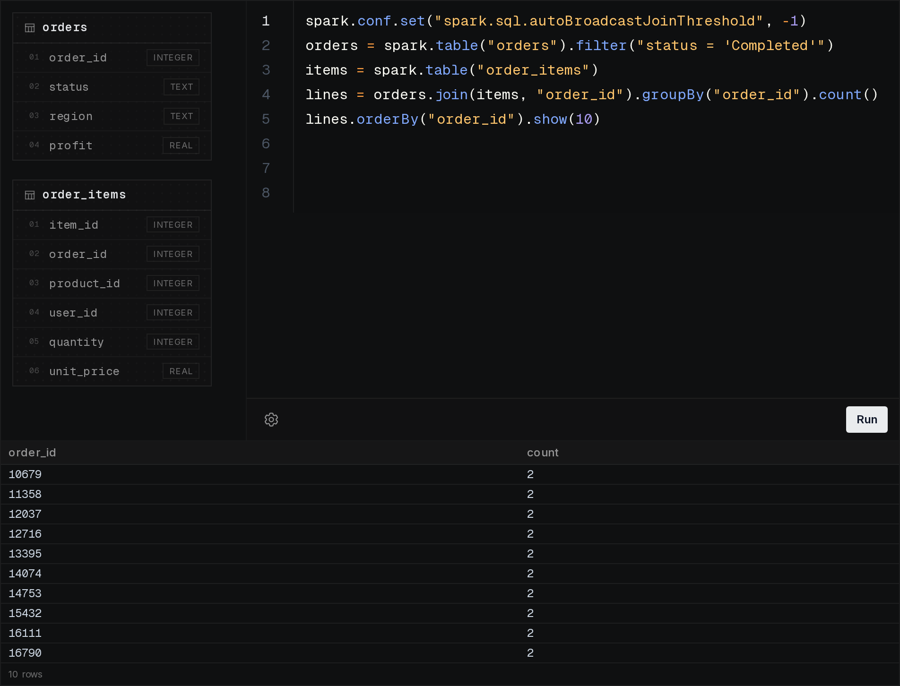
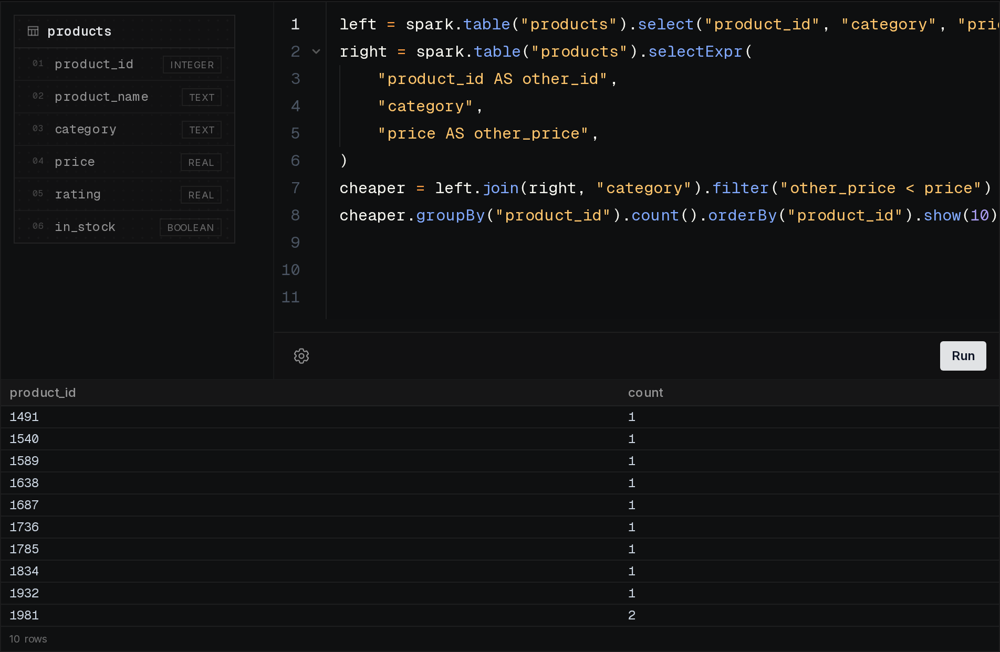
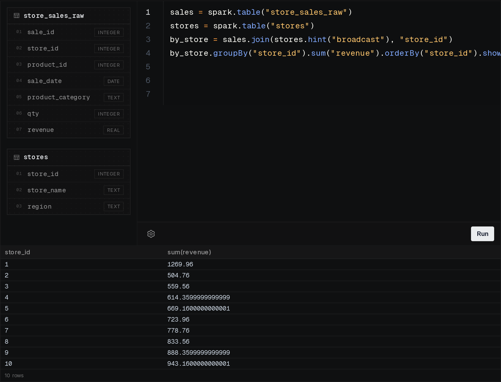
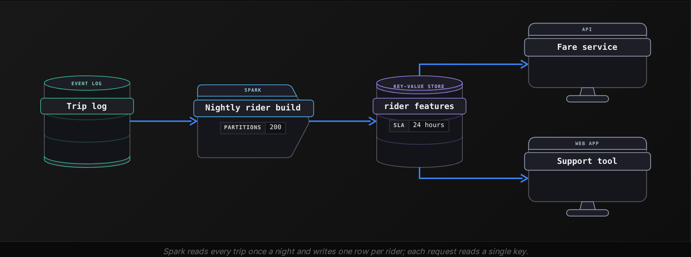

Advanced·Spark · 15 min · 16 challenges

# Joins: Advanced

Say you're on Uber's pricing data team, and the nightly job that tags each trip with the surge multiplier live when it started has crept from 20 minutes to 9 hours. Its join condition is a time range, the 8 lookup tables it enriches trips with are broadcast to 400 executors, and the product team now wants the same answer per ride, in milliseconds.


<br>

---

## Inside Sort-Merge Join

When neither side of an equi-join fits under the broadcast threshold, Spark plans a sort-merge join. It runs as 3 steps: shuffle both sides on the join key so equal keys meet on one task, sort each task's rows by key, then walk the 2 sorted runs side by side. Each step has its own cost and its own operator in the plan, so you can trace a slow sort-merge join to one of them before you change anything.


<br>

### The plan, operator by operator

This is what `explain()` prints for `clicks.join(purchases, "user_id")` with broadcast disabled, listed from the scans upward. Each side gets its own Scan, Exchange and Sort, and the 2 branches meet at the join.

| Operator | Where it runs | What it costs |
| --- | --- | --- |
| `Scan` and `Filter isnotnull(user_id)` | Map stage, one per side | Reads the input and drops NULL keys, which can never satisfy an equality |
| `Exchange hashpartitioning(user_id, 200)` | Stage boundary | Every row of that side is written to shuffle files and fetched by the reducer that owns its key |
| `Sort [user_id ASC NULLS FIRST]` | Reduce stage | Each task sorts its slice of that side, n log n work, writing sorted runs to disk if memory runs short |
| `SortMergeJoin [user_id], [user_id], Inner` | Reduce stage, same tasks as the sorts | One forward pass over both sorted slices, plus one output row per matching pair |

The `Sort` is a second sort, separate from the one inside the shuffle. Sort-based shuffle orders map output by partition ID so each reducer can find its block, and inside a block the rows arrive in whatever order the map tasks wrote them. The join needs key order, so each side gets a `Sort` in the reduce stage. That sort has to consume the whole fetched slice before the merge sees its first row.


<br>

### Counting stages and tasks

Say `clicks` is read as 40 input partitions, `purchases` as 60, and `spark.sql.shuffle.partitions` is 200. The DAGScheduler cuts the job at the 2 Exchanges, which gives 3 stages. Stage 1 scans `clicks` in 40 tasks and writes shuffle files, and stage 2 does the same for `purchases` in 60 tasks. The 200 tasks of stage 3 each fetch one partition from both sides, sort both and merge them. Stages 1 and 2 do not depend on each other, so they can run at the same time. The join costs 2 shuffles and 300 tasks.


<br>

### The merge, step by step

Each task in stage 3 holds 2 sorted iterators and treats them differently. The left side streams, one row at a time. The right side is buffered by key. When the left cursor reaches a new key, the right cursor skips smaller keys and copies every right row with an equal key into a buffer. Each left row with that key emits one joined row per buffered row. When the left key changes, the buffer is cleared and refilled.

Neither cursor moves backward, so the merge reads each input row once. The output size is a separate number: a key with 2 left rows and 3 right rows emits 6, which is the duplicate-key blowup produced inside this loop. The animation runs the plan on 4 clicks and 5 purchases with 2 shuffle partitions. Follow `u1`: its 2 clicks and 3 purchases meet on one reduce task.

https://github.com/user-attachments/assets/b38efd64-6c51-413e-94d4-4293dc2b302a

| user_id | clicks rows | purchases rows | joined rows |
| --- | --- | --- | --- |
| u1 | 2 | 3 | 6 |
| u2 | 1 | 1 | 1 |
| u3 | 1 | 0 | 0 |
| u4 | 0 | 1 | 0 |
| total | 4 | 5 | 7 |

Keys `u3` and `u4` each sit on one side only. They are shuffled and sorted like the rest, and then the merge drops them. An inner sort-merge join pays to move and sort rows that produce nothing, so a filter applied before the join trims all 3 steps.


<br>

### When a side arrives already partitioned

The plan leaves out an `Exchange` when a side's rows are already hash-partitioned on the join key into the partition count the join will use. A side produced by `repartition(200, "user_id")` qualifies, and so does the output of an earlier sort-merge join on `user_id`. Two tables bucketed on the key with the same bucket count skip both Exchanges. The join's own output is partitioned on `user_id`, so a `groupBy("user_id")` after it adds no shuffle. A `groupBy` on another column adds one.

**Both tables hold several GB. How many shuffles does this job run, and where does the groupBy execute?**

```python
spark.conf.set("spark.sql.autoBroadcastJoinThreshold", -1)
clicks_by_user = clicks.repartition(200, "user_id")
joined = clicks_by_user.join(purchases, "user_id")
joined.groupBy("user_id").count().collect()
```

- **A.** 3: one per side for the join, plus one for the groupBy in a stage of its own.
- **B.** 1: the repartition partitions both sides, so the join and groupBy share its shuffle.
- **C.** 4: the repartition, a fresh Exchange per join side, and one more for the groupBy.
- **D.** 2: the repartition for clicks and one for purchases; the groupBy runs in the join's reduce stage.

<details>
<summary>Solution</summary>

**D.** 2: the repartition for clicks and one for purchases; the groupBy runs in the join's reduce stage.

The repartition is the clicks side's shuffle and purchases gets one Exchange. The groupBy on the join key reuses the join's partitioning in stage 3.

**Why the others are wrong**

- **A.** The join's output is already hash-partitioned on user_id. That is the distribution the groupBy needs, so the planner adds no Exchange for it.
- **B.** A repartition applies only to the DataFrame it is called on. The purchases side still needs its own Exchange to reach 200 partitions on user_id.
- **C.** The clicks side already has hashpartitioning(user_id, 200), which is what the join requires, so the planner adds no second Exchange above the repartition.

</details>

Run a sort-merge join on the practice tables. Broadcast is off, so `orders` and `order_items` are both shuffled on `order_id`. The `groupBy` on the join key runs inside the join's reduce stage. Each result row is a completed order with its count of item lines.



```python
spark.conf.set("spark.sql.autoBroadcastJoinThreshold", -1)
orders = spark.table("orders").filter("status = 'Completed'")
items = spark.table("order_items")
lines = orders.join(items, "order_id").groupBy("order_id").count()
lines.orderBy("order_id").show(10)
```

Grouping the same join on another column costs one more shuffle. `groupBy("product_id")` needs its rows hash-partitioned on `product_id`, and the join leaves them partitioned on `order_id`. The plan therefore gains a third `Exchange hashpartitioning(product_id, 200)` after the `SortMergeJoin`, and the job gains a fourth stage to read it.


<br>

---

## Non-Equi Joins

A hash or sort-merge join works because equal keys can be routed to one task. Rows that might match meet there, and rows that cannot match are never compared. A range condition offers nothing to route by. Take `t.start_ts >= w.from_ts AND t.start_ts < w.to_ts`: a trip starting at 14:07 could fall in any window of the table, so no partitioning of the windows rules any of them out in advance. Spark has to test the condition on pairs.


<br>

### What Spark plans with no equality

| Situation | Physical operator | How pairs are formed |
| --- | --- | --- |
| One side under the broadcast threshold, or hinted | `BroadcastNestedLoopJoin` | The small side is copied to every executor; each task loops over its rows of the big side and, for each one, over the whole copy |
| Neither side small, inner join | `CartesianProduct` | One task per pair of partitions: 50 left and 40 right make 2,000 tasks, and each right partition is read once per left one |
| Neither side small, outer join | `BroadcastNestedLoopJoin`, forced | Spark broadcasts one side whatever its size, which can exhaust driver or executor memory |

The animation broadcasts 3 surge windows and runs 4 trips through them in 2 tasks, with start times in minutes. No shuffle happens. Each task tests each of its trips against all 3 windows: 12 comparisons to produce 4 rows.

https://github.com/user-attachments/assets/682f707e-c1ab-4152-955d-01143e6d0899

<br>

### Pricing a range join in pairs

A nested loop costs the number of pairs tested, whatever share of them match. Take a surge-pricing job: 48 million trips a day across 500 cities, with a surge window every 2 minutes in each city. That makes 720 windows per city per day and 360,000 in all. Each trip belongs to exactly one window of its own city. The range-only condition also matches it to the concurrent window in the other 499 cities, which returns about 24 billion rows, so `city_id` is needed for a correct answer as well as for speed. The 2 keyed versions below both return the right 48 million rows.

| Join condition | Windows tested per trip | Pairs tested per day |
| --- | --- | --- |
| time range only | 360,000 | 17.28 trillion |
| equal `city_id`, plus the time range | 720 | 34.56 billion |
| equal `city_id` and hour, plus the time range | 30 | 1.44 billion |

Pairs tested equal trips times the windows each trip is checked against, and every equality term cuts the second factor. One equality is enough to change the operator. Spark takes the equal columns as join keys, plans a sort-merge or broadcast hash join on them, and evaluates the range as a filter on each pair within a key group. The plan then shows a keyed operator such as `SortMergeJoin [city_id], [city_id], Inner`, with the range condition after the join type.

- **12,000x** — fewer pairs with city and hour keys


<br>

### Binning a range into a key

Time has no natural equality, so you build one. Truncate each trip's start to the hour, and give each window one row for every hour it overlaps, so a window from 13:59 to 14:01 appears under both 13:00 and 14:00. Join on city and hour, and keep the range test in the condition to drop pairs that share an hour but not a window.

```sql
trips_h = trips.withColumn("hour", F.date_trunc("hour", "start_ts"))
windows_h = surge_windows.withColumn(
    "hour",
    F.explode(
        F.sequence(
            F.date_trunc("hour", "from_ts"),
            F.date_trunc("hour", F.expr("to_ts - interval 1 microsecond")),
            F.expr("interval 1 hour"),
        )
    ),
)
priced = trips_h.join(
    windows_h,
    (trips_h.city_id == windows_h.city_id)
    & (trips_h.hour == windows_h.hour)
    & (trips_h.start_ts >= windows_h.from_ts)
    & (trips_h.start_ts < windows_h.to_ts),
)
```

The sequence ends at the hour of the window's last instant, one microsecond before `to_ts`, so a window ending exactly on the hour stays in one bin. Choose the bin from the window length. Bins much shorter than a window copy each window into many bins and inflate that side. Bins much longer leave many windows per bin and push the pair count back up. With 2-minute windows on even minutes, an hour bin copies nothing and leaves 30 windows per city-hour.

> **TIP**
>
> Before running a join whose condition has `<`, `>` or `BETWEEN` and no equality, check its operator with `explain()`. If it is `BroadcastNestedLoopJoin` or `CartesianProduct`, multiply the 2 row counts: that product is the work.

**Spark joins 2 million sessions to a 3MB table of 50,000 campaign windows on s.ts BETWEEN c.start_ts AND c.end_ts, with default settings. Which operator runs, and how many pairs does it test?**

- **A.** BroadcastNestedLoopJoin: the 3MB side is broadcast, and all 100 billion pairs are tested.
- **B.** BroadcastHashJoin: the windows are hashed, so each session costs one lookup, 2 million in all.
- **C.** CartesianProduct: every range join becomes one, testing all 100 billion pairs across tasks.
- **D.** BroadcastNestedLoopJoin: the 3MB side is broadcast, and each session is tested against its one window.

<details>
<summary>Solution</summary>

**A.** BroadcastNestedLoopJoin: the 3MB side is broadcast, and all 100 billion pairs are tested.

The table is under 10MB, so Spark broadcasts it. With no equality, each of the 2 million sessions is tested against all 50,000 windows.

**Why the others are wrong**

- **B.** A hash join needs an equality key to hash on. A BETWEEN gives it none, so the hash operators are never candidates.
- **C.** The pair count is right, but CartesianProduct is the fallback when neither side can be broadcast. This 3MB side can.
- **D.** The operator is right, but a nested loop cannot find a session's window without testing all of them: 50,000 per session.

</details>

On the practice tables, the cell below pairs each product with every cheaper product in its category. Category equality is the join key, and the price comparison runs on pairs inside each category. Replace `join(right, "category")` with `crossJoin(right)` and run it again. The counts can only grow, and so does the work, since every product is now tested against every other.



```python
left = spark.table("products").select("product_id", "category", "price")
right = spark.table("products").selectExpr(
    "product_id AS other_id",
    "category",
    "price AS other_price",
)
cheaper = left.join(right, "category").filter("other_price < price")
cheaper.groupBy("product_id").count().orderBy("product_id").show(10)
```


<br>

---

## Shuffle-Hash Join

A shuffled hash join keeps the 2 shuffles of sort-merge and replaces its 2 sorts with a hash table. Each reduce task fetches its partition of both sides and loads the smaller slice into a hash table keyed on the join key. It then streams the larger slice through that table, probing once per row. Nothing waits for a sort, and no key order is needed.

| ✓ Sort-merge join, per reduce task | ✗ Shuffled hash join, per reduce task |
| --- | --- |
| • Fetches its slice of both sides<br><br>• Sorts both slices by key<br><br>• Merges them in one forward pass<br><br>• Can write sorted runs to disk when memory runs short<br><br>• The planner's default for large equi-joins | • Fetches its slice of both sides<br><br>• Builds a hash table from the smaller slice<br><br>• Probes it once per row of the larger slice<br><br>• Needs the whole build slice in memory at once<br><br>• Chosen by a hint or by changing a default |


<br>

### How it gets into a plan

Spark plans a shuffled hash join in 2 cases

- You put a shuffle_hash hint on one side, as in drivers.hint("shuffle_hash"). For an inner join, the hinted side becomes the build side.
- You set spark.sql.join.preferSortMergeJoin from its default true to false, and the smaller side is estimated under autoBroadcastJoinThreshold times spark.sql.shuffle.partitions, 10MB times 200 = 2,000MB with defaults, and at least 3 times smaller than the other side.

The 2,000MB test averages out to 10MB per reducer, and that average assumes the build side's keys spread evenly over 200 partitions. Hash partitioning sends every row of a key to one task, so the estimate says nothing about the largest slice. To confirm the choice, look for `ShuffledHashJoin [driver_id], [driver_id], Inner, BuildRight` in the plan, with an `Exchange` under each side and no `Sort` above either.

```sql
priced = trips.join(drivers.hint("shuffle_hash"), "driver_id")
priced.explain()
```


<br>

### When dropping the sort wins

Take 60GB of trips joined on `driver_id` to a 600MB `drivers` table with one row per driver, over 200 partitions. Each reduce task receives around 300MB of trips and 3MB of drivers. Sort-merge sorts both slices before its first match. The hash join builds a 3MB table and streams the 300MB through it unsorted. Shuffle bytes are the same either way, so the saving is the sort of 60GB of rows, spread over 200 tasks, on every run.


<br>

### The memory bet

The saving holds only if every task's build slice, as a hash table, fits in the memory the task can use. An executor with 4 cores runs 4 tasks at once, and they share its memory. Sort-merge degrades when memory is short, writing sorted runs to disk and reading them back. The hash table in this operator has no disk fallback, so a slice that does not fit fails the task with an out-of-memory error.

| Build side | Rows per key | Average slice | Largest slice | Result |
| --- | --- | --- | --- | --- |
| `drivers`, 600MB | 1 | 3MB | about 3MB | Faster than sort-merge |
| `city_fares`, 1.6GB | one city holds 25% | 8MB | 400MB or more | The task holding that city fails |

In the second row the bet is lost. Every row of the large city hashes to one partition, so one task must build a hash table of at least 400MB while the other 199 build around 8MB each. A retry reads the same partition and fails the same way. After `spark.task.maxFailures` attempts, 4 by default, the job fails. Without the hint, sort-merge would have finished that task slowly, sorting the slice partly on disk.

**A join hinted shuffle_hash on city_fares (1.6GB, 200 shuffle partitions) fails: task 137 runs out of memory on all 4 attempts while the other 199 tasks succeed. What is the cause, and what fixes it?**

- **A.** Task 137 streams too many trips; moving the hint to trips makes the large side the build side.
- **B.** The disk on task 137's host is failing; speculative execution would rerun it elsewhere.
- **C.** Task 137 holds the large city's 400MB build slice; dropping the hint lets sort-merge finish it.
- **D.** The build side broke the 2,000MB rule; raising shuffle partitions to 400 splits the city in 2.

<details>
<summary>Solution</summary>

**C.** Task 137 holds the large city's 400MB build slice; dropping the hint lets sort-merge finish it.

All of one key's rows hash to one task, so its hash table outgrows that task's memory. Sort-merge sorts the same slice with disk as a fallback.

**Why the others are wrong**

- **A.** Task 137 fails while building, before streaming matters. Making 60GB of trips the build side raises the memory every task needs.
- **B.** All 4 attempts failed with the same out-of-memory error, which follows the partition's data to whatever host runs it.
- **D.** The table is 1.6GB, under 2,000MB, and one key is never split: at 400 partitions the whole city still lands on one task.

</details>

Spark reads 4 join hints, one per strategy: `broadcast` plans a broadcast hash join, `merge` a sort-merge join, `shuffle_hash` a shuffled hash join, and `shuffle_replicate_nl` a `CartesianProduct`. For broadcast and shuffled hash, the hinted side is the one built into a hash table. When the 2 sides carry different hints, `broadcast` wins over `merge`, `merge` over `shuffle_hash`, and `shuffle_hash` over `shuffle_replicate_nl`. A hint the join cannot honour, such as `shuffle_hash` on a condition with no equality, is dropped with a warning in the driver log.


<br>

---

## The Broadcast Storm

A broadcast hash join drops the shuffle of the big side and sets up a different kind of traffic. The driver runs a separate job to collect the small side, builds a hash table from its rows, and ships that table to every executor. Torrent broadcast cuts it into 4MB blocks (`spark.broadcast.blockSize`) that executors fetch from the driver and from each other, which spreads the sending load. Each executor still receives the full table once, and all of its tasks share that copy.


<br>

### Bytes on the wire

One broadcast therefore puts about table size times executor count on the network. A shuffle-based join moves each side once: big side plus small side. Add executors and the first number grows while the second stays put. Here are lookup tables from a trip pricing job on 400 executors, each joined to 60GB of trips.

| Lookup table | Size | Broadcast to 400 executors | Shuffle both sides |
| --- | --- | --- | --- |
| `cities` | 2MB | 0.8GB | 60GB |
| `promos` | 120MB | 48GB | 60.1GB |
| `drivers` | 600MB | 240GB | 60.6GB |
| `riders` | 900MB | 360GB | 60.9GB |

Setting the 2 costs equal gives the break-even size: 60GB divided by 399, about 150MB. Below it, broadcasting a table moves fewer bytes than shuffling the trips; above it, more. Network is one axis. The shuffle also writes the trips to disk and sorts them, so a broadcast a little past break-even can still finish first. At 6 times past it, `riders` sends about 300GB more than the shuffle would.


<br>

### A threshold raised to rescue one join

A storm usually starts with a threshold raised to rescue one join. Someone sets `autoBroadcastJoinThreshold` to 1GB so `riders` broadcasts, and every lookup table under 1GB broadcasts along with it. The pricing job joins trips to 8 of them: `riders` 900MB, `drivers` 600MB, `payment_methods` 400MB, `vehicles` 250MB, `promos` and `fare_rules` 120MB each, `zones` 8MB and `cities` 2MB, 2.4GB in all. Each executor holds all 8 hash tables at once, and the driver collects and builds each one before sending it.

- **960GB** — received by executors per run
- **860GB** — of it from the 4 tables past break-even

Those bytes repeat. Each action runs the plan again, broadcasts included, so a job that writes the result and then counts it pays twice. A backfill loop that runs the join once per hour pays once per hour. Because the cost is per executor, the broadcast phase also gets longer every time the cluster grows, which is the opposite of what more executors do for a shuffle.


<br>

### Recognising a storm

- explain() shows a BroadcastExchange per table, and a short job per broadcast runs before the main job
- The query fails with Could not execute broadcast in 300 secs, the default spark.sql.broadcastTimeout
- The driver runs out of memory while collecting a small side, before any big-side task starts
- Executors fail with out-of-memory errors as the join stage starts, holding every broadcast table at once
- The broadcast phase slows down each time executors are added

| ✓ Do | ✗ Don't |
| --- | --- |
| • Price a broadcast as table size times executor count and compare it with the shuffle it replaces<br><br>• Filter and select columns on a lookup table before the join so fewer bytes are copied<br><br>• Hint broadcast on tables under the break-even size and keep the threshold at 10MB<br><br>• Recount broadcast bytes whenever the executor count changes | • Raise autoBroadcastJoinThreshold for the whole job to rescue one slow join<br><br>• Raise spark.sql.broadcastTimeout to hide a broadcast that is too large<br><br>• Run a broadcast join inside a loop of actions without counting the repeats<br><br>• Assume a table's size on disk equals the memory its hash table takes |

**A job joins a 250MB vehicles table to 40GB of ratings on 300 executors. Counting network bytes only, which strategy moves less?**

- **A.** Broadcast: 250MB is sent once and shared, so about 250MB crosses the network.
- **B.** Sort-merge: about 40.25GB moves, against about 75GB for the broadcast.
- **C.** Broadcast: about 75GB, against 80.5GB, since sort-merge moves each side twice.
- **D.** Neither: torrent broadcast sends each 4MB block once, so both move about 40GB.

<details>
<summary>Solution</summary>

**B.** Sort-merge: about 40.25GB moves, against about 75GB for the broadcast.

Each side is shuffled once: 40GB plus 250MB. The broadcast sends 250MB to each of 300 executors, well past this cluster's break-even of about 134MB.

**Why the others are wrong**

- **A.** Every executor receives its own copy, so the cost is 250MB times 300, about 75GB.
- **C.** The 75GB is right, but a shuffle carries each row across the network once, so sort-merge moves roughly 40.25GB.
- **D.** Torrent spreads who sends the blocks, but every executor still receives all of them: 250MB times 300 executors.

</details>

On the practice tables, `stores` is small enough to broadcast. Run the cell, then change the hint to `"merge"` and run it again; the rows match. The plan is what changes. With `broadcast`, `explain()` shows a `BroadcastExchange` over the `stores` scan and no Exchange between the `store_sales_raw` scan and the join, so the network carries `stores` once per executor. With `merge`, an `Exchange hashpartitioning(store_id, 200)` sits under each side, and every sales row crosses the network once. On 400 executors, the first plan sends 400 copies of `stores` and the second sends the sales table once.



```python
sales = spark.table("store_sales_raw")
stores = spark.table("stores")
by_store = sales.join(stores.hint("broadcast"), "store_id")
by_store.groupBy("store_id").sum("revenue").orderBy("store_id").show(10)
```


<br>

---

## When Not to Join in Spark

Spark's join cost follows the bytes it reads. A sort-merge or broadcast join reads both sides in full, less whatever partition pruning removes, which suits work where most rows on both sides reach the output. When the work is fetching a few thousand rows by key from a table of billions, an index or a key-value store reads those rows and nothing else, and its cost follows the number of keys.


<br>

### Same question, 2 cost curves

A support tool flags 5,000 trips today and needs each rider's history from a table of 2 billion rows at about 200 bytes each.

| Measure | Spark join | Key-value lookups |
| --- | --- | --- |
| Rows read | 2 billion, the whole history | 5,000 |
| Bytes read | 400GB | about 1MB |
| Cost grows with | table size | keys requested |
| Smallest possible latency | job startup plus a full scan | one round trip per key or batch of keys |

The Spark job can broadcast the 5,000 keys and skip the big shuffle, and it still scans 400GB to find 5,000 rows. Unless the history's layout lets pruning skip files for those keys, every file is opened. The crossover sits where the keys you need cover a large share of the table: fetching 500 million rows by key would mean 500 million round trips to read 100GB that one scan reads sequentially.


<br>

### Signs the join belongs in a store

- The driving side is tiny next to the lookup side: thousands of keys against billions of rows
- The answer is needed per request or per event, within milliseconds of a user acting
- The same keyed lookup runs many times a day against a table that changes slowly
- Each run reads the big side whole and keeps a tiny fraction of it


<br>

### Spark builds, the store serves

Most of these cases still need Spark for the half that touches every row. A nightly job aggregates all trips per rider, a sort-merge join plus a `groupBy` over the full history, and writes one row per `rider_id` into a key-value store. The fare service and the support tool then read single keys. The join that reads everything runs once in batch, and the lookups that read one row run in the store.




<br>

### The reverse mistake

The opposite error is calling the store from inside a Spark transformation, one request per row. Enriching 48 million trips that way makes 48 million round trips from the executors, capped by what the store can serve, and a retried task repeats its calls. When most keys are needed, export a snapshot of the store's table and join it in Spark, which reads it once in bulk.

> Where the join runs
>
> - Most rows of both sides reach the output: join in Spark.
> - A few thousand keys from a huge table, in batch: prune with the table's layout, or query an index.
> - An answer per request or per event: precompute in Spark, serve from a key-value store.
> - Millions of keys per run: join a bulk snapshot in Spark, never per-row calls.

**A fraud check must attach a card's 30-day spend to each incoming payment within 50 milliseconds. Spend comes from a 3-billion-row payment history. How should the work be split?**

- **A.** A Spark job runs per payment and joins it to the history on card_id, returning the sum.
- **B.** Broadcast the payment history to the fraud service, which joins each payment against it.
- **C.** The key-value store holds raw payments and sums a card's last 30 days on each request.
- **D.** Spark computes 30-day spend per card in batch and writes it keyed by card; the check reads one key.

<details>
<summary>Solution</summary>

**D.** Spark computes 30-day spend per card in batch and writes it keyed by card; the check reads one key.

The join and aggregation over 3 billion rows run once in Spark, and each payment then costs one keyed read.

**Why the others are wrong**

- **A.** Each run reads the history, so every payment pays for a scan of 3 billion rows, far past a 50-millisecond budget.
- **B.** A broadcast copies a table to the executors of one Spark job. The history is far too large to copy, and the fraud service runs outside Spark.
- **C.** The store is the right place to read from, but summing raw rows per request makes each read scan a card's history. Precompute the sum.

</details>


<br>

---

## Putting It All Together

Back on Uber's pricing team, the 9-hour nightly job is taken apart join by join. The surge join gains city_id and an hour bin, so a nested loop over 17.28 trillion pairs becomes a keyed join testing 1.44 billion. The threshold goes back to 10MB: promos and fare_rules, under the 150MB break-even, keep an explicit broadcast hint, while riders, drivers, payment_methods and vehicles move to shuffled joins, replacing 860GB of broadcast traffic with about 242GB of shuffles. The drivers join gets a shuffle_hash hint because each of its 200 slices holds about 3MB, and city_fares keeps sort-merge because one city holds 25% of its rows. The per-ride fare request leaves Spark entirely: the nightly job writes one row per rider to a key-value store, and the app reads one key per ride.

- Sort-merge internals show that each keyed join on a new key shuffles the trips again, so joins that share a key run back to back reuse one partitioning.
- Binning turned the non-equi surge join into a keyed join, which is what made sort-merge, broadcast hash and shuffled hash available to it at all.
- The shuffled hash bet is placed per slice: the same hint is safe on drivers and fatal on city_fares .
- Broadcast cost scales with executors and shuffle cost with data, so the 150MB break-even moves every time the cluster is resized.
- The per-ride answer is the same join run once in bulk and then served by key, so Spark does the full read and the store does the single-row reads.


<br>

---

## Key Takeaways

- A sort-merge join costs 2 shuffles, 2 sorts and 1 forward merge, and an Exchange disappears when a side already arrives hash-partitioned on the key with the same partition count.
- A join condition with no equality runs as BroadcastNestedLoopJoin or CartesianProduct and costs rows times rows; one equality term, even a binned hour, turns it back into a keyed join.
- A shuffled hash join keeps the shuffles and drops the sorts, betting that every build slice fits in a task's memory; a key that breaks the bet fails the task on every retry.
- A broadcast costs about table size times executor count on the network, so past a break-even size it moves more bytes than the shuffle it replaced.
- When a run needs a few keys from a huge table, or an answer per request, precompute in Spark and serve from an index or key-value store.
