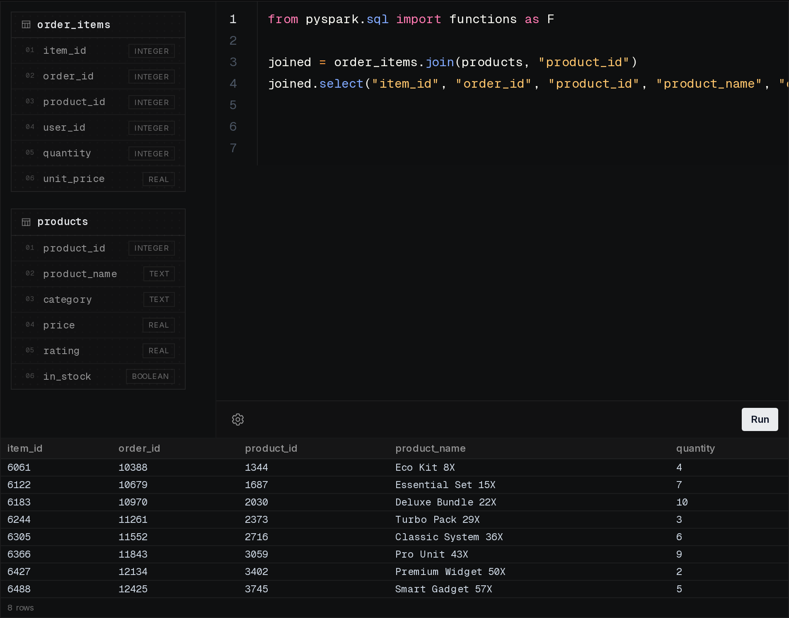
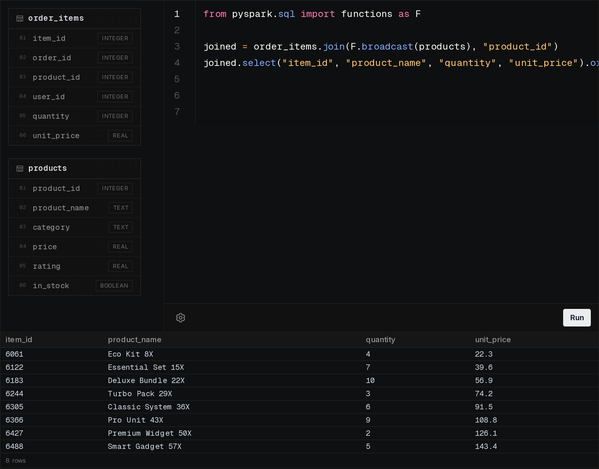
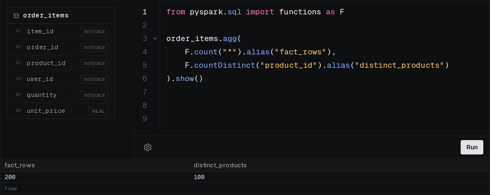
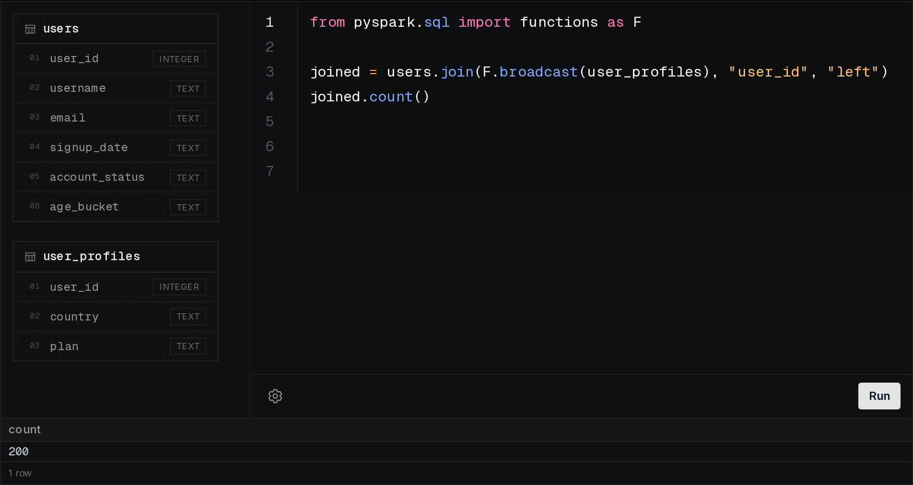
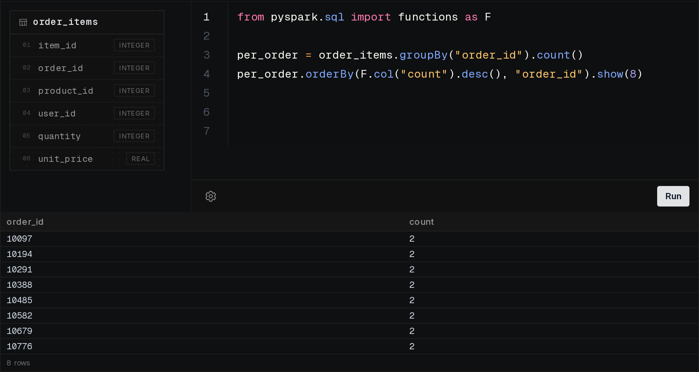

Beginner·Spark · 13 min · 17 challenges

# Joins: Beginner

At Spotify, a data engineer builds Brazil's daily top artists by joining a day of stream events to a lookup of the few thousand artists eligible for the chart. The events table is vast; the lookup is a few MB. Written one way, the job pushes every event across the cluster and runs for an hour. Written another, it ships the lookup to each executor and the events never move.


<br>

---

## Why a Join Moves Data

### Matching rows that live on different machines

A join pairs each row of one table with the rows of another that share a key. `orders.join(products, "product_id")` pairs order 1, which carries product 4017, with the one `products` row whose `product_id` is 4017. To build that pair, the 2 rows have to be in the same place at the same moment: inside one task, on one executor, in memory together.

Before the join, nothing has put them there. Spark read `orders` as 2 partitions by cutting its file at a byte offset, and read `products` as 2 partitions the same way. Which partition holds order 1 depends on where that row sat in the orders file, and which partition holds product 4017 depends on where it sat in the products file. The 2 rows land on whichever executors picked up those partitions, and the placement of one says nothing about the placement of the other.

A join is therefore a wide transformation on both of its inputs. Spark hashes the join key of every `orders` row and sends the row to the shuffle partition that hash selects, then does the same to every `products` row with the same hash function and the same number of partitions. Afterwards every row carrying `product_id` 4017, whichever table it came from, sits in one partition, and a single task can walk through that partition and emit each match.

| product_id | orders rows that carry it | products row | matches emitted |
| --- | --- | --- | --- |
| 4017 | order_id 1, 3, 6 | Desk lamp | 3 |
| 2210 | order_id 2, 5 | Notebook | 2 |
| 3305 | order_id 4 | Headphones | 1 |
| total | 6 rows | 3 rows | 6 |

The first line of the program below turns off Spark's automatic broadcasting, so that the join you watch is the shuffle version. Section 1 explains what that setting does when it is left alone. Watch for 2 shuffles, one per table, before any output row appears, and notice that each output row is built inside the task that received both of its halves.

https://github.com/user-attachments/assets/93b1dffb-3f51-4279-9aa9-436df7837979

<br>

### What the shuffle costs

Both tables cross the network. The tasks that read `orders` write every row to local disk, grouped by destination partition; the tasks that read `products` do the same; then the join tasks pull their partition's rows from every one of those writers. A join of a 200GB table to a 50GB table writes 250GB of shuffle data and reads 250GB back, and the reading side waits for the slowest writer to finish before it starts.

Inside each shuffle partition, Spark sorts both sides by the key and then merges them, advancing through 2 sorted lists the way you would merge 2 sorted decks of cards. That strategy is called sort-merge join, and it is what Spark falls back to whenever it has no reason to choose anything cheaper. It handles tables of any size, because no table ever has to fit in one executor's memory, and that generality is what the 2 shuffles pay for.

> What the Spark UI shows for a sort-merge join
>
> - 2 stages upstream of the join, each with Shuffle Write close to the size of the table it read.
> - 1 join stage whose Shuffle Read is about the sum of those 2 writes.
> - A join stage far slower than its shuffle volume suggests usually has 1 task reading much more than the rest: 1 key holds most of the rows.

**A job joins clicks, 400GB, to sessions, 100GB, on session_id, and neither side is small enough to broadcast. How much shuffle data does the job write before the join tasks run?**

- **A.** 400GB, because only the larger table has to move to meet the smaller one
- **B.** 500GB, because both tables are hashed on session_id and written out in full
- **C.** 100GB, because Spark moves the smaller table to where the larger one already sits
- **D.** 0GB, because a join on a shared key is a narrow transformation over both inputs

<details>
<summary>Solution</summary>

**B.** 500GB, because both tables are hashed on session_id and written out in full

Every row of both inputs is written to shuffle files grouped by destination partition: 400GB from clicks plus 100GB from sessions, then all of it is read back by the join tasks.

**Why the others are wrong**

- **A.** Spark placed each table's rows without regard to where the other table's rows sit. Both are hashed on session_id and both are written out, so the smaller table moves too.
- **C.** That describes a broadcast, which the question rules out. In a sort-merge join the larger table is hashed and written as well.
- **D.** A join is wide on both sides. Matching rows start in unrelated partitions and have to be brought together through a shuffle.

</details>

The cell below joins the seed's `order_items` fact table to its `products` dimension on `product_id`. Spark picks a strategy on its own here; the next section shows which and why. Run it and read the first row: its `item_id` and `quantity` came from `order_items`, its `product_name` came from `products`, and the join put them side by side because both carry the same `product_id`. Each item appears once, as each of orders 1 to 6 did in the table above, because every `product_id` matches a single `products` row.



```python
from pyspark.sql import functions as F

joined = order_items.join(products, "product_id")
joined.select("item_id", "order_id", "product_id", "product_name", "quantity").orderBy("item_id").show(8)
```


<br>

---

## Broadcasting the Small Side

### Move the small table, leave the big one

In the example, `products` has 3 rows and `orders` has 6. Shuffling `orders` to meet `products` costs the same as shuffling `orders` for any other purpose: every row written to disk, every row read back over the network. There is another way to get the matching rows into one task. Leave every `orders` partition where it is, and send the entire `products` table to every executor. Each task that holds an `orders` partition then has all 3 products in front of it and finds each order's product with a local hash lookup.

That is a broadcast join. The driver collects the small table, builds a hash table keyed on `product_id`, and sends 1 copy to each executor. The big table's partitions never move, so the join runs as a narrow transformation over `orders`, inside the same stage as whatever transformation came before it. The 2 shuffles of the previous section are gone, and so is the sort: a hash lookup needs no sorted input.

`F.broadcast(products)` is a hint that tells Spark to broadcast that side whatever it estimates the size to be. Watch the animation below: `products` leaves its partitions once, arrives whole at every `orders` task, and the output appears without any row of `orders` changing executor.

https://github.com/user-attachments/assets/a74853f1-1624-4df3-8b56-568d55304831

<br>

### What the broadcast costs instead

A broadcast has its own bill. The small table travels once to each executor, and each executor keeps a hash table of it in memory for the length of the stage. A 20MB dimension on a cluster of 50 executors therefore crosses the network 50 times, and each of the 50 executors holds 20MB more than it otherwise would. Set that against shuffling a 200GB fact table, where every byte is written to disk and read back, and the broadcast is the smaller number by a factor of a few hundred.

- **1GB** — network traffic to broadcast it
- **400GB** — shuffle traffic for the fact table


<br>

### When Spark broadcasts without being asked

You do not always need the hint. Before choosing a strategy, Spark estimates the size of each side. If one side's estimate is under `spark.sql.autoBroadcastJoinThreshold`, which defaults to 10MB, Spark broadcasts that side on its own. That is what the `-1` in section 0 switched off: setting the threshold to `-1` tells Spark that no table is small enough, so both sides shuffle. The estimate comes from the files Spark reads, and after a filter or an aggregation it can be far from the truth, so those are the joins where you add the hint yourself.

> **TIP**
>
> Write `F.broadcast()` around the side you know is small when the planner cannot know it: a filtered table, the output of an aggregation, or a table read from a source that reports no size. Leave it off when the table is read straight from files under the threshold; Spark finds those on its own.

**events is 200GB and countries is 5MB, both read from files with default settings. How many shuffles does events.join(countries, "country_code") add to the job?**

- **A.** 1, because events is hashed on country_code to meet the broadcast copy
- **B.** 2, because a join always hashes both sides on the key before matching them
- **C.** 0, because countries is under the threshold and is broadcast to every executor
- **D.** 1, because countries is shuffled to the partitions that hold the events rows

<details>
<summary>Solution</summary>

**C.** 0, because countries is under the threshold and is broadcast to every executor

5MB is below the 10MB default, so Spark broadcasts countries without a hint. events stays in place and the join runs as a narrow step over it.

**Why the others are wrong**

- **A.** The broadcast copy goes to the executors that already hold events. Nothing about events needs to move, so no shuffle of it happens.
- **B.** That is the sort-merge path, which Spark takes only when neither side is under the threshold. A 5MB table is under it.
- **D.** A broadcast sends the whole table to every executor rather than splitting it by key. A shuffle would put each country on exactly 1 partition, which could not serve every events partition.

</details>

Run the same fact-to-dimension join as before, now with the hint on `products`. The rows that come back are identical; what changed is where the work happened. `order_items` stayed in its partitions and `products` travelled to them.



```python
from pyspark.sql import functions as F

joined = order_items.join(F.broadcast(products), "product_id")
joined.select("item_id", "product_name", "quantity", "unit_price").orderBy("item_id").show(8)
```


<br>

---

## Which Side Is Small Enough

### Dimension tables broadcast, fact tables do not

Almost every join pairs a fact table with a dimension table. Fact tables record events: orders placed, pages viewed, payments settled, ads clicked. They gain a row per event, so they grow with traffic, and they run to billions of rows. Dimension tables describe the entities events refer to: products, stores, customers, currencies, device types. They gain a row when the business adds a product or opens a store, so they grow with the business, and most stay small for years. A fact joined to a dimension is the most common join you will write, and the dimension is the broadcast candidate.

| Table | Kind | Rows | In memory | Broadcast? |
| --- | --- | --- | --- | --- |
| page_views | fact | 40 billion | 4TB | No |
| orders | fact | 2 billion | 300GB | No |
| customers | dimension | 80 million | 8GB | No |
| products | dimension | 200,000 | 40MB | Yes |
| stores | dimension | 3,000 | 600KB | Yes |
| currencies | dimension | 180 | under 20KB | Yes |

The `customers` row is the one to study. It is a dimension by nature, 1 row per customer, and it still cannot be broadcast, because 80 million rows at 100 bytes each is 8GB, and sending 8GB to every executor and holding it in each one's memory would cost the cluster more than a shuffle would. Being a dimension tells you where to look for a broadcast candidate; the size decides whether it qualifies.


<br>

### Size means size in memory

The size that matters is the table as it will sit in an executor's memory, built into a hash table, and that is larger than the file on disk. Files are compressed and encoded column by column; the same rows decoded into in-memory objects take 3 to 5 times the space. A 10MB file can become a 40MB broadcast. The driver has to hold the table too, because it collects the rows before sending them, so a broadcast that fits the executors but overflows the driver fails anyway.

A quick estimate is rows multiplied by average row width. A catalog of 200,000 products at 200 bytes each is 40MB: fine to broadcast and fine to hold on every executor. A table of 80 million customers at 100 bytes is 8GB: shuffle it. For anything in between, in the hundreds of MB, the broadcast works on a cluster with roomy executors and fails with an out-of-memory error on a tight one, so check the executor memory before you add the hint.


<br>

### A filter can make a candidate

Size is measured at the join, after whatever transformations came before it. `users` with 50 million rows is too big to broadcast. `users` filtered to the 20,000 who signed up this week is a few MB, and broadcasting it is right. Spark's estimate, though, may still be the full table's, because the estimate came from the files and the filter happened after the read. This is the case the hint exists for: you know the filtered side is small, and Spark does not.

```sql
new_users = users.filter(F.col("signup_date") >= "2024-03-08")
joined = user_events.join(F.broadcast(new_users), "user_id")
```

| ✓ Broadcast this side | ✗ Shuffle both sides |
| --- | --- |
| • A dimension or lookup table<br><br>• Tens of MB in memory, a few hundred at most<br><br>• Row count stable from month to month<br><br>• A table you filtered down to a known small set | • A fact or event table<br><br>• Both sides over the threshold<br><br>• A dimension so large it rivals the fact, like 80 million customers<br><br>• A side whose size you have not checked |

**You join payments, 900 million rows, to merchants, 120,000 rows, on merchant_id. Spark reads merchants as 30MB of files, which build into roughly 120MB in memory, and the threshold sits at its default. Which call gives you a broadcast join?**

- **A.** payments.join(F.broadcast(merchants), "merchant_id") with the hint on the dimension
- **B.** payments.join(merchants, "merchant_id") and rely on the default threshold
- **C.** merchants.join(F.broadcast(payments), "merchant_id") with the hint on the fact
- **D.** payments.join(merchants, "merchant_id") after setting the threshold to -1

<details>
<summary>Solution</summary>

**A.** payments.join(F.broadcast(merchants), "merchant_id") with the hint on the dimension

merchants is a dimension of roughly 120MB in memory, which an executor holds without trouble, and the hint makes Spark broadcast it although its 30MB file size is above the threshold. payments never moves.

**Why the others are wrong**

- **B.** Spark's estimate comes from the files, and 30MB is above the 10MB default, so it judges merchants too large and plans a sort-merge join with 2 shuffles.
- **C.** The hint is on the 900 million row side. Spark would try to collect payments on the driver and ship it everywhere, which fails long before the join runs.
- **D.** At -1 the threshold rules out every broadcast Spark would pick for itself, which forces the shuffle you are trying to avoid.

</details>

The seed's `order_items` is a fact table and `products` a dimension. The cell counts the fact rows and the distinct products they reference. The second number is bounded by the size of the dimension however many events pile up on the fact side, and that bound is why the dimension is the side to broadcast.



```python
from pyspark.sql import functions as F

order_items.agg(
    F.count("*").alias("fact_rows"),
    F.countDistinct("product_id").alias("distinct_products")
).show()
```


<br>

---

## Join Type vs Join Strategy

### The type is yours, the strategy is Spark's

Every join carries 2 independent decisions. The join type is yours, written as the third argument: `"inner"`, `"left"`, `"right"`, `"full"`, `"left_semi"` or `"left_anti"`. It defines which rows the result contains. The join strategy is Spark's, chosen while planning: broadcast or sort-merge, with the rules of the previous 2 sections deciding which. It defines how the matching rows are brought together and how much data moves. Change the type and the result changes; change the strategy and the result stays the same while the stages and shuffles change.

| Type | Rows in the result | A question it answers |
| --- | --- | --- |
| inner | Pairs that match on the key | Which orders have a product in the catalog? |
| left | Every left row, with right columns or nulls | Every order, with its product where the catalog has one |
| right | Every right row, with left columns or nulls | Every product, with its orders where any exist |
| full | Every row from both sides, matched where possible | Orders and products together, nothing dropped |
| left_semi | Left rows that have a match, left columns only | Which orders reference a catalog product? |
| left_anti | Left rows that have no match | Which orders reference a product missing from the catalog? |

Strategy sits on the other axis. The same `orders.join(products, "product_id", "left")` returns the same rows whether Spark broadcasts `products` or shuffles both sides; the row count, the nulls, and the column values do not depend on the strategy. What depends on it is the plan: 0 shuffles and a single stage, or 2 shuffles and 3 stages.


<br>

### The one place the axes touch

A broadcast join can only broadcast the side whose unmatched rows the join type is allowed to drop. Take the left join above. Every `orders` row must appear, matched or not. An executor holding a partition of `orders` can produce that correctly only if it has the whole of `products`, because a product missing from a partial copy might exist on another executor. Broadcasting `products` gives every executor the whole copy, so it works. Broadcasting `orders` would not, since an executor holding part of `products` could not tell a true non-match from a match it cannot see. So a left join broadcasts only its right side, a right join only its left side, and a full outer join neither: full outer joins run as sort-merge.

If you hint the side the type forbids, Spark drops the hint and shuffles. A left join that stays slow after you added `F.broadcast()` deserves a second look at which side the hint is wrapped around.


<br>

### Debug each axis on its own

When a join misbehaves, name the symptom first, because the 2 axes have different tools. Wrong rows in the result point at the type and the keys: an inner join where a left join was meant drops rows, a key column with nulls drops rows in an inner join because a null never equals a null, and a duplicated key multiplies rows, which the next section covers. A slow join points at the strategy. `explain()` names it on the join's own line of the physical plan, and each shuffle shows up as an `Exchange hashpartitioning` beneath the join.

| Line in the physical plan | What it tells you |
| --- | --- |
| SortMergeJoin or BroadcastHashJoin | The strategy Spark chose for this join |
| Exchange hashpartitioning on product_id | A shuffle of 1 side on the key: 2 beneath a sort-merge join, none beneath a broadcast join |

| ✓ Rows are wrong | ✗ Rows are right but slow |
| --- | --- |
| • Check the join type argument<br><br>• Check for nulls in the key column<br><br>• Check for duplicate keys on either side<br><br>• Changing the strategy will not change a row | • Run explain() and find the join line<br><br>• Count the Exchange lines beneath it<br><br>• Ask whether a side is small enough to broadcast<br><br>• Changing the type would change the answer |

**events.join(users, "user_id", "left") returns the rows you expect but runs for 40 minutes, and explain() shows SortMergeJoin with 2 Exchange lines. users is around 30MB in memory. Which change speeds it up without changing a single result row?**

- **A.** Change the type: events.join(users, "user_id", "inner") to skip the unmatched rows
- **B.** Wrap the left side: F.broadcast(events).join(users, "user_id", "left")
- **C.** Raise spark.sql.shuffle.partitions so the shuffle spreads across more tasks
- **D.** Wrap the right side: events.join(F.broadcast(users), "user_id", "left")

<details>
<summary>Solution</summary>

**D.** Wrap the right side: events.join(F.broadcast(users), "user_id", "left")

A left join may broadcast its right side, 30MB fits comfortably in each executor, and both Exchange lines disappear. The rows are the same because strategy never changes the result.

**Why the others are wrong**

- **A.** An inner join drops every event whose user is missing from users. The result changes, and both shuffles stay in the plan.
- **B.** A left join can broadcast only its right side, so Spark drops this hint, and events is the large table besides.
- **C.** More tasks still shuffle the same bytes of both tables. The volume that makes the join slow is untouched.

</details>

The cell runs a left join of `users` to `user_profiles` with the right side broadcast, which the type allows, and returns its row count: every user, with `country` and `plan` null where no profile exists. Note the number, change `"left"` to `"inner"`, and run again. Each user without a profile drops out and the count falls by that many, while the strategy, a broadcast of `user_profiles`, stays put.



```python
from pyspark.sql import functions as F

joined = users.join(F.broadcast(user_profiles), "user_id", "left")
joined.count()
```


<br>

---

## The Duplicate-Key Blowup

### One key, 2 rows, double the output

Give `products` a `version` column and let product 4017 carry 2 rows: version 1 priced at 25 and version 2 priced at 27. The catalog now has 4 rows for 3 products. Join `orders`, 5 rows, to it on `product_id` and count the result. Order 1 carries 4017 and matches both versions, producing 2 output rows. Order 3 carries 4017 and does the same. Orders 2, 4 and 5 each match 1 catalog row. The result has 7 rows from 5 orders, and nothing in the code hints that anything multiplied.

| product_id | orders rows | products rows | output rows |
| --- | --- | --- | --- |
| 4017 | 2 | 2 | 4 |
| 2210 | 2 | 1 | 2 |
| 3305 | 1 | 1 | 1 |
| total | 5 | 4 | 7 |

The rule behind the table: for each key, the output holds left rows times right rows. A key that is unique on the right contributes exactly its left count, 2 rows on the right double that count, and 3 rows on each side turn 6 input rows into 9 output rows. In the program below, `products` is 4 rows, far under the threshold, so Spark broadcasts it. Watch the 2 `orders` that carry 4017: each one meets both versions in its task's copy of the catalog and emits 2 rows.

https://github.com/user-attachments/assets/691dcf49-feb1-4172-841d-37e50f45a70c

<br>

### Why it hurts at scale

Getting 7 rows from 5 is a 40% inflation, and every total built on the result is wrong: quantity summed over the join counts orders 1 and 3 twice. Scale that to production. A fact table of 2 billion orders joined to a catalog that averages 3 versions per product comes out at 6 billion rows. The join's own shuffle is unchanged: it moves the 2 billion orders and the catalog as they are, and the multiplication happens afterwards, inside the join tasks. Everything downstream pays for it. The join tasks emit 3 times the rows, a later aggregation reads 3 times the rows, the written result is 3 times the size, and its totals are 3 times too high in a way no single row reveals. The sharpest case is a key repeated on both sides: 10,000 rows on the left and 10,000 on the right for 1 key is 100 million output rows, all emitted by the 1 task that holds that key.

**A left table holds key A on 3 rows and key B on 2 rows. A right table holds A on 2 rows, B on 1 row and C on 4 rows. How many rows does an inner join on the key return?**

- **A.** 15 rows: 5 left rows multiplied by the 3 right rows that share a key with them
- **B.** 8 rows: 3 times 2 for key A plus 2 times 1 for key B, and C has no left match
- **C.** 5 rows: 1 per left row, because the right table only supplies lookup columns
- **D.** 12 rows: 3 plus 2 plus 2 plus 1 plus 4, every row from both sides exactly once

<details>
<summary>Solution</summary>

**B.** 8 rows: 3 times 2 for key A plus 2 times 1 for key B, and C has no left match

Each key contributes left count times right count: 6 for A and 2 for B. C appears only on the right, so an inner join emits nothing for it.

**Why the others are wrong**

- **A.** Multiplication happens per key, not across the whole table. Rows for A pair only with rows for A.
- **C.** That holds only when the right side is unique on the key. Key A has 2 right rows, so each of its 3 left rows comes out twice.
- **D.** A join pairs rows rather than stacking them. Adding the row counts describes a union, and C would be dropped by an inner join anyway.

</details>


<br>

### Detect before you join

A side that should have 1 row per key can be checked in 1 statement, and the check runs as an aggregation over that side alone, far cheaper than the join it protects.

```sql
dupes = (products.groupBy("product_id").count()
         .filter(F.col("count") > 1))
dupes.show()
```

A count comparison catches the same problem after the fact. In an inner join to a side that is unique on the key, the result never has more rows than the left table, and in a left join it has exactly as many. A result with more rows than the left side means the right side repeated a key. Write both counts to the job's log and the first bad run shows the jump.


<br>

### Prevent it

Decide which row per key the join should see, and collapse the side to it before joining. If the duplicates are versions, keep the latest: find the maximum version per product and join the catalog back to that list on both columns. Exact copies need only `dropDuplicates(["product_id"])`. When the rows differ and you have no rule, `dropDuplicates` still returns 1 row per key, but it chooses that row arbitrarily, and a different run can choose a different one.

```sql
latest = products.groupBy("product_id").agg(F.max("version").alias("version"))
current = products.join(latest, ["product_id", "version"])
result = orders.join(current, "product_id")
```

| ✓ Do | ✗ Don't |
| --- | --- |
| • Check that a dimension is unique on its key before joining to it<br><br>• Compare the left row count with the result row count<br><br>• Collapse to 1 row per key with a rule you can state<br><br>• Treat a side with several rows per key as a fact, not a dimension | • Assume a table named like a dimension is unique on its key<br><br>• Fix a blowup by calling dropDuplicates on the joined result<br><br>• Rely on dropDuplicates to pick the row you meant<br><br>• Sum a measure across a join whose row count you have not checked |

The seed's `order_items` holds several rows per `order_id`, as a line-item table should. The cell shows the orders with the most items. Join `orders` to `order_items` on `order_id` and each order appears as many times as this count says: the expected result for a fact-to-fact join, and the blowup from this section if `order_items` had been mistaken for a one-row-per-order dimension.



```python
from pyspark.sql import functions as F

per_order = order_items.groupBy("order_id").count()
per_order.orderBy(F.col("count").desc(), "order_id").show(8)
```


<br>

---

## Putting It All Together

A retailer's nightly report joins 3 billion order line items to a product catalog of 400,000 rows and a store table of 2,000 rows, then sums revenue by category and region. The first version took 2 hours and reported revenue 30% above the finance ledger.

- The 2 hours came from 2 sort-merge joins: line items shuffled twice, once to meet products and once to meet stores, 4 join shuffles in total for tables that fit in memory many times over.
- Products at 400,000 rows and stores at 2,000 are dimensions a few tens of MB in memory, so both belong inside F . broadcast ( ) , and the line items never leave their partitions.
- The 30% overshoot came from the catalog carrying a row per product version. Each line item matched every version of its product, and the revenue sum counted it once per version.
- The fix for the overshoot sits on the type-and-keys axis: collapse the catalog to its latest version per product_id before the join, then confirm the result has exactly as many rows as the line items table.
- The fix for the runtime sits on the strategy axis: explain ( ) should show 2 BroadcastHashJoin lines with no Exchange hashpartitioning beneath either join. The 1 Exchange left sits above them, from the revenue aggregation by category and region, and its shuffle write is the only one the Spark UI shows.


<br>

---

## Key Takeaways

- A join is wide on both inputs: matching keys start in unrelated partitions, so Spark hashes both tables on the key and shuffles each one.
- A broadcast join ships the small side whole to every executor, leaves the big side in place, and runs with 0 shuffles.
- Dimension tables are broadcast candidates by nature; the in-memory size, 3 to 5 times the file on disk, decides whether they qualify.
- Join type is what you wrote and sets which rows come back; join strategy is what Spark chose and sets how much data moves. Debug wrong rows on the type axis and slow runs on the strategy axis.
- A left join can broadcast only its right side, a right join only its left, and a full outer join neither.
- Output rows per key equal left rows times right rows for that key, so a duplicated key on a dimension multiplies the fact table. Check uniqueness before the join and compare counts after it.
