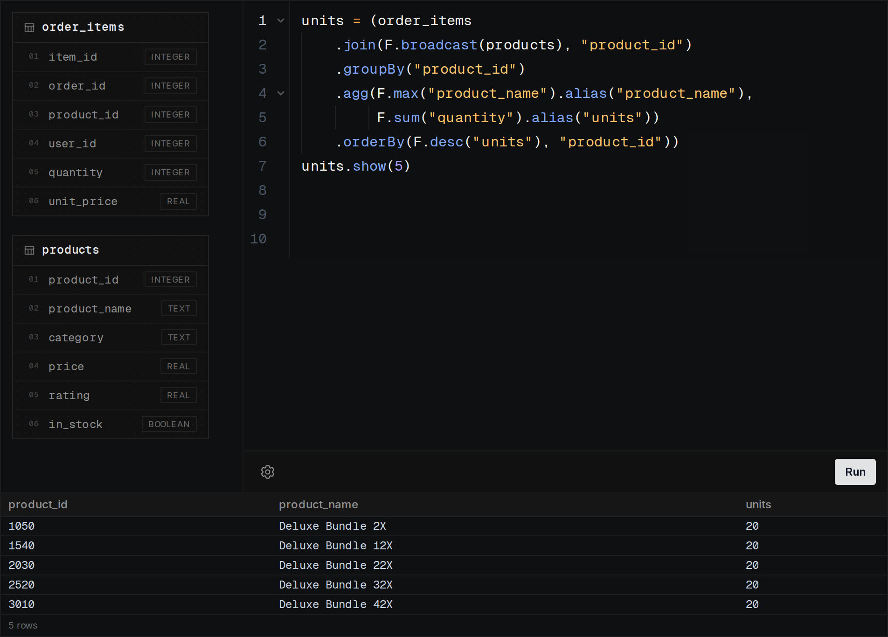
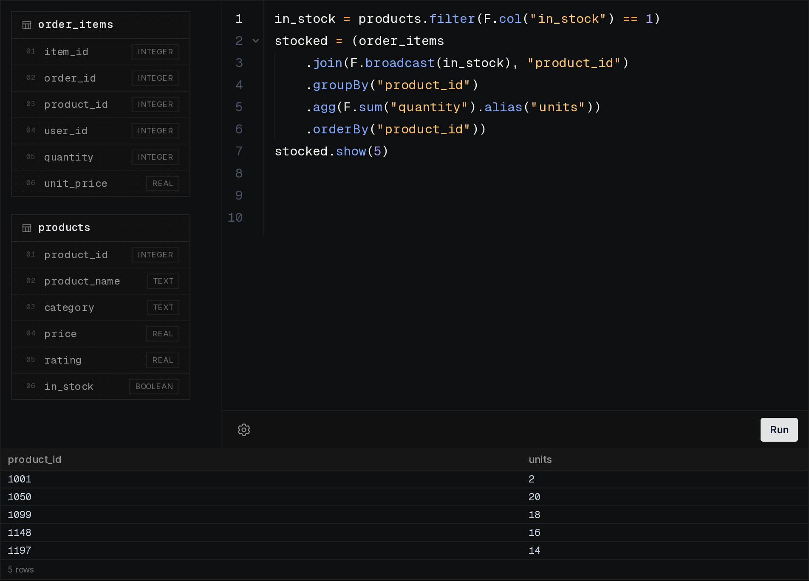
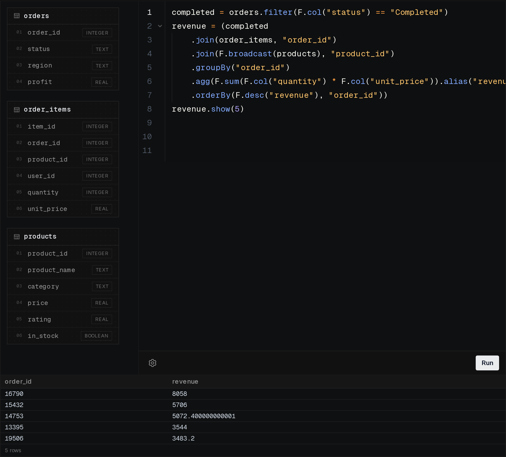

Intermediate·Spark · 14 min · 19 challenges

# Joins: Intermediate

At Netflix, a nightly job joins a day of play events to the titles catalog and then to the profiles table. The catalog join finishes in minutes; the profiles join runs for an hour. An engineer raises the broadcast threshold so profiles broadcast too, and the driver dies before a single row is joined. All 3 outcomes come down to which join strategy Spark picked, and why.


<br>

---

## The Four Join Strategies

Every join you write with `.join()` is a logical join: it says which rows pair up. Catalyst turns it into 1 of 4 physical join strategies, and the strategy decides how many shuffles the join costs, how much memory it needs, and whether it runs at all. The beginner lesson showed 2 of them working, the broadcast join and the shuffled join. This section names all 4 and the conditions Spark checks, in order, to pick one.


<br>

### The 4 strategies

| Strategy | Plan node | When Spark picks it | What it costs |
| --- | --- | --- | --- |
| Broadcast hash join | BroadcastHashJoin | An equality key, and one side's estimated size is under `spark.sql.autoBroadcastJoinThreshold` | Ships the small side to every executor once; the big side never moves |
| Sort-merge join | SortMergeJoin | An equality key, neither side small enough to broadcast | Shuffles both sides on the key, sorts each partition, merges; 2 shuffles |
| Shuffle hash join | ShuffledHashJoin | An equality key, one side far smaller but over the threshold, and a `shuffle_hash` hint or `spark.sql.join.preferSortMergeJoin` set to false | Shuffles both sides, hashes the smaller side per partition, no sort |
| Broadcast nested loop join | BroadcastNestedLoopJoin | No equality key (a range or inequality condition), and one side is under the threshold | Broadcasts one side, then compares every row of the other against all of it |

The planner asks 3 questions in a fixed order. First, does the condition contain at least one equality between a column on each side? `orders.product_id == products.product_id` does; `events.ts.between(sessions.start, sessions.end)` does not. Without an equality there is no key to hash or sort on, so only the nested loop family remains: broadcast nested loop if one side fits under the threshold. When neither side fits, an inner join falls to a full cartesian product, while an outer join with no equality key still runs as broadcast nested loop and broadcasts a side that is over the threshold. Second, with an equality key, is either side's estimated size under the threshold? If so, broadcast hash join, with no shuffle on either side. Third, if both sides are over the threshold, the default is sort-merge join; shuffle hash join runs only when you ask for it with a hint or turn the sort-merge preference off.

*The cartesian product is the fifth outcome rather than a fifth strategy: it is what remains when no key exists and nothing fits in memory, and it pairs every row with every row.*


<br>

### What the choice costs

Put sizes on it. A fact table of 400GB joins a dimension of 8MB on a cluster of 200 executors. Broadcast hash join reads the dimension once, sends 8MB to each executor, 1.6GB of network in total, and every task joins its own partition of the fact table where it sits: 1 stage and no shuffle write. Sort-merge join on the same pair shuffles both sides: 400GB written to local disk and read back across the network, plus a sort of every partition, and 3 stages where there was 1. Spark's part of the work is seeing that the dimension is small, and the next section covers what happens when it cannot.

You can override the choice per join with a hint on either DataFrame. `F.broadcast(products)` and `products.hint("broadcast")` are the same request; `merge` asks for sort-merge join and `shuffle_hash` for shuffle hash join. On a join with no equality key, the `broadcast` hint is what produces a broadcast nested loop join, and `shuffle_replicate_nl` asks for the cartesian product. A hint that can't be honoured is dropped: a `merge` hint on a join with no equality key does nothing, because there is no key to merge on.

```sql
enriched = order_items.join(F.broadcast(products), "product_id")
merged = orders.join(order_items.hint("merge"), "order_id")
hashed = orders.join(order_items.hint("shuffle_hash"), "order_id")
```

Run the cell below. The hint keeps `order_items` in place and ships `products` to each task. The rows that come back are the same as without the hint; what changed is the plan underneath, and section 3 shows how to see that.



```python
units = (order_items
    .join(F.broadcast(products), "product_id")
    .groupBy("product_id")
    .agg(F.max("product_name").alias("product_name"),
         F.sum("quantity").alias("units"))
    .orderBy(F.desc("units"), "product_id"))
units.show(5)
```

The threshold check is absolute. Spark compares each side's estimated bytes against a fixed number, 10MB unless you change it, and never against the other side. A 20MB table joined to a 2TB table fails the check exactly as a 20MB table joined to a 30MB table does, so a lopsided pair on its own never moves the planner off sort-merge.

**orders is a 300GB fact table and stores is a 40MB table. orders.join(stores, "store_id") runs with default settings and no hints. Which strategy does Spark pick?**

- **A.** Broadcast hash join, with stores shipped to every executor
- **B.** Shuffle hash join, because stores is so much smaller than orders
- **C.** Sort-merge join, shuffling both orders and stores on store_id
- **D.** Broadcast nested loop join, with stores as the broadcast side

<details>
<summary>Solution</summary>

**C.** Sort-merge join, shuffling both orders and stores on store_id

There's an equality key, neither side is under the threshold, and no hint or config asks for anything else, so the default wins.

**Why the others are wrong**

- **A.** At 40MB, stores is 4 times over the 10MB threshold, so the automatic broadcast check fails.
- **B.** The size ratio alone never selects it; shuffle hash join needs a hint or spark.sql.join.preferSortMergeJoin turned off.
- **D.** Nested loop is only for conditions with no equality; store_id = store_id is an equality, so it's never considered here.

</details>


<br>

---

## The 10MB Broadcast Threshold

The threshold is `spark.sql.autoBroadcastJoinThreshold`, and its default is 10485760 bytes, 10MB. Spark compares it against a number it computes before reading a single row: the planner's size estimate for each side of the join, in bytes. Whether that estimate is right decides whether a 2MB dimension gets broadcast or shuffled.


<br>

### Where the estimate comes from

For a table read from files, the estimate starts as the sum of the file sizes in the directory listing: the compressed bytes on disk, which Spark gets from the storage system without opening a file. Each operator above the scan adjusts that figure by a fixed rule, and the rules are blunt. The table below is the whole set the planner uses when table statistics are absent, which they are by default.

| Operator above the scan | Estimate it reports | Why that is often wrong |
| --- | --- | --- |
| `select` of fewer columns | Child size scaled by the width of the kept columns | Column widths are type defaults, not measured |
| `filter` | The child's size, unchanged | A filter that keeps 1% of rows still reports 100% |
| `join` | Left size times right size | Treats every row as matching every row |
| `groupBy` with keys | The child's size, unchanged | Collapsing 1B rows to 500 groups reports 1B rows' worth of bytes |
| `groupBy` with no keys | 1 row | The only operator whose estimate shrinks |

Read the `filter` row twice, because it is the one that bites. A `products` table of 300MB on disk, filtered to the 2MB of rows where `active == 1`, is still 300MB to the planner. That is 30 times over the threshold, so Spark picks sort-merge join and shuffles a 400GB fact table to meet a 2MB dimension. Nothing in the logs says the estimate was wrong; the job takes an hour instead of 4 minutes.

**dim is 60MB on disk. fact.join(dim.filter(F.col("region") == "EU"), "id") runs with the default threshold, no statistics and no hint. The EU rows total 3MB. Which strategy runs?**

- **A.** Broadcast hash join, because the 3MB of EU rows fit under the threshold
- **B.** Sort-merge join, because the filter leaves the estimate at 60MB
- **C.** Broadcast hash join, because Spark runs the filter before estimating
- **D.** Shuffle hash join, because dim is far smaller than fact

<details>
<summary>Solution</summary>

**B.** Sort-merge join, because the filter leaves the estimate at 60MB

The filter rule keeps the child's size, 60MB is over 10MB, and nothing else asks for a different strategy.

**Why the others are wrong**

- **A.** The planner never sees 3MB; without statistics a filter reports its child's full size.
- **C.** Estimation happens at planning time, before any row is read, so no filter has run yet.
- **D.** A size gap never selects shuffle hash join on its own; it needs a hint or the sort-merge preference turned off.

</details>


<br>

### Telling Spark what you know

When you know the side is small and the planner does not, wrap it in `F.broadcast()`. The hint is a promise, and Spark takes it over its own estimate, up to the hard caps in the next section. Apply the filter first and broadcast the filtered DataFrame. On an inner join the optimizer would push a later filter on `products` columns below the broadcast anyway, so this order does not change the plan; it makes the code show which rows travel to every executor.

https://github.com/user-attachments/assets/0da8026f-8cd3-48b6-94ac-b76e1a530bab

The animation sets the threshold to -1 first. That value turns automatic broadcasting off entirely, which is how you make a plan take the sort-merge path in a test; with it off, only the hint can produce a broadcast. `products` has 4 rows and the filter drops the 1 inactive row, Fax machine, before the 3 survivors are copied to each of the 2 tasks reading `orders`. The 6 order rows stay in their 2 input partitions through the whole join; no row of `orders` moves.

> **TIP**
>
> A broadcast hint travels with the DataFrame. Filter after the hint and Spark broadcasts whatever the hinted side has become at join time, so hint early if you like, but the bytes shipped are the bytes left after the last filter above the join.

The other fix is to give the planner real numbers. Computing statistics for the table with an `ANALYZE TABLE` statement stores row counts and per-column histograms in the catalog, and with `spark.sql.cbo.enabled` on, the cost-based optimizer uses them to estimate how many rows a filter keeps. That makes the estimate right for every query on the table; the hint makes it right for 1 join. Statistics suit dimensions many jobs read; the hint suits a one-off.

Try it on the practice tables. `products` is filtered to in-stock rows before the hint, so only those rows travel; the aggregate afterwards groups on the join key.



```python
in_stock = products.filter(F.col("in_stock") == 1)
stocked = (order_items
    .join(F.broadcast(in_stock), "product_id")
    .groupBy("product_id")
    .agg(F.sum("quantity").alias("units"))
    .orderBy("product_id"))
stocked.show(5)
```


<br>

---

## The Real Broadcast Ceiling

The config takes any number of bytes, so nothing stops you setting it to 5GB and letting every join broadcast. The cost of a broadcast doesn't scale the way the threshold suggests, and 3 fixed limits sit in the way before the config matters.

- **8GB** — hard cap on one broadcast table
- **512M rows** — hard cap on build-side rows
- **300s** — default spark.sql.broadcastTimeout

The first 2 are refusals: Spark throws an error naming the cap and the job dies at the moment the broadcast is built. The third is a clock: `spark.sql.broadcastTimeout` is how long the driver waits for the build side to be collected and shipped, and a broadcast that overruns it fails the job. None of those is the practical ceiling. The practical ceiling comes from what a broadcast makes the cluster do, and it lands at 1 to 2GB on disk.


<br>

### What a broadcast makes the cluster do

- The driver collects every row of the build side into its own heap and builds a hash table from them.
- Each executor pulls a full copy of that hash table over the network and keeps it in memory for the whole job.
- Every task on an executor probes the same copy, which is never split, so more executors never shrink it.

| Build side on disk | Hash table in memory (about 4x) | Driver heap it needs | Network with 100 executors |
| --- | --- | --- | --- |
| 10MB | 40MB | 40MB | 4GB |
| 500MB | 2GB | 2GB | 200GB |
| 2GB | 8GB | 8GB | 800GB |

The second column is the one the threshold never mentions. Parquet stores columns compressed; the hash table holds every row decompressed, each with its own header, plus an index over the keys, and that comes to roughly 4 times the disk size. A 500MB dimension becomes a 2GB structure that the driver must hold while building it, and that each executor must hold next to the memory its tasks need for their own work. With 100 executors it also crosses the network 100 times. At 2GB on disk the driver needs 8GB free, every executor needs 8GB free, and 800GB moves before the first row is joined, where a sort-merge join shuffles the 2GB dimension plus the fact table once.

| ✓ Broadcast a 1GB dimension | ✗ Sort-merge the same dimension |
| --- | --- |
| • Driver builds a 4GB hash table before anything ships<br><br>• Every executor holds 4GB for the life of the job<br><br>• 100 executors pull 400GB over the network<br><br>• The fact table never shuffles: 1 stage | • Driver holds nothing; executors do all the work<br><br>• A task holds 1 partition of each side, not the table<br><br>• 1GB plus the fact table cross the network once<br><br>• Both sides shuffle and sort: 3 stages |

The crossover follows from the comparison. A broadcast pays off while executor count times hash-table size stays well under the bytes a shuffle would move, and while each executor has the headroom to hold the table beside its tasks. Past 1 to 2GB on disk, the hash table alone is a quarter of a 16GB executor, and the driver becomes the single machine that must hold the whole thing first. That is why production configs keep the threshold in the tens or low hundreds of megabytes and reserve hints for sides under around 1GB, whatever the config would accept.

The driver is the part people forget. In client mode it is the laptop or edge node that submitted the job, with a default heap of 1GB; a broadcast the executors could hold still dies there with an out-of-memory error, because the driver gathers the build side before anything is sent. The error names the driver, not the join, which is why a failed broadcast is often filed as a driver sizing problem.

**An engineer sets spark.sql.autoBroadcastJoinThreshold to 4GB so that a 3GB customers table broadcasts in a join to a 1TB fact table. The driver runs with its default memory. What fails first?**

- **A.** The broadcast exchange refuses the table because it is over the 8GB cap
- **B.** The driver runs out of memory collecting the build side
- **C.** Nothing fails; each executor holds 3GB and the join runs as a broadcast
- **D.** Spark ignores the raised threshold and runs a sort-merge join

<details>
<summary>Solution</summary>

**B.** The driver runs out of memory collecting the build side

The driver must hold all 3GB of rows, decompressed into roughly 12GB of hash table, in a 1GB heap, and it dies before any executor receives a byte.

**Why the others are wrong**

- **A.** At 3GB on disk the table is under the cap on disk; the cap is checked on the built table, and the job does not get that far.
- **C.** Executors never get the chance, because the build happens on the driver first and the driver cannot hold it.
- **D.** The config is honoured as written; Spark does not second-guess a threshold that the hard caps allow.

</details>


<br>

---

## Verifying with explain()

You've added a hint, or raised the threshold, and the job still takes an hour. The next step is to read the plan rather than guess. `df.explain()` prints the physical plan Catalyst settled on, and the join node in it names the strategy and the side that was built. The rule from the Catalyst lessons, counting `Exchange` nodes to count shuffles, applies to joins the same way.

```sql
joined = orders.join(products, "product_id")
joined.explain()
```

The same 2 lines print different plans depending on what the planner believes about `products`. Below are the 2 plans side by side, with the null filters Spark adds under an inner join left out to keep the lines short.

products estimated at 8MB

| Physical plan line |
| --- |
| BroadcastHashJoin [product_id#3], [product_id#12], Inner, BuildRight |
| :- FileScan parquet orders[order_id#2,product_id#3] |
| +- BroadcastExchange HashedRelationBroadcastMode(...) |
| +- FileScan parquet products[product_id#12,product_name#13] |

products estimated at 50MB

| Physical plan line |
| --- |
| SortMergeJoin [product_id#3], [product_id#12], Inner |
| :- Sort [product_id#3 ASC NULLS FIRST], false, 0 |
| : +- Exchange hashpartitioning(product_id#3, 200) |
| : +- FileScan parquet orders[order_id#2,product_id#3] |
| +- Sort [product_id#12 ASC NULLS FIRST], false, 0 |
| +- Exchange hashpartitioning(product_id#12, 200) |
| +- FileScan parquet products[product_id#12,product_name#13] |

Read the join line first. `BroadcastHashJoin` ends with `BuildRight`: the right side of the join, the second DataFrame in `orders.join(products)`, is the one turned into a hash table and shipped. Under it, the `BroadcastExchange` node sits on the branch that was broadcast, and the other branch runs from `FileScan` straight into the join with no `Exchange` at all: `orders` never moved. The right-hand plan has no build side to name. Both branches carry an `Exchange hashpartitioning(..., 200)`, 1 shuffle each into 200 reducer partitions, and a `Sort` above each exchange, which is the merge's precondition.

> What each join node tells you
>
> - `BroadcastHashJoin ... BuildLeft` or `BuildRight`: strategy 1; the named side is the one broadcast, and a `BroadcastExchange` sits under it
> - `SortMergeJoin`: strategy 2; expect an `Exchange` and a `Sort` on both branches, 2 shuffles
> - `ShuffledHashJoin ... BuildLeft` or `BuildRight`: strategy 3; an `Exchange` on both branches, no `Sort`, the named side is hashed per partition
> - `BroadcastNestedLoopJoin BuildRight, Inner`: strategy 4; a `BroadcastExchange` on the named side and a condition with no equality in it
> - `CartesianProduct`: the fallback; no key and nothing small enough to broadcast

The plan also predicts the stage count you will see once the job runs. Each `Exchange` ends a stage, so the left plan is 1 stage for the join itself plus a small separate job that collects `products` for the broadcast, and the right plan is 3 stages: 1 per scan feeding an exchange, and 1 that reads both exchanges and merges. If a job that should broadcast shows 3 stages for the join, the plan is where the mismatch shows first, before any stage has run.


<br>

### Which side can be built

For an inner join Spark may build either side and picks the smaller estimate, so `BuildLeft` shows up whenever the first DataFrame is the small one. An outer join removes the choice. The side a join preserves must be the streamed side, because the hash table only holds rows that get probed, so a left join can only build the right side and a right join only the left; a full outer join cannot be a broadcast hash join at all. `small.join(big, "id", "left")` therefore runs as sort-merge even with a hint on `small`, and the plan tells you so with a `SortMergeJoin` line ending in `LeftOuter`.

**customers is 4MB and orders is 200GB. The plan for the join below shows SortMergeJoin [customer_id#5], [customer_id#20], LeftOuter, even though customers carries a broadcast hint. Why did Spark not broadcast customers?**

```python
result = F.broadcast(customers).join(orders, "customer_id", "left")
```

- **A.** Spark never uses a broadcast hash join for an outer join of any kind
- **B.** A left join must stream the left side, so only orders could be built, and it is too big
- **C.** At 4MB customers is over the threshold once its hash table expands
- **D.** customers has no table statistics, so its size is unknown

<details>
<summary>Solution</summary>

**B.** A left join must stream the left side, so only orders could be built, and it is too big

The preserved side is streamed and the other side is hashed, so the hint on customers is dropped; orders at 200GB cannot be hashed, leaving sort-merge.

**Why the others are wrong**

- **A.** Left and right outer joins can both be broadcast hash joins; only the side that can be built is restricted.
- **C.** The threshold compares the on-disk estimate, and 4MB is under 10MB; expansion is a memory concern, not the planner's test.
- **D.** Without statistics the planner uses file sizes, which give 4MB here; the estimate was fine, the build-side rule blocked it.

</details>

> **TIP**
>
> `explain("formatted")` prints the same tree with each node numbered and a details block under it, including the estimated size each side was planned with. When a dimension you expected to broadcast did not, that size is the first number to read.


<br>

---

## Ordering a Multi-Table Join

A join with 3 or more tables runs as a chain of 2-table joins, in the order you wrote them. Catalyst can reorder joins only when the cost-based optimizer is on and `spark.sql.cbo.joinReorder.enabled` is set, and both are off by default, so for most jobs the order in the code is the order Spark runs. Each link in the chain is 1 of the 4 strategies from section 0, and each one's cost depends on the size of its inputs, which is where ordering matters: the output of one join is the input to the next.


<br>

### A worked chain

Take 3 tables. `orders` is 2 billion rows and 400GB. `customers` is 50 million rows and 5GB, past the broadcast ceiling. `products` is 200,000 rows and 20MB, and the job wants only the Toys category: 5% of products, which is 1MB, and 3% of orders. The same 3 tables can be joined in 2 orders.

| Step | Order A: customers first | Order B: toys first |
| --- | --- | --- |
| Join 1 | `orders` to `customers`: sort-merge, shuffles 400GB + 5GB, output 2B rows | `orders` to broadcast(`toys`): no shuffle, output 60M rows, 12GB |
| Join 2 | 2B rows to broadcast(`toys`): no shuffle, output 60M rows | 12GB to `customers`: sort-merge, shuffles 12GB + 5GB |
| Shuffle total | 405GB | 17GB |
| Rows that are joined and then discarded | 1.94B | 0 |

Both orders produce the same 60 million rows. Order B moves 24 times fewer bytes because the only filter in the job, Toys, is applied by the join that can be broadcast, and that join runs before the join that cannot. The rule generalises: run first the join that removes the most rows per byte it moves, and that is nearly always a broadcast join against a filtered dimension, because it shrinks the fact table with no shuffle at all.


<br>

### The ordering rules

Order a chain by these, top first

- Filter each table before it joins. Spark pushes a filter on one table's columns below an inner join anyway, but the fact table shrinks only at the join to that table.
- Join the filtered, broadcastable dimensions first; each one shrinks the fact table without a shuffle.
- Put the sort-merge joins last, when the fact side is as small as it is going to get.
- Keep joins on the same key adjacent: the second reuses the first's hash partitioning and skips a shuffle.
- Join 2 fact tables to each other only after both have been filtered and reduced by their dimensions.

Rule 4 comes from the shuffle lessons. `orders.join(order_items, "order_id").join(shipments, "order_id")` shuffles `orders` and `order_items` on `order_id` for the first join, and the result is already partitioned on `order_id`, so the second join shuffles only `shipments`. Put a sort-merge join on `product_id` between them and the `order_id` partitioning is gone; the third join shuffles the whole intermediate result again. A broadcast join on `product_id` in the same place keeps it, because the fact side never moves, so the third join still shuffles only `shipments`. The same reuse applies to a `groupBy` on the join key straight after the join.

https://github.com/user-attachments/assets/6601deed-39d8-4cfc-b876-3d842e1e7156

The animation chains 2 broadcast joins. `orders`, 6 rows in 2 partitions, picks up `segment` from `customers` and then `category` from `products`; both dimensions have 3 rows and both arrive at every task whole. Watch the `orders` partitions: through 2 joins they never leave the task that read them, which is the shape to aim for in a dimension-heavy chain, every dimension broadcast and the fact table staying put or shrinking.

The cell below applies rules 1 and 2 to the practice tables. The filter on `status` sits on `orders` before anything joins it, and `products` arrives by broadcast. The practice tables are all far under 10MB, so Spark broadcasts the `order_items` join as well, and neither join shuffles. The `groupBy` on `order_id` then adds its own `Exchange`, because no earlier shuffle left the rows partitioned on that key, and the `orderBy` adds a range shuffle after it. With a production-sized `order_items`, the first join would be a sort-merge on `order_id`, and the `groupBy` would reuse that partitioning with no shuffle of its own.



```python
completed = orders.filter(F.col("status") == "Completed")
revenue = (completed
    .join(order_items, "order_id")
    .join(F.broadcast(products), "product_id")
    .groupBy("order_id")
    .agg(F.sum(F.col("quantity") * F.col("unit_price")).alias("revenue"))
    .orderBy(F.desc("revenue"), "order_id"))
revenue.show(5)
```

| ✓ Do | ✗ Don't |
| --- | --- |
| • Write the filter on each table above its join, so the join sees fewer rows<br><br>• Join filtered dimensions by broadcast before any sort-merge join<br><br>• Group consecutive joins on one key so the partitioning carries over<br><br>• Confirm the order with explain() and count the Exchange nodes | • Join the 2 largest tables before a dimension join has cut either one down<br><br>• Rely on the optimizer to reorder joins; join reordering is off by default<br><br>• Interleave a sort-merge join on another key between 2 joins on the same key<br><br>• Expect a filter comparing columns of both sides to shrink the join beneath it |

**events is 1TB with user_id and device_id. users is 30GB with a country_code. devices is 3MB, and the job keeps 1 device type, 2% of devices. countries is 50KB and joins only through users.country_code. Which order moves the least data?**

- **A.** users to broadcast(countries), then events to that by sort-merge, then broadcast(filtered devices)
- **B.** events to broadcast(filtered devices), then users by sort-merge, then broadcast(countries)
- **C.** events to users by sort-merge, then broadcast(filtered devices), then broadcast(countries)
- **D.** events to broadcast(filtered devices), then broadcast(countries), then users by sort-merge

<details>
<summary>Solution</summary>

**B.** events to broadcast(filtered devices), then users by sort-merge, then broadcast(countries)

The broadcast join cuts events to roughly 20GB with no shuffle, the sort-merge then moves 20GB plus 30GB, and countries joins for free at the end.

**Why the others are wrong**

- **A.** The sort-merge join sees all 1TB of events because the device filter has not touched it yet; 1.03TB shuffles.
- **C.** The sort-merge runs before the devices join has cut anything, so all 1TB of events plus 30GB of users shuffles; the filtered devices arrives too late.
- **D.** events has no country_code, so countries has no key to join on until users has been joined; the chain cannot run in this order.

</details>


<br>

---

## Putting It All Together

An Uber team builds a daily table of trips enriched with city, driver and promotion details. Trips is 3 billion rows, drivers is 6GB, cities is 2MB, and promotions is 400MB on disk but the job wants only the 50 promotions active that day. The first version joins trips to drivers first and runs for 2 hours; the plan shows 2 SortMergeJoin nodes and 4 Exchange nodes, one of the joins being promotions.

- The promotions join went sort-merge because the filter to active promotions left the planner's estimate at 400MB, 40 times over the threshold; F . broadcast ( ) on the filtered DataFrame fixes that one join.
- Drivers at 6GB stays sort-merge on purpose: decompressed into roughly 24GB per executor and collected on the driver first, it is past the ceiling no config can move.
- Reordering the chain to trips, broadcast(cities), broadcast(active promotions), then drivers lets the 2 broadcast joins shrink trips before the only shuffle, and the plan afterwards shows 1 SortMergeJoin with 2 Exchange nodes.
- The BuildRight on each BroadcastHashJoin line confirms that cities and promotions, written as the right side of each . join ( ) , were the sides shipped.


<br>

---

## Key Takeaways

- Spark picks 1 of 4 physical strategies by 3 ordered checks: an equality key, a side under the threshold, then the sort-merge default.
- The 10MB threshold is compared against a planner estimate that a filter never shrinks; F . broadcast ( ) overrides the estimate.
- A broadcast is built on the driver and copied whole to every executor at around 4 times its disk size, so 1 to 2GB is the real ceiling.
- explain ( ) names the strategy in the join node, and BuildLeft or BuildRight names the side that was broadcast.
- Joins run in the order written; put filtered, broadcastable dimensions first and sort-merge joins last.
