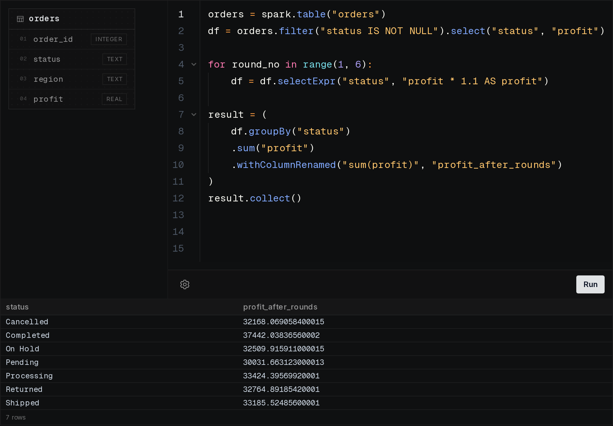

Advanced·Spark · 15 min · 11 challenges

# Lazy Evaluation: Advanced

A LinkedIn data engineer runs nightly label propagation over the member graph to find communities: each round, every member adopts the smallest label among their connections, and a sum checks whether any label moved. Round 2 finishes in 4 minutes. Round 30 takes an hour on identical data, because Spark replays every earlier round before it can answer.


<br>

---

## Lineage That Grows in Loops

### Reassigning a DataFrame nests the old plan

A DataFrame is a plan, and every transformation returns a new DataFrame whose plan holds the old one as its child. Inside a loop, `labels = new_labels` rebinds a Python name to the newer plan. The older plan stays reachable as a subtree, so after 30 rounds the name `labels` points at a single DataFrame whose plan stacks 30 joins and 30 groupBys on top of the original `nodes` scan.

Here is the job from the intro. The `edges` table holds each connection in both directions plus a self-loop for every member, so a member's own label is always on offer. Each round, every member takes the smallest label it is offered. Labels can only fall, so once their sum stops falling, no label has moved and the loop stops.

```sql
labels = nodes.select("node_id", F.col("node_id").alias("label"))
previous_total = None

for round_no in range(1, 31):
    new_labels = (
        edges.join(labels, edges.src == labels.node_id)
        .groupBy(F.col("dst").alias("node_id"))
        .agg(F.min("label").alias("label"))
    )
    total = new_labels.agg(F.sum("label")).first()[0]
    if total == previous_total:
        break
    previous_total = total
    labels = new_labels
```

Read the loop the way Spark does. The single line that touches data is `first()`, the action at the end of the stopping check. Every other line adds operators to a plan held in driver memory. The table follows what `labels` refers to as each round begins.

| Round starting | Joins in labels' plan | groupBys in labels' plan | Scans of edges in it |
| --- | --- | --- | --- |
| 1 | 0 | 0 | 0 |
| 2 | 1 | 1 | 1 |
| 10 | 9 | 9 | 9 |
| 30 | 29 | 29 | 29 |

Building that plan computed none of it. The description grows by 1 join and 1 groupBy every round whether an action runs, and each action decides how much of it gets executed. The next section prices that decision.

**This loop runs 12 rounds with no action inside it. When the loop finishes, what has Spark done?**

```python
for i in range(12):
    df = df.join(dims[i], "user_id").filter(F.col("score") > 0)
```

- **A.** Run 12 jobs, one per round, and passed each round's rows to the next
- **B.** Run nothing; df is one DataFrame whose plan holds all 12 joins and filters
- **C.** Run nothing; df holds only round 12's join and filter, applied to the input
- **D.** Run the first round to learn the schema and deferred the other 11

<details>
<summary>Solution</summary>

**B.** Run nothing; df is one DataFrame whose plan holds all 12 joins and filters

Each round wrapped the previous plan in a new join and filter. The first action on df will execute all 12 rounds as a single plan.

**Why the others are wrong**

- **A.** A transformation launches no job. Each pass of the loop only added a join and a filter to the plan, and nothing ran.
- **C.** Reassignment drops no earlier round. The new DataFrame's plan contains the old one as a child, so rounds 1 through 11 are still inside it.
- **D.** The driver derives each round's schema from the plan without launching a job. All 12 rounds are still unexecuted.

</details>


<br>

### A long plan is driver work

The driver pays for that plan in 2 places. Column references are resolved as each DataFrame is built, which is why a misspelled column fails on the line that names it. Every reassignment in the loop therefore checks its new join and groupBy against a plan one round deeper, so a deep loop slows down before any action runs. When an action does run, the driver rewrites the whole plan, chooses how each operator will run, and cuts the result into stages for the DAGScheduler, all on a single machine. At round 20, it does that for 20 joins to produce a single number, and the round after, for 21.

On the Jobs tab, planning shows up as a gap. A job's clock starts when the DAGScheduler receives it, after planning is done, so a check that spends 40 seconds in the driver leaves 40 idle seconds on the event timeline between the previous job's end and its own start. Gaps that widen round after round, on input that stays the same size, mean the plan is growing.

> The same growth in an RDD loop
>
> An RDD loop such as `ranks = ranks.join(links).mapValues(update)` grows a chain of dependencies where a DataFrame loop grows a plan. Serializing a task walks that chain recursively, so after enough rounds the walk overflows the driver thread's stack and the job dies with a `StackOverflowError` before a single task runs. Iterative RDD jobs with no checkpoint are the classic source of this error.

The animation runs the same growth on a loop small enough to watch. It starts from Monday's events, adds another day per round with `union`, and ends in a single `collect()`.

https://github.com/user-attachments/assets/53b2de32-56d3-427f-81e3-5dd6fe9a65c6

The loop's 3 rounds launch nothing. When `collect()` runs, 1 job with 1 stage starts: each day's table brings its 2 partitions along, so the stage runs 8 tasks, and the driver gathers all 12 rows. Every round left its operators, and here its partitions too, in the job that finally ran.


<br>

### Try it on the seed

This cell rewrites `profit` 5 times in a loop over `orders`, then totals it by status. Run it, change `range(1, 6)` to `range(1, 41)`, and run it again. The totals change; the loop still finishes before any task starts, and all 40 rewrites wait for the `collect()` at the bottom.



```python
orders = spark.table("orders")
df = orders.filter("status IS NOT NULL").select("status", "profit")

for round_no in range(1, 6):
    df = df.selectExpr("status", "profit * 1.1 AS profit")

result = (
    df.groupBy("status")
    .sum("profit")
    .withColumnRenamed("sum(profit)", "profit_after_rounds")
)
result.collect()
```

Two lines decide what the cell computes. The reassignment `df = df.selectExpr(...)` hands each round the DataFrame the previous round built, so the plan stacks every rewrite; without it, each round would discard its rewrite and start over from the unchanged `df`. And `collect()` sits after the loop, so all the rounds run inside the single job it launches.

**This loop leaves out the reassignment. What does collect() return?**

```python
df = orders.select("status", "profit")
for round_no in range(1, 6):
    df.selectExpr("status", "profit * 1.1 AS profit")
df.collect()
```

- **A.** Profit times 1.1 once, since only the last rewrite is kept
- **B.** Profit times 1.1 five times, since the plan stacks all 5 rewrites
- **C.** The original profit values, since df holds no rewrite at all
- **D.** No rows, since the first unassigned line raised an error

<details>
<summary>Solution</summary>

**C.** The original profit values, since df holds no rewrite at all

Each selectExpr built a new DataFrame that was dropped at once. df still names the plan from before the loop.

**Why the others are wrong**

- **A.** No rewrite was assigned to df, the last one included, so none of them reaches collect().
- **B.** Stacking needs df = on each pass. Without it, nothing links the rewrites to df.
- **D.** Building a DataFrame and discarding it is valid, so no error is raised and no job runs until collect().

</details>


<br>

---

## The Recompute Cost

### Each check replays every earlier round

The stopping check ends in `first()`, an action, and an action runs a plan from its sources. At round k, the check's plan begins at the `nodes` scan and holds k joins and k groupBys, so Spark recomputes rounds 1 through k before adding up a single label. The job for round k-1 sent its sum to the driver and kept nothing a later job could start from.

Put a price on it. Suppose a round of join and groupBy over the member graph takes 2 minutes of cluster time. The check at round k then costs about 2k minutes, and the run pays for every check along the way:

| Round | Rounds its check replays | Check time | Rounds of work so far |
| --- | --- | --- | --- |
| 1 | 1 | 2 min | 1 |
| 2 | 2 | 4 min | 3 |
| 10 | 10 | 20 min | 55 |
| 20 | 20 | 40 min | 210 |
| 30 | 30 | 60 min | 465 |

After n checks the total is n(n+1)/2 rounds, which grows with the square of n. 30 rounds of progress cost 465 rounds of work, or 930 minutes at 2 minutes a round, where computing each round once would take 60 minutes. Doubling the run to 60 rounds roughly quadruples the bill, to 1,830 rounds.

- **15.5x** — work per round of real progress
- **29** — computed rounds that round 30 redoes

Narrow loops pay less of this bill on executors. A loop of `withColumn` rewrites like the one in the previous section's cell replays cheaply, because pipelining fuses its steps into a single pass over each row. Its cost lands on the driver, which still plans every step. Loops whose rounds hold joins and groupBys pay on both sides.


<br>

### Fewer actions, same plan

Running fewer actions cuts the cost without any new API. Here are 3 loop shapes over 30 rounds, priced in rounds of work.

| Loop shape | Rounds of work | Joins in the last plan |
| --- | --- | --- |
| Check after every round | 465 | 30 |
| Check after every 5th round | 105 | 30 |
| 30 fixed rounds, one action at the end | 30 | 30 |

Checking less often cuts executor work, but the final action still plans and runs a 30-join chain, and a fixed round count either stops too early or wastes rounds after the labels settle. Only a checkpoint bounds the depth of the plan itself.


<br>

### The bill shows up in 3 places

Where repeated rounds cost you

- **Executors** *Grows with the square of the round count*\
  Each check rescans edges and reruns every earlier join and groupBy. Round k's job reads the full edges table k times.
- **Driver** *Grows every round*\
  Planning round k's check means working through k joins. Gaps between jobs widen while executors sit idle.
- **Recovery** *Grows with depth*\
  If an executor dies mid-job, the DAGScheduler resubmits the parent stages whose output it held. In a deep plan, those parents reach back through earlier rounds.


<br>

### Reading it in the Spark UI

| Where to look | Loop with its plan depth capped | Loop replaying every round |
| --- | --- | --- |
| Jobs tab, check durations | Rise for a few rounds, then drop back to one round's time | A straight climb: 2, 4, 6 ... 60 minutes |
| Stages per check job | Stays under a fixed cap | More each round, a join and groupBy's worth |
| Stages tab, edges input | Read a capped number of times per check | Read k times by round k's check |
| Event timeline | Short, steady gaps | Widening gaps with idle executors |

A climbing line on the Jobs tab while input size holds still points to lineage before it points to data. To confirm, open 2 check jobs a few rounds apart and compare their DAG visualizations. If the later one holds more joins, the plan is carrying history from round to round.

**dims holds 8 DataFrames, and each join takes about 1 minute when run once. Roughly how many join-minutes does this loop spend on executors?**

```python
events = spark.table("user_events")
for i in range(8):
    events = events.join(dims[i], "user_id")
    print(i, events.count())
```

- **A.** 8 join-minutes, since each count() runs only its own round's join
- **B.** 16 join-minutes, since each count() reruns its own join and the one before
- **C.** 64 join-minutes, since each count() reruns all 8 joins of the loop
- **D.** 36 join-minutes, since the count() at round k reruns all k joins so far

<details>
<summary>Solution</summary>

**D.** 36 join-minutes, since the count() at round k reruns all k joins so far

The checks replay 1, 2, up to 8 joins, and 1 + 2 + ... + 8 = 36. With a single action after the loop, the same work would cost 8.

**Why the others are wrong**

- **A.** count() executes the whole plan of events, and by round k that plan holds k joins. The previous count() kept no rows for this one to reuse.
- **B.** No rule limits replay to the previous round. The plan reaches back to the table scan, so every earlier join reruns.
- **C.** At round k the plan holds only the k joins added so far. Later rounds do not exist yet when that count() runs.

</details>


<br>

---

## Checkpointing to Cut Lineage

### Saving the rows, dropping the recipe

`df.checkpoint()` runs the plan of `df`, writes the resulting rows as files under the checkpoint directory, and returns a new DataFrame whose plan is a single scan of those files. The returned DataFrame keeps no link to the joins that produced it. Any plan built on it starts from the saved rows, so a later check can reach back no further than the most recent save.

```sql
spark.sparkContext.setCheckpointDir("/shared/checkpoints/label_propagation")

CHECKPOINT_EVERY = 5
labels = nodes.select("node_id", F.col("node_id").alias("label"))
previous_total = None

for round_no in range(1, 31):
    new_labels = (
        edges.join(labels, edges.src == labels.node_id)
        .groupBy(F.col("dst").alias("node_id"))
        .agg(F.min("label").alias("label"))
    )
    if round_no % CHECKPOINT_EVERY == 0:
        new_labels = new_labels.checkpoint()
    total = new_labels.agg(F.sum("label")).first()[0]
    if total == previous_total:
        break
    previous_total = total
    labels = new_labels
```

Two lines carry the change. `setCheckpointDir` names a directory on storage that the driver and every executor can reach and that outlives any executor; call `checkpoint()` without it and Spark raises an error saying the checkpoint directory has not been set. The reassignment `new_labels = new_labels.checkpoint()` is what cuts the lineage. The call leaves the DataFrame it was invoked on unchanged, so dropping its return value pays for the save and carries on with the uncut plan.

#### Eager and lazy saves

`checkpoint()` is eager by default: the call itself launches the save, one of those jobs that run before your own action. With `checkpoint(eager=False)`, the call returns at once and the files are written when the first action runs on the returned DataFrame. Loops usually keep the default, so the save lands on a known line and the check right after it reads files.


<br>

### A reliable save makes 2 passes

A checkpoint runs the plan twice. The first pass is a job that counts the rows; the second is a job that writes them, and since the first pass kept nothing, the second recomputes every row. Spark's documentation for the underlying checkpoint call recommends keeping the data in executor storage before saving so the write reads stored rows instead; the caching lessons later in the track cover how. In the loop above, the save at round 5 replays 5 rounds once to count and once to write.


<br>

### Choosing the interval

With a save every n rounds, no job ever replays more than n rounds. Within each block of n, the checks before the save replay 1, 2, up to n-1 rounds, and the save replays n rounds twice. Over 30 rounds:

| Save every | Rounds of work | Saves written | Deepest job |
| --- | --- | --- | --- |
| 1 round | 60 | 30 | 1 round |
| 5 rounds | 120 | 6 | 5 rounds |
| 10 rounds | 195 | 3 | 10 rounds |
| Never | 465 | 0 | 30 rounds |

- **4 hours** — 30 rounds, saved every 5
- **345** — rounds of replay the saves remove

Rounds of work fall as the interval shrinks, but each save writes the whole labels table to shared storage and adds 2 jobs for the driver to schedule. Saving every round cuts 465 rounds of work to 60, at the price of 30 full writes of the table and 60 extra jobs. The right interval is where another save costs about as much as the replay it removes, and you find it by timing a save job and a round on the Jobs tab. Spark's own ALS recommender exposes the same choice as `checkpointInterval`, which defaults to 10 and takes effect only once a checkpoint directory is set.

> **TIP**
>
> On a checkpointed DataFrame, the query graph in the Spark UI begins at a node named `Scan ExistingRDD` where the joins used to be. A check whose graph still shows the full chain of joins after a save means the return value of `checkpoint()` was dropped.

**Here step holds a round's join and groupBy, and the loop is meant to save every 5 rounds. How many rounds does the check at round 30 replay, and why?**

```python
for round_no in range(1, 31):
    new_labels = step(labels)
    if round_no % 5 == 0:
        new_labels.checkpoint()
    total = new_labels.agg(F.sum("label")).first()[0]
    labels = new_labels
```

- **A.** All 30, because the saved DataFrame is never assigned back to new_labels
- **B.** Only 5, because the save at round 25 cut every round before it
- **C.** None, because the save at round 30 runs right before the check reads it
- **D.** All 30, because a save cuts lineage only after its files are cleaned up

<details>
<summary>Solution</summary>

**A.** All 30, because the saved DataFrame is never assigned back to new_labels

checkpoint() returns a new, cut DataFrame and leaves new_labels untouched. With the return value dropped, the loop pays for 6 saves and still carries the full 30-round plan.

**Why the others are wrong**

- **B.** The save at round 25 cut the lineage of a DataFrame that nobody kept. The new_labels the loop continues with still reaches back to round 1.
- **C.** The round-30 save did write files, but the check's plan is built on the original new_labels, which never reads them.
- **D.** Cleanup has no bearing on lineage. A save cuts the lineage of the DataFrame it returns, as soon as it returns; this loop throws that DataFrame away.

</details>


<br>

---

## Local vs Reliable Checkpoints

### Executor storage or shared storage

`df.localCheckpoint()` cuts lineage the same way `checkpoint()` does: the DataFrame it returns has a plan that starts from saved rows. What differs is where those rows live. A local save keeps each partition in the storage of the executor that computed it, in memory with spill to that executor's local disk. A reliable save writes files to the checkpoint directory on shared storage.

| Property | localCheckpoint() | checkpoint() |
| --- | --- | --- |
| Where rows live | Executor memory and local disk | Files in the checkpoint directory |
| Needs `setCheckpointDir` | No | Yes |
| Passes over the plan per save | 1 | 2, unless the rows are already in executor storage |
| Write target | Executor memory or local disk | Shared storage, usually slower |
| After an executor is lost | Its partitions are gone | Any executor reads the files |
| Cleanup | Freed after the driver drops its last reference to it | Left on storage unless `spark.cleaner.referenceTracking.cleanCheckpoints` is `true` |

Reliable saves outlive the run. With `spark.cleaner.referenceTracking.cleanCheckpoints` at its default of `false`, every save's files stay in the checkpoint directory after the job ends, so a nightly job that saves 6 times a night leaves 180 sets of files behind after a month. Give each run its own subdirectory and delete it when the run succeeds.


<br>

### Losing an executor after a local save

Normally a lost executor costs only time: the DAGScheduler notices the missing output and reruns the stages that produced it, using their lineage. A local save removed that lineage on purpose. If the executor holding partition 2 of the round-25 labels dies, no plan exists that can rebuild partition 2, so the task that needs it fails with an error saying the checkpoint block was not found because the executor that saved it is no longer alive.

Retries cannot fix this, because every attempt looks for the same missing block. After `spark.task.maxFailures` attempts, 4 by default, the stage is aborted and the job fails in round 26 with 25 rounds of progress lost. Recovery means rerunning from round 1.

localCheckpoint(), executor 3 lost

| Partition | Held by | Next read |
| --- | --- | --- |
| 0 | executor 1 | Succeeds |
| 1 | executor 2 | Succeeds |
| 2 | executor 3 | Fails: no copy, no lineage |
| 3 | executor 4 | Succeeds |

checkpoint(), executor 3 lost

| Partition | Stored as | Next read |
| --- | --- | --- |
| 0 | file part-00000 | Succeeds |
| 1 | file part-00001 | Succeeds |
| 2 | file part-00002 | Succeeds on another executor |
| 3 | file part-00003 | Succeeds |

**A 20-round loop runs labels = new_labels.localCheckpoint() every 5 rounds. During round 14, the executor holding partition 6 of the round-10 save dies. What happens?**

- **A.** Spark rebuilds partition 6 from round 5's save, then reruns rounds 6 to 10 for it
- **B.** The task retries on another executor and reads a replica of partition 6
- **C.** Spark reruns rounds 1 to 10 for partition 6 from the original tables
- **D.** The job fails, since partition 6 has no copy and no lineage to rebuild it from

<details>
<summary>Solution</summary>

**D.** The job fails, since partition 6 has no copy and no lineage to rebuild it from

The round-14 plan begins at the round-10 save. Each retry looks for the lost block, finds nothing, and after 4 attempts the job fails.

**Why the others are wrong**

- **A.** Round 10's local save has no lineage back to round 5. The cut that made the save cheap also removed this path.
- **B.** A local save keeps a single copy, on the executor that computed it. No replica exists to read.
- **C.** That would need the lineage the local save discarded. Nothing in the plan points back to the original tables.

</details>


<br>

### Choosing between local and reliable

Back to the 30-round job with a save every 5 rounds. A local save stores rows as the counting pass computes them, so it replays its 5 rounds once. Each block then costs 10 rounds of checks plus 5 for the save: 90 rounds over the run against 120 with reliable saves, and no writes to shared storage. The price is exposure. With local saves, a lost executor fails the job whenever it held partitions of the latest save, which most executors do; with reliable saves, a lost executor costs at most the rounds since the last save.

- **3 hours** — 30 rounds, saved locally every 5
- **25%** — less compute than reliable saves

> Picking a save
>
> - Local suits runs short enough that rerunning from scratch costs less than writing every save to shared storage.
> - Reliable suits long runs, where losing an executor in hour 3 would otherwise throw away hours 1 and 2.
> - Reliable suits clusters that remove executors mid-run, through failures or by shrinking to save money.
> - Local saves occupy executor memory and disk, and saves from earlier rounds stay there until the driver drops them.

**A risk team's job runs 40 rounds of fraud-ring detection for 5 hours on 200 executors, and 3 of last month's runs lost an executor partway through. Which save strategy fits?**

- **A.** localCheckpoint() every 5 rounds, because it skips the second pass a reliable save makes
- **B.** No saves at all, because retries rebuild any lost partition from its lineage
- **C.** checkpoint() every 5 rounds, because a lost executor then costs only rounds since the last save
- **D.** localCheckpoint() every round, because frequent saves limit what a lost executor can take

<details>
<summary>Solution</summary>

**C.** checkpoint() every 5 rounds, because a lost executor then costs only rounds since the last save

Saved files survive the loss, so recovery reaches back at most 5 rounds. The second pass and the shared-storage writes are the premium paid for that.

**Why the others are wrong**

- **A.** It does skip that pass, but on a 5-hour run that has lost executors before, a single loss fails the job and throws away hours of rounds.
- **B.** Retries do rebuild lost partitions, but the plan grows by a round each time, and 40 rounds of replay at every check costs far more than the saves.
- **D.** Frequency does not help a local save: a lost executor still takes its saved partitions with it, and with no lineage behind them the job fails.

</details>


<br>

---

## Side Effects Inside Transformations

### A function runs each time its task runs

A function passed to a transformation runs on an executor, inside a task, every time that task executes. Everything earlier in this lesson multiplies task executions: each action replays the plan, a reliable save makes 2 passes, a lost executor's stages get resubmitted, a failed task is retried, and a slow one may get a speculative copy. A function that only computes a value from its row is safe through all of it. A function that also changes something outside the row, such as a counter, a log, an API call or another database, makes that change once per execution.

#### The counter that reads 2,000

Accumulators are Spark's shared counters: tasks add to them, and the driver reads the total. Here a validation function counts payments with no amount as the rows pass through `map`, and 2 actions follow.

```sql
missing_amount = spark.sparkContext.accumulator(0)
payments = spark.table("payments")

def validate(row):
    if row.amount is None:
        missing_amount.add(1)
    return row

checked = payments.rdd.map(validate)

print(checked.count())
spark.createDataFrame(checked, payments.schema).write.parquet("/warehouse/payments_checked/")
print(missing_amount.value)
```

Say 1,000 payments have no amount. `count()` runs `validate` over every row and the counter reaches 1,000. The write is a second action, so it reads the table and runs `validate` again, and the driver prints 2,000. Spark's documentation states the rule: an accumulator update made inside an action is applied once per task, and an update made inside a transformation may be applied more than once if tasks or stages are re-executed.

Count the ways a row's function can run, and the count of its effect stops being 1:

| What runs the function again | Example | Runs per row |
| --- | --- | --- |
| Another action on the same DataFrame | `count()`, then a write | 1 per action |
| A reliable save of the DataFrame | `checkpoint()` without stored rows | 2 for the save |
| A resubmitted stage | An executor dies mid-job | 1 more for the lost partitions |
| A speculative copy | A slow task gets a twin | Up to 2 for that partition |
| An action that stops early | `take(5)` | 0 for rows it never reads |
| No action | A loop that never calls one | 0 |


<br>

### Effects go in actions, with a key

Move the effect out of the transformation and into an action. `foreachPartition` is an action that hands your function an iterator over a partition's rows, so the function opens a connection per partition, sends what it needs to, and closes it. Accumulator updates made inside it count once per task, retries included.

```sql
def send_alerts(rows):
    client = AlertClient()
    for row in rows:
        client.upsert(alert_id=row.txn_id, body=row.reason)
    client.close()

flagged = (
    spark.table("payments")
    .filter(F.col("amount").isNull())
    .select("txn_id", F.lit("missing amount").alias("reason"))
)
flagged.foreachPartition(send_alerts)
```

An action still runs again under retries and speculation, and an external effect doesn't roll back. A task that delivered 400 of its 500 alerts and then failed delivers all 500 again on its retry. So the receiver has to tolerate repeats, and that needs a stable key taken from the row, here `alert_id=row.txn_id`. Designing writes that land once on such a key is the subject of the fault-tolerance lessons later in the track.

| ✓ Do | ✗ Don't |
| --- | --- |
| • Compute values in transformations; send, write and count in foreachPartition or a write<br><br>• Give every external write an id from the row, so a repeat overwrites the earlier one<br><br>• Read an accumulator after the action that fills it, and fill it only inside actions<br><br>• Open a connection per partition inside foreachPartition, never one per row | • Call an API, send a message or write a file from a function passed to map<br><br>• Report an accumulator filled inside a transformation as an exact count<br><br>• Debug with print in a transformation: the output goes to executor logs<br><br>• Assume a reliable checkpoint() runs your function once: the save makes 2 passes |

**push_notifs holds 1,000 rows in 4 partitions, and send_push delivers a notification per call. After both actions run, which is true?**

```python
sent = spark.sparkContext.accumulator(0)

def notify(row):
    send_push(row.user_id)
    sent.add(1)
    return row

pushed = spark.table("push_notifs").rdd.map(notify)
pushed.count()
pushed.take(5)
```

- **A.** 1,000 pushes were sent and sent reads 1,000, because take(5) reuses the rows count() computed
- **B.** 1,005 pushes were sent and sent reads 1,005, because take(5) reran notify on 5 rows
- **C.** 2,000 pushes were sent and sent reads 2,000, because each action replays all 4 partitions
- **D.** 1,005 pushes were sent but sent reads 1,000, because accumulators skip a second action's updates

<details>
<summary>Solution</summary>

**B.** 1,005 pushes were sent and sent reads 1,005, because take(5) reran notify on 5 rows

count() calls notify on all 1,000 rows. take(5) replays the map but pulls only 5 rows from the first partition, so notify runs 5 more times, and both actions' updates count.

**Why the others are wrong**

- **A.** count() kept no rows, so take(5) is a second action and runs map(notify) again from the table.
- **C.** count() does read every partition, but take(5) stops once it has 5 rows, so the other partitions never run notify again.
- **D.** The push count is right, but no rule drops a second action's updates. Each action's tasks add to sent, so it also reads 1,005.

</details>


<br>

---

## Putting It All Together

A payments company runs a nightly job that groups accounts into fraud rings: accounts sharing a card or device form edges, label propagation runs for up to 40 rounds over 200 million accounts on 200 executors, and every newly found ring triggers an alert to the risk team.

- Written as a plain loop with a sum check each round, the 40-round job replays 820 rounds of work, and the driver plans a deeper chain every round.
- A save every 5 rounds caps every job at 5 rounds of depth, and reassigning the DataFrame that checkpoint ( ) returns is what makes the cap real.
- Over 5 hours on 200 executors, losing one is expected, so the saves are reliable checkpoints to a run-specific directory that is deleted after a successful run.
- The ring alerts go out in foreachPartition after the final round, keyed by ring id, so a retried task re-sends onto the same alert records.
- If the alert call sat inside the loop's map , every check, every save pass and every retry would page the risk team again.


<br>

---

## Key Takeaways

- Reassigning a DataFrame inside a loop nests the previous plan in the new one, so after n rounds a single DataFrame carries all n rounds.
- An action inside the loop replays every round from the source tables: n checks cost n(n+1)/2 rounds of work, and the driver plans a longer chain each time.
- checkpoint ( ) and localCheckpoint ( ) run the plan, keep the rows and return a DataFrame whose plan starts from them; only the returned DataFrame is cut, so reassign it.
- A reliable save costs a second pass and a shared-storage write and survives a lost executor; a local save is cheaper and fails the job when an executor holding it dies.
- A function inside a transformation runs once per task execution, which can be 0, 1 or several times; put effects in actions such as foreachPartition and give each one an id so a repeat overwrites.
