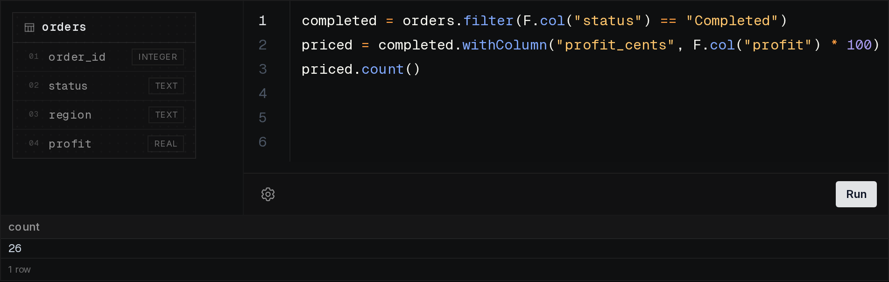
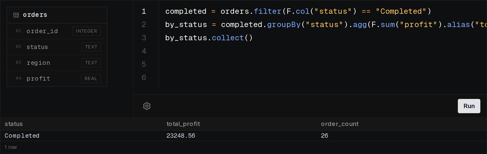
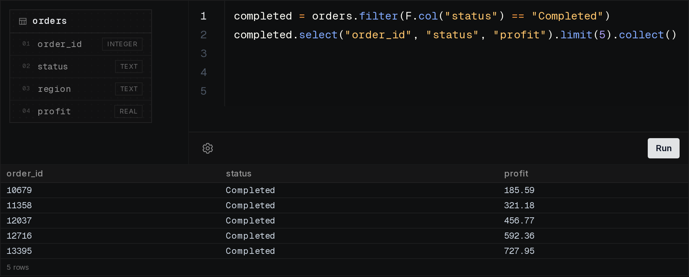
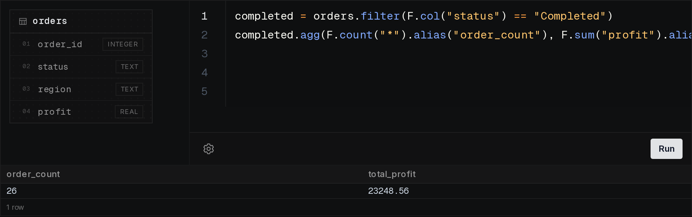

Beginner·Spark · 13 min · 11 challenges

# Lazy Evaluation: Beginner

An analyst at Uber opens a notebook against a day of trip records and chains a filter and a cast onto it, then a groupBy. Every line returns in under a second. Then collect() runs for 20 minutes and dies with a traceback pointing at collect(). The bug is 3 lines up and the 20 minutes are gone. This lesson explains why Spark works this way.


<br>

---

## Errors That Surface at the Action

A transformation line returns a new DataFrame and runs nothing. `trips.filter(F.col("status") == "completed")` records one step, hands back an object that describes the result, and the driver sends no task to any executor. The recorded chain turns into a job only when an action asks for a result. So when an error's cause sits inside the data, the error stays hidden until a task reads that data, and tasks read data only during the action.


<br>

### The bug on line 2, the crash on line 4

```sql
trips = spark.read.parquet("s3://rides/trips/2024-03-14/")
priced = trips.withColumn("fare_cents", F.col("fare_text").cast("int"))
per_city = priced.groupBy("city").agg(F.sum("fare_cents").alias("fare_total"))
per_city.collect()
```

The column `fare_text` holds strings such as `"1250"`, and one row somewhere in the day's 400 files holds `"12.50USD"`. Line 2 carries the bug, because a cast from that string to an integer cannot succeed. Spark cannot see the bad value at line 2: the footer of each file tells Spark that `fare_text` exists and is a string, and nothing more. So line 2 records the cast and returns. Line 4 builds the job, and because `collect()` returns `fare_total`, every row's `fare_cents` has to be computed. The executors start reading the 400 files, and 18 minutes in, a task reaches the bad row. With ANSI mode on, the default since Spark 4.0, a cast that can't parse its input raises `CAST_INVALID_INPUT` instead of returning null. The failed task takes the job down with it, and the traceback ends at `per_city.collect()`, the line the driver was executing when the failure came back.

| Mistake | What Spark can know when the line runs | Where it surfaces |
| --- | --- | --- |
| Column name misspelled | The file footer lists every column | The transformation line, as an AnalysisException |
| Path that does not exist | read() lists the files at that path | The read line |
| Text that cannot be cast | Only the column's type, never its values | The action, when a task reads the row |
| A zero in a column you divide by | Only the column's type | The action, when a task reaches that row |
| A file deleted after read() ran | The listing from when read() ran | The action, when a task opens the file |

The table above follows one pattern. Spark checks what it can learn from metadata on the line itself, and leaves everything that needs a row until a task has that row. A misspelled column fails on its own line with `cannot resolve`, because the schema arrived with the file listing. A value that breaks a cast, a zero that breaks a division, or a file that vanished between the listing and the job can be found only by a task, and a task runs only inside an action.

> When the traceback ends at an action
>
> - The line in the traceback is the line that started the job. The mistake lives in a transformation above it.
> - Read the error class first, because the class names the cause: a failed cast and a missing file raise different errors, and a division by zero raises its own.
> - Walk upward through every transformation that feeds the action, and check the one the message points at.
> - A `.limit(1000)` right after the read, ahead of any grouping or sort, checks the shape of the chain in seconds, though a bad value elsewhere still waits for the full run.

The cell below records 2 transformations and ends with `count()`. Run it and note that the only output is the one number the action returns. The filter ran inside the job, and because `count()` needs no `profit_cents` value, Spark never computed one. The DataFrame `priced` itself never held a row.



```python
completed = orders.filter(F.col("status") == "Completed")
priced = completed.withColumn("profit_cents", F.col("profit") * 100)
priced.count()
```

Every action follows this rule. `count()` and `collect()` each start a job that reads every partition, and so does a write, so whichever of them first runs a broken chain is the line the traceback ends at. A step placed after the broken one gives no protection either: a filter on a cast column computes the cast for each row before it can decide whether to keep that row.

**A nightly job runs the program below, and one row in the source holds qty_text equal to "n/a". ANSI mode is on. Which line does the traceback end at?**

```python
stock = spark.read.parquet("s3://wh/stock/")
typed = stock.withColumn("qty", F.col("qty_text").cast("int"))
low = typed.filter(F.col("qty") < 10)
low.count()
```

- **A.** Line 2, because the cast is the step that cannot handle the value n/a.
- **B.** Line 4, because count() is the action that starts the job whose task reads the bad row.
- **C.** Line 1, because reading the files is when Spark first touches the data.
- **D.** No line, because a cast that fails returns null and the filter then drops the row.

<details>
<summary>Solution</summary>

**B.** Line 4, because count() is the action that starts the job whose task reads the bad row.

Lines 1 to 3 build the description. The job starts at count(). Because the filter needs qty for every row, a task casts the row holding n/a and the cast raises, which ends the traceback on line 4.

**Why the others are wrong**

- **A.** The bug is in the cast, but line 2 only records the step. At that moment Spark knows qty_text is a string and nothing about its values, so no error can appear there.
- **C.** Line 1 lists the files and reads their footers for the schema, which touches no row. The value n/a sits inside a row, which no task reads until the action.
- **D.** That was the behaviour before Spark 4.0. With ANSI mode on, a cast that cannot parse its input raises CAST_INVALID_INPUT, and the failed task fails the job.

</details>

> **TIP**
>
> When a job fails minutes in, read the error class before the line number. Classes like CAST_INVALID_INPUT and DIVIDE_BY_ZERO name a step in the chain, as a missing-file error does. The line number only names the action.


<br>

---

## Why Laziness Makes Spark Fast

Lazy evaluation looks like a quirk until you see what it buys. Because no step runs until the action, Spark holds the entire chain, from the read to the action, before it touches a byte. A library that runs each line as it arrives knows only that one line, so it has to produce the full result of line 1 before it learns what line 2 wants. Spark knows what every later line wants, and it uses that knowledge to skip work the chain never needs.


<br>

### What the whole chain lets Spark skip

```sql
trips = spark.read.parquet("s3://rides/trips/2024-03-14/")
completed = trips.filter(F.col("status") == "completed")
slim = completed.select("city", "fare_cents")
per_city = slim.groupBy("city").agg(F.sum("fare_cents").alias("fare_total"))
per_city.collect()
```

Take the day's trips as 200GB across 40 columns of roughly equal size, 5GB per column, with 7 trips in 10 completed. Run eagerly, line by line, line 1 loads all 200GB, line 2 writes a 140GB copy holding the completed rows, line 3 writes a 7GB copy holding 2 columns of that, and only then does the grouping begin over the 7GB copy. Spark runs the same 5 lines as one job. Apart from `status`, the chain mentions only `city` and `fare_cents`, and `collect()` needs `fare_total`, so the executors read those 3 columns, 15GB. Each task filters its rows as they stream through, and the 3 in 10 that fail the filter are dropped before anything is sent anywhere. The grouping needs every city's total in one place, and each task adds up its own rows per city before anything moves, so what travels between executors is one small row per city per task, a few MB in all, rather than 7GB of trips.

| Step | Eager, line by line | Spark, whole chain |
| --- | --- | --- |
| Read | 200GB, all 40 columns | 15GB, the 3 columns the chain names |
| Filter | Writes a 140GB copy | Drops rows inside each task, writes nothing |
| Select 2 columns | Writes a 7GB copy | Already done at the read |
| Group by city | Reads the 7GB copy back and groups it | Sums per city inside each task, moves a few MB |
| Total data handled | Over 350GB | About 15GB |

The table gives 3 rules, and each one depends on Spark seeing the chain before it runs it.

- **Read only what the chain names** *15GB instead of 200GB*\
  Spark collects every column any line uses and asks the source for those alone. A format that stores each column separately hands back 3 columns and never touches the other 37.
- **Filter before anything moves** *7GB instead of 140GB*\
  A filter runs inside the task that read the row, so a dropped row costs one comparison and never crosses the network or lands on disk.
- **One pass, no copies in between** *0 copies instead of 2*\
  A filter followed by a select and then a withColumn executes as one pass over each partition, as does any run of per-row steps. A row goes in one end and out the other, and the DataFrames in between are names in your code, never data on a machine.

**In the 5-line trips program above, line 2 assigns the DataFrame completed. How many rows does completed hold anywhere in the cluster right after line 2 runs?**

- **A.** Seven in 10 of the source rows, the completed ones, spread across the executors.
- **B.** All of the source rows, because the filter runs when the next line asks for columns.
- **C.** The rows of the first partition, which Spark reads to check that the filter compiles.
- **D.** None: completed describes a filter and holds no rows until an action runs the chain.

<details>
<summary>Solution</summary>

**D.** None: completed describes a filter and holds no rows until an action runs the chain.

A DataFrame is a description. The rows that satisfy the filter exist only inside tasks during the job that collect() starts, and even then as a stream through each task.

**Why the others are wrong**

- **A.** That is what an eager library would hold. Spark has sent no task yet, so no executor has read a row, let alone filtered one.
- **B.** Neither the read nor the filter has run. Line 3 records another step and still sends no task, and the chain runs at collect() on line 5.
- **C.** Checking the filter needs the schema, which came from the file footers at the read. No partition is read for that check.

</details>


<br>

### Watching the chain run

The animation below runs a filter and a groupBy over 8 orders split into 2 partitions, ending in a `collect()`. Step through it and watch the timeline: the first 2 lines produce no task at all. When `collect()` arrives, 2 tasks read the 2 partitions and drop orders 3 and 5 inside the task that read them. Each task then adds up its own completed orders per region and sends those partial totals on. The first partition's totals are US 120 and EU 80, plus 60 for APAC. The second's are US 95 and EU 55, plus 70 for LATAM. The 2 grouping tasks combine them into 4 regional totals: US reaches 215 and EU 135, while APAC stays at 60 and LATAM at 70. The driver receives those 4 rows. Orders 3 and 5 never travelled, and no table of 6 filtered rows was ever stored between the 2 lines.

https://github.com/user-attachments/assets/c27b21c4-2592-4a99-b226-e56341e4abca

Run the cell below. The chain filters and groups by `status` before it collects, all in one job. The filter removes every order whose status reads anything other than `Completed` before the grouping sees a row, which is why the result holds 1 row.



```python
completed = orders.filter(F.col("status") == "Completed")
by_status = completed.groupBy("status").agg(F.sum("profit").alias("total_profit"), F.count("*").alias("order_count"))
by_status.collect()
```

> **TIP**
>
> Write the whole chain before the action and let Spark see all of it. A count() placed after the filter to check a step gives Spark a shorter chain to optimise and a second job to run.


<br>

---

## The Action Catalog

Every action starts a job, and the actions differ in what they hand back, in how much of the chain they have to run, and in where the result lands. Knowing the catalog tells you what a line will cost before you run it.

| Action | Returns | How much it runs | Where the result lands |
| --- | --- | --- | --- |
| `count()` | 1 number | Every partition | Driver, as an integer |
| `collect()` | Every row | Every partition | Driver memory, as a list of Row |
| `show(n)` | Prints n rows, 20 by default | Partitions until it has n rows | Driver, printed |
| `take(n)`, `head(n)`, `first()` | n rows, or 1 | Partitions until it has n rows | Driver, as a list of Row |
| `write.parquet(path)` | Nothing | Every partition | Files at the path, nothing on the driver |
| `toPandas()` | Every row | Every partition | Driver memory, as one local table |


<br>

### Actions that stop early

`show()` and `take()` ask for a handful of rows, and Spark exploits that. For a chain of per-row steps, a filter followed by a select, a task can produce a finished row as soon as it reads one. Spark starts a job over 1 partition, and if that partition yields 20 rows the job ends there. A `show()` on a 400-partition table reads 1 partition in a second, while a `count()` on the same table reads all 400. If the first partition yields fewer than 20 rows, Spark launches another job, and each new round tries about 4 times as many partitions as it has scanned so far, until it has enough rows.


<br>

### Stopping early needs finished rows

The shortcut works only when a finished row can exist before the whole chain finishes. After a `groupBy`, no result row is complete until every source row for that key has been seen, so `show()` on a grouped DataFrame runs the full grouping and then prints 20 of the results. The same holds for `orderBy`: the first row of a sorted result is known only after every partition has been read. A quick look is cheap on the chain before the grouping, where it costs 1 partition, and costs the whole job after it.


<br>

### Lines that start no job

Each of these runs in milliseconds and sends no task

- printSchema() reads the column list that arrived with the file listing.
- columns, dtypes and schema read the same metadata.
- limit(20) records a cap on the rows and waits for an action.
- distinct(), orderBy() and groupBy().agg() record steps that will run later, however expensive they are.
- df.write on its own is a builder, and the job starts at .parquet(path) or .save().

The Jobs page of the Spark UI lists the jobs each action started, which makes the catalog visible after the fact. Every action starts at least 1 job: a pipeline with 1 `write` usually shows 1, and a notebook cell with 3 `show()` calls shows 3 or more, because a `show()` whose first partition comes up short adds follow-up jobs. A line that appears there cost a job, whatever the code looked like.

**How many lines in the program below start a job?**

```python
events = spark.read.parquet("s3://logs/events/")
errors = events.filter(F.col("level") == "ERROR")
errors.printSchema()
sample = errors.limit(10)
sample.show()
n = errors.count()
```

- **A.** Two, the show() line and the count() line, while the other lines record steps.
- **B.** Three, because printSchema() also has to read the files to learn the columns.
- **C.** Four, one for each line after the read, since each one touches the data.
- **D.** One, because Spark folds every line of the cell into a single job.

<details>
<summary>Solution</summary>

**A.** Two, the show() line and the count() line, while the other lines record steps.

show() starts a job that stops once it has its 10 rows, with follow-up jobs if the first partition comes up short, and count() starts one over every partition. printSchema() and limit() send no task.

**Why the others are wrong**

- **B.** printSchema() prints the column list that the read collected from the file footers, and it sends no task. Only the show() and count() lines start jobs.
- **C.** The filter and the limit record steps and touch no data. Only show() and count() are actions, so 2 lines start jobs.
- **D.** Spark folds the transformations into the job each action starts, and 2 lines here are actions, so 2 lines start jobs, each with its own chain.

</details>

Picking the action is picking the cost. A look at 5 rows of a filtered table needs an action that stops early. `show(5)` and `take(5)` both do, and either one usually reads 1 partition. The number of rows the filter keeps can come only from an action that runs every partition, and `count()` does that while sending the driver 1 number.

**The table trips is stored as 400 partitions, and completed is a filter on it with plenty of matching rows in every partition. Which line usually reads the fewest partitions?**

- **A.** completed.count(), because the driver receives only 1 number from the job.
- **B.** completed.groupBy("city").count().show(5), because only 5 grouped rows get printed.
- **C.** completed.show(5), because a filtered row is finished as soon as a task reads it.
- **D.** completed.orderBy("fare_cents").show(5), because only the 5 lowest fares travel.

<details>
<summary>Solution</summary>

**C.** completed.show(5), because a filtered row is finished as soon as a task reads it.

A filter emits finished rows as it reads, so the job over the first partition usually finds 5 matches and ends there, reading 1 partition of the 400.

**Why the others are wrong**

- **A.** A small result says nothing about how much the job reads. The count of rows that pass the filter is known only after all 400 partitions have been filtered.
- **B.** No city's count is finished until every source row has been seen, so the grouping runs over all 400 partitions before 5 of its rows are printed.
- **D.** Only 5 rows reach the driver, but the 5 lowest fares are known only after every partition has been read, so all 400 are scanned.

</details>

> **TIP**
>
> Know how many partitions a line's action runs before you run the line. show() after a filter: 1 partition. count(): all of them. show() after a groupBy or an orderBy: all of them.


<br>

---

## The collect() Trap

`collect()` runs the chain and then sends every result row from every executor to the driver, where the rows become Python objects in a list. The executors hold the data spread across many machines, and the driver is a single process, sized for coordinating tasks rather than for holding data. A `collect()` on a result that fits on one machine is fine. A `collect()` on a result that doesn't is the most common way a beginner takes down a driver, and it fails only after every executor has done its work.

- **1g** — default spark.driver.maxResultSize


<br>

### The funnel

Take 100 executors finishing a job that produces 50 million rows of 120 bytes. Across the cluster that is 6GB, spread 60MB per executor, which each of them held comfortably. `collect()` asks all 100 to send their 60MB to the driver, and the driver guards itself with `spark.driver.maxResultSize`. Once the results that have arrived pass that limit, Spark aborts the job with a `SparkException` saying the total size of serialized results is bigger than `spark.driver.maxResultSize`. The executors' work is thrown away, and the failure comes late, after the job has done nearly all its reading. Raising the limit to let 6GB through moves the failure onto the driver itself: its heap is small by default too, it has to hold the whole result at once as Python objects that take more space than the bytes on the wire, and it dies with an `OutOfMemoryError`. Whether `collect()` is safe depends only on the size of the result, however large the source is.

| What you want | Use | Why it is safe |
| --- | --- | --- |
| A look at some rows | `show(20)` or `take(5)` | A fixed number of rows reaches the driver |
| A number | `count()`, or `agg(...)` then `collect()` | The aggregate is 1 row before it travels |
| The top 10 by a column | `orderBy(...).limit(10).collect()` | The limit caps what the driver receives |
| All the rows, saved | `write.parquet(path)` | Executors write their own partitions in parallel, the driver receives nothing |
| All the rows, in a Python list | `collect()` only when the count is known to be small | A lookup table of 300 rows fits anywhere |
| A local pandas table | `toPandas()` after an aggregate or a limit | `toPandas()` collects, with the same funnel |


<br>

### When collect() is the right call

`collect()` is safe after the chain has already shrunk the data. A `groupBy("country").agg(...)` over 2 billion events returns at most 1 row per country, a few hundred rows, and collecting them into a Python list to build a report costs nothing. A `limit(1000)` before `collect()` caps the list at 1000 rows whatever the source holds. The question to ask before typing it is the row count of the DataFrame on the left of the dot. If you cannot bound that count, `write` the result instead and read it back from where it landed.

| ✓ Do | ✗ Don't |
| --- | --- |
| • Aggregate or limit before you collect<br><br>• Use show() or take() for a look at the data<br><br>• Write large results to storage and let the executors do it<br><br>• Bound the row count of the DataFrame before the dot | • collect() a DataFrame whose row count you cannot state<br><br>• Treat toPandas() as free, it collects<br><br>• Collect to count, since count() returns 1 number<br><br>• Raise driver memory as the first fix for a failed collect() |

**Which of these lines is safe to run against a 3-billion-row events table on a driver with default settings?**

- **A.** events.select("user_id", "country").collect(), because 2 columns make each row small.
- **B.** events.groupBy("country").agg(F.count("*")).collect(), because the result has 1 row per country.
- **C.** events.filter(F.col("country") == "US").toPandas(), because the filter keeps 1 country.
- **D.** events.distinct().collect(), because distinct() removes the duplicated rows first.

<details>
<summary>Solution</summary>

**B.** events.groupBy("country").agg(F.count("*")).collect(), because the result has 1 row per country.

The grouping returns at most a few hundred rows, one per country, so the driver receives a small list after the executors did the heavy work.

**Why the others are wrong**

- **A.** Dropping columns shrinks each row and leaves 3 billion of them. Every row still heads for the driver, and the job aborts once the results pass the result-size limit.
- **C.** toPandas() collects. A filter to 1 country on 3 billion events can leave hundreds of millions of rows, far beyond what the driver accepts.
- **D.** distinct() removes exact duplicate rows, and an event table has few of those, so close to 3 billion rows still head for the driver.

</details>

The cell below collects, and it is safe because `limit(5)` caps the result at 5 rows before they travel. Run it, then change 5 to 50 and note that the driver still receives a bounded list.



```python
completed = orders.filter(F.col("status") == "Completed")
completed.select("order_id", "status", "profit").limit(5).collect()
```


<br>

---

## Re-Execution on Every Action

A DataFrame is a description of how to compute rows, and after a job finishes, the rows the tasks produced are gone. The driver keeps whatever the action returned, whether a number or a list. The executors keep nothing. So when a second action runs on the same DataFrame, Spark has no rows to reuse, and it runs the chain again from the source. This is the cost of laziness, and it bites every pipeline that calls one action for a check and another for the output.

```sql
trips = spark.read.parquet("s3://rides/trips/2024-03-14/")
completed = trips.filter(F.col("status") == "completed")
print(completed.count())
completed.write.parquet("s3://rides/completed/2024-03-14/")
```

| Job | Started by | Reads from the source | Does |
| --- | --- | --- | --- |
| 1 | `count()` on line 3 | The `status` column, 5GB, from all 400 files | Filters every row, counts the survivors |
| 2 | `write` on line 4 | All 40 columns, 200GB, from all 400 files | Filters every row again, writes 140GB |

The filter's output from job 1 was stored nowhere, so job 2 cannot pick it up: both jobs list the same 400 files, and the filter runs over every row twice. Job 1 stays cheap here only because a count needs 1 column. Had `completed` carried a `groupBy` as well, both jobs would have moved rows between executors and grouped them, and the second job would have cost as much as the first. In a notebook the pattern grows unnoticed, because every `show()` while exploring is an action: 5 looks at a grouped DataFrame run the full grouping 5 times.

The Jobs page of the Spark UI makes this visible. 2 jobs in a row that read the same source with the same input size are the tell that one DataFrame was acted on twice, and the fix starts from the code that called the second action.

**How many times does the program below read the source files under s3://logs/events/?**

```python
events = spark.read.parquet("s3://logs/events/")
errors = events.filter(F.col("level") == "ERROR")
print(errors.count())
errors.write.parquet("s3://logs/errors/")
print(errors.count())
```

- **A.** Once, because errors is computed on line 2 and the 3 actions reuse it.
- **B.** Twice, because the write stores the filtered rows and the last count reads them.
- **C.** Three times, once per action, with the filter running over every row 3 times.
- **D.** Four times, once for the read on line 1 and once more for each action.

<details>
<summary>Solution</summary>

**C.** Three times, once per action, with the filter running over every row 3 times.

count(), write and count() are 3 actions, each starting a job that begins at the source files, and no job keeps rows for the next one to reuse.

**Why the others are wrong**

- **A.** Line 2 records a filter and computes nothing. Each action starts its own job from the source, so the files are read 3 times.
- **B.** The write stores files at s3://logs/errors/, but errors still describes a filter over the source. The last count() reads the source again. Reading the written path needs a new spark.read.
- **D.** Line 1 lists the files and reads their footers for the schema, and reads no rows. Only the 3 actions read the data.

</details>


<br>

### Why Spark forgets

Spark drops task output on purpose. A job over 200GB produces hundreds of gigabytes of intermediate rows across the executors, and keeping all of it after every job would fill the cluster's memory within a few actions. Throwing it away costs nothing when no second action comes, and most DataFrames in a pipeline are acted on once. The description is cheap to keep and to rerun, and Spark bets on that. When you do need a result twice, you have to tell Spark. The tools for that within reach at this point are below. A later lesson covers asking Spark to hold a result in memory between actions.


<br>

### 3 ways to avoid the second pass

- **Fold the actions into one** *1 job instead of 2*\
  A count and a sum you want together belong in one agg(F.count("\*"), F.sum("fare_cents")) followed by one collect(). The chain runs once and the driver gets both numbers.
- **Write once, read the written data** *Later passes read 140GB, never the 200GB source*\
  Write completed to storage, then point later actions at a fresh spark.read of that path. Each later action pays for the filtered data, and the filter runs once.
- **Take exploratory actions out of the pipeline** *0 extra jobs in production*\
  A count() left in from debugging adds a pass over the source every night. Drop it, or count a limited sample during development only.

```sql
completed = trips.filter(F.col("status") == "completed")
completed.write.parquet("s3://rides/completed/2024-03-14/")
saved = spark.read.parquet("s3://rides/completed/2024-03-14/")
print(saved.count())
```

The cell below returns the count and the total profit of completed orders from 1 action. Written as 2 separate actions, Spark would filter the table twice. As one `agg`, the chain runs once and the driver receives 1 row holding both numbers.



```python
completed = orders.filter(F.col("status") == "Completed")
completed.agg(F.count("*").alias("order_count"), F.sum("profit").alias("total_profit")).collect()
```

Folding works whenever the numbers you want come from the same chain. One `agg` call can hold `F.count` and `F.sum` next to `F.avg` and `F.min`, and `F.max` too, each with its own alias. The single `collect()` at the end returns them as the fields of 1 row.

*Every action rerunning the chain is also why a failed task can be retried safely: the description is still there, and running it again gives the same rows. A later lesson builds on that.*


<br>

---

## Putting It All Together

At Shopify, a nightly job reads a day of checkout events, filters to completed checkouts, casts a text amount to cents, groups by merchant to total the cents, counts the groups for a log line, and writes the grouped table for a dashboard. One night it runs for 25 minutes and fails with a traceback ending at the write, and the on-call engineer has to find the cause and the waste.

- The traceback names the write because that action started the failing job, and the error class CAST_INVALID_INPUT points at the cast above it, where a text amount such as 12.50USD could never become an integer.
- The count() for the log line succeeded first: a count of merchants needs no amount, so Spark never ran the cast in that job, and only the write's job reached the bad row.
- Each job ran as one pass: the executors read only the columns the chain names, dropped incomplete checkouts inside the task that read them, and sent small per-merchant partial results between machines rather than the checkouts themselves.
- The count() and the write are 2 actions on the same grouped DataFrame, so the filter and the grouping ran twice. The Jobs page shows 2 jobs reading the same files.
- Writing once and counting the written table cuts the nightly run to 1 pass over the source.
- The dashboard's grouped table has 1 row per merchant, so collecting it for a summary email is safe, while collecting the filtered checkouts themselves would send millions of rows toward the driver.


<br>

---

## Key Takeaways

- A transformation records a step and returns at once, so an error whose cause lives in the data surfaces at the action, and the traceback names the action's line while the mistake sits in a transformation above it.
- Seeing the whole chain before running it lets Spark read only the columns the chain names, drop rows before they move, and run per-row steps in one pass with no copies in between.
- Each action starts at least 1 job. count() and write run every partition. show() and take() stop once they have enough rows, but they can't stop early when the chain holds a groupBy or an orderBy, because then no row is finished early.
- collect() sends every result row to the driver, so it is safe only when you can state the row count, as you can after an aggregate or a limit.
- A second action on the same DataFrame reruns the chain from the source. The fix is to fold the actions into one agg. Where that does not fit, write once and read the written data back.
