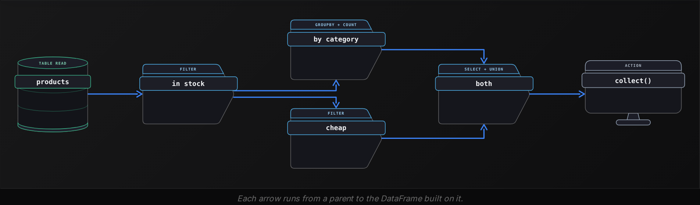
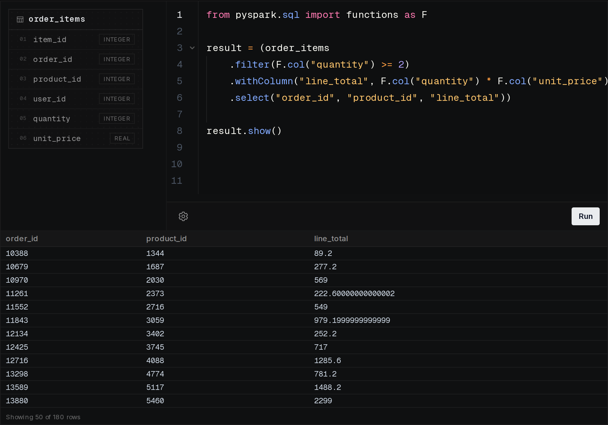

Intermediate·Spark · 14 min · 11 challenges

# Lazy Evaluation: Intermediate

At Netflix, an engineer patches the nightly viewing-hours table: read it, pass its rows through a Python fix, overwrite the same path. Every line before the write finishes in seconds, because no work has run. Then the write starts, deletes the old files, and launches tasks that look for those files. Knowing what Spark builds before it runs, and when it reads, decides whether that table survives the night.


<br>

---

## The DAG as a Graph

### Each DataFrame is a node with parents

A transformation returns a new DataFrame that stores 2 things: the operation, and a link to the DataFrame it was built from. No rows move. Chain 5 transformations and you hold 5 linked nodes, the last pointing back through the others to the source table.

Those links form a graph, and its shape starts to matter once your code branches. Two DataFrames can share a parent, and `union` gives a single node 2 parents. This chain does both:

```sql
in_stock = products.filter(F.col("in_stock") == 1)

by_category = in_stock.groupBy("category").agg(F.count(F.lit(1)).alias("n"))
cheap = in_stock.filter(F.col("price") < 20)

both = by_category.select("category").union(cheap.select("category"))
both.collect()
```



When `both.collect()` runs, Spark starts at the action and follows the links backward to every source it can reach. Each node on one of those paths joins the job, and a node on none of them stays a description. Call `cheap.collect()` instead and the `groupBy` never runs, because no link leads from `by_category` to `cheap`.


<br>

### A shared node is shared only in your code

Your code shows `in_stock` once, with 2 children. The plan Spark executes is a tree, so it copies the shared part into each branch: the `by_category` side gets its own read and filter of `products`, and the `cheap` side gets another. One action, 2 scans of the same table. On a 6-row table that costs nothing. On a 300GB table it doubles the read, and no line of your code shows it.

The cost of a branch point is paid once per path that leaves it and reaches the action. Build 3 DataFrames on `in_stock`, combine them into 1 result, and `products` is read 3 times.


<br>

### Where the graph is cut into stages

The scheduler takes the part of the graph an action needs and cuts it wherever rows must move between tasks, the stage boundary from the execution lessons. Everything between 2 cuts runs inside the same task, 1 partition per task. The animation plays a 6-row version of the `by_category` branch, with `products` read as 2 partitions and the count finished in 2 shuffle partitions.

https://github.com/user-attachments/assets/95207f4b-25ab-460b-bd85-22726ccf9240

| Stage | Work inside it | Tasks | How it ends |
| --- | --- | --- | --- |
| 1 | read products, keep in_stock = 1, start the count per category | 2, 1 per input partition | a shuffle that sends each category to a single task |
| 2 | finish the count for each category | 2, 1 per shuffle partition | 3 rows returned to the driver |

Four of the 6 rows pass the filter (product ids 1, 2, 4 and 5), and the driver receives Kitchen 2, Garden 1 and Toys 1. No stage-2 task can start until both stage-1 tasks finish, because either of them may hold Kitchen rows.


<br>

### The same graph in the Spark UI

The Spark UI's Jobs page lists each job beside the code line whose action launched it. Open a job and its DAG visualization draws the picture from this section: a box per stage with its operations inside, and an arrow wherever a shuffle connects 2 stages. Count the arrows to count the shuffles. Count how often 1 table's scan appears to catch a branch that reads its source twice.

> **TIP**
>
> Before opening the UI, sketch the graph from your code: a node per DataFrame variable and an arrow from each parent to its child, as in the diagram above. Any node with 2 or more arrows leaving it, on paths that all reach the same action, marks a source that gets read more than once.

**In the code from this section, how many times does Spark read products when both.collect() runs?**

```python
in_stock = products.filter(F.col("in_stock") == 1)

by_category = in_stock.groupBy("category").agg(F.count(F.lit(1)).alias("n"))
cheap = in_stock.filter(F.col("price") < 20)

both = by_category.select("category").union(cheap.select("category"))
both.collect()
```

- **A.** Once, because in_stock is 1 DataFrame and both branches share its rows
- **B.** Zero, because defining in_stock already read products and the action reuses it
- **C.** Twice, because each branch traces back to products separately and the plan holds 2 scans
- **D.** Three times: once for in_stock, and once more for each branch built on it

<details>
<summary>Solution</summary>

**C.** Twice, because each branch traces back to products separately and the plan holds 2 scans

The plan Spark runs is a tree. The by_category branch and the cheap branch each carry their own copy of the read and the filter, so 1 action scans the table 2 times.

**Why the others are wrong**

- **A.** Sharing a variable in your code does not share computed rows. The plan copies the in_stock part into each branch, and each copy carries its own scan.
- **B.** Defining a DataFrame reads nothing. The filter is recorded, and the read happens when the action runs.
- **D.** in_stock has no scan of its own beyond the copies inside the 2 branches. Count the paths from the action back to the source: there are 2.

</details>


<br>

---

## Jobs That Run Before an Action

The rule from the beginner lessons holds most of the time: transformations describe, actions run. It bends whenever Spark cannot finish describing the result without looking at data. A DataFrame must know every column's name and type from the line that creates it, and a few operations must know their output columns as well. When that information lives only inside the files, Spark launches a job on the spot, during the line you wrote.


<br>

### Reading a file without a schema

CSV and JSON files carry no column types, so reading one without a schema forces Spark to open the data:

```sql
events = spark.read.csv("/data/events/", header=True, inferSchema=True)
```

That single line launches 2 jobs. The first reads the first line of the input, which gives the column count and, with `header=True`, the names. The second reads every row of every file to settle each column's type, because a single value of `3.5` at row 40 million turns an integer column into a double. On a 200GB directory that is a full scan, paid again when your first action reads the same files.

| Read call | Jobs during the read | What the job reads |
| --- | --- | --- |
| CSV, no schema | 1 | the first line, for the column count and names |
| CSV with inferSchema=True | 2 | the first line, then every row |
| JSON, no schema | 1 | every row, to collect field names and types |
| Parquet | 1, small | 1 file footer, where the schema is stored |
| Any format with .schema(...) | 0 | nothing: the schema comes from you |

Declaring the schema removes the scan:

```sql
events = (spark.read
    .schema("event_id INT, user_id INT, event_type STRING, country STRING")
    .csv("/data/events/", header=True))
```

File listing still happens during the read. Spark lists the files on the driver, and when the directory tree holds more paths than `spark.sql.sources.parallelPartitionDiscovery.threshold` (32 by default), it runs the listing as a job of its own.


<br>

### pivot without its values

A `pivot` turns the distinct values of 1 column into output columns. Spark cannot name those columns without the values, so this line runs a job:

```sql
by_status = orders.groupBy("region").pivot("status").sum("profit")
```

The job finds the distinct `status` values, sorts them and collects them to the driver. Past `spark.sql.pivotMaxValues` (10,000 by default) the line fails. Listing the values yourself skips the job and pins the output schema: a new status that shows up next month adds no surprise column for every downstream reader.

```sql
by_status = (orders.groupBy("region")
    .pivot("status", ["Completed", "Pending", "Cancelled"])
    .sum("profit"))
```


<br>

### Extra jobs hiding inside one action

Some actions launch more than 1 job before the result arrives. A sort is the common case: `orderBy` sends rows to tasks by range of the sort key, and to choose the range boundaries Spark first runs a job that samples the key, then runs the work itself. `show()` is the other: it runs a job over 1 partition, and if that produces fewer than the 20 rows it wants, it runs another over up to 4 times as many partitions, and again, until it has enough. After a filter that keeps 0.01% of the rows, 1 `show()` can launch several jobs, each scanning more new partitions than the last.

> Finding early jobs in the Spark UI
>
> - Every job row names the source line that triggered it. A job tied to a read or a pivot ran before your action did.
> - A 1-task job right after a read is the first-line or footer fetch. A job with 1 task per input partition is a full inference scan.
> - A short job right before the main work of a sort is the sampling pass, and a run of growing jobs on 1 show() is the scale-up.

**Which lines launch a job before any action runs?**

```python
events = spark.read.json("/data/events/")
typed = spark.read.schema("user_id INT, event_type STRING, country STRING").json("/data/events/")
counts = events.groupBy("country").pivot("event_type", ["click", "view"]).count()
wide = typed.groupBy("country").pivot("event_type").count()
```

- **A.** Only the wide line, since pivot is the only operation here that must look at data
- **B.** The events read and the counts pivot, since every pivot collects its distinct values
- **C.** None of them, since Spark opens no file until an action such as collect() runs
- **D.** The events read and the wide pivot: one lacks a schema, the other its output columns

<details>
<summary>Solution</summary>

**D.** The events read and the wide pivot: one lacks a schema, the other its output columns

The JSON read without a schema scans every row for field names and types, and the pivot on typed runs a job to collect the distinct event_type values. typed and counts run nothing.

**Why the others are wrong**

- **A.** The events read also looks at data: JSON without a schema runs a full scan to find field names and types.
- **B.** counts lists its values, so Spark knows the output columns and runs nothing. A pivot runs a job only when the values are missing.
- **C.** That holds when Spark has everything it needs to build the plan. A missing schema and a pivot without values both force a job.

</details>


<br>

### What the value list decides

A value list skips the job, and it also fixes which columns the result has. A status that appears in the data but is missing from the list is dropped from the output, and its profit is counted in no column. A listed status that never occurs still gets a column, filled with null for every region. The list is part of the output contract: when a new status starts to matter, adding it is a deliberate change made in 1 place, and every reader of the table sees the new column on the same day.

**The orders data holds the statuses Completed, Pending and Refunded, and no row is Cancelled. Which columns does by_status have, and where does the Refunded profit go?**

```python
by_status = (orders.groupBy("region")
    .pivot("status", ["Completed", "Pending", "Cancelled"])
    .sum("profit"))
```

- **A.** region, Completed, Pending and Refunded: Spark adds a column for each status the data holds
- **B.** region, Completed, Pending and Cancelled; Cancelled is null everywhere and Refunded profit is dropped
- **C.** region, Completed and Pending; Cancelled is left out because no row in the data holds it
- **D.** region, Completed, Pending, Cancelled and Refunded, with Cancelled null for every region

<details>
<summary>Solution</summary>

**B.** region, Completed, Pending and Cancelled; Cancelled is null everywhere and Refunded profit is dropped

The list fixes the output columns. A listed status with no rows still gets a column of nulls, and an unlisted status is counted in no column.

**Why the others are wrong**

- **A.** With a value list, Spark collects nothing from the data. The columns are the listed values, so Refunded gets no column.
- **C.** Spark never checks whether a listed value occurs. Cancelled gets its column, filled with null for every region.
- **D.** The Cancelled column is right, but Refunded is missing from the list, so its rows add to no column.

</details>


<br>

---

## Overwriting What You Read

A DataFrame read from a path holds the list of files found there and the recipe to apply to them. The rows stay on disk until a job opens those files, which is safe as long as the files stay put, and dangerous the day a job writes over the path its own input points at.


<br>

### Spark blocks the direct case

This job lowercases every email and writes the result back where it came from:

```sql
users = spark.read.parquet("/data/users/")
fixed = users.withColumn("email", F.lower("email"))
fixed.write.mode("overwrite").parquet("/data/users/")
```

It fails when the write is called, before any task runs, with an `AnalysisException`: `Cannot overwrite a path that is also being read from.` The check compares the target path with every path the plan reads. Nothing is deleted.


<br>

### Why the guard exists

Overwrite mode empties the target first, then runs the job that produces the new files. With the guard out of the way, the steps would go like this:

| Step | What Spark does | Files in /data/users/ |
| --- | --- | --- |
| read.parquet | records the files it found: part-0 and part-1 | 2 |
| withColumn | adds lower(email) to the recipe | 2 |
| write, before any task | deletes everything at the target path | 0 |
| write, tasks start | each task opens part-0 or part-1 to read its rows | 0 |

Calling `users.count()` before the write would change nothing. An action computes its answer and keeps no rows, the re-execution rule from the beginner lessons, so the write's job goes back to the files regardless.


<br>

### When the guard cannot see the path

The guard reads the plan, so it catches only a read the plan still names. Convert the DataFrame to an RDD and back, a common move when the fix is a Python function over rows, and the new plan starts from an anonymous RDD with no path in it. Here `clean_row` is a Python function that lowercases a row's email:

```sql
users = spark.read.parquet("/data/users/")
fixed = spark.createDataFrame(users.rdd.map(clean_row), users.schema)
fixed.write.mode("overwrite").parquet("/data/users/")
```

The RDD still reads `/data/users/` lazily, but the plan the guard checks names no file, so the write goes ahead. The old files are deleted, the tasks try to open them, and each fails with an error saying a file does not exist and that the underlying files may have been updated. The job fails, and the path it set out to fix holds no data.

With `spark.sql.files.ignoreMissingFiles` set to `true`, which some teams enable to ride out files vanishing during a read, the outcome is worse: the tasks skip the deleted files instead of failing, the job reports success, and the table now has 0 rows.


<br>

### Write somewhere new, then switch

The fix leaves the input untouched until the output is complete. Write the result to a new path, check it, and move readers over only after the check passes:

```sql
fixed.write.mode("overwrite").parquet("/data/users_2024_03_15/")

check = spark.read.parquet("/data/users_2024_03_15/")
assert check.count() == spark.read.parquet("/data/users/").count()
```

Readers find the current version through 1 indirection, such as a table definition or a config value holding the path, and you update that pointer after the check. The old path stays readable until you delete it, so a bad run rolls back by pointing the indirection at yesterday's directory.

| ✓ Do | ✗ Don't |
| --- | --- |
| • Write each run to a new path and move readers over once the output is checked<br><br>• Treat a job whose input and output paths match as a bug, even when Spark lets it run<br><br>• Keep ignoreMissingFiles off in jobs that overwrite, so a missing input fails the run | • Count the input before the write and assume its rows are now held in memory<br><br>• Round-trip through .rdd and then overwrite the path you read from<br><br>• Overwrite in place to save storage; a single failed run costs you the whole table |

**clean_row lowercases the email field. What happens when the last line runs?**

```python
users = spark.read.parquet("/data/users/")
fixed = spark.createDataFrame(users.rdd.map(clean_row), users.schema)
print(users.count())
fixed.write.mode("overwrite").parquet("/data/users/")
```

- **A.** The guard finds no path in the plan, overwrite deletes the old files, and the tasks fail on files that are gone
- **B.** Spark raises an AnalysisException at the write, because fixed still reads /data/users/ underneath
- **C.** The write succeeds, because users.count() already loaded every row of the table into executor memory
- **D.** The write succeeds, but the new files hold only the rows the earlier count() happened to read

<details>
<summary>Solution</summary>

**A.** The guard finds no path in the plan, overwrite deletes the old files, and the tasks fail on files that are gone

The round trip through .rdd hides the read from the guard, but the RDD still reads /data/users/ lazily. Overwrite empties the path first, so the tasks open deleted files and the job fails with the table emptied.

**Why the others are wrong**

- **B.** The guard checks paths named in the plan. After createDataFrame over an RDD, the plan names no path, so the check passes.
- **C.** An action returns its result and keeps no rows. The write's job reads the files again, and by then they are deleted.
- **D.** count() read every row and kept none of them. Its job has no effect on what the later write reads.

</details>


<br>

---

## Pipelining Narrow Operations

### Narrow and wide

Sort every transformation by what 1 output partition needs. A narrow transformation builds each output partition from exactly 1 input partition: `filter`, `select`, `withColumn` and `union` work on the rows in front of them and nothing else. A wide transformation needs rows from many input partitions, because rows that share a key can sit in any of them: `groupBy`, `distinct` and `orderBy` are wide. Every shuffle and every stage cut you have seen so far sits at a wide transformation.


<br>

### A chain of narrow steps runs as 1 pass

Spark runs consecutive narrow transformations as 1 pass, which is called pipelining. The task reads a row, applies the first operation, hands the result to the second, and carries on to the end of the chain before it reads the next row. No step runs over the whole partition before the next begins, and no intermediate DataFrame is stored anywhere.

The animation plays a 3-step chain on 6 `order_items` rows split into 2 partitions: keep rows with `quantity >= 2`, compute `line_total`, keep 2 columns.

https://github.com/user-attachments/assets/a92c0d74-3d11-462d-9753-683b08db1943

The board shows 1 stage of 2 tasks and no shuffle. Each task carries its rows through all 3 steps, and the driver collects 4 rows: order 1 with 36, order 2 with 50, order 3 with 60 and order 5 with 80. The 2 rows with quantity 1 stop at the filter and never reach the multiplication.


<br>

### What pipelining buys, and what it hides

- A narrow step adds work per row, never a pass: 10 chained withColumn calls still read the input once.
- A task holds only the few rows in flight, so a 2GB partition can stream through a filter chain.
- The Spark UI times a stage as a whole. If 1 expression in the chain is slow, the stage is slow, with no step named.
- The chain ends at the first wide transformation, and every step after it belongs to the next stage.

Here is a longer job, with the stage each step lands in:

```sql
report = (transactions
    .filter(F.col("quantity") > 0)
    .withColumn("unit_price", F.col("total_amount") / F.col("quantity"))
    .groupBy("product_id")
    .agg(F.avg("unit_price").alias("avg_unit_price"))
    .filter(F.col("avg_unit_price") > 20)
    .orderBy(F.desc("avg_unit_price")))

report.collect()
```

| Step | Narrow or wide | Runs in |
| --- | --- | --- |
| read transactions | source | stage 1 |
| filter quantity > 0 | narrow | stage 1 |
| withColumn unit_price | narrow | stage 1 |
| groupBy + avg | wide | starts in stage 1, finishes in stage 2 |
| filter avg_unit_price > 20 | narrow | stage 2 |
| orderBy | wide | range shuffle ends stage 2, sort runs in stage 3 |
| collect | action | stage 3 sends the rows to the driver |

Five transformations, 3 stages, 2 shuffles, plus the sampling job a sort always brings. Each stage is 1 pipelined pass, so when this job is slow, the question for the Spark UI is which of the 3 stages takes the time, then which steps that stage contains.

Run the narrow chain on the practice data. Then add `.groupBy("order_id").agg(F.sum("line_total").alias("order_total"))` to the end of `result` and say which steps now run in stage 1 and which in stage 2.



```python
from pyspark.sql import functions as F

result = (order_items
    .filter(F.col("quantity") >= 2)
    .withColumn("line_total", F.col("quantity") * F.col("unit_price"))
    .select("order_id", "product_id", "line_total"))

result.show()
```

With the `groupBy` added, stage 1 holds the read, the filter, `line_total`, the `select` and the first half of the sum: each task adds up `line_total` per `order_id` for the rows it holds. The shuffle sends each `order_id` to a single task, and stage 2 adds those partial sums into `order_total`. The 3 narrow steps still cost 1 pass over the input, and the `groupBy` is the only new boundary in the job.

**How many stages does this job run, and how does stage 1 treat each row?**

```python
result = (user_events
    .filter(F.col("event_type") == "purchase")
    .withColumn("year", F.substring("event_date", 1, 4))
    .groupBy("user_id", "year")
    .agg(F.count(F.lit(1)).alias("purchases"))
    .withColumn("is_repeat", F.col("purchases") > 1)
    .collect())
```

- **A.** Five stages, 1 per transformation, each reading what the previous stage stored
- **B.** Two stages: in stage 1 each row is filtered and given year in 1 pass before the shuffle
- **C.** Two stages: stage 1 filters the whole partition, stores it, then adds year in a second pass
- **D.** Three stages, because the withColumn after the aggregation needs a stage of its own

<details>
<summary>Solution</summary>

**B.** Two stages: in stage 1 each row is filtered and given year in 1 pass before the shuffle

The filter and the first withColumn pipeline into stage 1, the groupBy cuts the job, and the end of the aggregation plus is_repeat pipeline into stage 2.

**Why the others are wrong**

- **A.** Narrow steps get no stages of their own. Only the groupBy cuts the job, so there are 2.
- **C.** The stage count is right, but narrow steps run row by row in 1 pass. No filtered copy of the partition is stored between them.
- **D.** is_repeat is narrow, so it joins the stage that finishes the aggregation. A step needs a new stage only when rows must move between tasks.

</details>

To place a step you have not met before, ask what 1 output partition needs. A `filter` on a column, a `withColumn` with arithmetic and a `select` need only the row in hand, so they join the current stage. A `distinct` must compare a row against copies that may sit in any partition, and an `orderBy` must know where every row ranks, so each one ends the stage. When a wide step cannot be avoided, putting the narrow filters before it means the shuffle moves fewer rows.

**This job has 1 shuffle. Which steps run in stage 1, before it?**

```python
result = (order_items
    .filter(F.col("quantity") >= 2)
    .withColumn("line_total", F.col("quantity") * F.col("unit_price"))
    .distinct()
    .select("order_id", "line_total")
    .collect())
```

- **A.** The read, the filter, line_total and select, since Spark moves every narrow step ahead of the wide one
- **B.** The read and the filter only, since withColumn computes a new value and so starts a stage
- **C.** Every step, since distinct only removes rows and moves none of them between tasks
- **D.** The read, the filter, line_total and the first half of distinct; select runs in stage 2

<details>
<summary>Solution</summary>

**D.** The read, the filter, line_total and the first half of distinct; select runs in stage 2

The narrow steps pipeline into 1 pass, each task drops the copies it holds, the shuffle gathers matching rows, and stage 2 finishes distinct and runs select.

**Why the others are wrong**

- **A.** The select comes after distinct in the chain, so it runs once the shuffle has delivered the deduplicated rows, in stage 2.
- **B.** Computing line_total needs only the row in hand, so it is narrow and pipelines with the filter.
- **C.** Two copies of a row can sit in different partitions, so distinct must bring them to 1 task. That move is the shuffle.

</details>


<br>

---

## DAG vs Lineage

Two names come up for the graph behind a DataFrame, and they refer to different objects with different lifetimes. Confusing them leads to wrong guesses about when work happens and what Spark repeats after a failure.


<br>

### Lineage: the recipe a DataFrame carries

Lineage is the chain of parent links from the first section: each DataFrame records its operation and its parents, all the way back to the source. It exists from the line that defines the DataFrame and lasts as long as the DataFrame does. It holds operations and parent links, with no stages or tasks. At the action, Spark expands it into datasets with partition-level dependencies: a narrow link says output partition 3 needs input partition 3, and a shuffle link says it needs a piece of every input partition.


<br>

### The DAG: the schedule for 1 job

The scheduler builds a DAG when an action submits a job. It takes the part of the lineage that action needs, cuts it at shuffle links, and produces stages and the tasks inside them. The DAG belongs to that job and is gone when the job ends. Two actions on the same DataFrame produce 2 jobs and 2 DAGs from 1 unchanged lineage, which is the re-execution from the beginner lessons seen from the scheduler's side.

| ✓ Lineage | ✗ DAG |
| --- | --- |
| • Recorded as each transformation is defined<br><br>• Lasts as long as the DataFrame<br><br>• Operations and the parents they read<br><br>• Answers: how is this partition rebuilt?<br><br>• Visible in your code as the chain of variables | • Built when an action submits a job<br><br>• Discarded when that job ends<br><br>• Stages and the tasks inside them<br><br>• Answers: what runs, in what order?<br><br>• Visible in the Spark UI, 1 diagram per job |


<br>

### Following both through 4 lines

```sql
clean = page_views.filter(F.col("dur_ms") > 0)
per_page = clean.groupBy("page_url").agg(F.count(F.lit(1)).alias("views"))
per_page.collect()
per_page.filter(F.col("views") > 100).collect()
```

| Line | Lineage afterwards | DAG afterwards |
| --- | --- | --- |
| clean = ... | read page_views, filter | none |
| per_page = ... | read, filter, groupBy and count | none |
| per_page.collect() | unchanged | job 1: 2 stages, discarded when it ends |
| per_page.filter(...).collect() | a new DataFrame: per_page plus 1 filter | job 2: 2 stages, built from scratch |

Job 2 repeats the read, the filter and the count, because nothing from job 1 was kept. Reading the table this way shows where the cost sits: lineage grows with every line and costs almost nothing to extend, while each DAG is a full run of everything upstream of its action.


<br>

### What each one does after a lost executor

When an executor dies, the partitions it held are gone, and Spark rebuilds them from lineage. A partition behind narrow links is rebuilt by re-running its chain from the 1 source partition it came from, and nothing else. A partition behind a shuffle link needs the shuffle files the parent stage wrote; if those lived on the lost executor too, the scheduler re-runs the parent-stage tasks that produced them.

So lineage says what to recompute, and the DAG's stage boundaries decide how far back the recomputation reaches. A loss inside a pipeline of narrow steps costs a few task re-runs. A loss after 3 shuffles can pull work back through all 3 of them.

> **TIP**
>
> When a second action on a DataFrame takes as long as the first, read its lineage: every operation upstream of that action runs again, whatever earlier jobs already computed from it.

**These 3 lines have run and no action has been called. What does Spark hold for top?**

```python
clean = page_views.filter(F.col("dur_ms") > 0)
per_page = clean.groupBy("page_url").agg(F.count(F.lit(1)).alias("views"))
top = per_page.filter(F.col("views") > 100)
```

- **A.** A DAG of 2 stages, built when per_page was defined, waiting for an action to run it
- **B.** Nothing yet: Spark records the chain of operations only when the first action begins
- **C.** A lineage of 3 operations back to page_views, and no DAG until an action asks for top
- **D.** A lineage and a DAG, both built line by line, so the action only has to launch the tasks

<details>
<summary>Solution</summary>

**C.** A lineage of 3 operations back to page_views, and no DAG until an action asks for top

Each line added 1 link to the recipe. Stages and tasks come later, when an action on top hands that lineage to the scheduler.

**Why the others are wrong**

- **A.** Defining a DataFrame builds no stages. The scheduler creates a DAG only when an action submits a job.
- **B.** The chain is recorded line by line. Each assignment stores the operation and its parent immediately.
- **D.** The lineage grows line by line, but the DAG depends on which action runs. It is built at that moment and discarded when the job ends.

</details>


<br>

---

## Putting It All Together

A subscription company's nightly billing job reads raw CSV invoices with inferSchema, pivots revenue by plan without listing the plans, and splits the cleaned rows into 2 branches, monthly and annual, that it unions back into 1 report. A second step reads the published report, patches rows in a Python function via .rdd, and overwrites the report's own path. The Spark UI shows 3 jobs before the first action, the report job scans the invoices 2 times, and one night the patch step fails and leaves the report path empty.

- The 3 early jobs come from the read and the pivot: a declared schema removes the first-line and inference jobs, and an explicit plan list removes the pivot job.
- The 2 scans come from the branch point: both branches trace back to the invoices, and the plan copies the shared part into each.
- Inside the report job, the read, filters and column fixes before the pivot's shuffle pipeline into 1 stage, so extra cleanup steps add per-row work and no extra pass.
- The patch step hides its input path from the overwrite guard; writing to a dated path and switching readers after a check keeps the old report intact.
- When an executor dies mid-run, lineage rebuilds the lost partitions, and the DAG's stage boundaries decide how much of the job runs again.


<br>

---

## Key Takeaways

- Every DataFrame is a node linked to its parents, and an action runs only the nodes on paths from it back to the sources.
- A node your code shares between branches is copied into each branch of the plan, so its source is read once per branch.
- Spark runs a job before any action when it needs data to finish the plan: CSV and JSON reads without a schema, Parquet footers, pivot without values.
- Overwrite deletes the target before the tasks read their input. Spark blocks the direct case, and an RDD round trip hides it from the guard.
- Consecutive narrow transformations run as 1 pass inside 1 task, and only wide transformations add stages.
- Lineage is the recipe each DataFrame keeps for rebuilding lost partitions; the DAG is the schedule of stages built for a single job.
