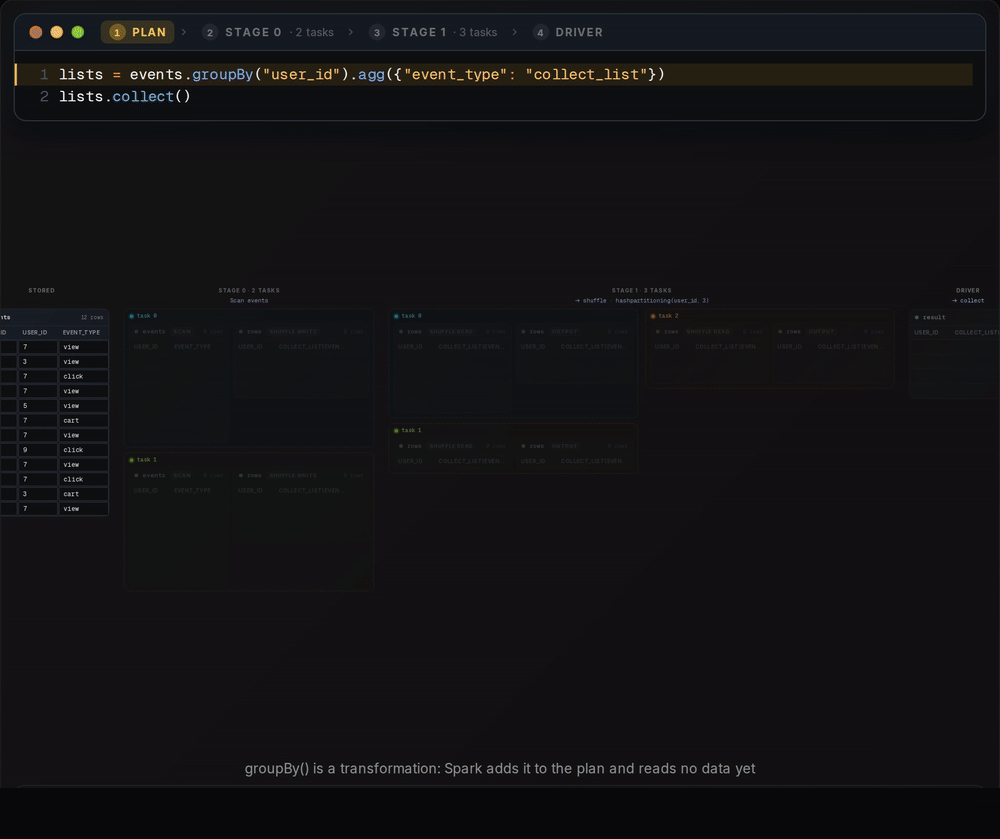
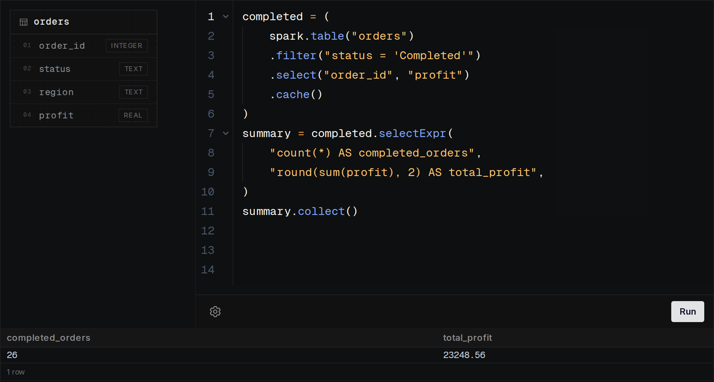

Advanced·Spark · 15 min · 15 challenges

# Memory and Caching: Advanced

It is 3 a.m. at Uber, and a nightly surge-pricing feature job has died for the third time. One stage spends 40% of its task time collecting garbage, the cached trips table has fallen to 61% in memory without a single error, and the latest executors vanished with exit code 137 and no stack trace. Which memory region failed decides which fix ships before the morning model refresh.


<br>

---

## Tuning the Garbage Collector

Every executor is a single JVM, and every object its tasks create lives on that JVM's heap until the garbage collector proves nothing still points to it. The collector divides the heap into a young generation, where objects are born and most die within milliseconds, and an old generation, where survivors are promoted. Young collections are frequent and cheap. Reclaiming the old generation means tracing everything still alive there, and the stop-the-world phases of that work freeze every task thread on the executor at once, so a single long pause stalls all of its cores together.


<br>

### Reading the GC share

Spark records how long each task spent inside garbage collection. The Executors tab shows it inside `Task Time (GC Time)` and colors that cell red once GC passes 10% of task time, and a stage's task table lists it per task. Below 10%, collection is a minor cost and tuning the collector buys almost nothing. Above 10%, ask why the heap churns, because 2 stages with the same GC share can need opposite fixes.

| Reading | Stage 4 | Stage 7 |
| --- | --- | --- |
| Executor heap | 48GB | 16GB |
| Collector | Parallel, the Java 8 default | G1 |
| Median task time | 45s | 52s |
| Median GC time | 18s | 21s |
| GC share | 40% | 40% |
| Storage memory used | 2.1GB of 28.6GB | 9.3GB of 9.4GB |
| Spill per task | 0 | 1.8GB |
| Failed tasks | 0 | 6, all OutOfMemoryError |

Stage 4 has room to spare: storage holds 2.1GB of 28.6GB, and no task spills or fails. Its lost time is pauses. The parallel collector stops every thread for each old-generation collection, and that work grows with the old generation, so on a 48GB heap a single pause can last seconds. That is a policy problem, and changing the collector fixes it. Stage 7 is a capacity problem. Its storage sits at its limit and its tasks spill, with 6 of them dying. Each collection frees little because nearly everything on the heap is still in use, so the collector runs again almost at once, and no collector setting creates room that live data already fills.


<br>

### When the collector is the fix

On Java 8 the default collector is Parallel; from Java 9 onward the JVM picks G1 on server-class machines. G1 splits the heap into equal regions and reclaims the old generation a few regions at a time, aiming to hold each pause under `-XX:MaxGCPauseMillis`, 200ms by default. A large executor heap still on the parallel collector should try G1 first. Once on G1, 3 more flags do most of the remaining work.

```sql
spark = (
    SparkSession.builder
    .config("spark.executor.memory", "16g")
    .config(
        "spark.executor.extraJavaOptions",
        "-XX:+UseG1GC "
        "-XX:InitiatingHeapOccupancyPercent=35 "
        "-XX:G1HeapRegionSize=16m "
        "-XX:ConcGCThreads=4",
    )
    .getOrCreate()
)
```

What each G1 flag changes

- InitiatingHeapOccupancyPercent=35: G1 starts marking the old generation when the heap is 35% occupied instead of the default 45%, so marking finishes before free regions run out and force a full stop-the-world collection. From Java 9, adaptive tuning treats this as a starting value.
- G1HeapRegionSize=16m: an object at least half a region in size is humongous and goes straight into old regions. A 16GB heap defaults to 8MB regions, making every array of 4MB or more humongous, and Spark allocates many large arrays for execution pages and cached batches. Setting 16m raises the threshold to 8MB, and Spark's tuning guide advises a larger region size for large heaps.
- ConcGCThreads=4: more threads for the marking that runs alongside tasks, so it keeps pace with allocation, paid for in CPU the tasks would otherwise use.


> Before you touch the flags
>
> - Spark refuses `-Xmx` inside `spark.executor.extraJavaOptions`; heap size comes only from `spark.executor.memory`.
> - Executor JVMs read their flags at launch, so set them in the submit config or the session builder, before any executor starts.
> - Under a 10% GC share, leave the collector alone and find the slow stage's real cost elsewhere.

For a capacity problem like Stage 7, shrink what lives on the heap instead. Give each executor fewer cores so fewer tasks share it, or split the work into more partitions so each task holds less. Caching less also helps, and so does moving execution buffers and cached data out of the heap, which the next section covers.

**An executor runs a 40GB heap on Java 8 with no collector flags. Its stage shows a 30% GC share and storage memory at 3GB of 23.8GB. No task spills or fails, but every few minutes all its tasks freeze together for several seconds. What is the best first change?**

- **A.** Raise spark.executor.memory to 56g so that old-generation collections come less often
- **B.** Add -XX:+UseG1GC to spark.executor.extraJavaOptions to replace the parallel collector
- **C.** Add -Xmx48g to spark.executor.extraJavaOptions to give the old generation more room
- **D.** Persist the input with MEMORY_ONLY so tasks stop rereading it and allocate less

<details>
<summary>Solution</summary>

**B.** Add -XX:+UseG1GC to spark.executor.extraJavaOptions to replace the parallel collector

With storage free and nothing spilling, long synchronized freezes point at the collector's policy. Java 8 defaults to the parallel collector, and G1 reclaims the old generation in regions under a pause target.

**Why the others are wrong**

- **A.** Collections would come less often, but each parallel pause grows with the old generation, so every freeze would last longer. Memory was never short here.
- **C.** Spark refuses to start executors whose Java options set -Xmx, and a larger heap would lengthen the pauses even if it were allowed.
- **D.** A cache adds long-lived data to the heap, giving every old-generation collection more to trace, so the freezes would grow.

</details>


<br>

---

## Off-Heap Memory

The collector only traces objects on the heap. Spark's memory manager can also allocate native memory outside the heap for the binary rows its operators already use, and the collector neither traces data kept there nor copies it between generations. Two settings create an off-heap pool, which Spark runs as a second unified pool with the same execution and storage split as the one on the heap.

```sql
spark = (
    SparkSession.builder
    .config("spark.executor.memory", "16g")
    .config("spark.memory.offHeap.enabled", "true")
    .config("spark.memory.offHeap.size", "8g")
    .getOrCreate()
)
```


<br>

### What moves off the heap

The switch moves the execution memory of Tungsten, Spark SQL's engine for operators that work on binary rows in pages Spark allocates itself, as a whole: every sort buffer built from binary rows, and every hash table that aggregations and joins build from them, now takes its pages from the off-heap pool. The heap's execution share keeps serving only the older object-based paths, such as RDD aggregations, and on-heap caching can borrow what they leave idle. So the heap should shrink when off-heap memory is added, or most of its execution share sits unused.

| ✓ Moves off the heap | ✗ Stays on the heap |
| --- | --- |
| • Binary-row sort buffers, plus the hash tables aggregations and joins build<br><br>• Shuffle write buffers filled by those operators<br><br>• Blocks persisted with StorageLevel.OFF_HEAP, always serialized, falling back to disk | • DataFrames cached with cache(), whose default level stores on the heap<br><br>• Broadcast tables and the objects tasks create<br><br>• RDD aggregations, which buffer JVM objects<br><br>• Task bookkeeping and query plan metadata |

*The off-heap pool follows the same spark.memory.storageFraction as the heap: 4,096MB starts as protected storage, and execution can borrow whatever storage leaves free.*


<br>

### Budgeting the whole container

Off-heap memory sits outside `-Xmx`, so the heap limit cannot cap it. Spark's own accounting keeps it within `spark.memory.offHeap.size`, and the container needs room for that much on top of everything else. Spark 3 adds the off-heap size to the executor's container request as a separate amount; Spark 2 expected it to fit inside `spark.executor.memoryOverhead`, so a config carried over from an old job can count it twice or not at all. Here is the full budget for the executor above, with overhead at its default of 10% of the heap.

| Region | Size | What it holds | Traced by the collector |
| --- | --- | --- | --- |
| Reserved | 300MB | Spark's internal objects | Yes |
| User memory | 6,434MB | Objects your code and Spark's metadata create | Yes |
| Unified pool, on heap | 9,650MB | On-heap caching and object-based execution | Yes |
| Off-heap pool | 8,192MB | Execution pages and OFF_HEAP blocks, split 4,096MB each way | No |
| memoryOverhead | 1,638MB | Thread stacks, network buffers, Python worker processes | No |
| Container | 26,214MB | The limit the cluster manager enforces | Not applicable |

The first 3 rows add up to the 16,384MB heap. Adding the 8,192MB pool while keeping a 16g heap grows each container by that full amount, and nodes already packed with these executors now fit fewer. The useful version of this change lowers `spark.executor.memory` at the same time: a 10g heap beside the 8g pool requests 19,456MB, only 1,434MB more than the 16g heap needed alone, and the collector now traces 10GB instead of 16GB.

> **TIP**
>
> To confirm the pool is in use, turn on the Off Heap Storage Memory column in the Executors tab: it shows used and total off-heap storage for each executor. A total of 0 means the setting never reached the executors.

Off-heap memory pays off when collection time comes from Spark-managed data: large sort and aggregation buffers, or a big serialized cache, on a heap the collector struggles to keep up with. It does nothing for pressure from broadcast tables or task objects, which stay on the heap. And every off-heap block is serialized, so reading it costs a decode that an on-heap deserialized cache skips.

**An executor on Spark 3 is configured with spark.executor.memory set to 20g, default overhead, spark.memory.offHeap.enabled true and spark.memory.offHeap.size 6g. How much memory does its container request?**

- **A.** 20,480MB, because the off-heap pool and overhead are both carved out of the 20g heap
- **B.** 22,528MB, the heap plus 2,048MB of overhead, with off-heap memory left uncounted
- **C.** 26,624MB, the heap plus 6,144MB of off-heap memory, with no overhead on top
- **D.** 28,672MB, the heap plus 2,048MB of overhead plus 6,144MB of off-heap memory

<details>
<summary>Solution</summary>

**D.** 28,672MB, the heap plus 2,048MB of overhead plus 6,144MB of off-heap memory

Spark 3 sums all 3: 20,480MB of heap, overhead at 10% of it, and the off-heap pool, which sits outside -Xmx and needs its own room.

**Why the others are wrong**

- **A.** Neither comes from the heap: off-heap memory is native memory outside -Xmx, and overhead is an allowance requested on top of it.
- **B.** That was the Spark 2 picture, where off-heap memory had to fit inside overhead. Spark 3 requests it separately, so this total is 6,144MB short.
- **C.** Overhead still applies at 10% of the heap, 2,048MB here. It covers thread stacks and network buffers as well as any Python workers.

</details>


<br>

---

## Cache Eviction

A cached DataFrame is a set of blocks, 1 per partition, each held by the block manager of the executor that computed it. Blocks live in the storage side of the unified pool, and they leave it in 2 ways. When a new block needs room, the block manager evicts the least recently used blocks of other datasets. When a task needs execution memory, it can take back whatever storage has borrowed beyond `spark.memory.storageFraction` of the pool, 0.5 by default, evicting blocks until it has enough. Blocks below that line are safe from execution, though a newer cache can still push them out.

Neither kind of eviction raises an error. A block stored with `MEMORY_ONLY` is dropped, and the next action that needs that partition rebuilds it from lineage inside the task: the source read and every transformation that built the cached DataFrame run again for that partition. A level that includes disk writes the evicted block to local disk instead, which costs a read but no recompute. One more rule shapes what you see: a block being stored never evicts blocks of its own dataset, so a DataFrame larger than its memory ends up partly cached, and under `MEMORY_ONLY` the partitions that never fit are recomputed on every action.


<br>

### Watching a cache shrink

Take the trips cache from a nightly pricing job: 200 partitions persisted with `MEMORY_ONLY` over 10 executors, each with a 9,650MB unified pool from a 16g heap. Here is its Storage tab row, read at 2 moments:

| When | Cached Partitions | Fraction Cached | Size in Memory |
| --- | --- | --- | --- |
| After the first action | 200 | 100% | 79,100MB |
| After the join stage | 122 | 61% | 48,251MB |

Each executor held 20 partitions, 7,910MB, against a protected half of 4,825MB. The join stage needed execution memory, reclaimed the borrowed share, and left every executor with about 12 partitions. The 78 that left were dropped, so the next stage that reads the cache rebuilds each of them from the trip source and the enrichment that produced it, on every run, without a line in the driver log.


<br>

### Residency versus intent

Which signals report what is actually held

- spark.catalog.isCached and df.storageLevel report what you asked for, and both still say cached after every block is gone.
- The Storage tab's Fraction Cached reports what is held right now; anything under 100% means some partitions come from source.
- A task that read its partition from the cache runs PROCESS_LOCAL on the executor holding the block, while a rebuilt partition shows the locality of the source read.
- A lost executor takes its blocks with it, so a stage that retried after an executor loss is reading a smaller cache.


<br>

### Keeping the cache resident

| ✓ Do | ✗ Don't |
| --- | --- |
| • Persist with MEMORY_AND_DISK when a rebuild costs more than a local disk read<br><br>• Select and filter before caching, so the blocks fit inside the protected half<br><br>• Call unpersist() on caches a loop no longer reads, before the next iteration<br><br>• Checkpoint data whose rebuild you cannot afford at all, or write it out and read it back | • Treat isCached as proof that a partition is still in memory<br><br>• Cache a DataFrame larger than the storage memory your executors hold<br><br>• Raise spark.memory.storageFraction without checking the spill it adds |

Raising `spark.memory.storageFraction` to 0.85 would protect about 8,200MB per executor, enough for all 20 trip partitions, but it leaves execution a guaranteed 1,450MB, so the join stage would spill instead of evicting. Size the protection from the cache's real footprint in the Storage tab.

**A loop persists features with MEMORY_ONLY and reads it in every iteration. features.storageLevel still reports MEMORY_ONLY, yet iteration 3 takes twice as long as iteration 1, and the Storage tab shows Fraction Cached at 55%. What explains it?**

- **A.** Execution or newer caches evicted 45% of the blocks, and each action rebuilds those partitions
- **B.** The evicted 45% went to local disk, and iteration 3 pays to read those blocks back
- **C.** The cache was never built, because persist() stores nothing until unpersist() runs
- **D.** The loop's lineage grew so long that Spark stopped reading the cache in later iterations

<details>
<summary>Solution</summary>

**A.** Execution or newer caches evicted 45% of the blocks, and each action rebuilds those partitions

storageLevel reports the request, while Fraction Cached reports what is held. Under MEMORY_ONLY an evicted block is dropped, so each iteration recomputes those partitions from lineage.

**Why the others are wrong**

- **B.** Only levels that include disk write evicted blocks out. MEMORY_ONLY drops them, so the extra time is recompute, which a disk level would have turned into reads.
- **C.** persist() waits for the first action, and the 55% shows blocks were built. unpersist() removes blocks and never creates them.
- **D.** A long lineage slows planning, but a matching cached plan is still read. Partial residency with the rest rebuilt explains the slowdown.

</details>

`unpersist()` acts at once: it removes the blocks as soon as it runs, with no action needed. So it belongs after the last action that reads the cache. Called 1 action early, that last action finds no blocks and rebuilds every partition from lineage, which is the same recompute an eviction causes, this time chosen by your own code.


<br>

---

## OOM Forensics

An out-of-memory failure names a place, and the place picks the fix. Raising `spark.executor.memory` after a driver OOM changes nothing, and raising it after a container kill puts most of the new memory into a heap that never filled. Asked in this order, 3 questions classify almost every case.

Classifying the failure

- Which process failed? A driver OOM fails the whole application at once. An executor failure shows in the driver as a failed task, with the error as its failure reason, or as a lost executor.
- Did the JVM throw, or was the process killed from outside? A thrown OutOfMemoryError carries a Java stack trace. A kill leaves an exit code, usually 137 or 143, and no trace.
- What was running? The failed task's stage, its operator and the size of its partition show whether a single task was oversized or every task shared too little.

| Where | What you see | Usual cause | First fix |
| --- | --- | --- | --- |
| Driver heap | `OutOfMemoryError: Java heap space` on the driver, ending the application | A large `collect()`, or building a broadcast table | Keep results on the cluster: aggregate first or write them out |
| Driver result limit | `Total size of serialized results ... is bigger than spark.driver.maxResultSize` | The same large `collect()`, stopped at the 1g default | The same; raising the limit moves the crash into the driver heap |
| Executor heap | `Java heap space`, or `GC overhead limit exceeded` under the parallel collector, on a task that fails 4 attempts before the stage aborts | A single task holding a hot key's group, a broadcast table too big for the heap, or too many tasks sharing one heap | Shrink the oversized task, use fewer cores per executor, stop broadcasting the big side |
| Execution pool | `SparkOutOfMemoryError: Unable to acquire 65536 bytes of memory, got 0` | A task needed another page and nothing could spill to free one | More shuffle partitions, or fewer concurrent tasks per executor |
| Container limit | Executor lost with exit code 137 or 143 and no stack trace | Memory outside the heap: Python workers, network buffers, an unbudgeted off-heap pool | Raise `spark.executor.memoryOverhead`, or budget off-heap memory |
| Direct buffers | `OutOfMemoryError: Direct buffer memory` while reading shuffle blocks | Network buffers for many large fetches in flight at once | Lower `spark.reducer.maxSizeInFlight` from its 48m default, raise overhead |


<br>

### Case: the hot-key list

Back in the pricing job, a stage builds each rider's list of trip events with `collect_list`. Most tasks finish in seconds. One fails with `Java heap space`, is retried 3 times, and the stage aborts on the 4th failure. The animation below plays the same grouping on 12 events and shows why no retry can succeed.



The shuffle sends every row for a key to the same reduce task. User 7 owns 8 of the 12 events, so one task assembles a list twice the size of all the others combined, while the remaining lists stay short. Scaled up to a rider with millions of events, that single task holds the whole list in its heap, and every retry hands the same rider to a task with the same heap. Raising executor memory postpones the failure until that rider's list grows again. The first fix changes what the task must hold: aggregate the hot rider to counts or a capped sample instead of a full list, or split the hot key off and process it on its own path.


<br>

### Case: Exit Code 137

Later the same night, executors start disappearing with exit code 137. Their tasks show peak execution memory well under each task's share and no Java error at all. Nothing inside the heap ran out: the process as a whole crossed its container's limit, and the cluster manager killed it. The first fix is a larger `spark.executor.memoryOverhead`. If the job also enables off-heap memory, confirm next that the container budget includes `spark.memory.offHeap.size` alongside heap and overhead.


<br>

### Case: the result that came home

The morning report ends with `collect()` on 9 million priced rows, and the driver stops it with the `maxResultSize` error at the 1g default. Raising the limit to 2g lets more bytes through and moves the failure into the driver heap, which must hold every row as an object once they arrive. The first fix keeps the rows on the cluster: write the priced table out, and let the report read a summary of it.

> Fixes that hide the cause
>
> - Raising `spark.driver.maxResultSize` turns a clean refusal into a driver heap OOM.
> - Adding executor memory for a hot key lasts only until its row count grows again.
> - Adding shuffle partitions leaves every row of a hot key on the same task.
> - Raising the heap after a container kill feeds the region that never filled.

**A stage loses 3 executors, each reported with exit code 143 and no Java stack trace. Their tasks peak at about half their execution memory share without spilling, and task sizes are even across the stage. What is the best first fix?**

- **A.** Raise spark.executor.memory, so every memory region inside the executor grows
- **B.** Raise spark.sql.shuffle.partitions, so each task needs less execution memory
- **C.** Raise spark.executor.memoryOverhead, since the process outgrew its container
- **D.** Salt the join key, since a single task must be holding a hot key's rows

<details>
<summary>Solution</summary>

**C.** Raise spark.executor.memoryOverhead, since the process outgrew its container

No stack trace plus an outside kill means the whole process crossed the container limit while the heap had room. Overhead covers the native memory that grew.

**Why the others are wrong**

- **A.** Most of the new memory would land in a heap that never filled. An outside kill means memory beyond the heap grew, and only overhead covers that.
- **B.** Execution memory sat at half its share, so smaller tasks change nothing that failed. The process was killed for memory outside the heap.
- **D.** A hot key fails a single oversized task with a Java heap error, and these tasks are even. Salting answers a problem this stage does not have.

</details>


<br>

---

## Caching Before the Filter

Take an `events` table partitioned by `event_date` into 90 daily directories, with 40 columns in its files. A job needs Brazil's events from a single day and reuses them in 3 aggregations, so it caches. Here are 2 placements of `cache()` that return identical rows.

```sql
events = spark.table("events").cache()
brazil = (
    events
    .filter("event_date = '2024-03-14' AND country = 'BR'")
    .select("user_id", "event_type")
)
brazil.count()
```

```sql
brazil = (
    spark.table("events")
    .filter("event_date = '2024-03-14' AND country = 'BR'")
    .select("user_id", "event_type")
    .cache()
)
brazil.count()
```


<br>

### Why the filter stops at the cache

Calling `cache()` registers the plan as it stands at that moment with Spark's cache manager. When a later query is planned, Spark searches it for any subtree that produces the same result as a registered plan and swaps that subtree for an `InMemoryRelation`. That swap happens before optimization. In the first version the registered plan is a scan of every file, so by the time the optimizer would push `event_date` and `country` into the scan, the scan sits behind the cache. Both conditions run as a filter over cached batches, and the first action reads and stores all 90 partitions and all 40 columns.

Filter, then cache

| Plan detail | Value |
| --- | --- |
| PartitionFilters | event_date = 2024-03-14 |
| PushedFilters | country = BR |
| ReadSchema | user_id, event_type, country |
| Partitions scanned | 1 of 90 |
| Cache holds | 2 columns, Brazil only |

Cache, then filter

| Plan detail | Value |
| --- | --- |
| PartitionFilters | none |
| PushedFilters | none |
| ReadSchema | all 40 columns |
| Partitions scanned | 90 of 90 |
| Cache holds | 40 columns, every country |

- **540GB** — read and cached by the cache-first job
- **6GB** — a single day of files, filter-first

Cache eviction makes the cache-first job worse. Storage memory sized for a single day's slice cannot hold the whole table, so `cache()`, whose default level includes disk, writes most of it to the executors' local disks before the first count returns, and all of it was read without pruning. The filter-first job reads even less than its day of files, because column pruning skips the 37 columns that nothing selects or filters on.

> **TIP**
>
> The cache also reaches past your own variable. Any later query in the session that reads `spark.table("events")` matches the registered plan and reads from the cache, including a later cell's 1-day report that would otherwise have pruned its read to a single partition.

*Cached batches carry per-column minimum and maximum values, so InMemoryTableScan can skip whole batches that cannot match a filter. That saving starts only after the full table has been read and stored.*

> Spotting It in explain()
>
> - `InMemoryRelation` sitting directly above a `FileScan` means the cache holds that scan's full output.
> - Empty `PartitionFilters` and `PushedFilters` under it, on a filtered query, mean pruning was lost.
> - A `ReadSchema` listing every column under it means column pruning was lost too.


<br>

### Where the cache belongs

Caching before the filter is right only when the consumers truly share the whole input. If 6 reports each filter a different country from the same day, cache that day once, with the union of the columns they need, and let each report apply its own country filter to the cache. The cached plan should get every filter and column choice all its consumers share and leave out only what they differ on. If the shared part still exceeds storage memory, write it out as a table and let each consumer prune its own read.

**A notebook caches spark.table("clicks") and runs 1 aggregation on it. Later in the same session it runs spark.table("clicks").filter("click_day = '2024-03-14'").count(), where clicks is partitioned by click_day, and every cached block is still resident. How many partitions does that count read from the files?**

- **A.** One partition, because the filter on click_day prunes the file read to a single directory
- **B.** Every partition, because a filtered query forces the cached plan to be rebuilt
- **C.** One partition, because the cache manager substitutes plans only for the variable that called cache()
- **D.** None, because the query matches the cached plan and reads its blocks instead

<details>
<summary>Solution</summary>

**D.** None, because the query matches the cached plan and reads its blocks instead

The scan subtree produces the same result as the registered plan, so it becomes an InMemoryRelation, and the filter runs over cached batches. At cache()'s default level, an evicted block would come back from local disk.

**Why the others are wrong**

- **A.** Pruning would apply if the scan reached the optimizer, but the scan matches the registered plan and is swapped for the cache first.
- **B.** A matching cached plan is reused as it is, and the filter runs over its batches. Only a lost block, such as one on a lost executor, sends Spark back to the full, unpruned scan.
- **C.** Substitution matches plans by the result they produce, regardless of variable, so any read of clicks in the session finds the cache.

</details>

Run the filter-first version on `orders`. Then move `.cache()` to directly after `spark.table("orders")`, which puts the filter and select after it. Run again. The 2 results match: placement changes what Spark reads and stores, and the rows stay the same. To see which version you wrote, call `completed.explain()` in each. Filter-first, the plan under `InMemoryRelation` holds the `Filter` on `status` and a scan reading 3 of the table's 4 columns. Cache-first, `InMemoryRelation` sits directly above a scan reading all 4 columns, and the `Filter` runs on top of `InMemoryTableScan`.



```python
completed = (
    spark.table("orders")
    .filter("status = 'Completed'")
    .select("order_id", "profit")
    .cache()
)
summary = completed.selectExpr(
    "count(*) AS completed_orders",
    "round(sum(profit), 2) AS total_profit",
)
summary.collect()
```


<br>

---

## Putting It All Together

Picture the Uber surge-pricing feature job from the start of the lesson, fixed in one pass. The stage at a 40% GC share on a 48GB parallel-collector heap moves to G1. Its sort buffers move to an 8g off-heap pool, with the heap trimmed so the container barely grows. The trips cache is narrowed to the day and columns the pricing stages share, persisted with disk, so the join stage can no longer drop 78 partitions behind the job's back. The hot rider's event list becomes counts, and the exit code 137 kills stop once overhead covers the memory outside the heap.

- The GC share decides whether flags help; a full heap sends you to off-heap memory or a smaller cache instead.
- Off-heap memory shrinks what the collector traces, and every byte of it must appear in the container budget, or the job trades GC pauses for exit code 137.
- Execution memory reclaiming storage is what evicts a cache, so a cache sized below the protected half survives the join stage.
- Caching after the filter shrinks the cache, which keeps it resident, which keeps every action reading pruned data.
- An OOM's location tells you which of these regions overflowed, and so which of the lesson's fixes applies.


<br>

---

## Key Takeaways

- Tune the collector only when GC passes 10% of task time and memory has room; a heap full of live data needs less data on it, which no flag provides.
- Off-heap memory takes Tungsten execution and OFF_HEAP blocks out of the collector's reach, and the container needs room for that pool beyond the heap plus its overhead.
- Eviction is silent: storageLevel reports the request, Fraction Cached reports residency, and MEMORY_ONLY blocks that leave are rebuilt from lineage.
- Classify an OOM by process, by thrown versus killed, and by what the task held, then reach for the fix that region needs.
- A cache freezes its plan as written, so cache after the filters and columns every consumer shares. A cache placed earlier loses pruning and pushdown for every read that matches it.
