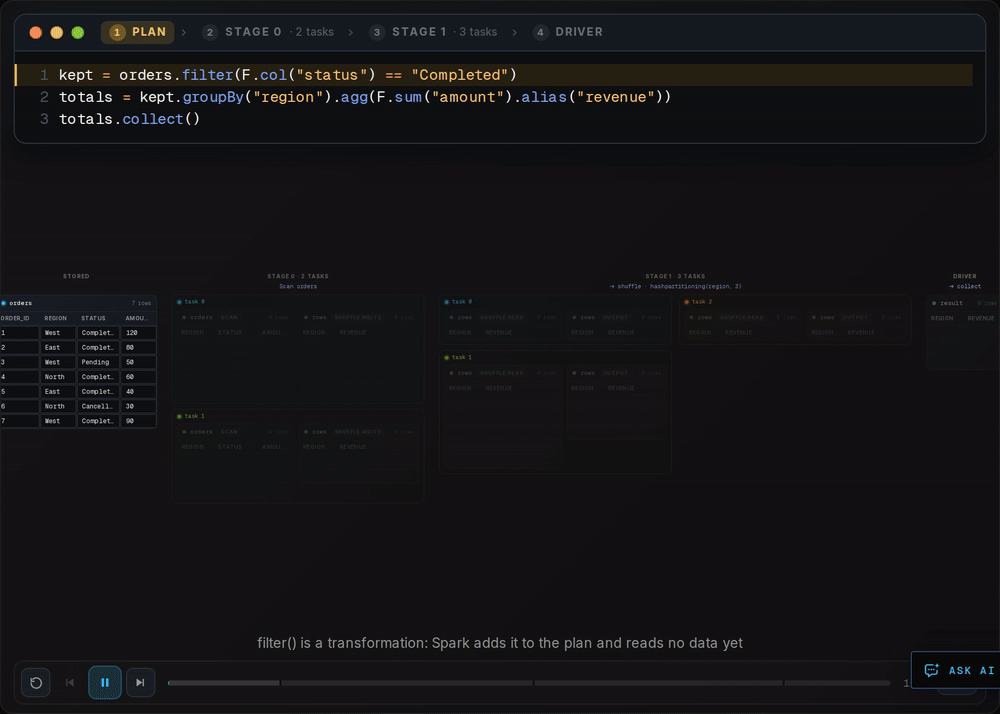
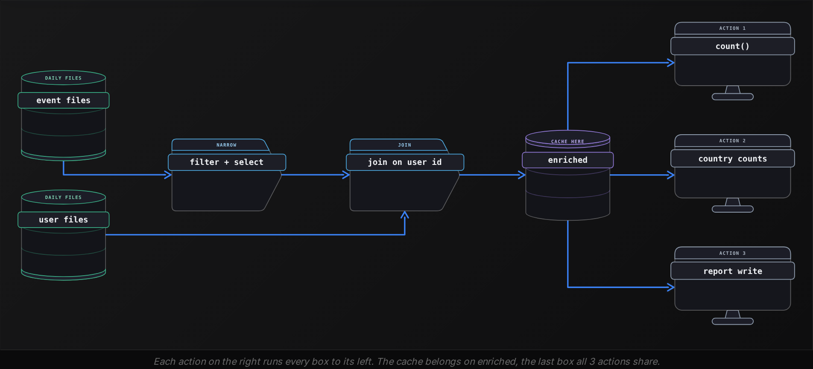
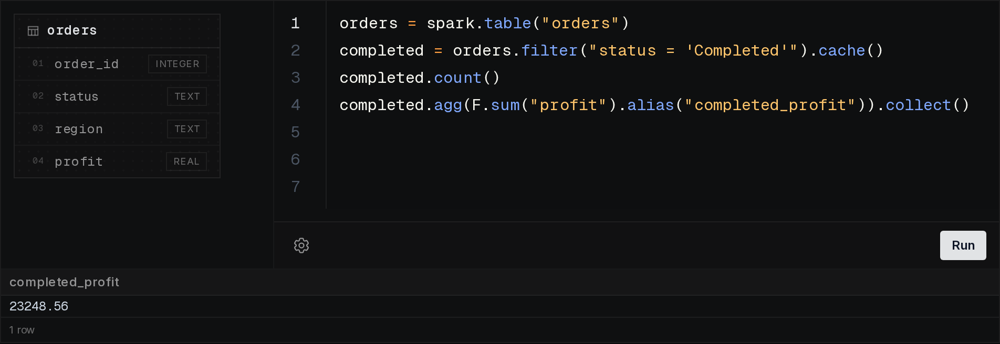
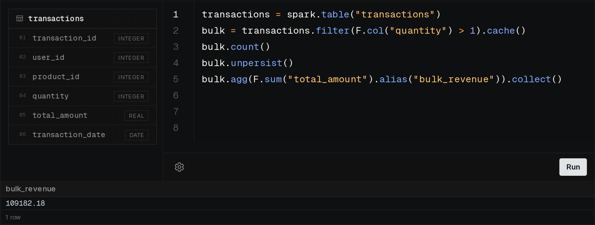

Beginner·Spark · 20 min · 16 challenges

# Memory and Caching: Beginner

Picture a Netflix data engineer whose morning Spark job joins a day of viewing events to member profiles, then feeds the joined table to 4 reports. Each report is an action, so the join runs 4 times. One `.cache()` in the right place cuts that to once. A missing `unpersist()` leaves the result holding executor memory long after the last report has read it.


<br>

---

## Where to Put the Cache

Every action you call runs the full chain of transformations behind its DataFrame, starting from the source files. Spark keeps no result between actions unless you tell it to. A cache is that instruction: it stores the partitions of 1 DataFrame on the executors, so later actions start from the stored partitions and skip every step that built them. The decision that matters most is which DataFrame in the chain gets stored.

The board below plays 1 action on 7 orders split across 2 partitions. The filter keeps the 5 completed orders, the `groupBy` shuffles them by region across 3 tasks, and `collect()` returns 3 totals: West 210, East 120, North 60. Run `kept.count()` after it and Spark reads all 7 rows and filters them a second time, because nothing from the first run was kept.




<br>

### A job with 3 actions

Here is a daily job that reads click events, keeps 2 columns, joins them to users and runs 3 actions on the joined result. Suppose reading the event files takes 1.5 minutes, reading the user files takes 0.5 minutes and the join takes 5.

```sql
events = spark.read.parquet("/data/events/2024-03-15")
users = spark.read.parquet("/data/users")

clicks = events.filter(F.col("event_type") == "click").select("user_id", "page_id")
enriched = clicks.join(users, "user_id")

enriched.count()
enriched.groupBy("country").count().collect()
enriched.write.mode("overwrite").parquet("/reports/clicks_enriched")
```




<br>

### Count the shared work

Without a cache, all 3 actions pay for the read and the join. Moving the cache earlier or later in the chain changes how much of that work repeats:

| Where the cache sits | Action 1 runs | Actions 2 and 3 each run | Shared work in total |
| --- | --- | --- | --- |
| No cache | read + join | read + join | 21 min |
| On `clicks` | read + join | users read + join | 18 min |
| On `enriched` | read + join | a read of the cache | 7 min |
| On each action's own output | read + join | read + join | 21 min, plus 3 caches nobody reads again |

The rule the table shows: put the cache on the **last DataFrame every later action shares**, the point where the chain branches. Cache earlier, and each action still repeats the steps between the cache and the branch. Cache later, on 1 branch, and only the action on that branch benefits.

Another way to read the table: for each later action, a cache saves the work between the source and the cached DataFrame. On `clicks` that is only the 1.5-minute events read, because the users read and the join still run after it. On `enriched` it is 7, because both reads and the join sit behind it. The wide steps usually dominate that number, so a cache placed right after a join or a `groupBy` saves the shuffle along with everything before it.

```sql
enriched = clicks.join(users, "user_id").cache()
```

*These times leave out the cache's own costs, storing the partitions during the first action and reading them back in the later ones. Both are small next to a 5-minute join, and a later section of this lesson prices them.*

**Both actions read priced. Which DataFrame should carry .cache() to save the most work?**

```python
orders = spark.read.parquet("/data/orders")
paid = orders.filter(F.col("status") == "Completed")
lines = paid.join(order_items, "order_id")
priced = lines.withColumn("line_total", F.col("quantity") * F.col("unit_price"))

priced.groupBy("region").agg(F.sum("line_total")).collect()
priced.groupBy("product_id").agg(F.sum("quantity")).collect()
```

- **A.** orders, so the order files are read only once
- **B.** paid, because the filter has already removed rows
- **C.** priced, the last DataFrame that both actions share
- **D.** Each groupBy result, so both outputs are stored

<details>
<summary>Solution</summary>

**C.** priced, the last DataFrame that both actions share

Caching the branch point lets the second action start from stored rows and skip the read, the filter and the join.

**Why the others are wrong**

- **A.** The files are read once, but both actions still run the filter, the join and the withColumn on their own.
- **B.** The cache is smaller, yet the join after it still runs twice, and the join is the costly step here.
- **D.** Each output is read by 1 action only, so neither cache is ever read, and the join still runs twice.

</details>


<br>

### Narrow the cache before you store it

The branch point also decides how big the cache is, because a cache holds every row and every column of the DataFrame it sits on. If the 3 actions only read `user_id`, `page_id` and `country`, a `select` of those columns right before `.cache()` stores 3 columns instead of everything `users` carried. A filter placed before the cache shrinks it the same way, by rows.

> **TIP**
>
> Give the branch point a name. A variable such as `enriched` that 3 actions read is a single DataFrame to put `.cache()` on; the same chain retyped inside each action leaves you no single DataFrame to cache.


<br>

---

## cache() vs persist()

`cache()` and `persist()` make the same request: keep this DataFrame's partitions on the executors once an action computes them. They differ in 1 thing, who chooses the storage level, meaning where the partitions are kept: memory, local disk or both.

| Call | Storage level it sets |
| --- | --- |
| `df.cache()` | the default for DataFrames: memory first, local disk for what does not fit |
| `df.persist()` | the same default |
| `df.persist(StorageLevel.MEMORY_ONLY)` | the level you pass, here memory only |

So `cache()` is shorthand for `persist()` with no argument. Reach for `persist()` when you want a level other than the default; the next section covers how to choose one. Both return the DataFrame they were called on and also mark it in place, so `df.cache()` on a line of its own works as well as `df = df.cache()`.

Calling `cache()` on a DataFrame that is already cached changes nothing: Spark logs a warning that the data is already cached and keeps the first level. To switch levels, call `unpersist()` first, then `persist()` with the new level.


<br>

### Marking is free, the first action pays

Like a transformation, `cache()` is lazy. The line returns at once, launches no job and stores nothing. The partitions are stored by the first action that computes them: as each task finishes a partition, the executor running it keeps a copy. That first action does all of its usual work plus the storing, so it runs a little slower than it would without the cache. Every action after it reads the stored copy.

Traced through the job from the previous section, with `enriched.cache()` on its own line before the actions:

| Line | What Spark does | Time |
| --- | --- | --- |
| `enriched.cache()` | records the cache mark; no job runs | none |
| `enriched.count()` | reads, filters and joins, storing each partition as its task finishes | 7 min plus the storing |
| `enriched.groupBy("country").count().collect()` | reads the stored partitions and aggregates them | the aggregation only |
| `enriched.write.mode("overwrite").parquet(...)` | reads the stored partitions and writes them out | the write only |


<br>

### The first action sets how much is stored

A partition is stored only when an action computes it in full, so the action you run first sets how much of the cache exists afterwards. `count()` has to visit every partition to count its rows, so it fills the whole cache. `show()` asks for 20 rows and computes only as many partitions as it needs to find them, sometimes 1 out of 200. The other 199 stay unstored until a later action computes them, and that later action pays the full build for each of them.

> **TIP**
>
> The common pattern is `df.cache()` followed by `df.count()`: 1 cheap action whose only job is to fill every partition, so the actions after it all start from a full cache. `take()`, `first()` and `head()` fill only part of it, the same way `show()` does.

**The DataFrame has 200 partitions. After show() finishes, how many of them are stored in the cache?**

```python
long_views = spark.read.parquet("/data/page_views").filter(F.col("dur_ms") > 1000).cache()
long_views.show()
long_views.count()
```

- **A.** Only the partitions show() computed to find 20 rows, as few as 1
- **B.** All 200, because the cache() call stored them as the line ran
- **C.** All 200, because any action fills the whole cache the first time
- **D.** None, because show() previews rows without storing any of them

<details>
<summary>Solution</summary>

**A.** Only the partitions show() computed to find 20 rows, as few as 1

show() stops once it has 20 rows, and only partitions computed in full are stored. The count() after it computes and stores the rest.

**Why the others are wrong**

- **B.** cache() is lazy: the line records a mark and runs no job, so nothing is stored until an action runs.
- **C.** An action stores only the partitions it computes, and show() computes as few as it can.
- **D.** show() is an action like any other, and each partition it computes in full gets stored.

</details>


<br>

### Checking the cache is in the plan

`explain()` shows whether a query will read the cache. After `enriched.cache()`, the plan for `enriched.groupBy("country").count()` starts from an `InMemoryTableScan` over an `InMemoryRelation`, where before it started from the file scans and the join. The plan reflects the mark, so it looks the same before and after the first action. To see how much is stored, open the Storage tab in Spark's web UI: it lists each cached DataFrame with its storage level, Cached Partitions, Fraction Cached, Size in Memory and Size on Disk. A Fraction Cached far below 100% right after a `show()` is the partial fill described above.

Try it on the practice data. The `cache()` line marks `completed`, `count()` computes and stores every partition, and the final `collect()` reads the stored copy to sum profit.



```python
orders = spark.table("orders")
completed = orders.filter("status = 'Completed'").cache()
completed.count()
completed.agg(F.sum("profit").alias("completed_profit")).collect()
```


<br>

---

## Storage Levels

A storage level answers 3 questions about a cached DataFrame: does it live in executor memory, on the executor's local disk, or both; how many copies exist; and what happens to a partition when memory runs out. The levels you will use cover those answers in a handful of combinations.

| Level | Where partitions go | A partition that does not fit in memory |
| --- | --- | --- |
| `MEMORY_ONLY` | executor memory | is left unstored and recomputed each time an action needs it |
| `MEMORY_AND_DISK` | memory first, then local disk | is written to the executor's local disk and read back from there |
| `DISK_ONLY` | local disk only | never comes up: every partition goes to disk |
| `MEMORY_ONLY_2`, `MEMORY_AND_DISK_2` | as the level without `_2`, on 2 executors | is handled as by the level without `_2` |

Local disk here means the disk attached to each executor's machine. It is scratch space: whatever a level writes there disappears when the application ends, and your output files are never involved.


<br>

### The defaults differ by API

A DataFrame's `cache()` uses memory and disk. Print its level after calling it and you see `Disk Memory Deserialized 1x Replicated`, the `MEMORY_AND_DISK_DESER` level: memory first, local disk for what does not fit, 1 copy. An RDD's `cache()` uses `MEMORY_ONLY`, so data cached through `.rdd` behaves differently when memory runs short. Deserialized describes how the stored bytes are laid out, and the choices in this section are about memory, disk and copies.

```sql
enriched.cache()
print(enriched.storageLevel)

sessions.persist(StorageLevel.MEMORY_ONLY)
history.persist(StorageLevel.DISK_ONLY)
```


<br>

### Pick by what a miss costs

Every level is a bet about misses: the partitions an action needs that memory is not holding. On a miss, `MEMORY_ONLY` recomputes the partition from the transformations that built it, and the disk levels read it back from local disk. A disk read costs about the time to read that partition's bytes. A recompute can cost everything behind the DataFrame: the file read, plus any join, `groupBy` or other shuffle. So the choice comes down to which of those is cheaper for this DataFrame, and how often misses will happen.

| DataFrame | How it is built | Size against memory | Level, and why |
| --- | --- | --- | --- |
| `sessions` | a filter over 1 day of files | fits with room to spare | `MEMORY_ONLY`: misses are rare, and a miss reruns a short scan |
| `enriched` | the 7-minute read and join | about twice the executors' memory | `MEMORY_AND_DISK`: half of it would miss, and a disk read beats rerunning the join |
| `history` | 3 joins and a `groupBy` over a year | many times the memory | `DISK_ONLY`: almost all of it would miss anyway, and memory stays free for `sessions` |

| ✓ MEMORY_ONLY fits when | ✗ MEMORY_AND_DISK fits when |
| --- | --- |
| • the DataFrame fits in memory with room to spare<br><br>• recomputing a partition is a short scan or filter<br><br>• you would rather a miss fall back to the source than to disk | • the DataFrame might not fit in memory<br><br>• recomputing a partition reruns a join, a groupBy or a slow read<br><br>• a steady read from local disk beats an unpredictable recompute |


<br>

### Copies on 2 executors

When an executor is lost, the partitions it had cached go with it, memory and local disk alike, and the next action that needs them recomputes them. A `_2` level stores each partition on 2 executors, so the surviving copy serves the next read when 1 of them is lost. It also doubles the memory the cache takes. Use it only when executors are lost often and a recompute is slow enough to matter; for most batch jobs, 1 copy is the right default.

**A DataFrame takes 20 minutes to build through 2 shuffles, is about 3 times the executors' combined memory, and 5 later actions read it. Which level should it get?**

- **A.** MEMORY_ONLY, because reads from memory are the fastest
- **B.** MEMORY_ONLY_2, so a lost executor does not cost a recompute
- **C.** No cache, because it cannot fit in memory anyway
- **D.** MEMORY_AND_DISK, keeping what fits in memory and the rest on local disk

<details>
<summary>Solution</summary>

**D.** MEMORY_AND_DISK, keeping what fits in memory and the rest on local disk

Misses become local disk reads instead of 20-minute recomputes, and the part that fits still reads from memory.

**Why the others are wrong**

- **A.** About 2 in 3 partitions would not fit, and each of the 5 actions would recompute them through both shuffles.
- **B.** The second copy doubles the memory needed, so even fewer partitions fit and the misses grow.
- **C.** A disk level can still hold it, and reading local disk is far cheaper than 5 builds of 20 minutes each.

</details>

> **TIP**
>
> Set the level at the moment you cache. Switching later follows the steps from the `cache()` vs `persist()` section, and the next action then pays the full build again.

| ✓ Do | ✗ Don't |
| --- | --- |
| • Choose MEMORY_AND_DISK when a recompute reruns a join or shuffle<br><br>• Choose MEMORY_ONLY for small DataFrames that rebuild from a short scan<br><br>• Check the level with print(df.storageLevel) after setting it | • Don't pick MEMORY_ONLY for a DataFrame larger than memory<br><br>• Don't use a _2 level by habit; it doubles the memory used<br><br>• Don't treat DISK_ONLY as a saved output; it vanishes with the application |

**A DataFrame is a filter over 1 day of page_views files. It rebuilds in about 20 seconds, takes about a tenth of the executors' memory, and 3 actions read it. Which call fits it best?**

- **A.** persist(StorageLevel.MEMORY_ONLY), since it fits with room to spare
- **B.** persist(StorageLevel.DISK_ONLY), to keep executor memory free
- **C.** persist(StorageLevel.MEMORY_ONLY_2), so a lost executor costs nothing
- **D.** MEMORY_ONLY, set after the first action so that action runs faster

<details>
<summary>Solution</summary>

**A.** persist(StorageLevel.MEMORY_ONLY), since it fits with room to spare

Every partition fits in memory, so misses are rare, and a miss only reruns a 20-second scan of 1 day of files.

**Why the others are wrong**

- **B.** Memory has room for all of it, so sending every read to local disk gives up the fastest reads and frees memory nothing needs.
- **C.** The second copy doubles the memory held to guard against a recompute that takes 20 seconds.
- **D.** The level is right, but a mark set after the first action stores nothing until the next action, which then pays the build again.

</details>


<br>

---

## When Caching Wastes Memory

A cache has 3 costs. The first action stores each partition as it goes, which makes it slower. The stored partitions take executor memory, or local disk, for as long as the cache exists. And when the cache does not fit, part of it is recomputed or read from disk anyway. A cache earns its place only when the later actions save more time than those costs add.


<br>

### Pricing a single cache

Take `enriched` again: 7 minutes to build. Suppose storing it adds 30 seconds to the first action and reading it back costs each later action 20 seconds. Without a cache, each action pays the 7 minutes. With it, the first pays 7 minutes and 30 seconds, and each later one pays 20 seconds.

- **6 min 10 s** — saved when 2 actions read it
- **12 min 50 s** — saved when 3 actions read it

The saving grows with every action that reads the cache and with every minute of work behind it. With only 1 action, nothing is saved and the storing time is pure loss. That gives the first 2 tests: at least 2 actions must read the DataFrame, and the work behind it must cost more than reading the cache back.


<br>

### Four ways a cache burns memory

- **Read by 1 action** *nothing to reuse*\
  The cache is filled, then never read. The job pays for the storing and holds the memory for no saving.
- **Cheap to rebuild and large** *little saved for a lot held*\
  A filter over a file rebuilds in seconds, yet its cache takes memory that a costly join result could have used.
- **Wider than the actions need** *every column is stored*\
  A cache holds all columns of its DataFrame. If the actions read 3 of 40, a select first stores 3 columns instead of 40.
- **Too big for its level** *memory held, work repeated*\
  At MEMORY_ONLY, partitions that do not fit are recomputed on every read, so the job holds memory and still repeats the work.

The second case hurts even when the cache saves a little, because caches on an executor share its memory: a cache that saves little can crowd out 1 that saves a lot.

Here is a job that makes 2 of these mistakes, then the version that fixes them:

```sql
all_events = spark.read.parquet("/data/events").cache()
march = all_events.filter(F.col("event_date") >= "2024-03-01").select("user_id", "event_type")

march.groupBy("event_type").count().collect()
march.select("user_id").distinct().count()
```

```sql
all_events = spark.read.parquet("/data/events")
march = all_events.filter(F.col("event_date") >= "2024-03-01").select("user_id", "event_type").cache()

march.groupBy("event_type").count().collect()
march.select("user_id").distinct().count()
```

The first version stores every column of every day of events, a scan that is cheap to redo, to serve 2 actions that read 2 columns of March, and both actions still rerun the filter and the select on top of it. The second stores only those 2 columns for March, on the DataFrame the 2 actions share.

| ✓ Caches that repay their memory | ✗ Caches that burn it |
| --- | --- |
| • A joined fact table read by 4 reports<br><br>• A per-user aggregate reused by 3 model features<br><br>• A cleaned lookup table feeding several joins in 1 job | • A raw file read cached before a single query<br><br>• A 200-column table cached when the reports read 5<br><br>• A per-day cache from an earlier loop pass still held during the next pass |

> Three questions before .cache()
>
> - Will 2 or more actions read this DataFrame?
> - Does rebuilding it run a join, a shuffle or a slow read?
> - After a `select` of the columns the actions read, will it fit at the level you chose?

After a run, the Storage tab answers the third question. A Size on Disk you did not plan for, or a Fraction Cached under 100% at `MEMORY_ONLY`, means the cache did not fit and some reads turned into disk reads or recomputes.

> **TIP**
>
> When the numbers are unclear, time it: run the job once with the cache and once without, and compare how long the actions after the first one take.

**Executor memory can hold 1 of these 2 DataFrames as a cache, but not both. Each would be read by 3 actions. Which one should the job cache?**

```python
recent = spark.read.parquet("/data/page_views").filter(F.col("dur_ms") > 0)
by_user = recent.join(users, "user_id").groupBy("user_id", "country").agg(F.sum("dur_ms").alias("total_ms"))
```

- **A.** recent, because it is built first and feeds by_user
- **B.** by_user, because a join and a groupBy sit behind it
- **C.** recent, because a larger cache saves more work per read
- **D.** Neither, because 3 actions are too few to repay a cache

<details>
<summary>Solution</summary>

**B.** by_user, because a join and a groupBy sit behind it

Each action skips a join and a shuffle, and a result aggregated per user is usually far smaller to hold.

**Why the others are wrong**

- **A.** Caching recent saves only a file scan per action, while the join and the groupBy would still run 3 times.
- **C.** Size measures the memory held, while the saving is the work behind the cache, and behind recent is a scan.
- **D.** Two actions already repay a cache with costly work behind it, so 3 readers of by_user save a lot.

</details>


<br>

---

## Releasing with unpersist()

A cached DataFrame stays stored until 1 of 3 things happens: your code calls `unpersist()` on it, the application ends, or Spark needs the room for something else. Spark cannot tell that your code has moved on, so a variable that no later line reads frees nothing. In a scheduled job that runs for an hour, a forgotten cache holds memory for the rest of the run, and the joins and aggregations on those executors have less memory to work with while it is held.

Notebooks make this worse. Picture a session on a cluster whose executors can hold about 400GB of cached data. Four cells each cache a 90GB result, and none is read again after its cell. By the fifth cell, 360GB is held for nobody. Storing the fifth result first means moving older partitions out of memory, at the default level by writing them to local disk, so the fifth cell pays to save data that is already dead.


<br>

### unpersist() takes effect at once

`cache()` is lazy, but `unpersist()` is eager: when the line runs, Spark tells every executor to drop that DataFrame's stored partitions. By default it returns without waiting for the drop to finish, and `unpersist(blocking=True)` waits. The DataFrame itself still works afterwards. The next action on it recomputes from the source, exactly as if it had never been cached.

That timing decides where the call goes: after the last action that reads the cache, and before the work that needs the memory. Here is the pattern in a job with 2 phases:

```sql
visits = daily_events.join(users, "user_id").cache()
visits.count()

visits.groupBy("country").count().write.parquet("/reports/by_country")
visits.groupBy("device").count().write.parquet("/reports/by_device")
visits.unpersist()

baskets = orders.join(order_items, "order_id").cache()
baskets.count()
```

Run the cell: `bulk` is cached, filled by `count()`, then released, and the final total still comes back correct because Spark recomputes `bulk` from `transactions` for it.



```python
transactions = spark.table("transactions")
bulk = transactions.filter(F.col("quantity") > 1).cache()
bulk.count()
bulk.unpersist()
bulk.agg(F.sum("total_amount").alias("bulk_revenue")).collect()
```


<br>

### Three places to put the call

| Where visits.unpersist() sits | The 2 reports | Memory while baskets builds |
| --- | --- | --- |
| right after `visits.count()` | both recompute the join from the source | free |
| after the by_device write | both read the cache | free |
| nowhere | both read the cache | still holding `visits` |

The first row is the costly mistake: the cache is filled, released and never read, so the job pays for storing it and then runs the join 2 more times. The last row costs memory instead of time: `baskets` competes with data nobody reads, and some of its partitions can end up on local disk or recomputed.

> **TIP**
>
> A job that caches a new DataFrame on each pass of a loop, 1 per day of data, should release the previous pass's cache inside the loop. Otherwise every day's cache stays until the job ends.


<br>

### Releasing everything, and checking

`spark.catalog.clearCache()` drops every cached DataFrame and table in the session in 1 call. It fits the end of a notebook, or the boundary between 2 phases that share nothing. Inside a job where another part still reads a cache, it throws away work you meant to keep, so release by name there.

| Check | Shows | After cache() | After unpersist() |
| --- | --- | --- | --- |
| `df.is_cached` | whether the DataFrame carries the cache mark | `True`, even before any action | `False` |
| `print(df.storageLevel)` | the level the mark asks for | `Disk Memory Deserialized 1x Replicated` | `Serialized 1x Replicated`, meaning no memory and no disk |
| Storage tab | partitions stored and their size | a row once an action fills it | the row is gone |

*Calling unpersist() on a DataFrame that was never cached does nothing and raises no error, so a release at the end of a code path is safe even when an earlier branch skipped the cache.*

**This job combines placement, the first action and release. What happens when it runs?**

```python
joined = events.join(users, "user_id").cache()
joined.show()
joined.groupBy("country").count().collect()
joined.unpersist()
joined.groupBy("device").count().collect()
```

- **A.** cache() stores every partition at once, so both counts read memory and the join runs once
- **B.** show() fills the whole cache, and unpersist() waits until the device count has finished
- **C.** show() stores a few partitions, the country count stores the rest, and the device count recomputes the join
- **D.** The join runs once, because the cache is kept until the application ends regardless

<details>
<summary>Solution</summary>

**C.** show() stores a few partitions, the country count stores the rest, and the device count recomputes the join

The country count computes and stores whatever show() left, then the release means the device count starts again from events and users.

**Why the others are wrong**

- **A.** cache() stores nothing on its own line; partitions are stored only as actions compute them.
- **B.** show() stores only the partitions it computed, and unpersist() drops partitions as soon as its line runs.
- **D.** The application ending is 1 way a cache is freed, but unpersist() frees it earlier, right where it is called.

</details>


<br>

---

## Putting It All Together

A food-delivery marketplace runs a nightly Spark job that joins 30 days of orders to restaurant and courier tables, then builds 4 outputs from the joined result: city revenue, courier lateness, top dishes and refund rates. After those, the same job builds training features for a demand model from a separate table of menu changes, and that phase needs as much executor memory as it can get.

- The joined orders are the branch point all 4 outputs share, so . cache ( ) goes there, after a select of the columns the outputs read.
- A count ( ) right after the cache fills every partition, so all 4 outputs start from stored data and none of them pays for the join.
- Thirty days of joined orders can exceed executor memory and recompute through a shuffle, so the default memory-and-disk level beats MEMORY_ONLY .
- Each output is read once, so caching any of them would burn memory; only the shared join repays its cache.
- unpersist ( ) right after the fourth output frees the memory before the feature phase starts, instead of leaving 30 days of orders in place until the job ends.


<br>

---

## Key Takeaways

- Cache the last DataFrame every later action shares, the branch point. The work it saves each later action is everything between the source and it.
- cache ( ) is persist ( ) at the default level. Both are lazy, and the first action that computes a partition stores it.
- Fill the cache with count ( ) . show ( ) , take ( ) and first ( ) store only the partitions they compute.
- Pick the level by what a miss costs: MEMORY_ONLY when a recompute is a short scan, MEMORY_AND_DISK when it reruns a join or shuffle.
- A cache pays only when 2 or more actions read it, the work behind it is costly, and it fits after a select of the columns those actions use.
- unpersist ( ) is eager: call it after the last read and before the next phase needs the memory.
