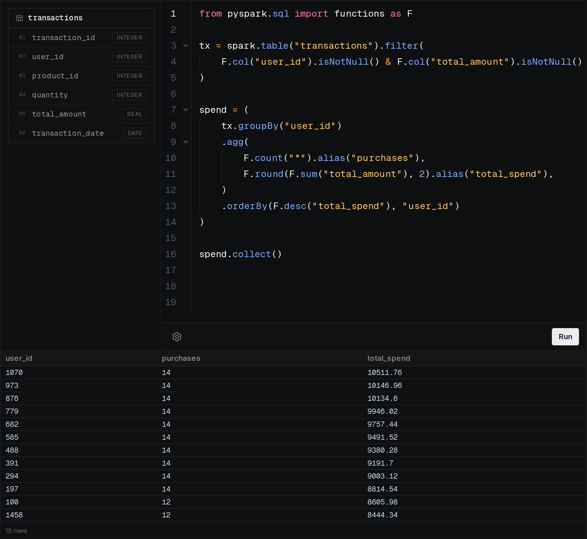

Intermediate·Spark · 14 min · 16 challenges

# Memory and Caching: Intermediate

Uber's nightly trip pipeline joins a week of rides to driver records, caches the result, and feeds 3 fare reports. Tonight 2 executors vanish mid-join with exit code 137, while their heaps sit half empty and no OutOfMemoryError appears anywhere. Raise the heap, raise the overhead, or drop the cache? Picking right depends on knowing which slice of executor memory actually ran out.


<br>

---

## The Executor Memory Split

Every executor runs as a single JVM process, and the memory it gets is fixed when it launches. The `spark.executor.memory` setting, which `--executor-memory` sets on spark-submit, becomes that JVM's maximum heap. Inside the heap, Spark draws 3 regions, each with its own job and its own way of failing. A further pool, the overhead, sits outside the heap and gets its own section later in this lesson.


<br>

### Three regions inside the heap

Bottom of the heap to top

- **Reserved memory** *300 MB, fixed*\
  Spark sets this aside for its own internal objects before counting anything else. No setting changes it, and Spark refuses to launch an executor with less than 450 MB of heap, one and a half times the reserved block.
- **User memory** *40% of the heap left after reserved*\
  Space outside Spark's accounting. It holds Spark's internal metadata, such as the records it keeps for partitions and blocks, plus any objects that code outside Spark's operators builds on the heap. Nothing here can spill or be evicted, so overfilling it ends in a heap OutOfMemoryError.
- **Unified memory** *60% of the heap left after reserved*\
  The region Spark manages, sized by spark.memory.fraction. Execution and storage share it, with a soft boundary between them placed by spark.memory.storageFraction, which defaults to 0.5.


<br>

### Sizing an 8 GB executor

The arithmetic runs in megabytes of 1,024 KB, which the Spark UI writes as MiB: start from the heap, take away the reserved block, then split the rest by `spark.memory.fraction`. The executor below, 8 GB of heap and 4 cores, is the running example for every section that follows.

| Region | How it is computed | Size at an 8 GB heap |
| --- | --- | --- |
| Heap (`spark.executor.memory`) | heap in GB times 1,024 | 8,192 MB |
| Reserved | fixed | 300 MB |
| Usable heap | heap minus reserved | 7,892 MB |
| Unified (`spark.memory.fraction` 0.6) | usable times 0.6 | 4,735 MB |
| Storage side (`storageFraction` 0.5) | unified times 0.5 | about 2,368 MB |
| Execution side | unified minus storage side | about 2,367 MB |
| User memory | usable times 0.4 | 3,157 MB |

Look at where the 0.6 lands. It multiplies the usable heap, so an executor launched with 8 GB gives Spark's managed region about 4.6 GB, a little over half of what the command line asked for. The storage and execution sides are a starting position: the next section shows each one growing into the other's space, and what happens when the owner wants it back.

*Spark 1.6 introduced this layout with spark.memory.fraction at 0.75. Spark 2.0 lowered the default to 0.6, where it has stayed.*


<br>

### Which setting moves which region

| Setting | Default | Raising it does this |
| --- | --- | --- |
| `spark.executor.memory` | 1g | Grows every region except reserved, in proportion |
| `spark.memory.fraction` | 0.6 | Grows unified memory and shrinks user memory by the same amount |
| `spark.memory.storageFraction` | 0.5 | Widens the cache's protected share and narrows execution's |
| `spark.executor.cores` | 1 on most cluster managers | Changes no region, but more tasks share the execution side at once |

> **TIP**
>
> Pushing `spark.memory.fraction` toward 0.9 looks like free memory for joins, but user memory shrinks to match, and code that builds large objects on the heap starts dying with OutOfMemoryError. Keep 0.6 until you have measured user memory sitting idle.

**An executor launches with spark.executor.memory set to 4g and every other memory setting at its default. How large is its unified region, the pool execution and storage share?**

- **A.** About 2,458 MB
- **B.** About 1,139 MB
- **C.** About 2,278 MB
- **D.** About 1,518 MB

<details>
<summary>Solution</summary>

**C.** About 2,278 MB

Taking off the 300 MB reserved block leaves 3,796 MB usable, and 0.6 of that is about 2,278 MB.

**Why the others are wrong**

- **A.** That is 60% of the full 4,096 MB heap. The 300 MB reserved block comes off first, so the 0.6 applies to 3,796 MB.
- **B.** That is the storage side of the unified region, set by spark.memory.storageFraction. The question asks for the whole region both sides share.
- **D.** That is user memory, the 0.4 of usable heap that Spark does not manage. The unified region is the other 0.6.

</details>


<br>

---

## Execution vs Storage Memory

The unified region holds 2 kinds of data. Execution memory is working space for tasks running right now: the hash table a `groupBy` builds, the buffer a sort fills, the rows a sort-merge join holds while it matches keys, and records waiting to be written as shuffle files. Storage memory holds blocks you asked Spark to keep: partitions from `cache()` and `persist()`, plus broadcast variables, including the table a broadcast join ships to every executor.

Before Spark 1.6 a fixed wall stood between them, so a job with no cache left its storage share idle while its sorts spilled. The unified design takes the wall down and lets either side borrow what the other is not using. The rules that matter are the ones for getting borrowed memory back.


<br>

### The borrowing rules

| Situation | What Spark does |
| --- | --- |
| Storage wants space and execution's side is idle | Storage borrows it, so a cache can grow past its half |
| Execution wants space that storage has borrowed | Execution evicts cached blocks until storage is back at its line |
| Execution wants more, and storage is at or below its line | Execution evicts nothing further, and the task spills to disk |
| Storage wants space that execution is using | Storage cannot evict execution, so the new block goes to disk or stays uncached, per its storage level |

The asymmetry follows from what each side holds. Execution memory is the half-finished state of a running task, and taking it away would mean failing the task or redoing its work. A cached block is a copy: once evicted, Spark can rebuild it from lineage or read it back from disk. So execution wins every contest, but only down to the line `spark.memory.storageFraction` draws, which keeps a large shuffle from wiping a cache out entirely.


<br>

### One executor, one join, step by step

Back to the running example: 4,735 MB of unified memory, with the storage line near 2,368 MB. A job caches an enriched trips DataFrame that needs 3,600 MB, then runs a join that asks for working memory in 2 rounds.

| Step | Event | Storage (MB) | Execution (MB) | Free (MB) |
| --- | --- | --- | --- | --- |
| 1 | Executor starts | 0 | 0 | 4,735 |
| 2 | `cache()` fills 3,600 MB of partitions | 3,600 | 0 | 1,135 |
| 3 | Join tasks ask for 2,000 MB | 2,735 | 2,000 | 0 |
| 4 | Join tasks ask for 600 MB more | 2,368 | 2,367 | 0 |
| 5 | Join finishes | 2,368 | 0 | 2,367 |

At step 2 the cache has borrowed 1,232 MB from the execution side. At step 3 the join takes the 1,135 MB that were free and evicts 865 MB of cached partitions to cover the rest. At step 4 only 367 MB more can be evicted before storage reaches its line, so 233 MB of the request goes unmet and the tasks spill. After step 5 the cache is short 1,232 MB of partitions, and 2,367 MB sits free.

**The running-example executor has a cached DataFrame using 3,000 MB of its 4,735 MB unified region when a join's tasks ask for 2,500 MB of execution memory. What happens?**

- **A.** The join evicts 632 MB of cached blocks, then spills because 133 MB is still missing.
- **B.** The join evicts the entire cache and runs with all 2,500 MB held in memory.
- **C.** The join waits until the cache is unpersisted, then takes its full 2,500 MB.
- **D.** The join takes the 1,735 free MB and spills the rest, leaving the cache whole.

<details>
<summary>Solution</summary>

**A.** The join evicts 632 MB of cached blocks, then spills because 133 MB is still missing.

Execution takes the 1,735 MB that is free, then may evict storage down to its 2,368 MB line, which frees 632 MB. That leaves it 133 MB short, so its tasks spill.

**Why the others are wrong**

- **B.** Execution can evict only the part of the cache above the storage line. The protected 2,368 MB stays where it is.
- **C.** Execution never waits on storage. It takes free memory, evicts what it is allowed to, and spills for the rest.
- **D.** Free memory comes first, but the cache has borrowed 632 MB above its line, and execution reclaims that before spilling.

</details>

What happens to evicted partitions depends on the storage level. Under `MEMORY_ONLY` they are dropped, and the next action that reads them recomputes them from lineage. Under a memory-and-disk level they are written to local disk as they leave memory, and the next read comes from there. A DataFrame's `cache()` uses a memory-and-disk level, while an RDD's `cache()` uses `MEMORY_ONLY`.

| ✓ What a big join can do to your cache | ✗ What your cache can do to a big join |
| --- | --- |
| • Evict every cached block above the storage line<br><br>• Turn the next read of those partitions into a recompute or a disk scan<br><br>• Leave memory free that refills only when an action reads those partitions again | • Hold its protected half, about 2,368 MB here, out of execution's reach<br><br>• Lower the ceiling on execution, so join tasks spill earlier<br><br>• Never take memory from a task that is already running |

That right-hand column is why a cache can never stall a join. No running task waits for storage to hand memory back. The worst a cache does is sit in its protected half, which caps execution and makes the join spill sooner, a cost the next section teaches you to read.

> **TIP**
>
> Pick `MEMORY_ONLY` only when recomputing a partition is cheaper than reading it back from local disk. For a cache built from a wide join or an expensive aggregation, keep a memory-and-disk level, so a later shuffle's evictions cost a disk read instead of a rerun.

**A DataFrame built from a wide join of transactions to products is persisted, and a large aggregation then runs on the same executors and evicts part of it. Which choice of storage level makes the next read of the evicted partitions skip a rerun of the join?**

- **A.** MEMORY_ONLY, because the storage line keeps execution from evicting any of the cache
- **B.** Any storage level, because execution never evicts a persisted DataFrame
- **C.** MEMORY_AND_DISK, because it stops execution from evicting the blocks at all
- **D.** MEMORY_AND_DISK, because evicted blocks are written to local disk as they leave memory

<details>
<summary>Solution</summary>

**D.** MEMORY_AND_DISK, because evicted blocks are written to local disk as they leave memory

The evicted partitions land on local disk, so the next action reads them back from there instead of recomputing the join from lineage.

**Why the others are wrong**

- **A.** The line protects only the share up to spark.memory.storageFraction. Blocks above it are evicted, and under MEMORY_ONLY they are dropped and rebuilt from lineage, which reruns the join.
- **B.** Execution evicts cached blocks whenever storage has borrowed past its line. A persisted DataFrame is cached data like any other.
- **C.** The level is right, but the reason is wrong. Execution still evicts the blocks above the line. The level decides where they go when it does.

</details>


<br>

---

## Spilling to Disk

A spill is what a task does when it asks for execution memory and the memory manager refuses. The operator holding the data, whether a sort buffer, an aggregation hash table or the sort inside a sort-merge join, writes what it has to local disk as a sorted file, frees the memory, and keeps reading. When input runs out, it merges the spilled files with what is still in memory. The task finishes with the right answer, after serializing, writing, reading back and merging data that never needed to leave RAM.


<br>

### How much memory one task can get

Every task running on an executor at the same moment draws on the same execution pool. With N tasks running, each can hold at most 1/N of the pool. Spark also keeps a floor: before a task is left with less than 1/(2N), it waits for other tasks to release memory. On the running example's 4 cores, N is 4.

| Executor state | Execution pool | Most a task can hold | Floor a task is given |
| --- | --- | --- | --- |
| No cache, 4 tasks running | 4,735 MB | about 1,184 MB | about 592 MB |
| Cache at its 2,368 MB line, 4 tasks running | about 2,367 MB | about 592 MB | about 296 MB |
| Cache at its line, 2 cores instead of 4 | about 2,367 MB | about 1,184 MB | about 592 MB |

Use the table as a test for any stage: when a task's input, held in memory as rows, outgrows its share, that task spills. Shuffle read sizes in the UI are compressed bytes, and the same rows usually take several times that space once deserialized, so 300 MB of shuffle read can overflow a 592 MB share. The last row shows a lever on the cores: halving them doubles each task's share without touching the heap, at the price of half as many tasks at once.


<br>

### Where a skewed key puts the pressure

This job joins trips to drivers with broadcasting switched off, so both sides are shuffled into 3 reducer tasks by `driver_id`. Driver 101 has 7 of the 12 trips. Every row a reducer task receives is held in its execution memory while the sort-merge join sorts and matches it, so watch which task collects the 7.

https://github.com/user-attachments/assets/2b526ab9-8dac-43b5-af0b-ebcc127bf1b8

The plan has 3 stages: a map stage for each side writing shuffle files, then the join stage reading them. The task that receives driver 101 holds at least 7 trip rows, while the other 2 tasks share at most the remaining 5. Scale every row up a million times: that task gets the same share of memory as its neighbours, with several times their input, and it is the one that spills.


<br>

### Reading a spill in the stage metrics

Spark records 2 spill numbers per task. Spill (Memory) is the size of the spilled data as deserialized rows in memory at the moment it was written out. Spill (Disk) is the size of the same data serialized and compressed on disk. The memory figure is usually several times the disk figure, and both read 0 for a task that never ran short. The stage page shows them as quantiles across the stage's tasks:

| Metric | Min | Median | 75th percentile | Max |
| --- | --- | --- | --- | --- |
| Duration | 41 s | 48 s | 55 s | 14 min |
| Shuffle Read Size | 75 MiB | 92 MiB | 105 MiB | 1.9 GiB |
| Peak Execution Memory | 230 MiB | 280 MiB | 310 MiB | 2.3 GiB |
| Spill (Memory) | 0 B | 0 B | 0 B | 7.6 GiB |
| Spill (Disk) | 0 B | 0 B | 0 B | 1.6 GiB |

This stage ran on running-example executors with a cache sitting at its 2,368 MB line, so the execution pool was about 2,367 MB and each of 4 tasks started with about 592 MB. The max column carries the story. One task read 1.9 GiB of shuffle data, about 21 times the median, and spilled 7.6 GiB of rows. Its peak execution memory of 2.3 GiB is nearly the whole pool: as the other tasks finished, N fell, its share grew toward all of it, and it still could not hold its input. The median task, with its 592 MB share and a 280 MiB peak, never spilled.

**A stage's summary metrics show the median task reading 120 MiB of shuffle data with no spill, while the max task reads 3.1 GiB and spills 11 GiB. Executors have 8g heaps and 4 cores. Which change targets the cause?**

- **A.** Raise spark.sql.shuffle.partitions so that every task reads less shuffle data.
- **B.** Raise spark.executor.memory to 16g so that each task's share of memory grows.
- **C.** Raise spark.memory.fraction to 0.9 so that execution gets more of each heap.
- **D.** Salt or isolate the hot key so that its rows spread across many tasks.

<details>
<summary>Solution</summary>

**D.** Salt or isolate the hot key so that its rows spread across many tasks.

Only the top task spills, reading about 26 times the median. That is a skewed key, and splitting it is what shrinks the task's input.

**Why the others are wrong**

- **A.** More partitions shrink the median task, but every row of the hot key still hashes to the same task, so the max barely moves.
- **B.** Even at 16g the whole unified region is about 9.4 GiB, which cannot hold 11 GiB of rows for a single task.
- **C.** That takes about 2.3 GiB from user memory, far short of what the hot task needs, and invites heap OutOfMemoryErrors.

</details>

Tracing a spill to the memory it lacked

- Find the stage with nonzero Spill (Disk) and open its summary metrics.
- Compare Max with Median. Spill on the top tasks only means skewed input: salt or isolate the hot key, since more partitions leave it in one task.
- Spill on every task means each task's input outgrows its share. Raise spark.sql.shuffle.partitions so each task reads less.
- Even spill that more partitions do not cure, with a large cache at its line, means the cache is capping execution. Unpersist it before the stage, or give each task more memory with fewer cores or a bigger heap.


<br>

### Find the execution memory in a query

The cell below aggregates the practice `transactions` table. It has 2 shuffles and 3 stages: the `groupBy` hashes rows by `user_id`, and the `orderBy` range-partitions the totals. Each reducer task builds a structure from execution memory, a hash table for the aggregation and a sort buffer for the ordering. Run it, then point to the 2 operations that would spill first if this table held a billion rows.



```python
from pyspark.sql import functions as F

tx = spark.table("transactions").filter(
    F.col("user_id").isNotNull() & F.col("total_amount").isNotNull()
)

spend = (
    tx.groupBy("user_id")
    .agg(
        F.count("*").alias("purchases"),
        F.round(F.sum("total_amount"), 2).alias("total_spend"),
    )
    .orderBy(F.desc("total_spend"), "user_id")
)

spend.collect()
```


<br>

---

## The memoryOverhead OOM

Everything so far lives inside the JVM heap. The cluster manager does not police the heap, though. It limits the whole process, and it sets that limit at the heap plus `spark.executor.memoryOverhead`. When the process's resident memory crosses the limit, the cluster manager kills it outright, with no exception, no spill and no chance to finish the task.

- **384 MB** — default overhead floor
- **10%** — default overhead share of the heap
- **137** — exit code of a killed executor


<br>

### What lives outside the heap

- Thread stacks for every task, shuffle and network thread the executor runs
- The JVM's own metadata, such as loaded classes and compiled code
- Direct byte buffers the network layer uses to send and fetch shuffle blocks
- Native memory used by compression libraries and other code outside the JVM
- Python worker processes the executor starts to run your Python functions

None of this appears in Spark's memory accounting, so none of it can spill or be evicted. The default overhead is the larger of the floor and the share: for the running example's 8,192 MB heap, 10% gives 819 MB, and the cluster manager grants a container of 9,011 MB.


<br>

### Heap error or container kill

| ✓ Heap OutOfMemoryError | ✗ Container kill |
| --- | --- |
| • The JVM throws java.lang.OutOfMemoryError: Java heap space inside a task<br><br>• The executor log holds the error and its stack trace<br><br>• The task fails with the error as its reason<br><br>• Fix with less data per task, more heap, or fewer cores | • The cluster manager kills the process from outside the JVM<br><br>• The executor log stops mid-stream, with no OutOfMemoryError<br><br>• The driver reports ExecutorLostFailure, often with exit code 137, which is 128 plus signal 9<br><br>• Fix with more spark.executor.memoryOverhead or fewer concurrent tasks |

The tell is the mismatch. In the Executors tab, covered in the next section, a dead executor's storage memory can read far below its total, and its last log lines can be routine task progress, because the heap never ran out. The process outgrew its limit in memory the JVM does not count. The driver's failure reason starts with ExecutorLostFailure (executor 7 exited caused by one of the running tasks), followed by the cluster manager's own words: the container was killed for exceeding memory limits.


<br>

### Raising the overhead

Fix the region that grew. Raising `spark.executor.memory` from 8g to 9g grows a heap that had room and adds only about 100 MB of overhead through the 10% share. Set the overhead directly instead:

```sql
from pyspark.sql import SparkSession

spark = (
    SparkSession.builder
    .appName("trips_nightly")
    .config("spark.executor.memory", "8g")
    .config("spark.executor.cores", "4")
    .config("spark.executor.memoryOverhead", "2g")
    .getOrCreate()
)
```

The container grows from 9,011 MB to 10,240 MB, and every added megabyte lands outside the heap, where the kills came from. Spark 3.3 added `spark.executor.memoryOverheadFactor` for setting the share instead of a size: raising it from 0.10 to 0.20 gives the same 8 GB heap about 1,638 MB of overhead.

> **TIP**
>
> Fewer cores per executor also helps. Each concurrent task brings its own threads, buffers and in-flight shuffle fetches, so 2 tasks need less overhead than 4 inside the same container.


**Executors keep dying mid-stage. The driver shows ExecutorLostFailure with exit code 137, the executor logs end with no OutOfMemoryError, and the dead executors' storage memory read 0.9 GiB of 4.4 GiB. Each has an 8g heap and the default overhead. What do you change?**

- **A.** Raise spark.executor.memory to 9g and keep the default overhead.
- **B.** Raise spark.executor.memoryOverhead to 2g and keep the 8g heap.
- **C.** Lower spark.memory.fraction to 0.4 so that user memory grows.
- **D.** Call unpersist() on the cached DataFrame before the stage runs.

<details>
<summary>Solution</summary>

**B.** Raise spark.executor.memoryOverhead to 2g and keep the 8g heap.

Exit code 137 with no heap error is a container kill. The memory that grew sits outside the heap, so the overhead is the setting to raise.

**Why the others are wrong**

- **A.** The heap had room. A 9g heap adds about 100 MB of overhead, while most of the extra gigabyte goes where nothing ran short.
- **C.** That moves memory between regions inside the heap. The container limit counts heap plus overhead, and the heap was not the part that grew.
- **D.** Storage held 0.9 of 4.4 GiB, so the cache crowded nothing, and it lives inside the heap, which the kill did not come from.

</details>


<br>

---

## Reading Memory in the UI

Each region from this lesson leaves a trace in the Spark UI, spread across 3 places: the Executors tab, the Storage tab, and the detail page for each stage. Walking them in that order narrows a memory problem to a single region.


<br>

### Executors tab: unified memory per executor

Each executor gets a row. Storage Memory reads as used over total, for example `2.3 GiB / 4.4 GiB`. The total is the whole unified region, since storage may borrow all of it, and it lands a little below the formula's 4,735 MB (4.6 GiB) because the JVM reports slightly less heap than it was given. Disk Used counts cached blocks held on local disk. Among the tab's additional metrics, Peak JVM Memory shows the most heap the process ever used. Task Time (GC Time) turns red when garbage collection takes more than 10% of task time, a sign the heap is crowded with live objects.


<br>

### Storage tab: what survived in the cache

Each cached DataFrame gets a row, with its Storage Level, Cached Partitions, Fraction Cached, Size in Memory and Size on Disk. Under `MEMORY_ONLY`, evicted partitions leave the cache, so Fraction Cached falls below 100%. Under a memory-and-disk level, they move from Size in Memory to Size on Disk, and Fraction Cached can stay at 100% while the cache quietly slows down.


<br>

### Stage page: execution memory per task

Open the slowest stage. Its summary metrics give Peak Execution Memory, Spill (Memory) and Spill (Disk) as quantiles, and its task table lists failed tasks with their error, which is where `ExecutorLostFailure` shows up.


<br>

### From symptom to region

| What you see | Region under pressure | First move |
| --- | --- | --- |
| Spill on most tasks, peaks near each task's share | Execution, in unified memory | More shuffle partitions, or fewer cores per executor |
| Spill on the max task only | Execution, from skewed input | Salt or isolate the hot key |
| Fraction Cached below 100%, or Size on Disk climbing during joins | Storage, in unified memory | Cache fewer columns, or unpersist sooner |
| `java.lang.OutOfMemoryError: Java heap space` in an executor log | User memory, or the heap as a whole | Less data per task, or more heap |
| `ExecutorLostFailure`, exit code 137, no heap error | Overhead, outside the heap | Raise `spark.executor.memoryOverhead` |
| GC Time in red | Heap crowded with live objects | Check cache size and per-task data first |

**A report reads a DataFrame persisted with MEMORY_ONLY, after a large join ran on the same executors. Which reading tells you whether part of that DataFrame had to be recomputed?**

- **A.** Fraction Cached below 100% in the Storage tab
- **B.** Disk Used above zero in the Executors tab
- **C.** Spill (Disk) above zero on the join's stage
- **D.** Peak JVM Memory close to the full heap

<details>
<summary>Solution</summary>

**A.** Fraction Cached below 100% in the Storage tab

Under MEMORY_ONLY, evicted partitions are dropped and leave the cache, so the fraction falls. Each missing partition is recomputed when the report reads it.

**Why the others are wrong**

- **B.** MEMORY_ONLY never writes cached blocks to disk, so Disk Used stays at zero however much the join evicted.
- **C.** Spill measures execution memory running short inside the join. It says nothing about which cached partitions survived.
- **D.** That shows the heap was busy at some moment. It does not say which cached partitions are still in memory.

</details>


<br>

### Putting the readings together

A job caches `trips_enriched` with `cache()` on the running-example executors, then runs a heavy aggregation over it. No task fails. Mid-stage, the Executors tab and the stage's summary metrics read as follows.

Executors tab, mid-stage

| Executor | Storage Memory | Disk Used |
| --- | --- | --- |
| 1 | 2.2 GiB / 4.4 GiB | 3.1 GiB |
| 2 | 2.2 GiB / 4.4 GiB | 3.0 GiB |
| 3 | 2.2 GiB / 4.4 GiB | 3.2 GiB |

Stage summary metrics

| Metric | Median | Max |
| --- | --- | --- |
| Peak Execution Memory | 548 MiB | 563 MiB |
| Spill (Memory) | 2.8 GiB | 3.0 GiB |
| Spill (Disk) | 610 MiB | 650 MiB |

**Which reading of these numbers is right, and what is the first move?**

- **A.** Overhead is running out, so raise spark.executor.memoryOverhead before the next run.
- **B.** A hot key is overloading one task, so salt it to spread its rows across tasks.
- **C.** The cache sits at its protected half, capping each task near 563 MiB, so shrink or unpersist it.
- **D.** User memory is full, so lower spark.memory.fraction to give your own objects room.

<details>
<summary>Solution</summary>

**C.** The cache sits at its protected half, capping each task near 563 MiB, so shrink or unpersist it.

Storage reads 2.2 of 4.4 GiB, exactly its line, and Disk Used holds evicted blocks. Execution has the other 2.2 GiB, a quarter per task, and every task peaked there and spilled. Raising shuffle partitions is the other lever.

**Why the others are wrong**

- **A.** No task failed and no executor was lost. Spill is execution memory running short inside the heap, which overhead does not touch.
- **B.** The max spill is barely above the median. Skew shows as a max many times the median, and here every task spills alike.
- **D.** Nothing points at user memory: no heap error appears. Lowering the fraction would also shrink unified memory, so tasks would spill more.

</details>


<br>

---

## Putting It All Together

Uber's nightly trip job from the intro runs on executors with 8g heaps, 4 cores and default memory settings. It caches trips_enriched at 3,600 MB per executor, joins trips to drivers, and loses 2 executors with exit code 137 while their storage memory sits well below its total.

- The heap math sets the stage: 7,892 MB usable, 4,735 MB unified, 3,157 MB user, and a storage line near 2,368 MB.
- The join evicts the 1,232 MB of cache above that line, and because a DataFrame's cache ( ) uses a memory-and-disk level, the 3 reports read those partitions from local disk instead of recomputing a week of trips.
- With the cache at its line, each of the 4 join tasks gets about 592 MB, so even spill across tasks points at too much data per task, while a single spilling task would point at a hot driver.
- The lost executors had heap to spare, so the kill came from overhead: raising spark . executor . memoryOverhead to 2g grows each container from 9,011 MB to 10,240 MB.
- The Executors tab, the Storage tab and the stage summary each confirm one piece, which is how the fix lands on overhead instead of the heap.


<br>

---

## Key Takeaways

- An executor's heap splits into 300 MB reserved, user memory, and a unified region of 0.6 of the rest, shared by execution and storage.
- Execution can evict cached blocks down to the storage line, and storage can never take memory from a running task.
- A task gets between 1/(2N) and 1/N of the execution pool, and spills whenever its input outgrows that share.
- Spill on every task means too much data per task; spill on the max task alone means a skewed key.
- Exit code 137 with no heap error is a container kill: raise spark . executor . memoryOverhead , and leave the heap alone.
- The Executors tab, the Storage tab and the stage summary each point at a different region.
