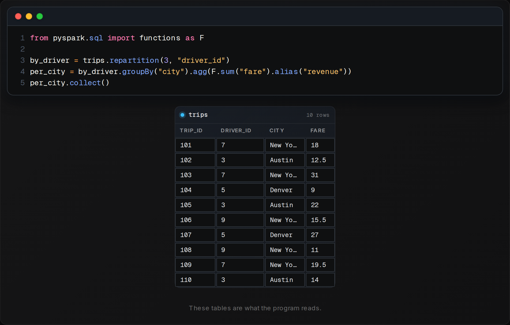
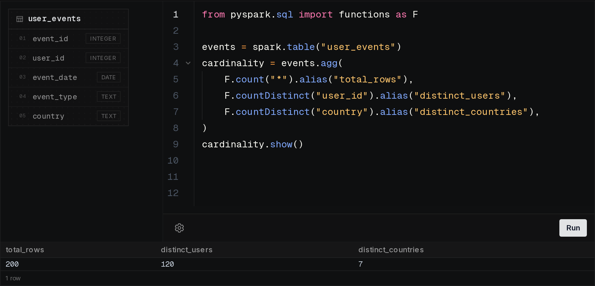
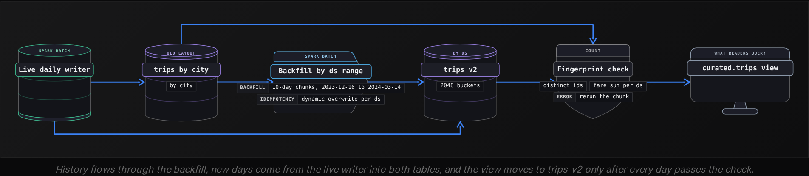
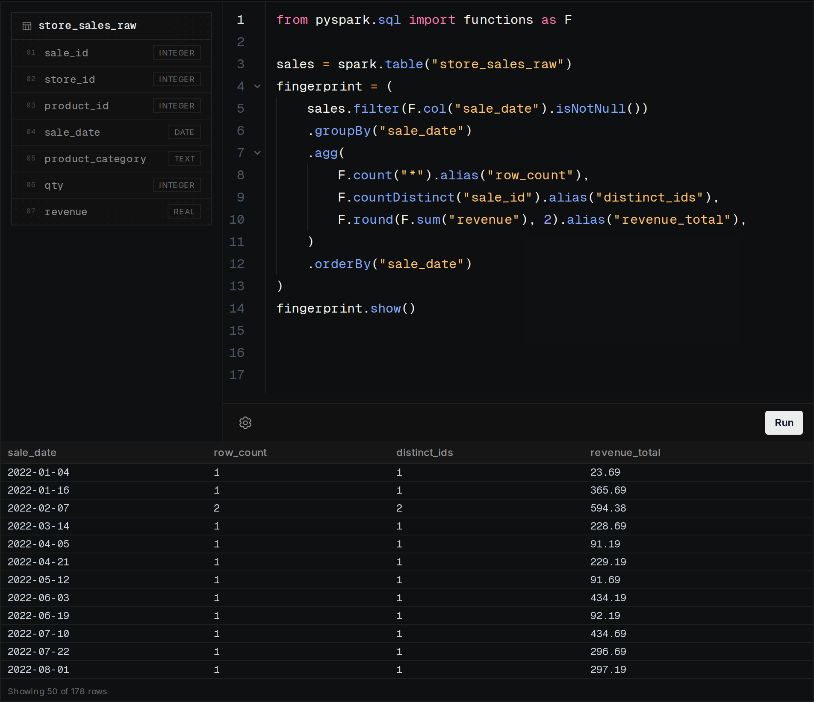
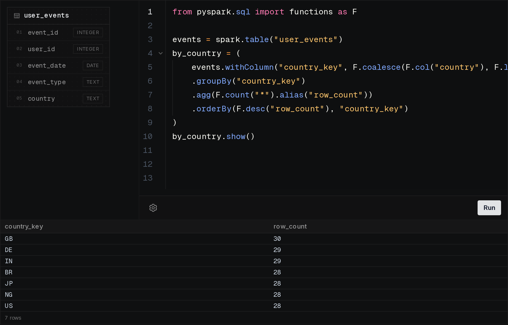
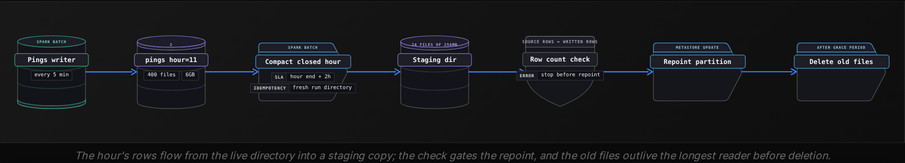

Advanced·Spark · 15 min · 17 challenges

# Partitioning: Advanced

A data engineer at Uber has a pricing job that reruns every hour, joining yesterday's 2TB of trips to drivers. Each run reshuffles all 2TB by `driver_id`, an older table partitioned by city leaves a single task grinding through New York, and a GPS pings table piles up 2,400 small files an hour. All 3 problems come from how the files are laid out.


<br>

---

## Bucketing at Write Time

Bucketing fixes a table's hash layout at write time. Spark hashes each row's bucket column, takes the result modulo the bucket count n, and writes the row into a file tagged with that bucket's number. The metastore stores the column and n beside the table's schema, so a query that later reads the table by name knows which bucket holds every key before it opens a file.

That knowledge is what a join normally buys with a shuffle. The pricing job joins `trips`, 2TB per day, to `drivers`, 120GB, on `driver_id`. Neither table is stored by `driver_id`, so Spark hash-partitions both inputs across the network before a trip can meet its driver. The animation runs that join on 10 trips and 4 drivers.

https://github.com/user-attachments/assets/daba3e0a-4b33-4528-9fb0-f0add0688984

The first line turns off broadcasting, which would otherwise copy a table this small whole to every task; the production tables are far too large for that shortcut. What runs instead is an exchange on each side: every input task writes its rows to shuffle files keyed by `driver_id`, and each reducer task fetches its share from all of them. Every row for driver 7 reaches the same reducer, whichever partition it started in, and meets its match there.


<br>

### Paying the shuffle once, at write

Bucketing moves that exchange from the read to the write. The table is shuffled by its bucket column once, as it is written, and the hashed layout is kept as files. Every read afterwards starts from rows already grouped by `driver_id`.

```sql
trips = spark.read.parquet("/lake/raw/trips/")

(
    trips.repartition(2048, "driver_id")
    .write.partitionBy("ds")
    .bucketBy(2048, "driver_id")
    .sortBy("driver_id")
    .mode("overwrite")
    .saveAsTable("curated.trips_bucketed")
)
```

The write, line by line

- bucketBy works only with saveAsTable. Writing with .save(path) raises an error, because the bucket column and count have to be recorded in the metastore.
- repartition(2048, "driver_id") applies the same hash and modulo as bucketBy(2048, "driver_id"), so each write task holds exactly 1 bucket and writes 1 file into each ds directory: 2048 files per day.
- sortBy orders the rows inside each bucket file. The plan further down shows what it leaves in place.

The animation shows that reuse at small scale. Once rows are hash-partitioned by `driver_id`, a `groupBy` on `driver_id` needs no second exchange, because each driver's rows already sit in 1 partition. A bucketed table is that first exchange, saved to disk.

https://github.com/user-attachments/assets/0df7403b-b6ec-44aa-8b04-75a6f0e5ab19

<br>

### Reading 2 bucketed tables by name

`drivers` is written the same way, into 2048 buckets on `driver_id`. Read both tables by name and join them, and the planner finds each scan already delivering hash partitioning on `driver_id` into 2048 parts, the exact distribution the join requires. It adds no exchange. Task 0 reads bucket 0 of both tables, task 1 reads bucket 1 of both, and so on through 2048 tasks of about 1GB of trips each.

Plan without buckets

| Operator | Reads |
| --- | --- |
| SortMergeJoin | both |
| Sort | trips |
| Exchange hashpartitioning(driver_id, 200) | trips |
| FileScan parquet | trips |
| Sort | drivers |
| Exchange hashpartitioning(driver_id, 200) | drivers |
| FileScan parquet | drivers |

Plan with 2048 buckets on each side

| Operator | Reads |
| --- | --- |
| SortMergeJoin | both |
| Sort | trips |
| FileScan parquet, Bucketed: true | trips |
| Sort | drivers |
| FileScan parquet, Bucketed: true | drivers |

*The Sort steps stay. In Spark 3 a bucketed scan does not report its sort order to the planner by default, so sortBy does not remove them; the missing exchange is the saving to count on.*

- **2.12TB** — shuffle written per unbucketed run
- **51TB** — shuffle written per day, unbucketed

The bucketed table pays for 1 shuffle when the day is written, and all 24 hourly runs after it join without any.

> **TIP**
>
> Bucketing pays off when reads on the key outnumber writes. A table rewritten every hour and read once an hour gains nothing: the shuffle at write replaces the shuffle at read 1 for 1.

**trips_bucketed and drivers_bucketed are both bucketed by driver_id into 2048 buckets and read by name. How many exchanges does the plan for this program contain?**

```python
from pyspark.sql import functions as F

trips = spark.table("curated.trips_bucketed")
drivers = spark.table("curated.drivers_bucketed")

ranked = (
    trips.join(drivers, "driver_id")
    .groupBy("driver_id")
    .agg(F.sum("fare").alias("revenue"))
    .orderBy(F.desc("revenue"))
)
ranked.collect()
```

- **A.** 0, because every step runs inside the driver_id buckets
- **B.** 1, a range exchange for the orderBy, while the join and groupBy reuse the buckets
- **C.** 2: an exchange for the join and another for the orderBy, since joins always exchange
- **D.** 3: an exchange for each wide step, the join, the groupBy and the orderBy

<details>
<summary>Solution</summary>

**B.** 1, a range exchange for the orderBy, while the join and groupBy reuse the buckets

The join's output stays hash-partitioned on driver_id into 2048 parts, which satisfies the groupBy. Sorting by revenue needs range partitioning, the only distribution the buckets lack.

**Why the others are wrong**

- **A.** The join and the groupBy do. The orderBy needs rows in global revenue order, which hashed buckets cannot supply, so it adds a range exchange.
- **C.** A join exchanges only when an input is not already partitioned on the join key. Both scans arrive bucketed on driver_id with equal counts, so the join adds none.
- **D.** Counting wide steps overcounts. A step gets an exchange only when its input lacks the distribution it needs, and only the orderBy is in that position.

</details>


<br>

---

## Bucketing Pitfalls

A bucketed table keeps its exchange-free plan only while each query meets the conditions the planner checks. Miss any of them and the plan regains an exchange with no error and no warning: the same result, at the old shuffle cost. Traps 1 to 3 show up in `explain()` as an `Exchange` sitting above a scan you expected to read buckets. Traps 4 and 5 add no exchange; they show up as file counts on disk and as per-task input sizes in the Spark UI.


<br>

### Trap 1: reading the files instead of the table

The bucket column and count live in the metastore; the files hold rows and nothing more. `spark.read.parquet("/lake/curated/trips_bucketed/")` reads the same bytes as `spark.table("curated.trips_bucketed")`, yet sees a plain directory, so its scan reports no partitioning at all. Read a bucketed table by its name, or through a view over that name.


<br>

### Trap 2: bucket counts that differ

Buckets line up only when both sides split the key space the same number of ways. With `trips` in 2048 buckets and `drivers` in 512, a driver in bucket 1,031 of `trips` sits in bucket 7 of `drivers`, since 1,031 modulo 512 is 7. Spark keeps the side with more buckets as it is and shuffles the other into 2048 partitions, so `drivers` pays a 120GB exchange on every run.

*Spark 3.1 added spark.sql.bucketing.coalesceBucketsInJoin.enabled, off by default. When one count divides the other, it reads the larger side at the smaller count, giving up parallelism to drop the exchange.*


<br>

### Trap 3: join columns that differ from the bucket columns

Join keys must equal the bucket columns, in name and in type. A `groupBy` is looser: its keys must include the bucket columns and may add others. This is what each query on `trips`, bucketed by `driver_id`, gets:

| Query on trips | Exchange added | Why |
| --- | --- | --- |
| Join on `driver_id`, `drivers` in 2048 buckets on it | None | Both scans already cluster rows on the join key |
| `groupBy("driver_id", "city")` | None | Rows sharing both keys already share a `driver_id` bucket |
| `groupBy("city")` | 1 | Each city's trips sit in all 2048 buckets |
| Join on `driver_id` and `city`, both sides bucketed on `driver_id` | Both sides | The join needs rows clustered on both keys together |
| Join to `drivers` whose `driver_id` is a string | The string side | Spark casts the string side, and the cast column has no bucket layout |

The animation plays the `groupBy("city")` row at small scale: rows are laid out by `driver_id` first, then aggregated by `city`.



The second exchange moves every row again, because each city's trips are scattered across all 3 driver partitions. A layout on `driver_id` is worth nothing to a query that groups or joins on anything else.


<br>

### Trap 4: the file explosion on write

Leave out the `repartition` before `bucketBy` and every write task opens a file for each bucket it holds rows for. A day of trips is read as 16,384 input tasks of 128MB, and hashing scatters rows from nearly every bucket into each of them.

- **33.5M** — files per day without the repartition
- **1GB** — size of each file with the repartition


<br>

### Trap 5: the parallelism ceiling

A bucketed scan runs 1 task per bucket and never splits a bucket across tasks, so the count fixed at write time is the parallelism of every bucketed join and aggregation that follows. Bucket 2TB into 64 and each of 64 tasks reads 32GB, however many cores the cluster has. Bucket a column with 30 distinct values into 2048 and 2,018 buckets sit empty while 30 tasks do the work.

> Checking a bucketed plan
>
> - Call `explain()` on the final DataFrame before trusting a layout.
> - Each scan of a bucketed table should read `Bucketed: true`.
> - No `Exchange` should sit between a bucketed scan and the join or `groupBy` above it.
> - In the Spark UI, the stage holding that scan should run as many tasks as the table has buckets.

**A teammate reads the bucketed trips table by path and joins it to drivers_bucketed, read by name. Both were written with 2048 buckets on driver_id. What does the join's plan contain?**

```python
trips = spark.read.parquet("/lake/curated/trips_bucketed/")
drivers = spark.table("curated.drivers_bucketed")

joined = trips.join(drivers, "driver_id")
joined.write.mode("overwrite").saveAsTable("curated.trips_priced")
```

- **A.** No exchange, because both sets of files are bucketed on disk
- **B.** Exchanges on both sides, because a path read disables bucketing for the query
- **C.** An analysis error, because a bucketed table cannot be read by path
- **D.** 1 exchange, on trips, into 2048 partitions to match the drivers buckets

<details>
<summary>Solution</summary>

**D.** 1 exchange, on trips, into 2048 partitions to match the drivers buckets

Spark keeps the side that already satisfies the join, drivers in 2048 buckets, and shuffles trips into 2048 partitions to line up with it. The 2TB side pays its full shuffle again.

**Why the others are wrong**

- **A.** The files do not carry the bucket spec; the metastore does. Read by path, trips has no known partitioning, so it must be exchanged.
- **B.** The path read affects only its own scan. drivers was read by name, its scan still reports 2048 hash partitions, and Spark keeps that layout.
- **C.** The read succeeds and returns the right rows. Only the layout knowledge is lost, which is why this trap goes unnoticed.

</details>

Cardinality decides whether a column can fill its buckets: a column with fewer distinct values than buckets caps the useful task count at that number. Compare 2 candidate bucket columns on `user_events`.



```python
from pyspark.sql import functions as F

events = spark.table("user_events")
cardinality = events.agg(
    F.count("*").alias("total_rows"),
    F.countDistinct("user_id").alias("distinct_users"),
    F.countDistinct("country").alias("distinct_countries"),
)
cardinality.show()
```


<br>

---

## Changing a Layout Safely

`trips_by_city`, the older layout, is partitioned by `city`. The target is `curated.trips_v2`, partitioned by `ds` and bucketed into 2048 on `driver_id`, holding each trip of the last 90 days exactly once. Rewriting in place is ruled out: Spark refuses to overwrite a table the same query reads from, and working around that refusal deletes the input before the lazy plan has read it. The move builds the new table beside the old one and switches readers at the end.


<br>

### The move in 5 steps



- **Pick a cutover day** *ds = 2024-03-15*\
  In trips_v2, days before it come from the backfill and days from it on come from the live writer, which keeps writing trips_by_city too until the rollback window closes. No day has 2 writers.
- **Backfill by day range** *dynamic partition overwrite*\
  Each write covers a range of ds values and replaces exactly those partitions, so a failed or repeated chunk rewrites its own days and nothing else.
- **Fingerprint every day** *old and new, compared day by day*\
  Row count, distinct trip ids and fare total per ds must match across the 2 tables before anything switches.
- **Switch the view** *a single metadata statement*\
  Readers query curated.trips; repointing it at trips_v2 moves every new query at once.
- **Keep the old table** *until the rollback window closes*\
  Pointing the view back at trips_by_city undoes the switch with nothing lost only while the live writer still sends it every new day.


<br>

### Overwrite a day, never the table

The default overwrite mode, `static`, deletes every existing partition of the target before writing, including days the DataFrame holds no rows for. Setting `spark.sql.sources.partitionOverwriteMode` to `dynamic` narrows the delete to the partitions the DataFrame writes. Under it, a chunk that dies halfway can rerun: the retry replaces its own days and leaves the rest alone.

```sql
from pyspark.sql import functions as F

spark.conf.set("spark.sql.sources.partitionOverwriteMode", "dynamic")

old = spark.table("curated.trips_by_city")
target_columns = spark.table("curated.trips_v2").columns
chunks = [("2023-12-16", "2023-12-25"), ("2023-12-26", "2024-01-04")]

for first_ds, last_ds in chunks:
    days = old.filter(F.col("ds").between(first_ds, last_ds))
    (
        days.select(*target_columns)
        .repartition(2048, "driver_id")
        .write.mode("overwrite")
        .insertInto("curated.trips_v2")
    )
```

insertInto matches columns by position, so the select lists them in the target's order; swap 2 columns of the same type, such as trip_id and driver_id, and rows load into the wrong places without an error. Each chunk scans all of trips_by_city, because ds is not that table's partition column and nothing prunes, so the chunk size trades the number of full scans against the size of each job.

Chunk by ds, never by city. Dynamic overwrite replaces whole ds partitions, so a loop that writes New York's trips and then Austin's leaves every day holding Austin's trips alone.


<br>

### Proving nothing moved twice

A fingerprint per `ds` catches both failures. A lost row lowers the count. A doubled row lifts the count above the number of distinct trip ids. Compute the same fingerprint on both tables and compare them day by day; a day that differs gets its chunk rerun, which dynamic overwrite makes safe. Try the fingerprint on `store_sales_raw`, grouped by `sale_date`.



```python
from pyspark.sql import functions as F

sales = spark.table("store_sales_raw")
fingerprint = (
    sales.filter(F.col("sale_date").isNotNull())
    .groupBy("sale_date")
    .agg(
        F.count("*").alias("row_count"),
        F.countDistinct("sale_id").alias("distinct_ids"),
        F.round(F.sum("revenue"), 2).alias("revenue_total"),
    )
    .orderBy("sale_date")
)
fingerprint.show()
```

Any day where `row_count` exceeds `distinct_ids` holds a repeated sale id. On a real move, the query must return identical rows from the old table and the new one.


<br>

### The switch and the way back

Every reader queries `curated.trips`, a view over whichever table is current. A view resolves to its table at planning time, so queries through it still get the bucketed scan. Moving every reader takes a single statement:

```sql
CREATE OR REPLACE VIEW curated.trips AS
SELECT
  trip_id,
  driver_id,
  city,
  fare,
  ds
FROM curated.trips_v2
```

> **TIP**
>
> Run downstream jobs against `trips_v2` for a full week of real traffic before dropping `trips_by_city`. Until then, pointing the view back at the old table is the entire rollback.

**With dynamic overwrite on, a teammate's first pass writes New York's trips for all 90 days into trips_v2 with mode("overwrite") and insertInto. A second pass writes Austin's trips for 2024-02-14 to 2024-03-14 only, the last 30 days. What does trips_v2 hold?**

- **A.** New York alone through 2024-02-13, and Austin alone for the last 30 days
- **B.** Austin alone on all 90 days, because the last overwrite replaces the table
- **C.** New York on all 90 days, plus Austin added on top for the last 30 days
- **D.** New York alone on all 90 days, because a written partition cannot be replaced

<details>
<summary>Solution</summary>

**A.** New York alone through 2024-02-13, and Austin alone for the last 30 days

Dynamic overwrite replaced only the 30 ds partitions the second pass wrote. Those days lost New York's trips, and the 60 earlier days kept them.

**Why the others are wrong**

- **B.** That is static overwrite. In dynamic mode, the 60 days the second pass held no rows for are left as they were.
- **C.** Overwrite never appends. Each of the last 30 partitions was replaced by the second pass's rows, which held only Austin.
- **D.** Spark overwrites a partition as often as asked. The second pass reports success, and the last 30 days now hold only Austin.

</details>


<br>

---

## Layout-Induced Skew

Skew is a single task holding far more data than its siblings. A stage ends when its last task does, so that task's runtime becomes the stage's runtime. Most skew arrives with the data. Layout skew is written down: a partition column or bucket key with lopsided values bakes the imbalance into the files, and every job that reads them inherits it.


<br>

### Large directories still scan evenly

Take 1 day of trips partitioned by `city`: 300GB under `city=New York` and 40MB under `city=Boise`. A scan of both still runs evenly sized tasks, because Spark cuts large files into splits of up to `spark.sql.files.maxPartitionBytes`, 128MB by default, and packs small files together. New York becomes about 2,400 tasks and Boise 1. Directory size alone does not skew a scan.


<br>

### Every null lands in 1 bucket

- **Writes keyed on the partition column.** repartition("city") before partitionBy("city") gives each directory 1 file, and hands all 300GB of New York to a single task while Boise's task finishes in seconds.
- **Bucketed reads.** A bucket is read whole by 1 task, so with 2048 buckets a key holding 5% of the rows makes its bucket about 100 times the size of the rest.
- **Null keys.** Every null hashes to the same value, so all trips without a driver share 1 bucket, and any read that keeps them, such as a left join or a groupBy, hands that bucket to 1 task.


The program below left-joins 12 trips to drivers; 5 of those trips have no driver yet.

https://github.com/user-attachments/assets/4db8c1a0-94df-4944-b5ff-e3591f01638f

All 5 null-key trips meet on the same reducer task. A bucketed write sends rows through the same hash, so on disk those trips would share 1 bucket, and that bucket stays whole in every read.

**trips is bucketed into 2048 buckets on driver_id, and 8% of a day's 2TB has a null driver_id. In a bucketed left join to drivers, about how much does the task holding the null bucket read?**

- **A.** About 1GB, like every other task, because hashing spreads rows evenly
- **B.** About 80MB, since the null rows spread evenly across all 2048 buckets
- **C.** About 165GB: all 164GB of nulls plus its share of the rest, against under 1GB
- **D.** About 2GB, because a bucket that large is split across 2 tasks

<details>
<summary>Solution</summary>

**C.** About 165GB: all 164GB of nulls plus its share of the rest, against under 1GB

Eight percent of 2,048GB is about 164GB, all in bucket 42, plus roughly 0.9GB of keyed rows. The other tasks read about 0.9GB each, so the stage waits on 1 task.

**Why the others are wrong**

- **A.** Hashing spreads distinct keys evenly. Every null hashes to the same value, so all 8% of the rows land in 1 bucket.
- **B.** That would hold if nulls hashed to many values. They all hash to 42, so they share bucket 42.
- **D.** A bucketed scan never splits a bucket, whatever its size. The null bucket goes to 1 task.

</details>


<br>

### Detecting skew before it ships

A bucket can never hold less than its hottest key. With n buckets an even bucket holds 1/n of the rows, so any key above that share produces the largest task however high n goes. Before choosing a partition column or bucket key, count rows per value and compare the top share with 1/n. Run that count for country on user_events, with nulls kept as a value of their own, since they share 1 bucket like any other key.



```python
from pyspark.sql import functions as F

events = spark.table("user_events")
by_country = (
    events.withColumn("country_key", F.coalesce(F.col("country"), F.lit("(null)")))
    .groupBy("country_key")
    .agg(F.count("*").alias("row_count"))
    .orderBy(F.desc("row_count"), "country_key")
)
by_country.show()
```

On a table already written, the Spark UI shows the same thing per task. A stage's summary metrics list the minimum, median and maximum of task duration and input size; a maximum many times the median, on a stage reading bucketed or freshly partitioned data, points at the layout.


<br>

### Designing around skew

For writes, range partitioning on the partition column plus a high-cardinality column splits the hot value. Spark samples the keys and cuts them into ranges of similar row counts, so New York's trips spread over many ranges and many tasks each write a slice of its directory, while several small cities share 1 range.

```sql
(
    trips.repartitionByRange(400, "city", "trip_id")
    .write.partitionBy("city")
    .mode("overwrite")
    .saveAsTable("curated.trips_by_city")
)
```

| ✓ Do | ✗ Don't |
| --- | --- |
| • Partition by a column with bounded, even values, such as ds<br><br>• Compare the top key's row share with 1/n before choosing a bucket key<br><br>• Write null or placeholder keys to their own table before bucketing<br><br>• Spread a hot partition value on write with repartitionByRange on a second column | • Repartition by the partition column alone when 1 value dominates<br><br>• Bucket on a key whose nulls or test accounts hold a large share of rows<br><br>• Raise the bucket count to tame 1 hot key; its bucket stays whole |


<br>

---

## Compaction in Production

`pings` takes a write every 5 minutes, partitioned by `ds` and `hour`. Each write runs 200 tasks and each task writes 1 file, so a closed hour holds 2,400 files averaging about 2.6MB across its 6GB. Compaction rewrites that hour as 24 files of 256MB. The rewrite is a short Spark job; the production work is swapping files that other queries may be reading at that moment.


<br>

### How compaction breaks readers

| What the compactor does | What a live reader sees |
| --- | --- |
| Deletes the 2,400 old files while a query is scanning them | The query fails on the first old file it tries to open after the delete |
| Writes the 24 new files into `hour=11` before deleting the old ones | A query that lists the directory in between reads every row twice |
| Compacts the hour the writer is still appending to | Files written mid-run get deleted with the old ones, and their rows are gone |
| Repoints `hour=11` while a late writer still appends to the old path | Late rows land in a directory the table no longer reads |


<br>

### A protocol readers never notice

At 14:30 on 2024-03-15, with a 2-hour lateness window, `hour=11` is the newest hour the compactor may touch. Its run takes 5 steps:

- **Compact closed hours only** *hour end plus a 2-hour lateness window*\
  Once late rows stop arriving the writer never touches the hour again, so nothing lands while the compactor reads it.
- **Write to a fresh directory** *outside the live partition*\
  A new path per run, such as /lake/pings_compacted/ds=2024-03-15/hour=11/run=1/, keeps half-written output out of every listing a reader makes.
- **Verify the copy** *row counts must match*\
  The compacted directory must hold exactly as many rows as the source hour, or the run stops before any reader is affected.
- **Repoint the partition** *a single metastore update*\
  Queries planned after the update list the 24 new files; queries planned before it keep the 2,400 old ones they already listed.
- **Delete after a grace period** *longer than the longest query*\
  The old files go only once every query that could have listed them has finished: measure the longest query and add margin.

Together the steps keep the metastore pointing the partition at exactly 1 complete directory at every moment, and no file a planned query listed disappears before that query can finish.



```sql
import math

from pyspark.sql import functions as F

TARGET_FILE_BYTES = 256 * 1024 * 1024


def compact_hour(ds, hour, hour_bytes, staging_dir):
    rows = spark.table("lake.pings").filter(
        (F.col("ds") == ds) & (F.col("hour") == hour)
    )
    file_count = max(1, math.ceil(hour_bytes / TARGET_FILE_BYTES))
    (
        rows.drop("ds", "hour")
        .repartition(file_count)
        .write.mode("errorifexists")
        .parquet(staging_dir)
    )
    written = spark.read.parquet(staging_dir).count()
    expected = rows.count()
    if written != expected:
        raise ValueError(f"{staging_dir}: wrote {written} rows, expected {expected}")
    return file_count
```

errorifexists makes a reused staging path fail instead of mixing with a half-written earlier attempt. repartition(file_count) shuffles the hour's 6GB so each output file gets an equal share of rows. coalesce(file_count) skips the shuffle by merging the scan's input partitions in place, and the merged groups, and so the files, can differ in size. At 6GB the shuffle costs seconds and buys even files. On a 2TB day it becomes the largest cost of the run, and coalesce with its uneven files is often the better trade.

Writers should append through the table name, never a hard-coded path. An append by name goes to the partition's current location, so a late row that slips past the window still lands where readers look. An append by path to the old directory survives only until the delayed delete, and no reader sees it before then.

**A compactor writes 24 new files into hour=11, then deletes the 2,400 old ones. A dashboard query sums pings for that hour, lists the directory between those 2 steps, and finishes before the delete. What does it return?**

- **A.** The correct sum, because Spark reads only the newest files in a directory
- **B.** Twice the true sum, because it read the old files and the new ones
- **C.** A file-not-found error, because the old files vanished before it read them
- **D.** Half the true sum, because the new files replaced half of the old listing

<details>
<summary>Solution</summary>

**B.** Twice the true sum, because it read the old files and the new ones

Its listing held the 2,400 old files and the 24 new ones, and each set holds every row of the hour, so every row counted twice.

**Why the others are wrong**

- **A.** Spark reads every data file the listing returns. A plain directory has no notion of which files are current.
- **C.** The query finished before the delete ran, so every file it listed still existed when it was read.
- **D.** Writing new files removes nothing. The listing grew from 2,400 files to 2,424, and all of them were read.

</details>


<br>

---

## Putting It All Together

Back in the Uber pricing scenario: the team rewrites trips as trips_v2, partitioned by ds and bucketed into 2048 on driver_id, and writes trips with no driver to a table of their own. The hourly join loses both exchanges and runs 2048 tasks of about 1GB, the city-partitioned table retires a week after the view moves, and the GPS pings table gets a compactor that turns each closed hour's 2,400 files into 24 while dashboards keep querying.

- The bucketed write is the pricing join's shuffle paid once and saved, which is why both sides need the same bucket count and every read must go through the table name.
- The bucket count fixes 3 things at once: files per day, tasks per read, and the floor on a bucket's size, its hottest key; moving null drivers out is what keeps 2048 buckets even.
- The layout move and the compactor follow a single rule: build the new files beside the old ones, check them, switch with a single metadata change, and delete only when no reader can need the old files.
- Dynamic overwrite per day range makes the backfill safe to rerun for the same reason a fresh run directory makes compaction safe to rerun: a retry replaces its own output and nothing else.


<br>

---

## Key Takeaways

- A bucketed write pays the key's shuffle once; tables bucketed on the same key into the same count then join and aggregate on it with no exchange.
- The layout holds only when reads go through the table name and the counts, key columns and key types all match; explain ( ) then shows Bucketed : true and no Exchange above the scans.
- The bucket count sets the files per day and the tasks per read, and no bucket can be smaller than its hottest key, nulls included.
- Move a layout beside the old one: a single writer per day, dynamic overwrite per day range, a fingerprint per day, then a view switch.
- Layout skew lives where 1 task owns 1 value: writes repartitioned by the partition column, and bucketed reads of a hot or null key.
- Compact only closed partitions, into a fresh directory, verify, repoint, and delete the old files after the longest query could have finished.
