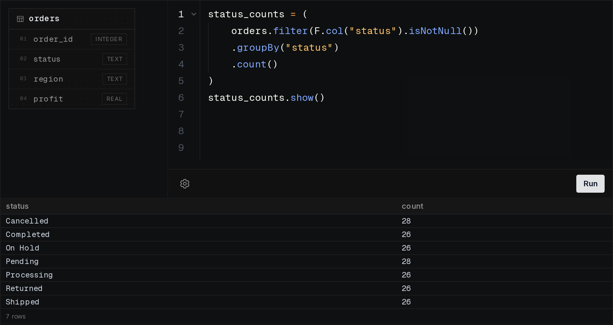
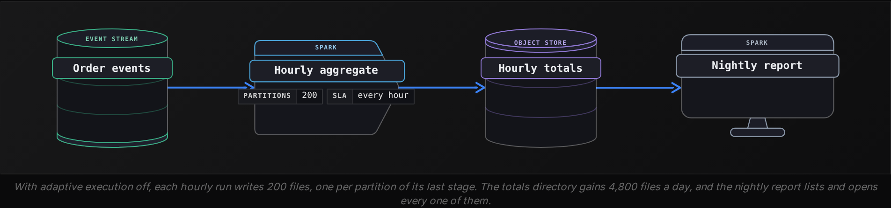

Beginner·Spark · 13 min · 16 challenges

# Partitioning: Beginner

Take the Netflix job that computes yesterday's top 10 titles: it reads a day of playback events and usually finishes in 20 minutes. This Friday it is at 3 hours and climbing. The bytes have not changed, but their shape has: 400,000 files of 300KB instead of 1,000 files of 128MB, and the job is paying for every one of them.


<br>

---

## What a Partition Is

A partition is the unit of work in Spark: a slice of a DataFrame that one task reads and transforms on one core, with no help from any other task. On disk, a partition is a byte range: a whole file, or a piece of a file, with a start offset and a length. In memory, it's the block of rows that one executor holds for that slice. Every narrow transformation runs partition by partition, so a filter keeps the exact count it was given, and so does a select or a withColumn.

Two numbers describe any partition: how many bytes it holds, and how many rows that becomes once decoded. The first decides how long its task spends reading. The second decides how much executor memory the task needs while it works. Both come back in the sections that follow, because every partitioning problem is one of those 2 numbers sitting far from where it should be.


<br>

### Where partitions come from on read

When you call spark.read on a directory, Spark lists the files and cuts them into partitions of one split size. spark.sql.files.maxPartitionBytes caps the split at 128MB by default. The split shrinks when a read is small so that every core still gets work: Spark divides the total bytes, plus a 4MB charge per file, by the core count and takes that when it's smaller, with 4MB as the floor. Any read above 128MB times the core count splits at 128MB: a 10GB file on 16 cores becomes 80 partitions, read by 80 tasks in parallel. Files larger than the split are cut at its boundaries, and smaller files are packed together up to the split.

| On disk, read on 16 cores | Partitions | Each partition holds |
| --- | --- | --- |
| 1 file of 10GB | 80 | 128MB |
| 1 file of 300MB | 16 | 15 of 19MB, 1 of 15MB |
| 1 file of 50MB | 13 | 12 of 4MB, 1 of 2MB |
| 10 files of 6MB | 10 | 1 whole file |

The count depends only on file sizes and the core count, so you can predict it from a directory listing and the cluster size before a single row is read. That matters because the count is also the number of tasks the first stage launches, and nothing in a narrow transformation changes it.

https://github.com/user-attachments/assets/27facbac-0cda-46f7-bd8f-8f1a2bfc87f1

The program above reads a 12-row `orders` table as 4 partitions and filters it down to the 2 refunded rows. Follow the task count: 4 tasks launch, each scans its 3 rows, and 4 result sets travel back to the driver even though at least 2 of them carry nothing. The filter removed 83% of the rows and left the partition count alone.


<br>

### Why 128MB

Each task carries a fixed cost: the driver serializes and schedules it, an executor opens the input, and the result is reported back, a few milliseconds of overhead whatever the size of the input. Reading and decoding 128MB takes a task on the order of a second or more, so at that size the overhead stays under 1% of the work. Memory sets the upper limit. A task decodes its partition into rows in memory, and the decoded rows take more space than the bytes on disk, so a 128MB input expands into something that still fits inside the memory one task gets, where a 2GB input often does not. At 128MB a read also leaves enough partitions to spread the work: a 10GB read gives 80 tasks, which keep a 16-core cluster busy for 5 rounds, so one slow task shifts the finish line by a fraction of a round rather than doubling it.

- **2 to 3** — tasks per core, per the tuning guide
- **200ms** — shortest task Spark schedules well

Both figures come from Spark's own tuning guide, the first so that every core always has a queue of work waiting, the second as the floor below which scheduling dominates. A partition of 128MB on splittable input lands well above that floor and well below the point where a single task outgrows its memory.

**A directory holds one 2GB CSV file and nothing else. On a 16-core cluster, you call spark.read.option("header", "true").csv(path) with default settings. How many partitions does the first stage read, and what does each hold?**

- **A.** 1 partition, because a single file is read by a single task
- **B.** 16 partitions, each a 128MB byte range of the file
- **C.** 200 partitions, the default count for any DataFrame
- **D.** 2 partitions of 1GB, one per core of a 2-core driver

<details>
<summary>Solution</summary>

**B.** 16 partitions, each a 128MB byte range of the file

On 16 cores, 2,048MB plus the 4MB file charge divides to 128.25MB per core, above the 128MB limit, so the split stays at 128MB. Dividing 2,048 by 128 gives 16 ranges, one per task.

**Why the others are wrong**

- **A.** A splittable file is cut at split boundaries. One task per file happens only when the file can't be split, and a plain CSV can.
- **C.** The default of 200 applies to partitions after a shuffle. A read's count comes from file sizes measured against the 128MB limit and the core count, and a filter or select never changes it.
- **D.** The driver's cores play no part. Executor cores can only shrink the split below 128MB, and 16 of them leave a 2GB read at 128MB: 16 ranges.

</details>


<br>

---

## Too Many Small Partitions

A job drowns in small partitions when the count stays high while the bytes per partition collapse, and you have already met the usual sources. A selective filter keeps the partition count: 80 partitions of 128MB that keep 0.1% of their rows become 80 partitions of around 128KB, and every narrow step after it runs as 80 tasks over 10MB of data. A shuffle writes spark.sql.shuffle.partitions partitions, 200 by default, whatever the data: a groupBy over 50MB writes 200 shuffle partitions of roughly 250KB each. Adaptive query execution, on by default since Spark 3.2 and taught later, merges small shuffle partitions at run time, so all 200 run only when it is off. And a directory of thousands of tiny files produces thousands of tiny partitions, which the small-files section prices in detail.


<br>

### What a task costs before it does any work

Every task pays the same entrance fee. The driver serializes the task, finds a free slot, and sends it over the network. On arrival the executor deserializes it and opens its input before setting up the code it will run. When the task finishes it reports its status and metrics back, and the driver records them and schedules the next one. None of these steps looks at your data, and together they take a few milliseconds to a few tens of milliseconds per task. That fee is noise next to a 128MB partition and the whole bill for a 50KB one.

| Same 1GB of input | 8 partitions | 20,000 partitions |
| --- | --- | --- |
| Bytes per task | 128MB | about 50KB |
| Work per task | about 1 second | under 1 millisecond |
| Fixed cost per task | about 10ms | about 10ms |
| Share of time that is overhead | about 1% | over 90% |
| Tasks the driver must schedule | 8 | 20,000 |

Read the last row again. The driver works through its task queue from one scheduling loop, so 20,000 tasks is 20,000 trips through that loop, and the executors spend most of each slot's time waiting for the next assignment to arrive. The same bytes in 8 partitions ask the driver for 8 decisions.


<br>

### Empty reducers after a shuffle

https://github.com/user-attachments/assets/9f64410e-3485-4282-b882-e42eb33c7dc4

Here 9 orders in 3 regions are summed by region with the shuffle partition count set to 6. The map side runs 3 tasks, one per input partition, and each hashes its rows by region. The reduce side launches 6 tasks for 3 keys, so at least 3 of them receive no rows at all; they run anyway and return an empty result. East sums to 120. West and North come to 105 and 95, and at least half of the reduce tasks contributed nothing but overhead. At the default of 200, at least 197 partitions would hold nothing, and with adaptive execution off each would still run as a task.


<br>

### What it looks like in the Spark UI

- A stage with thousands of tasks over a few megabytes of input
- Task durations where the median sits below 50ms
- Input size per task measured in KB rather than MB
- Scheduler delay that is a visible share of each task's time
- Exactly 200 tasks after every groupBy or join, a sign adaptive execution is off

The runnable example below groups the practice `orders` table by status and counts each group. Run it: the shuffle writes 200 partitions for a handful of statuses, and adaptive execution merges the near-empty ones, so on a cluster the reduce stage runs as around 1 task. With it off, 200 tasks would produce those few rows. The `isNotNull` filter keeps a null status from forming its own group.



```python
status_counts = (
    orders.filter(F.col("status").isNotNull())
    .groupBy("status")
    .count()
)
status_counts.show()
```

> **TIP**
>
> Exactly 200 tasks in a reduce stage over a small input means the shuffle default set the count and adaptive execution is off. The methods that change it arrive in the next lesson.

**A nightly job reads 400 partitions of 128MB, filters to the 0.05% of rows that are errors, then runs 6 more narrow transformations and writes. The Spark UI shows 400 tasks in that stage with a median duration of 30ms. What's the job paying for?**

- **A.** A shuffle that the filter inserted to rebalance the surviving rows across executors
- **B.** Spill to disk, because 400 partitions of 128MB do not fit in executor memory at once
- **C.** The launch cost of 400 tasks over about 25MB of surviving data, because the filter kept the count
- **D.** The driver re-reading the 51GB input once for each of the 6 narrow transformations

<details>
<summary>Solution</summary>

**C.** The launch cost of 400 tasks over about 25MB of surviving data, because the filter kept the count

128MB times 400 is 51,200MB, and 0.05% of that is 25.6MB. The filter dropped the rows and kept all 400 partitions, so every narrow step after it runs as 400 tasks whose scheduling costs more than their work.

**Why the others are wrong**

- **A.** A filter is narrow and inserts no shuffle. Rows stay in the partition they were read into, which is why the task count is still 400 after the filter.
- **B.** A core runs one task at a time, and 128MB per task is the target size. A 30ms median task means too little work per task, the opposite of spill.
- **D.** The narrow steps run inside the same tasks over the same partitions, and nothing re-reads the input between them. The cost here is the task count, which the filter left untouched.

</details>


<br>

---

## Too Few Large Partitions

The opposite failure is quieter and costs more per hour. A job with fewer partitions than cores leaves the extra cores with nothing to run. Take 64GB read as 8 partitions on a cluster with 64 cores: 8 tasks start, each with 8GB to work through, and the other cores sit idle for the whole stage. The stage takes as long as one task needs to read 8GB, which is 64 times longer than a 128MB task would take, while you pay for 64 cores and 8 of them work.

- **56** — cores idle for the whole stage
- **12.5%** — of the cluster doing work

Idle cores are the part that shows on the bill. A cluster rented by the hour costs the same per minute whether 8 tasks or 64 are running, and the 8-task version runs many times longer. The part that doesn't show until it fails is what each of those 8 tasks has to hold in memory.


<br>

### Where too few partitions come from

Unsplittable files are the classic source. A CSV compressed with gzip cannot be cut at an arbitrary byte, because decompression has to start from the beginning of the stream, so a single 10GB `.csv.gz` arrives as 1 partition and 1 task however many cores you have. A read from a relational database through JDBC is 1 partition unless you tell Spark how to split the query, so a 200 million row table arrives through a single connection into a single task. And a shuffle partition setting that someone lowered to 4 for a small table keeps applying to every groupBy and join in that session, including the one over the big table.

| 64GB of input | 8 partitions | 512 partitions |
| --- | --- | --- |
| Bytes per task | 8GB | 128MB |
| Cores busy on a 64-core cluster | 8 | 64 |
| Rounds of tasks | 1 | 8 |
| Memory a task must hold | several GB of decoded rows | a few hundred MB |
| If 1 task is slow | the stage waits for it | the other 63 cores keep working |


<br>

### Spill, then OOM

Each task gets a bounded share of its executor's memory. A task that sorts or aggregates its partition has to hold the working set inside that share, and an 8GB partition decoded into rows will not fit. Spark's first answer is to spill: it writes part of the working set to the executor's local disk and reads that part back when the task needs it, so the task can keep going. Every spilled byte is written once and read once more, on a disk far slower than memory, so a task that spills 6GB has added 12GB of disk traffic to its own work. Spill is slow and survivable. When even the part that must stay resident outgrows the share, a hash table for a group holding millions of rows for instance, the executor throws an out of memory error and dies. Its tasks are retried on another executor, which has the same memory and the same 8GB partition, and dies the same way.


<br>

### The tells in the Spark UI

- A stage with fewer tasks than the cluster has cores
- Task durations in minutes while most executors show no active tasks
- Nonzero values in the Spill (Memory) and Spill (Disk) columns
- A failure reason that names OutOfMemoryError or a lost executor
- Input per task in GB rather than MB

| ✓ Too many small partitions | ✗ Too few large partitions |
| --- | --- |
| • Thousands of tasks over few bytes<br><br>• Overhead outweighs work<br><br>• Driver busy scheduling<br><br>• Cure: lower the count | • Fewer tasks than cores<br><br>• Idle cores, long tasks<br><br>• Spill, then OOM<br><br>• Cure: raise the count |

Both failures look the same on the wall clock: the stage is slow. You read both off the same screen by comparing the task count against the core count, and the bytes per task against 128MB. With those 2 numbers you know which direction to move the count, before you know the tool that moves it.

**A job reads a single 12GB gzip-compressed CSV on a cluster with 48 cores, then groups by customer and writes. The first stage shows 1 task that ran for 40 minutes, and the second stage shows 200 tasks that finished in under a minute. Where did the time go, and why?**

- **A.** The first stage: gzip cannot be split, so 1 task read all 12GB while 47 cores idled
- **B.** The second stage: 200 partitions over 48 cores is too many tasks for the data
- **C.** The first stage: 12GB exceeds the 128MB limit, so Spark refused to split the file
- **D.** The shuffle: moving 12GB across the network takes longer than reading it from disk

<details>
<summary>Solution</summary>

**A.** The first stage: gzip cannot be split, so 1 task read all 12GB while 47 cores idled

Decompression of gzip must start from the first byte, so Spark reads the file as 1 partition. The groupBy's shuffle then spread the rows over 200 partitions, which is why the second stage ran in parallel.

**Why the others are wrong**

- **B.** That stage ran about 4 tasks per core on 48 cores, close to the tuning guide's 2 to 3, and finished in under a minute anyway. The 40-minute task is the bottleneck.
- **C.** The 128MB limit is the size Spark splits at, and it splits any splittable file. Gzip blocks the split; the limit refuses nothing.
- **D.** The shuffle belongs to the stage that finished quickly. The slow stage is the read, where a single task did all the decompression on 1 core.

</details>


<br>

---

## The Small-Files Problem

Take 100GB of data written 2 ways: 1,000 files of 100MB, or 100,000 files of 1MB. The bytes and the rows are identical, yet a job that reads them does very different amounts of work. The difference is a set of costs that scale with the number of files rather than the number of bytes, and at 100,000 files those costs stop being a rounding error.


<br>

### Three costs that scale with file count

Spark has to list the files before it can plan a read: it needs the name and size of every file, and it gets them from the storage system in pages. An object store returns at most 1,000 names per list request, so 1,000 files arrive in 1 round trip and 100,000 files take 100 of them, each a network call the driver waits on in turn. The driver then holds an entry for every file in memory while it plans; 100,000 entries is a visible slice of a small driver's heap, and a table that keeps growing eventually makes the driver the thing that runs out of memory.

Then every file has to be opened. Each file is a separate object, and reading its first byte means a separate request: authenticate, locate, open, then stream. On an object store that round trip costs tens of milliseconds before any data flows. One file of 100MB pays it once and then streams for a second or more. Reading 100 files of 1MB pays it 100 times for the same bytes, and the reading task spends more time waiting for opens than reading data.

The open cost also sets the partition count. Spark packs small files into partitions, but it charges each file a fixed spark.sql.files.openCostInBytes of 4MB on top of its real size when it fills a 128MB partition, precisely because opening is expensive. A 1MB file counts as 5MB, so a partition holds about 25 of them and about 25MB of real data. The 100,000 files become roughly 4,000 partitions and as many tasks, each reading about 25MB through around 25 opens, where the 1,000 large files become 1,000 tasks reading 100MB through 1 open each.

| 100GB on disk | 1,000 files of 100MB | 100,000 files of 1MB |
| --- | --- | --- |
| List requests (1,000 names each) | 1 | 100 |
| File entries held by the driver | 1,000 | 100,000 |
| Open requests | 1,000 | 100,000 |
| Partitions in the read | 1,000 | about 4,000 |
| Real data per task | 100MB | about 25MB |
| Opens per task | 1 | about 25 |


<br>

### Where 100,000 files come from

Files are born one per task. When a DataFrame is written, every partition of its final stage becomes 1 file in the output directory, so the file count of a write equals the partition count of the stage that wrote it. A groupBy as the last step shuffles into 200 partitions by default, and unless adaptive execution merges them, the job writes 200 files however small the result. Run that job every hour and the directory gains 4,800 files a day and 1,752,000 a year, almost all of them far below 1MB. Merging shrinks each run's count, but every run still adds files.




<br>

### Write fewer, larger files

The cure is to write fewer, larger files, aiming at 128MB to 1GB each, so that a reader gets 1 open per 128MB of data and a partition count that matches the bytes. That means controlling the partition count of the writing stage, and the methods that set it are the subject of the next lesson. What this lesson gives you is the diagnosis: when a read of a modest table takes minutes before its first task starts, or its first stage has 10 times the tasks the byte count predicts, count the files.

**A table is written by a job whose last stage has 200 partitions. The job runs once an hour, and each run writes to a new subdirectory. After 30 days, how many files does a full read have to list and open, and what set that number?**

- **A.** 720 files, because each hourly run writes 1 file into its own subdirectory
- **B.** 200 files, because each run overwrites the previous run's output
- **C.** 30 files, because Spark merges a day's output into a single file at midnight
- **D.** 144,000 files, because every run writes 1 file per partition of its last stage

<details>
<summary>Solution</summary>

**D.** 144,000 files, because every run writes 1 file per partition of its last stage

200 partitions per run, 24 runs a day, 30 days: 200 times 24 times 30 is 144,000. The file count is the writing stage's partition count multiplied by the number of runs.

**Why the others are wrong**

- **A.** A run writes 1 file per partition of its final stage. 24 times 30 gives the 720 subdirectories, and each of them holds 200 files.
- **B.** Each run writes to a new subdirectory, so nothing is overwritten, and the 200 files per run accumulate for 30 days.
- **C.** Spark merges nothing on its own. Every task writes its own file, and files stay as written until a job rewrites them.

</details>


<br>

---

## The Cost of inferSchema

A CSV file carries no types. Every value is text, and the only metadata is an optional header line of column names. When you read one, every column still needs a type. Spark can leave every column as string or use a schema you declare, and neither costs anything extra, or it can infer the types, which costs a full extra pass over the data.

```sql
raw = spark.read.option("header", "true").csv("/lake/orders/")

inferred = (
    spark.read.option("header", "true")
    .option("inferSchema", "true")
    .csv("/lake/orders/")
)
```

With inferSchema set, Spark parses every row of every file and, for each column, tracks the narrowest type that still fits every value seen so far: integer until a decimal point appears, double until a letter appears, string after that. That's a complete scan of the input, and it runs when .csv(path) is called, before you have asked for anything. You'll see a job appear in the UI with no action in your code. When you do call an action, the real job reads the same bytes a second time. On a 500GB directory you have read 1TB to get an answer that needed 500GB.

| 500GB of CSV | Scanned to build the DataFrame | Scanned by the first action | Total |
| --- | --- | --- | --- |
| No options | 1 header line | 500GB | 500GB |
| inferSchema true | 500GB | 500GB | 1TB |
| Declared schema | 0 | 500GB | 500GB |

- **2x** — bytes read with inference on
- **1 line** — read when every column is a string


<br>

### Declaring the schema

```sql
orders_schema = "order_id INT, status STRING, region STRING, profit DOUBLE"

orders = (
    spark.read.option("header", "true")
    .schema(orders_schema)
    .csv("/lake/orders/")
)
```

The schema string names each column and its type in the same form you would use in a CREATE TABLE. With it in place, the read opens nothing until an action runs, and then the parser converts each value straight into the declared type. The same schema can be built as a StructType of StructField objects, which you reach for when a field is nested. Either way the cost of learning the types drops to 0 bytes, and the types are the ones you chose rather than the ones a scan happened to find.


<br>

### Inference also guesses

The extra scan would be tolerable if it always produced the right schema. It produces the schema that fits the data on that day. A postal code column holding 02134 infers as an integer and comes back as 2134, with the leading zero gone for good. An amount column that is numeric in a billion rows and holds the text `N/A` in 1 row infers as string, and the arithmetic you write downstream runs on a string column: depending on your settings it either fails at the action, after the job has run for an hour, or quietly turns the bad values into null. A column that is empty in every row infers as string, and the day it fills with numbers the schema changes under every job that reads it. A declared schema keeps the types you chose: a value that doesn't parse becomes null by default, and `.option("mode", "FAILFAST")` makes the read fail at the first malformed row.

JSON reads pay the same pass. spark.read.json(path) infers by default, so a JSON read without .schema(...) always pays the full pass. Both readers accept a samplingRatio option that infers from a fraction of the rows, which shortens the scan and makes the guess less reliable at the same time; a declared schema avoids both problems.

> **TIP**
>
> In a notebook, read a small sample with inferSchema and paste the printed schema into a declaration. Inference is a fine way to learn a source once, and a poor way to read it every night.

| ✓ Do | ✗ Don't |
| --- | --- |
| • Declare the schema for every CSV and JSON read in production<br><br>• Keep the schema next to the job so a change to it is reviewed<br><br>• Infer once on a sample, then paste the result as the declaration<br><br>• Set mode to FAILFAST so a malformed row stops the read and sends you to the source | • Pay a 500GB scan to learn 6 column types<br><br>• Let today's data decide tomorrow's types<br><br>• Store postal codes or IDs with leading zeros as inferred integers<br><br>• Expect a sampled inference to see the 1 row that breaks the type |

**A job reads a 2TB CSV directory with inferSchema set to true, filters to 1 region, and calls count(). Roughly how many bytes does the job read in total, and when does the first scan happen?**

- **A.** 2TB in total, because the inference pass is reused as the data for the count
- **B.** 4TB in total: 2TB when .csv(path) is called to infer the types, and 2TB again when count() runs
- **C.** 2TB plus the header line, with inference running lazily when count() is called
- **D.** 4TB in total, both scans triggered by count() because nothing runs before an action

<details>
<summary>Solution</summary>

**B.** 4TB in total: 2TB when .csv(path) is called to infer the types, and 2TB again when count() runs

Inference is a full pass that runs at read time, before any action. The action then reads the directory again, because nothing from the inference pass is kept except the schema.

**Why the others are wrong**

- **A.** Spark keeps only the inferred schema from the first pass. The rows are discarded, and the count has to read all 2TB a second time.
- **C.** Inference runs the moment .csv(path) is called, and a job appears in the UI before your action. Reading only the header is what happens without inferSchema.
- **D.** The 4TB figure is right. The first scan, though, runs at .csv(path): inference needs the data to produce the schema the DataFrame requires, so it can't wait for the action.

</details>


<br>

---

## Putting It All Together

A team at Spotify computes daily podcast listening totals. An hourly job aggregates play events with a groupBy, runs with adaptive execution switched off, and writes 200 files per run into one directory. A nightly job reads that directory, joins it to a 300GB gzip-compressed CSV export of show metadata read with inferSchema, and groups by show, in a session whose shuffle partition count was lowered to 8 back when the export was small. The nightly run has gone from 12 minutes to 2 hours over 6 months, and last week one executor died with an out of memory error.

- The directory now holds 200 times 24 times 180, about 864,000 files, so the nightly read spends its first 10 minutes on 864 list requests and then opens every file: the small-files problem, caused by the writing stage's 200 partitions on every run.
- The read packs those tiny files roughly 25 to a partition, giving tens of thousands of tasks with 30ms medians: too many small partitions, visible as a stage drowning in scheduler delay.
- The 300GB CSV is scanned twice, once at read time for inference and once for the join, so 600GB of the nightly bill buys 6 column types a declared schema would have given for free.
- The metadata export is 1 gzip file, so its read is 1 task on 1 core while the rest of the cluster waits: too few large partitions at the read. That task streams its rows on to the join's shuffle and holds little of the 300GB itself.
- The OOM comes from the join: the leftover shuffle partition count of 8 splits the 300GB into 8 partitions of more than 37GB each, a working set far beyond one task's memory share. Tasks spill first, and then an executor dies.
- Every one of these is read off the same 2 numbers in the Spark UI, task count against core count and bytes per task against 128MB, before any tuning tool is picked up.


<br>

---

## Key Takeaways

- A partition is a byte range on disk and a block of rows in memory, read by exactly 1 task; narrow transformations keep its count.
- 128MB is the largest split by default and the size to aim for: large enough that task overhead stays under 1%, small enough to fit a task's memory and leave enough tasks to spread.
- Too many small partitions shows as thousands of sub-50ms tasks over kilobytes each; the entrance fee of each task outweighs its work.
- Too few large partitions shows as fewer tasks than cores, which leaves executors idle, while the tasks that do run fill the spill columns and kill executors with OOM.
- File count is a cost of its own: Spark has to list and open every file and charges 4MB per open, which turns 100,000 files of 1MB into around 4,000 tasks and 100,000 round trips.
- inferSchema is a full scan that runs before your first action; a declared schema costs 0 bytes and gives you the types you meant.
