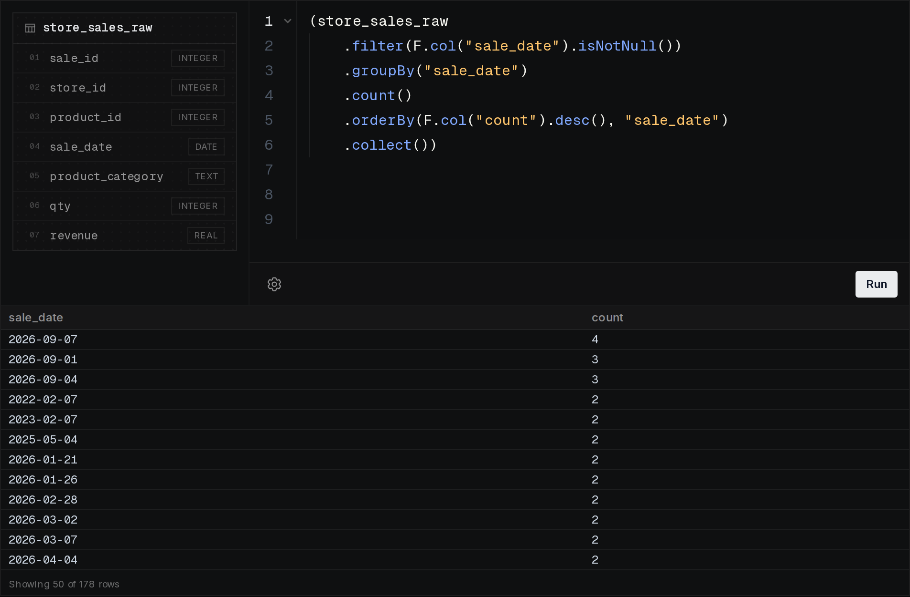
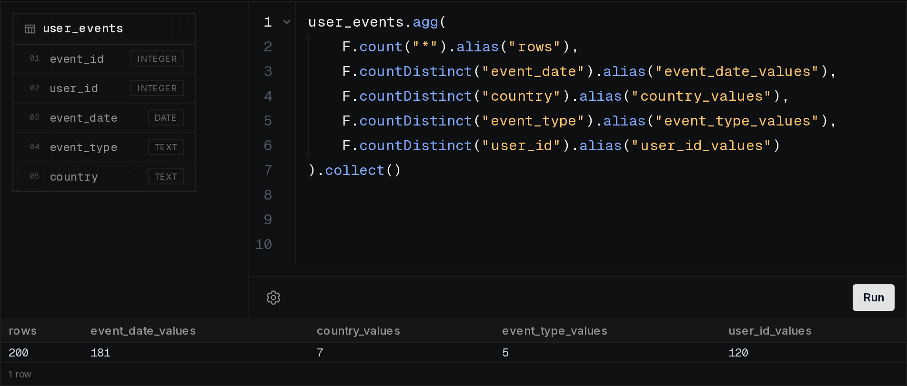
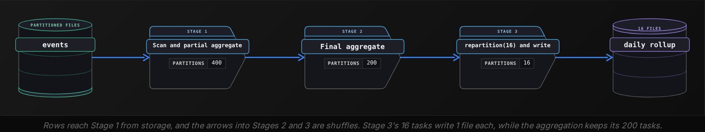

Intermediate·Spark · 14 min · 16 challenges

# Partitioning: Intermediate

On the night a new season drops at Netflix, analysts want playback errors from the last 6 hours, and the playback events table holds a year of history. Laid out by date and hour, the query opens 6 directories and returns in seconds. Laid out by user ID, it lists millions of tiny files and the dashboard times out.


<br>

---

## repartition vs coalesce

Both `repartition(n)` and `coalesce(n)` change how many partitions a DataFrame has, and they get there by opposite routes. `repartition` is a wide transformation: the plan gains an Exchange, every row passes through shuffle files, and a new stage starts. `coalesce` is narrow: each output partition reads several existing partitions where they already sit, with no Exchange and no new stage.


<br>

### repartition: a full shuffle into even pieces

Below, 9 orders arrive in 2 input partitions and `repartition(4)` spreads them over 4. Each task of the first stage writes its rows to shuffle files, then the 4 tasks of the second stage each fetch a share. With no column given, Spark deals rows out round-robin, so the 4 outputs end up close to equal in size.

https://github.com/user-attachments/assets/1c905c67-2ae1-4381-8b7c-4fb312e2ff93

The physical plan shows this as `Exchange RoundRobinPartitioning(4)`. The price is that of any shuffle: every row is serialized, written to local disk and fetched over the network by the next stage. In return, `repartition` can raise the count as well as lower it, and the pieces come out balanced however lopsided the inputs were.


<br>

### coalesce: merging partitions in place

Here the same 9 orders start in 4 partitions and `coalesce(2)` brings them to 2. No row touches a shuffle file. Each of the 2 tasks reads 2 of the original partitions back to back, inside the same stage that read them from storage.

https://github.com/user-attachments/assets/cacd39f0-4f5e-495f-87e9-1341bba05e2a

The plan shows a `Coalesce 2` node with no Exchange between it and the scan. That has 2 consequences. `coalesce` only lowers the count: `coalesce(10)` on a 4-partition DataFrame leaves 4. And each merged partition is the sum of the inputs it absorbed, so lopsided inputs stay lopsided.

| What you see | repartition(n) | coalesce(n) |
| --- | --- | --- |
| Plan node | Exchange RoundRobinPartitioning(n) | Coalesce n |
| New stage | Yes | No |
| Direction | Up or down | Down only |
| Partition sizes | Close to equal | Sums of the input partitions |
| Bytes moved | Every row, through shuffle files | None |


<br>

### Repartitioning by a column

`repartition("region")` hashes on `region`, so every row with the same region lands in the same partition. Without a count it uses `spark.sql.shuffle.partitions`, and `repartition(3, "region")` sets the count directly. The plan shows `Exchange hashpartitioning(region, 3)`. A `groupBy("region")` right after needs exactly that arrangement, so the planner adds no second Exchange. The run below has 1 shuffle, and the aggregation happens inside the tasks that received the rows.

https://github.com/user-attachments/assets/9cb071fc-3e75-4b30-a4ac-6c84cc03a15d

<br>

### When coalesce shrinks the stage above it

Since `coalesce` adds no stage, it shrinks the stage it lands in, and that stage includes every narrow step above it. Take a read of 400 partitions, a filter that keeps 2% of rows, and `coalesce(1)` so the output is a single file. The whole stage now runs as 1 task. That task reads all 400 input partitions one after another and filters every row while the rest of the cluster sits idle.

```sql
logs = spark.read.parquet("/lake/raw_logs")
errors = logs.filter(F.col("level") == "ERROR")

errors.coalesce(1).write.parquet("/lake/errors_a")

errors.repartition(1).write.parquet("/lake/errors_b")
```

`repartition(1)` pays for a shuffle and still wins here. The read and filter keep all 400 tasks, and only the 2% of rows that survive cross the Exchange to the single writing task. The rule I use: `coalesce` when the work sharing its stage is light, `repartition` when that work is heavy, when the count has to go up, or when the partitions need evening out.

| ✓ Do | ✗ Don't |
| --- | --- |
| • Use coalesce to cut the count when the work sharing its stage is light<br><br>• Use repartition(n) to raise the count or even out lopsided partitions<br><br>• Use repartition(n, col) when the next step groups or writes by that column<br><br>• Check explain() for an Exchange or a Coalesce node before trusting a count | • Don't coalesce(1) right after a heavy read or filter over hundreds of partitions<br><br>• Don't expect coalesce(n) to raise the count above what the DataFrame has<br><br>• Don't repartition by one key right before a groupBy on another key |

**The read below produces 400 partitions. How many tasks run the filter?**

```python
events = spark.read.parquet("/lake/events")
br = events.filter(F.col("country") == "BR")
br.coalesce(10).write.parquet("/lake/br_events")
```

- **A.** All 400, because the filter comes before coalesce in the code
- **B.** Only 10, because coalesce shares the read's stage and sets its task count
- **C.** Only 10, after a shuffle moves the 400 read partitions into 10
- **D.** A single task, because any write after coalesce runs as 1 task

<details>
<summary>Solution</summary>

**B.** Only 10, because coalesce shares the read's stage and sets its task count

coalesce(10) is narrow, so the scan, the filter and the merge form 1 stage of 10 tasks, each reading about 40 input partitions.

**Why the others are wrong**

- **A.** Code order does not set the stage shape. coalesce adds no stage, so the filter runs inside the merged stage and takes its task count.
- **C.** The count is right and the mechanism is wrong: coalesce writes no shuffle files. Each of the 10 tasks reads its input partitions directly.
- **D.** The write runs on as many tasks as its stage has, here 10. Only coalesce(1) would cut the stage to 1 task.

</details>

The light case looks like this: a small table, a filter, and an output that needs only a couple of partitions. The merged stage reads few rows, so running it on 2 tasks costs little, and `coalesce` skips the shuffle that `repartition` would add. Check both counts with `df.rdd.getNumPartitions()`, which reports how many partitions the DataFrame has. Then look for `Coalesce 2` directly above the filter in `explain()`, with no Exchange between them.


<br>

---

## partitionBy on Write

`partitionBy` on the writer turns a column's values into directories. Each distinct value gets a folder named `column=value`, the rows carrying that value go into files inside it, and the column is dropped from the files themselves because the path already records it.

```sql
clicks.write.partitionBy("click_date").parquet("/lake/clicks")
```

| Path | What it holds |
| --- | --- |
| /lake/clicks/click_date=2024-03-13/ | Files holding every row from March 13 |
| /lake/clicks/click_date=2024-03-14/ | Files holding every row from March 14 |
| /lake/clicks/click_date=2024-03-15/part-00000-9f2c.c000.parquet | 1 file in a date directory, written by task 0 |
| /lake/clicks/click_date=__HIVE_DEFAULT_PARTITION__/ | Rows whose click_date is NULL |
| /lake/clicks/_SUCCESS | Marker written when the job commits |

Reading `/lake/clicks` back, Spark walks the directories, parses each name, and adds `click_date` as a column again. It infers the type from the names: dates come back as dates and digit strings as integers, so a store code like `00123` written as a partition value reads back as `123`. Passing a schema on read, or setting `spark.sql.sources.partitionColumnTypeInference.enabled` to `false`, keeps it a string.


<br>

### How many files a write emits

Each write task opens 1 file for every distinct partition value among the rows it holds. Upstream partitioning decided which rows each task holds without looking at `click_date`, so a task holding rows from 30 dates writes 30 files. The ceiling is the task count times the value count.

Take a backfill of 30 days of `clicks`, 30GB in all, written straight after a `groupBy` that left 200 partitions:

| Before the write | Write tasks | Dates per task | Files |
| --- | --- | --- | --- |
| Nothing | 200 | 30 | Up to 6,000 |
| coalesce(20) | 20 | 30 | Up to 600 |
| repartition("click_date") | Up to 30 hold rows | 1 or more | 30 |

The first row averages 5MB per file, the small-files problem produced by your own write. Hashing on the partition column sends all of a date's rows to 1 task, so every directory gets exactly 1 file:

```sql
(clicks
    .repartition("click_date")
    .write
    .partitionBy("click_date")
    .parquet("/lake/clicks"))
```

The cost is 1 shuffle, plus a risk on busy days: a date with 10 times the usual traffic becomes 1 large file written by 1 task, and the stage waits for it. Adding `.option("maxRecordsPerFile", 5000000)` to the writer makes each task start a new file every 5 million rows, so a heavy date gets several bounded files.

Before choosing a column, look at how rows spread across its values, because each value's rows become 1 directory. Run this on `store_sales_raw` to see the rows each `sale_date` directory would hold, biggest day first, and compare the top of the list with the bottom.



```python
(store_sales_raw
    .filter(F.col("sale_date").isNotNull())
    .groupBy("sale_date")
    .count()
    .orderBy(F.col("count").desc(), "sale_date")
    .collect())
```


<br>

### Partitioning by a column with too many values

Every distinct value costs at least 1 directory and 1 file, however few rows it has. `partitionBy("user_id")` on a table with 2 million users creates 2 million directories. A read has to list 2 million paths before it scans a row, and the files average a few kilobytes, so opening each one takes longer than reading it.

> Signs a partition column is too fine
>
> - Tens of thousands of distinct values or more over the table's lifetime
> - A typical directory under 100MB, so its files are smaller still
> - Values that rarely repeat: IDs, timestamps, session keys, free text
> - Reads that take longer to list files than to scan them

> **TIP**
>
> Count values over the table's whole life, beyond today's load. `click_date` adds 1 directory a day, 365 a year. A column that adds 50,000 new values a day passes 18 million directories within a year.

**This DataFrame has 50 partitions, and each partition holds rows from all 10 countries. How many data files does the write produce?**

```python
df.write.partitionBy("country").parquet("/lake/sales")
```

- **A.** Exactly 10, since Spark merges each country's rows into a single file
- **B.** Exactly 50, since each write task produces a single output file
- **C.** Exactly 60: 1 file per task plus 1 index file per country
- **D.** Exactly 500, since each of the 50 tasks writes into all 10 directories

<details>
<summary>Solution</summary>

**D.** Exactly 500, since each of the 50 tasks writes into all 10 directories

Every task holds all 10 countries and opens 1 file per country, so the ceiling of tasks times values is reached.

**Why the others are wrong**

- **A.** Spark merges nothing at write time. Each task writes its own file into every country directory it holds rows for.
- **B.** That holds for a write without partitionBy. With it, a task opens 1 file per distinct value it holds, here 10.
- **C.** Spark writes no per-directory index file. The 50 tasks write data files only, 10 each.

</details>

To bring those 500 files down to 10, change which rows each task holds. `repartition("country")` hashes on the partition column, so all of a country's rows reach 1 task, and that task writes 1 file into its directory. The shuffle runs before the write, and `explain()` shows `Exchange hashpartitioning(country, 200)` above the scan. At most 10 of those 200 tasks hold rows, and the rest write nothing.


<br>

---

## Partition Pruning

When a filter references only partition columns, Spark tests it against directory names before it opens a single file. On `events`, written with `partitionBy("event_date")` and holding 730 days, a query for 1 day rules out 729 directories from their names alone. Their files are never opened or scanned. That is partition pruning, the return on the layout work of the previous section.

- **29.2TB** — stored across 2 years of events
- **40GB** — scanned by a pruned 1-day query


<br>

### Seeing the prune in the plan

```sql
events = spark.read.parquet("/lake/events")

one_day = events.filter(
    (F.col("event_date") == "2024-03-15") & (F.col("country") == "US")
)
one_day.explain()
```

`explain()` prints a scan node that sorts the filters by where they apply. These are the parts of it to read:

| Plan text | What it means |
| --- | --- |
| PartitionFilters: [isnotnull(event_date#3), (event_date#3 = 2024-03-15)] | Checked against directory names. Only matching directories are read. |
| DataFilters: [isnotnull(country#2), (country#2 = US)] | Checked against rows inside the files that survive pruning. |
| PartitionFilters: [] | Nothing to prune with. Every directory under the path is read. |
| Location: InMemoryFileIndex(1 paths)[file:/lake/events] | The root Spark lists from. Pruning happens beneath it. |

*The scan also prints a PushedFilters list. It belongs to a separate mechanism inside the file format and does not affect which directories are read.*

The plan shows intent. To confirm the run, open the query in the Spark UI after it finishes: the scan node reports the number of files read, which should match the file count of the 1 matching directory, a few hundred here, instead of the whole table's.


<br>

### Which predicates prune

Spark classes a filter as a partition filter when every column it references is a partition column and the expression is deterministic. It evaluates that expression on the values parsed from directory names, so a function of the partition column prunes as well as a plain comparison does. A filter that also touches a data column stays at row level.

| ✓ Prunes on event_date | ✗ Reads every directory |
| --- | --- |
| • event_date = '2024-03-15'<br><br>• event_date >= '2024-03-01' AND event_date < '2024-04-01'<br><br>• event_date IN ('2024-03-14', '2024-03-15')<br><br>• month(event_date) = 3<br><br>• event_date = '2024-03-15' AND country = 'US', where the date half prunes | • event_ts >= '2024-03-15 00:00:00', a data column<br><br>• event_date = '2024-03-15' OR country = 'US'<br><br>• country = 'US' on its own |

The `OR` row catches teams out. A row with `country = 'US'` could sit under any date, so Spark cannot rule a directory out. If the date branch needs to be fast, run it as a query of its own.


<br>

### Two ways to lose the prune

Filtering on the column the partition was derived from skips pruning. If `event_date` was computed from `event_ts` at write time, a dashboard filtering `event_ts` to a 6-hour window still reads all 730 directories, because Spark has no way to know the 2 columns agree. Adding the matching `event_date` predicate leaves the result unchanged and cuts the read to 1 directory:

```sql
window = events.filter(
    (F.col("event_ts") >= "2024-03-15 06:00:00")
    & (F.col("event_ts") < "2024-03-15 12:00:00")
    & (F.col("event_date") == "2024-03-15")
)
```

Pointing the read straight at a directory is the other way to lose it. `spark.read.parquet("/lake/events/event_date=2024-03-15")` reads the right files but treats that directory as the root, so `event_date` disappears from the schema. Adding `.option("basePath", "/lake/events")` keeps the column. Reading the root and filtering reaches the same files and keeps it too.

> **TIP**
>
> When the date comes from data, such as the latest day loaded, fetch it to the driver with `collect()` and filter with that literal value. A literal comparison on `event_date` becomes a partition filter like any other.

**The events table is written with partitionBy("event_date") and also stores event_ts and country. Which filter reads only the directories for March 2024?**

- **A.** F.year("event_date") == 2024 combined with F.month("event_date") == 3
- **B.** F.col("event_ts").between("2024-03-01", "2024-03-31 23:59:59")
- **C.** (F.col("event_date") >= "2024-03-01") | (F.col("country") == "US")
- **D.** F.col("event_ts").cast("date") >= "2024-03-01" with a matching upper bound

<details>
<summary>Solution</summary>

**A.** F.year("event_date") == 2024 combined with F.month("event_date") == 3

Both expressions reference only event_date and are deterministic, so Spark evaluates them on each directory's value and keeps the 31 March directories.

**Why the others are wrong**

- **B.** event_ts is a data column. The rows returned are right, but all 730 directories are read to find them.
- **C.** The country branch of the OR can match rows under any date, so no directory is skipped, and US rows from other months come back too.
- **D.** The cast runs on a data column, so the expression references event_ts and Spark has no directory values to test it on.

</details>


<br>

---

## Choosing the Partition Column

A partition column is worth having when 3 tests pass: the reads that matter filter on it, it has few enough values to keep the directory count manageable, and each directory holds enough bytes for right-sized files. Run them in that order. A column no query filters on prunes nothing, however neatly it sizes.


<br>

### Start from the predicates

Collect the WHERE clauses of the queries that read the table, the scheduled jobs as well as the dashboards, and count how often each column appears. For `events`, a typical dashboard read looks like this:

```sql
SELECT
  country,
  COUNT(*) AS errors
FROM events
WHERE event_date = DATE '2024-03-15'
  AND event_type = 'playback_error'
GROUP BY country
```

Tallied across 1,000 recent reads, with many reads filtering on more than 1 column:

| Column in the WHERE clause | Share of 1,000 reads |
| --- | --- |
| event_date | 85% |
| country | 30% |
| event_type | 25% |
| user_id | 4% |


<br>

### Count the values

Distinct values over the table's whole retention become directories, so measure them before writing. Run this against `user_events` to get the row count beside the distinct count of each candidate. Rows divided by a column's count gives the average rows of the directory each value would get, and a count close to the row count marks a column of near-unique values.



```python
user_events.agg(
    F.count("*").alias("rows"),
    F.countDistinct("event_date").alias("event_date_values"),
    F.countDistinct("country").alias("country_values"),
    F.countDistinct("event_type").alias("event_type_values"),
    F.countDistinct("user_id").alias("user_id_values")
).collect()
```


<br>

### Do the file-size math

Bytes decide whether a directory can hold right-sized files. `events` lands 40GB a day and keeps 2 years, 29.2TB in total. Divide by each candidate's distinct values and compare the result against a common target of files between 128MB and 1GB:

| Candidate | Directories over 2 years | Average per directory | Verdict |
| --- | --- | --- | --- |
| event_date | 730 | 40GB | Matches 85% of reads, room for about 300 files of 128MB |
| country | 190 | About 154GB, uneven by country | Date-range reads scan a country's full history |
| event_date, then country | 138,700 | About 210MB, small countries under 1MB | Most directories hold 1 tiny file |
| event_hour (date and hour) | 17,520 | About 1.7GB | Fits only if reads filter by hour |
| user_id | 25,000,000 | About 1.2MB | Cardinality trap: 25 million paths to list |

`event_date` wins on every test. It serves 85% of reads, and each of its 730 directories has room for about 300 files at 128MB. The 30% of reads that add `country` still prune to 1 day and filter the country inside it. A second level would split each day into 190 slices, and for most countries the slice is too thin to fill a single file.


<br>

### Deriving the column from a timestamp

Event data usually carries a timestamp, far too fine to partition by. Derive a date at write time and partition by that, then point every reader at the derived column, as the pruning section showed with `event_ts`.

```sql
daily = raw_events.withColumn("event_date", F.to_date("event_ts"))

daily.write.mode("append").partitionBy("event_date").parquet("/lake/events")
```

A daily run loads 1 date, so every write task holds rows for that date alone and writes 1 file into its directory. The run's file count equals its task count, which the next section shows how to set.

> **TIP**
>
> Leave small tables unpartitioned. A 2GB table split by date into 730 directories averages under 3MB per directory, and a full read pays to list and open every one of those files.

| ✓ Do | ✗ Don't |
| --- | --- |
| • Pick the column the most important reads filter on, as stored<br><br>• Keep distinct values in the hundreds or low thousands over the table's life<br><br>• Check that each directory holds at least a few hundred MB<br><br>• Put the coarser column first when nesting: date, then something finer | • Don't partition by an ID, a timestamp, or any value that rarely repeats<br><br>• Don't add a second level whose directories drop under 100MB<br><br>• Don't partition a table smaller than a few GB at all |

**A payments table lands 6GB a day and is kept 3 years. Almost every read filters on settlement_day, and many also filter on merchant_id, which has 400,000 values. Which layout fits?**

- **A.** partitionBy("merchant_id"), since the merchant filter is the most selective
- **B.** partitionBy("settlement_day", "merchant_id") to prune on both at once
- **C.** partitionBy("settlement_day"), about 1,095 directories of 6GB each
- **D.** No partitioning, since 6GB a day is too small to split into directories

<details>
<summary>Solution</summary>

**C.** partitionBy("settlement_day"), about 1,095 directories of 6GB each

Every day-filtered read prunes to 1 directory with room for right-sized files. The merchant filter then applies to rows inside those files.

**Why the others are wrong**

- **A.** That creates 400,000 directories averaging about 16MB, and a read filtering only on settlement_day would open every one.
- **B.** Over 3 years that allows 1,095 days times 400,000 merchants, up to 438 million directories, most holding a file of a few kilobytes.
- **D.** The table holds about 6.6TB over 3 years. Without a date layout, every daily read scans all of it.

</details>


<br>

---

## Sizing Shuffle Partitions

Every Exchange that `groupBy`, `distinct`, `orderBy` or a count-less `repartition(col)` adds splits its output into `spark.sql.shuffle.partitions` pieces, 200 unless you change it. It is 1 value for the whole session, so the same 200 applies to a 2GB job and a 2TB job. Each piece becomes 1 task in the next stage, and when that stage ends in a write, each of those tasks that holds rows writes at least 1 file.

Below, the program sets the count to 2 before grouping 9 orders by region. Each of the 3 input partitions combines its own rows first, then hashes the partial counts into 2 reduce tasks, and the region totals come out of those 2. The board draws the plan as set, with no runtime merging, so the count you set is the task count you see.

https://github.com/user-attachments/assets/e5ae3336-72b7-44c1-aa96-2c11947083de

<br>

### Sizing from shuffle bytes

Size the count from the bytes the stage writes to the shuffle, divided by a target per partition. A target of 100 to 200MB keeps each task's slice well inside its memory while leaving enough tasks to occupy every core. When the count exceeds the core count, round it to a multiple of the cores so the last round of tasks fills every slot. Take a cluster with 100 cores and a 150MB target. Job A writes 75GB to the shuffle and job B writes 1.2GB:

- **500** — shuffle partitions for job A
- **8** — shuffle partitions for job B

Job A finishes in 5 rounds of 100 tasks. At the default it would hand each task 375MB, 2.5 times the target. Job B fits in a single round. With runtime partition merging off, the default gives each of its 200 tasks 6MB, and each task spends more time being scheduled than computing. On Spark 3.2 and later that merging is on by default and folds small reduce partitions together after the shuffle runs, so 200 becomes a ceiling and job B runs on fewer tasks. To check a running job, divide the stage's total shuffle read by its task count, both shown for the stage in the Spark UI.


<br>

### Scoping the setting to one job

Set the count for the job that needs it and leave other jobs at theirs. At launch, `--conf spark.sql.shuffle.partitions=500` on `spark-submit` scopes it to that application. Inside 1 session that runs several queries, call `spark.conf.set` before each action, since the plan reads the setting when the action triggers planning:

```sql
spark.conf.set("spark.sql.shuffle.partitions", 500)
per_user = events.groupBy("event_date", "user_id").count()
per_user.write.parquet("/lake/daily_users")

spark.conf.set("spark.sql.shuffle.partitions", 8)
per_country = events.groupBy("country").count()
per_country.write.parquet("/lake/country_counts")
```

Where 1 step needs a specific count, `repartition(n)` or `repartition(n, col)` states it in the code at that step, where a teammate reading the job will see it.

*That runtime merging is covered in a later lesson. It only combines partitions, so a setting that is too small stays too small, and a count passed to repartition(n) is kept as written.*


<br>

### Controlling the files a write emits

A write leaves 1 file per final-stage task that holds rows, multiplied by the partition values each task holds when `partitionBy` is on. A small aggregate written at the default count leaves up to 200 files of a few kilobytes each. These settings change that:

| Before the write | Files | Extra shuffle | Use when |
| --- | --- | --- | --- |
| Nothing | 1 per final-stage task holding rows | No | That task count already gives the file size you want |
| coalesce(16) | Up to 16 | No | The output is small and the merged stage's work is light |
| repartition(16) | 16, near equal in size | Yes | The final stage is heavy or its partitions are lopsided |
| repartition("click_date") plus partitionBy("click_date") | 1 per date | Yes | Writing many dates in one run |
| option("maxRecordsPerFile", n) on the writer | A new file every n rows | No | A single task would otherwise write an oversized file |

`coalesce(16)` after a `groupBy` merges the reduce side, so the aggregation itself then runs on 16 tasks. That suits a light aggregate and slows a heavy one, where `repartition(16)` keeps the aggregation at full width and pays 1 extra shuffle for 16 even files:



**A nightly job's aggregation stage reads 60GB of shuffle data on a cluster with 40 cores. Which shuffle partition count fits a 150MB target per partition?**

- **A.** Set it to 400, giving each task about 150MB in 10 full rounds on 40 cores
- **B.** Keep the default 200, which already gives each of the 40 cores 5 tasks
- **C.** Set it to 40, 1 per core, so the stage finishes in a single round
- **D.** Set it to 4,000, since more partitions always shorten the stage

<details>
<summary>Solution</summary>

**A.** Set it to 400, giving each task about 150MB in 10 full rounds on 40 cores

60GB over 150MB is 400, already a multiple of 40, so every round fills all 40 cores with tasks near the target.

**Why the others are wrong**

- **B.** The rounds divide evenly, but each task gets 300MB, twice the target.
- **C.** Each task would get 1.5GB, the too-few-large-partitions problem, and a write would emit only 40 large files.
- **D.** Each task gets 15MB, so scheduling overhead dominates, and a write after this stage could leave 4,000 small files.

</details>

In code, the count is set on the session before the action that runs the aggregation. With `spark.sql.shuffle.partitions` at 8, `explain()` on a `groupBy` shows `Exchange hashpartitioning(key, 8)` between the partial and final aggregates, and the reduce stage is planned as 8 tasks. Set it after the action and that job keeps whatever count was in force when it planned.


<br>

---

## Putting It All Together

The team behind the launch-night dashboard from the opening rebuilds its playback events table, which had been written by user ID. A backfill rewrites a year of history partitioned by date and hour, the dashboard's queries filter on those columns, and the hourly load is resized so each hour lands as a set of right-sized files.

- The predicates test picks date and hour because the dashboard filters on a 6-hour window, and an hour directory still holds gigabytes.
- The backfill repartitions on the partition columns so each hour directory gets 1 file, with maxRecordsPerFile splitting the peak hours.
- explain ( ) on the dashboard query has to show both columns in PartitionFilters , so 6 directories are read out of the year's thousands.
- The hourly load holds 1 hour, so its file count is its task count, set with repartition ( n ) from that hour's bytes.
- coalesce stays out of the load, since it would shrink the parsing stage down to the file count.


<br>

---

## Key Takeaways

- repartition adds an Exchange and a stage, and can raise or even out the count. coalesce merges in place, only lowers, and shrinks the stage it shares.
- partitionBy writes 1 directory per value, and each write task emits 1 file per value it holds. Repartition by the partition column to get 1 file per directory.
- Pruning happens when a filter references only partition columns. Read PartitionFilters in explain ( ) to confirm it before a query ships.
- Choose the partition column from the filters reads use, then check its distinct count and the bytes each directory would hold.
- Size shuffle partitions from shuffle bytes at 100 to 200MB each, set the count per job, and use coalesce , repartition or maxRecordsPerFile to set the files a write leaves.
