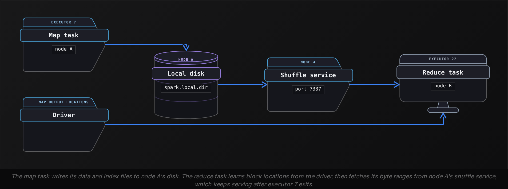
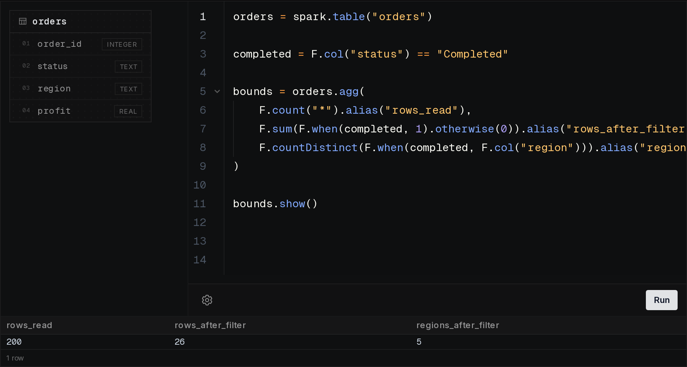

Advanced·Spark · 15 min · 13 challenges

# Shuffles: Advanced

A reduce stage can crawl while the cluster sits half idle, because each reducer is pulling 10,000 blocks of about 10KB apiece from disks spread across the cluster. LinkedIn's engineers hit this problem in their nightly jobs at scale and built Magnet, the push-based shuffle that shipped in Spark 3.2. This lesson shows how to price that shuffle, then remove or tune it.


<br>

---

## Sort-Based Shuffle Internals

A shuffle has 2 halves joined by files on local disk. Map tasks, the last tasks of the stage before the boundary, write those files. Reduce tasks, the first tasks of the stage after it, read them. The layout inside those files decides how many disk operations, open file handles and network requests the shuffle costs.


<br>

### Each map task writes a data file and an index

Since Spark 2.0, the sort-based shuffle manager is the only one Spark ships. A map task with output for R reducers writes 2 files. The **data file** holds all of its output rows as R segments laid end to end in reducer order. The **index file** holds R + 1 byte offsets: where each segment starts, plus the end of the file. Reducer 3 reads from offset 3 to offset 4, and those bytes are its block from this map task.

| Reducer | Reads from byte | Reads to byte | Block size |
| --- | --- | --- | --- |
| 0 | 0 | 18,400 | 18,400 |
| 1 | 18,400 | 18,400 | 0 (no rows) |
| 2 | 18,400 | 51,200 | 32,800 |
| 3 | 51,200 | 60,000 | 8,800 |

This map task's index file holds 5 numbers for 4 reducers: 0, 18,400, 18,400, 51,200 and 60,000. Reducer 1 has an empty block, recorded as 2 equal offsets. The driver also knows each block's size from the map task's status report, so reducer 1 never requests its empty block.


<br>

### The old design: a file for every block

Spark's first shuffle wrote a separate file for every pair of map task and reducer. Sort-based shuffle became the default in Spark 1.2, and Spark 2.0 removed the old design.

| Layout | Files after 1,000 map tasks feed 1,000 reducers | Logical blocks |
| --- | --- | --- |
| One file per map task and reducer | 1,000,000 | 1,000,000 |
| Sort-based: data file plus index | 2,000 | 1,000,000 |

The block count stays at 1 million either way, because each block became a byte range inside a data file instead of a file of its own. The sort layout removes the million file creations, the inode pressure and the per-node limit on open file handles. In exchange, every map task must order its output by reducer before writing it.


<br>

### Inside one map task

The sorting writers, step by step

- **Assign** *a reducer id per row*\
  The partitioner turns each row's key into a reducer id from 0 to R minus 1: a hash for groupBy, a sampled range for orderBy.
- **Buffer** *in memory*\
  Rows collect in a memory buffer, each tagged with its reducer id.
- **Sort and spill** *when memory runs out*\
  When the buffer reaches the memory the task was granted, the task sorts it by reducer id and writes it to a spill file.
- **Merge** *once, at the end*\
  The task merges its spill files and what remains in memory into the data file, segment by segment, then writes the index.

The sort is by reducer id. Inside a segment, rows carry no key order unless the operation asked for one. A task that never fills its buffer makes a single pass. A task that spills writes every spilled row twice, once to a spill file and once into the merged data file, and reads it back in between. Spill (Disk) on the stage page measures that extra traffic.


<br>

### 3 writers produce 1 layout

Spark picks 1 of 3 writers for each shuffle when it registers it. All 3 produce the same data file and index, so reducers never know which one ran.

| Writer | Spark picks it when | How it builds the data file |
| --- | --- | --- |
| Bypass | the writer does no combining and R is at most `spark.shuffle.sort.bypassMergeThreshold`, 200 by default | opens R files at once, 1 per reducer, then concatenates them in order |
| Serialized | the writer does no combining, the serializer can move records as raw bytes, and R is at most 16,777,216 | sorts 8-byte pointers that pack the reducer id with the record's address, so rows stay as bytes |
| Base sort | the writer itself must combine values per key | sorts row objects and merges values that share a key as it goes |

DataFrame aggregations do their combining in the partial aggregate before the shuffle, so their shuffle writer never combines. That leaves R as the deciding number. With spark.sql.shuffle.partitions at its default of 200, R equals the threshold, and a default DataFrame shuffle takes the bypass path: each map task holds 200 files open while it writes. Set 201 or more and the same job switches to the serialized writer, with no change to its output.


<br>

### The reduce side

Before fetching, a reduce task asks the driver where every map task's output lives and how big each block is. It then pulls its block from each map task: from local disk when the map ran on its own executor, over the network otherwise. `spark.reducer.maxSizeInFlight`, 48MB by default, limits how many bytes it has requested and not yet received. If the operation needs key order, the reducer sorts what arrives and spills when it runs short of memory.

**A DataFrame groupBy runs with 400 map tasks and spark.sql.shuffle.partitions set to 300. When the map stage finishes, how many shuffle files sit on local disks, and which writer wrote them?**

- **A.** 120,000 files, 1 per map task and reducer pair, written by the bypass writer
- **B.** 800 files written by the bypass writer, because the threshold compares against map tasks
- **C.** 800 files, a data file and an index per map task, written by the serialized writer
- **D.** 700 files, a data file per map task plus an index per reducer, from the serialized writer

<details>
<summary>Solution</summary>

**C.** 800 files, a data file and an index per map task, written by the serialized writer

Each of the 400 map tasks leaves 2 files. The aggregation combined before the shuffle, so the writer does no combining, and 300 reducers is above the bypass threshold of 200, which leaves the serialized writer.

**Why the others are wrong**

- **A.** That count matches the layout Spark 2.0 removed. The bypass writer does open 1 file per reducer, but it concatenates them into a single data file before the task ends, and 300 reducers exceed its threshold of 200.
- **B.** The file count is right, but the threshold compares against reducers. With 300 reducers, R is above 200, which rules the bypass path out.
- **D.** The writer is right, but the index belongs to the map task: each one records where its own R segments start, so there are 400 indexes, not 300.

</details>


<br>

---

## The External Shuffle Service

The data and index files from the map stage land under `spark.local.dir` on the node where each map task ran. Unless you configure otherwise, the executor that wrote them also serves them: its block manager answers every reducer's request for a byte range. The files can be read only while that executor is alive.


<br>

### Losing the executor that wrote the files

Executors leave mid-job for ordinary reasons: killed for exceeding their memory limit, preempted by the cluster manager, or released when idle. Suppose executor 7 ran 40 map tasks and then dies. Reducers asking it for blocks get a fetch failure, which Spark handles differently from the task failures you have met. Retrying the reduce task cannot help, because the bytes are gone. The DAGScheduler marks executor 7's map outputs as lost, resubmits the map stage to rerun those 40 tasks, and then reruns the reduce tasks that hadn't finished. In the Stages tab, the rerun appears with `(retry 1)` beside the stage id.


<br>

### A server that outlives executors

The **external shuffle service** is a long-running process on every worker node, started by the cluster manager outside any application and shared by all of them. When an executor starts, it registers its local directories with the service on its node. Reducers then fetch blocks from the service, on port 7337 by default, and the service reads the bytes off disk itself. An executor can exit at any point after its map tasks finish, and its files stay readable until the application ends.



```sql
spark.shuffle.service.enabled: true
spark.shuffle.service.port: 7337
```

| ✓ Executor serves its files | ✗ Shuffle service serves them |
| --- | --- |
| • Files readable only while the writing executor runs<br><br>• A lost executor reruns its map tasks<br><br>• Serving shares the executor's threads with its running tasks<br><br>• Nothing extra to install on the nodes | • Files readable while the node stays up<br><br>• A lost executor costs no rerun, and fetches continue<br><br>• Serving runs in its own process on the node<br><br>• The service must run, and stay compatible, on every node |


<br>

### A lost node still costs a rerun

The service reads files from a local disk and copies them nowhere. If the node goes down or its disk fails, every map output on that node is gone. If only the service process dies, the files still sit on disk but nothing can serve them: on the first fetch failure Spark unregisters that host's map outputs, and the DAGScheduler reruns those map tasks as it would without the service. The service turns an executor loss into a non-event, while a node loss still costs a partial rerun of the map stage.


<br>

### Push-based shuffle

The service can also fix the block count that the sort layout leaves behind. A shuffle from 10,000 map tasks to 10,000 reducers stores 100 million blocks, so a 1TB shuffle averages 10KB per block. Each reducer issues 10,000 small reads scattered across the cluster's disks, and on spinning disks the seeks cost more than the bytes. LinkedIn's engineers described this in their Magnet paper and contributed push-based shuffle to Spark 3.2.

With spark.shuffle.push.enabled set to true, a map task writes its files as usual, then pushes its blocks to shuffle services Spark assigned as mergers, each responsible for a set of reducers. A merger appends every block for a reducer into 1 merged file. The reducer reads a few large merged chunks instead of 10,000 small blocks, and falls back to the original files for any block that missed the merge. It requires the external shuffle service, and not every cluster manager supports it.


**An application runs with the external shuffle service enabled. Halfway through a reduce stage, executor 12 is killed for exceeding its memory limit, and its node stays up. What happens to the shuffle files executor 12 wrote?**

- **A.** Reducers keep fetching them from the node's shuffle service, and no map task reruns
- **B.** They are deleted with the executor, so the map stage reruns executor 12's tasks
- **C.** The service keeps serving them, but the DAGScheduler reruns executor 12's tasks anyway
- **D.** Reducers fetch them from a copy the service placed on another node at write time

<details>
<summary>Solution</summary>

**A.** Reducers keep fetching them from the node's shuffle service, and no map task reruns

Executor 12 registered its directories with the service at startup, and the service reads the files from disk on its own. The files outlive the executor until the application ends.

**Why the others are wrong**

- **B.** That is the outcome without the service. With it enabled, the files stay on disk and the service keeps serving them.
- **C.** The first half is right. Spark reruns map tasks only when their output is lost, and here every block is still reachable.
- **D.** The service never copies files. Had the node itself failed, those blocks would be lost and their map tasks recomputed.

</details>


<br>

---

## Pricing a Shuffle

Every shuffle sends a bill with 4 lines, and each line scales with a number on the stage page. Pricing a shuffle means reading those numbers and turning them into disk traffic, network traffic and request counts before deciding what to change.

| Line | Work | Paid by | Scales with |
| --- | --- | --- | --- |
| Write | serialize, compress, write; reread and rewrite spills | map tasks | Shuffle Write Size, Spill (Disk) |
| Serve | read byte ranges back off disk | the node holding the files | Shuffle Write Size and block count |
| Network | move blocks between nodes | the cluster network | remote share of Shuffle Read Size |
| Read | decompress, deserialize, aggregate or sort | reduce tasks | Shuffle Read Size / Records |

Shuffle output is compressed by default: spark.shuffle.compress is true and the codec is lz4. Shuffle Write Size therefore reports compressed bytes, the same bytes that later cross the disk and the network.


<br>

### A worked price

A daily job reads 600GB of clickstream, keeps 4 columns, and groups by user. The map stage reports a Shuffle Write Size of 90GB across 2,400 tasks. The reduce stage runs 600 tasks spread over 60 executors, so a reducer finds about 1 in 60 of its blocks on its own executor.

- **1.44M** — blocks in the shuffle

| Figure | Arithmetic |
| --- | --- |
| Disk traffic | 90GB written + 90GB read back = 180GB, before any spill |
| Network | 90GB × 59/60 = 88.5GB |
| Blocks | 2,400 map tasks × 600 reducers = 1,440,000 |
| Average block | 90GB ÷ 1,440,000 = 62.5KB |
| Per reducer | 2,400 fetches totalling 150MB |

The bytes look large, but the block size is the line that warns you. At 62.5KB per block, each reducer makes 2,400 small reads to collect 150MB. Fast local SSDs absorb that, while spinning disks spend more time seeking than transferring. Doubling the reducers to 1,200 halves the average block to about 31KB and doubles the total fetches to 2.88 million. Each reducer still makes 2,400 reads, now for 75MB. Shuffle Write Size stays at 90GB.

**A map stage reports a Shuffle Write Size of 40GB from 1,000 tasks. The reduce stage runs 500 tasks across 50 executors. Which estimate fits?**

- **A.** About 39.2GB crosses the network, in blocks averaging 40MB
- **B.** About 0.8GB crosses the network, in blocks averaging 80KB
- **C.** About 80GB crosses the network, once to write and once to read, in 80KB blocks
- **D.** About 39.2GB crosses the network, in blocks averaging 80KB

<details>
<summary>Solution</summary>

**D.** About 39.2GB crosses the network, in blocks averaging 80KB

Of 40GB, 49 parts in 50 are remote: 39.2GB. There are 1,000 × 500 = 500,000 blocks, so the average is 40GB ÷ 500,000 = 80KB.

**Why the others are wrong**

- **A.** The network figure is right, but 40MB is 40GB divided by the map tasks alone. Blocks come from map tasks and reducers together: 500,000 of them.
- **B.** That is the local share. A reducer finds about 1 in 50 blocks on its own executor, so the other 49 in 50 travel.
- **C.** Map tasks write to their own local disk, so writing crosses no network. Only the remote reads do.

</details>


<br>

### Shrink the rows before you pay

Every line of the bill multiplies rows crossing the boundary by bytes per row. A filter and a narrow select before the wide operation cut both, and the partial aggregate cuts rows to 1 per key per map task. The board plays a filter and a sum over 6 orders read as 2 partitions and shuffled to 2 reducers.

https://github.com/user-attachments/assets/df6bd7b9-9985-4cae-8ede-ae7a147e68d3

Of the 6 orders, 4 survive the filter, and each map task sends 1 partial sum for every customer it holds, so the cancelled orders never reach the shuffle. The driver collects c1 at 100, c2 at 50 and c3 at 35.


<br>

### Counting what a shuffle would carry

- Shuffle Write Size / Records on the map stage: the compressed bytes and the rows the map tasks wrote.
- Shuffle Read Size / Records on the reduce stage, with Shuffle Remote Reads giving the network line.
- Shuffle Read Blocked Time: how long reducers sat waiting for fetches instead of computing.
- Spill (Memory) and Spill (Disk): rows a writer or reader sorted in more than 1 pass.

The cell below reads 3 counts that bound a shuffle of the seed's `orders`: rows read, rows left after keeping completed orders, and the distinct regions among them. For a `groupBy("region")` on completed orders, that last count caps the partial sums each map task can send: at most 1 per distinct region it holds, plus 1 for rows whose region is null, since `countDistinct` skips nulls. Run it, then change `"Completed"` to another status and see which counts move.



```python
orders = spark.table("orders")

completed = F.col("status") == "Completed"

bounds = orders.agg(
    F.count("*").alias("rows_read"),
    F.sum(F.when(completed, 1).otherwise(0)).alias("rows_after_filter"),
    F.countDistinct(F.when(completed, F.col("region"))).alias("regions_after_filter"),
)

bounds.show()
```


<br>

---

## Eliminating a Shuffle

The cheapest shuffle is the one the plan never contains. A wide operation needs every row sharing a key inside 1 task, and Spark adds a shuffle only when its input isn't already laid out that way. That leaves 2 ways to remove one: drop a wide operation the result doesn't need, or hand the next wide operation input that already meets its requirement.


<br>

### Delete the shuffle nobody asked for

| Pattern | Shuffles as written | After the fix | Why it was waste |
| --- | --- | --- | --- |
| `repartition(400)` right before `groupBy("user_id")` | 2 | 1 | the round-robin layout is discarded by the hash shuffle the groupBy adds |
| `orderBy("ts")` before a write no reader consumes in order | 1 | 0 | the range shuffle and its extra stage buy an order nobody uses |
| `select("order_id").distinct()` on a column you know is unique | 1 | 0 | Spark cannot know the column is unique, so it shuffles to prove it |

Each of these survives code review because it looks harmless: a repartition left over from debugging, a sort added so a sample looked tidy, a distinct added out of caution. Search the code for wide operations whose output the next step reshuffles or ignores.

**How many shuffles does this program run, and which one can you delete without changing the rows it returns?**

```python
result = (orders
    .repartition(50)
    .filter(F.col("status") == "Completed")
    .groupBy("status")
    .agg(F.sum("profit").alias("profit"))
    .orderBy(F.col("profit").desc()))

result.collect()
```

- **A.** Two shuffles; delete the groupBy's, because the orderBy already moves rows by profit
- **B.** Three shuffles; delete the round-robin one from repartition(50), which the groupBy redoes
- **C.** Three shuffles; delete the orderBy's, because the groupBy output arrives in profit order
- **D.** One shuffle; the filter, groupBy and orderBy all run in a single stage after it

<details>
<summary>Solution</summary>

**B.** Three shuffles; delete the round-robin one from repartition(50), which the groupBy redoes

The repartition, the groupBy and the orderBy each add a shuffle. The groupBy's hash shuffle discards the round-robin layout, so dropping the repartition removes a shuffle and a stage with identical output.

**Why the others are wrong**

- **A.** The orderBy places rows by profit range, which says nothing about which task holds each status. The groupBy needs its own hash layout, and the program runs 3 shuffles.
- **C.** Hash partitioning scatters groups by key and sorts nothing. Dropping the orderBy changes the row order the driver receives.
- **D.** The filter is narrow and pipelines, but groupBy and orderBy are both wide, each needing its own shuffle and stage.

</details>


<br>

### Hand over input that is already arranged

Spark records how each DataFrame is partitioned. After repartition("customer_id"), every row for a customer sits in 1 partition, so a groupBy("customer_id") that follows finds its requirement met and adds no shuffle of its own. The board plays exactly that: 2 wide operations in the code, rows exchanged once.

https://github.com/user-attachments/assets/44d6541b-ff0e-42c4-9176-4521d8f0dee8

The driver collects c1 at 120 over 3 orders, c2 at 75 over 2, and c3 at 35 over 1. Look at what crossed the shuffle: all 6 raw orders, because a repartition moves rows before any aggregation runs. A plain groupBy would have shuffled partial sums. Repartitioning by a key first pays off only when 2 or more wide operations then share it.

#### One shuffle for 2 aggregations

A hash layout on user_id also satisfies a grouping on user_id plus other columns, since rows that share a (user_id, event_date) pair already share a user_id. The job below counts each user's events per day, then keeps each user's busiest day.

```sql
per_day = (events
    .groupBy("user_id", "event_date")
    .agg(F.count("*").alias("n")))

busiest = (per_day
    .groupBy("user_id")
    .agg(F.max("n").alias("busiest_day_events")))
```

```sql
per_day = (events
    .repartition("user_id")
    .groupBy("user_id", "event_date")
    .agg(F.count("*").alias("n")))

busiest = (per_day
    .groupBy("user_id")
    .agg(F.max("n").alias("busiest_day_events")))
```

| Plan | Shuffles | Rows that cross |
| --- | --- | --- |
| As written | 2 | partial counts per (user, day) per map task, then partial maxima per user |
| Repartitioned | 1 | every raw event |

Suppose a user-day averages 40 events and a user's events for a day tend to land in the same map task. The first plan's first shuffle then carries as little as a fortieth of the rows in the second plan's only shuffle. Fewer shuffles is the goal only when the bytes agree, so price both plans with the method from the previous section before choosing.


<br>

---

## The Shuffle Tuning Knobs

With only the needed shuffles left in the plan, configuration sets how each remaining one runs. The knobs sort by the part of the shuffle they touch, and each one answers a symptom you can see on the stage page.

| Knob | Default | What it changes |
| --- | --- | --- |
| `spark.sql.shuffle.partitions` | 200 | reducer count R, so block count and bytes per reducer |
| `spark.shuffle.sort.bypassMergeThreshold` | 200 | largest R that uses the bypass writer |
| `spark.shuffle.file.buffer` | 32KB | memory buffer in front of each file a map task writes |
| `spark.shuffle.compress` | true | compression of map output |
| `spark.reducer.maxSizeInFlight` | 48MB | bytes a reduce task keeps requested at once |
| `spark.reducer.maxBlocksInFlightPerAddress` | no limit | blocks one reducer requests from 1 server at once |
| `spark.shuffle.io.maxRetries` | 3 | fetch retries before a fetch failure |
| `spark.shuffle.io.retryWait` | 5s | wait between those retries |
| `spark.shuffle.service.enabled` | false | serve files from the node's shuffle service |
| `spark.shuffle.push.enabled` | false | push and merge blocks at remote services |
| `spark.local.dir` | /tmp | directories for shuffle and spill files |


<br>

### Map side: larger, fewer disk writes

The bypass writer keeps 1 file buffer per reducer, so at 200 reducers a map task holds around 6.4MB of buffers. Raising `spark.shuffle.file.buffer` to 1MB makes about 32 times fewer write calls but holds 200MB per task. Raise it when Shuffle Write Time is a large share of map task time and executors have memory to spare. Leave `spark.shuffle.sort.bypassMergeThreshold` alone unless you have measured both writers on your job, since raising it means more files open at once in every map task.


<br>

### Reduce side: how hard reducers pull

When Shuffle Read Blocked Time dominates the reduce stage and the serving nodes are lightly loaded, raising `spark.reducer.maxSizeInFlight` to 96MB keeps more requests outstanding, so transfers overlap with compute. `spark.reducer.maxBlocksInFlightPerAddress` works the other way: lowering it caps how many blocks 1 reducer asks of 1 server at a time, which protects shuffle services that drop connections under a flood of small requests.


<br>

### Fetch retries: how long before a rerun

A failed fetch waits `spark.shuffle.io.retryWait` and tries again, up to `spark.shuffle.io.maxRetries` times, and how long that takes depends on how the server fails. A server that refuses connections fails each attempt at once, so the defaults of 3 retries 5 seconds apart turn it into a fetch failure and a rerun of map tasks after about 15 seconds. At 10 retries 10 seconds apart, that stretches to about 100 seconds. A server that hangs makes each attempt first wait out `spark.shuffle.io.connectionTimeout`, which falls back to `spark.network.timeout`, 120 seconds by default. With the defaults that is 4 attempts of up to 120 seconds plus 15 seconds of waits, about 8 minutes, and at 10 retries 10 seconds apart about 24 minutes. More patience rides out shuffle servers that pause under heavy load, and every second of it is also how long a dead node takes to be declared lost.


<br>

### Local directories for shuffle files

`spark.local.dir` names the directories that receive shuffle and spill files, and cluster managers often override it with their own setting. List 1 directory per local disk, separated by commas, and Spark spreads files across them. Shuffle files on a network-attached volume pay the network twice: once to write and once to serve.

Most of these settings are read when executors start, so they belong in the submit-time configuration. `spark.sql.shuffle.partitions` is the exception: `spark.conf.set` changes it between queries.

```sql
spark = (SparkSession.builder
    .appName("daily_clicks")
    .config("spark.shuffle.file.buffer", "1m")
    .config("spark.reducer.maxSizeInFlight", "96m")
    .config("spark.shuffle.io.maxRetries", "10")
    .config("spark.shuffle.io.retryWait", "10s")
    .config("spark.shuffle.service.enabled", "true")
    .getOrCreate())
```

| ✓ Do | ✗ Don't |
| --- | --- |
| • Delete unneeded shuffles before tuning the ones that remain<br><br>• Change 1 knob per run and compare the same stage's metrics<br><br>• Check Shuffle Read Blocked Time before raising maxSizeInFlight<br><br>• Put spark.local.dir on fast local disks, 1 directory per disk | • Raise spark.shuffle.file.buffer without counting buffers per task<br><br>• Raise fetch retries to hide a node that keeps failing<br><br>• Enable the shuffle service before it runs on every node<br><br>• Judge a change by total job time alone |

**Reduce tasks spend most of their time in Shuffle Read Blocked Time. The executors have memory to spare, and the shuffle services report light load. Which change targets that symptom first?**

- **A.** Raise spark.shuffle.sort.bypassMergeThreshold so map tasks write fewer files
- **B.** Raise spark.shuffle.io.maxRetries so slow fetches get more attempts
- **C.** Raise spark.reducer.maxSizeInFlight so each reducer keeps more bytes requested
- **D.** Lower spark.reducer.maxBlocksInFlightPerAddress so servers get fewer requests

<details>
<summary>Solution</summary>

**C.** Raise spark.reducer.maxSizeInFlight so each reducer keeps more bytes requested

Reducers sit idle while servers have spare capacity, so more requests in flight overlap transfer with compute. The spare memory covers the larger buffers.

**Why the others are wrong**

- **A.** The map side already finished, and every writer leaves 2 files per map task. The wait is on fetches.
- **B.** Retries matter when fetches fail. Here they succeed but arrive too slowly for the reducers.
- **D.** That protects overloaded servers. These servers are lightly loaded, and lowering it would lengthen the wait.

</details>


<br>

---

## Putting It All Together

Back at LinkedIn's crawling nightly job, the stage page shows 10,000 map tasks writing 1TB for 10,000 reducers, Shuffle Read Blocked Time dominating the reduce stage, and a stage retry after an executor was killed for memory. The fix runs in order: delete a leftover repartition(400) that added a shuffle, price whether 2 aggregations on member id should share 1 repartitioned shuffle, enable the external shuffle service so a lost executor reruns nothing, then turn on push-based shuffle so reducers read merged chunks instead of 100 million 10KB blocks.

- The 10KB blocks come from the sort layout: 2 files per map task, but still M times R logical blocks inside them.
- The pricing arithmetic turns 1TB over 100 million blocks into the 10KB average that explains the seeks.
- Deleting and reusing shuffles comes before any knob, because a shuffle that is gone needs no tuning.
- The external shuffle service is the precondition both for surviving executor loss and for push-based merging.
- The reduce-side and retry knobs handle what remains: fetch waits and short server pauses.


<br>

---

## Key Takeaways

- A sort-based shuffle leaves 2 files per map task, a data file in reducer order and an index of R + 1 offsets, while the block count stays M times R.
- A default DataFrame shuffle at 200 reducers takes the bypass writer; at 201 or more it switches to the serialized writer.
- The external shuffle service keeps map output readable after its executor exits, but it copies nothing, so a lost node still reruns map tasks.
- Price a shuffle from the stage page: disk traffic twice, network for the remote share, and block size from M times R.
- Delete shuffles nobody needs, and line up keys so later wide operations reuse an earlier layout once both plans are priced.
- Tune 1 knob at a time against its symptom: write time, read blocked time, or fetch failures.
