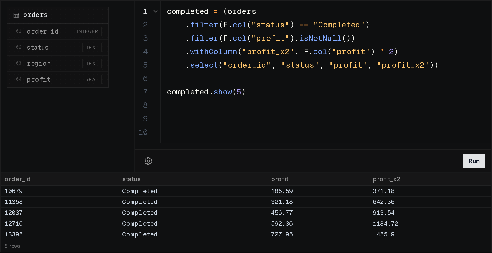
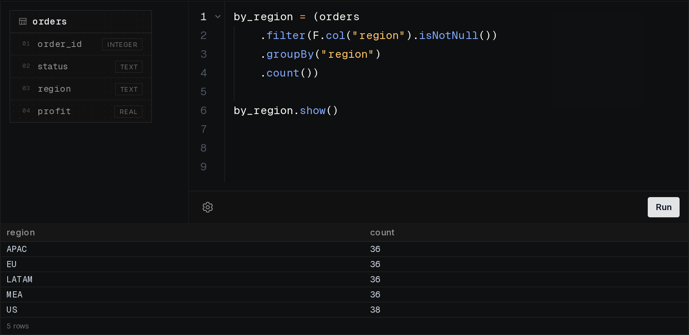
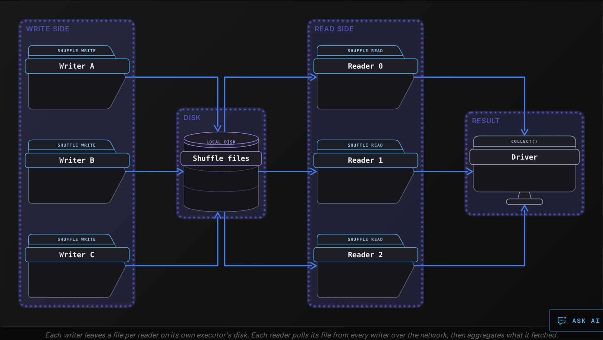
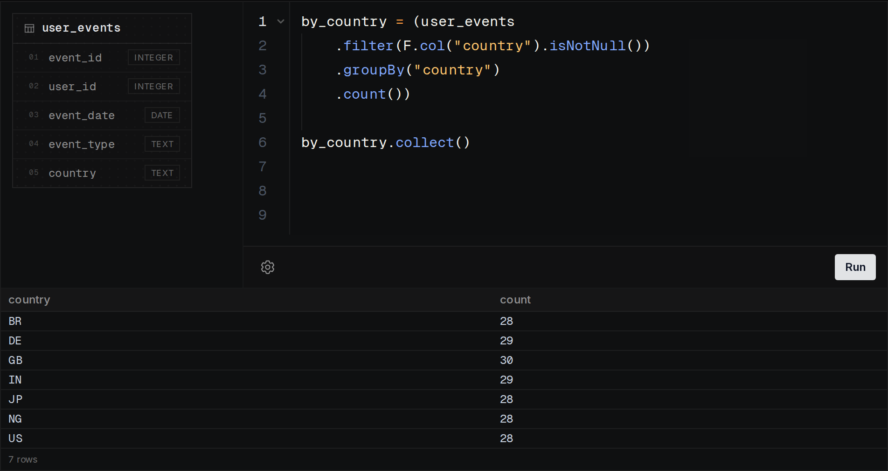
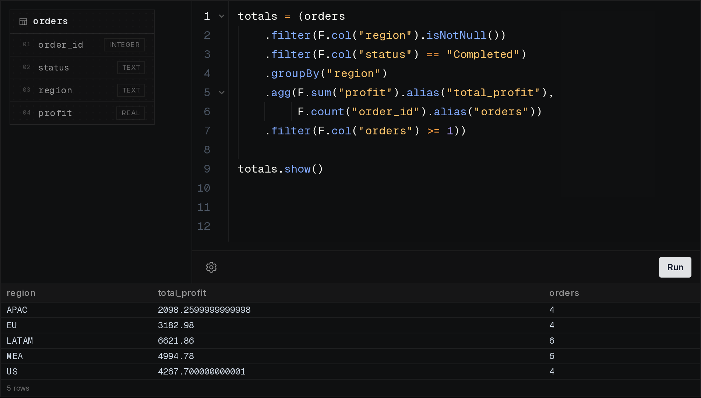
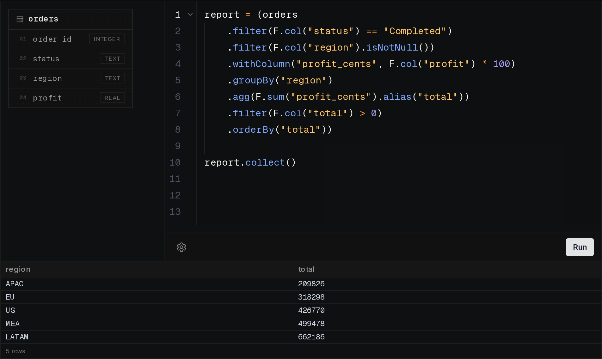

# Shuffles: Beginner

Every December, Spotify Wrapped tells hundreds of millions of listeners their top artist. The raw material is a year of play events spread across a cluster of machines, and no single machine holds all of one listener's plays. Before any top artist can be named, every play for a listener has to travel to the same place. That trip is the shuffle, and this lesson prices it.


<br>

---

## Narrow Transformations

A narrow transformation computes every output row from rows that sit in a single input partition. The task holding partition 2 reads its rows and applies the call, then writes partition 2 of the result; no row arrives from any other task and none leaves. This is how `filter` and `select` work, and `withColumn` and `drop` as well. `union` is narrow too, along with every column function you wrap inside any of them.


<br>

### One partition in, one partition out

Take an `orders` table of 8 rows that Spark reads as 4 partitions of 2 rows each, and a job that keeps rows where `status` equals `Completed`. The task on the first partition sees orders 101 and 102 and keeps 101, which finishes its work. The task on the second sees 103 and 104 and keeps 103. Each task decides the fate of its rows by reading a column value already in front of it, so there is nothing to request from another executor and nothing to wait for.

| Partition | Rows read | Rows kept |
| --- | --- | --- |
| 0 | 101 EU Completed, 102 US Pending | 101 |
| 1 | 103 US Completed, 104 APAC Cancelled | 103 |
| 2 | 105 EU Completed, 106 LATAM Pending | 105 |
| 3 | 107 US Completed, 108 APAC Completed | 107, 108 |

https://github.com/user-attachments/assets/a8e3a144-eb8c-4270-816f-15df760ffe2b

Each of the 4 tasks reads its own 2 rows and hands the survivors straight to the driver. No arrow crosses from one task to another, and the result still has 4 partitions: 3 of them now hold 1 row each and the fourth holds 2. `filter` and `select` can shrink a partition or change its columns, as can `withColumn`, and none of them moves the partition count or the executor holding each partition. A `union` places both inputs' partitions side by side, unchanged.


<br>

### What a narrow task touches

A narrow task reads its partition from storage and applies the call. Then it either passes rows on to the next narrow call or sends its result to the driver. It writes nothing to local disk and sends nothing to another executor. On a cluster with 16 slots and a table of 200 partitions, Spark runs 16 of these tasks at a time until all 200 are done, and a task that finishes early frees its slot for the next partition without waiting on any neighbour.

*The partition count after a filter equals the count before it, so keeping 1% of the rows leaves you with the same 200 partitions, most of them nearly empty. The Partitioning lessons deal with what to do about that.*


<br>

### Chaining narrow calls costs a single pass

Because a narrow call needs nothing from outside its partition, Spark runs a chain of them inside the same task. In the program below, each task takes a row, tests `status`, tests `profit`, computes `profit_x2`, drops the columns that `select` leaves out, and moves to the next row. The row stays in that executor's memory from the first call to the last. The code has 4 transformations, and they still add up to a single pass over the data.

> Narrow calls you will write every day
>
> - `filter` / `where`: keeps rows whose condition is true, tested a row at a time
> - `select` / `drop`: keeps or removes columns, and no row needs another row to do it
> - `withColumn`: computes a new column from the row's own values
> - `union`: stacks the partitions of 2 DataFrames, each partition kept whole
> - `F.when` and `F.round`, like `F.upper` and every other column function: applied row by row inside `withColumn` or `select`

Run the chain and read the 5 rows it prints. Then change the `withColumn` to compute `F.col("profit") / 2` and run again. The values you see change, while the number of rows and the number of partitions stay the same, because every change you made is decided row by row inside the task that read the row.



```python
completed = (orders
    .filter(F.col("status") == "Completed")
    .filter(F.col("profit").isNotNull())
    .withColumn("profit_x2", F.col("profit") * 2)
    .select("order_id", "status", "profit", "profit_x2"))

completed.show(5)
```


**Spark reads an events table as 200 partitions and runs the program below, then calls collect(). How many partitions does result hold when the action runs?**

```python
result = (events
    .filter(F.col("country") == "US")
    .select("user_id", "event_type")
    .withColumn("is_click", F.col("event_type") == "click"))
```

- **A.** 200, the same as the input, because each task filters and rewrites its own partition and no row moves anywhere
- **B.** Fewer than 200, because the filter drops rows and Spark merges the partitions that end up empty into their neighbours
- **C.** 1, because withColumn has to see every row at once to add the new column consistently across all of them
- **D.** 3, because select keeps 2 columns and withColumn adds a third, and Spark holds a partition per column

<details>
<summary>Solution</summary>

**A.** 200, the same as the input, because each task filters and rewrites its own partition and no row moves anywhere

Every call here is narrow, so partition 57 of the result comes from partition 57 of the input and the count stays at 200.

**Why the others are wrong**

- **B.** A narrow filter keeps a partition even when it empties it. Spark never merges partitions on its own during a filter.
- **C.** withColumn computes is_click from the row's own event_type, so each task adds it to its own rows alone.
- **D.** Partitions split rows, never columns. Changing the column list leaves the 200 row partitions as they are.

</details>

> **TIP**
>
> To decide whether a call is narrow, ask whether a task could answer it for its own rows without seeing anyone else's. The answer is yes for `filter` and `select`, and also for `withColumn`. You can put the same question to every call in the rest of this lesson.


<br>

---

## Wide Transformations

A wide transformation produces output rows that depend on rows from more than one input partition. Summing profit per region has to add up every US order, and US orders sit wherever the file reader placed them, spread across many partitions. The task holding one of those partitions can add up the US rows it sees, but it cannot know whether its subtotal is the whole answer, because another partition may hold US rows it has never seen.


<br>

### 7 orders in 2 partitions

Spark reads an `orders` table of 7 rows as 2 partitions. The first holds orders 1 to 4, where 1 and 3 are US orders and 2 is EU, with 4 from APAC. The second holds orders 5 to 7. Order 5 is from EU and order 6 from LATAM; order 7 is another US order. Ask for the list of order ids per region and the difficulty shows itself: US appears in both partitions, and so does EU. No task can write the US row of the result from the rows it holds, and the same is true for EU.

Partition 0

| order_id | region |
| --- | --- |
| 1 | US |
| 2 | EU |
| 3 | US |
| 4 | APAC |

Partition 1

| order_id | region |
| --- | --- |
| 5 | EU |
| 6 | LATAM |
| 7 | US |

So Spark moves rows. Each task reads the region of every row it holds and sends the row to the task that will own that region, so that all 3 US orders arrive at one task and both EU orders arrive at another. Only then can a task write the US row, with order 7 next to orders 1 and 3, and be certain the list is complete. That movement of rows between tasks is a shuffle, and the next section takes it apart.

https://github.com/user-attachments/assets/01f81f75-374f-4e4c-9aeb-582075ad3c89

In the diagram, 2 tasks read the input and 2 receive the moved rows. Follow order 7: it starts in the second input partition and ends up next to orders 1 and 3, which started in the first. Follow order 6: LATAM appears once, yet its data still travels, because the task that read it could not know it was alone. A wide transformation moves data for every key, even one with no partner, though for an aggregation like this each task first folds a key's rows into a single partial list and sends that.


<br>

### The wide calls you will meet first

Each of these needs rows gathered by a key

- groupBy(...).agg(...): every row carrying the same key has to reach a single task before the aggregate is final
- distinct(): a row is a duplicate only if its twin, anywhere in the table, has been brought next to it
- dropDuplicates(["user_id"]): the same gathering, keyed on the columns you name
- orderBy / sort: the first row of the output could be sitting in any input partition
- join between 2 large tables: matching keys from both sides have to meet in one task (the Joins lessons cover the case where one side is small)

Read the argument of the call to find the key. `groupBy("region")` gathers by region, `dropDuplicates(["user_id"])` gathers by user, `distinct()` gathers by the whole row, and `orderBy("profit")` gathers by ranges of profit so that one task holds the smallest values and another the largest. Each of these has the same shape underneath, an answer that depends on every row sharing a key, and that shared need is what makes a call wide.

| ✓ Narrow | ✗ Wide |
| --- | --- |
| • Output partition i comes from input partition i<br><br>• A task finishes when its own rows are done<br><br>• Partition count unchanged, or summed by union<br><br>• No disk write, no network traffic | • Output partition i gathers rows from every input partition<br><br>• A task cannot start until all input tasks finish<br><br>• Partition count set by a shuffle setting<br><br>• Rows written to disk and sent across the network |

**Which of these programs moves rows between executors when its action runs?**

- **A.** orders.filter(F.col("profit") > 0).select("order_id", "region").collect()
- **B.** orders.withColumn("big", F.col("profit") > 100).filter(F.col("big")).collect()
- **C.** orders.select("status").distinct().collect()
- **D.** orders.union(returns).select("order_id").collect()

<details>
<summary>Solution</summary>

**C.** orders.select("status").distinct().collect()

To know a status value appears a single time in the result, every copy of it has to reach one task, so the rows are shuffled by status.

**Why the others are wrong**

- **A.** Both calls are decided per row, so each task sends its surviving rows straight to the driver.
- **B.** The new column and the test on it are computed inside the task that already holds the row.
- **D.** union stacks the partitions of the 2 tables as they are, so no row changes partition.

</details>

Run the aggregation below. Spark has to bring every row for a region into one task before it can print a line for that region, so the rows move between the `filter` and the `count`. The `filter` itself runs where the rows were read, in the same task, before anything travels.



```python
by_region = (orders
    .filter(F.col("region").isNotNull())
    .groupBy("region")
    .count())

by_region.show()
```


<br>

---

## What a Shuffle Actually Is

A shuffle is an exchange in 2 parts. First, every task that holds input computes a destination for each of its rows from the row's key, and writes the rows into a file per destination on its executor's local disk. Second, a new set of tasks starts, one task per destination, and each fetches its file from every executor over the network, then does its work on the rows it now holds. Spark calls the 2 halves the shuffle write and the shuffle read.


<br>

### Picking a destination from the key

The destination is computed, never chosen by hand. Spark hashes the key and takes the remainder when divided by the number of output partitions. Hash the string `US` and you get the same number on every executor, so every US row, whatever partition it started in, is sent to the same destination. Different keys can share a destination, and that causes no trouble: the receiving task sorts them into separate groups when they arrive. Everything else in a shuffle depends on each key having exactly one destination.

```sql
destination = hash(key) % num_shuffle_partitions
```

| Rule | Consequence |
| --- | --- |
| Equal keys hash to equal values | All rows for a key meet in one reading task |
| Hash taken modulo the output partition count | Destination is between 0 and n - 1 |
| Several keys can share a destination | A reading task may hold many groups |
| Every row is routed, even a key seen once | A key appearing a single time still travels |

https://github.com/user-attachments/assets/0960fa42-4d6c-4205-b94e-f8e6cfea498e

The diagram has 3 writing tasks and 3 reading tasks. Each writer splits its 3 rows into piles, one pile per reader that has rows coming, and each reader collects its pile from every writer. Watch the US rows: 4 of them, spread across several input partitions, converge on a single reading task, which then counts 4. The reader that receives `JP` counts a single row, and it still waited for every writer to finish, because any writer might have been holding another `JP`.


<br>

### The write side and the read side



What each half does to a row

- **Shuffle write** *on the sending executor*\
  The row is serialized to bytes and appended to the file for its destination on local disk.
- **The barrier** *between the halves*\
  No reader starts until the last writer has finished, since that writer may hold rows for any reader.
- **Shuffle read** *on the receiving executor*\
  The reader opens a connection to every executor that wrote and fetches its bytes, then deserializes them back into rows.

The barrier matters as much as the bytes. No reading task starts until every writing task has finished, because the final writer might hold rows for any destination. Spark therefore splits the job at the shuffle: the part before it runs to completion, its files sit on the writers' local disks, and the part after it begins only then. They stay there after the readers finish, so a later action on the same DataFrame reads them instead of rewriting them, and Spark deletes them once nothing refers to that shuffle.


<br>

### How many readers there are

The number of destinations comes from a setting named `spark.sql.shuffle.partitions`, whose default is 200. It is independent of how many partitions were read and of how many distinct keys exist. A table read as 8 partitions and grouped by `region` with 4 distinct regions is split by every writer into 200 destinations, and at most 4 of them receive rows. By default Spark then merges small and empty destinations, so far fewer reading tasks run, and the Adaptive Query Execution lessons cover how. Either way, the input partition count stops mattering once a shuffle happens, because the reading side has a count of its own.

- **40,000** — shuffle files from 200 writers

**A groupBy("user_id") shuffles a table that Spark read as 8 partitions. Which statement about where rows land is true?**

- **A.** All rows from input partition 3 land in reading task 3, so the original layout of the table is preserved
- **B.** Rows with user_id 42 are spread evenly across the reading tasks so that the counting work is balanced
- **C.** Each reading task receives exactly one user_id, so there are as many readers as there are distinct users
- **D.** All rows with user_id 42 land in one reading task, whichever of the 8 input partitions they came from

<details>
<summary>Solution</summary>

**D.** All rows with user_id 42 land in one reading task, whichever of the 8 input partitions they came from

The destination is a function of the key alone, so 42 hashes to the same reader on every writer.

**Why the others are wrong**

- **A.** Input partition 3 holds many keys, and each of its rows is routed by its own key to possibly different readers.
- **B.** Spreading a key across readers would leave no reader able to produce the final count for it.
- **C.** The destination count comes from the shuffle setting, and several keys share a destination when keys outnumber destinations.

</details>

Run the same shape of program on the practice data. Count the rows it returns: that is the number of distinct countries, and so the number of destinations, out of 200, that received any rows.



```python
by_country = (user_events
    .filter(F.col("country").isNotNull())
    .groupBy("country")
    .count())

by_country.collect()
```

> **TIP**
>
> Every executor sends rows to every other executor, grouped by destination. No reader starts on its rows until the last writer has finished.


<br>

---

## Why Wide Costs More Than Narrow

A narrow task spends its time on a single resource: the CPU core it runs on, reading rows that are already in memory or streaming in from storage. A wide transformation adds 4 more. It serializes rows to bytes and writes those bytes to local disk; then it sends them across the network, where the far side reads and deserializes them. Each of those is slower than a core comparing 2 values, and a shuffle pays all 4 for every row that crosses.

| Step | Narrow filter | Wide orderBy |
| --- | --- | --- |
| Rows compared or hashed | Every row, in memory | Every row, in memory |
| Rows serialized to bytes | None | Every row alive at the orderBy |
| Bytes written to local disk | None | The whole shuffled dataset |
| Bytes sent over the network | None | The whole shuffled dataset |
| Bytes read back and deserialized | None | The whole shuffled dataset |
| Tasks waiting on other tasks | None | Every reader waits for every writer |


<br>

### Put sizes on it

Say a job reads 50GB of order rows. A `filter` over those rows touches 50GB once, in the tasks that read them, and produces nothing on disk. An `orderBy("order_date")` over the same rows writes about 50GB of shuffle files, then reads about 50GB over the network, so the rows are handled 3 times. A `dropDuplicates` on the full row does the same when nearly every row is unique, because nearly every row survives to the shuffle. Sort the table and then deduplicate it and the rows cross twice: 100GB written, 100GB read, before the job has produced its first row of output.

*When the aggregate is sum or count, Spark always adds up each task's rows per key before sending, and avg gets the same treatment. So a groupBy moves at most a single row per key per partition. The Shuffles: Intermediate lesson covers how.*


<br>

### The wait at the boundary

Cost in bytes is half the story. The readers cannot begin until the slowest writer finishes, because that writer may hold rows for any of them. Picture 4 writing tasks where 3 finish in 1 minute and the fourth, holding a partition 10 times larger, takes 10 minutes. The 3 quick tasks finish, their output sits on disk, their slots go idle, and every reader starts at minute 10. The cluster did 13 task-minutes of work across a 10-minute window in which most slots were doing nothing.

| Task | Rows | Finishes at |
| --- | --- | --- |
| Writer 0 | 2 million | minute 1 |
| Writer 1 | 2 million | minute 1 |
| Writer 2 | 2 million | minute 1 |
| Writer 3 | 20 million | minute 10 |
| Every reader | starts | minute 10 |

A narrow chain has no such wall. Each task finishes and its result is final, so a slow partition delays only itself while the other slots move on to the next partitions. The moment you add a wide call, the slowest partition anywhere in the input sets the pace for everything after it.


<br>

### Shrink the rows before they cross

Since a shuffle charges per row, the cheapest shuffle is the one with the fewest rows. A `filter` placed before a wide call drops rows in the task that read them, at CPU cost only. With 1,000,000 orders of which 250,000 are Completed, filtering before an `orderBy` means 250,000 rows cross instead of 1,000,000. Before a `groupBy`, it cuts the rows every writer hashes and adds up before sending. Any condition you can test on a raw row belongs before the wide call, and a condition on the aggregated result, such as a total above 1000, can only come after.

| ✓ Testable on the raw row | ✗ Testable only after grouping |
| --- | --- |
| • status == "Completed"<br><br>• profit > 0<br><br>• region in a short list<br><br>• Put it before the groupBy: rows drop out before they are written | • sum(profit) > 1000<br><br>• count > 5<br><br>• avg(profit) between 2 values<br><br>• Has to follow the agg: the shuffle has already run |

**The program below groups 400 million click rows by user_id and runs slowly. Which change reduces the bytes the shuffle moves?**

```python
(clicks
   .groupBy("user_id")
   .count()
   .collect())
```

- **A.** Replace collect() with show(), so Spark moves only the first 20 rows through the shuffle to the driver
- **B.** Insert .filter(F.col("count") > 10) after .count(), so fewer rows reach the driver at the end of the job
- **C.** Insert .filter(F.col("event_type") == "purchase") before the groupBy, so writers count and send purchase clicks only
- **D.** Insert .select("user_id") after .count(), so the shuffle carries a narrower row with fewer columns in it

<details>
<summary>Solution</summary>

**C.** Insert .filter(F.col("event_type") == "purchase") before the groupBy, so writers count and send purchase clicks only

Rows dropped before the wide call never reach a writer's partial counts, so a user with no purchases sends nothing.

**Why the others are wrong**

- **A.** show() trims what the driver receives. The groupBy still runs its whole shuffle before any count is final.
- **B.** The shuffle has already run by then, so this filter acts on the aggregated result and cannot shrink what was sent.
- **D.** A select after the groupBy acts on the aggregated result, after the shuffle has already moved the counts.

</details>

Run the program, then move the `status` filter after the `agg` at the end of the chain and run it again. It fails as soon as the line defining `totals` runs, before any action reads data, with an error that `status` cannot be resolved, since grouping by `region` left no `status` column. A condition on a raw column can only go before the shuffle, which is also where it costs least.



```python
totals = (orders
    .filter(F.col("region").isNotNull())
    .filter(F.col("status") == "Completed")
    .groupBy("region")
    .agg(F.sum("profit").alias("total_profit"),
         F.count("order_id").alias("orders"))
    .filter(F.col("orders") >= 1))

totals.show()
```

> **TIP**
>
> Before you add a wide call, ask what the rows look like at that line: how many there are and how many columns each carries. Every one of them is about to be written to disk and sent over the network for another task to read.


<br>

---

## Spotting Shuffles in Your Code

You can count a program's shuffles without running it. Read the chain from the first DataFrame to the action, and at each call ask the question from the first section: can a task answer this for its own rows alone? When the answer is no, there is a shuffle at that line. Narrow calls add none, however many you stack, and a wide call adds exactly 1.

The wide calls, as they appear in code

- groupBy(...) followed by agg, count, sum or avg: 1 shuffle, keyed on the groupBy columns
- distinct(): 1 shuffle, keyed on every column
- dropDuplicates([...]): 1 shuffle, keyed on the listed columns
- orderBy(...) or sort(...) ending in collect() or a write: 1 shuffle that places rows by range
- join(...) of 2 large tables: 1 shuffle of each side, keyed on the join column


<br>

### Walk a chain line by line

Before you run the program below, count its shuffles. There are 7 calls between the table and the action, and 2 of them are wide. Run it with `collect()` so the sort is a true global sort. Then delete the `orderBy` line and run again: the same rows come back, 1 shuffle fewer, in whatever order the readers returned them.



```python
report = (orders
    .filter(F.col("status") == "Completed")
    .filter(F.col("region").isNotNull())
    .withColumn("profit_cents", F.col("profit") * 100)
    .groupBy("region")
    .agg(F.sum("profit_cents").alias("total"))
    .filter(F.col("total") > 0)
    .orderBy("total"))

report.collect()
```

| Line | Narrow or wide | Why | Shuffles so far |
| --- | --- | --- | --- |
| `filter` on status | Narrow | Tested per row | 0 |
| `filter` on region | Narrow | Tested per row | 0 |
| `withColumn` | Narrow | Computed per row | 0 |
| `groupBy("region").agg` | Wide | All rows of a region must meet | 1 |
| `filter` on total | Narrow | Tested per aggregated row | 1 |
| `orderBy("total")` | Wide | Global order needs every row placed | 2 |
| `collect()` | Action | Runs the chain with its 2 shuffles | 2 |

The chain has 2 shuffles with 3 stretches of narrow work around them. The first shuffle moves the filtered raw rows. The second moves the aggregated rows, a single row per region, so it carries almost nothing. Where a shuffle sits in the chain matters as much as how many there are, because the rows alive at that line are the rows that cross.


<br>

### Calls that stay narrow despite appearances

- union: stacks 2 DataFrames partition by partition, and no row changes partition
- filter after a groupBy: runs on the aggregated rows inside the reading task
- withColumn with F.when: a case expression evaluated per row, with no key involved
- select with arithmetic or string functions: each row rewritten where it sits
- show() after narrow calls: the driver pulls 20 rows, and nothing moves between executors


<br>

### Calls that shuffle without saying so

`distinct()` reads like a tidy-up and runs as a `groupBy` on every column: to know a row is unique, Spark has to see all its copies in one task. `dropDuplicates(["user_id"])` does the same with a chosen key. And `orderBy` followed by `collect()` or a file write sorts across the whole table, so every row is sent to the partition that owns its range of values. Each of these costs the same shuffle as a `groupBy` on its key, whatever its name suggests.

*orderBy followed by show() or limit(n) runs as a different plan: each partition keeps its top n rows and the driver merges those few, with no range shuffle. The range shuffle is paid when the full sorted result is needed.*

**How many shuffles does the program below run?**

```python
(page_views
   .filter(F.col("device") == "mobile")
   .select("user_id", "page_url")
   .distinct()
   .withColumn("is_home", F.col("page_url") == "/")
   .filter(F.col("is_home"))
   .collect())
```

- **A.** 3, one for each call that follows select, since each of them sees a changed row shape
- **B.** 1, at distinct(), since every other call is tested or computed per row
- **C.** 2, one at distinct() and one at the final filter, which has to check rows across partitions
- **D.** 0, because distinct() on 2 columns can be finished inside each partition on its own

<details>
<summary>Solution</summary>

**B.** 1, at distinct(), since every other call is tested or computed per row

distinct() has to gather every copy of a (user_id, page_url) pair into one task. The other 4 calls are narrow.

**Why the others are wrong**

- **A.** A changed row shape is still decided per row. withColumn and filter run inside the task that holds the row.
- **C.** The final filter tests is_home on each row by itself, so no row needs to see another.
- **D.** A pair that appears in 2 partitions would survive twice. Only a shuffle on both columns brings the copies together.

</details>

| ✓ Do | ✗ Don't |
| --- | --- |
| • Count the wide calls before you run: each one is a shuffle<br><br>• Put every raw-column filter before the first groupBy<br><br>• Name the key of each shuffle: region, user_id, all columns<br><br>• Treat distinct and dropDuplicates as a groupBy in disguise | • Assume a short chain is cheap: a single orderBy can move the whole table<br><br>• Add a second groupBy when one agg can compute both numbers<br><br>• Trust the method name; ask what the task needs to answer<br><br>• Call collect() on a shuffled result larger than the driver can hold |

> **TIP**
>
> Read a chain the way Spark will run it: narrow calls fold into the task that reads the partition, and each wide call draws a line across the page where every row moves. The number of lines is the number of shuffles.


<br>

---

## Putting It All Together

Airbnb's data team runs a nightly job over the previous day's booking events to report confirmed bookings and revenue per listing, sorted so the highest-earning listings come first. The chain filters to confirmed bookings, drops the columns the report does not use, groups by listing_id to sum revenue and count bookings, and orders the result by the revenue total before writing it out.

- The filter and the column drop are narrow: each task trims its own partition and no row leaves it.
- The groupBy on listing_id is wide: a listing's bookings sit in many partitions and have to meet in one task.
- That meeting is a shuffle: each writer hashes listing_id to a destination, writes a file per destination, and the readers fetch their files over the network.
- The sort cannot begin until the last writer finishes, so the day's largest partition decides when the report can start, and filtering first keeps the rows that cross to confirmed bookings only.
- Reading the chain top to bottom gives 2 shuffles, one for the groupBy and one for the orderBy, and the second moves a single row per listing.


<br>

---

## Key Takeaways

- A narrow call lets each task finish on its own partition; a wide call needs rows from every partition.
- groupBy and orderBy are wide. So are distinct and dropDuplicates, and so is a join of 2 large tables; each one is a shuffle.
- A shuffle hashes each row's key to a destination, writes the row to local disk, and reads it back over the network.
- No reader starts until the last writer finishes, so the slowest partition sets the pace for everything after the shuffle.
- Filter on raw columns before the first wide call, because every row alive at that line is about to be written to local disk and sent over the network to another task.
- Count a chain's shuffles by counting its wide calls, before you run it.
