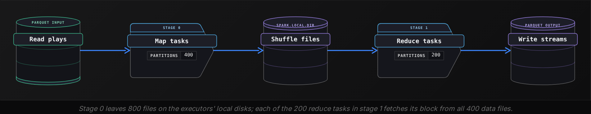
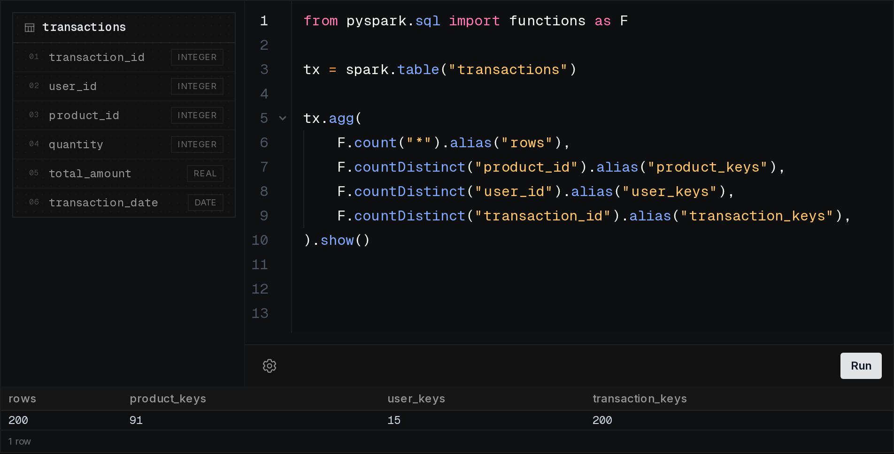

# Shuffles: Intermediate

Spotify Wrapped, written as a Spark job, takes a year of plays, groups them by listener and artist, then sorts by stream count to find each listener's favourites. The grouping and the sort each move data across the cluster, and how much moves, where it lands on disk and whether a later pass can skip it decides whether the job finishes overnight or eats the weekend.


<br>

---

## The Shuffle Write

A shuffle runs in 2 halves, split across a stage boundary. The first half, the shuffle write, is the last thing every task does in the stage before the wide transformation. Each of those tasks, called a map task, runs its pipelined narrow work, decides for every output row which downstream partition owns it, and writes the rows to its executor's local disk, grouped by that partition. The stage finishes only when the last map task has written.

```sql
plays = spark.table("plays")

streams = (plays
           .filter(F.col("ms_played") > 30000)
           .groupBy("listener_id", "artist_id")
           .agg(F.count("*").alias("streams")))

streams.write.parquet("/out/streams")
```

The rest of this lesson follows that job over a year of plays read as 400 partitions on a cluster of 20 executors. Stage 0 runs 400 map tasks. Each reads its split, applies the filter in the same pass, and for every surviving row works out which of the 200 reduce partitions owns its `(listener_id, artist_id)` pair. The 200 is the default of `spark.sql.shuffle.partitions`, the setting that fixes how many partitions a DataFrame shuffle produces.


<br>

### Choosing the target partition

For a `groupBy`, the owner comes from a hash of the grouping columns, taken modulo the number of reduce partitions. Every map task applies the same function, so a given listener and artist pair goes to the same reducer whichever task happened to read it. That agreement lets reducer 17 collect every row for its keys without asking anyone where they went. A later section of this lesson opens up the hash and the other rule Spark uses.


<br>

### What lands on disk

Each map task writes 2 files. The data file holds all its output rows laid out as 200 consecutive runs, 1 per reduce partition, and the index file records the byte offset where each run starts, so any run can be served without scanning the rest. A single run, the rows a map task holds for a single reducer, is a shuffle block. Rows are serialized and compressed on the way out, so they usually take far fewer bytes on disk than they did in memory.

| Quantity | Rule | Running example |
| --- | --- | --- |
| Map tasks | 1 per input partition | 400 |
| Reduce partitions | `spark.sql.shuffle.partitions` | 200 |
| Files on local disk | 2 per map task | 800 |
| Shuffle blocks | map tasks times reduce partitions | 80,000 |
| Blocks per map task | 1 per reduce partition | 200 |

Files grow with map tasks alone; blocks grow with the product of both sides. Spark has kept 1 data file per map task since version 1.2, when sort-based shuffle replaced a layout that opened a separate file for every block.


<br>

### Which disk, and for how long

The files go under `spark.local.dir`, which is `/tmp` unless set, on the machine running the executor; cluster managers often substitute directories of their own. A job writing 500GB of shuffle across 20 executors therefore needs about 25GB of free local disk on each, and when one machine fills up, its map tasks fail with `No space left on device` while the cluster's main storage sits half empty. The files also outlive the tasks that wrote them, because the next stage still has to fetch them.

The animation shrinks the job to 9 orders read as 2 partitions and counted per region into 2 reduce partitions. Watch the end of the first stage: each map task arranges its output by target partition and writes it before any reduce task starts. The final counts are US 3, EU 3, APAC 2 and LATAM 1.

https://github.com/user-attachments/assets/71ba64a5-fc85-4cfe-b08e-d8597359d0fd

<br>

### The write in the Spark UI

On the Stages tab, each stage's row carries a Shuffle Write column: the bytes and records all its tasks wrote. Open the map stage and every task lists its own Shuffle Write Size / Records and its shuffle write time. Read them against Input. A write far larger than the input means rows multiplied before the shuffle, and a write time that eats a large share of each task points at slow or crowded local disks.

**A stage of 300 map tasks feeds a groupBy with spark.sql.shuffle.partitions set to 100. What does its shuffle write leave on the executors' local disks?**

- **A.** 30,000 files, 1 per block, since each map task opens a file for every reducer
- **B.** 600 files holding 30,000 blocks, since each map task writes a data file and an index file
- **C.** 400 files holding 30,000 blocks, since there is 1 file per map task and 1 per reducer
- **D.** 600 files holding 400 blocks, since there is 1 block per map task and 1 per reducer

<details>
<summary>Solution</summary>

**B.** 600 files holding 30,000 blocks, since each map task writes a data file and an index file

Files follow map tasks: 300 times 2 is 600. Blocks are map tasks times reducers: 300 times 100 is 30,000.

**Why the others are wrong**

- **A.** That was the layout before Spark 1.2. Each map task now keeps its 100 blocks inside 1 data file.
- **C.** Reducers have not started during the write, so they own no files. Each map task writes 2, giving 600.
- **D.** The file count is right, but every map task holds a separate block for each of the 100 reducers: 30,000 in all.

</details>


<br>

---

## The Shuffle Read

The reduce stage waits for the whole map stage, since any map task might hold rows for any reducer. As each map task finishes, it reports to the driver where its data file lives and the size of each of its blocks. When all 400 have reported, the driver has a complete map of the shuffle, and the 200 reduce tasks can start.

Reduce task 17 then fetches block 17 from each of the 400 data files. Blocks written on its own executor are read from local disk; the rest arrive over the network from the other 19 executors. With map tasks spread evenly across the cluster, roughly 1 block in 20 is local and 19 in 20 are remote, so nearly every shuffled byte crosses the network once.




<br>

### From blocks to results

Fetches go out in parallel batches, so a reducer pulls from several executors at once while it processes blocks that have already arrived. For the `groupBy`, processing means merging: the reducer feeds each incoming row into a hash map keyed by `(listener_id, artist_id)`, adding counts for rows that share a key. Once the last block is merged, every key's count is final, because no other reducer holds rows for those keys. The finished rows then flow into the narrow work after the shuffle in the same stage, here the parquet write.


<br>

### The read mirrors the write

Each byte stage 0 writes, stage 1 reads, so the reduce stage's Shuffle Read total matches the map stage's Shuffle Write total. The split differs. Writes were divided by input partition, and reads are divided by key, each reducer taking whatever share of the data its keys own. In this job that share stays close across reducers. As the next section shows, each map task sends no more than 1 row for each `(listener_id, artist_id)` pair, so a listener who streams all day adds at most 400 rows per artist, and the hash spreads their artists over many reducers. Read sizes split apart when raw rows cross the shuffle, as after `repartition("listener_id")`: every play of a heavy listener lands on 1 reducer, that reducer reads far more than the median, and the stage waits on it.


<br>

### Read metrics in the Spark UI

| Task metric | What it counts | What a high value suggests |
| --- | --- | --- |
| Shuffle Read Size / Records | Bytes and rows the task fetched | Far above the median: its keys own a large share of rows |
| Shuffle Remote Reads | Bytes fetched from other executors | Near the total: expected when executors are many |
| Shuffle Read Blocked Time | Time the task waited with no block to process | A large share of task time: fetching is the bottleneck |

**A reduce stage of 200 tasks is slow. Read sizes per task are within 10% of each other, the median task takes 40 seconds, and the median Shuffle Read Blocked Time is 31 seconds. Where should you look first?**

- **A.** At fetching: tasks spend most of their time waiting for blocks from other executors
- **B.** At skew: a few reducers own most of the keys and hold up the whole stage
- **C.** At the map stage: too few map tasks wrote the files the reducers need
- **D.** At the merge: feeding rows into the hash map takes most of each task

<details>
<summary>Solution</summary>

**A.** At fetching: tasks spend most of their time waiting for blocks from other executors

Blocked time is waiting for blocks to arrive. At 31 of 40 seconds, the network and the serving executors come first.

**Why the others are wrong**

- **B.** Skew shows as a few tasks reading far more than the median. Read sizes within 10% of each other rule it out.
- **C.** The map stage finished before any reducer started. The lost time sits inside the reduce tasks, waiting on fetches.
- **D.** Merging happens while the task is not blocked, about 9 of 40 seconds here. Waiting on blocks dominates.

</details>


<br>

### Reducers with nothing to read

The plan sets the reduce task count to `spark.sql.shuffle.partitions`, whatever the data holds. With adaptive execution turned off (`spark.sql.adaptive.enabled` set to `false`), a `groupBy` on a column with 3 distinct values launches all 200 reduce tasks. Each key's rows land in a single partition, so at least 197 tasks find every block empty and finish with no output, more if 2 of the keys hash to the same partition. Each empty task still costs the driver a scheduling round trip. With adaptive execution on, the default since Spark 3.2, Spark measures the map output once the map stage ends and merges the small and empty partitions into a few tasks, often 1 for 3 keys. The Adaptive Query Execution lessons cover how.

The animation sets the reduce count to 6 and sums 6 orders spread over 3 regions. Before you play it, predict how many of the 6 reduce tasks receive any rows. The totals it returns are US 260, EU 110 and APAC 60.

https://github.com/user-attachments/assets/ca3a6a8b-344f-4abd-9f34-89bbb3d44d6c

**events is read as 120 partitions, and its country column holds 8 distinct values. If spark.sql.shuffle.partitions is 50, how many shuffle blocks belong to each reduce task of events.groupBy("country").count(), and how many reduce tasks can produce rows?**

- **A.** 50 blocks each, and at most 8 tasks produce rows
- **B.** 120 blocks each, and all 50 tasks produce rows
- **C.** 8 blocks each, and at most 8 tasks produce rows
- **D.** 120 blocks each, and at most 8 tasks produce rows

<details>
<summary>Solution</summary>

**D.** 120 blocks each, and at most 8 tasks produce rows

Every map task's data file holds a block for each reducer, so 120 each. Eight keys can fill at most 8 reducers.

**Why the others are wrong**

- **A.** Each reducer owns 1 block from each of the 120 map tasks' files, so it owns 120 blocks.
- **B.** The block count is right, but each country lands in 1 partition, so at most 8 tasks get rows.
- **C.** Blocks follow map tasks, 1 per map task for each reducer. The number of keys does not set them.

</details>


<br>

---

## Combining Before the Shuffle

The cheapest shuffle byte is the one never written. For `count`, `sum`, `min`, `max`, `avg` and most other built-in aggregates, Spark computes the result in 2 passes. A partial pass runs inside each map task before the shuffle write and collapses that task's rows to 1 row per key it saw, carrying a running result. A final pass runs in the reducer after the read and merges each key's partial rows. Every DataFrame `groupBy` using these aggregates gets the partial pass without being asked.

Map task 0 without a partial pass

| region |
| --- |
| US |
| EU |
| US |
| US |
| EU |
| US |

Map task 0 with a partial pass

| region | partial_count |
| --- | --- |
| US | 4 |
| EU | 2 |

Both outputs give the reducer what it needs: it adds US 4 to the partial US counts from every other map task and reaches the same total. The partial version writes 2 rows where the raw version writes 6. For `avg`, the partial row carries a sum and a count, since an average of averages would be wrong.


<br>

### What decides the saving

A map task can write at most 1 row per distinct key in its own partition, so the saving rests on a single ratio: rows per key within 1 task. Take a year of 1 billion plays read as 400 partitions, 2.5 million rows per map task, and group them 3 ways.

| Grouping key | Distinct keys | Rows per map task, at most | Rows shuffled, at most |
| --- | --- | --- | --- |
| `country` | 180 | 180 | 72,000 |
| `artist_id` | 50,000 | 50,000 | 20,000,000 |
| `listener_id` | 100,000,000 | 2,500,000 | 1,000,000,000 |

The same `groupBy` code cuts the shuffle by a factor of about 14,000 for country, 50 for artist, and almost nothing for listener: a task holding 2.5 million rows in arrival order sees nearly every listener once. Layout matters as much as the key. Had the files been written so each partition held a contiguous range of listeners, each task would see all of a listener's plays together, around 10 on average, and the partial pass would cut the shuffle about 10 times.

**Two copies of the 1 billion plays each sit in 400 partitions. Copy A is in arrival order. Copy B was written so each partition holds a contiguous range of listener_id values. Which is true of groupBy("listener_id").count()?**

- **A.** Both shuffle the same rows, since the partial pass depends only on how many distinct keys exist
- **B.** Copy A shuffles fewer rows, since arrival order spreads each listener's plays across many tasks
- **C.** Copy B shuffles fewer rows, since each task sees a listener's plays together and writes 1 row for them
- **D.** Neither copy combines, since count is computed only after the reducers have read every row

<details>
<summary>Solution</summary>

**C.** Copy B shuffles fewer rows, since each task sees a listener's plays together and writes 1 row for them

In copy B, each listener's plays share a partition, so a task writes 1 partial count per listener: about 10 times fewer rows.

**Why the others are wrong**

- **A.** The partial pass works per map task. What it drops depends on how often a key repeats inside 1 task, which layout controls.
- **B.** Spreading a listener across tasks defeats the partial pass: each task holds 1 or 2 of their rows and writes them all.
- **D.** count has a partial form: each map task counts its own rows per key before the write, and reducers add the results.

</details>


<br>

### Aggregates that combine poorly

What the partial row holds

- count, sum, min, max and avg: a fixed few numbers per key, however many rows fed it.
- collect_list and collect_set: the values themselves, so rows collapse while the bytes stay close to the raw values.
- countDistinct: only repeated (key, value) pairs can be dropped, so Spark **shuffles twice**, once on key and value, then once on key.
- approx_count_distinct: a fixed-size sketch, so the job shuffles once, with a default relative standard deviation of 5%.

```sql
exact = (plays
         .groupBy("artist_id")
         .agg(F.countDistinct("listener_id").alias("listeners")))

approx = (plays
          .groupBy("artist_id")
          .agg(F.approx_count_distinct("listener_id").alias("listeners")))
```

Run as written, `exact` takes 2 shuffles and 3 stages: the first shuffle groups by `(artist_id, listener_id)` so duplicate pairs meet and drop, and the second groups the surviving pairs by `artist_id` to count them. `approx` takes 1 shuffle and 2 stages, and each map task writes 1 sketch per artist it saw, the same size whatever the listener count.


<br>

### Check the ratio on real data

The cell below counts rows and distinct values for 3 columns of the practice `transactions` table. Run it, then divide `rows` by each key count. The quotient is the most a partial pass could shrink a `groupBy` on that column if 1 task saw every row; how the rows are split across tasks decides how close a real job gets.



```python
from pyspark.sql import functions as F

tx = spark.table("transactions")

tx.agg(
    F.count("*").alias("rows"),
    F.countDistinct("product_id").alias("product_keys"),
    F.countDistinct("user_id").alias("user_keys"),
    F.countDistinct("transaction_id").alias("transaction_keys"),
).show()
```


<br>

---

## Hash vs Range Partitioning

Every map task has to send each row to exactly 1 reducer, using a rule every other map task also applies. For shuffles keyed on columns, Spark has 2 rules. Hash partitioning sends a row to partition `pmod(hash(key), n)`, which hashes the key columns with Murmur3, divides the hash by the partition count n, and keeps the non-negative remainder. Range partitioning cuts the key's sorted values into n contiguous intervals and sends each row to the interval its key falls in. A third rule, round-robin, deals rows out in turn with no key at all; `repartition(n)` uses it.

| ✓ Hash partitioning | ✗ Range partitioning |
| --- | --- |
| • Used by groupBy, distinct, joins and repartition(col)<br><br>• Same key, same partition, for a fixed n<br><br>• Neighbouring keys scatter across partitions<br><br>• Needs no pass over the data before the shuffle<br><br>• Sizes even out when keys are many and similar in size | • Used by orderBy, sort and repartitionByRange(col)<br><br>• Same key, same partition, within 1 run<br><br>• Every key in partition i sorts before every key in partition i+1<br><br>• Runs a sampling job first to pick boundaries<br><br>• Sizes depend on how well the sample matches the data |


<br>

### Why a sort needs ranges

A `groupBy` reducer only needs every row for its keys, and a hash delivers that. A global sort needs more. Each reducer sorts its own rows, and reading partition 0, then 1, then 2 has to yield 1 ordered result, which holds only if every key in partition 0 sorts before every key in partition 1. A hash sends adjacent values like 99 and 100 to unrelated partitions, so `orderBy` uses ranges.

To place the boundaries, Spark first samples the data: around 100 keys per output partition by default, the value of `spark.sql.execution.rangeExchange.sampleSizePerPartition`, drawn from every input partition. It sorts the sample and picks n minus 1 cut points that split it evenly. That sampling is a job of its own, the kind you saw run ahead of an action's main job, and it computes the input once for the sample and again for the shuffle.

Suppose the sample for 3 partitions yields cut points of 50 and 100. Rows then route like this:

| amount | Range partition | Why |
| --- | --- | --- |
| 30 | 0 | 50 or less |
| 45 | 0 | 50 or less |
| 60 | 1 | above 50, 100 or less |
| 95 | 1 | above 50, 100 or less |
| 120 | 2 | above 100 |

The animation sorts 9 orders by `amount` into 3 reduce partitions, with cut points drawn from its own sample. Watch which amounts reach each reducer: low ones at the first, high ones at the last, and each reducer sorts only its own share. Collected in partition order, the result runs 15, 30, 45, 60, 70, 80, 95, 120, 140.

https://github.com/user-attachments/assets/252c696e-f701-4fe7-83b6-4c81dfbd1762

<br>

### Which rule your code gets

| Code | Partitioning | Shuffles |
| --- | --- | --- |
| `df.groupBy("region").count()` | hash on region | 1 |
| `df.distinct()` | hash on every column | 1 |
| `df.orderBy("amount")` | range on amount | 1 |
| `df.repartition(50, "region")` | hash on region, 50 partitions | 1 |
| `df.repartitionByRange(50, "amount")` | range on amount, 50 partitions | 1 |
| `df.repartition(50)` | round-robin, 50 partitions | 1 |
| `df.groupBy("region").count().orderBy("count")` | hash on region, then range on count | 2 |


<br>

### The partition count is part of the hash

Because the rule ends in a remainder, the same key lands in unrelated partitions under different counts: `US` might sit in partition 41 of 200 and partition 7 of 50. Two outputs hash-partitioned on the same column line up partition by partition only when they used the same n. Range layouts line up even less often, since their boundaries come from a sample of 1 run's data.

Neither rule splits a key: every row with `country = 'US'` lands in 1 partition under hash and under range alike.

**A job runs events.repartitionByRange(4, "event_date") over a year of events. Which is true of the 4 output partitions?**

- **A.** Each holds about a quarter of every month's dates, so all 4 cover the whole year
- **B.** Each holds 1 contiguous span of dates, and no single date is split between 2 partitions
- **C.** Each holds 1 calendar quarter, since range boundaries come from the column's type
- **D.** Each holds a scattered set of dates, chosen so the partitions come out equal in size

<details>
<summary>Solution</summary>

**B.** Each holds 1 contiguous span of dates, and no single date is split between 2 partitions

Rows route by comparing the date with the cut points, so a date always reaches 1 partition and each partition covers 1 interval.

**Why the others are wrong**

- **A.** That spread resembles round-robin. Range partitioning gives each partition 1 contiguous span of dates.
- **C.** Boundaries come from a sample of the data. If summer holds most events, the cut points crowd into summer.
- **D.** Scattering neighbouring values is what hashing does. A range layout keeps neighbouring dates together.

</details>


<br>

---

## Reusing Shuffle Output

Spark skips a shuffle in 2 situations. Inside 1 query, it plans none when the data already sits partitioned the way the next operation needs. Across actions, it skips a map stage whose shuffle files are still on disk from an earlier job.


<br>

### Partitioning already in place

A `groupBy("region")` needs every row of a region in 1 partition. After `repartition("region")` that already holds: the repartition hashed every row by region. Before adding a shuffle, Spark compares what each operation needs with how its input is partitioned, and here they match, so the aggregation runs inside the repartition's reduce tasks with no second shuffle.

The animation repartitions 9 orders by region into 3 partitions, then counts orders per region. Count the shuffles as it plays: there is 1, and each count is computed in the task where its region's rows landed.

https://github.com/user-attachments/assets/73421183-0a2e-47fe-b177-2e01af3a4830

<br>

### What counts as a match

| Code | Shuffles | Why |
| --- | --- | --- |
| `repartition("region").groupBy("region")` | 1 | Hash on region already gathers each region |
| `repartition(50, "region").groupBy("region")` | 1 | Same match, and the groupBy inherits the 50 partitions |
| `repartition("region").groupBy("region", "status")` | 1 | A region's rows sit together, so each region and status pair does too |
| `repartition("region", "status").groupBy("region")` | 2 | Status spreads 1 region over several partitions |
| `repartition(50).groupBy("region")` | 2 | Round-robin put every region everywhere |
| `groupBy("region").count().groupBy("region").max("count")` | 1 | The first groupBy left the rows hashed on region |
| `repartition("region").orderBy("region")` | 2 | A sort needs ranges, which a hash cannot provide |

Spark's test is whether the existing layout puts all rows that share the new grouping key in 1 partition. Hashing on a subset of the grouping columns passes it, hashing on extra columns fails it, and round-robin always fails. When the layout passes, its partition count carries forward, so `repartition(50, "region")` sets the task count of everything after it up to the next shuffle.


<br>

### Shuffle files that outlive their job

Each action re-runs its lineage from the source, as lazy evaluation showed, with 1 exception. After a map stage finishes, its files stay on the executors' disks and the driver keeps their locations. When a later job in the same application needs that exact shuffle, the scheduler finds the map output complete and skips the stage: the Jobs tab lists it as skipped, and its tasks never run.

```sql
by_artist = (plays
             .groupBy("artist_id")
             .agg(F.sum("ms_played").alias("ms")))

first = by_artist.collect()
again = by_artist.collect()
```

The first `collect()` runs 400 map tasks that read `plays` and write partial sums, then 200 reduce tasks. The second runs the same query, finds all 400 map outputs registered, skips stage 0, and runs only the 200 reducers, so `plays` is never read a second time.

#### Where the reuse ends

The reuse belongs to 1 query. `by_artist.filter(F.col("ms") > 0).collect()` is a new query that plans its own shuffle, so both stages run again even though the rows feeding the shuffle are identical. The files are also temporary: Spark deletes them some time after the driver drops its last reference to the query that wrote them, and an executor that dies usually takes its files with it. Reuse you control on purpose comes from caching, covered in a later lesson.

**Which of these 3 jobs run the 400 map tasks that read plays?**

```python
totals = plays.groupBy("artist_id").agg(F.sum("ms_played").alias("ms"))

a = totals.collect()
b = totals.collect()
c = totals.filter(F.col("ms") > 0).collect()
```

- **A.** Only the first job; the second and third reuse its shuffle files
- **B.** All 3, since shuffle files are deleted when the job that wrote them ends
- **C.** The first and the third; the second skips its map stage
- **D.** The first and the second; the third reads earlier files through the filter

<details>
<summary>Solution</summary>

**C.** The first and the third; the second skips its map stage

The second runs the same query and finds its map outputs registered. The filter makes the third a new query with a fresh shuffle.

**Why the others are wrong**

- **A.** The second reuses them. The third is a new query with a shuffle of its own, so its map stage runs in full.
- **B.** The files stay on disk after the job ends, which is why the second collect() can skip its map stage.
- **D.** A new query cannot reach another query's shuffle files, so the third reads plays again. The second is the one that skips.

</details>


<br>

### Capstone: the whole shuffle at once

**With spark.sql.shuffle.partitions at 200, how many shuffles does this job run, and how many tasks run the aggregation?**

```python
daily = (plays
         .repartition(100, "listener_id")
         .groupBy("listener_id", "day")
         .agg(F.sum("ms_played").alias("ms"))
         .orderBy("ms"))

daily.write.parquet("/out/daily")
```

- **A.** Two shuffles, and the aggregation runs inside the repartition's 100 tasks
- **B.** Three shuffles, and the aggregation runs as 200 tasks of its own
- **C.** Two shuffles, and the aggregation runs as 200 tasks after the sort
- **D.** One shuffle, since the sort reuses the hash layout on listener_id

<details>
<summary>Solution</summary>

**A.** Two shuffles, and the aggregation runs inside the repartition's 100 tasks

Hash on listener_id gathers every (listener_id, day) pair, so the groupBy reuses its 100 tasks. The orderBy adds a range shuffle with 200 partitions.

**Why the others are wrong**

- **B.** The groupBy keys include listener_id, so the repartition's layout already satisfies it. Only the repartition and the sort shuffle.
- **C.** The shuffle count is right, but the aggregation comes before the sort and inherits the repartition's 100 partitions.
- **D.** A sort on ms needs ranges on ms. A hash on listener_id gives neither, so the sort shuffles again.

</details>

The last question joins the partial pass from section 2 to the layout reuse in this one. A `repartition` has no aggregate to apply, so its map tasks write every row they receive, as they read it. Whatever runs after it, partial pass included, runs in the repartition's reduce tasks, on rows that have already crossed the network.

**A teammate adds repartition("country") before groupBy("country").count() on the 1 billion plays in 400 partitions, so the groupBy adds no shuffle. Compared with the groupBy alone, how many rows cross the shuffle?**

- **A.** The same, at most 72,000, because there is still exactly 1 shuffle
- **B.** Half as many, because the groupBy and the repartition share 1 shuffle
- **C.** None, because the groupBy reads the repartition's files where they sit
- **D.** All 1 billion, because the partial count now runs only after the shuffle

<details>
<summary>Solution</summary>

**D.** All 1 billion, because the partial count now runs only after the shuffle

A repartition writes every row it receives. The aggregation, partial pass included, runs after the read, so 72,000 rows become 1 billion.

**Why the others are wrong**

- **A.** The remaining shuffle belongs to the repartition, which writes raw rows. The 72,000 bound needed a partial pass before the write.
- **B.** Sharing the shuffle removes no rows. With no partial pass before the write, every play is shuffled.
- **C.** The groupBy runs in the repartition's reduce tasks, but those tasks fetched every row over the network first.

</details>


<br>

---

## Putting It All Together

Each December, Spotify Wrapped shows every listener their most-played artists of the year. Picture producing a version of it in Spark from 1 billion plays read as 400 partitions: drop plays under 30 seconds, count streams per listener and artist, sort the result by streams for a summary report, and collect the top rows twice while checking them.

- The groupBy on ( listener_id , artist_id ) writes 2 files per map task, and its partial pass helps only as much as a listener repeats an artist inside 1 task.
- Its 200 reducers each fetch from all 400 data files, and because each map task sends at most 1 row per pair, read sizes stay close even when a few listeners stream all day.
- Sorting by streams adds a sampling job and a range shuffle, so the job runs 2 shuffles and 3 stages.
- Collecting the same DataFrame again skips the map stage on the Jobs tab, while adding a filter first plans a fresh shuffle.
- Repartitioning by listener_id up front would let the groupBy reuse that layout, at the cost of shuffling every raw play and landing each heavy listener's plays on 1 reducer with outsized Shuffle Read.


<br>

---

## Key Takeaways

- A shuffle write leaves 2 files per map task on local disk, a data file and an index file, with 1 block per reducer inside; blocks number map tasks times reducers.
- A reducer starts only after the whole map stage, then fetches its block from every map output, mostly over the network.
- Shuffle Read on the reduce stage totals the map stage's Shuffle Write; the split by key decides which reducers carry the most.
- Built-in aggregates run a partial pass before the write, and the saving depends on how often a key repeats inside 1 map task.
- Hash partitioning serves groupBy, distinct and joins; range partitioning serves sorts and runs a sampling job first.
- Spark skips a shuffle when the existing layout already gathers the new key, and skips a map stage when the same query's files are still on disk.
- A repartition before a groupBy saves a shuffle but moves the partial pass behind it, so raw rows cross the network.
