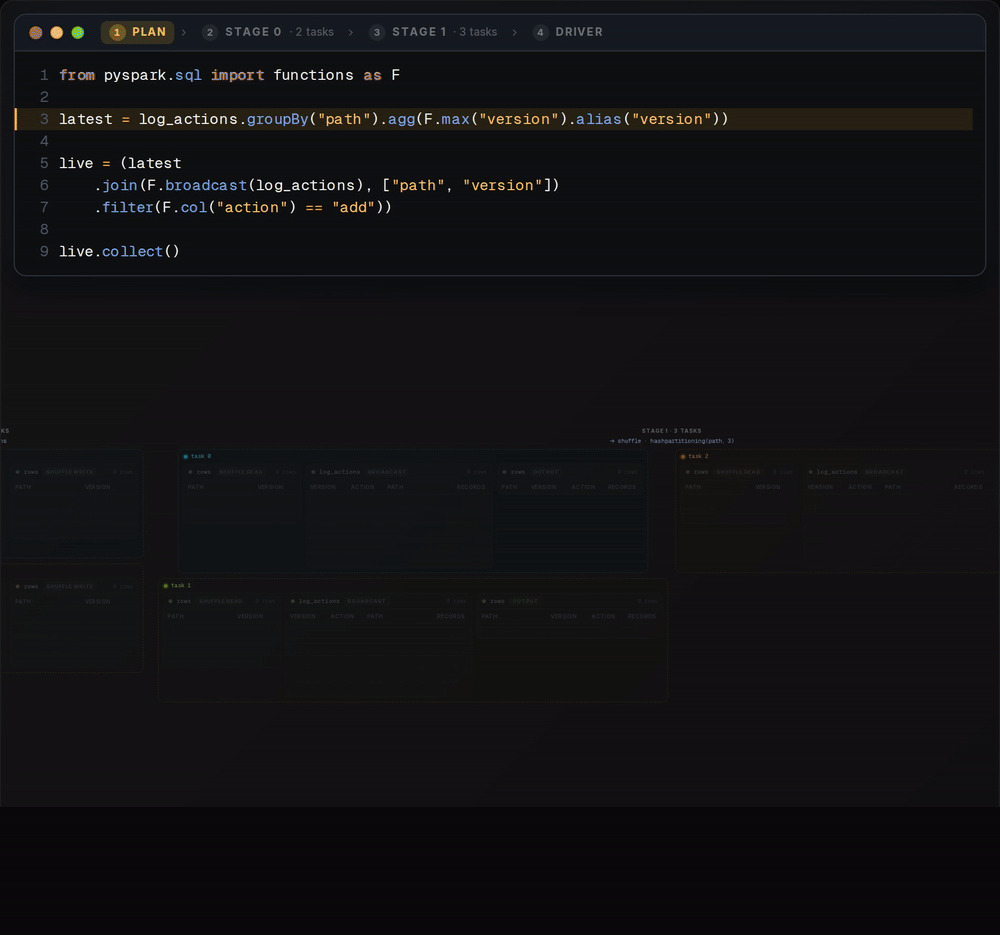
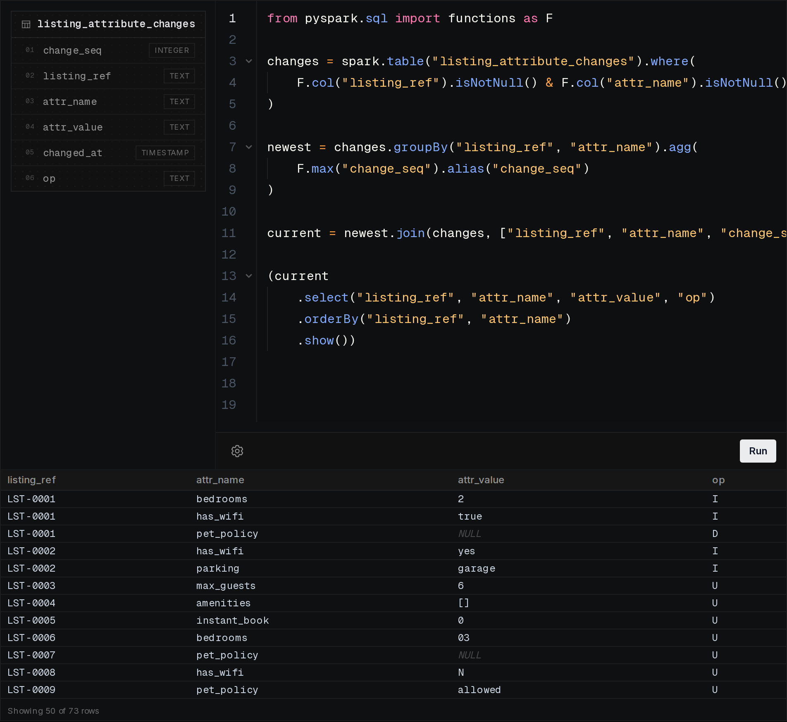
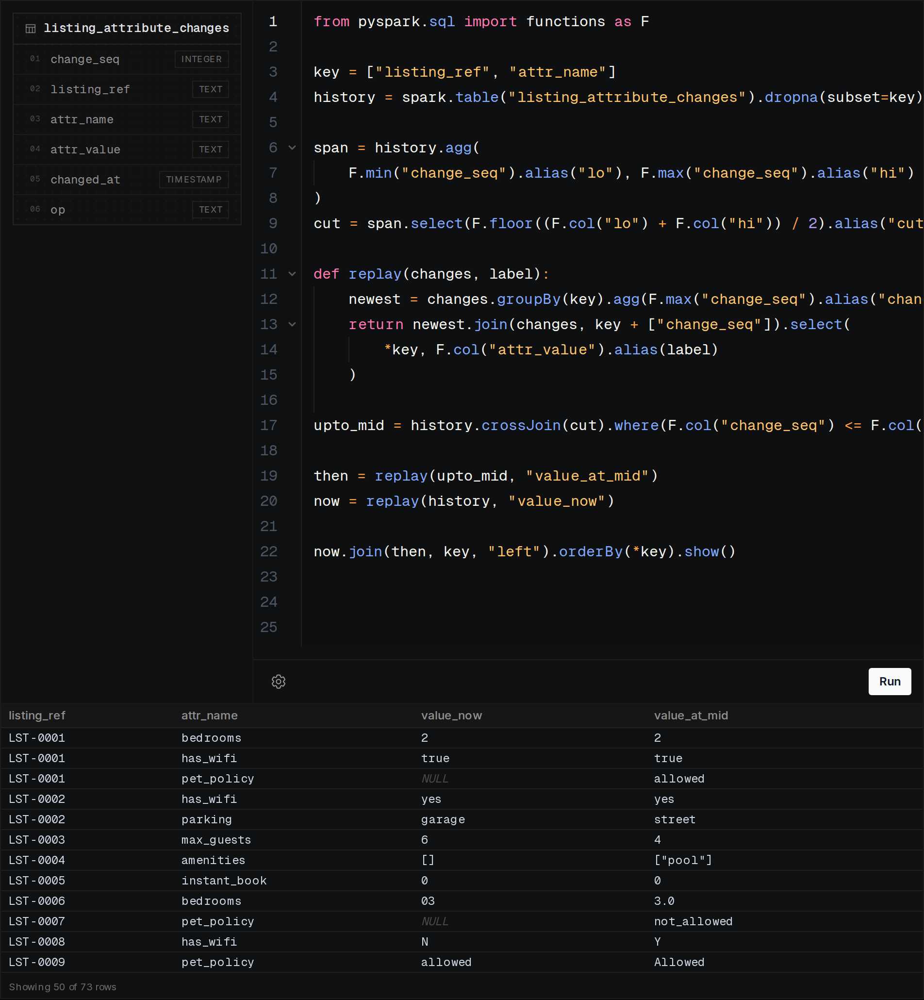
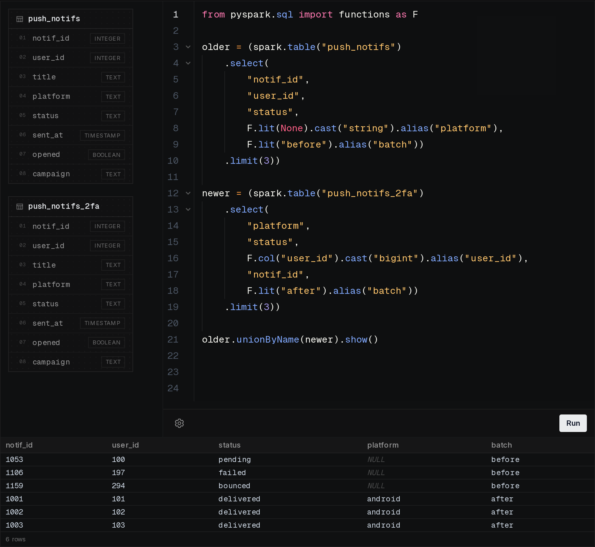
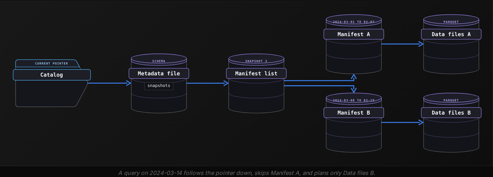
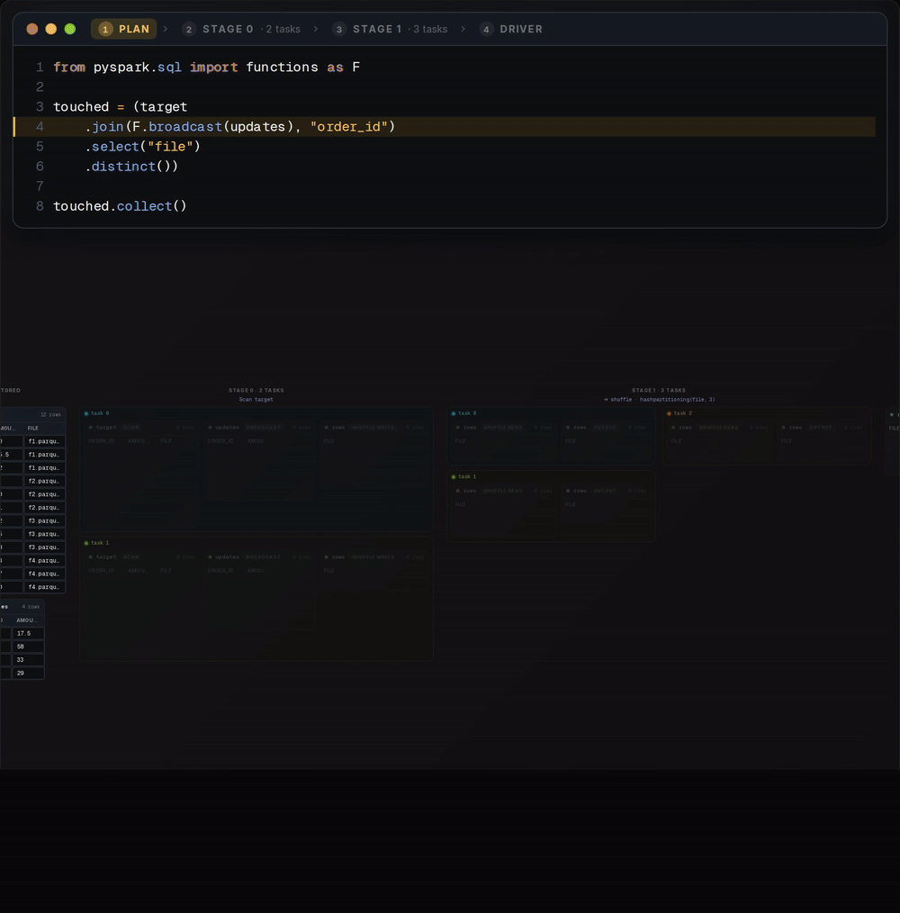

Advanced·Spark · 15 min · 14 challenges

# Storage Formats: Advanced

Take a Netflix data engineer whose nightly job rewrites a week of viewing history while analysts are mid-query. When a table is only a directory of Parquet files, a query that lists it during the rewrite can count rows twice or miss them. Netflix built Iceberg so a rewrite like that lands as 1 atomic commit.


<br>

---

## Where Raw Parquet Runs Out

A Parquet file is well built: columns stored together, row groups carrying min and max stats, and a footer that lets Spark skip whatever a query does not need. A table makes a bigger promise than a file, and a directory cannot keep it. After `df.write.parquet("/lake/orders")`, the table later readers see is whatever a listing of that directory returns at the moment they look. Nothing records which files belong together, which write produced them, or whether that write finished.

That arrangement holds while 1 job writes and nobody reads during the write. Production breaks both conditions every day: a nightly load runs while dashboards query, a backfill overlaps the regular load, and a privacy request asks you to delete 1 customer from 3 years of files.


<br>

### The overwrite that deletes first

Take a job that rebuilds the whole `orders` directory with `mode("overwrite")`. Spark runs a file overwrite in 2 steps: it deletes the files already at the path, then runs the write job. That job stages each task's output under a hidden `_temporary` directory and moves it into place only after every task has finished. Spark skips paths whose names begin with _ when it reads a directory, so staged files stay invisible.

```sql
orders = spark.read.parquet("/lake/raw/orders")

(orders
    .dropDuplicates(["order_id"])
    .write
    .mode("overwrite")
    .parquet("/lake/orders"))
```

Now let the job fail near the end, after 1 task has used up its retries. The old files are already gone. The new ones sit under `_temporary`, which readers skip. Every dashboard on `/lake/orders` reads an empty table until someone reruns the job, and nothing in the directory says which run was the last good one.


<br>

### 6 gaps between a folder and a table

That failure is one case of a general shortage. Each row below names a guarantee a database table gives and how a directory of Parquet files falls short of it.

| Guarantee | What a Parquet directory does | Where it bites |
| --- | --- | --- |
| Atomic commit | Files appear one by one as the job commit moves them into place | A crash mid-commit leaves part of a write visible |
| Isolation | A reader lists the directory once and reads what is there | A query listing between a hand-run compaction's write and its delete counts rows twice |
| Conflict check | Nothing notices a write that landed in between | Two overwrites of 1 partition can leave both jobs' files in it |
| Row-level change | Files are immutable, so any edit means rewriting whole files yourself | Deleting 1 customer means finding and rewriting every file holding them |
| One schema | Each file carries its own schema in its footer | A job writes amount as a string, and reads of those files fail |
| History | Overwrites and deletes destroy the previous files | Last Tuesday's report cannot be rerun on last Tuesday's data |


<br>

### A seventh gap: planning time

The last gap costs time. To plan a query on a partitioned path, Spark lists its partition directories, all of them when it reads the path directly, and on an object store each listing call is a network round trip. With 5 years of daily partitions, that is more than 1,800 directories to list before any task starts. Footer stats help only once a task has opened a file, so a filter on a non-partition column still opens the footer of every file.

> The root of all 7 gaps
>
> The directory listing is the only record of what the table contains. The rest of this lesson replaces that listing with a log that writers append to and readers trust, and each guarantee in the table follows from that replacement.

**The rebuild above gets further this time: every task finishes, and the job commit has moved 30 of 80 staged files into /lake/orders when the driver crashes. What does a query on the path return?**

- **A.** Every new row: the remaining 50 files finish moving when Spark restarts the application
- **B.** Only the rows in the 30 moved files, with no error and no sign that 50 are missing
- **C.** The old rows, because a commit that does not finish rolls back the earlier delete
- **D.** Only the rows in the 30 moved files, plus a warning listing the 50 files still staged

<details>
<summary>Solution</summary>

**B.** Only the rows in the 30 moved files, with no error and no sign that 50 are missing

The old files were deleted before the write, the 30 moved files are ordinary files in the directory, and the other 50 are still hidden under _temporary. Readers get a partial table that looks complete.

**Why the others are wrong**

- **A.** A new application knows nothing about the old job's staged output. The 50 files stay under _temporary, which readers skip.
- **C.** The delete ran before the write job and kept no copy, so there is nothing to roll back to.
- **D.** The rows are right but no warning exists. A reader sees a directory of Parquet files and has no record of how many there should be.

</details>


<br>

---

## The Transaction Log

A table format adds 1 directory beside the data files: a log of numbered commits. In Delta the log lives in `_delta_log/`, and each commit is a JSON file named for its version: `00000000000000000000.json` is version 0, `00000000000000000001.json` is version 1. The log defines the table. A data file that no commit adds is invisible, whatever a directory listing says.


<br>

### What a commit holds

A commit is a list of actions. An `add` names a data file joining the table, with its size and per-column stats. A `remove` names a file leaving it. A `metaData` action carries the schema and partition columns, and `commitInfo` records the operation. Below is version 2 of the running example, a DELETE that dropped 10 rows from `part-001.parquet`:

```sql
[
  {
    "commitInfo": {
      "operation": "DELETE",
      "timestamp": 1710513045000
    }
  },
  {
    "remove": {
      "path": "part-001.parquet",
      "dataChange": true
    }
  },
  {
    "add": {
      "path": "part-003.parquet",
      "size": 41210,
      "dataChange": true,
      "stats": "{\"numRecords\":340,\"minValues\":{\"order_id\":1201},\"maxValues\":{\"order_id\":1890}}"
    }
  }
]
```

The DELETE left `part-001.parquet` untouched on disk. It wrote `part-003.parquet` holding the 340 surviving rows and recorded the swap. Every edit to the table works this way, as new files plus log entries, because a Parquet file is never modified after it is written.


<br>

### The directory versus the table

Files in the directory

| path | in the log |
| --- | --- |
| part-000.parquet | added v0, removed v3 |
| part-001.parquet | added v0, removed v2 |
| part-002.parquet | added v1, removed v3 |
| part-003.parquet | added v2 |
| part-004.parquet | added v3 |
| part-005.parquet | never |

Files in the table at version 3

| path | records |
| --- | --- |
| part-003.parquet | 340 |
| part-004.parquet | 520 |

Of the 6 files on disk, 2 make up the table. `part-005.parquet` came from a job that crashed before committing, so no reader ever sees it. This is what makes a write atomic: data files go down first and stay invisible, and creating the next commit file publishes all of them at once.


<br>

### One writer wins each version

Nothing stops 2 writers from finishing their data files at the same moment and both trying to create version 4. Exactly 1 must succeed, which takes an atomic create-if-absent on the commit file's name. Where the storage cannot do that, the format routes commits through a lock or a catalog service that hands out versions. What the loser does next is the subject of the next section.


<br>

### Replaying the log

A reader rebuilds the table's state by keeping, for each file path, its newest action across all commits: a path whose newest action is `add` is live, and one whose newest action is `remove` is gone. The Delta protocol calls this action reconciliation. The animation replays the 4 commits of the running example: a `groupBy` on `path` finds each file's newest version, and a join brings back the action recorded there.



The `groupBy` is the only shuffle, since every action for a path has to reach 1 task before its newest version is known. The join wraps `log_actions` in `F.broadcast`, a few rows here, so it adds no shuffle. On a table with millions of files that shuffle is real work, which is why the log gets checkpointed.

Every 10 commits by default (`delta.checkpointInterval`), the writer saves the reconciled state as a Parquet checkpoint, and a `_last_checkpoint` file points at the newest one. A reader loads that checkpoint and replays only the JSON commits after it: at version 1,234, the checkpoint from version 1,230 plus 4 commits.

The `stats` in each `add` pay off at planning. For a filter such as `order_id = 1500`, Spark compares the value against every live file's min and max from the log and drops files that cannot match, with no directory listing and before any task is scheduled. Delta collects these stats for the first 32 columns by default. In the SQL tab of the Spark UI, the scan node's `number of files read` shows how many files survived.

> **TIP**
>
> Keep frequently filtered columns among the first 32 of the schema, or raise `delta.dataSkippingNumIndexedCols`. A filter on column 40 gets no skipping from the log, only the row-group stats inside each file Spark still opens.

The same latest-wins rule rebuilds current state from any change history. `listing_attribute_changes` records each edit to a listing's attributes with an increasing `change_seq`. Run the cell: it keeps each listing and attribute pair's highest `change_seq`, joins back for the value, and shows the result.



```python
from pyspark.sql import functions as F

changes = spark.table("listing_attribute_changes").where(
    F.col("listing_ref").isNotNull() & F.col("attr_name").isNotNull()
)

newest = changes.groupBy("listing_ref", "attr_name").agg(
    F.max("change_seq").alias("change_seq")
)

current = newest.join(changes, ["listing_ref", "attr_name", "change_seq"])

(current
    .select("listing_ref", "attr_name", "attr_value", "op")
    .orderBy("listing_ref", "attr_name")
    .show())
```

The join is where the latest-wins rule is enforced. `F.max("change_seq")` finds the newest change for each pair, but the aggregate keeps no `attr_value`, so a join has to bring the value back. Joining on `listing_ref` and `attr_name` alone would match every change ever made to the pair and return its whole history. Adding `change_seq` to the join columns lets only the newest change's row through. The log replay above does the same thing with `path` and `version`.

**Suppose the cell above joins newest back to changes on listing_ref and attr_name only, dropping change_seq. What does current hold?**

```python
current = newest.join(changes, ["listing_ref", "attr_name"])
```

- **A.** One row per pair, holding its newest value
- **B.** An error, since both sides carry change_seq
- **C.** Every change made to each pair, newest included
- **D.** Every change made to each pair, newest one first

<details>
<summary>Solution</summary>

**C.** Every change made to each pair, newest included

Each newest row matches every changes row for its pair, so the whole history comes back.

**Why the others are wrong**

- **A.** changes has 1 row per edit, so each pair matches all of them.
- **B.** The select never names change_seq, so nothing is ambiguous.
- **D.** The rows are right, but orderBy sorts by pair only, not by recency.

</details>


<br>

---

## ACID and Time Travel

With the log as the table, each property a database promises becomes a rule about commits. Atomicity comes from the single commit file and durability from storing it durably. Isolation and consistency between writers come from how readers pick a version and how writers claim the next one.


<br>

### Readers pin a snapshot

A query resolves the table once, at planning: it reads the newest commit, say version 2, and fixes the list of files that version names. Every task in the query reads from that list for as long as the query runs. This is snapshot isolation: a query sees the table as of 1 committed version and never sees a write halfway applied.

Follow it through the running example. A report plans against version 2 and is handed `part-000.parquet`, `part-002.parquet` and `part-003.parquet`. Midway, a compaction commits version 3, removing `part-000.parquet` and `part-002.parquet` and adding `part-004.parquet`. The report keeps reading `part-000.parquet` without error, because a `remove` only writes a log entry. The file stays on disk until a cleanup deletes it, and the cleanup waits out a retention window first.

Version 2: what the report reads

| file | records |
| --- | --- |
| part-000.parquet | 400 |
| part-002.parquet | 120 |
| part-003.parquet | 340 |
| total | 860 |

Version 3: what a new query reads

| file | records |
| --- | --- |
| part-003.parquet | 340 |
| part-004.parquet | 520 |
| total | 860 |

Both versions hold 860 rows: version 3 packed 400 and 120 rows into 1 file of 520 without changing a value. The log flags such commits with `dataChange: false`.


<br>

### Writers race optimistically

Writers hold no lock while they work. Each records the version it started from, writes its data files, and then tries to create the next commit. If that version is taken, it reads the commits that beat it and runs 2 checks. Did any of them remove or rewrite a file it read? Did any of them add files inside the data it read, such as a partition its filter selected? If both answers are no, it retries the commit at the following version, reusing the data files it already wrote. If either is yes, committing would act on a table it never saw, and it fails with a concurrent modification error. So a delete of `order_date = '2024-03-01'` fails when another job appends into that partition first, because the new rows match its filter and the delete would skip them. When 2 blind appends hit 1 table, both commit, since neither reads anything.

**Two jobs start from version 7 of orders, partitioned by order_date. Job A appends files to order_date=2024-03-15 while Job B deletes rows where order_date is 2024-03-01, and A commits version 8 first. What happens to Job B?**

- **A.** It fails, because any commit between its start and its own commit invalidates its snapshot
- **B.** It overwrites version 8, and the files Job A appended disappear from the table
- **C.** It waits for a lock that Job A held during its write, then commits as version 8
- **D.** It reads version 8, sees A only added files in a partition B never read, and commits as version 9

<details>
<summary>Solution</summary>

**D.** It reads version 8, sees A only added files in a partition B never read, and commits as version 9

B's delete read only the 2024-03-01 files, and version 8 touched none of them, so there is no conflict. B retries the commit itself as version 9.

**Why the others are wrong**

- **A.** Formats check what the intervening commit touched before failing a writer. Failing on every intervening commit would make 2 jobs on 1 table fail constantly.
- **B.** Versions are claimed with create-if-absent, so B cannot replace version 8. A's files stay in the table.
- **C.** Neither job held a lock; both worked in parallel. B finds version 8 taken only when it tries to commit.

</details>


<br>

### Reading an old version on purpose

Replaying the log only up to version N gives the table exactly as version N left it. Spark exposes that as a read option on the format:

```sql
path = "/lake/orders"

v1 = spark.read.format("delta").option("versionAsOf", 1).load(path)
latest = spark.read.format("delta").load(path)

removed = v1.join(latest, "order_id", "left_anti")
```

`timestampAsOf` takes a time instead and resolves to the newest version committed at or before it. Use either to rerun last Tuesday's report on last Tuesday's data, to audit what a bad job changed, or to roll back by committing an old version's file list as a new version.


<br>

### How far back you can go

Time travel needs 2 pieces to survive: the log entries for the version and the data files they name. Delta keeps log entries for 30 days by default (`delta.logRetentionDuration`), and its `VACUUM` command deletes data files that were removed from the table more than 7 days ago (`delta.deletedFileRetentionDuration`). Retention is a storage budget: a table fully rewritten every day keeps about 1 extra copy of itself per retained day, and once a version's files are vacuumed, reading it fails even while its log entries remain.

On the change history from the last section, time travel is the same replay stopped early. Run the cell: it rebuilds the listings as of the midpoint of their history and as of the newest change, then lines the 2 up so you can spot values that moved.



```python
from pyspark.sql import functions as F

key = ["listing_ref", "attr_name"]
history = spark.table("listing_attribute_changes").dropna(subset=key)

span = history.agg(
    F.min("change_seq").alias("lo"), F.max("change_seq").alias("hi")
)
cut = span.select(F.floor((F.col("lo") + F.col("hi")) / 2).alias("cut"))

def replay(changes, label):
    newest = changes.groupBy(key).agg(F.max("change_seq").alias("change_seq"))
    return newest.join(changes, key + ["change_seq"]).select(
        *key, F.col("attr_value").alias(label)
    )

upto_mid = history.crossJoin(cut).where(F.col("change_seq") <= F.col("cut"))

then = replay(upto_mid, "value_at_mid")
now = replay(history, "value_now")

now.join(then, key, "left").orderBy(*key).show()
```


<br>

---

## Schema Evolution

In a plain directory each Parquet file carries its own schema and nothing reconciles them. A table format keeps 1 schema in the log's `metaData` action and gives it 2 jobs. It enforces: a write whose columns or types disagree with the logged schema is rejected before it commits, so a job that starts writing `amount` as a string fails loudly and the table stays clean. It also evolves: a schema change is itself a commit, and the format's rules decide which changes cost only that commit and which force a rewrite.


<br>

### Adding a column costs 1 commit

Add `discount` to `orders` and the format writes a new schema to the log and rewrites no files. Old files have no `discount` column, so readers fill null for their rows, while new files carry real values. A table of 50,000 files gains the column in the time it takes to write 1 commit.


<br>

### Widening reads old bytes as a bigger type

- **2,147,483,647** — largest value an INT column holds

A table whose `order_id` is running out of `INT` can widen the column to `BIGINT`. Old files keep their 4-byte integers and the reader upcasts each value as it decodes it, which is safe because every old value fits the new type. Formats that support widening allow changes such as `INT` to `BIGINT`, `FLOAT` to `DOUBLE`, and `DECIMAL` to a larger precision at the same scale. Narrowing, or a change across type families such as `STRING` to `INT`, can fail on a value already stored, so it means rewriting every file.


<br>

### Rename and drop: names versus IDs

Parquet readers match columns by name by default, and that makes renames dangerous. Rename `amt` to `amount` in the logged schema, and a by-name reader opening an old file looks for `amount`, finds no such column, and returns null for every old row. The query succeeds, and nothing reports that the column's history is gone.

The fix gives each column a permanent ID. Iceberg assigns every column a field ID, writes the same ID into each Parquet file's schema, and matches on the ID when reading. Delta does the equivalent once column mapping is on (`delta.columnMapping.mode = 'name'`), keeping a fixed physical name under each logical one. With either, a rename changes only the log.

An old file read by name

| column asked for | column in file | value read |
| --- | --- | --- |
| order_id | order_id | 1201 |
| amount | no match | null |

The same file read by ID

| column asked for | column in file | value read |
| --- | --- | --- |
| order_id (ID 1) | order_id (ID 1) | 1201 |
| amount (ID 2) | amt (ID 2) | 18.50 |

IDs make drops safe too. Drop `amt`, later add a different column that happens to be called `amt`, and a by-name reader resurrects the old values from old files under the new column. Matched by ID, the new column gets a fresh ID such as 7, old files only hold ID 2, and the new column reads null for them.

**A table matches Parquet columns by name. An engineer renames amt to amount with a metadata-only change, then sums amount over the whole table. What comes back?**

- **A.** A total covering only rows written after the rename, with no error
- **B.** An error, because the old files have no column named amount
- **C.** The correct total, because the rename updated the column name inside each file
- **D.** A total of only new rows, plus a warning naming files that lacked the column

<details>
<summary>Solution</summary>

**A.** A total covering only rows written after the rename, with no error

Old files have no column called amount, so their rows read as null and the sum skips them. The number looks plausible, which is why this failure goes unnoticed.

**Why the others are wrong**

- **B.** A by-name reader treats a missing column as null, the same rule that makes adding a column cost nothing. No error is raised.
- **C.** A metadata-only change rewrites no file. The old files still call the column amt.
- **D.** The total is right, but nothing warns you. A missing column is a normal case for a by-name reader, so it fills null quietly.

</details>

| Schema change | Files rewritten | Old rows read as |
| --- | --- | --- |
| Add a column | None | null |
| Widen INT to BIGINT | None | the old value, upcast |
| Rename, matched by ID | None | the old value |
| Rename, matched by name | None | null, with no error |
| Drop a column | None | hidden from readers |
| Narrow, or change type family | Every file | the rewritten value |

A table reads its files the way `unionByName` combines 2 DataFrames: columns pair up by name in any order, and an `INT` meeting a `BIGINT` comes out as `BIGINT`. In the cell, the older batch stands in for files written before `platform` existed, so it carries `platform` as an explicit null, which is what a reader fills for old files. The newer batch lists its columns in a different order. Run the cell and check `platform` on the rows marked `before`.



```python
from pyspark.sql import functions as F

older = (spark.table("push_notifs")
    .select(
        "notif_id",
        "user_id",
        "status",
        F.lit(None).cast("string").alias("platform"),
        F.lit("before").alias("batch"))
    .limit(3))

newer = (spark.table("push_notifs_2fa")
    .select(
        "platform",
        "status",
        F.col("user_id").cast("bigint").alias("user_id"),
        "notif_id",
        F.lit("after").alias("batch"))
    .limit(3))

older.unionByName(newer).show()
```

The call makes 2 choices that decide whether the rows line up. `unionByName` matches columns by name, which is why the newer batch's reordered columns still land correctly. Plain `union` matches by position and would put `platform` values under `notif_id`. Passing `allowMissingColumns=True` makes `unionByName` fill null for a column one side lacks, the step the cell wrote out by hand. Without the flag, the call fails as soon as one side is missing a column.


<br>

---

## Delta, Iceberg, or Hudi

All 3 formats give the previous sections' guarantees: atomic commits over immutable Parquet files, snapshot reads, time travel and schema evolution. They differ in how the metadata is laid out, which decides 3 properties: how planning scales with file count, how row updates get written, and how many engines can share a table.


<br>

### 3 ways to lay out metadata

| Aspect | Delta | Iceberg | Hudi |
| --- | --- | --- | --- |
| Metadata | Ordered JSON commits plus Parquet checkpoints | A tree: metadata file, manifest list, manifests | A timeline of instants in a .hoodie folder |
| A version is | An integer commit number | A snapshot ID | An instant, keyed by commit time |
| A commit is | Creating the next numbered file | Swapping the catalog's pointer to a new metadata file | Completing an instant on the timeline |
| Row updates | File rewrites, or deletion vectors that mark rows removed | File rewrites, or delete files (format v2) | Copy-on-write or merge-on-read, set per table |
| Built for | Spark-centric batch and merge work | Huge tables shared by several engines | Keyed upserts and pulling only changed rows |


<br>

### Iceberg's tree and why it scales

Iceberg's metadata is a tree, so it has no log to replay. The catalog holds a pointer to the current metadata file, which names the current snapshot's manifest list. The manifest list names manifests and records the range of partition values each covers, and each manifest lists data files with their column stats. Planning walks down the tree and skips whole manifests whose range misses the filter, so its work follows the files a query might need, while a log replay starts from an entry for every live file.



The tree also allows partition evolution. Iceberg partitions by transforms of a column, such as `days(order_ts)`, and each manifest records the spec its files were written with. Switch from daily to hourly and new files use the new spec while old files keep theirs; a filter on `order_ts` prunes both, and nothing is rewritten. Queries filter on `order_ts` itself and never name a partition column, which Iceberg calls hidden partitioning.


<br>

### Copy-on-write versus merge-on-read

Formats also split on how a row update is written. Copy-on-write rewrites every file holding an updated row: writes pay, and reads stay plain Parquet scans. Merge-on-read writes only the change, as delete markers or small log files beside the base files, and every read merges them in until a compaction folds them back. Either way, finding the files to touch is a job of its own. Delta's MERGE starts with an inner join of the updates against the table that collects the names of the files holding a match:



The join broadcasts `updates`, so the only shuffle is the `distinct` on `file`. The 4 changed rows hit 3 of the 4 files, and copy-on-write rewrites all 9 rows in them. Scaled up, 1,000 updated keys scattered over 200 files of 128MB each is 25.6GB rewritten for a few kilobytes of change, on every run.

Hudi was built around that trade. A record-level index maps each key to the file group holding it, a merge-on-read table appends updates to that group's log files, and compaction later merges them into a new base file. Commit times on the timeline also let a downstream job read only rows changed since the last commit it processed.


<br>

### Choosing and defending it

| If the platform... | Lean toward | Because |
| --- | --- | --- |
| Runs nearly all reads and writes on Spark, with appends and periodic merges | Delta | Simplest log, and checkpoints keep replay short |
| Shares tables across several query engines, or holds millions of files | Iceberg | Engine-neutral spec, manifests that prune at planning |
| Changes its partitioning as data grows | Iceberg | Partition evolution with no rewrite of old files |
| Upserts keyed rows every few minutes and feeds jobs that want only changes | Hudi | Record index, merge-on-read, incremental reads by commit time |

A defence names the workload, the cost the choice avoids, and the cost it accepts. For instance: 'Hudi merge-on-read, because 40 source databases upsert every 5 minutes and copy-on-write would rewrite most files each run; we accept that reads merge log files, and we run compaction hourly to keep that merge small.' Each part of it can be checked against the job's metrics.

**A team runs 3 engines on the same tables: Spark writes them hourly, a SQL engine serves dashboards, and a separate service reads features for model training. The largest table holds 4 million files, rows are appended and rarely updated, and the team plans to move from daily to hourly partitions. Which format fits best?**

- **A.** Delta, because the writer is Spark and the checkpoint keeps log replay short
- **B.** Hudi merge-on-read, because hourly writes need log files to stay cheap
- **C.** Iceberg, because its spec is engine-neutral, manifests prune 4 million files and partitions evolve in place
- **D.** Iceberg, because it is the only format of the 3 that accepts appends from Spark

<details>
<summary>Solution</summary>

**C.** Iceberg, because its spec is engine-neutral, manifests prune 4 million files and partitions evolve in place

Each requirement maps to an Iceberg design point: the open spec for 3 engines, manifest pruning at planning, and partition evolution without a rewrite.

**Why the others are wrong**

- **A.** The writer fits, but 2 other engines read these tables and the partition change would mean rewriting old data. Neither is where Delta's design is strongest.
- **B.** Merge-on-read pays off for frequent updates to existing rows. These tables are append-only, so its log files and compaction add work for no gain.
- **D.** The format is right but the reason is wrong: all 3 formats take appends from Spark. Engine sharing, file count and partition evolution decide it.

</details>


<br>

---

## Putting It All Together

Uber built Hudi to bring upserts and incremental processing to its data lake: tables such as trips keep changing after their rows first land, and downstream jobs needed to consume only the changed rows instead of rescanning whole partitions on every run.

- Upserting by key into plain Parquet partitions would mean overwriting whole partitions each run, with readers seeing them empty or partial mid-write: the gaps from the first section.
- Each upsert batch lands as 1 commit on Hudi's timeline, so a downstream job reads a consistent snapshot even while the next batch is being written.
- Commit times on that timeline double as time travel: a job can read the table as of the last instant it processed and pull only rows changed since.
- A new trip attribute arrives as an added column, which costs 1 schema commit and reads as null for older rows.
- Merge-on-read keeps frequent row updates cheap at the price of scheduled compaction, the same trade the format comparison weighs.


<br>

---

## Key Takeaways

- A directory of Parquet files lacks atomic commits, isolation, conflict checks, row edits, a single schema and history, because the listing is its only record.
- A table format's log is the table: a file is live when its newest action is an add, and creating the next commit file publishes a whole write at once.
- Readers pin 1 version at planning and read its file list to the end; writers commit optimistically and fail only when an intervening commit changed files they read.
- Time travel replays the log to an earlier version and works only while both its log entries and its data files outlive retention.
- Adding and widening columns cost 1 commit; renames and drops are safe only when readers match columns by ID.
- Choose Delta, Iceberg or Hudi from the workload: how many engines share the table, how many files it holds, and how often its rows get updated.
