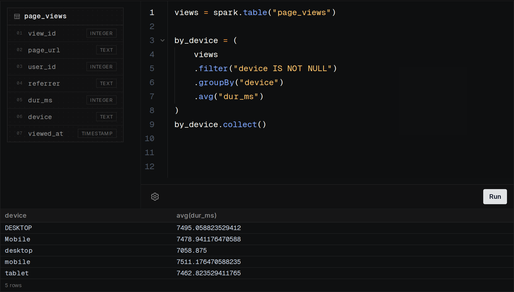
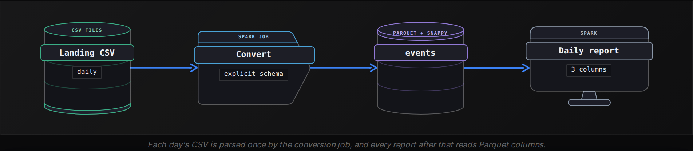
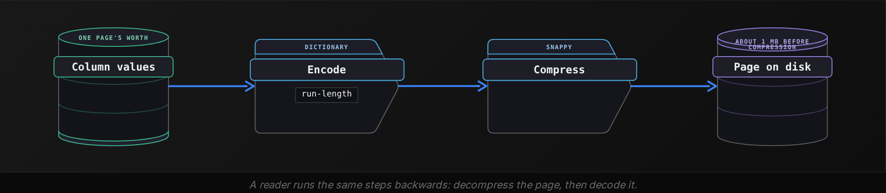

Beginner·Spark · 13 min · 10 challenges

# Storage Formats: Beginner

Parquet 1.0 came out of Twitter and Cloudera in 2013. It's a file format that stores a table column by column. A Twitter analyst counting how many tweets went out in each language yesterday needs only the language field, even though every tweet record carries dozens of fields. Whether Spark pulls every field off disk or that single column decides whether the job finishes before lunch.


<br>

---

## Rows vs Columns

Most analytical queries touch a handful of columns across millions of rows: total revenue by country, average session length by device. For storage, what matters is which bytes sit next to each other on disk, because a scan reads contiguous runs of bytes and pays for every byte it passes over.


<br>

### One table, two byte orders

Take 4 rows of a clickstream table called `events`. As a table they look like this:

| event_id | user_id | country | event_type | dur_ms |
| --- | --- | --- | --- | --- |
| 1001 | 48211 | BR | click | 5120 |
| 1002 | 48211 | BR | scroll | 870 |
| 1003 | 30777 | US | click | 2310 |
| 1004 | 91002 | IN | purchase | 15400 |

A file has to put these 20 values in a single sequence. A row-oriented file writes every field of row 1 before it starts on row 2. CSV and line-delimited JSON work this way. A column-oriented file writes all 4 values of `event_id` before any value of `user_id`, and carries on column by column through `dur_ms`.

Row layout: file order

| block | values |
| --- | --- |
| row 1 | 1001, 48211, BR, click, 5120 |
| row 2 | 1002, 48211, BR, scroll, 870 |
| row 3 | 1003, 30777, US, click, 2310 |
| row 4 | 1004, 91002, IN, purchase, 15400 |

Column layout: file order

| block | values |
| --- | --- |
| event_id | 1001, 1002, 1003, 1004 |
| user_id | 48211, 48211, 30777, 91002 |
| country | BR, BR, US, IN |
| event_type | click, scroll, click, purchase |
| dur_ms | 5120, 870, 2310, 15400 |

Now run a query that needs 2 columns: the average `dur_ms` per `country`.

```sql
events.groupBy("country").avg("dur_ms").collect()
```

In the row layout, the country of row 3 sits between that row's `user_id` and `event_type`, and its `dur_ms` comes right after. The wanted values are scattered through every block, so the scan reads every block and discards 3 fields out of 5. In the column layout, the wanted values fill the `country` block and the `dur_ms` block, which sit contiguously, and the scan never touches the other 3.


<br>

### How rows come back together

Splitting a table into column blocks loses nothing about which values belong together. The 3rd value in the `country` block and the 3rd value in the `dur_ms` block both belong to row 3, so the reader rebuilds rows by position: `(US, 2310)` for row 3. Spark receives ordinary rows holding only the 2 requested columns, and the rest of the job runs as it would on any DataFrame.


<br>

### Why the scan cannot hop over fields

Disks and object stores serve reads as ranges of bytes, and each request carries a fixed delay before its first byte arrives. Picking `country` out of a row file would take 1 small request per row, billions of them, each paying that delay. Reading the whole file in order is cheaper than that, so a row-oriented scan always reads everything. A column file turns the same need into a few large requests, 1 per column block.


<br>

### At production scale

Suppose the real `events` table has 30 columns of roughly equal width and 20 billion rows, and the daily report needs `country` and `event_type` along with `dur_ms`. A row-oriented scan reads all 30 columns of every row. A columnar scan fetches the 3 column blocks the report names and leaves the rest on disk.

- **27** — columns per row read only to be dropped
- **10x** — fewer bytes read by the columnar scan


<br>

### What rows are still good for

| ✓ Row layout wins when | ✗ Column layout wins when |
| --- | --- |
| • A program writes or reads a whole record at a time<br><br>• An application looks up a single order by its id<br><br>• Records arrive one by one and must land immediately<br><br>• A partner system expects a file it can open in a text editor | • A query aggregates a few columns over many rows<br><br>• Tables are wide and most queries use a small slice<br><br>• Data is written once in bulk and read many times<br><br>• Storage size and scan time drive the bill |

> **TIP**
>
> Values in a column block share a type and often repeat: every `country` is one of a few hundred codes. Keeping them side by side lets a columnar file shrink them far more than a row file can, and the next section shows how, byte by byte.

**A 40-column table with columns of roughly equal width is stored once as CSV and once in a columnar format. A query averages 1 column grouped by another. Roughly how much of each file does the scan read?**

- **A.** Both read about 5% of the file, because Spark parses only the 2 columns the query names
- **B.** The CSV scan reads all of it, and the columnar scan reads 2 of 40 column blocks, about 5%
- **C.** The columnar scan reads all of it, because columnar files must be read whole to rebuild rows
- **D.** Both read all of it, because storage cannot serve bytes from the middle of a file

<details>
<summary>Solution</summary>

**B.** The CSV scan reads all of it, and the columnar scan reads 2 of 40 column blocks, about 5%

The CSV interleaves all 40 fields on every line, so every byte is read. The columnar file keeps each column contiguous, so only 2 blocks are fetched.

**Why the others are wrong**

- **A.** Spark can skip converting unused CSV fields, but it still reads every byte of every line to find where the 2 fields start.
- **C.** Rows are rebuilt by position from the requested columns alone, so the other 38 blocks are skipped.
- **D.** Storage serves any byte range. Skipping fails in the row file only because the wanted fields are scattered across it.

</details>


<br>

---

## Inside Parquet

Parquet is the columnar format Spark writes by default. Beyond column blocks, a Parquet file cuts its rows into groups, splits each column into pages, records every column's type, and ends with a map of where everything sits. Each of those pieces exists so that a reader can fetch fewer bytes.


<br>

### The parts of a file, front to back

| Part | What it holds | Default size |
| --- | --- | --- |
| Magic bytes | The 4 characters `PAR1`, marking the file as Parquet | 4 bytes |
| Row group | A horizontal slice of the rows, stored column by column | About 128 MB |
| Column chunk | One column's values for one row group | Varies by column |
| Page | A slice of a column chunk, encoded and compressed as a unit | About 1 MB |
| Footer | Schema, row counts, and the offset and size of every column chunk | Usually KB |
| Footer length + `PAR1` | The footer's size in bytes, then the magic bytes again | 8 bytes |

A file with 2 row groups and 3 columns therefore holds 6 column chunks. The first slice of rows has its own `event_id` chunk next to the `country` and `dur_ms` chunks, and the second slice repeats that set. Row groups exist because a writer buffers a whole row group in memory before writing it out, and because they give readers natural places to split a large file among several tasks.


<br>

### The footer is read first

A reader opens a Parquet file at the end. The last 8 bytes give the footer's length, 1 more read fetches the footer, and from then on the reader knows the schema and the exact byte range of every column chunk. Here is what the footer of a small `events` file records for 3 of its columns:

| Row group | Column | Starts at byte | Size in bytes |
| --- | --- | --- | --- |
| 0 | event_id | 4 | 41,200,000 |
| 0 | country | 41,200,004 | 2,100,000 |
| 0 | dur_ms | 43,300,004 | 18,700,000 |
| 1 | event_id | 62,000,004 | 40,900,000 |
| 1 | country | 102,900,004 | 2,050,000 |
| 1 | dur_ms | 104,950,004 | 18,400,000 |

To read `country` alone, Spark requests 2 byte ranges, starting at byte 41,200,004 and byte 102,900,004: about 4.15 MB from a file of about 123 MB. Without the footer it would have to read the file front to back to find where `country` begins. The `country` chunks are small because 2-letter codes repeat, which the encodings below take advantage of.


<br>

### The schema travels with the data

The footer stores each column's name and type: `event_id` as a 64-bit integer, `country` as a string, `dur_ms` as a 32-bit integer. Spark reads those types instead of guessing them, so a Parquet read never needs the extra pass over the data that `inferSchema` costs on CSV, and an integer stays an integer from the job that wrote it to every job that reads it.


<br>

### Encodings: repeats stored once

Before any compression, Parquet encodes each column chunk to exploit how its values repeat. The writer tries dictionary encoding first: it builds 1 dictionary per column chunk, a list of that chunk's distinct values, and stores it as a dictionary page ahead of the chunk's data pages. Every data page then holds small integer codes that point into that single dictionary. If the dictionary grows past its size limit, about 1 MB by default, the writer stops using it and writes the chunk's remaining pages in plain encoding. A high-cardinality column like `event_id` therefore ends up mostly plain.

country as written

| row | country |
| --- | --- |
| 1 | BR |
| 2 | BR |
| 3 | US |
| 4 | BR |
| 5 | IN |
| 6 | BR |
| 7 | BR |
| 8 | US |

country's dictionary

| code | value |
| --- | --- |
| 0 | BR |
| 1 | US |
| 2 | IN |

The 8 rows become the codes `0 0 1 0 2 0 0 1`. In plain form Parquet stores each string as a 4-byte length plus its characters, so `BR` takes 6 bytes. With 200 distinct countries a code needs 8 bits, so each value drops to 1 byte. Where the same code repeats many times in a row, as when the data is sorted by country, run-length encoding stores the code once with a count: a run of 50,000 `BR` rows becomes 2 numbers.

What each piece buys a reader

- **Footer** *Read first*\
  Gives the byte range of every column chunk, so the reader fetches only what it needs.
- **Column chunks** *One per column per row group*\
  Keep each column contiguous, so skipping a column skips its bytes.
- **Row groups** *About 128 MB*\
  Let several tasks share a large file, each reading its own row groups.
- **Pages** *About 1 MB*\
  The unit of encoding and compression, small enough to decode in memory.
- **Schema** *Stored in the footer*\
  Types arrive with the data, with no inference pass.

> **TIP**
>
> Spark writes one Parquet file per partition of the DataFrame, named like `part-00000-<uuid>-c000.snappy.parquet`. A DataFrame with 2,000 tiny partitions writes 2,000 tiny files, each with its own footer to open: the small-files problem in Parquet form.

**Spark opens a 1 GB Parquet file to read 1 of its 25 columns. What does it read first?**

- **A.** The first row group, to learn the column names from its first page
- **B.** The whole file, because column chunks can start anywhere and must be found by scanning
- **C.** The magic bytes at the start, which list where each column chunk begins
- **D.** The last 8 bytes, which give the footer's length, then the footer with every chunk's offset

<details>
<summary>Solution</summary>

**D.** The last 8 bytes, which give the footer's length, then the footer with every chunk's offset

The footer is the map. Once it is read, Spark fetches the byte ranges of that column's chunks and leaves the other 24 columns on disk.

**Why the others are wrong**

- **A.** Row groups hold values only. Names and types live in the footer at the end of the file.
- **B.** Chunks can start anywhere, but the footer records each one's offset, so no scan is needed.
- **C.** The leading PAR1 only marks the format. The offsets are in the footer.

</details>


<br>

---

## Column Projection

Projection is the list of columns a query keeps. With a Parquet source, Spark hands that list to the file reader, which turns it into byte-range requests for the matching column chunks. Columns left out of the list are never fetched or decoded, and they take no executor memory.


<br>

### Catalyst writes the column list for you

The job below never calls `select`. It filters on `event_type` first, then groups on `country` and sums `dur_ms`. When Catalyst rewrites the plan, it traces which columns each step uses and moves that list into the scan, so only 3 of the 30 columns are read.

```sql
events = spark.read.parquet("/data/events/")

report = (
    events
    .filter(events.event_type == "purchase")
    .groupBy("country")
    .sum("dur_ms")
)
report.collect()
```

Run `report.explain()` and find the `FileScan parquet` line of the plan. Its `ReadSchema` entry is the column list the reader received: `struct<country:string,event_type:string,dur_ms:int>`. When a Parquet scan is slower than its column list suggests, this line is the first thing to check: a `ReadSchema` listing all 30 columns means something in the job asked for them.


<br>

### What the narrower read saves downstream

Every later step works on the narrower rows. The `groupBy` above shuffles rows that carry only `country` and `dur_ms`, because the filter has already used up `event_type` before the shuffle. If one of the 30 columns is a long free-text `user_agent`, it stays out of the plan and never crosses the network.


<br>

### Four ways a job loses its projection

Catalyst trims only the columns it can prove are unused. These patterns hide that information or ask for everything:

- select("\*") or collecting a DataFrame that still has every column: the plan really does need all 30.
- events.cache() before narrowing: the cache stores what it was given, so the scan reads all 30 columns to fill it.
- events.rdd.map(...): the lambda is opaque to Catalyst, so every column stays in case the function reads it.
- A CSV or JSON source: Spark can skip converting unused fields, but every byte of every line still comes off storage.

```sql
slim = (
    spark.read.parquet("/data/events/")
    .select("country", "event_type", "dur_ms")
    .cache()
)
slim.filter(slim.event_type == "purchase").groupBy("country").sum("dur_ms").collect()
```

| ✓ Do | ✗ Don't |
| --- | --- |
| • Select the columns a cached or written DataFrame needs before cache() or write<br><br>• Check ReadSchema in explain() when a Parquet scan reads more than you expect<br><br>• Stay in DataFrame operations so Catalyst can see which columns each step uses | • Cache a wide source table whole and narrow it in later steps<br><br>• Drop to .rdd for logic that DataFrame functions can express<br><br>• Expect a select on a CSV source to cut the bytes read from storage |


<br>

### Try it

The cell reads the practice table `page_views`, which has 7 columns, and averages `dur_ms` per `device`. It has no `select`, so the column list comes from Catalyst alone. Before you run it, decide which columns its scan should fetch. Then change `.avg("dur_ms")` to `.agg({"dur_ms": "avg", "view_id": "count"})` and work out how that list should change before the second run.



```python
views = spark.table("page_views")

by_device = (
    views
    .filter("device IS NOT NULL")
    .groupBy("device")
    .avg("dur_ms")
)
by_device.collect()
```

On a Parquet source, the format Spark writes when none is named, the first version's `explain()` shows a `ReadSchema` holding `dur_ms` and `device`: 2 of the 7 columns, with no `select` written anywhere. The second version adds `view_id` to that list, because the count now uses it, and each returned row gains a count beside its average. The column list follows what the plan touches. It holds only while every step is one Catalyst can read, and the next question shows what happens when a step is not.

**The events table has 30 columns. How many of them does the Parquet scan in this program read?**

```python
events = spark.read.parquet("/data/events/")
pairs = events.rdd.map(lambda r: (r.country, r.dur_ms)).collect()
```

- **A.** All 30, because Catalyst cannot see which fields the lambda reads and keeps every column
- **B.** 2, because Catalyst reads the lambda and keeps only country and dur_ms
- **C.** 2, because collect() returns only the fields the lambda puts in its tuples
- **D.** 0, because .rdd reads from the cache and never from the Parquet files

<details>
<summary>Solution</summary>

**A.** All 30, because Catalyst cannot see which fields the lambda reads and keeps every column

After .rdd, the lambda receives full rows. Adding .select("country", "dur_ms") before .rdd brings the scan back to 2 columns.

**Why the others are wrong**

- **B.** Catalyst cannot look inside a Python lambda, so it cannot learn that only 2 fields are used.
- **C.** The tuples are built after the scan. By then all 30 columns have already been read.
- **D.** Nothing here is cached. The .rdd conversion runs the full scan when collect() fires.

</details>


<br>

---

## The Cost of CSV and JSON

Text formats store every value as characters and every row as a line. That makes them readable by anything, and expensive for Spark in 4 ways: more bytes, parsing work, missing types and, once gzipped, a single task per file.


<br>

### More bytes for the same event

Take a single event where `user_id` is 48211 and `country` is BR, with `event_type` set to click and `dur_ms` at 5120. Written as a JSON line, the record repeats every key name:

```sql
{
  "user_id": 48211,
  "country": "BR",
  "event_type": "click",
  "dur_ms": 5120
}
```

As a CSV line it is `48211,BR,click,5120`: the key names move into a header row, but the number 48211 still takes 5 characters at 1 byte each. In Parquet the same event takes about 10 bytes before compression: 4 for each integer and 1 for each dictionary code.

- **67 bytes** — the event as a JSON line
- **38 bytes** — of those spent on key names
- **19 bytes** — the event as a CSV line


<br>

### Parsing every character

To find `dur_ms` in a CSV line, the parser walks every character up to the 3rd comma, because nothing in the file records where a field starts. Then it converts the digits `5120` into an integer a character at a time, checking that each one is a digit. A JSON parser does the same work on braces and quotes, and matches every key name against the schema before it knows which field a value belongs to. Skipping a field on text still means reading past it, so this work grows with the full width of every line.


<br>

### No types, so Spark guesses or reads strings

A CSV file carries no types. Read it without a schema and every column arrives as a string. Turn on `inferSchema` and Spark makes an extra pass over the data to guess types before the real read starts. JSON sources infer a schema by default, with the same extra pass. Passing an explicit schema avoids both costs, and Parquet never needs one because its footer already holds the types.


<br>

### Compressed text is one task per file

Text files are often gzipped to save space. A gzip stream can only be decompressed from its first byte, so Spark cannot split a `.csv.gz` file among tasks: a 20 GB `events.csv.gz` becomes 1 partition read by 1 core while the rest of the cluster waits. A Parquet file compresses page by page and still splits by row group, which the next section explains.


<br>

### The bill, in bytes and hours

Here is the running example priced out. The `events` history is 6 TB of CSV with 30 columns. Its Parquet copy is 1.5 TB. The daily report reads 3 columns, so on Parquet it fetches about 150 GB. The cluster has 100 cores, and suppose each core gets through 25 MB/s of input, 2.5 GB/s across the cluster. The report runs 10 times a day.

| Per day | CSV | Parquet |
| --- | --- | --- |
| Bytes read per run | 6 TB | 150 GB |
| Time per run at 2.5 GB/s | 40 min | 1 min |
| Runs per day | 10 | 10 |
| Cluster time per day | 6 h 40 min | 10 min |

Converting costs 1 full read of the CSV, 40 minutes, plus the time to write 1.5 TB. Against 6 h 30 min of cluster time saved every day, that cost is repaid on day one. The 25 MB/s rate is also generous to CSV: decoding binary Parquet columns is faster per byte than parsing text, so the real gap is wider than the table shows.



```sql
schema = "event_id BIGINT, user_id INT, country STRING, event_type STRING, dur_ms INT"

raw = (
    spark.read
    .option("header", True)
    .schema(schema)
    .csv("/landing/events/2024-03-15/")
)
raw.write.mode("overwrite").parquet("/data/events/2024-03-15/")
```

> Where text formats still belong
>
> - Landing zones, where an outside system drops files you do not control
> - Exports to partners or tools that cannot read Parquet
> - Small config or lookup files that people edit by hand
> - Debugging, when you need to read a few records with your own eyes

**A nightly job reads a single 30 GB clicks.csv.gz file on a 64-core cluster and runs for 2 hours. What explains most of the runtime?**

- **A.** The CSV holds too many columns, so executors run out of memory while parsing it
- **B.** Spark infers the schema of a gzip file twice, once for each compression block
- **C.** Gzip cannot be split, so 1 task reads and parses all 30 GB while 63 cores sit idle
- **D.** Text values arrive as strings, so every aggregate adds a shuffle to convert them

<details>
<summary>Solution</summary>

**C.** Gzip cannot be split, so 1 task reads and parses all 30 GB while 63 cores sit idle

A .csv.gz file is 1 partition. Converting it once to Parquet lets later reads spread across all 64 cores.

**Why the others are wrong**

- **A.** Parsing works line by line, so width costs CPU time and little memory. Width does not explain why the other cores sit idle.
- **B.** Inference costs 1 extra pass, and only when it is turned on. A gzip stream has no separate blocks to infer from.
- **D.** Type conversion is narrow work done inside each task. It adds CPU time but no shuffle.

</details>


<br>

---

## Compression with Snappy

Spark compresses every Parquet file it writes with Snappy unless told otherwise. The setting is `spark.sql.parquet.compression.codec`, its default is `snappy`, and the codec shows up in the file names as `.snappy.parquet`.


<br>

### Where Snappy sits in the write path



Compression runs on each page after encoding, so Snappy squeezes data that dictionary codes and run lengths have already shrunk. Because every page is compressed on its own, a task assigned the second row group of a file starts decompressing at that row group's first page, with no need for the bytes before it, and so a Snappy Parquet file splits across tasks where a gzipped CSV cannot.


<br>

### Fewer bytes to fetch

Snappy finds repeated byte sequences and replaces later copies with short references to earlier ones. In the running example, the encoded but uncompressed Parquet copy of `events` would be 2.4 TB, and Snappy brings it to the 1.5 TB in the bill from the CSV section. The report's 3 columns shrink from 240 GB to 150 GB, and at the cluster's 2.5 GB/s, fetching them drops from 96 seconds to 60.


<br>

### CPU on every page

Every compressed page must be decompressed before Spark can use a value in it, and every page written must first be compressed. Google, which wrote Snappy, publishes its speed on a single core of the processor it measured:

- **500 MB/s** — Snappy decompression, 1 core
- **250 MB/s** — Snappy compression, 1 core

At that decompression rate, 100 cores turn 150 GB of compressed pages back into 240 GB of encoded values in about 5 seconds. The report pays about 5 seconds of CPU to save 36 seconds of reading. On the write side, compressing the 2.4 TB copy takes around 2.7 core-hours of CPU, paid once by the conversion job.

| Per report run | Uncompressed Parquet | Snappy Parquet |
| --- | --- | --- |
| Bytes fetched | 240 GB | 150 GB |
| Fetch time at 2.5 GB/s | 96 s | 60 s |
| Decompression time | 0 s | about 5 s |
| Total | 96 s | about 65 s |


<br>

### When the trade turns

Snappy assumes the CPU is waiting on storage. That assumption fails when a binary column holds images or encrypted blobs, which are already compressed: there are no repeats left to find, so Snappy spends CPU and saves nothing. It also fails for a table that is rarely read but kept for years, where size matters more than speed and slower codecs that pack tighter can win. For tables Spark scans every day, the default holds.

| ✓ What Snappy buys | ✗ What Snappy costs |
| --- | --- |
| • Fewer bytes fetched for every column read<br><br>• 2.4 TB stored as 1.5 TB in the running example<br><br>• Pages that decompress independently, so files stay splittable<br><br>• Decompression fast enough that it rarely becomes the slow step | • CPU on every page read and every page written<br><br>• A weaker ratio than slower codecs reach<br><br>• Wasted work on data that is already compressed<br><br>• Compression at half its decompression speed, paid at write time |

```sql
spark.conf.get("spark.sql.parquet.compression.codec")

events.write.option("compression", "snappy").parquet("/data/events_copy/")
```

> **TIP**
>
> To confirm what a table was written with, list its files: names ending in `.snappy.parquet` were compressed with Snappy. The footer also records the codec for each column chunk, so a reader always knows how to decompress each one.

**A report reads 3 Snappy-compressed Parquet columns and spends most of its time waiting on storage. A teammate proposes rewriting the table uncompressed to save CPU. What happens to the report?**

- **A.** It speeds up, because decompression was the slowest step of the scan
- **B.** It slows down, because the scan fetches more bytes to save a few seconds of CPU
- **C.** It stays the same, because encoding already removed every repeat Snappy could find
- **D.** It fails, because Spark cannot split uncompressed Parquet files across tasks

<details>
<summary>Solution</summary>

**B.** It slows down, because the scan fetches more bytes to save a few seconds of CPU

In the running example the 3 columns grow from 150 GB to 240 GB and fetch time from 60 to 96 seconds, to save about 5 seconds of decompression.

**Why the others are wrong**

- **A.** The scan was waiting on storage, so the CPU spent decompressing was never the bottleneck.
- **C.** Encoding removes repeated whole values, and Snappy still finds repeated byte sequences: 2.4 TB to 1.5 TB in the running example.
- **D.** Uncompressed Parquet splits by row group like any other Parquet file. Only the byte count changes.

</details>


<br>

---

## Putting It All Together

A mobile game studio lands 2 TB of gzipped JSON gameplay events every night, and 15 analysts query the last 90 days for retention and spend. Each query runs for over an hour, most of the cluster sits idle during the read, and the storage bill grows every month.

- The idle cluster comes from gzip: each . json . gz file is 1 task, so the first fix is a nightly job that converts each day to Parquet with an explicit schema.
- The JSON repeats every key on every line, and Parquet's binary integers and dictionary codes drop most of those bytes before Snappy shrinks the rest.
- Out of dozens of fields, retention queries need user id and event date plus spend, so the footer lets each query fetch only those column chunks.
- Analysts who cache the whole table give that saving back, so shared notebooks select the needed columns before cache ( ) .
- The few seconds of Snappy decompression per query are repaid many times over by the bytes each scan no longer fetches.


<br>

---

## Key Takeaways

- A scan pays for every byte between the values it wants, so a row layout makes a few-column query read the whole table.
- A Parquet file is row groups of column chunks split into pages, with a footer at the end mapping every chunk's byte range and type.
- Spark reads only the columns a plan uses. Check ReadSchema in explain ( ) , and select the needed columns before cache ( ) or . rdd , and before any write.
- CSV and JSON take more bytes and are parsed character by character. Reading them also costs a schema pass, and each gzipped file goes to 1 task. Convert them once, at landing.
- Snappy trades a few seconds of CPU for fewer bytes fetched, and Parquet stays splittable because each page compresses on its own.
