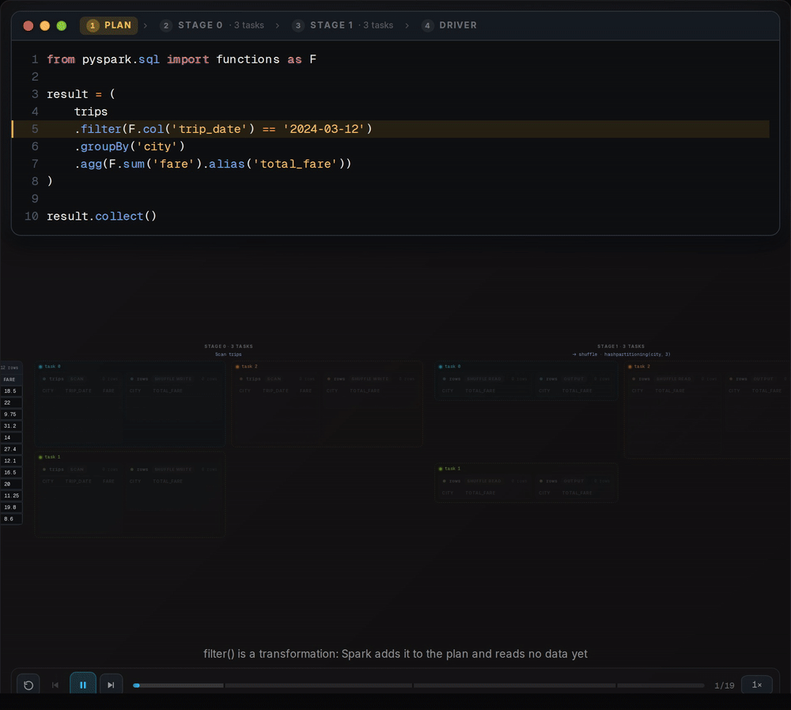
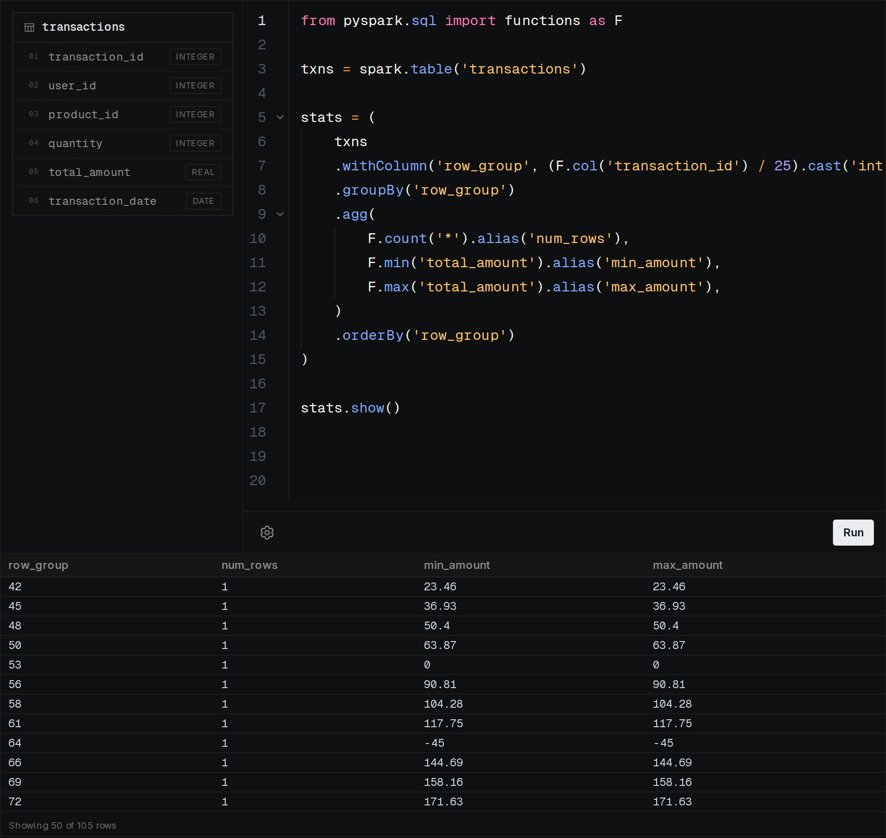
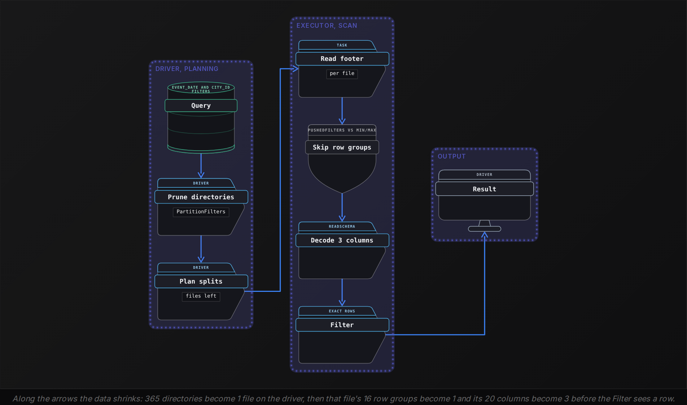
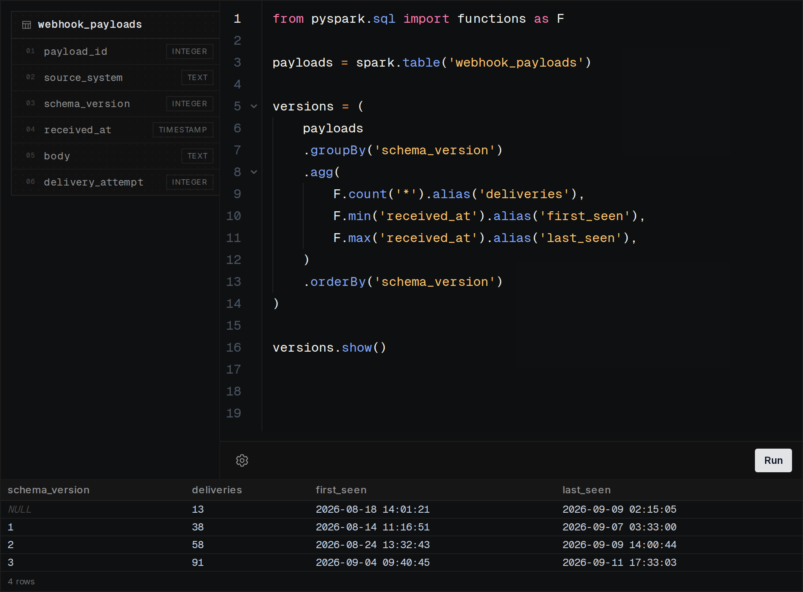

Intermediate·Spark · 14 min · 13 challenges

# Storage Formats: Intermediate

At Uber, an on-call engineer has 10 minutes to pull every trip in city 42 from last Tuesday out of a year of trip logs before a pricing review. The same filter can read all 730GB or a single 128MB row group. Which one it reads depends on how the files were laid out when written, and on whether Spark can check that layout before reading a single row.


<br>

---

## Predicate Pushdown

Column projection already lets the reader skip columns a query never names. Predicate pushdown does the same for rows. When a filter compares a column to a literal, Catalyst hands that comparison to the Parquet reader together with the column list, and the reader uses it to avoid fetching data that cannot match. The test runs inside the scan, against the file, before rows are decoded into memory.


<br>

### Where the filter runs

| ✓ Filter applied after load | ✗ Filter pushed to the reader |
| --- | --- |
| • The reader decodes every row of the projected columns<br><br>• Every decoded row enters the Filter operator<br><br>• Rows that fail are discarded after their I/O is paid<br><br>• Stage input bytes equal the full projected size | • The reader receives the predicate before opening a file<br><br>• It tests each row group's statistics against the predicate<br><br>• Row groups that cannot match are never fetched<br><br>• Input bytes shrink with every row group skipped |

```sql
trips = spark.read.parquet('/lake/trips_raw')

result = (
    trips
    .filter(F.col('city_id') == 42)
    .select('trip_id', 'city_id', 'fare')
)

result.explain()
```

Logical optimization pushes the filter and the column list down to the scan before any job runs. The FileScan line of the physical plan then carries 4 fields worth reading:

| Plan field | Value in this plan | What it tells you |
| --- | --- | --- |
| ReadSchema | struct<trip_id:bigint,city_id:int,fare:double> | Projection: 3 of the 20 columns get decoded |
| DataFilters | [isnotnull(city_id), (city_id = 42)] | Data-column filters Spark offered to the reader |
| PushedFilters | [IsNotNull(city_id), EqualTo(city_id,42)] | Filters handed to the Parquet reader, which tests them against row-group statistics where the column type allows |
| PartitionFilters | [] | Directory-level filters, empty because this copy of trips has no partition columns |

*Real plans add expression ids, as in city_id#12; they're left out here.*


<br>

### Why the Filter node stays

Directly above the FileScan, the plan still contains `Filter (isnotnull(city_id) AND (city_id = 42))`. Pushdown is coarse: the reader skips a row group only when its statistics prove no row inside can match. A row group that might hold city 42 is read whole, rows for cities 41 and 43 included, and the Filter removes them. So PushedFilters buys less I/O, and the Filter node keeps the answer exact.


<br>

### What the reader will accept

| ✓ Pushed to the reader | ✗ Kept above the scan |
| --- | --- |
| • ==, <, <=, >, >= against a literal<br><br>• isin(...) with literal values<br><br>• isNull() and isNotNull()<br><br>• startswith('...') on a string column<br><br>• & and \| joining any of the above | • A function around the column: F.lower, F.substring, F.to_date<br><br>• Arithmetic on the column, as in F.col('fare') \* 1.1 > 50<br><br>• A comparison of 2 columns, as in fare > tip |

A blocked predicate can usually be rewritten as a comparison on the stored column. Both filters below keep the March 2024 trips from the string column `trip_date`, and only the second reaches the reader:

```sql
blocked = trips.filter(F.substring('trip_date', 1, 7) == '2024-03')

pushed = trips.filter(
    (F.col('trip_date') >= '2024-03-01') & (F.col('trip_date') < '2024-04-01')
)
```

The first plan still shows `PushedFilters: [IsNotNull(trip_date)]`. Spark infers that any row passing the substring test has a non-null date and pushes that inferred check, which rules out almost nothing. The second plan adds `GreaterThanOrEqual(trip_date,2024-03-01)` and `LessThan(trip_date,2024-04-01)`.

> **TIP**
>
> Look for your own comparison in PushedFilters. A lone IsNotNull on the column means the real predicate stayed above the scan, so the footers can't skip any row group on it.

**trips stores trip_date as a string, and each file's row groups cover tight date ranges. Which filter lets the reader skip row groups for 2024-03-12?**

- **A.** F.to_date('trip_date') == F.lit('2024-03-12'), since Catalyst folds the conversion into the literal
- **B.** F.col('trip_date') == '2024-03-12', since a bare column compared to a literal becomes EqualTo
- **C.** F.substring('trip_date', 1, 10) == '2024-03-12', since the substring spans the whole value
- **D.** None of them, since footers keep no min and max for string columns

<details>
<summary>Solution</summary>

**B.** F.col('trip_date') == '2024-03-12', since a bare column compared to a literal becomes EqualTo

This is the shape the reader accepts. PushedFilters lists EqualTo(trip_date,2024-03-12), and row groups whose range excludes that date are skipped.

**Why the others are wrong**

- **A.** Catalyst leaves a function around a column in place. The conversion runs on every row above the scan, and PushedFilters holds only IsNotNull(trip_date).
- **C.** It keeps the same rows, but the reader sees a function of the column and has no statistics to test it against.
- **D.** Parquet records min and max for strings too, which is why startswith and string ranges can skip row groups.

</details>


<br>

### Fewer rows reach the shuffle

Every row the reader drops is also a row the rest of the stage never touches, shuffle write included. The animation totals fares per city for 1 day across 12 trips in 3 partitions. Its tables sit in memory with no row groups, so the filter runs right after the scan in the same stage instead of inside the reader; downstream, the effect is identical.



Five of the 12 trips are dated 2024-03-12, so at most 5 rows reach partial aggregation, and the shuffle moves per-city partial sums instead of raw trips. The job runs as 2 stages with 1 shuffle, from the `groupBy`.


<br>

### Proving the I/O was saved

`explain()` shows intent. To confirm the saving, run the query and open it in the SQL tab of the Spark UI. If the scan node's `number of output rows` equals the table's row count, no row group was skipped, however good PushedFilters looked. After a layout change, compare the stage's input size: skipping shows up as fewer bytes read while the Filter's output stays the same.


<br>

---

## Row Groups and Footer Stats

Inside a Parquet file, rows are stored in row groups: horizontal slices, each holding a column chunk per column. The footer, written last, lists every row group with a minimum, a maximum and a null count for each column chunk. Given a pushed predicate, the reader fetches the footer once, tests the predicate against each row group's statistics, and reads only the row groups the test cannot rule out.


<br>

### Reading the statistics

Take a trips file of 8 row groups, with `city_id` values from 1 to 500. Here are its `city_id` statistics when rows are written in arrival order and when they are sorted by `city_id` first.

Arrival order

| row group | min city_id | max city_id |
| --- | --- | --- |
| 0 | 1 | 500 |
| 1 | 2 | 500 |
| 2 | 1 | 499 |
| 3 | 1 | 500 |
| 4 | 3 | 500 |
| 5 | 1 | 500 |
| 6 | 1 | 498 |
| 7 | 2 | 500 |

Sorted by city_id

| row group | min city_id | max city_id |
| --- | --- | --- |
| 0 | 1 | 63 |
| 1 | 63 | 127 |
| 2 | 127 | 190 |
| 3 | 190 | 251 |
| 4 | 251 | 314 |
| 5 | 314 | 377 |
| 6 | 377 | 440 |
| 7 | 440 | 500 |

Run `city_id = 42` against each footer. In arrival order every range contains 42, so no row group can be ruled out and the whole file is fetched. Sorted, row group 0 spans 1 to 63 and must be read, while row group 1 starts at 63 and every later one starts higher, so the rest are skipped. Both files hold the same rows and get the same query and the same PushedFilters, so the write order is the only thing that changed the I/O.

- **8 of 8** — row groups fetched in arrival order
- **1 of 8** — row groups fetched when sorted

Statistics exist for every column, sorted or not. In both files `fare` runs from around 2 to about 450 inside every row group, because sorting on `city_id` scatters fares. So `fare > 500` skips every row group and returns nothing without reading a single row group, while `fare > 100` skips none. A file can be sorted only one way, so sort it on the column your queries filter on most.

**Using the sorted footer above, how many row groups does the reader fetch for city_id = 63?**

- **A.** Only 1, since city 63 belongs to row group 1 alone
- **B.** None, since 63 sits on the boundary between 2 ranges
- **C.** All 8, since equality filters cannot skip on int columns
- **D.** Exactly 2, since row group 0's max and row group 1's min both equal 63

<details>
<summary>Solution</summary>

**D.** Exactly 2, since row group 0's max and row group 1's min both equal 63

The reader keeps any group with min <= 63 <= max. Row groups 0 and 1 pass, and the other 6 are skipped.

**Why the others are wrong**

- **A.** A footer cannot say which group owns a value. Row group 0's max is also 63, so it might hold matching rows.
- **B.** Min and max are inclusive, so a boundary value falls inside both ranges and passes the test for both groups.
- **C.** Equality on an int column is the commonest pushed filter; the same file skipped 7 row groups for city 42.

</details>


<br>

### Writing data that skips well

The cheapest way to cluster is `sortWithinPartitions`, which sorts each task's rows before they are written and adds no shuffle and no stage:

```sql
(trips
    .sortWithinPartitions('city_id')
    .write
    .mode('overwrite')
    .parquet('/lake/trips_sorted'))
```

| ✓ sortWithinPartitions('city_id') | ✗ orderBy('city_id') |
| --- | --- |
| • No shuffle: each task sorts the rows it already holds<br><br>• Each file covers most cities in narrow row-group slices<br><br>• With 200 files, city 42 sits in about 200 row groups | • Adds a range shuffle and a stage before the write<br><br>• Each file covers its own contiguous band of cities<br><br>• City 42 sits in 1 or 2 row groups across the table |

Pay for the global sort when the table is read far more often than it is written.


<br>

### Row-group size

Spark's Parquet writer targets row groups of `parquet.block.size`, 128MB by default, so the 8 row groups above make a 1,024MB file. Override it per write with `.option('parquet.block.size', 32 * 1024 * 1024)`, and the same file holds 32 row groups, so city 42 costs a single 32MB group. The price is a bigger footer, more separate requests to storage and less data per chunk for the codec to compress.

Splits are planned before any footer is read. Spark cuts files at `spark.sql.files.maxPartitionBytes`, 128MB by default, and a row group goes to the task whose split holds its midpoint. A skipped row group still gets a task; that task finds nothing to fetch and ends almost at once, which shows up as a run of near-zero task durations in the stage.

> **TIP**
>
> Spark writes timestamps as INT96 unless `spark.sql.parquet.outputTimestampType` says otherwise, and the reader pushes no filters on INT96 columns. Set it to TIMESTAMP_MICROS before writing a table that queries will filter by time.

The seed has no row groups, but you can compute what a footer would record. The cell treats every 25 consecutive `transaction_id` values as a single row group and reports its row count and the min and max of `total_amount`. Run it, choose a threshold near the top of the amounts, and decide which groups a reader could skip for `total_amount` above it. Then change 25 to 100 and watch the ranges widen.



```python
from pyspark.sql import functions as F

txns = spark.table('transactions')

stats = (
    txns
    .withColumn('row_group', (F.col('transaction_id') / 25).cast('int'))
    .groupBy('row_group')
    .agg(
        F.count('*').alias('num_rows'),
        F.min('total_amount').alias('min_amount'),
        F.max('total_amount').alias('max_amount'),
    )
    .orderBy('row_group')
)

stats.show()
```


<br>

---

## Pruning vs Pushdown

Pruning and pushdown both spare Spark from reading data, but they act at different moments on different machines. Pruning removes whole directories from the file listing on the driver while the plan is built. Pushdown removes row groups inside each file as an executor opens it. A query can get either, both or neither, and each is enabled by a different choice at write time.

| Aspect | Partition pruning | Predicate pushdown |
| --- | --- | --- |
| Unit skipped | A directory and every file in it | A row group inside a file |
| Metadata used | Directory names, as in event_date=2024-03-12 | Min, max and null count in each footer |
| Decided by | The driver, while planning | Each task, as it opens its file |
| Cost of a skipped unit | Nothing: never listed as a split, never opened | One footer read per file |
| Enabled at write time by | partitionBy on the column | Sorting or clustering on the column |
| Plan field | PartitionFilters | PushedFilters |
| Best for columns that are | Low-cardinality and always filtered: date, region | High-cardinality: city, user, device |


<br>

### Functions on the column

The driver holds the full list of partition values in memory, so pruning can evaluate any deterministic expression over them. With `event_date` as the partition column, `F.month('event_date') == 3` still prunes to the March directories. The footer test understands only the plain comparisons listed in the first section, so the same `F.month` around a data column pushes nothing.


<br>

### One table, both levels

A trips table queried by day and by city should prune on the day and push down the city:

```sql
(trips
    .repartition('event_date')
    .sortWithinPartitions('event_date', 'city_id')
    .write
    .partitionBy('event_date')
    .mode('overwrite')
    .parquet('/lake/trips'))
```

`repartition('event_date')` is a hash shuffle, so the write runs in 2 stages and each day's rows land in the same task, giving a single file per day directory. `sortWithinPartitions` adds no shuffle. The sort leads with `event_date` because the writer needs each task's rows grouped by partition column; when the existing order starts with anything else, Spark inserts its own sort by `event_date`, and your city order is not guaranteed to survive it.



Put numbers on it. The table holds a year: 365 directories, each holding a 2GB file of 16 row groups, 730GB in all. The query asks for city 42 on 2024-03-12 and selects 3 of the 20 columns.

| Step | Skipped | Left to read |
| --- | --- | --- |
| Start | Nothing | All 730GB, in 365 files |
| Prune on event_date | The other 364 directories, dropped from the listing before any split is planned | A 2GB file |
| Push down city_id | The other 15 row groups, ruled out by the footer | A 128MB row group |
| Project 3 columns | The other 17 column chunks | The 3 chunks' share of 128MB |

Pruning did most of the work, and cheaply: the 364 dropped directories cost the driver a listing entry each, and no task touched them. Put the same 365 files in a single flat directory, with `event_date` stored inside each file, and pushdown still finds the right row group, because each footer's min and max for `event_date` are both that file's own date. The difference is the work spent ruling the rest out. The driver plans splits over all 730GB, 16 per file, and each of those 5,840 tasks reads its file's footer before finding nothing to fetch, where the partitioned layout needed 16 tasks.

> **TIP**
>
> Filter on the partition column itself. A table partitioned by `event_date` and queried with `pickup_ts >= '2024-03-12'` prunes nothing, because the driver can't link `pickup_ts` to directory names. Add the matching `event_date` condition beside the timestamp filter.

**A query on /lake/events filters event_date == '2024-03-12'. explain() shows PartitionFilters: [] and PushedFilters: [IsNotNull(event_date), EqualTo(event_date,2024-03-12)]. What does that tell you?**

- **A.** event_date lives inside the files, so every file is listed and opened before footer stats can skip anything
- **B.** The table is pruned to 1 directory, and pushdown then narrows it to the matching row groups
- **C.** The reader rejected the date predicate, so the Filter operator checks every row of every file
- **D.** Spark ran the date check on the driver once, against the directory names in the listing

<details>
<summary>Solution</summary>

**A.** event_date lives inside the files, so every file is listed and opened before footer stats can skip anything

A partition column would appear in PartitionFilters. The date lives in the files, so only pushdown helps, and only if the files are sorted or clustered on it.

**Why the others are wrong**

- **B.** Pruning would leave its mark in PartitionFilters, which is empty, so every directory stays in the plan.
- **C.** The comparison appears in PushedFilters, so it was handed to the reader. Whether anything is skipped depends on the footer ranges.
- **D.** A driver-side check on directory names is pruning, and it would show under PartitionFilters, which is empty here.

</details>

> When a level quietly does nothing
>
> - The query never filters the partition column, so every directory is listed and every file opened
> - PushedFilters holds the right comparison, but the files are unsorted on that column, so every row group is read
> - The partition column is too fine: 500 cities over 365 days make 182,500 small directories


<br>

---

## Choosing a Codec

Spark compresses Parquet with Snappy unless told otherwise. The codec runs page by page, after dictionary and run-length encoding have already shrunk the data, so any codec leaves the file splittable. Every codec charges CPU twice, once to compress at write and again to decompress at every read, and pays it back in bytes stored and bytes moved. Choosing one means deciding which of those your table can afford.

```sql
(trips
    .write
    .option('compression', 'zstd')
    .mode('overwrite')
    .parquet('/lake/trips_zstd'))

spark.conf.set('spark.sql.parquet.compression.codec', 'zstd')
```

The writer option covers a single write and overrides the session setting, which covers every Parquet write after it. Each column chunk records its own codec, so a directory can mix Snappy and ZSTD files and still read as a single table, and switching codecs never forces a rewrite of old data.


<br>

### Four codecs on the same benchmark

| Codec | Ratio | Compress | Decompress |
| --- | --- | --- | --- |
| snappy | 2.1x | 550MB/s | 1,750MB/s |
| lz4 | 2.1x | 740MB/s | 4,500MB/s |
| zstd, level 1 | 2.9x | 530MB/s | 1,700MB/s |
| gzip (zlib), level 1 | 2.7x | 95MB/s | 400MB/s |

*Rounded from the single-core Silesia corpus table in the zstd project's README. Figures move with each release and CPU, and Parquet pages compress differently from raw text, so read them as relative speeds.*

Snappy and LZ4 trade ratio for speed. ZSTD at a low level comes close to gzip's ratio while decompressing about 4 times faster, which leaves gzip few cases where it wins. Parquet's own defaults sit further along the curve: gzip runs at level 6, and ZSTD at level 3 unless `parquet.compression.codec.zstd.level` says otherwise.


<br>

### Measuring on your own table

The benchmark compresses raw text. Your columns arrive already dictionary-encoded and will compress differently, so measure on a sample:

```sql
sample = spark.read.parquet('/lake/trips').sample(fraction=0.01, seed=7)

for codec in ['snappy', 'zstd', 'gzip']:
    (sample
        .write
        .option('compression', codec)
        .mode('overwrite')
        .parquet(f'/tmp/codec_test/{codec}'))
```

Each write is its own action, so the sample is recomputed 3 times; the fixed seed returns the same 1% every time. Compare the 3 directory sizes and time a scan of each. Say the results come back like this, for a table holding 2,000GB of encoded pages before compression:

| Codec | 1% sample | Full table | Decompress core-seconds per full scan |
| --- | --- | --- | --- |
| snappy | 9.0GB | 900GB | ~1,170 |
| zstd | 6.6GB | 660GB | ~1,200 |
| gzip | 6.3GB | 630GB | ~5,120 |

The last column divides 2,000GB by each codec's benchmark decompression speed. ZSTD stores 240GB less than Snappy and moves 240GB less over the network on every full scan, for roughly 3% more decompression CPU. Gzip saves another 30GB of storage and costs over 4 times ZSTD's CPU on every read. Scanned 50 times a day, that gap comes to roughly 196,000 core-seconds, roughly 54 core-hours, daily.


<br>

### Picking by read pattern

- **Hot table, many reads a day** *zstd at a low level, or snappy*\
  Decompression cost per byte is close, and ZSTD moves fewer bytes, which wins when scans wait on storage.
- **CPU-bound job on fast local disks** *snappy or lz4*\
  Bytes are cheap to fetch, so the codec that spends the least CPU wins.
- **Archive written once, read rarely** *zstd at a higher level*\
  The slow compression is paid once at write, and reads still decompress at ZSTD speed.
- **Files read by other engines** *a codec every reader supports*\
  Confirm each consumer can decode the codec before switching.

> Parquet codec vs shuffle codec
>
> `spark.sql.parquet.compression.codec` (default snappy) sets the codec for files you write. `spark.io.compression.codec` (default lz4) sets it for shuffle files and spills. Moving your tables to ZSTD leaves shuffle compression where it was.


**A dashboard table is scanned in full around 200 times a day from object storage, and its scans wait mostly on the network. It uses Snappy. The storage team proposes gzip for smaller files. Going by the benchmark above, which choice fits best?**

- **A.** gzip, since smaller files cut network time on all 200 daily scans
- **B.** lz4, since it has the fastest decompression in the table
- **C.** zstd at a low level, since it nears gzip's ratio at Snappy-like decompression speed
- **D.** Keep Snappy, since changing codecs means rewriting every existing file

<details>
<summary>Solution</summary>

**C.** zstd at a low level, since it nears gzip's ratio at Snappy-like decompression speed

ZSTD cuts the bytes each network-bound scan fetches while costing about the same decompression CPU as Snappy.

**Why the others are wrong**

- **A.** Gzip shrinks the files, but it decompresses at about a quarter of ZSTD's speed, a cost paid on all 200 scans.
- **B.** LZ4 decompresses fastest but compresses no better than Snappy, so network-bound scans move as many bytes as before.
- **D.** Each column chunk records its codec, so new ZSTD files can sit beside old Snappy ones and a rewrite is optional.

</details>


<br>

---

## Schema-on-Read Pitfalls

Each Parquet file carries its own schema in its footer. A directory of raw Parquet is a pile of files written by different jobs over months, and nothing makes their schemas agree. When you read the directory, Spark settles on a single schema before touching any data. With `spark.sql.parquet.mergeSchema` at its default of false, Spark's documentation says that schema comes from the summary file, or from a random data file if there is none, and every file is read through it.


<br>

### Four files, 3 kinds of drift

| File | Schema in its footer |
| --- | --- |
| day=2024-03-01/part-0.parquet | order_id bigint, amount int, cust_id bigint |
| day=2024-03-08/part-0.parquet | order_id bigint, amount int, cust_id bigint, coupon string |
| day=2024-03-12/part-0.parquet | order_id bigint, amount double, cust_id bigint, coupon string |
| day=2024-03-14/part-0.parquet | order_id bigint, amount double, customer_id bigint, coupon string |

#### An added column

The March 8 job added `coupon`. If Spark takes the March 1 footer, `coupon` is missing from the DataFrame and `select('coupon')` fails at analysis. If it takes any later footer, the March 1 rows return `coupon` as null. The same code can change behavior after new files land.

#### A changed type

On March 12, `amount` became a double. Suppose the chosen schema says double. The read returns at once and `printSchema()` looks right, but the task that opens the March 1 file fails at the action with `Parquet column cannot be converted ... Column: [amount], Expected: double, Found: INT32`. The error can arrive an hour into a job, from the task holding an old file. That is Spark 3.x behavior; newer releases read some widenings such as int to double, so check the version you run.

**spark.read.parquet('/lake/orders') returns at once and printSchema() shows amount: double. Forty minutes into the job, a single task fails with Expected: double, Found: INT32. What happened?**

- **A.** An older file stores amount as INT32, and the failure waits until a task opens that file
- **B.** The input file was corrupted during its write, so it must be rebuilt from source
- **C.** mergeSchema widened amount to double, and that widening failed on the largest file
- **D.** Spark inferred amount from a directory name, and a directory held a decimal value

<details>
<summary>Solution</summary>

**A.** An older file stores amount as INT32, and the failure waits until a task opens that file

The schema came from a single footer at read time. Each file is checked only when a task reads it, so the error arrives mid-job.

**Why the others are wrong**

- **B.** Nothing is corrupt: the file is valid Parquet whose schema differs from the one Spark chose for the directory.
- **C.** mergeSchema is off by default and runs at read time, so it cannot explain a failure 40 minutes later.
- **D.** Inference from directory names covers partition columns only, and amount lives inside the files.

</details>

#### A renamed column

On March 14, `cust_id` became `customer_id`. Spark matches Parquet columns by name, so it sees 2 unrelated columns. Files written under the other name return nulls for whichever one the schema holds, and nothing fails. An inner join on `customer_id` then drops every older order, since null keys never match.

#### Types inferred from directory names

Partition values get types too, inferred from directory names. `store_id=007` becomes the integer 7, and a join against store codes stored as '007' finds nothing. Set `spark.sql.sources.partitionColumnTypeInference.enabled` to false to keep them as strings, or declare the type in an explicit schema.


<br>

### Reading defensively

An explicit schema makes the result independent of which footer Spark picks, and gives the rename a single place to be reconciled:

```sql
orders_schema = StructType([
    StructField('order_id', LongType()),
    StructField('amount', DoubleType()),
    StructField('cust_id', LongType()),
    StructField('customer_id', LongType()),
    StructField('coupon', StringType()),
])

orders = (
    spark.read.schema(orders_schema).parquet('/lake/orders')
    .withColumn('customer_key', F.coalesce('customer_id', 'cust_id'))
)
```

On Spark 3.x this schema still cannot read the int files as double; read those days separately, cast `amount`, and union the 2 DataFrames. `mergeSchema` handles the added column by combining every footer's fields, at the price of a job that opens every file before yours starts, and it treats a rename as 2 different columns.

| ✓ Do | ✗ Don't |
| --- | --- |
| • Pass an explicit schema to any directory that several jobs write<br><br>• Coalesce renamed columns into a single key right after the read<br><br>• Count nulls per file with input_file_name() after upstream changes | • Let whichever footer Spark samples define the table<br><br>• Treat a clean printSchema() as proof every file can be read<br><br>• Join on a renamed key before reconciling its old and new names |

Producers that version their payloads let you see drift before it breaks a read. The seed's `webhook_payloads` table records a `schema_version` on every delivery. Run the cell to count deliveries per version and see when each version first and last arrived; it is the same audit you would run over files grouped by `input_file_name()`.



```python
from pyspark.sql import functions as F

payloads = spark.table('webhook_payloads')

versions = (
    payloads
    .groupBy('schema_version')
    .agg(
        F.count('*').alias('deliveries'),
        F.min('received_at').alias('first_seen'),
        F.max('received_at').alias('last_seen'),
    )
    .orderBy('schema_version')
)

versions.show()
```


<br>

### Reading a slow scan in order

When a scan reads more than it should, check its FileScan line from the coarsest level down. PartitionFilters comes first, because a directory dropped there never becomes a task. PushedFilters comes next, for the row groups the footers can rule out, and ReadSchema last, for the column chunks decoded. The codec and the schema change how each surviving byte is decoded and typed, and neither one changes which files a task opens.

**Capstone. events is partitioned by event_date, sorted by user_id within each day and compressed with ZSTD. This query opens every file in the table. Which single change cuts its I/O the most?**

```python
result = (
    spark.read.parquet('/lake/events')
    .filter(F.to_date('event_ts') == '2024-03-12')
    .filter(F.col('user_id') == 9001)
    .select('event_id', 'event_type')
)
```

- **A.** Rewrite the files with gzip, since a higher ratio means fewer bytes per scan
- **B.** Turn on mergeSchema, so the reader sees every column in every file
- **C.** Add repartition(400) before the filters, to spread the scan over more tasks
- **D.** Add F.col('event_date') == '2024-03-12' beside the timestamp filter, so the driver prunes

<details>
<summary>Solution</summary>

**D.** Add F.col('event_date') == '2024-03-12' beside the timestamp filter, so the driver prunes

The function on event_ts gives the driver nothing to prune with. The event_date condition drops every other day's directory, and user_id pushdown then skips row groups in the files left.

**Why the others are wrong**

- **A.** Gzip trims a few bytes, but every file is still opened, and each decompresses about 4 times slower than ZSTD.
- **B.** mergeSchema adds a job that reads every footer. It settles the schema and leaves the set of files read unchanged.
- **C.** A repartition adds a shuffle after the scan, and the scan still opens every file.

</details>


<br>

---

## Putting It All Together

Back at Uber, the on-call engineer's query asks for every trip in city 42 on 2024-03-12 with a surge multiplier above 2.0, from a year of trip logs, and the pricing review starts in 10 minutes.

- The trip logs are partitioned by event_date, so PartitionFilters cuts 365 directories to 1 on the driver before any task starts.
- Rows were sorted by event_date and then city_id at write time, so the single remaining footer rules out 15 of its 16 row groups for city 42.
- The surge condition compares a bare column to a literal, so it joins city_id in PushedFilters, and the Filter above the scan trims the surviving row group to exact rows.
- The files are ZSTD-compressed, so the surviving column chunks travel fewer bytes over the network and decompress about as fast as Snappy would.
- The read declares an explicit schema, so a column renamed last month comes back as a single coalesced column instead of nulls nobody would notice before the review.


<br>

---

## Key Takeaways

- A filter that compares a bare column to a literal reaches the Parquet reader. Confirm that PushedFilters lists your comparison and holds more than an IsNotNull.
- The reader skips a row group when its footer min, max and null count rule the predicate out, so the sort order at write time decides how much gets skipped.
- Pruning drops directories on the driver before any task exists; pushdown drops row groups inside each file a task opens. Partition by the low-cardinality column every query filters, and sort by the selective one.
- For tables scanned often over the network, ZSTD at a low level reads fewer bytes than Snappy for similar decompression CPU, and gzip rarely wins. Measure on a 1% sample before switching.
- A directory's schema comes from a single footer unless you merge or declare it. Added, retyped and renamed columns either fail late or return quiet nulls.
