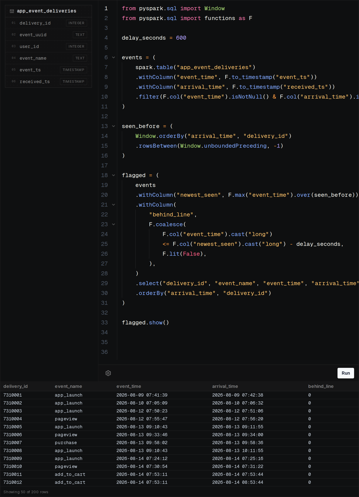
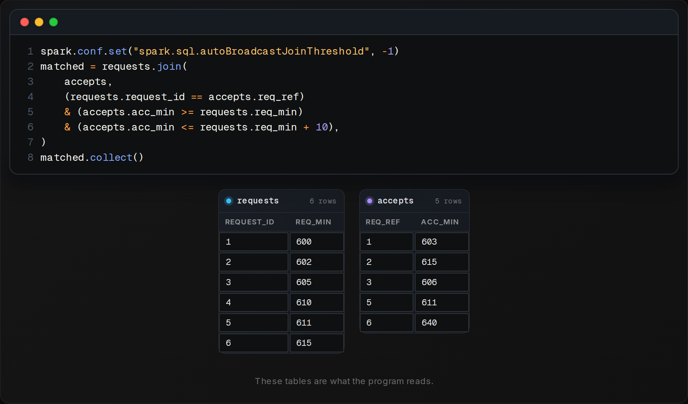
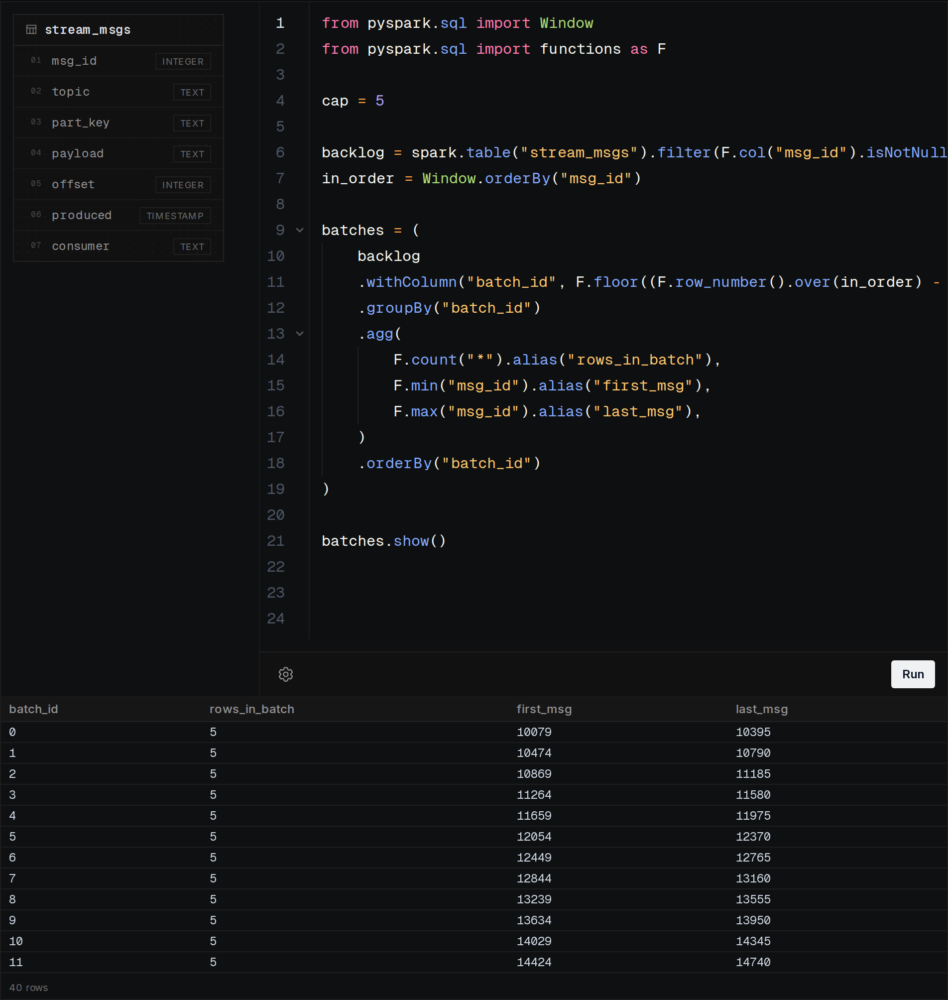

Advanced·Spark · 15 min · 13 challenges

# Structured Streaming: Advanced

Midnight on New Year's Eve at Uber: ride requests pour in, phones on packed streets upload events 20 minutes late, and a streaming job pairs every request with the driver who accepted it. Whether that job keeps up or falls over comes down to 4 choices: where its state lives, how long it waits for stragglers, how much it reads per batch, and how fast it must answer.


<br>

---

## The State Store

A stateful operator needs rows from earlier micro-batches to answer the current one. A running count per city needs the count so far, `dropDuplicates` needs every ID it has seen, and a stream-stream join needs the unmatched rows from both sides. Spark keeps that memory in a state store: a versioned key-value map that each stateful operator holds once per shuffle partition.

The operator sits after a shuffle, so its state is split exactly like the shuffle output. The animation runs the batch form of a per-city count on 2 input partitions and 3 shuffle partitions. Track where each city lands: in a streaming query, the reducer task that receives a key is also the task that owns that key's state.

https://github.com/user-attachments/assets/0386c204-6828-4447-93b0-2a83f9d7d187

In the streaming plan, 2 operators wrap that shuffle's reducer side. Call `query.explain()` on a running aggregation and you find `StateStoreRestore`, which reads each key's old count from the store, and `StateStoreSave`, which writes the new one. In batch 41, the task for partition 2 loads version 41 of the store for operator 0, partition 2, applies the batch's updates, and commits version 42. A coordinator on the driver tracks which executor has each store loaded, and the scheduler treats that executor as the preferred location for the partition's next task. If the task waits out the locality timeout and runs elsewhere, the new executor reloads the store from the checkpoint.


<br>

### Where the bytes sit, batch by batch

The default provider keeps each partition's map in executor heap, as a hash map of `UnsafeRow` keys and values. Each commit writes only the keys that batch changed or removed, to a file named for the new version, `N.delta`, under the checkpoint directory. A background maintenance task, which runs every 60 seconds by default, folds the deltas into a full `N.snapshot` once 10 of them have piled up since the last snapshot.

| Checkpoint path | Written when | Holds |
| --- | --- | --- |
| offsets/41 | Batch 41 starts | Source offsets batch 41 reads |
| state/0/2/40.snapshot | Maintenance, after 10 deltas | Every key of operator 0, partition 2 |
| state/0/2/41.delta | Batch 40 commits | Keys batch 40 changed |
| state/0/2/42.delta | Batch 41 commits | Keys batch 41 changed |
| commits/41 | Batch 41 finishes | Marker that batch 41 is done |

To run batch 42 after a restart, Spark loads `40.snapshot`. It then replays `41.delta` and `42.delta` on top, so recovery reads 1 full copy of the state plus a few small files. Files for the last 100 batches are kept by default (`spark.sql.streaming.minBatchesToRetain`), and maintenance deletes older ones.


<br>

### What the checkpoint freezes

The number of state partitions is whatever `spark.sql.shuffle.partitions` held when the query first started, and Spark writes that value into the checkpoint. Change the setting later and a restart keeps the recorded value, because each key's state sits in the files of the partition its hash chose. The provider class is recorded the same way. Both are first-start decisions: a small stream left at the default 200 partitions runs 200 stateful tasks per batch, each opening its own store, for as long as that checkpoint lives.


<br>

### When the heap gives out: RocksDB

Heap state holds up until garbage collection takes over. Every stored key and value is an object the collector must trace, so a few million keys per executor push the GC Time figure in the Executors tab toward a large share of task time, and a full collection can stall a batch for seconds. The RocksDB provider, available since Spark 3.2, moves the map into an embedded key-value store that keeps recent data in native memory and the rest in sorted files on the executor's local disk. The heap then holds only what the current batch touches.

```sql
spark.conf.set(
    "spark.sql.streaming.stateStore.providerClass",
    "org.apache.spark.sql.execution.streaming.state.RocksDBStateStoreProvider",
)
spark.conf.set(
    "spark.sql.streaming.stateStore.rocksdb.changelogCheckpointing.enabled",
    "true",
)
```

RocksDB checkpoints incrementally too. At each commit it uploads only the sorted files written since the previous upload, plus a small zip listing the files that make up that version. With changelog checkpointing, available since Spark 3.5, a commit writes only a log of changed keys and moves file uploads to the background, which shortens every batch's commit. Its memory lives outside the heap, so budget it in `spark.executor.memoryOverhead`.

| ✓ Default heap provider | ✗ RocksDB provider |
| --- | --- |
| • State as UnsafeRow objects in executor heap<br><br>• Commit writes a delta file of changed keys<br><br>• Snapshot built in the background every 10 deltas<br><br>• GC time grows with the number of keys | • State in native memory and local disk<br><br>• Commit uploads new sorted files, or a changelog<br><br>• Heap holds only the batch's working set<br><br>• State can grow past executor memory |

> **TIP**
>
> Read state size from the query: `query.lastProgress['stateOperators']` reports `numRowsTotal` and `memoryUsedBytes` for each stateful operator. A row count that climbs on every batch and never falls means nothing is freeing state.

**A per-city count first started with spark.sql.shuffle.partitions at 200. Months later the team sets it to 24 and restarts from the same checkpoint. What happens?**

- **A.** Spark rehashes every stored key into 24 partitions during the first batch after restart.
- **B.** The query keeps running with 200 state partitions, the count its checkpoint recorded.
- **C.** The query runs on 24 partitions and every city's count restarts from zero.
- **D.** The query refuses to start until the old state directory is removed by hand.

<details>
<summary>Solution</summary>

**B.** The query keeps running with 200 state partitions, the count its checkpoint recorded.

The checkpoint stores the partition count and Spark restores it over the new setting, so every key still finds its files.

**Why the others are wrong**

- **A.** State files are written per partition and Spark never moves keys between them, so the recorded count wins.
- **C.** Spark ignores the new value for this query, so no count is lost and the partition count stays at 200.
- **D.** Nothing fails: Spark restores the recorded 200 partitions and carries on from the last committed batch.

</details>


<br>

---

## Watermarks

A window from 12:00 to 12:10 can always receive one more row: a phone that went offline can upload a 12:04 event an hour later. Without a rule for when to stop waiting, a windowed count keeps every window it ever opened, and its state grows until the executors run out of memory. A watermark is that rule, a moving event-time line behind which Spark treats data as finished.

```sql
from pyspark.sql import functions as F

trip_counts = (
    trip_events
    .withWatermark("event_time", "10 minutes")
    .groupBy(F.window("event_time", "10 minutes"), "city")
    .count()
)

query = (
    trip_counts.writeStream
    .outputMode("append")
    .format("parquet")
    .option("path", "/lake/trip_counts")
    .option("checkpointLocation", "/chk/trip_counts")
    .start()
)
```

The watermark equals the largest event time seen so far, minus the delay. Spark computes it at the end of each micro-batch, taking the maximum across all partitions, and applies it during the next batch. It never moves backwards, and until the first batch finishes there is none, so the first batch drops nothing.


<br>

### Which late rows are dropped

For a windowed aggregation the test runs on the row's window, and the row's own timestamp only picks that window: Spark drops a row when its window ends at or before the watermark. Trace 4 batches of the query above, 10-minute windows with a 10-minute delay:

| Batch | Arriving events | Watermark in use | What happens | Watermark after |
| --- | --- | --- | --- | --- |
| 0 | 12:02, 12:07, 12:14 | none | Windows 12:00 to 12:10 (count 2) and 12:10 to 12:20 (count 1) open | 12:04 |
| 1 | 12:21, 12:03 | 12:04 | 12:03 kept, since its window ends at 12:10; window 12:20 to 12:30 opens | 12:11 |
| 2 | none (no-data batch) | 12:11 | Window 12:00 to 12:10 ends before 12:11: written with count 3, then removed | 12:11 |
| 3 | 12:08, 12:13 | 12:11 | 12:08 dropped, its window is gone; 12:13 joins window 12:10 to 12:20 | 12:11 |

The 12:03 row arrived 18 minutes behind the newest event and still counted, because its window was open. The 12:08 row was 13 minutes behind and was dropped, because its window had closed. So the delay is a floor: a row within the delay of the newest event time is always kept, and a row further behind survives until the watermark passes its window's end.


<br>

### What the watermark frees

The same test clears state. When the watermark passes a window's end, Spark deletes that window's key from the store, so state holds only windows still open: roughly a delay plus a window length of data. In append mode, deletion is also when the window is written, once, with its final count, which is why append output trails event time by at least the delay. Update mode writes a window's new count on every batch that changes it and still deletes closed windows. Complete mode rewrites the whole result each batch, needs every window it ever saw, and the watermark frees nothing.

> The watermark in 5 rules
>
> - Rows within the delay of the newest event time are always kept.
> - In a windowed aggregation, Spark compares the window's end to the watermark, whether it is deciding to drop a row or to free state.
> - With several watermarked inputs, the global watermark is the lowest of them, set by `spark.sql.streaming.multipleWatermarkPolicy` = `min`.
> - Rows dropped as late are counted in `numRowsDroppedByWatermark` in the query's progress.
> - When the watermark advances, Spark runs a no-data batch to apply it without waiting for new rows.

**Windows are 10 minutes long, the delay is 10 minutes, and the watermark stands at 14:27. Which arriving row does Spark drop?**

- **A.** An event at 14:24, because its timestamp is older than the 14:27 watermark.
- **B.** An event at 14:29, because the watermark has passed the start of its window.
- **C.** None of them, because a row is dropped only once it is twice the delay late.
- **D.** An event at 14:18, because its window ended at 14:20, before the watermark.

<details>
<summary>Solution</summary>

**D.** An event at 14:18, because its window ended at 14:20, before the watermark.

Window 14:10 to 14:20 ended before 14:27, so its state is gone and the row is dropped.

**Why the others are wrong**

- **A.** Its window runs to 14:30, past the watermark, so the window is still open and the row is counted.
- **B.** A window's start plays no part; this window ends at 14:30, after 14:27, so the row counts.
- **C.** No such multiple exists: the test compares the row's window end with the watermark.

</details>

The cell replays a delivery log in arrival order. For each event it takes the newest event time received so far minus the delay, and flags the event if its own time sits at or behind that line. That is the test a watermarked `dropDuplicates` applies, since it has no window to check. If you change `delay_seconds` from 600 to 60 and rerun the cell, more events fall behind; count how many.



```python
from pyspark.sql import Window
from pyspark.sql import functions as F

delay_seconds = 600

events = (
    spark.table("app_event_deliveries")
    .withColumn("event_time", F.to_timestamp("event_ts"))
    .withColumn("arrival_time", F.to_timestamp("received_ts"))
    .filter(F.col("event_time").isNotNull() & F.col("arrival_time").isNotNull())
)

seen_before = (
    Window.orderBy("arrival_time", "delivery_id")
    .rowsBetween(Window.unboundedPreceding, -1)
)

flagged = (
    events
    .withColumn("newest_seen", F.max("event_time").over(seen_before))
    .withColumn(
        "behind_line",
        F.coalesce(
            F.col("event_time").cast("long")
            <= F.col("newest_seen").cast("long") - delay_seconds,
            F.lit(False),
        ),
    )
    .select("delivery_id", "event_name", "event_time", "arrival_time", "behind_line")
    .orderBy("arrival_time", "delivery_id")
)

flagged.show()
```

The cell moves the line after every row, but Spark moves the watermark only at the end of a batch and applies it in the next one. Each flag therefore marks the earliest point at which Spark could drop that event: an event that arrives in the same batch as the newer event is still kept, so Spark drops the same rows or fewer. The cell also tests each event's own time, the rule for `dropDuplicates`; a windowed count tests the end of the event's window instead.


<br>

---

## Stream-Stream Joins

Joining 2 streams means neither side is ever complete. A ride request in batch 12 may meet its driver's acceptance in that same batch or 2 batches later in batch 14, and some requests never meet one. So Spark buffers both inputs: each new request is matched against every stored acceptance with the same key and then stored itself, and each new acceptance does the same against stored requests. One join keeps 4 state stores per shuffle partition, 2 per side: one counts the rows under each key and one holds the rows.

Within a micro-batch, Spark hash-shuffles both sides on the join key, which puts a request and its acceptance on the same task. The animation plays that step as a batch join with broadcasting turned off and the 10-minute time range used below, on times written as minutes after midnight.



Request 2's acceptance reached the right task and still produced nothing: it came 13 minutes after the request, outside the range. Request 6's came 25 minutes after. In a stream, every one of the 6 requests would stay in state whether it had matched or not, because another acceptance with the same key could still arrive; the 3 even-numbered requests have only produced no output yet.


<br>

### State that only grows

Spark accepts an inner stream-stream join without any watermark. Every request and every acceptance then stays in state for the life of the query, because Spark cannot rule out a future match. At 3,000 requests per second, the request side alone adds 10.8 million rows an hour.

- **259M** — request rows in state after 1 day


<br>

### Two watermarks and a time range

```sql
from pyspark.sql import functions as F

requests_wm = requests.withWatermark("request_time", "5 minutes")
accepts_wm = accepts.withWatermark("accept_time", "15 minutes")

matched = requests_wm.join(
    accepts_wm,
    F.expr(
        """
        req_ref = request_id
        AND accept_time >= request_time
        AND accept_time <= request_time + INTERVAL 10 MINUTES
        """
    ),
)
```

The equality finds the partner, and the range tells Spark when a stored row can no longer find one. A query with 2 watermarked inputs has a single global watermark, by default the minimum of the 2; call it G. Spark treats any acceptance still to come as carrying an accept_time after G, so a stored request is deleted once G passes request_time plus 10 minutes. Any request still to come carries a request_time after G, so a stored acceptance is deleted once G passes its own accept_time.

| Quantity | Value | Why |
| --- | --- | --- |
| Request watermark | newest request minus 5 min | Delay set on requests |
| Acceptance watermark | newest acceptance minus 15 min | Delay set on acceptances |
| G | 15 min behind | The lower of the 2, streams in step |
| A request is held | 25 min | Until G passes request_time + 10 min |
| An acceptance is held | 15 min | Until G passes accept_time |
| Request rows held | 4.5 million | 3,000 a second for 1,500 seconds |

The slower stream sets G for both sides. Raise the acceptance delay from 15 to 30 minutes and each request stays 40 minutes, even though nothing about requests changed. When a join's state is bigger than expected, start with its largest delay.

**Requests carry a 5-minute delay, acceptances a 15-minute delay, and someone deletes the upper bound so the join keeps only accept_time >= request_time. What happens to state?**

- **A.** Stored requests are never deleted, because some future acceptance could always match them.
- **B.** Both sides stay bounded, because the 2 watermarks alone decide when rows leave state.
- **C.** Stored acceptances are never deleted, because nothing caps how early their request was.
- **D.** State shrinks, because Spark now deletes each request as soon as 1 acceptance matches it.

<details>
<summary>Solution</summary>

**A.** Stored requests are never deleted, because some future acceptance could always match them.

Without the upper bound, an acceptance arriving at any later time can still match a stored request whatever G is, so the request side grows without end.

**Why the others are wrong**

- **B.** A watermark becomes a deletion rule only through the range; without the upper bound, requests have none.
- **C.** Acceptances still leave once G passes accept_time, since the lower bound survived.
- **D.** Spark keeps matched rows too, since another row with the same key could still arrive and match.

</details>


<br>

### Outer joins wait on the watermark

A left outer join from requests to acceptances must eventually emit each unanswered request with NULLs, and it can only do so once no match is possible, the moment the request leaves state. Spark therefore refuses a left outer stream-stream join unless the right side has a watermark and the condition has a time range. With the settings above, an unanswered request's NULL row appears around 25 minutes after the request, and later if no new data arrives to move the watermark.

| ✓ Do | ✗ Don't |
| --- | --- |
| • Watermark both inputs, even on an inner join<br><br>• Bound the partner's time from both sides in the condition<br><br>• Set each delay from measured lateness, then work out state lifetime<br><br>• Watch numRowsTotal for the join after every change | • Ship an inner stream-stream join with no watermarks<br><br>• Write a one-sided range, which frees only 1 side's state<br><br>• Pad one stream's delay far past the other's<br><br>• Expect outer-join NULL rows before the watermark passes |


<br>

---

## Backpressure

By default a micro-batch reads everything the source has received since the last committed offset. While input is steady that is a normal-sized batch, but after an outage or a spike the next batch inherits the whole backlog at once. One giant batch shuffles more data than the executors can hold, so it spills to disk or fails. Because a batch commits all or nothing, a failure discards the work and Spark retries the same giant batch.

Structured Streaming leaves the intake rate to you: you set a ceiling on how much each trigger may read, and each source spells it differently:

| Source | Option | What it caps |
| --- | --- | --- |
| Files | `maxFilesPerTrigger` | New files read per batch |
| Offset-based message log | `maxOffsetsPerTrigger` | Offsets per batch, split across the log's partitions by backlog |
| Offset-based message log | `minOffsetsPerTrigger` with `maxTriggerDelay` | A minimum batch size, waited for up to a time limit, since Spark 3.3 |
| Rate, for testing | `rowsPerSecond` | Rows generated each second |

```sql
request_files = (
    spark.readStream
    .format("parquet")
    .schema(request_schema)
    .option("maxFilesPerTrigger", 200)
    .load("/landing/ride_requests")
)
```


<br>

### Pricing the catch-up

Take the request stream from the message log, 3,000 rows a second on a 10-second trigger. A normal batch carries 30,000 rows and finishes in 6 seconds, about 0.2 milliseconds a row. A 30-minute outage leaves 5.4 million rows waiting, so the first uncapped batch after the restart is 180 times normal size. With `maxOffsetsPerTrigger` at 150,000, each batch looks like this:

| Each capped batch | Value |
| --- | --- |
| Rows read | 150,000 |
| Duration at 0.2 ms a row | 30 seconds |
| New rows arriving meanwhile | 90,000 |
| Backlog drained | 60,000 |
| Batches to clear 5.4 million | 90 |

- **45 min** — to clear the backlog at that cap

Every batch in that stretch is a normal batch scaled by 5, so its memory and shuffle needs stay predictable, spill included, and a failure costs 30 seconds of work. The price is latency: a row near the end of the backlog waits out the whole catch-up before it is written.


<br>

### Choosing the number

Two limits box the cap in. From below, it must be larger than a normal batch: at 30,000, the stream reads exactly what arrives in each 10-second trigger and the backlog never shrinks. From above, it must stay under the largest batch your executors finish without spilling, where the stage page shows zero in its spill columns, and under the batch duration your consumers can wait for. If the Structured Streaming tab shows input rate above process rate for hours with no outage behind it, no cap helps: the cluster is too small for the stream, and only more executors or a cheaper query close the gap.

**A stream averages 3,000 rows per second on a 10-second trigger, and each row costs about 0.2 milliseconds. After an outage, which maxOffsetsPerTrigger value never clears the backlog?**

- **A.** 150,000, because each batch then runs longer than the 10-second trigger.
- **B.** 60,000, because each batch then takes 12 seconds, longer than the trigger.
- **C.** 30,000, because each batch reads only what arrives in one trigger interval.
- **D.** 300,000, because batches that large always spill and never finish.

<details>
<summary>Solution</summary>

**C.** 30,000, because each batch reads only what arrives in one trigger interval.

A 30,000 batch takes 6 seconds, waits for the 10-second trigger, and 30,000 more rows arrive meanwhile.

**Why the others are wrong**

- **A.** A 150,000 batch takes 30 seconds while 90,000 rows arrive, so each batch drains 60,000.
- **B.** A 60,000 batch takes 12 seconds while 36,000 arrive, so the backlog still shrinks by 24,000.
- **D.** Spill slows a batch without stopping it; 300,000 rows take 60 seconds while 180,000 arrive, so it drains.

</details>

> **TIP**
>
> `trigger(availableNow=True)`, added in Spark 3.3, drains everything waiting in several batches that respect the source's cap, then stops. The older `trigger(once=True)` reads it all in 1 batch and ignores the cap.

*The spark.streaming.backpressure.enabled setting belongs to Spark's older streaming API and changes nothing in Structured Streaming.*

The cell splits a message table into capped batches in message order. Set `cap` to the rows you would allow per trigger and compare how many batches result and which messages each one covers.



```python
from pyspark.sql import Window
from pyspark.sql import functions as F

cap = 5

backlog = spark.table("stream_msgs").filter(F.col("msg_id").isNotNull())
in_order = Window.orderBy("msg_id")

batches = (
    backlog
    .withColumn("batch_id", F.floor((F.row_number().over(in_order) - 1) / cap))
    .groupBy("batch_id")
    .agg(
        F.count("*").alias("rows_in_batch"),
        F.min("msg_id").alias("first_msg"),
        F.max("msg_id").alias("last_msg"),
    )
    .orderBy("batch_id")
)

batches.show()
```


<br>

---

## Micro-Batch vs Continuous

Every micro-batch pays a fixed toll before it touches a row. The driver first writes the batch's offsets to the write-ahead log, then plans and schedules a job. Stateful tasks load and commit their stores, and after the sink finishes the driver writes a marker to the commit log. Spark's documentation puts the micro-batch floor at about 100 milliseconds end to end, and a query with a stateful shuffle and object-store checkpoints usually needs a second or more per batch.

Continuous processing, added in Spark 2.3 and still marked experimental, skips the toll by never ending the job. One long-running task per input partition reads and writes rows as they arrive, and the trigger interval only sets how often Spark marks an epoch and checkpoints positions. The documentation quotes end-to-end latency as low as 1 millisecond.

```sql
surge_alerts = (
    request_log
    .filter("surge_multiplier > 2.0")
    .select("request_id", "city", "surge_multiplier")
)

query = (
    surge_alerts.writeStream
    .format("console")
    .option("checkpointLocation", "/chk/surge_alerts")
    .trigger(continuous="1 second")
    .start()
)
```


<br>

### What continuous mode gives up

> The price of millisecond latency
>
> - Map-like operations only. You can use most SQL functions along with `select`, `filter` or `map`. Anything that needs a state store, such as an aggregation or a join, is unsupported, and that includes deduplication.
> - Sources: the message-log source and the rate source. Sinks: the message-log sink; the memory and console sinks also work but are meant for testing.
> - At-least-once delivery: after a failure, rows since the last committed epoch are written again.
> - One core per input partition for the life of the query, or it stops making progress.
> - No task retry: a failed task stops the query, and you restart it from the checkpoint.

**A stateless filter feeds an alerting service that tolerates duplicate alerts and must react within 20 milliseconds. The source log has 12 partitions and the query gets 8 executor cores. What happens in continuous mode?**

- **A.** It runs near 20 ms, because continuous tasks take turns on the 8 cores between epochs.
- **B.** It runs 8 partitions continuously and processes the other 4 as micro-batches.
- **C.** It runs, but some alerts are lost, because continuous mode delivers at most once.
- **D.** It stops making progress, because it needs 1 core for each of the 12 partitions.

<details>
<summary>Solution</summary>

**D.** It stops making progress, because it needs 1 core for each of the 12 partitions.

Each input partition gets a task that runs for the life of the query, so 12 partitions need 12 cores.

**Why the others are wrong**

- **A.** Continuous tasks never end, so a task holding a core never hands it to another.
- **B.** A query runs in a single mode; Spark never mixes the 2 per partition.
- **C.** Continuous mode is at-least-once, so the risk is duplicates, which this service accepts.

</details>


<br>

### Matching the mode to a latency budget

| Latency budget | Query shape | Choose | What you pay |
| --- | --- | --- | --- |
| Minutes | Any | Micro-batch, trigger every 1 to 5 minutes | Little: fewer batches, fewer small files |
| 1 to 10 seconds | Aggregations, joins, dedup | Micro-batch, default trigger | The toll on every batch |
| 100 ms to 1 second | Stateless | Micro-batch, tuned: few shuffle partitions, fast checkpoint storage | Tuning effort, more frequent commits |
| Under 100 ms | Stateless, map-only | Continuous | At-least-once, manual restarts, pinned cores |
| Under 100 ms | Stateful | Neither: Spark's floor is above it | A different serving design |

Choose the slowest trigger the consumer tolerates. A file sink on a 1-second trigger writes a fresh set of files every second, one per output task, and compaction becomes a permanent chore; a 1-minute trigger writes 60 times fewer sets for the same rows. A dashboard that refreshes every minute gains nothing from second-level batches.

Measure the toll before arguing about it. Each entry in `query.recentProgress` carries `durationMs`, where `addBatch` is the time spent running the batch's job and `triggerExecution` covers the whole batch, log writes included. If a stream on a 1-second trigger shows 400 milliseconds of `triggerExecution` outside `addBatch`, 40 percent of every second goes to bookkeeping.

- **4%** — that same toll on a 10-second trigger

**A fraud check must flag a card within 50 milliseconds when its spend over the last 10 minutes passes a limit. Which plan fits?**

- **A.** Continuous mode, because it reaches 1-millisecond latency for any query shape.
- **B.** Neither: continuous mode rejects the aggregation, and micro-batch cannot reach 50 ms.
- **C.** Micro-batch with a 50-millisecond trigger, since the trigger sets end-to-end latency.
- **D.** Continuous mode with RocksDB state, since native memory removes the per-batch toll.

<details>
<summary>Solution</summary>

**B.** Neither: continuous mode rejects the aggregation, and micro-batch cannot reach 50 ms.

The windowed sum needs state, which only micro-batch offers, and micro-batch sits near 100 ms at best.

**Why the others are wrong**

- **A.** Continuous mode accepts only map-like operations, and a 10-minute spend total is an aggregation.
- **C.** A trigger only sets how often batches start; each batch still pays its planning and log writes.
- **D.** Continuous mode has no state store at all, so the provider choice never applies.

</details>


<br>

---

## Putting It All Together

An ad platform credits each click to the impression that led to it, if the click comes within 30 minutes, and bills advertisers from the matched rows every minute. Impressions arrive at 20,000 a second, and mobile apps upload clicks in bursts that run up to an hour late.

- The join buffers both streams, so the design starts with state: with a 10-minute impression delay, a 60-minute click delay and the 30-minute range, G trails by an hour and each impression is held roughly 90 minutes, around 108 million rows.
- At that size heap state would drown in garbage collection, so the RocksDB provider and the shuffle partition count are set before the first start, since the checkpoint keeps both.
- Watermarks on both inputs and click_time BETWEEN impression_time AND impression_time + INTERVAL 30 MINUTES give Spark a deletion rule for each side; a one-sided range would leave impressions in state forever.
- maxOffsetsPerTrigger sits above a normal batch and below the largest batch that ran without spill, so the burst after a source outage drains as a run of ordinary batches.
- Billing every minute from a stateful join rules out continuous mode, and a 1-minute trigger keeps the per-batch toll and the file count low.


<br>

---

## Key Takeaways

- State lives once per stateful operator per shuffle partition, on the executor running that partition, and each commit checkpoints only what changed.
- The shuffle partition count and the state provider are written into the checkpoint at first start and stay for its life.
- Switch to the RocksDB provider when state size drives GC time; it keeps state in native memory and local disk.
- A watermark is the newest event time minus the delay, applied 1 batch later; once a window's end is at or before it, Spark writes the window out and frees its state, and late rows for that window are dropped.
- A stream-stream join needs watermarks on both inputs and a two-sided time range, and the slower watermark sets how long both sides are held.
- Cap each trigger's intake above a normal batch and below the largest batch that runs clean, so backlogs cost latency instead of crashes.
- Micro-batch bottoms out near 100 ms with exactly-once; continuous mode reaches milliseconds for map-only queries at the price of at-least-once delivery and pinned cores.
