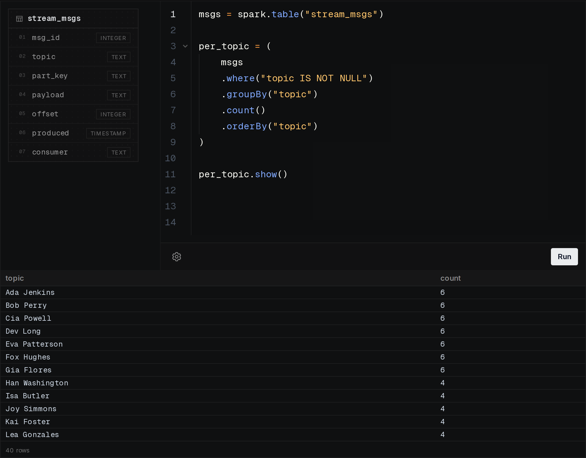
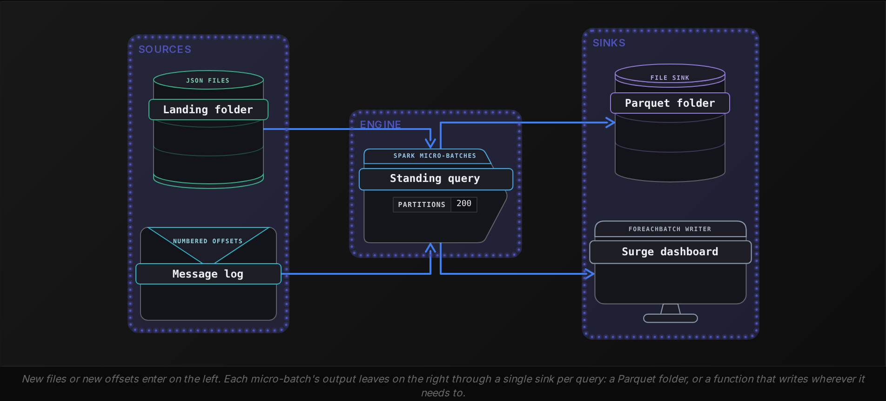
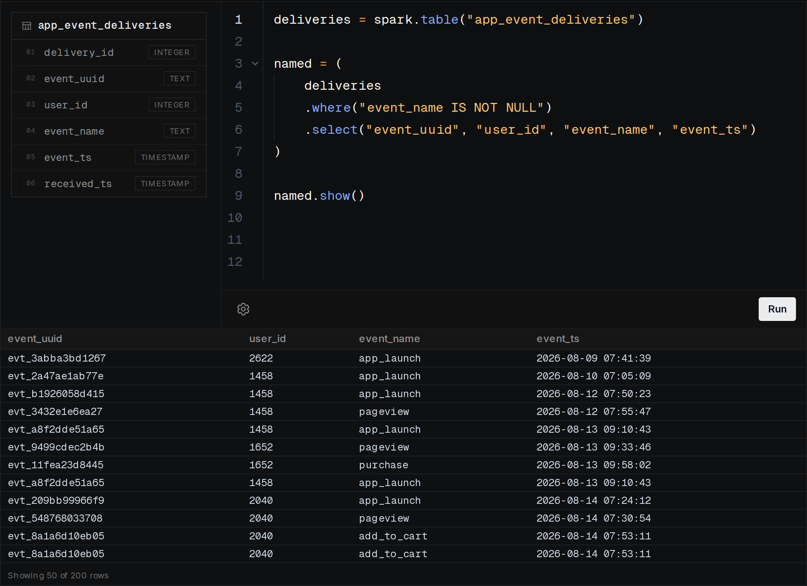

Beginner·Spark · 13 min · 13 challenges

# Structured Streaming: Beginner

At 11:58 pm on New Year's Eve, ride requests flood Uber's app from San Francisco's SoMa district. Surge pricing for each zone is only as good as the request counts behind it: a count that lands 10 minutes late prices a crowd that has already gone home. Here is how Spark keeps that count current, one small batch at a time, and what makes it fast or cheap.


<br>

---

## A Stream Is a Growing Table

The jobs you have run so far read input that sat still: it held a fixed set of rows when the action began, and the job finished once it had read them all. Ride requests never sit still. On a busy night a phone somewhere sends a new one every few milliseconds, so the dataset you want to count has no last row, and any batch job run over it is out of date the moment it ends.

Structured Streaming, the stream engine built into Spark since version 2.0, treats the stream as a table that gains rows forever. You write an ordinary DataFrame query against that table, and Spark keeps the query standing. Each time rows are appended, Spark updates the query's answer, and the promise is exact: the answer matches what the batch query would return if you ran it over every row received so far.


<br>

### The input table and the result table

Two tables are in play. The input table holds every event the stream has delivered, a row per event, and it only grows at the bottom. The result table holds the query's answer over the input table. Here is a query that counts requests per zone, followed through 30 seconds of New Year's Eve in San Francisco:

| Clock | Rows appended | Input table | Result table |
| --- | --- | --- | --- |
| 23:58:00 | ride 1 (SoMa), ride 2 (Mission), ride 3 (SoMa) | 3 rows | SoMa 2, Mission 1 |
| 23:58:10 | ride 4 (SoMa), ride 5 (Marina) | 5 rows | SoMa 3, Mission 1, Marina 1 |
| 23:58:20 | ride 6 (Mission) | 6 rows | SoMa 3, Mission 2, Marina 1 |
| 23:58:30 | none | 6 rows | SoMa 3, Mission 2, Marina 1 |

Check the last column against the input size. At 23:58:20 the result is exactly what `groupBy("zone").count()` returns on the 6 rows received by then. At 23:58:30 nothing new arrived, so the answer stays put. That equivalence is the contract every streaming query keeps: the same answer as the batch query over all data so far, refreshed whenever the data grows.


<br>

### Updating without rereading

Rerunning the batch query over the whole input table on every update would keep the contract and fail on cost. By morning that table holds every request since the stream started, and each rerun would read more than the one before. Spark reads only the rows appended since its previous update and folds them into the answer it already holds. At 23:58:20 the only new row was ride 6, so Spark added 1 to Mission's count. Where Spark keeps that running answer between updates is the subject of a later lesson. For now, treat the input table as a model for reasoning about the query: Spark never stores it whole.

| ✓ Batch query | ✗ Streaming query |
| --- | --- |
| • Input holds a fixed set of rows<br><br>• Runs once and ends<br><br>• Reads all of its input on every run<br><br>• Answer is final when the job ends | • Input gains rows for as long as the query runs<br><br>• Runs until you stop it<br><br>• Reads only rows new since the last update<br><br>• Answer is refreshed each time rows arrive |

**At 23:58:30 the result table reads SoMa 3, Mission 2, Marina 1. At 23:58:40 the only arrivals are rides 7 and 8, both from SoMa. What does Spark's next update produce, and which rows does it read?**

- **A.** SoMa 2 and no other rows: the counts for the 2 new rides alone, after reading only those 2 rows
- **B.** SoMa 5, Mission 2, Marina 1, after reading only rides 7 and 8 and adding them to the counts
- **C.** SoMa 5, Mission 2, Marina 1, after rereading all 8 rows of the input table from the beginning
- **D.** SoMa 3, Mission 2, Marina 1, unchanged, because the counts were settled by the earlier update

<details>
<summary>Solution</summary>

**B.** SoMa 5, Mission 2, Marina 1, after reading only rides 7 and 8 and adding them to the counts

The answer matches the batch query over all 8 rows, and Spark gets there by reading the 2 new rows and folding them into the counts it already holds.

**Why the others are wrong**

- **A.** Reading only the new rows is right, but the result table answers the query over every row so far. Mission and Marina keep their counts while SoMa reaches 5.
- **C.** The counts are right, but Spark never rereads the input table. It reads only the rows appended since its previous update, which here is 2 rows.
- **D.** Rides 7 and 8 must raise SoMa from 3 to 5, because a streaming query refreshes its answer whenever rows are appended.

</details>


<br>

### The answer always trails the data

Between updates, the result table describes the past. Ride 5 is in the stream from the moment its phone sends it, but Marina has no row in the result until the update that reads it. That gap, from an event arriving to the result including it, is the stream's latency, and the rest of this lesson is about what sets it.

> **TIP**
>
> To test a standing query, save a copy of its input, run the same transformations with `spark.read`, and compare. The batch answer must match the stream's result table over the same rows.

The seed's `stream_msgs` table is a saved slice of a message log with a row per message. Each row holds the message's `topic` and `offset`, plus the `consumer` recorded for it, or null where none is. Treat it as an input table frozen at an instant and run the count per topic: the rows that come back are the result table a standing query would show at that instant. Then add `.where("consumer IS NOT NULL")` before the `groupBy` and run it again. This standing query counts only messages with a consumer recorded, so no topic's count rises, and a topic with no consumer recorded drops out.



```python
msgs = spark.table("stream_msgs")

per_topic = (
    msgs
    .where("topic IS NOT NULL")
    .groupBy("topic")
    .count()
    .orderBy("topic")
)

per_topic.show()
```


<br>

---

## Micro-Batches

Spark runs a standing query as a loop of ordinary batch jobs. Each job, called a micro-batch, covers the rows that arrived since the job before it, and the batches are numbered from 0. A micro-batch runs as tasks on the same driver and executors you already know, with the same shuffles. What Structured Streaming adds is the loop around them and the bookkeeping that hands each job its slice of the stream.


<br>

### One turn of the loop

> What the driver does for each micro-batch
>
> - Asks the source for its newest position: the latest file in a folder, or the latest offset in each partition of a message log.
> - Writes down the range from the previous batch's end to that position, before any data is read.
> - Plans the query over only the rows inside that range and runs it as a job on the executors.
> - Hands the job's output to the sink and marks the batch committed once the write has landed.
> - Waits for the trigger, then starts the next batch at the position where this one ended.

Fixing the range before reading turns an endless stream into a bounded input. From the executors' side, batch 7 is a small table with a known set of rows, and they handle it like any other job's input. Where the driver keeps those ranges, and how it uses them after a crash, comes in a later lesson.


<br>

### Batch 7, played as a job

Take the zone count at batch 7, whose range held 9 rows read as 2 input partitions. Play the job and find its shuffle. The `where` runs inside the tasks that read each partition, and the `groupBy` moves rows so that each zone lands on one of 3 reduce tasks, the same exchange a nightly job over a year of requests would run.

https://github.com/user-attachments/assets/6cb091f4-e643-49ff-9a05-1c899bf0b59f

Of batch 7's 7 requests, 4 come from SoMa and 2 from Mission, with Marina's 1 making up the rest. The 2 cancelled rides are dropped in the read tasks before anything crosses the network. Spark then adds those 3 counts to the totals carried over from batches 0 to 6. The job's shape does not depend on the batch's size: with 9 rows or 9 million, it runs as 2 stages with a shuffle between them.


<br>

### Small batches pay full job prices

Every micro-batch pays a job's fixed costs before it touches a row: the driver plans and schedules it, then waits for the slowest task to report back. The animation used 3 reduce tasks to fit the screen. A real streaming aggregation shuffles into `spark.sql.shuffle.partitions` reduce tasks in every batch, 200 by default. Adaptive Query Execution, which would coalesce the empty ones in a batch job, is switched off inside a streaming query. For batch 7, that is 200 reduce tasks to count 3 zones, at least 197 of them with nothing to read. Each micro-batch also appears on the Jobs tab of the Spark UI as at least one job of its own, so a stream left running over a weekend fills that tab.

- **100 ms** — lowest latency the Spark docs cite

Those fixed costs put a floor under latency. No micro-batch can deliver a row faster than a job's own overhead from planning to commit, so micro-batching suits answers needed within seconds or minutes and fits poorly where a decision must land within a few milliseconds.


<br>

### Keeping up with the stream

One health check outranks the rest: each batch must finish faster than its share of data arrives. If a batch covers 10 seconds of requests and takes 4 seconds, the stream keeps up. If it takes 14, the next batch starts 4 seconds late with a bigger range. That batch runs longer and pushes the one after it later still. Each finished batch leaves a progress report, which the running query exposes as `lastProgress`:

```sql
{
  "batchId": 7,
  "numInputRows": 9,
  "inputRowsPerSecond": 0.9,
  "processedRowsPerSecond": 2.25,
  "durationMs": {
    "triggerExecution": 4000
  }
}
```

Set the 2 rates side by side: rows arrived at 0.9 a second and were processed at 2.25 a second, so batch 7 ran at 2.5 times the speed it needed. The Structured Streaming tab of the Spark UI charts the same 2 rates for every batch, beside batch duration. A process rate that stays under the input rate for minutes on end means the stream is losing ground, and the fix starts at the slowest stage inside each batch's job, found the way the Spark UI lesson showed.

**A stream runs on a 10-second schedule. For the past hour the Structured Streaming tab shows batch durations of 12 to 13 seconds and an input rate above the process rate. What happens to the stream from here?**

- **A.** Spark drops the rows that arrived during each extra 2 to 3 seconds so batches stay on schedule
- **B.** Spark starts a second batch alongside each slow one, so 2 jobs share the executors to close the gap
- **C.** Nothing worsens: each batch stays 2 to 3 seconds late, and that delay holds steady from now on
- **D.** Each batch starts later with a larger range than the last, so the backlog and the delay keep growing

<details>
<summary>Solution</summary>

**D.** Each batch starts later with a larger range than the last, so the backlog and the delay keep growing

An input rate above the process rate means rows pile up faster than batches clear them. Each late batch inherits a bigger range and so falls further behind.

**Why the others are wrong**

- **A.** Spark never skips rows to keep a schedule. Every row lands in some batch's range, and late batches cover more rows instead.
- **B.** Micro-batches of a query run one after another. A new batch starts only once the previous one has finished.
- **C.** With rows arriving faster than they are processed, the unprocessed backlog grows, so the delay cannot hold steady.

</details>


<br>

---

## Sources and Sinks

A standing query has 2 ends. The source is where new rows come from, and the sink is where each batch's output goes. The choice of source decides whether Spark can tell which rows are new, and the choice of sink decides what becomes of output already written.




<br>

### What a source must provide

Every micro-batch opens with the question "what is new since last time?", so a source has to answer in positions the driver can write down. A file source answers with the list of files it has already read: any file in the folder missing from that list is new. A message log answers with an offset per partition. Batch 7 might cover offsets 1,200 through 1,204 in partition 0 and 830 through 833 in partition 1, 9 messages in all, and batch 8 then starts at 1,205 and 834.

A source also has to fix a schema before the first batch, because every batch must produce the same columns. File sources refuse to guess by default: `spark.readStream.json(path)` without a `.schema(...)` call raises an error on that line, where `spark.read.json(path)` would have scanned the files to work a schema out. The inferSchema lesson priced that scan for a single read, and a stream would pay it against a folder that never stops changing.

| Source | Format name | How it tells what is new | Use |
| --- | --- | --- | --- |
| Files in a folder | json, csv, parquet, orc, text | Remembers every file it has read | Data landed by other jobs |
| Message log | set by the log's connector | Tracks an offset per log partition | Events from apps and services |
| Rate | rate | Counts the rows it has generated | Load tests: rows of timestamp and value at rowsPerSecond |
| Socket | socket | Numbers lines in memory only; cannot replay them after a restart | Demos only: lines read from a host and port |


<br>

### What a sink must provide

Each batch hands the sink a set of output rows. The sink has to take them batch after batch without disturbing what it wrote earlier, and it has to tell Spark when a batch's write has landed, so the driver can mark that batch committed. The file sink does both by adding new files for each batch and listing, in a `_spark_metadata` log inside the output folder, which files belong to committed batches. Spark jobs that read the folder later consult that log and see only committed files.

| Sink | Format name | What it does with a batch | Use |
| --- | --- | --- | --- |
| File | parquet, json, csv, orc, text | Adds new files and never rewrites old ones | Tables that later jobs read |
| Message log | set by the log's connector | Publishes each output row as a message | Feeding other services |
| foreachBatch | a function you write | Calls it with the batch as a DataFrame and its id | Any destination a batch writer reaches |
| Console | console | Prints the batch's rows on the driver | Debugging |
| Memory | memory | Keeps all output as a table in driver memory | Debugging small streams |

`foreachBatch` is the sink to reach for when no built-in one fits. Inside your function the micro-batch is an ordinary batch DataFrame, so you can join it or call `write` on it before handing it to any batch writer you know. The memory sink comes with the opposite warning: it repeats the `collect()` problem in streaming form, because every output row stays in the driver, and a stream left on overnight can exhaust the driver's heap.

```sql
def write_batch(batch_df, batch_id):
    (
        batch_df
        .write
        .mode("append")
        .parquet("/lake/surge_inputs")
    )


query = (
    requests
    .writeStream
    .foreachBatch(write_batch)
    .option("checkpointLocation", "/chk/surge_inputs")
    .start()
)
```

> **TIP**
>
> Point a new query at `.format("console")` first. The console sink prints each micro-batch under a header such as `Batch: 7`, so you can see which rows landed in which batch before the query writes to a real table.

**A stream must read JSON files from /landing/payments and update a team dashboard whose database has no built-in Spark sink. Which source setup and sink fit?**

- **A.** A file source given its columns with .schema(...), and foreachBatch writing each batch with a batch writer
- **B.** A file source that infers columns from the first files, and the console sink for the dashboard to read
- **C.** A file source given its columns with .schema(...), and the memory sink queried by the dashboard
- **D.** A socket source pointed at the folder, and foreachBatch writing each batch with a batch writer

<details>
<summary>Solution</summary>

**A.** A file source given its columns with .schema(...), and foreachBatch writing each batch with a batch writer

File sources need the schema up front, and foreachBatch turns each micro-batch into a plain DataFrame that any batch writer for the database can save.

**Why the others are wrong**

- **B.** A streaming file source refuses to infer a schema by default, and the console sink only prints to the driver's output, which no dashboard reads.
- **C.** The schema part is right, but the memory sink keeps every row in driver memory and is meant for debugging, so an all-day stream would exhaust the driver.
- **D.** The sink is right, but the socket source reads lines from a host and port, not from files. It also loses those lines on restart.

</details>


<br>

---

## readStream and writeStream

Turning a batch job into a stream changes the 2 ends of the program and leaves the middle untouched. Here is a batch job that keeps the requested rides from the landing folder and appends them to a Parquet table:

```sql
requests = (
    spark.read
    .json("/landing/ride_requests")
)

requested = (
    requests
    .where("status = 'requested'")
    .select("ride_id", "zone", "requested_at")
)

(
    requested
    .write
    .mode("append")
    .parquet("/lake/requested_rides")
)
```

The same job as a stream reads every file that lands in the folder from now on:

```sql
requests = (
    spark.readStream
    .schema("ride_id BIGINT, zone STRING, status STRING, requested_at TIMESTAMP")
    .json("/landing/ride_requests")
)

requested = (
    requests
    .where("status = 'requested'")
    .select("ride_id", "zone", "requested_at")
)

query = (
    requested
    .writeStream
    .format("parquet")
    .option("path", "/lake/requested_rides")
    .option("checkpointLocation", "/chk/requested_rides")
    .start()
)
```


<br>

### What changed, line by line

| Part | Batch | Stream | Why |
| --- | --- | --- | --- |
| Read | `spark.read` | `spark.readStream` | Returns a streaming DataFrame |
| Schema | Inferred by scanning the files | Stated with `.schema(...)` | Every batch must yield the same columns |
| Transformations | `where`, `select` | Unchanged | Same DataFrame API, planned per batch |
| Write | `write` ... `parquet()` | `writeStream` ... `start()` | Launches a query that runs until stopped |
| Progress folder | None | `checkpointLocation` | Where the driver records each batch's range |

The middle block is identical to the character. `requested.isStreaming` returns `True`, and Catalyst plans the `where` and `select` for each micro-batch as it plans them for the batch job; `explain()` on the streaming DataFrame shows the same filter and projection.


<br>

### start() hands back a handle

`write.parquet()` is an action: the call blocks until the files exist, then returns. `writeStream.start()` launches the query on a background thread in the driver and returns a `StreamingQuery` handle straight away, while the micro-batches run behind it. Most daily work needs only 4 calls on that handle:

```sql
query.status
query.lastProgress
query.awaitTermination()
query.stop()
```

`status` says whether a batch is running or the query is waiting for data. `lastProgress` is the batch report from the micro-batch section. `awaitTermination()` blocks the calling program until the query ends, and a script submitted to a cluster needs it: the background thread does not keep the application alive, so a script that finishes right after `start()` takes its stream down with it. `stop()` ends the query.


<br>

### What a stream refuses

The first thing a stream refuses is an action. Calling `requested.count()` or `requested.show()` raises an `AnalysisException` whose message begins "Queries with streaming sources must be executed with writeStream.start()". An action asks for a single final answer over a fixed input, and a streaming DataFrame has no fixed input to give. Some transformations are refused too, at `start()` rather than on the line where you wrote them. An `orderBy` over raw rows is one: placing the first row in order requires seeing the last, and a stream has no last row. The lazy-evaluation lesson showed errors surfacing at the action; in a stream, `start()` is where the whole plan gets checked.

**A teammate tests a new stream with the program below. What happens when it runs?**

```python
events = (
    spark.readStream
    .schema("event_id BIGINT, user_id BIGINT, event_name STRING")
    .json("/landing/app_events")
)

purchases = events.where("event_name = 'purchase'")

print(purchases.count())
```

- **A.** It prints how many purchase rows the files in the folder hold at that moment
- **B.** It waits for the first micro-batch to finish, then prints that batch's purchase count
- **C.** It raises an AnalysisException at count(), saying a stream must run through writeStream.start()
- **D.** It prints 0, because no micro-batch has read any files by the time count() runs

<details>
<summary>Solution</summary>

**C.** It raises an AnalysisException at count(), saying a stream must run through writeStream.start()

An action on a streaming DataFrame is refused on the spot. The program needs a writeStream with a sink and a call to start().

**Why the others are wrong**

- **A.** That is what the batch reader would do. A streaming DataFrame has no fixed input, so count() cannot return a single number.
- **B.** No micro-batch runs at all. Batches start only from writeStream.start(), and the action fails before any could begin.
- **D.** The call never returns a number. Spark refuses actions on streaming DataFrames and raises an error instead of counting.

</details>

The seed's `app_event_deliveries` table is a saved slice of an app's event feed. The cell below runs the batch form of a per-event projection. Run it, then work out the streaming version line by line: which call becomes `readStream`, and which line `writeStream` and `start()` would replace.



```python
deliveries = spark.table("app_event_deliveries")

named = (
    deliveries
    .where("event_name IS NOT NULL")
    .select("event_uuid", "user_id", "event_name", "event_ts")
)

named.show()
```


<br>

---

## Triggers

The trigger decides when the next micro-batch starts. It is a single call on the writer, `.trigger(...)` placed before `start()`, and it sets the trade-off between how fresh the result table is and what the stream costs to keep running. Micro-batch queries take 4 trigger settings:

| Trigger | Code | When the next batch starts | When the query stops |
| --- | --- | --- | --- |
| Default | no `.trigger` call | As soon as the previous batch ends, if new data exists | When you stop it |
| Fixed interval | `.trigger(processingTime="10 seconds")` | At the next 10-second boundary, if new data exists | When you stop it |
| Available now | `.trigger(availableNow=True)` | Right away, batch after batch, until the data present at start is done | Once that data is processed |
| Once | `.trigger(once=True)` | Right away, as a single batch holding all data present at start | After that batch; deprecated since Spark 3.4 |


<br>

### A fixed interval under load

With `processingTime="10 seconds"`, Spark aims to start batches at 23:59:00, 23:59:10, 23:59:20 and on through the night. A batch that finishes early leaves the executors idle until the next boundary. A batch that overruns its slot is followed by the next one the moment it ends, and the boundaries it missed are skipped, never queued. If no new data has arrived by a boundary, no batch runs at all.

| Batch | Planned start | Actual start | Duration | What follows |
| --- | --- | --- | --- | --- |
| 7 | 23:59:00 | 23:59:00 | 4 s | Executors idle 6 s until 23:59:10 |
| 8 | 23:59:10 | 23:59:10 | 14 s | Batch 9 starts at 23:59:24, no wait |
| 9 | 23:59:20 | 23:59:24 | 5 s | Executors idle 1 s until 23:59:30 |

Batch 8 overran its slot, so batch 9, due at 23:59:20, began at 23:59:24 without waiting for 23:59:30. One slow batch costs a few seconds of freshness. Batches that overrun every slot run back to back, which is the default trigger in practice, and the freshness the interval promised is gone.

**A stream runs with .trigger(processingTime="10 seconds"), and every batch now takes 25 seconds. When do its batches start?**

- **A.** Every 10 seconds on schedule, so up to 3 batches overlap on the executors at any moment
- **B.** Each batch starts the moment the previous one ends, about every 25 seconds, with missed boundaries skipped
- **C.** At the first 10-second boundary after each batch ends, so a new batch begins every 30 seconds
- **D.** Never again: Spark stops the query with an error once a batch overruns the interval it was set

<details>
<summary>Solution</summary>

**B.** Each batch starts the moment the previous one ends, about every 25 seconds, with missed boundaries skipped

An overrun batch is followed straight away by the next one, and the boundaries it passed are dropped, so batches run back to back.

**Why the others are wrong**

- **A.** Batches of a query never overlap. A new batch waits for the previous one to finish, whatever the interval says.
- **C.** Spark does not wait for the next boundary after an overrun. The next batch starts as soon as the previous one finishes.
- **D.** An overrun is normal operation for a fixed interval. Spark keeps the query running and starts the next batch right away.

</details>


<br>

### Latency and cost

Under a fixed interval that the batches keep up with, a row waits up to a full interval for its batch to start, then a batch duration for its result to land. At 10 seconds with 4-second batches, that is up to 14 seconds from a phone's request to the zone count. Cost follows the cluster: the default trigger and a fixed interval both keep executors allocated around the clock, because the query never stops between batches, so you pay for them even while they sit idle.

- **8,640** — micro-batches a day at 10 seconds
- **1,440** — micro-batches a day at 1 minute

Every micro-batch that writes to the file sink adds a new file for every task that produced output, so the interval sets how fast the folder fills. That is the small-files problem from the partitioning lesson, produced on a timer, and every job that reads the folder later pays to open them.


<br>

### Matching the trigger to the need

| Need | Trigger | Why |
| --- | --- | --- |
| Surge dashboard fresh within 30 seconds | `processingTime="10 seconds"` | Bounded freshness, with batches big enough to spread each job's fixed cost |
| Fraud score as soon as micro-batches allow | Default | Each batch starts the moment the last one ends |
| Finance table refreshed each morning | `availableNow=True`, started by a scheduler | The cluster runs only while it catches up, then shuts down |

With `availableNow=True`, a stream behaves like a scheduled batch job that remembers where it stopped. Start it at 06:00 and it processes every file that landed since the previous run, in as many micro-batches as rate limits such as `maxFilesPerTrigger` allow, then stops, so the job that launched it can finish and release its executors. The next run picks up where this one ended, and no job has to work out which files are new. `once=True` did the same work in a single batch and ignored rate limits, which turned a large backlog into a single oversized job; Spark 3.4 deprecated it in favor of `availableNow`.

**A finance team needs yesterday's card payments in a Parquet table by 07:00 each day and wants to pay for executors only while they work. Which setup fits?**

- **A.** The default trigger on a cluster that runs all day, so the table is current long before 07:00
- **B.** processingTime="24 hours" on a cluster that sits idle between runs, waking once a day
- **C.** once=True started at 06:00, since it reads the whole backlog in a single batch and stops
- **D.** availableNow=True started by a scheduler at 06:00, stopping as soon as it has caught up

<details>
<summary>Solution</summary>

**D.** availableNow=True started by a scheduler at 06:00, stopping as soon as it has caught up

The run processes everything that landed since the last one, in rate-limited batches, then stops so the executors can be released.

**Why the others are wrong**

- **A.** The table would be current, but executors stay allocated around the clock for a table that is read once a morning.
- **B.** The query never stops between boundaries, so the executors are paid for during the 23-plus idle hours as well.
- **C.** It would stop, but once=True is deprecated since Spark 3.4 and squeezes a large backlog into a single oversized batch.

</details>


<br>

---

## Putting It All Together

Picture Uber's New Year's Eve in San Francisco: requested rides land as JSON files in a landing folder, a stream counts them per zone every 10 seconds for the surge dashboard, and finance wants the same rides as a Parquet table by 07:00 on January 1.

- The landing folder is the source: the stream states its schema, and the file list tells each micro-batch which requests are new.
- Each 10-second batch is a small job with a shuffle for the zone count, and its 200 reduce tasks are the first thing to check in the Spark UI when batches overrun.
- The dashboard sink is a foreachBatch function, because the dashboard's database has no built-in sink.
- The finance copy runs at 06:00 with availableNow , so its executors are paid for only while it catches up, and it writes fewer, larger files than a 10-second stream would.


<br>

---

## Key Takeaways

- A streaming query is a standing query over an input table that only grows, and its result matches the batch query over every row so far.
- Spark runs it as a loop of micro-batches: the driver fixes each batch's range, then runs an ordinary job over only the rows in that range.
- Each micro-batch pays a job's fixed costs, including spark . sql . shuffle . partitions reduce tasks after a shuffle, with Adaptive Query Execution switched off.
- A source must say what is new and supply a schema up front; a sink must accept batch after batch and confirm each write.
- readStream and writeStream . . . start ( ) replace the batch ends, the transformations between them stay the same, and actions are refused.
- The trigger sets freshness and cost: the default and fixed intervals keep executors running, while availableNow clears the backlog and stops.
