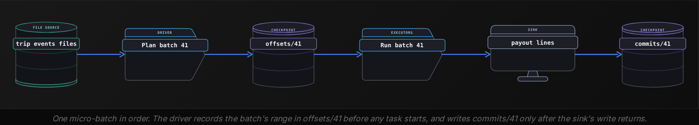
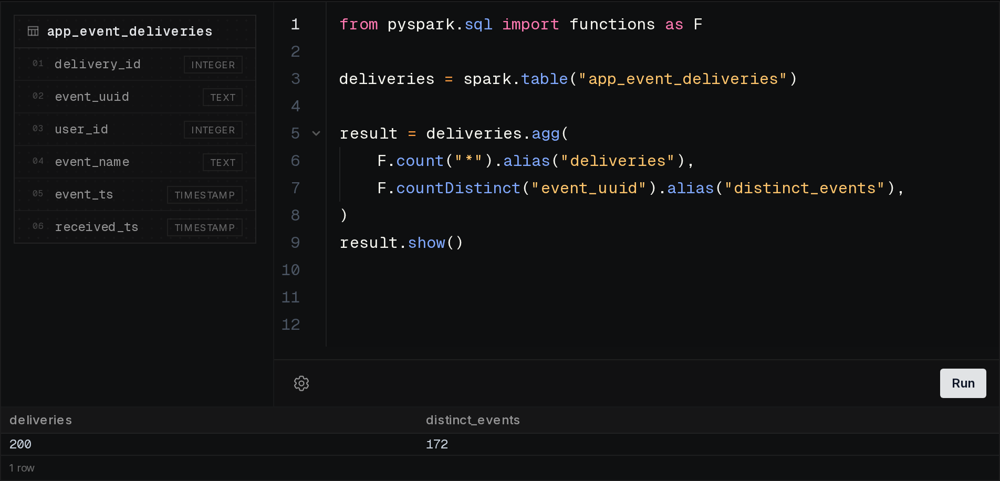

Intermediate·Spark · 14 min · 14 challenges

# Structured Streaming: Intermediate

Take the Uber stream that turns finished trips into driver payout lines. At 02:13 the Spark application crashes in the middle of batch 41, and on-call restarts it. Batch 41 held 634 trips. Will those trips be paid out never, once, or twice? The answer is written in the query's checkpoint folder and in what its sink does when the same batch arrives a second time.


<br>

---

## Checkpointing

A streaming query is meant to run for weeks, and the processes running it will die along the way: a node gets reclaimed, a deploy restarts the driver, an executor runs out of memory. The checkpoint is how the next run learns where the last one stopped. It is a folder on durable storage, named by the `checkpointLocation` option on the writer, that the query updates on every micro-batch.

```sql
trips = (
    spark.readStream
    .schema(trip_schema)
    .json("/landing/trip_events/")
)

completed = (
    trips
    .filter(F.col("status") == "completed")
    .select("trip_id", "driver_id", "city_id", "fare")
)

query = (
    completed.writeStream
    .foreachBatch(write_payout_lines)
    .option("checkpointLocation", "/chk/payout_lines/")
    .trigger(processingTime="1 minute")
    .start()
)
```

Inside `/chk/payout_lines/`, each micro-batch leaves files named by its batch number. Here is what each entry means, using batch 41 as the example:

| Entry | Written | Holds |
| --- | --- | --- |
| metadata | Once, at the first start | The query's id, which ties every later run to this folder |
| offsets/41 | Before batch 41 runs | Where batch 41 ends in each source, plus settings frozen for the batch |
| sources/0/41 | While batch 41 is planned | The 3 new files batch 41 reads; the file source keeps this list |
| commits/41 | After the sink accepts batch 41 | A marker that batch 41 is finished |
| state/ | Every batch, stateful queries only | Values carried between batches, such as running counts |

An offset is a source's position marker. For a partitioned message log it is a record number per partition; for the file source it is an entry number in the file list it keeps under `sources/`. Batch 41 starts where offsets/40 ended and stops at offsets/41, so the pair pins down exactly which rows belong to the batch: here, 3 files holding 634 trip events.



That order is the design. offsets/41 is a promise about what batch 41 will read, made before the work starts; commits/41 is the receipt, written after. A crash can land between them, and Spark's restart logic exists to handle that gap.


<br>

### What a restart reads

When a query starts with a `checkpointLocation` that already has content, Spark finds the highest batch number in `offsets/` and in `commits/` and compares them before reading any new data.

| Latest offsets | Latest commits | What Spark does first |
| --- | --- | --- |
| 41 | 41 | Plans batch 42, starting where batch 41 ended |
| 41 | 40 | Runs batch 41 again over the range stored in offsets/41 |
| none | none | Treats the query as new and asks each source for its starting position |

The middle row decides correctness. Spark never plans a fresh range for a half-finished batch: it re-reads the same 3 files, rebuilds the same 634 rows and passes them to the sink again, under the same batch id. Whether the sink is harmed by that depends on the sink, which the next section takes up.


<br>

### A stream with no checkpoint

Without a checkpoint, a restarted query has no record of its past and begins as a new query. What that costs depends on the source:

- File source: lists every file in the landing folder and processes all of them, so every trip already paid shows up in the sink again.
- Message log read from its latest position: skips every record produced while the query was down, so those trips are never paid.
- Message log read from its earliest position: replays everything the log still retains, duplicating it downstream.

Any state the query had built is gone as well. Spark protects most sinks from this: the file sink and `foreachBatch` refuse to start without a `checkpointLocation`, while the console sink, meant for debugging, gets a temporary folder that is deleted when the query stops.

| ✓ Do | ✗ Don't |
| --- | --- |
| • Put the checkpoint on storage that outlives the cluster, such as an object store path<br><br>• Give each query its own checkpoint folder and keep it for the life of the query<br><br>• Reuse the same checkpointLocation when you redeploy the same query | • Point 2 queries at one checkpoint folder; they overwrite each other's offsets<br><br>• Put it on the driver's local disk; a driver restarted elsewhere cannot see it<br><br>• Delete the folder to unstick a failing stream; that resets its position too |

> **TIP**
>
> A new checkpoint path is a new query, even when the code is identical. Moving the folder during a config cleanup is a common way to re-process a month of files by accident.

**The payout query dies after offsets/41 is written and after the sink has received part of batch 41, but before commits/41 exists. It restarts with the same checkpointLocation. What does Spark run first?**

- **A.** Batch 42, over only the files that landed after the crash
- **B.** Batch 41 again, over the 3 files recorded in the checkpoint
- **C.** Batch 41 again, over every file in the folder at restart time
- **D.** Nothing, until an operator picks a new starting position

<details>
<summary>Solution</summary>

**B.** Batch 41 again, over the 3 files recorded in the checkpoint

Latest offsets is 41 and latest commit is 40, so Spark re-runs batch 41 over the exact range stored in offsets/41 and sources/0/41.

**Why the others are wrong**

- **A.** Batch 42 is planned only once commits/41 exists. Here the latest commit is 40, so batch 41 is unfinished.
- **C.** The range of batch 41 was fixed before it ran. Files that arrived later belong to batch 42 or after.
- **D.** Restart needs no operator. The offsets and commits folders tell Spark which batch to run.

</details>


<br>

---

## Exactly-Once as a Contract

Exactly-once describes what ends up in the sink: every input record affects the output once, even when a crash forces Spark to process a batch twice. Spark makes no promise to execute each batch a single time, and the checkpoint walk-through showed it re-running batch 41 by design. The guarantee is a contract between 3 parties, and it holds only while all 3 keep their side of it.

| Party | Its side of the contract | What a crash does without it |
| --- | --- | --- |
| Source | Serve the same records again when asked for an old offset range | The re-run reads different rows, or none |
| Checkpoint | Store each batch's range before it runs and a commit after it finishes | The restart cannot tell which range to redo |
| Sink | Absorb a second delivery of a batch without changing the result | The re-run adds its rows on top of the first copy |


<br>

### A source that can replay

A source is replayable if it can serve an old range on request. A message log that keeps records for 7 days can re-serve the exact offsets batch 41 read, provided the query comes back within those 7 days. The file source re-reads files for as long as nobody moves or deletes them. A socket source keeps nothing: a line read from the socket is gone, and no checkpoint can bring it back, which is why Spark's documentation limits it to testing.

*Replay has an expiry date. If cleanup deletes trip files, or the log's retention window passes, before the query restarts, the range recorded in offsets/41 no longer exists and the contract fails at its first party.*


<br>

### A sink that can take a replay

A sink keeps its side in 1 of 2 ways: it is idempotent, or it is transactional. An idempotent write leaves the same result whether it runs once or twice. A plain append fails that test, since 634 rows appended twice is 1,268 rows. These 3 patterns pass it:

- **Overwrite by batch:** write batch 41 to a folder or partition named by its batch id, replacing whatever is already there.
- **Upsert by key:** match rows on trip_id, so a second copy of a trip rewrites the same row instead of adding one.
- **Record the batch id:** store the last batch id the target applied, and skip any batch at or below it.

Upserts and batch-id tracking need a target that supports them, such as a database table with a key. Overwriting by batch needs only a folder. `foreachBatch` calls your function with each batch's DataFrame and its batch id, and a re-run of batch 41 arrives with id 41 again. Overwriting by batch and recording the batch id both key on that repeated id. The upsert keys on `trip_id` instead, a business key that is the same in both copies of a trip. Here is `write_payout_lines` rewritten with the first pattern:

```sql
def write_payout_lines(batch_df, batch_id):
    (
        batch_df.write
        .mode("overwrite")
        .parquet(f"/lake/payout_lines/batch_id={batch_id}/")
    )
```

#### Transactional: Spark's file sink

A transactional sink makes a batch's rows and its batch id visible in a single atomic step: both or neither. Spark's file sink works this way. Tasks write part files into the output folder, then the driver writes `_spark_metadata/41`, a log entry listing exactly those files. A re-run of batch 41 finds that entry and skips the write. Spark jobs that read the folder take their file list from `_spark_metadata`, so part files left by a crashed attempt stay invisible to them; a tool that lists the folder directly still sees them.

| Sink | What a re-run of batch 41 does | Guarantee |
| --- | --- | --- |
| File sink | Finds _spark_metadata/41 and skips | Exactly-once |
| foreachBatch, plain append | Appends all 634 rows again | At-least-once |
| foreachBatch, keyed on batch_id | Replaces or skips batch 41 | Exactly-once |
| Message-log sink | Publishes the records again | At-least-once |
| Console | Prints the batch again | Debugging only |

> The weakest party sets the guarantee
>
> - Replayable source, checkpoint, plain append: a crash duplicates a batch. At-least-once.
> - Socket source, checkpoint, file sink: rows read before a crash are lost, and nothing restores them.
> - Replayable source, checkpoint, idempotent or transactional sink: exactly-once.

**A crash hits in the middle of a batch. Which pipeline still ends with each trip in the output once?**

- **A.** File source, checkpoint, foreachBatch appending each batch over JDBC
- **B.** Socket source, checkpoint, Spark's file sink with _spark_metadata
- **C.** File source, no checkpointLocation, foreachBatch overwriting by batch id
- **D.** File source, checkpoint, foreachBatch overwriting a folder per batch id

<details>
<summary>Solution</summary>

**D.** File source, checkpoint, foreachBatch overwriting a folder per batch id

All 3 parties hold: files can be re-read, offsets/N fixes the range, and the re-run replaces its own folder.

**Why the others are wrong**

- **A.** The source and checkpoint hold, but the append writes the replayed batch a second time. That's at-least-once.
- **B.** The sink is transactional, but the socket can't serve the old range, so rows read before the crash are gone.
- **C.** foreachBatch refuses to start without a checkpoint, and a restart without one would forget every batch it ran.

</details>


<br>

---

## The Dup After Restart

Tuesday morning, finance reports that 634 trips from overnight were paid twice. The payout query crashed at 02:13 and came back at 02:20. Duplicates after a restart have a short list of causes, and the checkpoint together with the duplicated rows tells you which one you are looking at.

The version of `write_payout_lines` running that night, before the rewrite in the previous section, appended each batch to the payouts database over JDBC and stamped every row with its batch id. Here is batch 41, step by step:

| Time | What happened | Latest offsets | Latest commit | Batch 41 rows in sink |
| --- | --- | --- | --- | --- |
| 02:12:00 | Batch 41 planned: 3 files, 634 trips | 41 | 40 | 0 |
| 02:12:40 | write_payout_lines appends batch 41 | 41 | 40 | 634 |
| 02:13:05 | Driver killed before commits/41 is written | 41 | 40 | 634 |
| 02:20:00 | Restart finds offsets 41, commit 40, re-runs 41 | 41 | 40 | 634 |
| 02:20:30 | Second append, then commits/41 is written | 41 | 41 | 1,268 |

Each part behaved as designed. The files were still there, the checkpoint sent Spark back to batch 41 and nowhere else, and Spark produced the same 634 rows with the same batch id. The sink appended them because a plain append has no way to recognise a repeat. The half of the contract that was missing is the sink's.


<br>

### Reading the duplicates

The duplicated rows carry the evidence. Group every duplicated trip by the batch id it was written under:

```sql
SELECT
  batch_id,
  COUNT(DISTINCT trip_id) AS duplicated_trips,
  COUNT(*) AS rows_written
FROM payout_lines
WHERE trip_id IN (
  SELECT
    trip_id
  FROM payout_lines
  GROUP BY trip_id
  HAVING COUNT(*) > 1
)
GROUP BY batch_id
ORDER BY batch_id
```

For this incident the query returns 1 row: batch 41, 634 duplicated trips, 1,268 rows written. Duplicates confined to a single batch id, 2 copies each, are the fingerprint of a replay into a sink that isn't idempotent. Other patterns point elsewhere:

| What the duplicates look like | Cause | Part to fix |
| --- | --- | --- |
| All in 1 batch id, 2 copies each | Crash after the write, before commits/N; the batch re-ran | Sink: make it idempotent or transactional |
| Spread across history; second copies in batch ids counting up from 0 | Checkpoint deleted or path changed; the query started over | Checkpoint: keep 1 folder per query for its whole life |
| Same event id, different source offsets or files | The producer sent the event twice | Input: deduplicate on the event id |
| Missing rows after a long outage | Retention removed the range before the restart | Source: keep data longer than the longest outage |


<br>

### Duplicates the source sends

The third row sits outside Spark's contract. Exactly-once means each input record lands once, and 2 deliveries of 1 event are 2 records. Phones cause this: an app that loses signal after sending an event, before the acknowledgement arrives, sends it again with the same event id. The `app_event_deliveries` table has that shape: 1 row per delivery, with its own `delivery_id` and `received_ts`, and `event_uuid` naming the event. Run the cell to compare deliveries with distinct events.



```python
from pyspark.sql import functions as F

deliveries = spark.table("app_event_deliveries")

result = deliveries.agg(
    F.count("*").alias("deliveries"),
    F.countDistinct("event_uuid").alias("distinct_events"),
)
result.show()
```

Any gap between the 2 numbers is redelivery. `deliveries.dropDuplicates(["event_uuid"])` keeps 1 row per event. `distinct()` would keep every copy, because 2 deliveries of an event differ in `delivery_id` and `received_ts`. On a stream, the dedupe step must remember event ids from every earlier batch to catch a copy that arrives a day late, which makes it stateful; the last section of this lesson prices that memory.

> Cleaning up batch 41
>
> - Delete the 634 extra rows once, keeping 1 row per trip_id.
> - Deploy the batch-id overwrite version of write_payout_lines before the next crash.
> - Keep /chk/payout_lines/ in place: replacing it would replay every batch, not 1.

**After a restart, an analyst finds 9,400 duplicated trips. Every second copy carries a batch id between 0 and 12, while the first copies carry ids from 300 to 1,850. What happened?**

- **A.** The checkpoint was replaced, so the query started over and re-read old files
- **B.** One batch re-ran after a crash, because the sink appends without checking ids
- **C.** The producer sent each trip twice, so Spark read 2 records for every trip
- **D.** The source's retention expired, so Spark skipped ahead to newer files

<details>
<summary>Solution</summary>

**A.** The checkpoint was replaced, so the query started over and re-read old files

Batch ids counting up from 0 mean a brand-new query. With no record of past files, the file source processed them all again.

**Why the others are wrong**

- **B.** A replay keeps its batch id, so both copies would share a single id. These copies sit hundreds of ids apart.
- **C.** Producer copies arrive close together in time, inside nearby batches. They wouldn't cluster in ids 0 to 12.
- **D.** Expired retention removes a range, which leaves missing rows. It can't produce a second copy of anything.

</details>


<br>

---

## Output Modes

Each micro-batch updates a result table: the answer the query would give if it ran as a batch job over every row received so far. The output mode decides which rows of that result table go to the sink after each batch.

| Mode | Sends to the sink after each batch | Fits |
| --- | --- | --- |
| append | Rows added to the result table this batch, each sent once and never revised | Queries whose result rows never change once they exist |
| update | Rows added or changed this batch | Aggregations feeding a sink that can overwrite by key |
| complete | The whole result table, every batch | Small aggregations, such as totals for a few dozen cities |


<br>

### One query, 3 modes

Take a running count of completed trips per driver. In batch 1, driver d7 completes 2 trips and d9 completes 1. Batch 2 adds 1 more for d7 and 2 for a new driver, d4, and batch 3 adds 1 for d9.

| Batch | Result table after it | update sends | complete sends |
| --- | --- | --- | --- |
| 1 | d7=2, d9=1 | d7=2, d9=1 | d7=2, d9=1 |
| 2 | d7=3, d9=1, d4=2 | d7=3, d4=2 | d7=3, d9=1, d4=2 |
| 3 | d7=3, d9=2, d4=2 | d9=2 | d7=3, d9=2, d4=2 |

Append has no column because Spark refuses it for this query. After batch 1 it would have to send d7=2 as a final row, and batch 2 shows it wasn't final. A running count changes whenever its driver finishes another trip, so no row of it is ever safe to emit as permanent. Spark accepts append on an aggregation only when the query also states how late an event may arrive, which lets Spark decide when a group is closed; that mechanism has a lesson of its own later in the track.

Complete is legal and wasteful at this shape. In batch 3 it resends d7=3 and d4=2, which did not change, and the table it resends grows with every new driver, so output per batch climbs for as long as the query runs. Update sent 1 row for the same batch.


<br>

### Which modes a query may use

| Query shape | append | update | complete |
| --- | --- | --- | --- |
| No aggregation: filter, select, withColumn | Allowed | Allowed, same output as append | Rejected: the result table would be every row ever read |
| Aggregation with no time bound | Rejected: groups never close | Allowed | Allowed |
| orderBy with no aggregation | Rejected | Rejected | Rejected |
| Aggregation followed by orderBy | Rejected | Rejected | Allowed |

Spark checks the mode against the plan when you call `start()`, before any data is read, and raises an `AnalysisException`. A sort needs the full result in hand, which only complete mode provides, so `orderBy` is legal there and nowhere else. The 2 rejections you will meet most often read:

Messages raised at start()

- Append output mode not supported when there are streaming aggregations on streaming DataFrames/DataSets without watermark
- Complete output mode not supported when there are no streaming aggregations on streaming DataFrames/Datasets


<br>

### The sink gets a vote

A mode the query allows must also be one the sink accepts. The file sink writes immutable files and can't revise a row it has already written, so it takes append only. `foreachBatch` takes all 3 modes and hands your function the rows the mode selects, leaving it to your code to apply them correctly. The message-log sink also takes all 3, publishing each changed row as a new record for its consumers to reconcile.

> **TIP**
>
> In update mode, foreachBatch receives only the changed rows: d9=2 in batch 3. An upsert on driver_id gives the target table each driver's current count. A plain append would store d7=2 and d7=3 as 2 separate rows, and a replayed batch would add a third.

**This query writes per-driver counts to the file sink and sets no output mode. Which outputMode lets start() succeed?**

```python
counts = (
    trips
    .filter(F.col("status") == "completed")
    .groupBy("driver_id")
    .count()
)

query = (
    counts.writeStream
    .format("parquet")
    .option("path", "/lake/driver_counts/")
    .option("checkpointLocation", "/chk/driver_counts/")
    .start()
)
```

- **A.** append, the default, because the file sink accepts append
- **B.** update, because only changed counts are written each batch
- **C.** None: the sink needs append and the aggregation forbids it
- **D.** complete, because the query contains a streaming aggregation

<details>
<summary>Solution</summary>

**C.** None: the sink needs append and the aggregation forbids it

Each side rejects what the other needs. Writing through foreachBatch in update mode, or adding a time bound, makes the query startable.

**Why the others are wrong**

- **A.** The file sink does accept append, but this aggregation has no time bound, so append is rejected at start().
- **B.** The query allows update, but the file sink can't revise files it has already written, so it rejects update.
- **D.** The query allows complete, but the file sink does not; it accepts append and nothing else.

</details>


<br>

---

## Stateless vs Stateful

A stateless operator computes a batch's output from that batch's rows alone. A stateful operator also needs what earlier batches contained, so Spark keeps a summary of them between batches: the query's state. Any streaming query can be cut into 2 parts: the operators that run fresh on each batch, and the ones that read and update state.

| Operator | Kind | What it keeps between batches |
| --- | --- | --- |
| select, withColumn, filter | Stateless | Nothing |
| Join to a static table | Stateless | Nothing; the static side is read again each batch |
| union of 2 streams | Stateless | Nothing |
| groupBy(...).agg(...) | Stateful | 1 running row per group |
| dropDuplicates on a key | Stateful | Every key value it has seen |
| Join of 2 streams | Stateful | Buffered rows from both sides, covered in a later lesson |


<br>

### Splitting a query

Here is a per-city leaderboard of drivers, built on the same `trips` stream and checkpointed to `/chk/leaderboard/`:

```sql
leaderboard = (
    trips
    .filter(F.col("status") == "completed")
    .join(cities, "city_id")
    .groupBy("city_name", "driver_id")
    .agg(
        F.count("*").alias("trips"),
        F.sum("fare").alias("earned"),
    )
)
```

Read it top down. The `filter` and the join to `cities`, a 2MB static table under the 10MB broadcast threshold, are stateless: they pipeline inside the first stage of each batch, and the broadcast adds no shuffle. The `groupBy` is the stateful part. It hash-shuffles the batch's rows on `city_name` and `driver_id`, and each task after the shuffle merges its slice of the batch into the running totals it holds for those keys.

Where the state shows up in leaderboard.explain()

- Exchange hashpartitioning(city_name, driver_id, 200): the shuffle in front of the state, with 1 state partition per shuffle partition.
- StateStoreRestore: reads each key's running totals from before this batch.
- StateStoreSave: writes the merged totals back, to be checkpointed with the batch.

The animation plays 1 micro-batch of the same shape as Spark runs it, trimmed to a count per driver: 9 trips in 2 input partitions, a filter that drops the 2 cancelled trips inside the tasks that read them, and a shuffle that sends each driver's rows to 1 of 3 reducer tasks. In the live stream, each of those reducers also owns the state for the drivers that hash to it, which is why a driver must land on the same partition in every batch.

https://github.com/user-attachments/assets/f4a849d7-bafd-4889-b58d-eed07db61886

That is 1 shuffle and 2 stages per batch, the plan a batch job would get. The streaming version adds a state read before the merge and a state write after it, in every reducer task, on every batch.


<br>

### What state costs

| ✓ Stateless part | ✗ Stateful part |
| --- | --- |
| • Work per batch grows with the batch's row count<br><br>• Holds nothing in executor memory between batches<br><br>• Restart reads offsets and commits, then carries on<br><br>• Filters and projections may change between restarts | • Work per batch grows with the batch plus the state it touches<br><br>• Holds state in executor memory and writes it under state/ each batch<br><br>• Restart reloads state from the checkpoint into the tasks that need it<br><br>• Grouping keys, aggregates and partition count are fixed by the checkpoint |


<br>

### The partition count is frozen

The number of state partitions is the value of `spark.sql.shuffle.partitions` at the query's first start, and Spark records it among the settings in each offsets file. Every later restart reuses the recorded value and ignores the one you set, because each key's state was filed under the partition its hash chose on the first day. At the default of 200, a stateful query runs 200 reducer tasks on every batch, even a batch of 12 rows, and each task loads and saves its slice of state. Adaptive query execution will not coalesce them: Spark turns it off for streaming queries and logs a warning if it's enabled. Choose the count from the expected state size before the first start.


<br>

### State grows with its keys

State size follows the number of distinct keys an operator has seen, and a key stays until something removes it. The leaderboard keeps 1 row per city and driver, which levels off once every active driver has appeared. `dropDuplicates(["event_uuid"])` keeps every event id it has ever seen: at 50 million events a day, a month of ids is 1.5 billion keys held across the executors and saved into the checkpoint. Bounding that growth by event time is a later lesson's subject; until then, size any stateful operator over an unbounded key before it ships.

> **TIP**
>
> Before shipping a stream, find its first stateful operator. Everything before it is cheap to change and cheap to restart. Everything from it onward commits you to executor memory, checkpoint storage and a fixed state layout for the life of the checkpoint.

**The leaderboard has run for a month against /chk/leaderboard/. Which change, deployed against that same checkpoint, takes effect as intended?**

- **A.** Group by driver_id alone, dropping city_name from the keys
- **B.** Tighten the filter to completed trips with a fare above 0
- **C.** Raise spark.sql.shuffle.partitions from 200 to 400 for speed
- **D.** Add a sum of tips beside the trips and earned aggregates

<details>
<summary>Solution</summary>

**B.** Tighten the filter to completed trips with a fare above 0

A filter is stateless. It changes which rows reach the groupBy, but the state's keys and columns stay the same.

**Why the others are wrong**

- **A.** Grouping keys define how the saved state is laid out. Changing them is not supported against an existing checkpoint.
- **C.** It deploys, but Spark restores 200 from the checkpoint's offsets files and ignores the new value, so the query runs as before.
- **D.** Adding an aggregate changes the schema of the saved state, which an existing checkpoint can't accept.

</details>


<br>

---

## Putting It All Together

Picture Uber's driver incentives team shipping a live per-city leaderboard of completed trips and earnings. It reads the same trip event files as payouts, feeds a table the driver app queries every few seconds, and must survive restarts without counting a trip twice.

- The groupBy on city and driver makes the leaderboard stateful, so spark.sql.shuffle.partitions is set to fit its state before the first start, since the checkpoint freezes it.
- An aggregation rules out append and the file sink accepts nothing else, so the leaderboard writes through foreachBatch in update mode.
- foreachBatch alone is at-least-once; upserting each batch's changed rows on city and driver makes a replayed batch rewrite the same values, which completes the contract.
- The trip files stay on disk long enough to replay, and /chk/leaderboard/ lives on durable storage, so a crash costs 1 re-run batch instead of a month of reprocessing.
- If the files carry producer retries, a dropDuplicates on trip_id before the groupBy cleans the input, at the price of state that grows with every trip.


<br>

---

## Key Takeaways

- A checkpoint writes offsets/N before batch N runs and commits/N after the sink accepts it; a crash between them makes Spark re-run batch N over the same range.
- Without a checkpoint, a restarted query is a new query that re-reads, skips or replays, depending on its source.
- Exactly-once holds when 3 parties keep their side: a replayable source, checkpointed offsets, and an idempotent or transactional sink.
- Duplicates in 1 batch id point to a non-idempotent sink, duplicates across history to a lost checkpoint, and distinct offsets for 1 event to the producer.
- Append needs result rows that never change, complete needs an aggregation, update fits running aggregates, and the file sink takes append only.
- A stateful operator sits behind a shuffle, fixes its partition count and keys at first start, and grows with every distinct key it sees.
