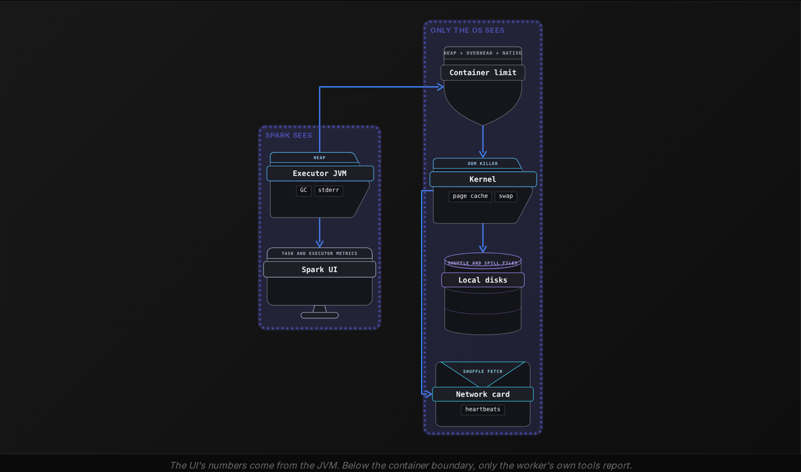

# The Spark UI: Advanced

The on-call data engineer at Netflix gets paged at 2 a.m.: the nightly job turning a day of viewing history into recommendation inputs has lost 6 executors, and the driver log holds 40,000 fetch-failure lines. One earlier line names the real cause. Finding it, then confirming it in GC logs, a flame graph and the worker's kernel, decides whether tonight's fix is memory, code or hardware.


<br>

---

## Reading Executor Logs

The Spark UI tells you an executor was lost and which tasks went down with it. It cannot tell you why the process stopped, because the reason was written to that executor's own stderr seconds before it exited. Each executor is a separate JVM that writes its log lines to a stderr file on its worker, and while it is alive the Executors tab links to that file in the Logs column.

After the executor exits and its container is cleaned up, that link goes dead. The file then lives wherever your cluster manager aggregates container logs, under the application ID and the executor's container. The event log behind the history server keeps metrics and plans but no executor stderr, so copy the logs you need before the cluster manager's retention deletes them.


<br>

### First error versus loudest error

When an executor dies, every task that depended on it fails as well, and each failure writes its own lines. A reducer fetching shuffle blocks from the dead executor logs a `FetchFailedException`, retries, and logs again. Across a few hundred reducers that is thousands of lines, all of which read like a network fault. The cause is usually a single line, earlier, on a different machine.

| Time | Where | Line |
| --- | --- | --- |
| 13:42:03 | executor 7 | WARN TaskMemoryManager: Failed to allocate a page (67108864 bytes), try again. |
| 13:42:05 | executor 7 | WARN TaskMemoryManager: Failed to allocate a page (67108864 bytes), try again. |
| 13:42:09 | executor 7 | ERROR Executor: Exception in task 41.0 in stage 10.0 (TID 3302): java.lang.OutOfMemoryError: Java heap space |
| 13:42:11 | driver | ERROR TaskSchedulerImpl: Lost executor 7 on 10.0.4.21: Command exited with code 52 |
| 13:42:12 | executor 12 | ERROR RetryingBlockTransferor: Exception while beginning fetch of 38 outstanding blocks: java.io.IOException: Failed to connect to /10.0.4.21:43117 |
| 13:42:12 | driver | WARN TaskSetManager: Lost task 3.0 in stage 10.0 (TID 3390): FetchFailed(BlockManagerId(7, 10.0.4.21, 43117), shuffleId=4, mapIndex=17, reduceId=3) |
| 13:42:12 to 13:47:40 | driver and 31 executors | about 4,800 more FetchFailed and connection lines |

Read in time order, the table shows one failure and its cascade. Executor 7 twice failed to get a 64 MB page of execution memory, then threw `OutOfMemoryError` in task 41 and exited with code 52, which Spark uses for an executor out of heap. Everything after 13:42:09 is cascade: executor 12 was fetching map output that executor 7 had written in stage 9, found nothing listening on port 43117, and the driver recorded a fetch failure. The FetchFailed lines outnumber the heap error thousands to one, but the heap error comes first.


<br>

### Classifying a death

| Class | First error | What sets it apart |
| --- | --- | --- |
| Memory, heap | `java.lang.OutOfMemoryError: Java heap space` or `GC overhead limit exceeded`; exit code 52 | `Failed to allocate a page` warnings often come first |
| Memory, outside the heap | No Java error; stderr stops mid-line with exit code 137 (SIGKILL), or ends at `RECEIVED SIGNAL TERM` with exit code 143 when the cluster manager sends SIGTERM first | A signal from outside the JVM: the container limit, the cluster manager or the kernel |
| Serialization | `NotSerializableException`, `InvalidClassException ... local class incompatible`, or `ClassNotFoundException` while reading a task | The same task fails the same way on every attempt, and the executor stays up |
| Network | `FetchFailedException`, `Connection reset by peer` or `RpcTimeoutException`, with nothing earlier on the source executor | Failures follow a host rather than a task |

Heartbeat timeouts need extra care. Each executor reports to the driver every 10 seconds, and after 120 seconds of silence, the default `spark.network.timeout`, the driver logs `Removing executor 5 with no recent heartbeats` and drops it. That line names no cause, and a frequent one is memory: an executor trapped in back-to-back full collections stops heartbeating while its network is fine. Before filing a timeout under network, open the silent executor's stderr and read the 2 minutes before it went quiet.

> **TIP**
>
> `Task not serializable` is thrown on the driver before any task launches, so no executor log mentions it. Executor-side serialization errors repeat instead: with `spark.task.maxFailures` at its default of 4, identical stack traces from different executors that keep running other work rule out the machine.

The order to read in

- Driver log: find the first line naming a lost executor, and note its ID, host and time.
- That executor's stderr: start 2 minutes before the loss and read forward.
- Stop at the first ERROR, or the first WARN that repeats. That line sets the class.
- Treat everything later, on any machine, as cascade until it proves otherwise.

**A job fails at 03:10. The driver log holds 1,900 FetchFailed lines naming host 10.0.6.14, plus a single line at 03:08:55: Removing executor 22 with no recent heartbeats: 131402 ms exceeds timeout 120000 ms. Executor 22 ran on 10.0.6.14, and its stderr ends at 03:06:41 after 3 repeats of Failed to allocate a page (67108864 bytes), try again. How do you classify the death?**

- **A.** Network: the FetchFailed lines all name 10.0.6.14, and the driver lost contact with executor 22.
- **B.** Serialization: executor 22 kept failing to allocate, so its tasks could not write their records.
- **C.** Memory: page allocation failed before the heartbeats stopped, so the timeout and fetch failures are cascade.
- **D.** Network: heartbeats travel over the network, so a timeout means the link to 10.0.6.14 dropped.

<details>
<summary>Solution</summary>

**C.** Memory: page allocation failed before the heartbeats stopped, so the timeout and fetch failures are cascade.

The earliest line on the silent executor is a memory failure, 2 minutes before the driver gave up. The 1,900 fetch failures came after it.

**Why the others are wrong**

- **A.** Both are effects. The fetch failures followed the executor's removal, and the lost contact is the missing heartbeat that the executor's own log explains.
- **B.** Page allocation is about execution memory. Serialization failures name a class and repeat on every attempt of a task.
- **D.** A dropped link would leave executor 22 logging normally or logging its own connection errors. Its log shows memory trouble, then silence.

</details>


<br>

---

## GC Logs

The GC Time column in the Executors tab says how much of a task went to garbage collection. It cannot say whether the collector was clearing short-lived garbage at a furious rate or fighting for room in a heap packed with data the job still needs. Those 2 problems call for opposite fixes, and the JVM's GC log separates them: a line per collection, with heap occupancy before and after.


<br>

### Turning it on

```sql
spark = (
    SparkSession.builder
    .config(
        "spark.executor.extraJavaOptions",
        "-Xlog:gc:stdout:time,uptime",
    )
    .getOrCreate()
)
```

The JVM reads this option when the executor launches, so it belongs in the submit command or the builder of a new application; setting it on a running session changes nothing. Sending the log to stdout puts it behind the stdout link in the Executors tab, beside the stderr from the previous section. For long jobs, write to a rotating file instead, `-Xlog:gc:file=/tmp/gc-%p.log:time,uptime:filecount=5,filesize=20M`, so a week of collections cannot fill a disk that shuffle files also need.


<br>

### Reading a line

A G1 pause line looks like this: [1201.002s][info][gc] GC(311) Pause Young (Normal) (G1 Evacuation Pause) 6144M->1210M(8192M) 52.104ms. Read it from the right. 52.104ms is the pause, during which every task thread on the executor stood still. 8192M is the heap's capacity. 6144M->1210M is occupancy before and after, so this collection freed 4,934 MB. The after-value matters most: whatever survives a collection is still referenced by something, so it is an upper bound on the data the executor is keeping alive.

Here are 2 executors from the same stage, both with GC Time shown in red in the Executors tab, which marks it once garbage collection passes 10% of task time. Both heaps are 8,192 MB.

Executor 3

| Uptime | Event | Heap before->after | Pause |
| --- | --- | --- | --- |
| 1201.0s | Pause Young | 6144M->1210M | 52 ms |
| 1201.5s | Pause Young | 6150M->1222M | 57 ms |
| 1202.0s | Pause Young | 6139M->1198M | 54 ms |
| 1202.5s | Pause Young | 6160M->1215M | 55 ms |

Executor 9

| Uptime | Event | Heap before->after | Pause |
| --- | --- | --- | --- |
| 1840.2s | Pause Young | 7020M->5410M | 120 ms |
| 1846.8s | Pause Young | 7390M->6620M | 180 ms |
| 1851.1s | Pause Young | 7810M->7350M | 240 ms |
| 1853.0s | Pause Full | 8180M->7960M | 9310 ms |

Executor 3's after-values hold flat near 1.2 GB, so the data it keeps fits with room to spare. What drives its collections is allocation. Subtract a line's after-value from the next line's before-value and divide by the time between them to get the allocation rate; divide total pause time by elapsed time to get the share spent stopped. Executor 9's after-values climb at every collection, each young pause frees less than the one before, and a full collection that freezes the JVM for 9.3 seconds hands back almost nothing.

- **9.9 GB/s** — executor 3 allocation rate
- **11%** — executor 3 time spent paused
- **97%** — executor 9 heap live after full GC


<br>

### Churn or a full heap

| ✓ Allocation churn | ✗ Full heap |
| --- | --- |
| • After-GC heap low and flat<br><br>• Each young pause frees most of the heap<br><br>• No full collections<br><br>• Cause: code creating short-lived objects for each row<br><br>• Fix: allocate less, starting from the frames that allocate most | • After-GC heap climbing toward capacity<br><br>• Each pause frees less than the last<br><br>• Full collections that free little, then OutOfMemoryError<br><br>• Cause: tasks holding more than their share of heap<br><br>• Fix: hold less per task, or give each task more heap |

More heap would space executor 3's collections further apart, but the code would produce garbage at the same rate, so the lasting fix is in the code path. Common sources are plans where whole-stage code generation fell back to evaluating row by row, RDD functions that build an object per record, and string expressions that copy every value. The flame graph in the next section names the exact frames. Executor 9 needs the reverse: its tasks hold too much at once, so cut what each holds with more shuffle partitions, fewer cores per executor, or by releasing a cache that crowds the heap.

**Executor 14 has a 12 GB heap and its GC Time shows red. During a slow stage its GC log prints a pause every 0.4 seconds: 9800M->2110M 71ms, 9820M->2090M 69ms, 9790M->2150M 73ms, 9810M->2100M 70ms. Which reading is right?**

- **A.** Full heap: about 9.8 GB is in use before each pause, so its tasks hold too much.
- **B.** Churn: about 2.1 GB survives each pause, and the code allocates roughly 19 GB a second.
- **C.** Full heap: a young pause every 0.4 seconds means the collector cannot keep up with live data.
- **D.** Churn: the 70 ms pauses come from GC logging itself, so turn the log off.

<details>
<summary>Solution</summary>

**B.** Churn: about 2.1 GB survives each pause, and the code allocates roughly 19 GB a second.

Flat, low after-values mean the kept data fits. The pauses come from how fast the young generation refills, so look for the allocating code.

**Why the others are wrong**

- **A.** The before-value includes garbage. The after-value, about 2.1 GB, is what survives, and it stays put.
- **C.** Pause frequency follows the allocation rate. A full heap shows rising after-values and full collections, and neither appears here.
- **D.** Writing a line per pause costs microseconds. The pauses happen with or without the log, which only records them.

</details>


<br>

---

## Flame Graphs

The GC log can report that executor 3 allocates 9.9 GB a second without saying which code does it, and the stage page stops at the task. A sampling profiler goes a level deeper. Many times a second it records the call stack of every running thread, then merges the stacks into a flame graph in which each frame's width is its share of the samples.


<br>

### Attaching to an executor

async-profiler is the usual choice for executor JVMs. It samples without safepoint bias, the distortion that makes profilers built on the JVM's own stack API report the nearest safe point instead of the frame that was really on the CPU. You can load it as an agent when each executor JVM starts, or attach it to an executor that is already running.

- **To a running executor:** on the worker, jps -l lists the executor as the process whose main class ends in CoarseGrainedExecutorBackend. Then asprof -d 60 -e cpu -f /tmp/exec7.html 48211 samples process 48211 for 60 seconds while the slow stage runs.
- **From launch:** load the profiler as an agent through spark.executor.extraJavaOptions, and every executor writes its own profile when it exits.

```sql
spark = (
    SparkSession.builder
    .config(
        "spark.executor.extraJavaOptions",
        "-agentpath:/opt/async-profiler/lib/libasyncProfiler.so"
        "=start,event=cpu,file=/tmp/exec-%p.html",
    )
    .getOrCreate()
)
```


<br>

### Reading by width

Each box is a stack frame. A frame's caller sits beneath it and the frames it calls sit on top, so the bottom row is where every thread starts and the top edge is where the CPU was when the sample fired. Sibling frames are merged and ordered by name, so horizontal position says nothing about when code ran. Width is the only measurement: a frame half as wide as the graph was on the stack in half the samples.

Hunt for wide frames along the top edge. A wide frame with little stacked above it spends its samples in its own code, and that self time is what an optimization removes. A wide frame covered by children is passing its time upward, so keep climbing until the width stops being covered.

#### A 60-second profile of a slow stage

An executor with 4 cores, sampled for 60 seconds at the default 10 ms interval, collects at most 24,000 CPU samples. This profile comes from a stage that pulls the domain out of each page view's referrer URL with `regexp_extract`:

| Frame | Sits under | Samples | Width |
| --- | --- | --- | --- |
| Executor$TaskRunner.run | thread root | 21,600 | 90% |
| GeneratedIteratorForCodegenStage2.processNext | TaskRunner.run | 15,840 | 66% |
| java.util.regex.Matcher.find | processNext | 9,360 | 39% |
| VectorizedParquetRecordReader.nextBatch | processNext | 1,680 | 7% |
| LZ4BlockOutputStream.write | TaskRunner.run | 2,160 | 9% |
| G1 GC worker threads | their own roots | 1,920 | 8% |

The task runner covers 90% because nearly every sample came from a task thread, and `processNext`, the generated code for the whole stage, covers 66%. Climb further and most of that width belongs to `Matcher.find`, topped by nothing but regex internals. Matching the pattern against each referrer costs 39% of the executor's CPU, more than reading Parquet, compressing shuffle output and collecting garbage put together, which sum to 24%. That is the hot code. Rewriting the extraction with `substring_index`, which splits on a fixed delimiter without a pattern engine, or storing the domain once upstream, removes most of that width.

> Choosing the event
>
> - `-e cpu`: where CPU time goes. The default, and the place to start when tasks run hot.
> - `-e wall`: every thread, running or waiting. Shows tasks parked in shuffle fetch or disk I/O, which cpu mode misses.
> - `-e alloc`: which frames allocate the bytes. Answers the churn question the GC log raised.
> - `-e itimer`: CPU sampling for hosts whose kernel blocks perf events.

| ✓ Do | ✗ Don't |
| --- | --- |
| • Profile while the slow stage runs, using its start and end on the stage timeline<br><br>• Profile the executor that runs the straggler task<br><br>• Split threads with -t when wall mode mixes in idle pool threads | • Read left-to-right position as the order code ran in<br><br>• Read a tall tower as slow code; height is only call depth<br><br>• Trust a 2% frame from a 5-second profile |

**A 60-second cpu profile of a straggler shows Executor$TaskRunner.run at 92%. Above it, UnsafeExternalSorter.spill covers 41%, with LZ4BlockOutputStream.write at 30% on top of that, and processNext covers 35%. What does the graph say?**

- **A.** The task framework is the bottleneck: TaskRunner.run is the widest frame at 92%.
- **B.** The generated code is the bottleneck: processNext holds 35% and needs a rewrite.
- **C.** Compression is the bottleneck: turning off spill compression would win back 30%.
- **D.** Spilling is the bottleneck: it takes 41% of CPU, most of it compressing, so tasks need more memory.

<details>
<summary>Solution</summary>

**D.** Spilling is the bottleneck: it takes 41% of CPU, most of it compressing, so tasks need more memory.

Spill and its compression sit above the task frames with 41% of the samples. Fewer spills remove that work, and the next section sizes the memory.

**Why the others are wrong**

- **A.** It is wide because every task sample passes through it. Children cover its width, so the time belongs to them.
- **B.** Its 35% is real work, but the spill path is wider and has a clearer cause.
- **C.** Compression is where spill spends its CPU, but spilling is the cause. Uncompressed spill files write several times more bytes to disk.

</details>


<br>

---

## Spill Ratios

A stage that spills adds 2 columns to its stage page, Spill (Memory) and Spill (Disk), and they measure the same records in 2 states. Spill (Memory) is the execution memory a task released by spilling, counted as the memory pages it held at that moment. Spill (Disk) is what those records took up once serialized and compressed into a spill file.

Their quotient is a compression ratio for your data in the form the engine holds it. With a ratio of 8, every byte on disk had been 8 bytes of memory.


<br>

### What the ratio tells you

| Stage | Spill (Memory) | Spill (Disk) | Ratio | Spill time goes to |
| --- | --- | --- | --- | --- |
| 7 | 96 GB | 12 GB | 8.0 | CPU: serializing and compressing |
| 12 | 30 GB | 27 GB | 1.1 | Disk: writing nearly every byte held |

A high ratio makes spilling cheap on disk and expensive on CPU: stage 7 serializes 96 GB to write 12 GB, and its flame graph shows the spill and compression frames from the previous section. A ratio near 1 means the data was already dense, such as compressed blobs, hashes or random IDs that LZ4 cannot shrink. Stage 12 writes almost every byte it held, so its local disks set the pace, which the next section's OS checks confirm.

The ratio also converts shuffle bytes into memory bytes. Shuffle files go through the same serializer and the same `lz4` codec as spill files, so a task's Shuffle Read Size times the ratio approximates the memory that task needs to hold its whole input.

**Stage 21 shows Spill (Memory) of 44 GB and Spill (Disk) of 40 GB. Its tasks run slowly while executor CPU sits near 30%. Where does the spill time go?**

- **A.** To disk: 44 GB held became 40 GB written, so spill writes almost every byte; check the local disks.
- **B.** To CPU: a ratio near 1 means the serializer works hardest, so profile with -e cpu.
- **C.** To memory: the 4 GB gap is what tasks lost by spilling, so add 4 GB to each executor.
- **D.** To network: spill files go to other executors, so a ratio near 1 means slow transfers.

<details>
<summary>Solution</summary>

**A.** To disk: 44 GB held became 40 GB written, so spill writes almost every byte; check the local disks.

A ratio of 1.1 means compression saved little, and slow tasks on idle CPUs point at I/O. The OS checks in the next section confirm it.

**Why the others are wrong**

- **B.** Serializer work tracks what is held, but here CPU is mostly idle and the output is nearly as large as the input.
- **C.** The gap between the 2 numbers measures compression. How much memory to add comes from what tasks held, which the rest of this section reads.
- **D.** Spill files stay on the executor's local disk. Shuffle files are the ones that cross the network.

</details>


<br>

### Sizing from what tasks held

Spill totals say whether a stage spilled. Sizing needs the stage's summary metrics, read at the max row, because the largest task is the first to run out. Show Additional Metrics adds Peak Execution Memory, the most a task held at once. A task that peaked at P and still spilled S wanted roughly P + S to finish without touching disk.

The animation below plays a sort-merge join in which user 7 owns 9 of the 12 events. Each key's rows land on a single reducer task, so the task that receives user 7 holds those 9 events and the matching user row, more than any other task. At production scale, that task is the max row of the summary metrics.

https://github.com/user-attachments/assets/43ed0fe7-a932-4007-a4bd-4a5c7d130763

> **TIP**
>
> When the max task's Spill (Memory) is many times the median, a hot key is at work, and sizing all 200 tasks for the max wastes memory on 199 of them. Fix the skew first, then size from the median.

#### Stage 15: 200 tasks, 16 GB heaps, 4 cores

| Metric | Median task | Max task |
| --- | --- | --- |
| Shuffle Read Size | 690 MB | 705 MB |
| Peak Execution Memory | 2,300 MB | 2,360 MB |
| Spill (Memory) | 3,200 MB | 3,280 MB |
| Spill (Disk) | 400 MB | 410 MB |

Supply first. A 16 GB heap is 16,384 MB; subtract the 300 MB Spark reserves and multiply by `spark.memory.fraction`, 0.6, to get 9,650 MB of unified memory. With 4 tasks running and nothing cached, each can claim a quarter, about 2,410 MB. Now demand. The max task peaked at 2,360 MB and spilled 3,280 MB more, so it wanted about 5,640 MB, which matches its 705 MB of shuffle input times the ratio of 8. Each task needs about 2.3 times the memory it gets.

Halving the executor to 2 cores raises each task's share to about 4,825 MB, still short of 5,640, and halves how many tasks the executor runs at once. Raising the partition count works the other way, by shrinking what each task holds. Keeping the max task's input under 2,410 / 8, roughly 300 MB, means splitting the stage's 140,000 MB of shuffle data at least 467 ways, and 600 partitions leaves headroom for hash-table overhead and uneven keys.


<br>

---

## The OS Layer

Every tool so far reads the JVM from inside: its stderr, its collector, its stacks, its task metrics. Some failures happen underneath it. The kernel can kill the process, a disk can saturate while the JVM sees only slow writes, and a network card can drop packets that TCP resends without the JVM ever knowing. For those, the UI shows a symptom with no cause, and the evidence is on the worker.




<br>

### The kill the JVM never logs

An executor killed with SIGKILL writes nothing on the way out, so its stderr stops mid-line with no stack trace or shutdown message. Its exit code is 137, which is 128 plus signal 9. The signal comes from the container's memory limit, which counts heap, `memoryOverhead` and native allocations together, or from the kernel's OOM killer when the whole worker runs short. A cgroup limit or the OOM killer leaves its record in the kernel log; a cluster manager that polls memory and kills on its own writes to its node log instead.

On the worker, run dmesg -T | grep -i -E 'killed process|out of memory' and look for a line such as Memory cgroup out of memory: Killed process 51877 (java) total-vm:21458712kB, anon-rss:18450432kB. The anon-rss figure is what the process held when it died: 18,018 MB. A 16 GB heap with the default 10% overhead sets an 18,022 MB limit, and the kernel kills the process as it reaches that limit, so anon-rss lands at the limit and never past it. The heap holds at most 16,384 MB, so native memory took at least the other 1,634 MB, filled the 1,638 MB of overhead and still asked for more. Raise spark.executor.memoryOverhead to 3 GB for headroom, then check that the kills stop.

**Executor 11 on worker 10.0.4.38 disappears with exit code 137. Its stderr ends mid-line with no exception, and its GC log's last after-value was 6.1 GB of a 12 GB heap. Where do you look next, and what do you expect to find?**

- **A.** The kernel log on 10.0.4.38 via dmesg -T, for a kill over memory outside the heap.
- **B.** The driver log, for a FetchFailedException that took the executor down over the network.
- **C.** Executor 11's stderr again, for an OutOfMemoryError that the first read missed.
- **D.** The Executors tab, for a GC Time spike long enough to stop the heartbeat.

<details>
<summary>Solution</summary>

**A.** The kernel log on 10.0.4.38 via dmesg -T, for a kill over memory outside the heap.

Exit 137 with no Java error is a SIGKILL from outside. With the heap half used, the extra memory was native, and the kernel log names the kill.

**Why the others are wrong**

- **B.** Fetch failures fail tasks; they never send a signal to a JVM. A fetch error would also appear in the executor's own stderr.
- **C.** A heap OOM logs the error and exits with code 52. This heap was half empty and nothing was logged.
- **D.** A heartbeat timeout ends with the driver removing the executor and logging it. Exit 137 means signal 9 from outside the JVM.

</details>


<br>

### Disk, memory and network saturation

| Symptom in Spark | Check on the worker | Saturated looks like |
| --- | --- | --- |
| Exit 137, stderr cut off, no Java error | `dmesg -T` | `Killed process ... (java)` at the exit time |
| Tasks slow, GC low, CPU idle | `vmstat 5`, then `iostat -x 5` | High `wa`; `w_await` in tens of ms on the spill disk |
| GC pauses jump from milliseconds to seconds | `vmstat 5` | Nonzero `si` and `so`: the heap is swapping |
| High Shuffle Read Blocked Time | `sar -n DEV 5`, `nstat` | Receive rate near link speed, or retransmits climbing |
| `No space left on device` | `df -h` on each `spark.local.dir` | A local directory at 100% |

#### A worker during a slow shuffle stage

| r | b | si | so | us | sy | id | wa |
| --- | --- | --- | --- | --- | --- | --- | --- |
| 3 | 11 | 0 | 0 | 9 | 4 | 49 | 38 |
| 2 | 12 | 0 | 0 | 8 | 4 | 45 | 43 |
| 3 | 12 | 0 | 0 | 10 | 5 | 40 | 45 |

The worker has 16 cores. The `b` column counts processes blocked in uninterruptible I/O, 11 to 12 here, while user CPU stays between 8% and 10% and `wa`, the time CPUs sat idle waiting on I/O, climbs from 38% to 45%. With `si` and `so` at zero, memory is fine. The executors are ready to work and the disks hold them back: the shuffle and spill files under `spark.local.dir` are the bottleneck, and `iostat -x 5` names the device. Spread `spark.local.dir` across every local disk as a comma-separated list, or cut the bytes written with the shuffle and spill fixes from earlier sections.

Network saturation surfaces as Shuffle Read Blocked Time, the stage page's measure of how long tasks waited on remote blocks. `sar -n DEV 5` prints receive and transmit rates per interface, and a 10 Gb/s link tops out near 1,250 MB/s. If the rate sits well below that while blocked time stays high, run `nstat` twice and compare `TcpRetransSegs`: a count rising by thousands per interval means packets are being lost and resent.

**A shuffle stage is slow. On a worker, vmstat 5 shows wa at 2% and id at 70%, sar -n DEV 5 shows 410 MB/s received on a 10 Gb/s link, and TcpRetransSegs in nstat rises by 9,000 per interval. What limits the stage?**

- **A.** Disk: with CPUs 70% idle, tasks must be waiting on local I/O.
- **B.** Packet loss: the link is far from full, but TCP keeps resending segments.
- **C.** Bandwidth: 410 MB/s is all a 10 Gb/s link can carry.
- **D.** Memory: 70% idle CPU means executors are frozen in garbage collection.

<details>
<summary>Solution</summary>

**B.** Packet loss: the link is far from full, but TCP keeps resending segments.

Idle CPUs, no disk wait, a third of the link's capacity and thousands of retransmits per interval point at a lossy network path.

**Why the others are wrong**

- **A.** Waiting on disk shows as high wa, and wa is 2%. The idle time has another cause.
- **C.** A 10 Gb/s link carries about 1,250 MB/s, so this one runs at a third of capacity.
- **D.** GC threads burn CPU while collecting, which shows as user time. Pauses are confirmed in the GC log.

</details>


<br>

---

## Putting It All Together

The Netflix on-call engineer from the intro sorts the driver log by time. Before the 40,000 fetch-failure lines, the first of the 6 lost executors shows Failed to allocate a page warnings in its stderr, then exit code 52. Its GC log has after-values climbing toward capacity during the aggregation stage, whose Spill (Memory) is 8 times its Spill (Disk) and whose max task wanted far more than its share of execution memory. A flame graph of a surviving executor shows spill and compression frames covering most of its CPU. Compression shrank each spill to an eighth, yet vmstat on the workers still shows wa climbing: every task's compressed spill lands on a single local disk, and that combined volume saturates it. The fix is a shuffle partition count sized from peak plus spill, and spark.local.dir spread across every disk.

- The executor log classified the death as memory, and the GC log showed a full heap rather than churn.
- The spill ratio converted each task's shuffle read into the memory it wanted, which set the new partition count.
- The flame graph confirmed that CPU went to spilling, so less data per task was the right lever.
- The OS layer showed why spill hurt on these workers: a single local disk carried every spill file.
- Each tool covered what the one before it could not see, and the last of them reached the worker's disk and network card.


<br>

---

## Key Takeaways

- Classify an executor death by the first ERROR or repeating WARN on the executor that died first; fetch failures and heartbeat timeouts after it are cascade.
- Exit code 52 is a heap OOM Spark caught, 137 is a SIGKILL from outside the JVM, and a serialization error repeats on every attempt of the same task.
- In a GC log the after-value decides: flat and low means allocation churn, climbing toward capacity means a full heap.
- Read a flame graph by width. The widest frame with little stacked above it is the hot code; position and height carry no cost.
- Spill (Memory) over Spill (Disk) is your data's in-memory blow-up. Peak plus spill, or Shuffle Read Size times the ratio, sizes a task's memory.
- Exit 137 with no Java error, high wa , nonzero swap and climbing retransmits are failures only the worker's kernel and tools can show.
