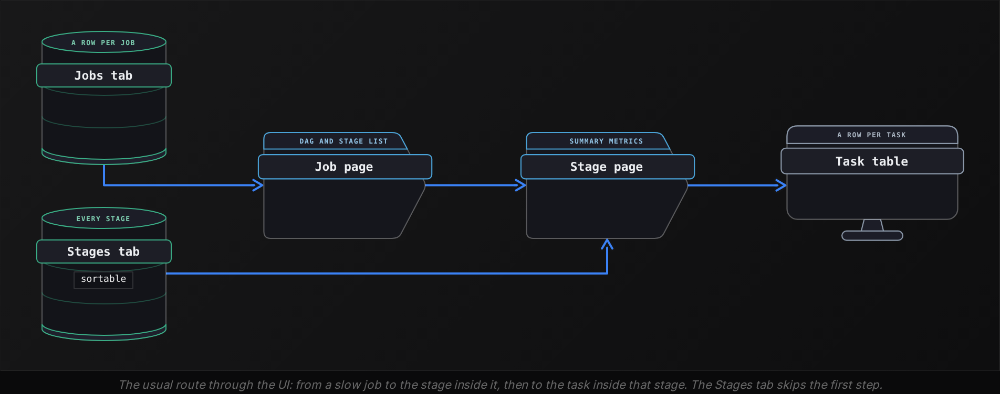
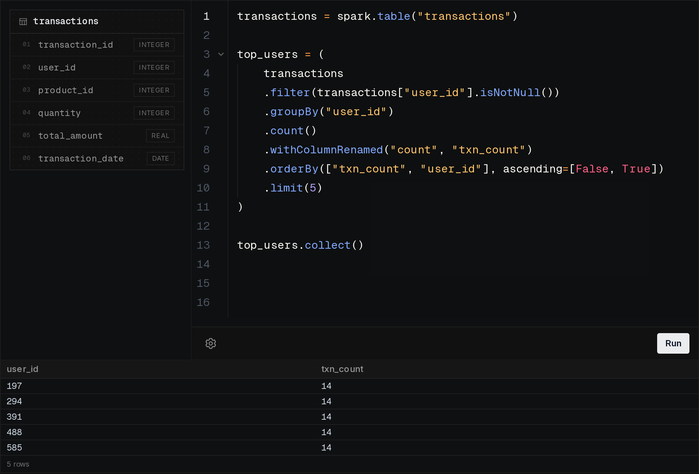
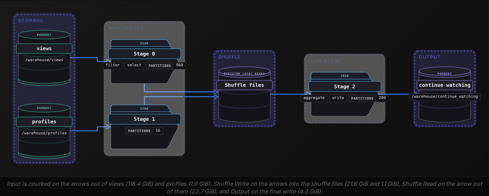

Beginner·Spark · 13 min · 10 challenges

# The Spark UI: Beginner

Netflix's overnight Spark job that rebuilds each profile's Continue Watching row used to finish in 12 minutes. This morning it took 59, and the on-call engineer has a proposal to double the executors. Before approving it, you open the Spark UI and find one task in a 200-task stage that ran for 50 minutes. Which fix works depends on why that task ran so long.


<br>

---

## The Tabs of the Spark UI

Every running Spark application serves a web UI from its driver on port `4040`. A second application on the same host takes `4041`, a third `4042`. The UI lives as long as the application: when the driver exits, the pages go with it. To inspect a finished run, the application must have written an event log, with `spark.eventLog.enabled` set to `true` before it started. The History Server, on port `18080` by default, replays that log into the same pages.

> Which UI holds the run you want?
>
> - Still running: the driver's host on port 4040, or 4041 and up when several applications share it.
> - Finished with event logging on: the History Server on port 18080, showing the same tabs.
> - Finished with event logging off: no pages exist. Turn logging on so the next run can be read.


<br>

### A question for each tab

| Tab | The question it answers | Columns to read |
| --- | --- | --- |
| Jobs | Which actions ran, and how long did each take? | Duration, Stages: Succeeded/Total |
| Stages | Which stage is slow, and how much data did it move? | Duration, Input, Output, Shuffle Read, Shuffle Write |
| Storage | What is cached, and how much of it fits in memory? | Fraction Cached, Size in Memory, Size on Disk |
| Environment | Which settings did the application launch with? | Spark Properties |
| Executors | Is every executor alive and taking its share of tasks? | Failed Tasks, Complete Tasks, Storage Memory |
| SQL / DataFrame | Which plan ran, and how many rows left each operator? | the plan graph and its per-operator metrics |

#### Jobs: a row for every action

A job is the work an action launches. Call `count()` and the Jobs tab gains a row; define 10 transformations without an action and it gains nothing, which is lazy evaluation made visible. With adaptive query execution on, the default since Spark 3.2, a single action can show up as several job rows, because Spark runs each shuffle stage as its own job to measure its output before planning the next step. The SQL / DataFrame tab lists those job ids under the query that launched them.

#### Stages: where the time and the bytes are

A stage is a run of narrow work that ends at a shuffle or at the job's result. The Stages tab lists every stage of every job with its Duration, its task count and 4 data columns: Input, Output, Shuffle Read and Shuffle Write. A slow job usually needs this tab first, and the rest of this lesson works inside it.

#### Storage, Environment, Executors, SQL / DataFrame

- **Storage**: stays empty after cache() until an action runs, because cache() is lazy too. A Fraction Cached under 100% means some partitions are missing from the cache and get recomputed whenever they are read.
- **Environment**: the properties the application launched with. Settings fixed at startup, such as spark.executor.memory, show the value that took effect.
- **Executors**: a row for each executor plus the driver. Failed Tasks piling up on a single row points at that machine: a lost executor, a memory kill, a bad node.
- **SQL / DataFrame**: each query's plan drawn as a graph with measured numbers, such as rows output per operator. Older versions label it SQL. Think of it as explain() after the run, with measurements attached.



**A teammate calls cache() on a DataFrame, defines 2 more transformations on it, and finds the Storage tab empty. What does the empty tab tell you?**

- **A.** The data was too large for memory, so Spark dropped every partition it had cached.
- **B.** No action has run since cache(), so nothing has been computed or stored yet.
- **C.** The Storage tab lists only saved tables, so cached DataFrames never appear in it.
- **D.** The cache went to disk, and the Storage tab counts only partitions held in memory.

<details>
<summary>Solution</summary>

**B.** No action has run since cache(), so nothing has been computed or stored yet.

cache() marks the DataFrame and waits. The first action computes the partitions and stores them, and only then does a row appear.

**Why the others are wrong**

- **A.** Data that did not fit would still show a row, with Fraction Cached under 100%. An empty tab means nothing was ever stored.
- **C.** The Storage tab exists to show cached DataFrames and RDDs with their storage level and size. Saved tables are files in storage and have no row there.
- **D.** The tab has a Size on Disk column for this case. Partitions stored on disk show up there.

</details>

The tabs measure at different grains. Jobs and Stages count per job and per stage, and Executors per machine. Only the SQL / DataFrame tab measures per operator: open a query and each box in its plan graph carries the numbers recorded while that operator ran, such as `number of output rows` on a join or the files a scan read.

**Stage 4 of a join takes 18 minutes, and you want the number of rows the join operator produced to check for a duplicate-key blowup. Which tab shows that count?**

- **A.** Jobs, which lists each job's stage count and the total tasks it ran.
- **B.** Executors, which totals the bytes each executor read and shuffled.
- **C.** Environment, which records the join strategy chosen for each query.
- **D.** SQL / DataFrame, whose plan graph shows rows output by the join node.

<details>
<summary>Solution</summary>

**D.** SQL / DataFrame, whose plan graph shows rows output by the join node.

Each operator in the plan graph carries its measured metrics, including number of output rows. A join that outputs far more rows than it reads is the blowup.

**Why the others are wrong**

- **A.** The Jobs tab counts stages and tasks. It carries no row counts for any operator.
- **B.** Executor totals mix every stage that ran on the machine and say nothing about a single operator's output.
- **C.** Environment holds configuration. The join strategy belongs to the plan, which lives in another tab.

</details>


<br>

---

## Finding the Slow Stage

This lesson follows a single job through the UI. It reads a day of viewing events, keeps views longer than a minute, joins them to profiles, sums watch time per profile, title and country, and writes Parquet. The cluster runs 8 executors with 4 cores each: 32 task slots.

```sql
views = spark.read.parquet("/warehouse/views")
profiles = spark.read.parquet("/warehouse/profiles")

watched = (
    views
    .filter(F.col("watch_seconds") > 60)
    .select("profile_id", "title_id", "watch_seconds")
)

result = (
    watched
    .join(profiles, "profile_id")
    .groupBy("profile_id", "title_id", "country")
    .agg(F.sum("watch_seconds").alias("total_seconds"))
)

result.write.mode("overwrite").parquet("/warehouse/continue_watching")
```

Count the stages before opening the UI. `profiles` is 1.9 GiB, far above the 10MB broadcast threshold, so the join is a sort-merge join and both sides shuffle on `profile_id`. That gives 3 stages: the first scans `views` and writes its shuffle, the second scans `profiles` and writes its shuffle, and the third reads both shuffles, joins, groups and writes. The `groupBy` adds no fourth stage, because the join already put every row for a `profile_id` on the same task, and every group it forms holds a single `profile_id`.


<br>

### Rank the stages by Duration

Open the Stages tab and click the Duration header to sort it descending. This run's completed stages:

| Stage Id | Description | Duration | Tasks: Succeeded/Total | Input | Output | Shuffle Read | Shuffle Write |
| --- | --- | --- | --- | --- | --- | --- | --- |
| 2 | parquet at NativeMethodAccessorImpl.java:0 | 52 min | 200/200 |  | 4.3 GiB | 22.7 GiB |  |
| 0 | parquet at NativeMethodAccessorImpl.java:0 | 6.4 min | 960/960 | 118.4 GiB |  |  | 21.6 GiB |
| 1 | parquet at NativeMethodAccessorImpl.java:0 | 48 s | 16/16 | 1.9 GiB |  |  | 1.1 GiB |

Stage 2 sits on top at 52 minutes. The total runtime, which the SQL / DataFrame tab reports as the write query's Duration, is 59 minutes. Stage 0 follows at 6.4 minutes and stage 1 at 48 seconds. The order already says where effort pays: halving stage 0 saves roughly 3 minutes, while stage 2 has 52 minutes to give back.

- **88%** — of the runtime spent in stage 2
- **8x** — stage 2 over the next slowest stage


<br>

### Parallel stages and the critical path

Stage 0 and stage 1 read different tables and wait on nothing, so Spark runs them at the same time. With adaptive query execution on, each scan stage runs as a job of its own, and the Jobs tab's event timeline draws those 2 jobs as overlapping bars. The job holding stage 2 starts once both finish, and the write query's row in the SQL / DataFrame tab names all 3 jobs. The run's length is the longest path through that DAG: 6.4 minutes of scanning, then 52 minutes of stage 2, then well under a minute of planning and file commit. Stage 1 runs entirely inside stage 0's window, so making it 10 times faster would not shorten the run by a second. A stage's claim on the runtime is the time it adds to that longest path.


<br>

### Matching a stage to your code

The Description column shows where the action was called, and a single `write` launched all 3 stages, so all 3 rows read the same call site. To tell them apart, open the SQL / DataFrame tab: it draws the whole plan with an `Exchange` node at each shuffle, and each stage covers the nodes between 2 exchanges.

| Stage | Plan nodes in the stage | Code it came from |
| --- | --- | --- |
| 0 | Scan parquet, Filter, Project, Exchange | read views, filter, select |
| 1 | Scan parquet, Exchange | read profiles |
| 2 | Exchange, Sort, SortMergeJoin, HashAggregate, write | join, groupBy, agg, write |

> **TIP**
>
> Call `spark.sparkContext.setJobDescription("continue watching")` before an action and the Jobs tab shows that text in place of the call site. On a script with 15 actions, that line turns a column of identical rows into a list you can read.

The Tasks column reads 200/200 for stage 2 because `spark.sql.shuffle.partitions` defaults to 200, and a stage reading a shuffle runs a task per shuffle partition. Duration itself is the wall clock from the stage's start to its last task's finish, so a long Duration comes in 2 shapes: many tasks of steady work, or a few tasks that finish long after the rest. The stage page tells those shapes apart.

**clicks (40 GiB) is joined to ads (6 GiB) on ad_id, then grouped by ad_id and summed, with default settings. How many stages does the Stages tab list?**

- **A.** Four stages: a scan stage per table, one for the join, one for the groupBy.
- **B.** Two stages: a scan of clicks, then a stage joining a broadcast copy of ads.
- **C.** Three stages: a scan stage per table, then one stage that joins and aggregates.
- **D.** One stage: the join and the aggregation both run inside the scan of clicks.

<details>
<summary>Solution</summary>

**C.** Three stages: a scan stage per table, then one stage that joins and aggregates.

Both sides shuffle on ad_id, and grouping on that same column reuses the join's partitioning.

**Why the others are wrong**

- **A.** The join already put every row for an ad_id on one task, so the groupBy adds no shuffle.
- **B.** At 6 GiB, ads is far above the 10MB threshold, so it shuffles instead of broadcasting.
- **D.** Joining inside the scan needs ads broadcast, which its 6 GiB rules out.

</details>

Practice ranking on a different job. Its 4 stages and their dependencies:

| Stage Id | Reads | Starts after | Duration |
| --- | --- | --- | --- |
| 0 | orders table | job start | 9 min |
| 1 | customers table | job start | 14 min |
| 2 | shuffles from stages 0 and 1 | stages 0 and 1 | 3 min |
| 3 | shuffle from stage 2 | stage 2 | 2 min |

**If you could halve the Duration of exactly one stage, which choice shortens the job the most?**

- **A.** Stage 1, which saves 5 minutes because stage 0 then becomes the longer branch.
- **B.** Stage 0, which saves 4.5 minutes because it reads the largest table in the job.
- **C.** Stage 2, which saves 1.5 minutes because every later stage waits on it to finish.
- **D.** Stage 1, which saves 7 minutes because half of its 14 minutes comes off the total.

<details>
<summary>Solution</summary>

**A.** Stage 1, which saves 5 minutes because stage 0 then becomes the longer branch.

The job runs max(9, 14) + 3 + 2 = 19 minutes. Halving stage 1 gives max(9, 7) + 5 = 14, a 5-minute saving, capped by stage 0's 9 minutes.

**Why the others are wrong**

- **B.** Stage 0 runs inside stage 1's 14-minute window. Halving it changes nothing on the longest path, so the job still takes 19 minutes.
- **C.** Stage 2 is on the longest path, so halving it does save 1.5 minutes. Halving stage 1 saves more.
- **D.** Stage 1 shrinks by 7 minutes, but the job then waits on stage 0 for 9 minutes, so only 5 come off the total.

</details>


<br>

---

## Measure Before You Tune

The on-call proposal is to double the executors from 8 to 16. It is a guess about the cause, and a test run either backs it with numbers or rules it out. Skipping the test means paying for 16 executors every night for a gain nobody measured.


<br>

### Write down the baseline

Before changing anything, copy the numbers that describe the run into a note. A finished run's pages last only as long as its event log is kept, and the comparison needs both runs side by side. The median and max task come from the stage page's Summary Metrics table, which the next section reads in full.

| Number | Where it lives | Baseline |
| --- | --- | --- |
| Total runtime | SQL / DataFrame tab, query Duration | 59 min |
| Slowest stage | Stages tab, sorted by Duration | stage 2, 52 min |
| Stage 2 median task | stage page, Summary Metrics | 40 s |
| Stage 2 max task | stage page, Summary Metrics | 50 min |
| Stage 2 Shuffle Read | Stages tab | 22.7 GiB |
| Executors and cores | Environment tab | 8 x 4 |

```sql
import time

spark.sparkContext.setJobDescription("continue watching: 16 executors")
start = time.time()
result.write.mode("overwrite").parquet("/scratch/continue_watching_test")
print(f"total runtime: {time.time() - start:.0f} s")
```

The printed figure includes planning and file commit, so it should land within a few seconds of the query's Duration in the UI. Writing to a scratch path keeps the experiment away from the table other teams read.


<br>

### One change, same input, more than one run

| ✓ Do | ✗ Don't |
| --- | --- |
| • Rerun on the same input date, so both runs read the same 118.4 GiB<br><br>• Change a single setting per run, so the difference has a single cause<br><br>• Run the baseline twice to learn how much runs vary on their own<br><br>• Compare the stage that owned the runtime as well as the total<br><br>• Confirm the new value in the Environment tab before reading results | • Compare a Monday run with a Friday run that read 30% more data<br><br>• Ship 3 tweaks together and credit the one you liked best<br><br>• Trust a 2-minute gain when 2 baseline runs differ by 2 minutes<br><br>• Judge a change by the total when the slow stage did not move<br><br>• Assume a setting applied because the code set it |


<br>

### The doubling experiment

Write the prediction down before the run. If the cluster were too small, every stage should run close to twice as fast once slots double from 32 to 64.

Baseline: 8 executors

| Number | Value |
| --- | --- |
| Total runtime | 59 min |
| Stage 0 | 6.4 min |
| Stage 2 | 52 min |
| Stage 2 median task | 40 s |
| Stage 2 max task | 50 min |

Doubled: 16 executors

| Number | Value |
| --- | --- |
| Total runtime | 55 min |
| Stage 0 | 3.3 min |
| Stage 2 | 51 min |
| Stage 2 median task | 40 s |
| Stage 2 max task | 50 min |

Stage 0 nearly halved, as predicted: 960 tasks of steady work spread over twice the slots. Stage 2 dropped by 1 minute. Its median and max task did not change, because a task runs on 1 core however many cores the cluster has, and stage 2 cannot finish before its 50-minute task does. A second baseline run on the same input took 61 minutes, so runs vary by about 2 minutes on their own, and a 4-minute gain sits barely outside that noise.

- **7%** — shorter runtime after doubling
- **+86%** — executor-hours per run after doubling

The measurement rejects the change and still tells you something: a stage whose slowest task stays fixed while slots double is waiting on that task, and the stage page can say which task and why.

**A teammate reports that adding cache() to a shared lookup cut their job from 30 to 24 minutes. The 30-minute run read Tuesday's input; the 24-minute run read Wednesday's, which was 20% smaller. What does the comparison show?**

- **A.** The cache saved 6 minutes, since the cached lookup was the only change in the code.
- **B.** The cache saved about 4.8 minutes: 6 minutes minus 20% for the smaller input.
- **C.** Nothing about the cache yet: input and code both changed, so rerun on Tuesday's input.
- **D.** The cache cost time, because a 20% smaller input alone should save more than 6 minutes.

<details>
<summary>Solution</summary>

**C.** Nothing about the cache yet: input and code both changed, so rerun on Tuesday's input.

The code and the input both changed between runs. Rerunning the cached version on Tuesday's input leaves the cache as the only difference.

**Why the others are wrong**

- **A.** The code changed, and so did the input. Either could explain the 6 minutes, so the comparison credits neither.
- **B.** Runtime does not scale in a fixed ratio with input, so trimming 20% off the gain is a guess written as a number.
- **D.** No rule says a 20% smaller input saves a fixed amount. Without a run on the same input, the cache's effect is unknown in either direction.

</details>


<br>

---

## Spotting a Straggler

Click stage 2's Description to open its page. Under the DAG and the event timeline sits `Summary Metrics for 200 Completed Tasks`: a row per metric, with columns for the fastest task, the 3 quartiles and the slowest task.

| Metric | Min | 25th percentile | Median | 75th percentile | Max |
| --- | --- | --- | --- | --- | --- |
| Duration | 29 s | 36 s | 40 s | 45 s | 50 min |
| Shuffle Read Size / Records | 81.5 MiB / 1712406 | 92.4 MiB / 1934187 | 98.0 MiB / 2043118 | 103.7 MiB / 2161902 | 3.2 GiB / 66417305 |


<br>

### Read the Duration row first

Min, 25th percentile, Median and 75th percentile run from 29 to 45 seconds, so at least 150 of the 200 tasks finished within 45 seconds. Max is 50 minutes. All of the spread is in the last column, which is the signature of a straggler: a task, or a few, still running long after the rest have gone idle.

- **75x** — slowest task over the median task

> Max against Median, a rule of thumb
>
> - Max within about 2x of Median: the work is even, and the stage is slow from total volume.
> - Max 10x Median or more: a straggler. Extra slots leave it untouched, so look at what it was given.
> - The 75th percentile far above Median: many slow tasks, an imbalance spread across the stage.


<br>

### Was the slow task handed more data?

The Shuffle Read row answers it. The median task fetched 98.0 MiB and about 2.0 million records, and the max fetched 3.2 GiB and 66.4 million, roughly 33 times as much. The straggler was handed far more records than its siblings, and a join stage sends every row with the same join value to the same task, so the next question is which value.

Below the summary, the Tasks table lists every task. Sorted by Duration, descending:

| Index | Executor ID | Duration | Shuffle Read Size / Records |
| --- | --- | --- | --- |
| 137 | 5 | 50 min | 3.2 GiB / 66417305 |
| 42 | 2 | 58 s | 112.9 MiB / 2349811 |
| 171 | 7 | 55 s | 108.6 MiB / 2260437 |

Task 137 handled shuffle partition 137 of the join, which collects every `profile_id` that hashes to it. A row count per `profile_id` on `views` finds the culprit: `profile_id` 0 holds 64.2 million rows, the placeholder the player logs while a device previews titles before anyone signs in. Those rows plus roughly 2.2 million from ordinary profiles sharing the partition make the 66.4 million.


<br>

### The same shape, small enough to watch

The animation runs a sort-merge join of 6 events to 3 users, with `spark.sql.autoBroadcastJoinThreshold` set to -1 so both sides shuffle. User u1 owns 4 of the 6 events. In the join stage, whichever of the 2 tasks receives u1 handles at least 5 of the 9 shuffled rows, and in a full-size job that task would sit alone in the Max column.

https://github.com/user-attachments/assets/2552b9ec-f399-4722-b184-108acbdd3a69

Now on the practice data. The cell counts rows per `user_id` in `transactions`, largest first. In a join on `user_id`, the top count is a floor on the records its task would read, and setting it against a typical count predicts how far that task's Records would sit above the median.



```python
transactions = spark.table("transactions")

top_users = (
    transactions
    .filter(transactions["user_id"].isNotNull())
    .groupBy("user_id")
    .count()
    .withColumnRenamed("count", "txn_count")
    .orderBy(["txn_count", "user_id"], ascending=[False, True])
    .limit(5)
)

top_users.collect()
```


<br>

### The fix, measured

Preview rows never belong in a Continue Watching row, so the fix is another filter in stage 0: `.filter(F.col("profile_id") != 0)`. Measured on the same input with the same 8 executors:

| Number | Baseline | With the filter |
| --- | --- | --- |
| Total runtime | 59 min | 12 min |
| Stage 2 | 52 min | 4.9 min |
| Median task | 40 s | 39 s |
| Max task | 50 min | 52 s |
| Shuffle Read | 22.7 GiB | 19.5 GiB |

The max task fell from 50 minutes to 52 seconds, within 2x of the median, and the run returned to 12 minutes with no executor added.

**Four stages, each summarised by its Duration and Shuffle Read rows. Which one points to a straggler?**

- **A.** Duration median 12 s, max 19 s; Shuffle Read median 60 MiB, max 74 MiB.
- **B.** Duration median 12 s, max 14 min; Shuffle Read median 60 MiB, max 4.1 GiB.
- **C.** Duration median 3 min, max 4 min; Shuffle Read median 900 MiB, max 1.1 GiB.
- **D.** Duration median 12 s, max 21 s; Shuffle Read median 2 MiB, max 3 MiB.

<details>
<summary>Solution</summary>

**B.** Duration median 12 s, max 14 min; Shuffle Read median 60 MiB, max 4.1 GiB.

Max duration is 70 times the median, and the same task read about 70 times the data: a straggler fed by a hot key.

**Why the others are wrong**

- **A.** Max is under 2x the median on both rows. The work is even and no task stands out.
- **C.** Every task is slow, and evenly so. The tasks are large, and no single task holds the stage open.
- **D.** Max sits under 2x the median. Tiny, even tasks point at too many partitions, a different problem from a straggler.

</details>


<br>

---

## Input, Output, and Shuffle

The 4 data columns on the Stages tab each measure bytes crossing a boundary. Read together, they say what physically moved: off which disk, over which link, into which machine's memory.

| Column | What it measures | From | To |
| --- | --- | --- | --- |
| Input | bytes the stage's tasks read from storage | files or tables in storage | executor memory |
| Output | bytes the stage wrote through a write action | executor memory | files or tables in storage |
| Shuffle Write | bytes the stage's tasks wrote for the next stage | executor memory | shuffle files on that executor's local disk |
| Shuffle Read | bytes the stage's tasks fetched from earlier shuffle files | local disks of every executor, mostly over the network | executor memory |




<br>

### Reading the example's columns

Stage 0 read 118.4 GiB from `/warehouse/views` and wrote 21.6 GiB of shuffle files. The data shrank twice before that write. The `select` meant Parquet read only 3 columns, so Input counts those columns' bytes alone. The filter then discarded every view of a minute or less inside the stage, before any row reached a shuffle file.

Stage 1 read 1.9 GiB of profiles and wrote 1.1 GiB. Stage 2's Shuffle Read of 22.7 GiB is the sum of those 2 writes: each of its 200 tasks fetched its partition's slice from the shuffle files on all 8 executors, 1 of them local and 7 across the network. Its 4.3 GiB of Output is the Parquet written to `/warehouse/continue_watching`.


<br>

### Patterns the columns reveal

What a stage's filled-in columns say about it

- Input and Shuffle Write on a stage: it read from storage and handed off to a later stage.
- Shuffle Read and Output on a stage: the last stage of a write. Its Shuffle Read should match the Shuffle Write of the stages feeding it.
- Shuffle Read and Shuffle Write on a stage: it received a shuffle and produced another, as a join followed by a groupBy on a different key does.
- No Output on a job that ends in collect(): the result travels to the driver, a trip none of the 4 columns counts.
- A broadcast join leaves the small table out of both Shuffle columns: the driver collects it and sends every executor a copy.

**A stage shows no Input and no Output, a Shuffle Read of 14.2 GiB and a Shuffle Write of 13.8 GiB. What did it do?**

- **A.** It read an earlier stage's shuffle files and wrote new ones for a stage after it.
- **B.** It read 14.2 GiB from storage and wrote 13.8 GiB of results to a table.
- **C.** It read an earlier stage's shuffle files and sent 13.8 GiB to the driver.
- **D.** It cached 14.2 GiB in memory and saved 13.8 GiB of it to local disk.

<details>
<summary>Solution</summary>

**A.** It read an earlier stage's shuffle files and wrote new ones for a stage after it.

Shuffle Read means it fetched another stage's output, and Shuffle Write means it prepared data for a later stage. It touched no storage at either end.

**Why the others are wrong**

- **B.** Storage reads show as Input and table writes as Output. Both columns are empty here.
- **C.** Data sent to the driver appears in none of the 4 columns. Shuffle Write is data kept on executor disks for a later stage.
- **D.** Caching shows in the Storage tab with its memory and disk sizes. The shuffle columns count bytes moving between stages.

</details>


<br>

### Watch the bytes move

This animation joins 8 views to 4 profiles with broadcasting turned off. The scan tasks read 12 rows from the 2 tables, the stages' Input. They write all 12 into shuffle partitions, the Shuffle Write, and the join tasks fetch the same 12 back, the Shuffle Read. The 8 joined rows go to the driver through `collect()`, so Output stays empty. Delete the first line and Spark would broadcast `profiles`, and the run would have no shuffle at all.

https://github.com/user-attachments/assets/37b71ccc-d4e2-452f-bd0d-93d8c3d9bde4

**A job joins a 9.6 GiB orders table to a 4 MiB regions table with default settings and ends with collect(). What does the stage that runs the join show?**

- **A.** Input near 9.6 GiB, a Shuffle Read near 4 MiB for regions, and no Output.
- **B.** Input near 9.6 GiB and a Shuffle Write near 9.6 GiB, ready for the join stage.
- **C.** Input near 9.6 GiB, with no Shuffle Read, no Shuffle Write and no Output.
- **D.** Input near 9.6 GiB and an Output equal to the rows that collect() returned.

<details>
<summary>Solution</summary>

**C.** Input near 9.6 GiB, with no Shuffle Read, no Shuffle Write and no Output.

regions is broadcast, so orders is joined where it is read, and collect() sends the result to the driver, which no column counts.

**Why the others are wrong**

- **A.** regions is under the 10MB threshold, so it is broadcast. Broadcast data reaches executors outside both shuffle columns.
- **B.** That is the sort-merge plan. With regions broadcast, orders never shuffles, so the join happens in the scan stage itself.
- **D.** Output counts only writes to storage. Rows returned by collect() travel to the driver and appear in none of the 4 columns.

</details>

The threshold decides from Spark's estimate of a table's size, and the code can decide instead. Wrap the small side in `F.broadcast()`, as in `orders.join(F.broadcast(regions), "region")`, and Spark ships `regions` to every executor whatever its estimate says. The join then runs inside the stage that scans `orders`, so neither table adds to Shuffle Read or Shuffle Write.


<br>

---

## Putting It All Together

At Uber, a nightly job joins a day of trips to driver records and writes earnings per driver. The week a new airport pickup flow ships, its runtime jumps from 20 minutes to 70, and the first proposal on the table is a bigger cluster.

- The SQL / DataFrame tab shows the join as sort-merge, because the driver table is far over the 10MB threshold, and the Stages tab lists the 3 stages that plan implies.
- Sorted by Duration, the join stage owns most of the 70 minutes, so speeding up the scan stages could save only a few.
- A test run with twice the executors on the same day's trips leaves the join stage's max task unchanged, which rules the bigger cluster out before anyone pays for it.
- The join stage's summary shows Max far above Median, and the slow task's Shuffle Read records point at a single driver_id: the placeholder the new flow logs before a driver accepts.
- After a filter drops the placeholder in the scan stage, the scan's Shuffle Write and the join's Shuffle Read shrink by the same amount, and the run returns near 20 minutes.


<br>

---

## Key Takeaways

- Bring the question to the tab: Jobs for actions, Stages for slow stages and moved bytes, Storage for the cache, Environment for settings, Executors for machines, SQL / DataFrame for the plan.
- Sort the Stages tab by Duration and rank stages by the time they add to the longest path; a stage hidden behind a longer parallel one can shrink without saving a second.
- Record the baseline, change a single thing, rerun on the same input, and judge the change by the stage that owned the runtime as well as the total.
- On a stage page, a Max far above the Median marks a straggler, and a matching gap in Shuffle Read records points at a hot key.
- Input and Output count bytes crossing storage, Shuffle Write and Shuffle Read count bytes crossing between stages, and results sent to the driver appear in none of them.
