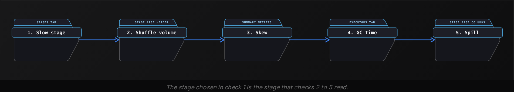
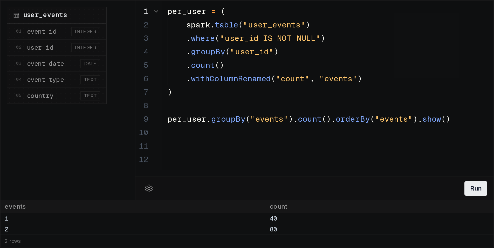

Intermediate·Spark · 14 min · 14 challenges

# The Spark UI: Intermediate

It is 6am at Netflix, and the nightly job that ranks viewing by title has blown its deadline by 2 hours. The on-call data engineer opens the Spark UI and finds 3 suspects at once: a 205 GB shuffle, one task running 34 times longer than the median, and an executor flagged red for garbage collection. Chasing the wrong suspect first burns the whole morning.


<br>

---

## The Five Checks, in Order

Slow-job investigations tend to start with whichever number looks most alarming. An executor shows red GC time, so someone doubles `spark.executor.memory`. The cluster bill rises and the ranking job still runs 2.3 hours, because the cause was a single title_id holding 35 times the typical task's rows. The memory change treated a symptom of that key.

A fixed order prevents that. Each check reads one number from one place in the UI, and each narrows where the next looks.



| Check | Where you read it | The number | Reads as healthy |
| --- | --- | --- | --- |
| 1. Slow stage | Stages tab, sorted by Duration | Stage duration as a share of the job | Picks the target for the other 4 checks |
| 2. Shuffle volume | Stage page header | Shuffle write over input | Matches the operation's shape |
| 3. Skew | Summary Metrics, Duration row | Max task over median task | Under 2 |
| 4. GC time | Executors tab, Task Time (GC Time) | GC time over task time | Under 10% |
| 5. Spill | Stage page, Spill (Memory) and Spill (Disk) | Any spill at all | Columns absent |

Checks 2, 3 and 5 live on the stage detail page, which opens when you click a stage's description in the Stages tab. Check 4 has a tab of its own because the JVM records garbage collection per executor; the stage page also carries a GC Time row, useful once you know which executor to blame.


<br>

### Why this order

The order runs from the widest view to the narrowest. Shuffle volume is a stage total: if a stage moves 5 times the bytes its operation needs, every task inside it is oversized, and its skew, GC and spill readings all describe that excess. Skew comes next because it compares tasks with each other, and a task holding far more rows than its peers is also the one collecting garbage and spilling. GC goes before spill because the pair separates 2 causes: spill means sort and aggregation buffers ran out of execution memory, while high GC with zero spill points at something else filling the heap, usually cached data.


<br>

### Running the checks on the ranking job

Here is the Stages tab for the title-ranking job after its late run, 2.3 hours end to end:

| Stage | Description | Duration | Tasks | Input | Output | Shuffle Read | Shuffle Write |
| --- | --- | --- | --- | --- | --- | --- | --- |
| 3 | scan viewing_events | 7.4 min | 2,800 | 380 GB | 0 B | 0 B | 205 GB |
| 4 | window by title_id, write | 2.1 h | 1,000 | 0 B | 1.6 GB | 205 GB | 0 B |

Check 1 picks stage 4, which holds 2.1 of the 2.3 hours. Check 2 reads its 205 GB shuffle read against the 380 GB that stage 3 scanned. A window shuffles every row it keeps, so a ratio of 0.54 fits the operation and the volume is honest. Checks 3 to 5 open stage 4's own page:

| Check | Reading on stage 4 | Verdict |
| --- | --- | --- |
| 3. Skew | Max task 2.0 h, median 3.5 min: ratio 34 | Fails |
| 4. GC time | Task 812 spent 38 min of its 2.0 h in GC (32%); executor 41, which ran it, is the only red row | Fails, on 1 executor |
| 5. Spill | 29 GB spilled from memory as 6.4 GB on disk, all by task 812 | Fails, in 1 task |

> Fix the earliest check that fails
>
> - Checks 3, 4 and 5 fail, and all 3 trace back to task 812.
> - Task 812's GC time and its spill both come from pushing 66 million rows through a single core.
> - Raising memory would shorten that GC and spill and leave the 66 million rows exactly where they are.
> - Salting or isolating the hot title_id fixes check 3, and checks 4 and 5 clear with it.

> **TIP**
>
> Write all 5 readings into the ticket before changing anything. After the fix, the same 5 numbers show whether the change worked and whether it pushed the problem into another check.

**A stage holds 80% of a job's runtime. Its code explodes an array column before a groupBy, and its shuffle write is 3.2 times its input. Its max task runs 6 times the median, and 2 executors show red GC time. Where does the diagnosis start?**

- **A.** The GC time, because red executors mean the heap is too small for this stage's tasks.
- **B.** The skew, because a max-over-median ratio of 6 means one key holds far more rows than the rest.
- **C.** The shuffle volume, because a write 3.2 times the input means rows multiplied before the shuffle.
- **D.** The spill, because a stage holding 80% of the runtime almost certainly spills on every task.

<details>
<summary>Solution</summary>

**C.** The shuffle volume, because a write 3.2 times the input means rows multiplied before the shuffle.

Check 2 fails first. The explode multiplies rows ahead of the exchange; trimming that volume shrinks every task, and the skew and GC readings get taken again afterwards.

**Why the others are wrong**

- **A.** GC is check 4. A shuffle 3.2 times the input means every task carries extra rows, so the GC is likely downstream of the volume.
- **B.** The skew may be real, but check 2 comes first: the extra volume inflates every task, and the skew reading can change once the volume is fixed.
- **D.** Spill is check 5, and nothing here reports any. A stage's share of runtime says nothing about spill until the stage page shows the columns.

</details>


<br>

---

## Reading Shuffle Volume

Check 2 asks one question of the slow stage: does the amount it shuffles match what its operation needs? The stage page header gives 3 totals. Input is what the stage read from storage. Shuffle Write is what its map tasks wrote for the next stage, and Shuffle Read is what its reduce tasks fetched from the stage before. The ratio to compute is a map stage's shuffle write over its input, or for a reduce stage, its shuffle read over the input of the stages feeding it.

That ratio has no single healthy value. Each operation shape has an expected value, and the verdict comes from comparing the measured ratio with it:

| Operation | Expected write over input | Why |
| --- | --- | --- |
| groupBy on a low-cardinality key | Well under 0.01 | Each map task combines its rows to one per key before writing |
| groupBy on a near-unique key | Close to 1 | Combining finds almost no repeated keys inside a map task |
| Shuffle join or window | About 0.5 to 1.5 | Every kept row crosses; columnar input and shuffle blocks compress differently |
| Broadcast join | 0 for the large side | The small side ships whole and the large side stays put |
| After an explode or a duplicate-key join | Above 1.5 | Rows multiplied before the write |


<br>

### Count records, then bytes

Bytes depend on encoding, so count records instead. The stage page reports Shuffle Write Size / Records, and an aggregation that combines has a hard ceiling on the records it can write: each map task writes at most one row per distinct key it saw. Stage 3 of the ranking job ran 2,800 map tasks over viewing_events, which covers 190 countries. A groupBy on country over that scan can write no more records than this, whether the table holds 9 billion rows or 90 billion:

- **532,000** — most records a country groupBy writes

The animation runs that combine on 15 rows of viewing minutes split into 3 partitions. Watch the shuffle: each map task sends at most 3 rows, one per country, so 15 input rows become no more than 9 shuffled ones.

https://github.com/user-attachments/assets/ff8e54e2-65d6-4e97-b92b-6bc4ff3f6d2b

<br>

### Same scan, 3 verdicts

Each shuffle write below is measured against the same 380 GB scan of viewing events. The first 2 come from the scan stage itself. The third comes from the join's reduce stage, where the joined rows enter the window's exchange.

| Operation | Shuffle write | Ratio | Verdict |
| --- | --- | --- | --- |
| groupBy country, sum minutes | 15 MB | 0.00004 | Healthy: combining collapsed each task to 190 rows at most |
| groupBy profile_id, collect_list of titles | 361 GB | 0.95 | Expected for the key: profiles barely repeat inside a task |
| window by title_id after a join to device_history on device_id | 1.9 TB | 5.0 | Excessive: device_id repeats on both sides, so the join multiplied rows before the window's exchange |

The second row deserves a closer look even though it reads as expected. Grouping by profile sends nearly every row across the network, so the question becomes whether the job needs profile-level lists at all. An expected ratio tells you the shuffle matches the code; whether the code should shuffle at that grain is a separate decision.


<br>

### Where an excessive shuffle comes from

- Rows multiplied before the write: an explode shows Shuffle Write records above Input records in its own stage. A join on a key that repeats on both sides shows it one stage later: the join's map stages write their input rows, and the stage taking the join's output into the next exchange writes far more records than the scan read.
- A broadcast that did not happen: the small side's estimated size sat above spark.sql.autoBroadcastJoinThreshold, so the large side crossed the network too. The plan shows SortMergeJoin where you expected BroadcastHashJoin.
- The same data shuffled twice on one key: 2 Exchange nodes with identical hash partitioning in a single plan, where the first shuffle's output could have been reused.

*Input counts bytes read after Parquet column pruning, so a query touching 4 of 60 columns shows only those 4 columns' bytes. Measuring shuffle write against the full table size on disk makes every shuffle look healthier than it is.*

**A stage scans 120 GB and runs a sum of revenue grouped by store_id, with 1,000 map tasks over 500 stores. Its Shuffle Write reads 96 GB. What is the verdict?**

```python
sales.groupBy("store_id").sum("revenue")
```

- **A.** Excessive: 1,000 tasks and 500 stores cap the write at 500,000 records, so 96 GB means rows crossed uncombined.
- **B.** Healthy: a groupBy shuffles every row to the task that owns its key, so a write near the input is expected.
- **C.** Excessive: 500 stores is too few keys, so the shuffle should be split across more partitions to cut the write.
- **D.** Healthy: a ratio of 0.8 sits inside the 0.5 to 1.5 band, the expected range for most shuffles.

<details>
<summary>Solution</summary>

**A.** Excessive: 1,000 tasks and 500 stores cap the write at 500,000 records, so 96 GB means rows crossed uncombined.

A combining aggregation writes at most one row per key per map task. A write near the input size means that combine did not happen, so read the plan for a partial HashAggregate before the Exchange.

**Why the others are wrong**

- **B.** That describes a shuffle join or a window. A sum over a groupBy combines inside each map task, which caps the write far below the input.
- **C.** More reduce partitions change how the write is divided, and leave how much is written unchanged. The record ceiling points at the missing combine.
- **D.** That band fits joins and windows. Applied to a combining aggregation it hides the problem: the expected ratio here is well under 0.01.

</details>


<br>

---

## The Skew Tell

The stage page's Summary Metrics table gives each metric's spread across the stage's tasks: Min, 25th percentile, Median, 75th percentile and Max. The skew tell is a single division, the Max of the Duration row over its Median. The median is the right baseline because one straggler drags a mean upward while barely moving the middle task.

| Metric | Min | 25th | Median | 75th | Max |
| --- | --- | --- | --- | --- | --- |
| Duration | 48 s | 2.9 min | 3.5 min | 4.1 min | 2.0 h |
| GC Time | 1 s | 4 s | 5 s | 7 s | 38 min |
| Shuffle Read Size / Records | 160 MB / 1.6M | 182 MB / 1.8M | 190 MB / 1.9M | 199 MB / 2.0M | 6.6 GB / 66M |
| Spill (Disk) | 0 B | 0 B | 0 B | 0 B | 6.4 GB |

For stage 4 of the ranking job, 2.0 hours over 3.5 minutes gives 34. Duration alone cannot say why the task was slow, so divide a second row the same way: 66 million shuffle read records over 1.9 million gives 35. The 2 ratios match. The slowest task took 34 times as long because it read 35 times the rows, nearly all of them for a single title_id. That is data skew.

| Max over median | What it means |
| --- | --- |
| Under 2 | Ordinary variation between tasks |
| 2 to 5 | Open the task table and read the slowest 10 tasks |
| Above 5 | Skew or a sick node: decide which before changing code |

*These bands are a working heuristic from practice; Spark itself flags none of them.*


<br>

### Data skew or a slow node

A high duration ratio has 2 causes that need opposite responses. The records ratio separates them, and the task table's Executor ID and Host columns confirm the call.

| ✓ Data skew | ✗ Slow node |
| --- | --- |
| • Records ratio close to the duration ratio<br><br>• The slow tasks read far more shuffle records<br><br>• Several slow tasks sit on different executors<br><br>• A rerun is slow at the same task index, wherever it lands | • Records ratio near 1<br><br>• The slow tasks read an ordinary share of records<br><br>• The slow tasks share one Executor ID and Host<br><br>• A rerun whose tasks land elsewhere runs at normal speed |

Here is the task table from a different job's slow stage, sorted by Duration, longest first. Its median task runs 11 s, so the duration ratio is 13, which looks like skew until you read the last column. The first 40 rows all carry executor 17; these are the top 3 and row 41:

| Row | Task | Executor ID | Host | Duration | Shuffle Read Records |
| --- | --- | --- | --- | --- | --- |
| 1 | 1311 | 17 | 10.0.3.21 | 2.4 min | 1.2M |
| 2 | 1290 | 17 | 10.0.3.21 | 2.3 min | 1.1M |
| 3 | 1347 | 17 | 10.0.3.21 | 2.3 min | 1.1M |
| 41 | 1318 | 6 | 10.0.1.9 | 12 s | 1.1M |

Records sit near 1.1 million for every task, and the slow ones share executor 17. The Aggregated Metrics by Executor table on the same page shows it from the other side: executor 17 spent 1.5 hours of task time on 40 tasks, while every other executor spent under 9 minutes on its 40. The data is even and one machine is slow, from a failing disk, a noisy neighbour or a throttled CPU. Salting would change nothing; the fix is to report the node and get it out of the pool.

**A stage's Summary Metrics show a median Duration of 20 s and a max of 4.0 min. Shuffle Read Records show a median of 800K and a max of 840K. The 6 slowest tasks all ran on executor 9. What do you conclude?**

- **A.** Data skew: a duration ratio of 12 sits well above 5, so the stage needs a salted key.
- **B.** Data skew: the 6 slow tasks read the largest shares, so the hottest keys landed on executor 9.
- **C.** No problem: a max of 4 minutes is short enough that the spread between tasks does not matter.
- **D.** A slow node: records barely vary and the slow tasks share executor 9, so the machine is the cause.

<details>
<summary>Solution</summary>

**D.** A slow node: records barely vary and the slow tasks share executor 9, so the machine is the cause.

A records ratio near 1 rules out data skew, and the shared executor confirms it. Check Aggregated Metrics by Executor, then get the node out of the pool.

**Why the others are wrong**

- **A.** The duration ratio is high, but the records ratio is 1.05. The slow tasks did ordinary work, so salting would spread rows that were already even.
- **B.** Their records sit inside an 800K to 840K range, a 5% spread. Hashing scatters hot keys across executors; 6 slow tasks on one executor points at the machine.
- **C.** The stage cannot finish before its slowest task, so a 12 times spread sets the stage's runtime whatever the absolute numbers.

</details>

The animation shows the data-skew side on a sort-merge join. Title 7 appears in 10 of the 15 plays, so whichever reduce task hash partitioning assigns to key 7 receives at least 11 rows, the 10 plays plus the title itself, while the other tasks split the remaining handful.

https://github.com/user-attachments/assets/6b323625-f7db-462b-8da4-99f648692f2d

When the tell reads data skew, the levers are ones you already have: salt the hot key, isolate it and process it separately, or filter it out first if the hot key is NULL. For a sort-merge join, adaptive execution splits any partition larger than both 5 times the median and 256 MB on its own. A window like stage 4's gets no such help, which is why its 66 million rows still ran on a single core.

Try the tell on the practice data. The cell counts events per user, then counts how many users sit at each event total. Read 2 values: the events figure where the running total of users first passes half of all users, which is the median, and the events figure in the last row, which is the max. Their ratio is the skew tell for any shuffle keyed on user_id.



```python
per_user = (
    spark.table("user_events")
    .where("user_id IS NOT NULL")
    .groupBy("user_id")
    .count()
    .withColumnRenamed("count", "events")
)

per_user.groupBy("events").count().orderBy("events").show()
```


<br>

---

## The GC Tell

Garbage collection is the JVM pausing an executor's task threads to reclaim heap from objects nothing references anymore. Every task records how long it was paused, and the UI sums those pauses in 2 places: the GC Time row of a stage's Summary Metrics, and the Executors tab's Task Time (GC Time) column, which shows an executor's total task time with its GC time in brackets.

The tell is GC time over task time. The Executors tab draws an executor's cell in red once GC passes 10% of its task time, and that line makes a good default: under 10% the heap is keeping up, and above it the executor is spending real time on memory housekeeping instead of your rows.

| Executor | Cores | Task Time (GC Time) | GC share | Storage Memory |
| --- | --- | --- | --- | --- |
| 1 | 5 | 3.2 h (1.0 h) | 31% | 9.6 GB / 10.1 GB |
| 2 | 5 | 3.4 h (58 min) | 28% | 9.9 GB / 10.1 GB |
| 3 | 5 | 3.1 h (55 min) | 30% | 9.7 GB / 10.1 GB |

That is a features job where every executor is red, and the last column explains it: cached data fills nearly all the storage memory each executor has. A cached DataFrame occupies the heap for as long as it stays cached, so the collector runs against a heap mostly taken by data it can never free, and each collection reclaims less space for the tasks. You can name the cause, memory pressure from caching, before changing any setting.


<br>

### 3 GC patterns and what causes each

| Pattern on the Executors tab | Likely cause | First lever |
| --- | --- | --- |
| One executor red, the rest clean | It ran the skewed task | Go back to the skew tell |
| All red, Storage Memory near full | Cached data crowding the heap | Call `unpersist()` on caches no longer read |
| All red, Storage Memory low, spill present | Each task holds too much data | More, smaller partitions |

When a single executor is red, open the slow stage's task table and sort by GC Time. The task at the top carries an Executor ID and a records count, which ties the red executor to one task and tells you whether that task was oversized.


<br>

### Levers before the heap knob

Raising `spark.executor.memory` is the last lever, and the order of the others follows from where the pressure comes from:

- **Shrink the task** *First*\
  More shuffle partitions, or smaller input splits, mean each task builds smaller hash tables and sort buffers, so fewer objects churn through the heap.
- **Free the heap** *Second*\
  A cache the job no longer reads keeps its memory until you call unpersist(); releasing it hands that space back to running tasks.
- **Give each task more of the executor** *Third*\
  Dropping from 5 cores to 4 on the same heap raises each task's share by a quarter, at the cost of a task slot per executor.
- **Raise the heap** *Last*\
  Every executor pays for a larger heap for the whole run, and the oversized tasks or idle cache that caused the pressure grow into it.

In the features job, the cache was a lookup table built in step 2 and never read after step 3. Releasing it after step 3 brought every executor under 6% GC and cut 40 minutes from the run without touching a memory setting.


<br>

### Where the ratio misleads

Short tasks inflate the share. A task that runs 300 ms and pauses 120 ms reads as 40% GC, yet a stage of such tasks loses a few seconds in total. Judge GC on executor totals or on a stage's summed time, and treat a high GC share in sub-second tasks as noise. The opposite case deserves attention: 9% GC on a 3-hour stage is 16 minutes, worth a look even though nothing turns red.

**An executor's Task Time (GC Time) reads 2.5 h (50 min). Storage Memory shows 0.4 GB of 10 GB used, and the stage it ran shows spill on every task. What is the first change?**

- **A.** Raise spark.executor.memory, because 33% GC means the heap is too small for the work.
- **B.** Raise the shuffle partition count, because the cache is near empty and every task spills.
- **C.** Call unpersist() on the cached tables, because 33% GC on an executor usually comes from caching.
- **D.** Leave it, because GC share only matters once the executor's tasks run longer than a few seconds.

<details>
<summary>Solution</summary>

**B.** Raise the shuffle partition count, because the cache is near empty and every task spills.

With storage almost empty, the pressure comes from execution. Spill on every task says each one holds too much, so smaller partitions cut both the GC and the spill.

**Why the others are wrong**

- **A.** The heap is short for these tasks, but the tasks are the problem. A bigger heap costs every executor and leaves the tasks oversized.
- **C.** Caching is a common cause, but 0.4 GB of 10 GB in storage rules it out here. There is almost nothing to release.
- **D.** The short-task caveat applies to sub-second tasks. Here GC took 50 minutes of a 2.5-hour total, which is real lost time.

</details>


<br>

---

## The Spill Tell

Spill is a task writing part of its sort or aggregation buffer to local disk because execution memory ran out, then reading it back to finish. The stage page gives it 2 columns, Spill (Memory) and Spill (Disk), and shows them only when some task in the stage spilled. If the columns are absent, no task spilled; if they appear at any size, that is a finding.

Spill (Memory) is how large the spilled data was in its in-memory form; Spill (Disk) is the same data serialized and compressed on disk, so the disk figure is the extra write and read the task paid for. On stage 4 of the ranking job, task 812 spilled 29 GB from memory as 6.4 GB on disk.


<br>

### Why spill means the task is too big

A task's working space comes from arithmetic you have met before. Take an executor with a 16 GB heap and 5 cores. Spark reserves 300 MB, gives 60% of the rest to the unified execution and storage pool, and divides the execution side among the tasks running at once:

- **1.9 GB** — per-task ceiling, storage empty

A shuffle partition of 2 GB on disk expands well past that once it is deserialized into hash tables and sort buffers, so the task spills. Smaller partitions change the arithmetic, and the shuffle partition count is the cheapest dial: it adds no cost per executor and acts only on the stages that shuffle.


<br>

### A worked fix

A daily aggregation reads 400 GB of shuffle data with `spark.sql.shuffle.partitions` at 200, so each task fetches about 2 GB. Divide the shuffle read by a target of 200 MB per partition to get the new count: 400 GB over 200 MB is 2,000.

```sql
spark.conf.set("spark.sql.shuffle.partitions", 2000)
```

200 partitions

| Metric | Value |
| --- | --- |
| Shuffle read per task | 2 GB |
| Spill (Memory) | 1.6 TB |
| Spill (Disk) | 310 GB |
| Stage duration | 48 min |

2,000 partitions

| Metric | Value |
| --- | --- |
| Shuffle read per task | 200 MB |
| Spill (Memory) | column absent |
| Spill (Disk) | column absent |
| Stage duration | 14 min |

Adaptive execution coalesces post-shuffle partitions that come out smaller than its 64 MB advisory size, so overshooting the count costs little. Undershooting costs the spill you started with.


<br>

### Which lever, by where the spill sits

| Where the spill sits | First lever |
| --- | --- |
| Every task in a shuffle stage, about evenly | Raise `spark.sql.shuffle.partitions` toward 100 to 200 MB per partition |
| A few tasks; the rest show 0 B | Skew: run the skew tell and fix the hot key |
| Tasks of a scan stage | Lower `spark.sql.files.maxPartitionBytes` from its 128 MB default |
| Every task, even at 100 MB partitions | Fewer cores per executor, then a larger heap |

The second row is why spill comes after skew in the diagnosis. Task 812's 29 GB spill sat in a single task. Raising the partition count would have left the hot title_id in one partition, because a key never splits across partitions, and the spill would have stayed where it was.

| ✓ Do | ✗ Don't |
| --- | --- |
| • Treat any spill figure as a finding, whatever its size<br><br>• Size shuffle partitions as shuffle read over 100 to 200 MB<br><br>• Compare the Median and Max spill to see whether spill is even<br><br>• Re-read the stage page after a change; the spill columns should vanish | • Raise executor memory before trying more partitions<br><br>• Add partitions when a single task holds all the spill<br><br>• Call 310 GB of disk spill small because the stage still finished<br><br>• Tune a scan stage's spill with the shuffle partition setting |

**A stage shows Spill (Disk) with Min 0 B, Median 0 B and Max 14 GB. Shuffle read per task has a median of 120 MB. Which lever comes first?**

- **A.** Raise spark.sql.shuffle.partitions, because any spill means the partitions are too large.
- **B.** Raise spark.executor.memory, because 14 GB of spill needs more room than the tasks have now.
- **C.** Fix the skew, because the median task spills nothing and all the spill sits in the Max tail.
- **D.** Lower spark.sql.files.maxPartitionBytes, because spill in the Max column means oversized input splits.

<details>
<summary>Solution</summary>

**C.** Fix the skew, because the median task spills nothing and all the spill sits in the Max tail.

Spill confined to the Max column is the skew pattern. Run the skew tell on the same page, then salt or isolate the hot key.

**Why the others are wrong**

- **A.** Partitions with a 120 MB median are already well sized. The spill sits in the tail, and more partitions will not split a hot key.
- **B.** Memory would give every executor more room to serve a few tasks. The pattern points at the data, so the heap stays the last lever.
- **D.** That setting sizes scan-stage tasks. This stage reads shuffle data, so its partition sizes come from the shuffle, and only the tail spills.

</details>


<br>

---

## Putting It All Together

Two weeks after the hot-title fix, the same Netflix ranking job slips to 1.6 hours. A change joined device details onto every viewing row ahead of the window, and the on-call engineer works the 5 checks on the new slow stage.

- Check 1 lands on the join's reduce stage, which writes the window's shuffle. The join's map stages wrote their input rows, but this stage writes 1.9 TB against the 380 GB scanned, a ratio of 5.0, far above the 0.5 to 1.5 band for a window.
- The records confirm it: Shuffle Write records here run several times the records the scan read, because the device table holds several rows per device_id, the duplicate-key blowup.
- Check 3 reads a duration ratio of 1.4, so there is no skew, which means the problem is spread across every task.
- Check 4 shows every executor red with Storage Memory nearly empty, and check 5 shows spill on every task: both describe tasks inflated by the extra rows.
- Deduplicating the device table before the join fixes check 2, and the GC and spill clear with it, with no partition or memory setting touched.


<br>

---

## Key Takeaways

- Run the 5 checks in order (slow stage, shuffle volume, skew, GC, spill) and fix the earliest that fails, because later failures are often its symptoms.
- Judge shuffle write against input by the operation's shape, and count records when bytes are ambiguous.
- Divide max by median on Duration, then on Shuffle Read Records: matching ratios mean data skew, a records ratio near 1 means a slow node.
- Above 10% GC over task time, read Storage Memory and spill to name the cause before any heap setting changes.
- Any spill means a task outgrew its execution memory; reach for the partition count first and the heap last.
