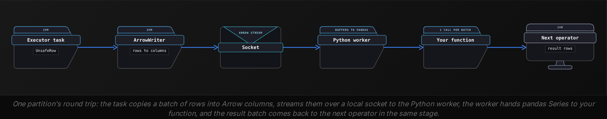
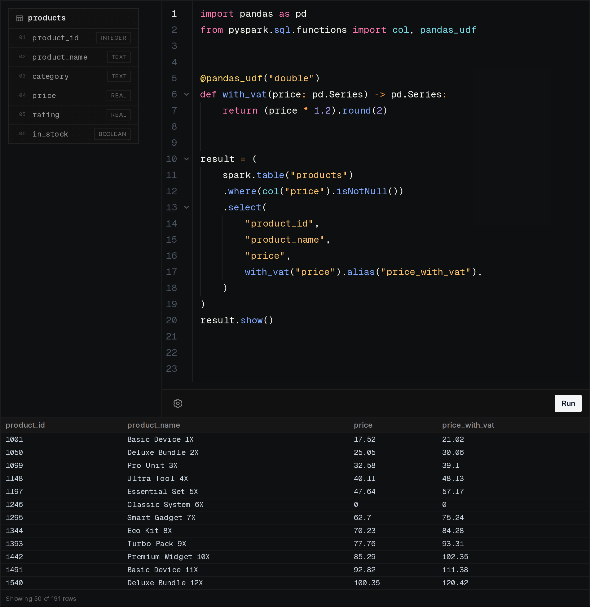
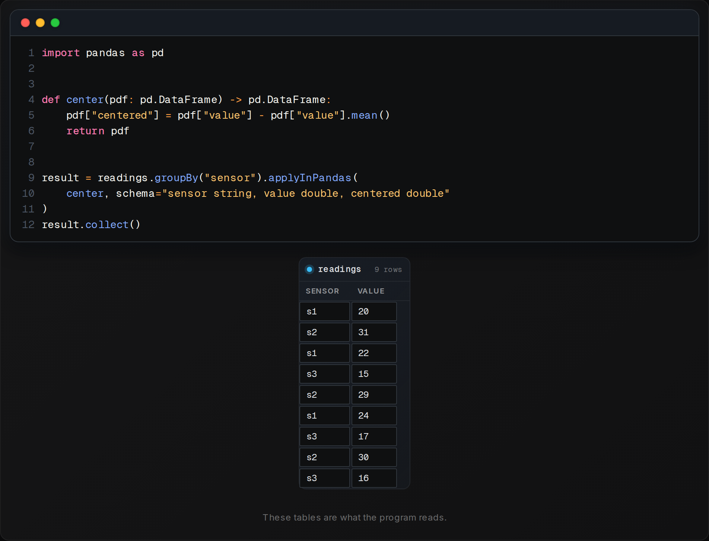

# UDFs and Serialization: Advanced

Two Sigma's engineers proposed vectorized pandas UDFs for Spark in 2017, and the problem they target looks like this: a Python UDF scores 2 billion trade rows overnight, and the executor profile shows most of the time spent turning rows into pickles and back. Whether the job is rewritten per batch, gets one config flipped, or changes serializer decides if it finishes before markets open.


<br>

---

## Arrow at the Border

A plain @udf runs under BatchEvalPython, and you pay for it value by value. The executor converts each field of an UnsafeRow into a Java object, a pickler on the JVM side turns those objects into bytes, and the Python worker unpickles every value into a fresh Python object before your function sees it. The result makes the same trip in reverse. A function that adds 1 to a number still costs several object allocations per field and 1 interpreted function call per row, and on a table of billions of rows those fixed costs are the job.


<br>

### A layout both runtimes share

Apache Arrow is a columnar memory format with a published specification. Its Java and Python libraries read and write the same bytes. A record batch stores each column as a few contiguous buffers. Fixed-width values sit back to back in a values buffer, and a validity bitmap marks nulls with 1 bit per row. Strings and other variable-length types add an offsets buffer that records where each value starts. Since the executor and the Python worker agree on that layout, the executor streams buffers into a socket and the worker uses them as they arrive, with no decoding step per value.

| Buffer | product_name (string) | price (double) |
| --- | --- | --- |
| Validity bitmap | 1 1 1 1 | 1 0 1 1 |
| Offsets | 0, 6, 9, 13, 17 | None, the width is fixed |
| Values | kettlemuglampvase | 19.99, unused, 5.00, 42.50 |

Read the table as 4 rows: a kettle at 19.99, a mug with no price, a lamp at 5.00 and a vase at 42.50. The mug's validity bit is 0, so its 8-byte slot in the values buffer holds a placeholder that nothing reads. The lamp's name is the characters between offsets 9 and 13 of a single run of text. Summing prices means walking a single block of memory, 8 bytes per row, which is the access pattern numpy and the CPU's vector instructions are built for.




<br>

### What changes per row

| ✓ Pickled path: BatchEvalPython | ✗ Arrow path: ArrowEvalPython |
| --- | --- |
| • Every field becomes a Java object, then pickle bytes, then a Python object<br><br>• Your function runs once for every row<br><br>• A null arrives as None, a number as a boxed Python int or float<br><br>• Cost scales with rows times columns, however short the function | • Each column is copied once into Arrow buffers on the JVM side<br><br>• Your function runs once per batch, on whole pandas Series<br><br>• A numeric column becomes a numpy array in one bulk conversion<br><br>• Python call overhead is paid per batch, so cost tracks bytes moved |

- **10,000** — rows per Arrow batch by default
- **100** — rows per pickled group sent to Python

A setting, spark.sql.execution.arrow.maxRecordsPerBatch, caps the rows in a batch, and a batch never spans 2 partitions, so a partition under the cap crosses as a single batch. Bigger batches spread the per-call overhead across more rows, but the worker holds the whole batch as pandas objects at once. That memory belongs to the Python process, outside the JVM heap, and counts against spark.executor.memoryOverhead, so a wide table with long strings and a raised cap is a direct route to the memoryOverhead OOM.

Arrow does not make the crossing free. The JVM still copies every value out of its rows into column vectors on the way out, and copies each result back into a row for the next operator in the stage. What it removes is the per-value object churn in Python and the per-row function call, which is where the pickled path spends most of its time on a short function.


<br>

### What the plan and the Spark UI show

In explain(), a vectorized UDF appears as ArrowEvalPython where a plain one showed BatchEvalPython. Both are narrow operators: the round trip to Python happens inside the current stage, with no exchange, so the stage count and the shuffle read and write columns in the Spark UI stay put when you switch. The number that moves is task duration for the stage holding the UDF, and that is the one to record before and after.

**A table has 200 partitions of 250,000 rows each, and a Python UDF reads one numeric column. How many times does Python invoke the function body as a plain @udf, and as a Series-to-Series @pandas_udf with the default batch cap?**

- **A.** 500,000 calls as a plain UDF, because rows are pickled 100 at a time, and 5,000 as a pandas UDF
- **B.** 50 million calls as a plain UDF and 50 million as a pandas UDF, because Arrow changes only the wire format
- **C.** 50 million calls as a plain UDF, 1 per row, and 5,000 as a pandas UDF, 25 batches per partition
- **D.** 200 calls as a plain UDF and 200 as a pandas UDF, because each task opens 1 Python worker

<details>
<summary>Solution</summary>

**C.** 50 million calls as a plain UDF, 1 per row, and 5,000 as a pandas UDF, 25 batches per partition

Each partition's 250,000 rows split into 25 batches of 10,000, and 25 batches times 200 partitions is 5,000 calls.

**Why the others are wrong**

- **A.** Groups of 100 batch the pickling, not the calls: the worker still loops over each group and calls your function once per row.
- **B.** Arrow changes the calling convention too: a pandas UDF receives a whole Series, so one call covers up to 10,000 rows.
- **D.** A task does talk to 1 worker, but that worker calls the function per row or per batch, many times within the task.

</details>


<br>

---

## pandas_udf

@pandas_udf takes the Spark return type, and the Python type hints on your function tell Spark which variant you mean. The workhorse takes 1 pd.Series per input column and returns a pd.Series with exactly as many values. Inside, your pandas or numpy code works on the whole Series at once. price \* 1.2 multiplies every row of the batch in one vectorized operation, and Spark checks only that the output length matches the input.

The cell below adds a price with 20% VAT to every product that has a price. Run it, then add rating as a second argument and return price \* rating: every extra input column arrives as another Series, aligned row for row with the first.



```python
import pandas as pd
from pyspark.sql.functions import col, pandas_udf


@pandas_udf("double")
def with_vat(price: pd.Series) -> pd.Series:
    return (price * 1.2).round(2)


result = (
    spark.table("products")
    .where(col("price").isNotNull())
    .select(
        "product_id",
        "product_name",
        "price",
        with_vat("price").alias("price_with_vat"),
    )
)
result.show()
```


<br>

### The function sees only its batch

Each call gets 1 batch, so anything that summarizes the Series inside a Series-to-Series UDF summarizes the batch. price - price.mean() subtracts the mean of whichever rows shared the batch, and the answer shifts if the table is repartitioned, the batch cap is raised, or a filter upstream drops rows. Spark raises no error, because the output length still matches. A statistic over a whole column or a whole group belongs in a built-in aggregate joined back to the rows, or in one of the grouped variants below.

**This UDF runs over a 3-million-row table stored in 12 partitions, with the default batch cap. What does each output row hold?**

```python
@pandas_udf("double")
def centered(price: pd.Series) -> pd.Series:
    return price - price.mean()
```

- **A.** The row's price minus the mean of its own Arrow batch, which differs from batch to batch
- **B.** The row's price minus the mean of all 3 million prices, computed once on the driver
- **C.** The row's price minus the mean of its partition, since each task calls the function once
- **D.** An error, because a Series-to-Series UDF is not allowed to call an aggregate like mean

<details>
<summary>Solution</summary>

**A.** The row's price minus the mean of its own Arrow batch, which differs from batch to batch

The function runs once per batch of up to 10,000 rows, and price.mean() sees only the rows in that batch.

**Why the others are wrong**

- **B.** No part of a pandas UDF runs on the driver or sees the whole column. The Series it receives is one batch.
- **C.** A partition of 250,000 rows crosses as 25 batches, and each batch gets its own call and its own mean.
- **D.** Spark checks only the output length, so the aggregate runs and silently scopes itself to the batch.

</details>


<br>

### The variants and what each costs

| Shape | Each call receives | Called from | Shuffle | Plan node |
| --- | --- | --- | --- | --- |
| `Series` to `Series` | 1 batch per input column | `select`, `withColumn` | None | `ArrowEvalPython` |
| `Iterator[Series]` to `Iterator[Series]` | Every batch of 1 partition, streamed | `select`, `withColumn` | None | `ArrowEvalPython` |
| `Series` to scalar | Every value of 1 group | `groupBy().agg()`, windows | All rows, no partial aggregation | `AggregateInPandas` |
| `applyInPandas` | 1 whole group as a DataFrame | `groupBy()` | All rows, by key | `FlatMapGroupsInPandas` |
| `mapInPandas` | Every batch of 1 partition as DataFrames | The DataFrame itself | None | `MapInPandas` |

Only rows 3 and 4 add an exchange, because a group has to be complete before Python sees any of it. The remaining rows are narrow and run inside the current stage.

#### Setup once per partition

```sql
from typing import Iterator

import pandas as pd
from pyspark.sql.functions import pandas_udf


@pandas_udf("double")
def risk_score(amounts: Iterator[pd.Series]) -> Iterator[pd.Series]:
    weights = load_weights("/models/risk_v3.json")
    for amount in amounts:
        yield amount * weights["amount"] + weights["bias"]
```

The iterator variant hands your function every batch of 1 partition through a generator, so the line above the for loop runs once per task. The same load inside a Series-to-Series UDF would repeat for every batch: a 400-partition job with 25 batches per partition would read a 200MB model 10,000 times instead of 400. Python workers are reused across tasks by default, so keeping the loaded model in a module-level variable of a module shipped to the executors can cut the loads further, toward 1 per worker.

#### Groups bring a shuffle and a whole group in memory

A Series-to-scalar UDF in groupBy().agg() and applyInPandas both need every row of a key inside one Python call, so Spark hash-partitions on the grouping key first. Neither combines rows before the exchange: where F.avg sends 1 partial sum and count per key per map task, a pandas aggregate sends every row. On the reducer, the whole group is materialized as one pandas object, so a hot key with 40 million rows becomes a 40-million-row DataFrame in one worker's memory: skew and an OOM risk at the same time.

Below, applyInPandas centers each sensor's readings on that sensor's own mean. Watch where the exchange falls: 2 input tasks hash rows by sensor, and each of the 3 reducer tasks calls center once for every sensor it received.



The mean is right this time because each group arrives whole: all of sensor s1's readings meet in a single call, so the function finds their mean of 22 and turns 20 into -2 and 24 into 2, with 22 itself landing on 0. The price is the exchange that the plan shows before FlatMapGroupsInPandas, plus enough Python memory to hold the largest group.


<br>

---

## Arrow UDFs in Spark 3.5

Some logic has no vectorized form: a parser from an internal library, a chain of string rules with early returns, a walk through a nested record. Written as a pandas UDF, it turns into s.apply(f), a Python loop that still calls f once per row, so the batch buys no speed and the body now reads as pandas wrapped around per-row code. Left as a plain UDF, it keeps its readable signature but pays the pickle transport on every value. Spark 3.5 adds a path for exactly this case: keep the row-at-a-time function and replace only the pickle transport beneath it.

```sql
from pyspark.sql.functions import udf


@udf("string", useArrow=True)
def normalize_sku(raw):
    if raw is None:
        return None
    head, _, tail = raw.strip().upper().partition("-")
    return f"{head}-{tail.zfill(6)}"
```

With useArrow=True on the decorator, or spark.sql.execution.pythonUDF.arrow.enabled set to true for the session (it defaults to false in 3.5), the executor ships Arrow batches in place of pickled rows. Inside the 3.5 worker, each batch is still converted to pandas Series, then zipped back into rows: your function is called once per row with Python values that match the declared types, a struct arrives as a Row, and the results are packed back into Arrow. explain() shows ArrowEvalPython in place of BatchEvalPython. Pickling disappears on both sides, while the Arrow-to-pandas conversion and the per-row call both stay, so the gain is largest when the pickle frames dominated the profile and the body was cheap.

| Property | Plain @udf | Arrow-optimized @udf | @pandas_udf |
| --- | --- | --- | --- |
| Wire format | Pickle | Arrow | Arrow |
| Calls to your function | 1 per row | 1 per row | 1 per batch |
| A value arrives as | Python object | Python object | Element of a pandas Series |
| A null arrives as | `None` | `None` | `NaN`, `None` or `NaT`, by dtype |
| Pays off when | It is the baseline | The border dominated the profile | The body vectorizes |

> **TIP**
>
> The 2 transports coerce a return value that does not match the declared type in different ways, a difference the Spark 3.5 documentation calls out. Before you enable the session config for a whole job, compare the old UDF's output with the new one's on a sample, column by column.


<br>

### Nested data and pandas

pandas has no nested column type, so the conversion improvises. A struct argument arrives in a pandas UDF as a pd.DataFrame with one column per field, and returning a struct means returning a DataFrame. An array arrives as an object-dtype Series holding a numpy array per row, and an array of structs holds numpy arrays of dicts. None of those shapes vectorize: any work on the elements is a Python loop over objects that pandas allocated for you, on top of the conversion that built them.

```sql
import pandas as pd
from pyspark.sql.functions import pandas_udf, udf


@pandas_udf("double")
def order_total_pd(items: pd.Series) -> pd.Series:
    return items.apply(
        lambda arr: float(sum(x["qty"] * x["unit_price"] for x in arr))
    )


@udf("double", useArrow=True)
def order_total(items):
    return float(sum(x["qty"] * x["unit_price"] for x in items))
```

Neither version vectorizes this order total, so both pay the Arrow-to-pandas conversion inside the worker. The Arrow-optimized one still wins on its own terms: it reads like the plain UDF your team already reviewed, each item arrives as a Row rather than a pandas shape, and, compared with the plain UDF, no value is pickled. Better still, the computation needs no Python: F.aggregate("items", F.lit(0.0), lambda acc, x: acc + x.qty \* x.unit_price) is a higher-order built-in that runs in the JVM with no border at all, though like the other higher-order functions it falls back from generated code. When nested data must reach Python and stay columnar, mapInArrow, available since 3.3, hands your function pyarrow RecordBatch objects, which represent nested types natively and come with compute functions that work on them.


<br>

### Choosing between them

| ✓ Do | ✗ Don't |
| --- | --- |
| • Use a pandas UDF when the body is pandas or numpy math over whole columns<br><br>• Add useArrow=True to an existing per-row UDF when the profile shows the pickle border<br><br>• Try a higher-order built-in such as aggregate or transform before any UDF on arrays<br><br>• Run old and new UDFs on a sample and diff outputs before enabling the session config | • Wrap per-row logic in s.apply inside a pandas UDF and expect a speedup<br><br>• Pass a struct column to a pandas UDF expecting a Series of dicts<br><br>• Assume a mismatched return value coerces the same way on both transports<br><br>• Reach for useArrow when the slow part is your own Python body |

**A plain @udf parses each user_agent string with a Python library that has no vectorized API, across 900 million rows. The flame graph shows the JVM spending most of its samples pickling. Which change targets that cost with the least rewriting?**

- **A.** Rewrite it as a Series-to-Series pandas UDF whose body calls s.apply(parse) on the batch
- **B.** Set spark.serializer to Kryo so the rows sent to the Python worker serialize faster
- **C.** Raise spark.sql.execution.arrow.maxRecordsPerBatch so fewer batches cross to Python
- **D.** Add useArrow=True to the existing @udf and keep the per-row body exactly as it is

<details>
<summary>Solution</summary>

**D.** Add useArrow=True to the existing @udf and keep the per-row body exactly as it is

The body has to stay per-row, and the pickling frames the profile measured are replaced by Arrow transport.

**Why the others are wrong**

- **A.** That swaps pickling for a pandas conversion and keeps 1 Python call per row, and it is a bigger rewrite than a flag.
- **B.** The Python border uses pickle or Arrow, and spark.serializer never touches either one.
- **C.** That cap governs Arrow batches, and a plain UDF sends no Arrow at all, so nothing changes.

</details>


<br>

---

## Kryo vs Java Serialization

Serialization also happens with no Python anywhere in sight. Spark turns JVM objects into bytes to shuffle an RDD, to keep a cached block in a serialized storage level, to ship a broadcast variable, and to send every task from the driver to an executor. spark.serializer picks the library for the first 3, and its default is org.apache.spark.serializer.JavaSerializer. Task closures always use Java serialization, whatever the setting says.


<br>

### What each serializer writes

Java serialization writes a class descriptor before the data. The descriptor holds the full class name and a version id, followed by every field's name and type, and then the serializer walks the object graph by reflection. Within one stream a repeated descriptor becomes a back-reference, but Spark resets the stream every spark.serializer.objectStreamReset objects, 100 by default, so descriptors are written again and again. Kryo writes a small integer for each registered class and uses per-class serializers that write field values in order, with no field names. A class you never registered still works, but Kryo then stores its full class name with each object, as the Spark tuning guide warns.

- **10x** — Kryo speed and size gain, per Spark docs
- **64m** — default spark.kryoserializer.buffer.max

#### Turning it on

```sql
from pyspark.sql import SparkSession

spark = (
    SparkSession.builder
    .config("spark.serializer", "org.apache.spark.serializer.KryoSerializer")
    .config("spark.kryo.registrationRequired", "true")
    .config("spark.kryo.classesToRegister", "com.acme.routing.Edge,com.acme.routing.Tile")
    .config("spark.kryoserializer.buffer.max", "256m")
    .getOrCreate()
)
```

The serializer is fixed when the session starts, so it belongs in the builder or in spark-submit, never in a spark.conf.set call mid-job. registrationRequired makes the first unregistered class fail its task with an error naming the class, which turns a silent size penalty into a list of names to add. buffer.max caps a single serialized object, and a Buffer overflow error means one record or broadcast value outgrew it, often a large lookup map built in JVM code.


<br>

### Where the setting changes nothing

| Data path | Bytes written by | Does spark.serializer matter? |
| --- | --- | --- |
| DataFrame shuffle | `UnsafeRow` binary, copied as is | No |
| DataFrame `cache()` | Compressed columnar batches | No |
| DataFrame broadcast join | The hash relation's own binary format | Barely |
| Python UDF border | Pickle or Arrow | No |
| Python RDD records | Pickled in Python, byte arrays in the JVM | Barely |
| RDD of JVM objects: shuffle, serialized cache | `spark.serializer` | Yes |
| Broadcast of a JVM object | `spark.serializer` | Yes |
| Task closures | Java serialization, always | Not configurable |

For a job built from DataFrames and Python, switching to Kryo moves no number in the Spark UI that you could attribute to it. Even for RDDs, Spark has used Kryo internally since 2.0 when it shuffles primitives and strings, and arrays of primitives get the same treatment. The setting matters in JVM code that keeps RDDs of custom classes. Graph and iterative algorithms do this, and so does the ALS recommender in Spark's ML library, which runs its iterations on RDDs internally. Where no stage handles RDDs of JVM objects, the choice is a no-op, and the tuning time belongs at the Python border.

Python has a serializer choice of its own for RDD records: pickle by default, or a marshal-based serializer passed when the SparkContext is created, faster but limited to Python's built-in types. It changes the byte arrays the JVM receives, which the JVM treats as opaque, so spark.serializer plays no part in it.

> 3 questions before touching spark.serializer
>
> - Does any stage run on an RDD of JVM objects? RDD jobs have no query behind them in the SQL tab.
> - Is a broadcast variable built by JVM code, such as a map from a library? It passes through spark.serializer.
> - Does a flame graph show ObjectOutputStream frames inside shuffle writes or cached-block writes? That is the cost Kryo removes.

**A job built only from DataFrame operations writes 400GB of shuffle per run. The team sets spark.serializer to Kryo with every custom class registered. What happens to shuffle write in the Spark UI?**

- **A.** It drops sharply, because Kryo writes far fewer bytes per record than Java serialization
- **B.** It stays about the same, because DataFrame exchanges write UnsafeRow bytes without spark.serializer
- **C.** It stays the same until the row classes are registered, then drops by about half
- **D.** It grows, because Kryo stores a full class name with each row that it writes

<details>
<summary>Solution</summary>

**B.** It stays about the same, because DataFrame exchanges write UnsafeRow bytes without spark.serializer

Rows are already binary, so the exchange copies them out as they are, and the setting is irrelevant to this job.

**Why the others are wrong**

- **A.** That holds for RDDs of JVM objects. A DataFrame exchange writes UnsafeRow bytes through its own serializer.
- **C.** There are no row classes to register: rows are UnsafeRow bytes, so registration changes nothing here.
- **D.** That penalty applies to unregistered classes on RDDs, and this exchange never calls Kryo at all.

</details>


<br>

---

## Serialization in a Flame Graph

A sampling profiler attached to an executor records JVM stacks, so it sees only half of a Python UDF job. In Spark 3.x, each task that talks to Python has 2 JVM threads worth reading: the task thread, which runs the stage and reads results back from the worker, and a writer thread named after the Python executable, such as stdout writer for python3, which pushes input rows to the worker. The Python worker is a separate process, so its CPU time is missing from the graph and shows up indirectly, as the task thread blocked reading a socket.


<br>

### Frames that mean serialization

| Frame | Thread | What it means |
| --- | --- | --- |
| `net.razorvine.pickle.Pickler.dump` | Writer | Rows pickled for a plain `@udf` |
| `EvaluatePython.toJava` | Writer | Spark values turned into pickle-ready Java objects |
| `Unpickler.load`, `EvaluatePython.makeFromJava` | Task | Results unpickled and turned back into Spark values |
| `ArrowWriter.write` | Writer | Row values copied into Arrow column vectors |
| `socketRead0` or `NioSocketImpl.read` under the Python reader | Task | JVM idle, waiting for the Python worker |
| `ObjectOutputStream.writeObject0` | Shuffle writer, block manager | Java serialization of RDD records or broadcasts |
| `Kryo.writeClassAndObject` | Shuffle writer, block manager | Kryo serialization of those same objects |
| `DefaultClassResolver.writeName` | Under Kryo frames | Full class names written for unregistered classes |


<br>

### Reading one profile

The table below is one illustrative capture from a 40-minute stage that applies a plain Python UDF to a Parquet table, with samples grouped by the frame families above. Real profiles vary, and the proportions are what you read.

| Frames | Share of executor samples |
| --- | --- |
| `Pickler.dump`, `EvaluatePython.toJava` | 31% |
| `Unpickler.load`, `EvaluatePython.makeFromJava` | 14% |
| Socket read, waiting on the Python worker | 38% |
| Parquet scan and the generated stage code | 12% |
| Everything else | 5% |

45% of the samples is the JVM side of the pickle border, and 38% is the JVM waiting while Python unpickles, calls the function per row and pickles the results. Both point the same way. If the body vectorizes, a pandas UDF removes the pickle frames and divides the Python calls by the batch size. If it does not, useArrow=True removes the pickle frames and leaves the socket wait, which is now mostly your function, for a profile on the Python side to explain. With a scan share this small, reading the data was never the problem.

> From frame to fix
>
> - `Pickler.dump` and `EvaluatePython` wide: the pickle border. Move to a pandas UDF if the body vectorizes, `useArrow=True` if it does not.
> - Socket read wide, border frames thin: the Python body itself is slow. Profile it in Python first, and once you know where the time goes, vectorize the body or replace it.
> - `ArrowWriter.write` wide: more columns cross than the function needs. Select only the columns it reads before the call.
> - `ObjectOutputStream` in shuffle or block writes: Java serialization on RDDs or broadcasts. Switch to Kryo.
> - Kryo frames with `DefaultClassResolver.writeName`: unregistered classes. Register them, then set `registrationRequired`.

Check every fix the way you found the problem: compare the stage's task time in the Spark UI before and after, then capture a new graph and confirm the frames you targeted shrank. A fix that moves work from one frame family to another, say from Pickler.dump to ArrowWriter.write, should still shrink the total. If the total holds steady, read the new graph again before choosing the next fix: a wide ArrowWriter.write means columns the function never reads are crossing, and a wide socket wait means the Python body itself is now the cost.

> **TIP**
>
> The fix that removes every frame family above at once is a built-in. If the logic fits in built-ins such as when and regexp_extract, or in a higher-order function, nothing crosses to Python. The border frames disappear from the graph, and the writer thread and socket wait go with them.

**After a move to a pandas UDF, a stage's flame graph shows ArrowWriter.write at 40% of executor samples. The UDF is called on F.struct(*df.columns) over a 60-column table, and its body reads 2 fields. What should change?**

- **A.** Switch spark.serializer to Kryo so that the Arrow batches are written faster
- **B.** Raise spark.sql.execution.arrow.maxRecordsPerBatch so the writer runs fewer times
- **C.** Go back to a plain @udf, since converting to Arrow costs more than pickling
- **D.** Pass only the 2 fields the body reads, so 2 columns cross instead of 60

<details>
<summary>Solution</summary>

**D.** Pass only the 2 fields the body reads, so 2 columns cross instead of 60

ArrowWriter's cost scales with values copied, and 58 of the 60 columns were copied for nothing.

**Why the others are wrong**

- **A.** Arrow batches are written by the Arrow library, and the JVM serializer is not involved.
- **B.** The writer copies every value once whatever the batch size, so 60 columns cost the same.
- **C.** Pickling 60 fields per row would cost more. The column count is the problem, and a plain UDF shares it.

</details>


<br>

---

## Putting It All Together

A card-payments team scores 600 million transactions each night with a Python fraud model applied through a plain UDF, then averages the score per merchant. The stage holding the UDF runs for 3 hours, and a flame graph of one executor shows most samples in pickling frames and socket waits. The model's arithmetic vectorizes, the merchant average needs no Python, and a lookup table of merchant tiers is broadcast from Python.

- The pickling frames say the border dominates, so the model moves to an Iterator pandas UDF that loads once per task and runs once per batch.
- The plan swaps BatchEvalPython for ArrowEvalPython inside the same stage, so shuffle volume stays put and only task time should drop.
- The per-merchant average stays a built-in avg with partial aggregation, since a pandas aggregate would ship all 600 million rows through the exchange.
- The merchant-tier broadcast is pickled in Python, so switching spark.serializer to Kryo would change nothing in this job.
- A fresh flame graph confirms the fix: the pickle frames are gone, and ArrowWriter stays small because only the model's input columns cross.


<br>

---

## Key Takeaways

- A plain UDF pays per value: every field is converted from a Java object to pickle bytes and on to a Python object, and each row adds a Python call.
- Arrow sends columns as buffers both runtimes read, so a pandas UDF pays 1 Python call per batch of up to 10,000 rows.
- A Series-to-Series UDF sees only its batch, so whole-column or whole-group logic needs a grouped variant or a built-in.
- Grouped pandas UDFs shuffle every row with no partial aggregation and hold each group in Python memory.
- useArrow=True in Spark 3.5 drops pickling but keeps per-row code. Use it when pandas cannot vectorize the logic or the nested data.
- spark.serializer governs RDDs of JVM objects and JVM broadcasts. DataFrame shuffles and caches ignore it, and so does the Python border.
- In an executor flame graph, pickle, ArrowWriter, socket-wait and ObjectOutputStream frames each point to a different fix.
