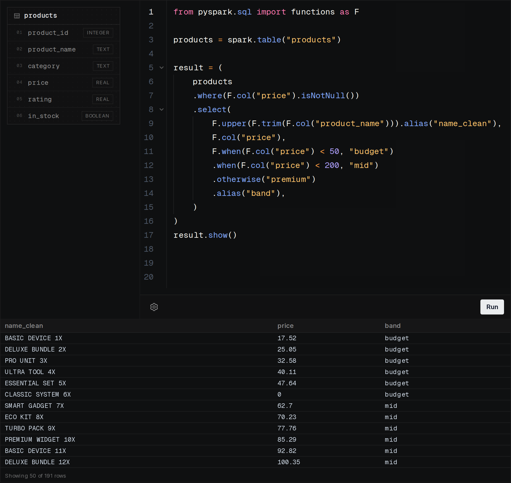
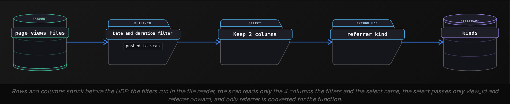

Beginner·Spark · 13 min · 11 challenges

# UDFs and Serialization: Beginner

Take a nightly job on Spotify's data team that builds a table of podcast episodes whose titles mention 'live'. A teammate wraps a 3-line Python title cleaner as a UDF, and the job that finished before breakfast now runs past lunch: every title is converted into a Python string and back, row after row. 2 built-in functions do the same cleanup without leaving Spark's engine.


<br>

---

## Registering a UDF

### A Python function Spark can call

A user-defined function, or UDF, is a Python function that Spark applies to a column row by row. Spark's built-in column functions cover most transformations, but sometimes the rule you need exists only as Python you wrote yourself. Once you wrap it as a UDF, the function is a column expression, so `select` and `withColumn` take it the same way they take a built-in, and so does `where`.

Every UDF takes 3 steps

- Write a plain Python function that takes column values as arguments and returns 1 value.
- Wrap it with F.udf() and declare the type of the value it returns.
- Call it on columns in a DataFrame expression, or register it by name to call it from SQL.

The running example sorts products into price bands. A price under 50 is `budget`, a price under 200 is `mid`, and anything higher is `premium`.

```sql
from pyspark.sql import functions as F
from pyspark.sql.types import StringType

def price_band(price):
    if price < 50:
        return "budget"
    if price < 200:
        return "mid"
    return "premium"

price_band_udf = F.udf(price_band, StringType())

products = spark.table("products")
banded = products.withColumn("band", price_band_udf(F.col("price")))
```

The second argument to F.udf() is the return type. Spark never looks at what your Python function returns to work out the column's type: the schema of banded lists band as a string because the code declared it. Leave the argument out and Spark assumes StringType. The type can also be a short string like "string" or "double", and "int" works too.

*This version fails on a product with no price. The Nulls and Types section shows why and fixes it.*

> **TIP**
>
> Writing `@F.udf(returnType="string")` above the `def` wraps the function in place. The name then refers to the UDF, and calling it on a plain number raises an error. Keeping the `def` and the wrapped object under separate names lets you test the Python logic without Spark.


<br>

### Calling it from SQL

`F.udf()` returns an object for DataFrame code and nothing more. A SQL query finds functions by name in the session's function registry, and that object was never added there. `spark.udf.register()` adds the function under a name you choose and also returns a UDF for DataFrame code, so 1 registration serves both.

```sql
spark.udf.register("price_band", price_band, StringType())

priced = spark.sql("""
SELECT
  product_name,
  price,
  price_band(price) AS band
FROM products
WHERE price IS NOT NULL
""")
```

| ✓ Wrapped with F.udf() | ✗ Registered with spark.udf.register() |
| --- | --- |
| • Returns a UDF for DataFrame expressions<br><br>• Invisible to spark.sql()<br><br>• Lives in a Python variable | • Adds a name to the session's function registry<br><br>• Callable from spark.sql() by that name<br><br>• Also returns a UDF for DataFrame expressions<br><br>• Lasts until the SparkSession stops |

**A teammate wraps clean_name and then queries it from SQL. What happens when the spark.sql line runs?**

```python
clean_name_udf = F.udf(clean_name, "string")

names = spark.sql("""
SELECT
  clean_name(product_name) AS name
FROM products
""")
```

- **A.** The query runs, because SQL can call any Python function in scope by its def name
- **B.** The query is accepted, and the missing function raises an error only when an action runs
- **C.** spark.sql() raises an error right away, because no function named clean_name is registered
- **D.** The query runs and returns name as a string column, the type declared in F.udf()

<details>
<summary>Solution</summary>

**C.** spark.sql() raises an error right away, because no function named clean_name is registered

F.udf() returns an object for DataFrame code only. spark.udf.register("clean_name", clean_name, "string") would make the name visible to SQL.

**Why the others are wrong**

- **A.** SQL never reads Python variables. It resolves function names in the session's registry, and F.udf() adds nothing there.
- **B.** Spark resolves names while spark.sql() builds the plan, so an unknown function fails on that line, before any action.
- **D.** The declared type would apply if the query ran, but SQL cannot resolve clean_name at all.

</details>


<br>

### Where the function runs

Applying a UDF is a narrow transformation. Each output row depends on 1 input row, so Spark calls the function inside the task that reads the partition, on the executor holding it, and no rows move between executors. The animation labels 8 sales `bulk` when the quantity is 10 or more and `single` otherwise, then totals revenue per label.

https://github.com/user-attachments/assets/a45ea768-e812-4e1b-adc6-092480286b40

The labels appear inside the 2 read tasks, before any row leaves its partition. The only shuffle belongs to `groupBy`, which brings each label's rows together for the final sum. The driver collects 2 rows: `bulk` with revenue 281.0 and `single` with 107.0. A UDF adds work to every task it runs in and adds no shuffle of its own, so you count the shuffles in a UDF job exactly as you would without it.

**This job bands every priced product with price_band_udf and counts the products in each band. How many shuffles does Spark run for it?**

```python
banded = (
    products
    .where(F.col("price").isNotNull())
    .withColumn("band", price_band_udf(F.col("price")))
)
counts = banded.groupBy("band").count()
counts.collect()
```

- **A.** Two shuffles: one for the UDF to gather each price's rows, one for groupBy to gather each band
- **B.** No shuffle at all, because the UDF runs on the driver after collect() pulls every product there
- **C.** No shuffle, because a UDF and a groupBy both keep each row in the partition it was read from
- **D.** One shuffle, for groupBy, while the UDF labels rows inside the tasks that read each partition

<details>
<summary>Solution</summary>

**D.** One shuffle, for groupBy, while the UDF labels rows inside the tasks that read each partition

Applying the UDF is narrow, like the where before it. The groupBy shuffle is the only one, as in the animation's size_band job.

**Why the others are wrong**

- **A.** The UDF labels each row inside the task that reads it, so it moves no rows between executors. Only groupBy shuffles.
- **B.** The UDF runs inside executor tasks while the job runs. The driver receives only the final count for each band.
- **C.** The UDF is narrow, but groupBy is wide: every row with the same band has to reach the same task before it can be counted.

</details>


<br>

---

## Built-Ins First

### The same bands, without Python

The functions module, imported as `F` throughout this lesson, holds a few hundred column functions that run inside Spark's engine. The price bands use 2 of them, `F.when` and `F.col`. The chain then ends with the `.otherwise` method.

```sql
from pyspark.sql import functions as F

products = spark.table("products")

banded = products.withColumn(
    "band",
    F.when(F.col("price") < 50, "budget")
    .when(F.col("price") < 200, "mid")
    .otherwise("premium"),
)
```

For every product with a price, `band` holds the label the UDF produced. The work underneath differs: no Python function is called, and each comparison is an expression Catalyst can read and rewrite.

SQL gets the same rule with no registration step. `CASE WHEN` is the SQL form of `F.when`, and the built-ins in this section's table go by the same names in SQL queries.

```sql
SELECT
  product_name,
  CASE
    WHEN price < 50 THEN 'budget'
    WHEN price < 200 THEN 'mid'
    ELSE 'premium'
  END AS band
FROM products
```


<br>

### Why the built-in wins

Spark keeps rows in memory in its own compact binary format. A built-in expression reads values straight out of that format. A Python UDF cannot. For every row, Spark has to turn the input values into Python objects before it can call your function, and whatever the function returns has to be turned back into the binary format. Turning in-memory values into bytes that another program can rebuild is called serialization, and rebuilding them is deserialization. On 10 rows the round trip is invisible. On 500 million rows it happens 500 million times.

> What a built-in gets that a UDF does not
>
> - No conversion: the expression works on Spark's binary rows, so nothing is serialized to call it.
> - Visibility: Catalyst reads the expression, so it is free to simplify it and to change where and in what order it runs.
> - Documented NULL behavior: every built-in states what it returns when an input is NULL.

**Run 2 jobs that add the same band column to 200 million products. The first calls price_band_udf, and the second uses the F.when chain. The UDF body is 5 lines of comparisons. Why does the F.when job finish first?**

- **A.** No price is converted into a Python object and back, and Catalyst can read every comparison
- **B.** F.when evaluates the comparisons on the driver, so no work is sent to the executors
- **C.** The UDF adds a shuffle to gather each band's rows before the function can label them
- **D.** F.when skips products whose price is NULL, so it evaluates far fewer rows than the UDF

<details>
<summary>Solution</summary>

**A.** No price is converted into a Python object and back, and Catalyst can read every comparison

Both costs belong to the UDF alone. The built-in reads values from Spark's binary rows, and its comparisons stay visible to the optimizer.

**Why the others are wrong**

- **B.** Built-ins run in the executors' tasks like every other expression. The driver plans the job and collects results.
- **C.** A UDF labels each row on its own, which makes it narrow. Neither version shuffles.
- **D.** F.when evaluates every row. When the price is NULL, every condition fails and the row lands in otherwise. The Nulls and Types section covers this case.

</details>


<br>

### Find the built-in before you write the function

Before writing a UDF, search the functions module for the operation you need. The table maps requests that often turn into UDFs onto the built-ins that cover them, using columns from the practice tables.

| You want to | Built-in | Example |
| --- | --- | --- |
| Lowercase and strip spaces | `F.lower`, `F.trim` | `F.lower(F.trim("product_name"))` |
| Branch on a condition | `F.when`, `.otherwise` | `F.when(F.col("price") < 50, "budget")` |
| Replace NULL with a default | `F.coalesce` | `F.coalesce("region", F.lit("unknown"))` |
| Pull a match out of text | `F.regexp_extract` | `F.regexp_extract("email", "@(.+)", 1)` |
| Collapse repeated spaces | `F.regexp_replace` | `F.regexp_replace("search_term", " +", " ")` |
| Parse a date string | `F.to_date` | `F.to_date("signup_date", "yyyy-MM-dd")` |
| Join strings with a separator | `F.concat_ws` | `F.concat_ws(" ", "first_name", "last_name")` |
| Split text into an array | `F.split` | `F.split("tags", ",")` |

#### When no row of the table fits

Compose built-ins before giving up on them. `F.trim(F.regexp_replace(F.lower("search_term"), " +", " "))` is 3 built-ins deep, and Catalyst reads every layer. Search the API reference by verb: extract and replace are good starts, and so are split and parse. Then search by the type you hold, whether string or date, array or map. A function in Spark's SQL function list with no wrapper in the module still runs as a built-in through `F.expr("...")`.

The cell below cleans each product name and bands its price using built-ins only. Run it, then change the `200` boundary to `100` and run it again to see which products move from `mid` to `premium`. Each label matches what `price_band` returns for the same price.



```python
from pyspark.sql import functions as F

products = spark.table("products")

result = (
    products
    .where(F.col("price").isNotNull())
    .select(
        F.upper(F.trim(F.col("product_name"))).alias("name_clean"),
        F.col("price"),
        F.when(F.col("price") < 50, "budget")
        .when(F.col("price") < 200, "mid")
        .otherwise("premium")
        .alias("band"),
    )
)
result.show()
```


<br>

---

## Opaque to Catalyst

### What Catalyst sees

Catalyst optimizes a query by reading its expressions. Given `F.col("price") >= 200`, it can see which column is compared with which constant, and by what operator, so it can work out which rows survive and where else the test could run. Given `price_band_udf(F.col("price")) == "premium"`, it knows that a Python function takes `price` and returns a string, and nothing more. The comparisons inside the function never reach the optimizer, so it cannot tell which prices end up `premium`.

| ✓ Built-in filter: price >= 200 | ✗ UDF filter: band == premium |
| --- | --- |
| • The column it reads: price<br><br>• The operator and the constant 200<br><br>• That a NULL price never passes<br><br>• That the test can run in the file reader | • The column it reads: price<br><br>• That the function returns a string<br><br>• Nothing about which prices pass<br><br>• Nothing it can hand to the file reader |


<br>

### The filter that cannot move

Pushdown is the rewrite that moves a filter as close to the data source as it can go. When `products` is stored as Parquet, Catalyst hands each pushable filter to the file reader, which skips data that cannot match instead of returning every row to Spark. A filter is pushable when it compares a raw column with a value. A test on a UDF's output never qualifies, because the reader cannot run your Python.

```sql
from pyspark.sql import functions as F

products = spark.read.parquet("/data/products")

premium_builtin = products.where(F.col("price") >= 200)
premium_udf = products.where(price_band_udf(F.col("price")) == "premium")

premium_builtin.explain()
premium_udf.explain()
```

In each plan, find the scan line and read its `PushedFilters` list.

| Filter | PushedFilters on the scan | What reaches the filter |
| --- | --- | --- |
| `F.col("price") >= 200` | `[IsNotNull(price), GreaterThanOrEqual(price,200.0)]` | Only data the reader could not rule out |
| `price_band_udf("price") == "premium"` | `[]` | Every row, each price serialized for the function |

On a table where every price is set, both DataFrames keep the same products. The built-in version lets the reader drop data before Spark handles it, and Catalyst added the `IsNotNull` test itself because a NULL price can never satisfy `>= 200`. The UDF version reads all of `products`, converts every price for the function, converts every answer back, and only then discards the rows that are not `premium`. If any price is NULL, this `price_band_udf` raises its `TypeError` at the action instead, a failure the Nulls and Types section fixes.

The Spark UI shows the gap on the scan's stage as input size. The UDF version's input matches the whole table, while the built-in version's can be far smaller when the files let the reader skip data.

*Wrapping a column in a built-in, as in F.lower(F.col("category")) == "toys", also keeps that comparison out of the file reader. The built-in still avoids the conversion and stays readable to Catalyst, so a selective filter is best written on the raw column.*

**Which of the 2 filters can Catalyst hand to the Parquet reader?**

```python
@F.udf(returnType="string")
def normalize(term):
    return term.strip().lower()

searches = spark.read.parquet("/data/search_queries")

a = searches.where(F.col("results_count") == 0)
b = searches.where(normalize(F.col("search_term")) == "shoes")
```

- **A.** Both, because normalize is deterministic and its return type is declared
- **B.** Only b, because string comparisons push down and numeric ones do not
- **C.** Neither, because a Parquet reader returns every row before any filter runs
- **D.** Only a, because b tests the output of a function Catalyst cannot read

<details>
<summary>Solution</summary>

**D.** Only a, because b tests the output of a function Catalyst cannot read

a compares a raw column with a constant, so it is pushable. b depends on Python code, so every row is read and sent through normalize first.

**Why the others are wrong**

- **A.** Determinism and a declared type are all Catalyst knows about normalize. The reader still cannot run Python, so b stays above the scan.
- **B.** Numeric and string comparisons on raw columns both push down. What blocks b is the function wrapped around the column.
- **C.** Parquet readers accept pushed filters and skip data with them. a appears in PushedFilters on the scan.

</details>


<br>

### A fast function still costs

None of this depends on how quickly the function runs. A UDF whose body returns its input unchanged still blocks pushdown on its result and still pays the conversion on every row. Rewriting the body to run 10 times faster changes the time inside the function and nothing around it.

What a UDF takes from the plan

- **Pushdown.** A filter on the UDF's output stays above the scan, so the reader returns every row.
- **Rewrites inside the expression.** Catalyst can move the call as a whole but cannot simplify or reason about what it computes.
- **Inferred filters.** Spark adds no IsNotNull test for a UDF's input, because it cannot know the function rejects NULL.
- **Cheap evaluation.** Every input value and every result crosses the serialization step, row by row.

> **TIP**
>
> When a filtered job reads far more data than you expect, look at the scan line in the output of `explain()`. An empty `PushedFilters` beside a `where` you thought was selective often means the condition depends on a UDF, and the fix is to restate it on raw columns.


<br>

---

## When a UDF Is Necessary

### The cases that justify a UDF

A UDF is worth its cost when column functions cannot express the logic at any reasonable length. Most of the UDFs worth keeping fall into 3 cases.

- **A Python library already does the work** *Parsing, validation, company rules*\
  Phone number formatting, user-agent parsing or a pricing rule your team maintains as a Python package. Rewriting it as column expressions creates a second copy that drifts from the first.
- **The rule needs real control flow** *Loops, running state, early exits*\
  A checksum computed digit by digit, such as the Luhn check on card numbers, or a parser that walks a string and changes mode as it reads.
- **A Python model scores each row** *Trained model objects*\
  A model trained with a Python machine learning library has to be called from Python, and no built-in can load it.

Before writing one, check in order whether a single built-in does it, whether a combination of built-ins does it in a few lines, and whether an array function does it. `F.transform` is one such array function, and `F.filter` and `F.aggregate` are others. If all 3 answers are no, write the UDF.

> **TIP**
>
> `F.transform(F.col("scores"), lambda x: x * 2)` takes a Python lambda, yet it builds a built-in expression. Spark calls the lambda once while building the plan, passing it a Column, and keeps the Column expression it returns, so no Python runs per row.


<br>

### Keep it contained

When a UDF stays, shrink what it touches. Every row that reaches the function pays the conversion, every argument column is converted for each of those rows, and a filter on the function's output gets no pushdown. Arrange the query so built-ins do all the work they can before the UDF runs.

```sql
from pyspark.sql import functions as F
from referrer_rules import classify

@F.udf(returnType="string")
def referrer_kind(referrer):
    if referrer is None:
        return None
    return classify(referrer)

views = spark.read.parquet("/data/page_views")

kinds = (
    views
    .where(F.col("viewed_at") >= "2024-03-01")
    .where(F.col("dur_ms") > 0)
    .select("view_id", "referrer")
    .withColumn("referrer_kind", referrer_kind(F.col("referrer")))
)
```

The 2 `where` calls compare raw columns, so they reach the Parquet reader and drop old and empty views before Spark handles them. The scan reads only the 4 columns the query names. `viewed_at` and `dur_ms` feed the filters, and the `select` needs `view_id` and `referrer`. Leaving a filter column out of the `select` keeps it from flowing downstream, but the reader still has to read it to apply the test. Past the filter, only the 2 kept columns travel on, and the UDF receives 1 argument, so only the `referrer` value of each surviving row is converted. `classify` is imported at the top of the file, outside the function body, and the `referrer_rules` package has to be installed on every executor, because that is where the function runs.



| ✓ Do | ✗ Don't |
| --- | --- |
| • Filter with built-ins on raw columns before the UDF so fewer rows reach it<br><br>• Pass the UDF only the columns it reads<br><br>• Import libraries and build lookups outside the function body<br><br>• Cache or write the UDF's output when more than 1 action reads it | • Filter on a UDF's output when the same test exists on a raw column<br><br>• Pass F.struct("\*") to a UDF that reads 2 fields<br><br>• Call a network service from inside the function for each row<br><br>• Compile a regex or open a file inside the function body |

Each action re-runs the plan, UDF included. A job that calls `count()` on `kinds` and then writes it pays the conversion twice, so cache `kinds` first, or write it once and read the result.

> Spark assumes your UDF is deterministic
>
> Spark's documentation says UDFs are treated as deterministic by default, and that optimization may remove duplicate calls or call the function more times than it appears in the query. A function that draws random numbers or reads the clock should be marked with `.asNondeterministic()`, which tells Catalyst to leave every call where the query put it and not to merge or duplicate any of them.

**A job tags 300 million page views with referrer_kind and keeps only March views longer than 0 ms. Which arrangement keeps the UDF's cost lowest?**

- **A.** Pass F.struct("*") to the UDF and let the function skip old or empty views itself
- **B.** Filter on raw viewed_at and dur_ms first, then pass only referrer to the UDF
- **C.** Run the UDF over every view, cache the result, then filter March views from the cache
- **D.** Have the UDF call the referrer service over HTTP so all executors share 1 lookup

<details>
<summary>Solution</summary>

**B.** Filter on raw viewed_at and dur_ms first, then pass only referrer to the UDF

The raw-column filters run in the file reader, and each surviving row converts 1 value for the function.

**Why the others are wrong**

- **A.** Every row is read and every field of every row is converted, including the ones the function discards.
- **C.** Caching saves later actions, but the UDF has already run on all 300 million rows before the filter.
- **D.** Each row would wait on a network call, and the service sees 1 request per row from every task.

</details>


<br>

---

## Nulls and Types

### NULL arrives as None

Spark hands a SQL NULL to a UDF as Python None. The first price_band compares price < 50 before anything else, and in Python 3 that comparison on None raises TypeError: '<' not supported between instances of 'NoneType' and 'int'. The practice products table has products with no price, so applying that UDF to every row fails.

Because transformations are lazy, the `withColumn` line succeeds. The error surfaces at the first action, as a failed task whose message ends in the Python traceback. Spark retries the task, the retry meets the same `None`, and the job fails.

```sql
from pyspark.sql import functions as F

@F.udf(returnType="string")
def price_band(price):
    if price is None:
        return None
    if price < 50:
        return "budget"
    if price < 200:
        return "mid"
    return "premium"
```

Returning `None` puts a NULL in the column, so a missing price stays visible as missing. A label such as `"unknown"` is also valid when downstream reports need a value in every row. Choose one deliberately and write the choice into the column's documentation.

#### The check belongs inside the function

A `where(F.col("price").isNotNull())` ahead of the UDF looks like protection, and in many plans it works. Spark's documentation states that it does not guarantee the order in which subexpressions are evaluated, including the order of WHERE and HAVING clauses, and that a UDF relying on a SQL null check is not guaranteed to see that check run first. A check at the top of the function holds however Catalyst arranges the plan.

> **TIP**
>
> Built-ins have NULL rules of their own. In the `F.when` band chain, a NULL price makes each condition NULL, which counts as false, so the row lands in `otherwise("premium")`. Starting the chain with `F.when(F.col("price").isNull(), F.lit(None))` keeps missing prices NULL.


<br>

### The declared type is a promise

Spark sets the column's type from the declaration, then converts each object the function returns into that type. With the default settings, an object of the wrong Python type becomes NULL, and Spark raises neither an error nor a warning. The schema still reads `double` and every task succeeds. The bad values show up later as gaps in a report.

| Function returns | Declared type | Value in the column |
| --- | --- | --- |
| `18.0` (float) | `double` | `18.0` |
| `18` (int) | `double` | NULL |
| `"18.0"` (str) | `double` | NULL |
| `18.0` (float) | `string`, the default | `"18.0"`, as text |
| `None` | any type | NULL |

The usual form of this bug is a branch that returns a whole number where the declaration says `double`.

```sql
@F.udf(returnType="double")
def member_discount(price):
    if price is None:
        return None
    if price > 100:
        return round(price * 0.10, 2)
    return 0
```

Last line: return 0

| price | discount |
| --- | --- |
| 150.0 | 15.0 |
| 40.0 | NULL |
| NULL | NULL |

Last line: return 0.0

| price | discount |
| --- | --- |
| 150.0 | 15.0 |
| 40.0 | 0.0 |
| NULL | NULL |

The fix is on the Python side: make every branch return the declared type. Here that means `return 0.0`, and a computed value can be wrapped in `float(...)`. After the first run, count the NULLs in each UDF column and compare that count with the NULLs in its inputs. A gap means a branch is returning the wrong type.

**The UDF runs on 10 rows where every units and baskets value is a positive whole number. What does its output column hold?**

```python
@F.udf(returnType="int")
def units_per_basket(units, baskets):
    if units is None or baskets in (None, 0):
        return None
    return units / baskets
```

- **A.** NULL in every row, because / returns a Python float and the declared type is int
- **B.** Each quotient rounded down, because Spark casts every float to the declared int
- **C.** Each quotient as text, because a mismatched value falls back to the string default
- **D.** Nothing, because the first row raises a type error and the job fails at the action

<details>
<summary>Solution</summary>

**A.** NULL in every row, because / returns a Python float and the declared type is int

In Python 3, / always returns a float, even for 4 / 2. A float does not match int, so each value becomes NULL. // or int(...) fixes it.

**Why the others are wrong**

- **B.** Spark applies no cast to a UDF's result. A float returned for an int column becomes NULL.
- **C.** The string default applies only when no type is declared. Here int is declared, and mismatches become NULL.
- **D.** No exception is raised. The mismatch is silent, which is how it reaches reports unnoticed.

</details>

> Before a UDF ships
>
> - It returns `None`, or a chosen default, when an input is `None`.
> - Every return statement produces the declared type, checked branch by branch.
> - The return type is written out instead of left to the `string` default.
> - A test calls the plain function on a typical value and an edge value, and on `None` as well.
> - The NULL count of its output matches the NULL count of its inputs.

**The first price_band has no None check, and the practice products table has products with no price. Which change keeps the job from failing on those rows, whatever order Catalyst gives the plan?**

- **A.** Add .where(F.col("price").isNotNull()) before the UDF, since a filter always runs before later expressions
- **B.** Test price == 0 at the top and return None, since Spark passes a NULL price into the function as 0
- **C.** Return None when price is None on the first line of the function, before any comparison runs
- **D.** Declare returnType="double", since a type mismatch turns every failure inside the function into a NULL

<details>
<summary>Solution</summary>

**C.** Return None when price is None on the first line of the function, before any comparison runs

The check runs on every row the function receives, so no arrangement of the plan can bring a NULL past it.

**Why the others are wrong**

- **A.** Spark does not guarantee the order in which subexpressions run, so the UDF can still meet a NULL price in some plans.
- **B.** A NULL arrives as Python None, which price == 0 never matches, so price < 50 still raises its TypeError.
- **D.** The declared type governs only the value the function returns. A TypeError raised inside the function still fails the task.

</details>


<br>

---

## Putting It All Together

A payments company scores the previous day's card transactions every night. The first version wraps everything in 1 UDF that receives each full row as a struct: it trims the merchant ID, buckets the amount, checks whether the card is international, calls a Python fraud model and returns a score declared as double. The job keeps rows scoring above 0.8, and the team wants to know why it takes hours and why some scores come back NULL.

- Built-ins first: F . trim trims the merchant ID and F . when buckets the amount, while the international check is a plain column comparison. The model call is the only Python left.
- Opaque to Catalyst: the settlement-day filter is written on the raw column so it reaches the scan, and PushedFilters confirms it, while the score filter stays above the UDF by necessity.
- Containment: the UDF now takes only the feature columns the model reads instead of the whole row, and its output is written once instead of recomputed by each action.
- Nulls and types: the NULL scores trace to a branch returning 0 for a declared double and to a missing device_trust the function never checked.
- Registering: the slimmed function is registered by name, so analysts' SQL reports call the same scoring logic as the nightly job.


<br>

---

## Key Takeaways

- A UDF wraps a Python function with F . udf ( ) and a declared return type, and Spark calls it row by row inside each task, adding no shuffle.
- Only spark . udf . register ( ) makes a UDF callable from SQL, and the object it returns works in DataFrame code too.
- A built-in beats a UDF because it reads Spark's binary rows directly and Catalyst can read the expression, while a UDF converts every value to Python and back.
- A filter on a UDF's output never reaches the file reader, so restate selective filters on raw columns and confirm them in PushedFilters .
- Reach for a UDF when the logic needs a Python library or model, or has real control flow, and run built-in filters and selects before the UDF.
- Check for None at the top of the function and return exactly the declared type, because a mismatch turns into a silent NULL.
