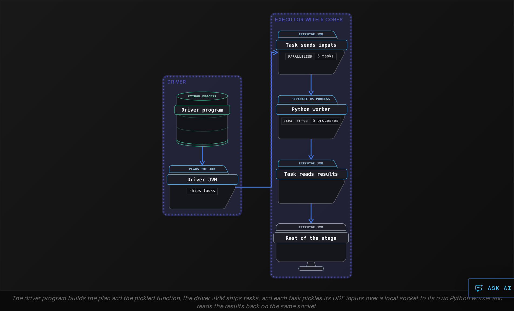
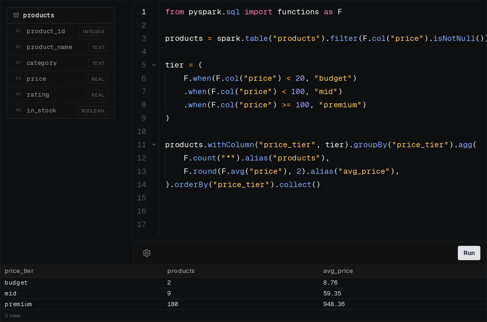

Intermediate·Spark · 14 min · 12 challenges

# UDFs and Serialization: Intermediate

A Netflix data engineer's nightly Spark job tags 2 billion playback events with a device family, using a 10-line Python function. The job runs for hours. The team is weighing a request for more executors against another option: understanding where those hours go once each row leaves the JVM for a Python process and comes back.


<br>

---

## Two Runtimes

Every executor you have sized so far is a single JVM process, and every built-in function Spark offers is JVM code running inside it. A Python function is source code for the Python interpreter, which the JVM cannot execute. So when a stage contains a Python UDF, each executor starts Python worker processes beside itself and hands them rows to compute.

The driver side has its own split. Your program is a Python process that steers a JVM driver through a gateway. Calls like `F.upper("product_name")` or `df.filter(...)` only build a plan, and the plan executes entirely inside JVMs. Calling `F.udf(fn, "string")` works differently: Spark serializes `fn`, with any variables it closes over, into bytes that travel with each task, because some process on the executor will have to run it.




<br>

### Inside a single task

Follow a single task in a stage that computes `shout_udf("product_name")`, where `shout` returns its argument in upper case. The task starts in the JVM like any other task and stays there until it needs the UDF's column.

| Step | Process | What happens |
| --- | --- | --- |
| 1 | Executor JVM | The task reads its partition and runs any built-in work that comes before the UDF. |
| 2 | Executor JVM | It asks for a Python worker: a small daemon forks one, or a worker left by an earlier task is reused, since `spark.python.worker.reuse` defaults to true. |
| 3 | Both | The JVM connects to the worker over a local socket and sends the serialized function. |
| 4 | Executor JVM | Input values are pickled in batches of 100 rows and written to the socket. The full rows wait in a queue inside the JVM. |
| 5 | Python worker | The worker unpickles each batch, calls your function once per row, pickles the results and writes them back. |
| 6 | Executor JVM | The task reads the results, converts each to the declared return type, attaches it to its waiting row and continues the stage. |

The list contains no shuffle, because the UDF is narrow: each result depends on a single row, so it runs inside the same task as the scan before it and the projection after it, and the stage count stays the same. What changes is how many processes the task needs and how many times each row's values are copied.


<br>

### Counting the processes

Each running task that evaluates a Python UDF holds its own worker, so the number of Python processes on a node follows the number of task slots. An executor with 5 cores runs 5 tasks at once and keeps 5 Python workers busy next to its JVM. Those workers live outside the JVM heap, so their memory comes from the container's overhead budget, the space whose exhaustion you met as the memoryOverhead OOM. A UDF that builds large Python objects per row can push an executor past its container limit while the heap in the Spark UI looks healthy.

| ✓ Built-in F.upper | ✗ Python UDF with the same logic |
| --- | --- |
| • Runs as JVM code inside the task<br><br>• Reads Spark's internal row format directly<br><br>• Needs no extra process and no socket<br><br>• Visible to Catalyst, which can optimize around it | • Runs in a Python worker beside the task<br><br>• Converts and pickles each value before the call<br><br>• Makes a socket round trip for every batch<br><br>• Opaque to Catalyst, evaluated in its own plan node |

> What crosses the border
>
> - The serialized function, once per task
> - The UDF's input columns, never the whole row
> - A result for every input row, on the way back
> - Nothing else: Spark keeps the rest of each row on the JVM side

**Executors in a cluster have 4 cores each, and worker reuse is on. A stage of 200 tasks applies a single Python UDF. At the busiest moment on one executor, how many Python worker processes are evaluating the UDF?**

- **A.** 200, because every task in the stage needs a worker of its own
- **B.** 1, because worker reuse lets every task share a single process
- **C.** 4: a worker for each task running at once on the 4 cores
- **D.** 8: a worker sending rows and another returning results per core

<details>
<summary>Solution</summary>

**C.** 4: a worker for each task running at once on the 4 cores

Each running task holds its worker for the length of the task, so concurrent workers follow the executor's 4 task slots.

**Why the others are wrong**

- **A.** Only running tasks hold a worker. The other tasks wait for a free core, and by the time they run, earlier workers are free to reuse.
- **B.** Reuse hands a finished task's worker to the next task. Tasks running at the same moment each need their own process.
- **D.** Rows go out and results come back over the same socket to the same worker. There is no separate process for the return trip.

</details>


<br>

---

## Pickle at the Border

Pickle is Python's standard format for turning objects into bytes and back, and the JVM side of Spark speaks it too, which is how the 2 processes exchange values. Whatever crosses the socket is pickled by the sender and unpickled by the receiver, so each argument changes form several times before your function sees it.


<br>

### A value's round trip

Take the `product_name` value `" Wireless Mouse "` and a UDF that returns `s.strip().lower()`. These are the forms that value takes on its way to Python and back.

| # | Where | Form of the value |
| --- | --- | --- |
| 1 | JVM | UTF-8 bytes inside Spark's internal row, as the scan produced them |
| 2 | JVM | A Java `String` object, allocated so the pickler can read it |
| 3 | JVM | Pickle bytes: an opcode, a length and the text, appended to a batch of 100 |
| 4 | Socket | The batch copied through the operating system to the worker |
| 5 | Python | A Python `str`, allocated by the unpickler |
| 6 | Python | Your function runs and returns a new `str`, `"wireless mouse"` |
| 7 | Python | Pickle bytes again, appended to the result batch |
| 8 | Socket | The result batch copied back through the operating system |
| 9 | JVM | Unpickled into a Java `String`, then converted to Spark's internal string |

Only step 6 is code you wrote. The other 8 are format changes and copies, and each one costs a memory allocation or copy per value. `strip()` and `lower()` run as C code inside the interpreter and finish quickly on a short string, while the steps around them run for every row whatever the function does. For a typical UDF those steps are the larger part of the bill, so making the function body twice as fast barely moves the job's runtime. Step 9 also enforces the declared return type: a Python float returned from a UDF declared `"int"` cannot be converted and arrives as null.


<br>

### What sets the size of the bill

Serialization cost grows with

- **Rows reaching the UDF** *count*\
  Every row is converted and copied in both directions, so 10 times the rows means 10 times the border work.
- **Bytes in the arguments** *width*\
  A 4-byte integer and a 2KB JSON string cost the same Python call but very different pickling and copying.
- **Bytes in the result** *width*\
  Returning a long string or a large array pays the trip a second time on the way back.
- **Shape of the values** *type*\
  A struct arrives as a Row object and an array as a list, while maps become dicts. Every nested value inside them is its own Python object.

Width deserves arithmetic. Suppose 50 million events where `payload` is a JSON string averaging 1,800 bytes and `event_type` averages 12 bytes. A UDF that reads `payload` to pull out a single field ships far more to Python than a UDF that reads `event_type`, before any pickle framing is added.

| UDF argument | Average bytes | Rows | Bytes sent to Python |
| --- | --- | --- | --- |
| `payload` | 1,800 | 50,000,000 | 90 GB |
| `event_type` | 12 | 50,000,000 | 600 MB |

So shrink what crosses. Extract the field with a built-in such as `F.get_json_object("payload", "$.device")` first and hand only that short string to the UDF, if a UDF is still needed. The same reasoning rules out `my_udf(F.struct("*"))`, which pickles every column of every row to use 2 of them.

The border holds memory as well as time. While a batch is in Python, the JVM keeps the original rows in a queue so it can attach each result to the right row, and that queue spills to disk when it outgrows memory. On the Python side, every unpickled value is an object the interpreter allocates and later frees. A wide argument costs CPU in the conversions and memory on both sides of the socket.

> **TIP**
>
> Return the narrowest type that holds the answer. A UDF that returns a boolean or an integer sends back a few bytes per row, while a UDF that returns a reformatted copy of its input pays the full width twice.

**This UDF runs over 80 million webhook rows, where body averages 3KB, and takes 40 minutes. Which change removes the most border work?**

```python
status_udf = F.udf(lambda b: json.loads(b)["status"] if b else None, "string")
out = hooks.withColumn("status", status_udf("body"))
```

- **A.** Replace the UDF with F.get_json_object("body", "$.status"), so the 3KB string never leaves the JVM
- **B.** Swap json.loads for a faster JSON parser inside the UDF, because parsing is the slow step
- **C.** Pass F.struct("*") so the UDF reads body and every other column in a single call
- **D.** Raise spark.sql.shuffle.partitions so the UDF's rows are spread over more tasks

<details>
<summary>Solution</summary>

**A.** Replace the UDF with F.get_json_object("body", "$.status"), so the 3KB string never leaves the JVM

Removing the UDF removes the pickling and the socket copy, and JVM code parses the JSON on Spark's own row format.

**Why the others are wrong**

- **B.** Parsing is 1 step among many. Around it, all 3KB of every row still crosses the socket both ways as pickled bytes.
- **C.** This pickles every column of every row, so more bytes cross than before, for the same single field.
- **D.** The job has no shuffle for that setting to affect, and spreading rows out does not reduce the bytes each row carries.

</details>


<br>

---

## Measuring the UDF Tax

A benchmark answers a single question: how much slower is this job because of the border crossing? Both versions must read the same input on the same cluster, do the same work and differ in exactly one expression. That design breaks under 3 habits, and each skews the answer.


<br>

### Trap 1: an action that skips the UDF

```sql
tagged = events.withColumn("kind", classify_udf("event_type"))
tagged.count()
```

Catalyst prunes columns that nothing downstream reads. `count()` reads no columns, so the `kind` projection is removed, and because a UDF is deterministic unless you mark it otherwise, Catalyst is free to drop it. The timer measures a scan, the 2 versions tie, and the conclusion is wrong. Time an action that needs every column instead. The `noop` write format, built into Spark since 3.0, runs the whole plan and discards the rows.

```sql
tagged.write.format("noop").mode("overwrite").save()
```


<br>

### Trap 2: timing the first run

The first run in a session pays one-off costs. Spark forks the Python workers and ships the function for them to load, and the JVM loads its classes for the first time. Later runs reuse the workers. Time each version several times and keep the median, so a cold start or a noisy neighbour on the cluster cannot decide the result.


<br>

### Trap 3: timing the read too

When each run reads files from storage, read variance lands in both numbers. Cache only the input column, materialize the cache once with an action, then time each variant over the cached data. The difference between the 2 medians is then the expression and nothing else.

```sql
import time
from pyspark.sql import functions as F

base = spark.read.parquet("/data/events").select("event_type").cache()
base.count()


def timed(label, frame, repeats=5):
    seconds = []
    for _ in range(repeats):
        start = time.perf_counter()
        frame.write.format("noop").mode("overwrite").save()
        seconds.append(time.perf_counter() - start)
    seconds.sort()
    print(label, "median seconds:", round(seconds[len(seconds) // 2], 2))


commerce = ("purchase", "add_to_cart")
classify_udf = F.udf(lambda t: "commerce" if t in commerce else "other", "string")
builtin_kind = F.when(F.col("event_type").isin(*commerce), "commerce").otherwise("other")

timed("python udf", base.withColumn("kind", classify_udf("event_type")))
timed("built-in", base.withColumn("kind", builtin_kind))
```

The 2 variants also agree on nulls, which you should confirm before trusting any timing: `None in commerce` is false in Python, and `isin` on a null returns null, which `when` treats as false, so both return `"other"`. A faster version that returns different rows has measured nothing.


<br>

### From seconds to a per-row price

Suppose the timing code prints 6.2 seconds for the built-in and 38.0 seconds for the UDF, over 40 million cached rows on 8 cores. The UDF adds 31.8 seconds of wall time. Multiply by the 8 busy cores and divide by the rows: (31.8 x 8) / 40,000,000 is about 6.4 microseconds of core time per row. A per-row price scales to any volume, so a table that receives 2 billion rows a day, the volume of the playback job in the intro, pays the figure below.

- **3.5 core-hours** — UDF tax per day at 2 billion rows


<br>

### The difference in the Spark UI

| Where to look | Built-in run | UDF run |
| --- | --- | --- |
| SQL tab plan graph | Scan, then Project | A `BatchEvalPython` box between them |
| Stages per run | 1 | 1: the UDF adds no stage |
| Shuffle read and write | None | None |
| Spill | None | None at this width |
| Median task duration | Short: tasks of the 6.2 s run | About 6 times longer, as 38.0 s is to 6.2 s |
| GC time | Low | Can rise with the objects the conversions create |

Long tasks that show moderate GC and neither shuffle nor spill usually point to a Python UDF: the checks you already run come back clean while the time goes to a process the stage page does not describe. The `BatchEvalPython` box in the SQL tab names the cause, and from Spark 3.4 that box also reports how much data was sent to and returned from the Python workers.

**A teammate times a UDF against its built-in rewrite with the code below. Both versions take 4.1 seconds, and the teammate concludes the UDF is free. What is the most likely explanation?**

```python
start = time.perf_counter()
users.withColumn("domain", domain_udf("email")).count()
print(time.perf_counter() - start)
```

- **A.** Python workers were already warm from an earlier run, so the border cost nothing
- **B.** Catalyst cached the first version's result and served the second from memory
- **C.** The email strings are short, so the border adds less than the timer can resolve
- **D.** count() reads no columns, so Catalyst pruned domain and the UDF never ran

<details>
<summary>Solution</summary>

**D.** count() reads no columns, so Catalyst pruned domain and the UDF never ran

Both runs timed the same scan. An action that needs every column, such as a noop write, makes the UDF execute.

**Why the others are wrong**

- **A.** Warm workers save startup time. Every row would still be pickled and copied, which costs time on each run.
- **B.** Spark caches a DataFrame only when you ask it to, and the 2 versions are different plans anyway.
- **C.** Short strings lower the cost per row, and across a whole table it still adds up. Something removed the UDF entirely.

</details>

An aggregate can stand in for the `noop` write, provided it reads the measured column. Catalyst prunes a column only when nothing downstream reads it. Put `F.countDistinct("kind")` or `F.max("kind")` in the final `agg` and the expression stays in the plan, but `F.count("*")` lets Catalyst drop it. Don't trust the number until `explain()` shows the expression still sitting above the scan.


<br>

---

## Moving Logic to the JVM

Most production UDFs are a few lines: a branch on a number, a string cleanup, a date parse, a lookup in a small dict. Spark has a built-in function for each, and a built-in runs inside the JVM on Spark's own row format, so a rewrite takes the Python workers out of the job and the socket and pickling go with them. These are the patterns you will meet most often.

| Inside the UDF | Built-in replacement |
| --- | --- |
| `if`/`elif` chain on a value | `F.when(...).when(...).otherwise(...)` |
| `s.strip().lower()` | `F.lower(F.trim(c))` |
| `re.sub(pattern, "", s)` | `F.regexp_replace(c, pattern, "")` |
| `re.search(pattern, s).group(1)` | `F.regexp_extract(c, pattern, 1)` |
| `datetime.strptime(s, "%Y-%m-%d").date()` | `F.to_date(c, "yyyy-MM-dd")` |
| `json.loads(s)["user"]["id"]` | `F.get_json_object(c, "$.user.id")` |
| `LOOKUP.get(code)` on a small dict | A broadcast join to a small lookup DataFrame |
| `[x \* 2 for x in xs]` | `F.transform(c, lambda x: x \* 2)` |
| `v if v is not None else 0` | `F.coalesce(c, F.lit(0))` |

*The lambda passed to F.transform is called once, on the driver, with column placeholders to build an expression. It never runs per row and never crosses the border.*


<br>

### A worked rewrite

This UDF sorts products into price tiers and keeps a missing price missing:

```sql
def price_tier(price):
    if price is None:
        return None
    if price < 20:
        return "budget"
    if price < 100:
        return "mid"
    return "premium"


tier_udf = F.udf(price_tier, "string")
tiered = products.withColumn("price_tier", tier_udf("price"))
```

The translation is mechanical, with a single trap. `F.when` treats a comparison against null as false, so a chain ending in `.otherwise("premium")` would call every unpriced product premium. Spell out the last condition instead and leave `otherwise` off: a row that matches no branch gets null, which is what `price_tier(None)` returned.

```sql
tier = (
    F.when(F.col("price") < 20, "budget")
    .when(F.col("price") < 100, "mid")
    .when(F.col("price") >= 100, "premium")
)
tiered = products.withColumn("price_tier", tier)
```

Run the built-in version on the practice data. The cell drops unpriced products before grouping, so every group has a tier to show.



```python
from pyspark.sql import functions as F

products = spark.table("products").filter(F.col("price").isNotNull())

tier = (
    F.when(F.col("price") < 20, "budget")
    .when(F.col("price") < 100, "mid")
    .when(F.col("price") >= 100, "premium")
)

products.withColumn("price_tier", tier).groupBy("price_tier").agg(
    F.count("*").alias("products"),
    F.round(F.avg("price"), 2).alias("avg_price"),
).orderBy("price_tier").collect()
```

The animation plays the same chain over 8 products in 2 partitions. The tier is computed inside each map task, on rows already there, before the shuffle write for the `groupBy`. The aggregation's shuffle is the only data that moves; with the UDF, every row would also have gone to a Python worker and back inside each map task.

https://github.com/user-attachments/assets/83232f5e-efdc-4e49-9f48-414245229193

<br>

### Where a rewrite changes the answer

Python and Spark agree on most operations and disagree on a few that turn up in real UDFs. Check these before shipping a rewrite.

| Case | Python in a UDF | Spark built-in |
| --- | --- | --- |
| Rounding 2.5 | `round(2.5)` gives 2, halves to even | `F.round` gives 3.0, halves up; `F.bround` gives 2.0 |
| Trimming a tab | `"\tsku".strip()` removes the tab | `F.trim` removes spaces only, so the tab stays |
| Title case of `o'neil` | `.title()` gives `O'Neil` | `F.initcap` gives `O'neil` |
| Casting `12a` to an integer | `int("12a")` raises and fails the task | `.cast("int")` gives null when ANSI mode is off, the default before Spark 4.0 |

To prove a rewrite, run both versions on the same sample and compare rows in both directions. `exceptAll` keeps duplicates, so a row that appears twice on one side and once on the other is caught, and since it reads every column, the UDF cannot be pruned away.

```sql
sample = products.sample(fraction=0.01, seed=7)
old = sample.withColumn("price_tier", tier_udf("price"))
new = sample.withColumn("price_tier", tier)
assert old.exceptAll(new).count() == 0
assert new.exceptAll(old).count() == 0
```

> When the UDF stays
>
> Keep a UDF when the logic needs a Python library with no built-in counterpart, such as a trained model's predict call. Then apply the border rules: shrink what crosses, filter with built-ins first, and measure.

**A UDF returns round(amount), and finance reconciles against its output. You rewrite it as F.round("amount"), and an exceptAll check finds rows that differ, all with amounts ending in .5. What fixes the rewrite?**

- **A.** Cast amount to a string before rounding, so both versions see identical digits
- **B.** Use F.bround("amount"), which rounds halves to even as Python's round does
- **C.** Keep F.round and add .otherwise(0), because the differing rows hold nulls
- **D.** Turn off worker reuse, so Python rounds with the same rule the JVM uses

<details>
<summary>Solution</summary>

**B.** Use F.bround("amount"), which rounds halves to even as Python's round does

Python rounds 2.5 to 2 and 3.5 to 4. F.round rounds halves up, while F.bround rounds them to even and matches.

**Why the others are wrong**

- **A.** The digits were already identical. The difference comes from how each side rounds a value exactly halfway.
- **C.** Every differing row ends in .5, which points at the halfway rule, and otherwise is a method of F.when chains only.
- **D.** Worker settings leave Python's rounding rule as it is. The rewrite itself has to pick the matching function.

</details>


<br>

---

## BatchEvalPython in the Plan

A Python UDF is opaque to Catalyst, yet the physical plan still marks exactly where the border sits. Catalyst lifts each Python UDF out of the expression you wrote and evaluates it in a dedicated operator, `BatchEvalPython`, which takes rows from the operator below, sends the UDF's inputs to the workers and appends the results as new columns. Find that node and you can read off which rows and columns cross, and how many times.

```sql
def clean_name(s):
    return s.strip().lower() if s is not None else None


clean_udf = F.udf(clean_name, "string")

named = (
    spark.read.parquet("/data/products")
    .filter(F.col("in_stock") == 1)
    .select("product_id", clean_udf("product_name").alias("clean_name"))
)
named.explain()
```

Its plan, trimmed to operator names and columns. Read it from the bottom up:

| Plan line | What it tells you |
| --- | --- |
| `Project [product_id#0, pythonUDF0#12 AS clean_name#9]` | Names the returned column, back in the JVM |
| `+- BatchEvalPython [clean_name(product_name#1)#8], [pythonUDF0#12]` | The border: the call with its 1 input column, then the result column it appends |
| `+- Project [product_id#0, product_name#1]` | Only 2 columns continue, since `in_stock` has done its job |
| `+- Filter (isnotnull(in_stock#5) AND (in_stock#5 = 1))` | A built-in filter below the border: rows it drops never cross |
| `+- FileScan parquet [product_id#0,product_name#1,in_stock#5] PushedFilters: [IsNotNull(in_stock), EqualTo(in_stock,1)]` | The same condition pushed into the Parquet read |

The call inside the node carries the Python function's name, so a function defined with `def` and a clear name keeps plans readable, while a lambda shows only a generic label. The columns inside the call are what gets pickled. No `Exchange` appears, which agrees with the Spark UI: the crossing happens inside 1 stage and adds no shuffle.


<br>

### A UDF inside a filter

Catalyst cannot push a predicate it cannot read into the scan, so a UDF condition is evaluated in `BatchEvalPython` and a `Filter` above it keeps the rows where it returned true. Here the condition also holds a built-in comparison:

```sql
valid = (
    spark.read.parquet("/data/users")
    .filter(is_valid_udf("email") & (F.col("account_status") == "active"))
    .select("user_id", "email")
)
```

| Plan line | What it tells you |
| --- | --- |
| `Project [user_id#0, email#2]` | Keeps the 2 selected columns |
| `+- Filter pythonUDF0#20: boolean` | Keeps rows where the UDF returned true, after they crossed |
| `+- BatchEvalPython [is_valid(email#2)#19], [pythonUDF0#20]` | Every row that passed the filter below crosses here |
| `+- Filter (isnotnull(account_status#4) AND (account_status#4 = active))` | The built-in half of the condition, below the border |
| `+- FileScan parquet [user_id#0,email#2,account_status#4] PushedFilters: [IsNotNull(account_status), EqualTo(account_status,active)]` | That half also reached the Parquet read, and the UDF half could not |

Catalyst split the `&`. The built-in comparison moved below the border and into the scan, so only active users cross, and that split happens whichever half you write first. What matters is that a selective built-in condition exists. If the UDF were the only condition, every row in `users` would cross.


<br>

### 2 crossings in one plan

UDFs whose inputs are plain columns run together in a single `BatchEvalPython`. When a built-in expression sits between 2 UDFs, as in `score_udf(F.concat(clean_udf("name"), F.lit("|")))`, the first result has to come back to the JVM before the second input can be built. The plan shows 2 `BatchEvalPython` nodes stacked on each other, and every row crosses twice.


<br>

### Pricing a plan before it runs

From plan to price

- Count the BatchEvalPython nodes: each is a round trip for every row that reaches it.
- Read the input columns inside each call and estimate their bytes per row.
- Estimate the rows reaching each node from the filters and scan beneath it.
- Multiply rows by the per-row core cost your benchmark measured, then divide by the cores.

Suppose `users` holds 300 million rows, 10% of them are active, and a benchmark of `is_valid` measured 5 microseconds of core time per row. With the built-in filter below the border, 30 million rows cross: 150 core-seconds, about 1.5 seconds of wall time on 100 cores. With the UDF as the only condition, all 300 million cross for 1,500 core-seconds. A single built-in condition cut 90% of the UDF's cost before any rewrite.

**A nightly job reads 400 million page_views rows, 20% of them from mobile. Which change cuts the UDF's cost the most?**

```python
views = spark.read.parquet("/data/page_views")
checkout = (
    views.withColumn("path", path_udf("page_url"))
    .filter(F.col("path") == "/checkout")
    .filter(F.col("device") == "mobile")
)
```

- **A.** Move the device filter above withColumn in the code, so fewer rows reach the UDF
- **B.** Add repartition(400) before the UDF so more Python workers share the work
- **C.** Replace path_udf with F.expr("parse_url(page_url, 'PATH')"), deleting the crossing
- **D.** Filter on path first, so Catalyst can push the UDF condition into the scan

<details>
<summary>Solution</summary>

**C.** Replace path_udf with F.expr("parse_url(page_url, 'PATH')"), deleting the crossing

The plan loses its BatchEvalPython node, so none of the 80 million mobile rows is pickled or copied at all.

**Why the others are wrong**

- **A.** Catalyst already places that built-in filter below BatchEvalPython, so only mobile rows cross. Reordering the code leaves the plan as it was.
- **B.** That adds a shuffle and moves every row over the network, while the total work done in Python stays the same.
- **D.** Catalyst cannot read a UDF, so a condition on its result stays above the border and out of the Parquet scan.

</details>

Some UDFs leave nothing to price, because a built-in does their whole job. A UDF filter that compares a column to a constant becomes `F.col("event_type") == "purchase"`, which Catalyst can push into the `FileScan` as a `PushedFilters` entry. A UDF that fills a missing value becomes `F.coalesce` inside the `Project`. Run `explain()` after the rewrite: a plan with no `BatchEvalPython` node sends no row to Python.


<br>

---

## Putting It All Together

Back at the Netflix playback job from the intro: 2 billion events a night get a device family from a 10-line Python UDF that reads the full user-agent string. The plan shows a single BatchEvalPython node fed by the whole scan, with the long user-agent as its only input column. A benchmark over a cached sample prices the crossing per row, and the engineer finds that 9 of the 10 lines are substring checks a F.when chain with contains can express, which removes the node and the hours with it.

- The 2 runtimes: each of the 2 billion user-agent strings travels to a Python worker beside an executor core and back.
- Pickle at the border: the user-agent is the widest column in the table, so it dominates the bytes crossing the socket.
- Measuring the tax: a noop write over a cached sample, timed as a median, turns the gap into a per-row price for the nightly volume.
- Moving logic to the JVM: substring checks become an F . when chain with contains , and an exceptAll check in both directions proves the labels match.
- The plan: after the rewrite BatchEvalPython is gone, no Exchange was added, and the stage count stays where it was.


<br>

---

## Key Takeaways

- A Python UDF runs in a separate Python worker for each running task, fed over a local socket by the executor JVM.
- Every value is converted and pickled on the way out and back, and those steps set most of a UDF's cost.
- Cost grows with the rows reaching the UDF and the bytes in its arguments and results, so shrink both.
- Benchmark on cached input with an action that reads the UDF column, take the median of warm runs, then convert to a per-row price.
- Most UDFs rewrite to F . when or to the built-in string, date, JSON and array functions. Before shipping, check that the rewrite rounds and trims the way the UDF did, and that its casts match.
- BatchEvalPython marks the crossing in the plan, and built-in filters below it shrink the rows that cross.
