# Aggregating: Advanced

Spotify Wrapped is days from launch, and the data team owes the app a row per listener: their tracks in the sequence they played them, a lookup of plays per genre, and how many songs they skipped. One GROUP BY has to produce all of it. Collapse the wrong way and someone's top song arrives fifth, or a listener with zero skips vanishes from the report.


<br>

---

## ARRAY_AGG for collecting values

Every aggregate you have used so far reduces a group to a single number: COUNT says how many rows, SUM gives a total, MAX picks the largest value. `ARRAY_AGG(column)` also reduces each group to a single value, and that value is an array holding every input value from the group. A listener with 4 plays becomes 1 output row carrying a 4-element array, and the individual values survive inside it.

The examples in this lesson run on a `plays` table with a row for every time a listener started a track. `ms_played` is how long the track ran before it ended or was cut off, `skipped` is true when the listener moved on early, and `played_at` holds the start time as HH:MM text, so it sorts in time order.


<br>

### A group in, an array out

https://github.com/user-attachments/assets/f9bee37d-818a-4971-9500-6a81c91a0222

Watch the animation in 2 moves. GROUP BY sorts the 8 rows into a pile per listener: 4 for ana, 3 for ben, 1 for cy. ARRAY_AGG then walks each pile and appends each row's `track` to that pile's array. The output has 3 rows because there are 3 groups, the same rule that governs COUNT and SUM. The new part is the shape of the value: each array has exactly as many elements as its group has rows.


<br>

### What lands in the array

ARRAY_AGG keeps every value it receives. ana played Aurora twice, so Aurora appears twice in her array. Put DISTINCT inside the parentheses and each value appears once per group, the same way `COUNT(DISTINCT track)` counts each value once. NULLs are kept as well: a row whose `track` is NULL adds a NULL element, where `COUNT(track)` would have passed over it.

**All values**

Every play contributes an element, so ana's array repeats Aurora and matches her play count of 4.

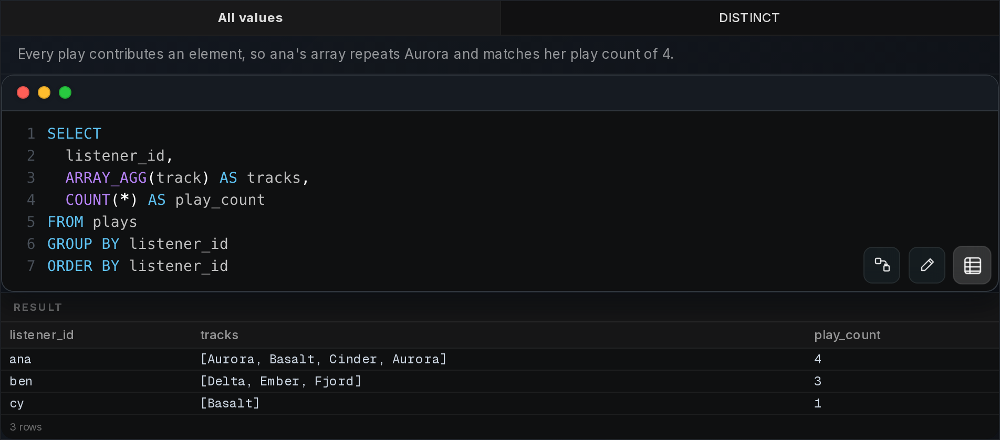

```sql
SELECT
  listener_id,
  ARRAY_AGG(track) AS tracks,
  COUNT(*) AS play_count
FROM plays
GROUP BY listener_id
ORDER BY listener_id
```

**DISTINCT**

Repeats collapse: ana's array drops to 3 tracks, matching COUNT(DISTINCT track).

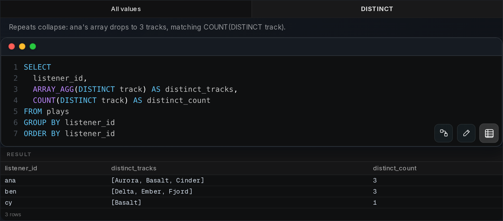

```sql
SELECT
  listener_id,
  ARRAY_AGG(DISTINCT track) AS distinct_tracks,
  COUNT(DISTINCT track) AS distinct_count
FROM plays
GROUP BY listener_id
ORDER BY listener_id
```

Put the array beside a count of the same rows and the 2 always agree. In the first version ana has 4 elements and a `play_count` of 4; the second version shows 3 of each. That agreement doubles as a check. When an array is longer than you expected, the group holds rows you didn't expect, and reading the array shows you which ones.


<br>

### The order inside is not fixed yet

Look at the order of ana's tracks in either version. It follows the sequence in which rows reached the aggregate, which depends on how the table was split across workers and which worker finished first. On a large table the same query can return the same elements in a different order on the next run, with no change to the data. Until you set the order explicitly, read an array from ARRAY_AGG as a collection: fine for checking what's in it or how many, wrong for asking which came first. The ORDER BY modifier, 2 sections ahead, sets that order.


<br>

### Why collect at all

- Hand an app a row per user with their recent items, instead of 50 rows it must regroup itself
- Keep detail behind a summary: a daily total next to the order IDs that make it up
- Debug a GROUP BY by collecting the raw values, which shows which rows landed in each group
- Filter at the grouped level, then expand the array back into rows with UNNEST

> **TIP**
>
> An array grows with its group. ARRAY_AGG over a key with a few enormous groups, such as a bot account with millions of plays, builds a millions-element array in the memory of the worker that owns that group. Check the largest group with COUNT(\*) and ORDER BY before collecting.

**This query runs on the 8-row plays table from this section. What does it return?**

```sql
SELECT
  genre,
  ARRAY_AGG(DISTINCT listener_id) AS listeners
FROM plays
GROUP BY genre
```

- **A.** 3 rows, a row per listener, each array listing the genres that listener played
- **B.** 3 rows, a row per genre, with 3 entries in pop because ana played pop twice
- **C.** 3 rows, a row per genre: pop and rock hold 2 listeners each, jazz holds 1
- **D.** 8 rows, a row per play, each holding a 1-element array of its listener

<details>
<summary>Solution</summary>

**C.** 3 rows, a row per genre: pop and rock hold 2 listeners each, jazz holds 1

pop holds ana and ben, and rock holds ana and cy. jazz receives ben twice, and DISTINCT keeps him once.

**Why the others are wrong**

- **A.** GROUP BY genre makes the groups, so there's a row per genre. The listener IDs are the values being collected.
- **B.** Without DISTINCT that would hold. DISTINCT keeps ana once, so pop holds ana and ben.
- **D.** An aggregate with GROUP BY returns a row per group, and genre has 3 distinct values here.

</details>


<br>

---

## MAP_AGG for key-value pairs

An array answers the question 'which values does this group hold?'. A map answers a different one: 'for this key, what's the value?'. `MAP_AGG(key, value)` builds a map from each group, turning every row into an entry whose key is the first argument and whose value is the second. You met MAP as a column type that arrives already built; MAP_AGG is how you construct one from ordinary rows.

Most real uses stack 2 GROUP BY levels. The inner query computes a number per listener and genre, so each genre appears once per listener. The outer query folds those rows into a map per listener.

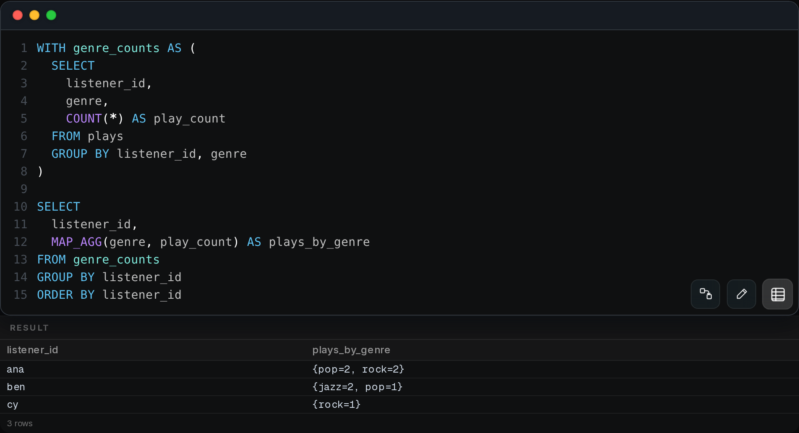

```sql
WITH genre_counts AS (
  SELECT
    listener_id,
    genre,
    COUNT(*) AS play_count
  FROM plays
  GROUP BY listener_id, genre
)

SELECT
  listener_id,
  MAP_AGG(genre, play_count) AS plays_by_genre
FROM genre_counts
GROUP BY listener_id
ORDER BY listener_id
```

Inner GROUP BY: a row per pair

| listener_id | genre | play_count |
| --- | --- | --- |
| ana | pop | 2 |
| ana | rock | 2 |
| ben | jazz | 2 |
| ben | pop | 1 |
| cy | rock | 1 |

Outer MAP_AGG: a row per listener

| listener_id | plays_by_genre |
| --- | --- |
| ana | {pop: 2, rock: 2} |
| ben | {jazz: 2, pop: 1} |
| cy | {rock: 1} |

The 5 inner rows become 3 outer rows. What's missing matters as much as what is there: ana has no jazz key and ben has no rock key. A map holds only the keys that occurred in the group, so the output follows the data. A genre that first appears next month becomes a new key with no edit to the query, where a design with a column per genre would need a new column every time.


<br>

### Reading a value back out

Square brackets read a key: `plays_by_genre['rock']` is 2 for ana. For ben the same expression stops the whole query with a key-not-present error, because his map never got a rock key. `element_at(plays_by_genre, 'rock')` reads the same value and returns NULL when the key is missing, which is what a report across many listeners needs.

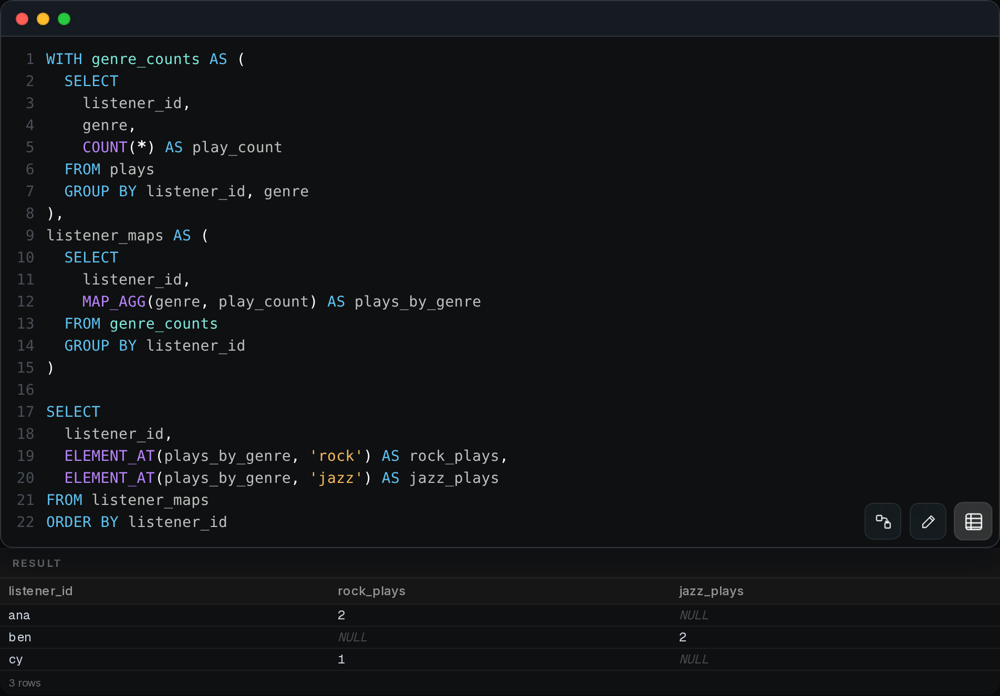

```sql
WITH genre_counts AS (
  SELECT
    listener_id,
    genre,
    COUNT(*) AS play_count
  FROM plays
  GROUP BY listener_id, genre
),
listener_maps AS (
  SELECT
    listener_id,
    MAP_AGG(genre, play_count) AS plays_by_genre
  FROM genre_counts
  GROUP BY listener_id
)

SELECT
  listener_id,
  ELEMENT_AT(plays_by_genre, 'rock') AS rock_plays,
  ELEMENT_AT(plays_by_genre, 'jazz') AS jazz_plays
FROM listener_maps
ORDER BY listener_id
```

ana reads 2 and NULL, and ben reads the reverse. cy reads 1 and NULL. Each NULL marks a genre that listener never played, and the query finishes for all 3 listeners.


<br>

### Keys must be unique within a group

MAP_AGG assumes each key arrives once per group. Feed it raw plays with `MAP_AGG(genre, track)` and ana sends pop twice with Aurora both times. She also sends rock twice, once with Basalt and once with Cinder. A map can hold rock only once, so MAP_AGG keeps one of the 2 values and discards the other without raising an error. Which value survives depends on the order the rows arrive, the same unstable order ARRAY_AGG showed. To keep everything, collect before you fold: an inner GROUP BY on listener and genre builds an array of tracks per genre, and MAP_AGG then maps each genre to its array. `MULTIMAP_AGG(key, value)` builds that same map of arrays in a single call.

**MAP_AGG**

One value per key: ana's rock entry keeps Basalt or Cinder and silently drops the other.

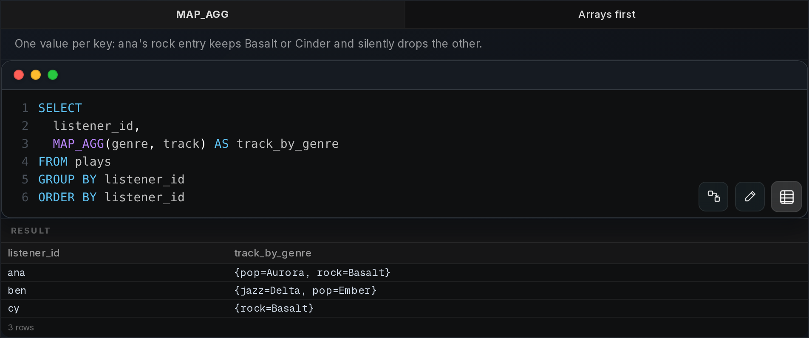

```sql
SELECT
  listener_id,
  MAP_AGG(genre, track) AS track_by_genre
FROM plays
GROUP BY listener_id
ORDER BY listener_id
```

**Arrays first**

Each genre's tracks are collected into an array first, so ana's rock entry holds both Basalt and Cinder.

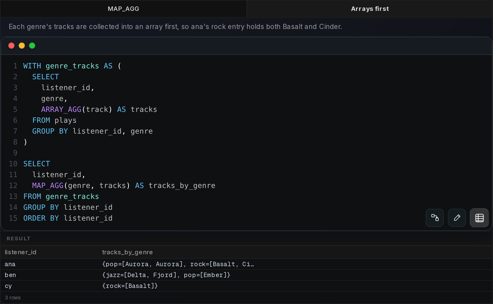

```sql
WITH genre_tracks AS (
  SELECT
    listener_id,
    genre,
    ARRAY_AGG(track) AS tracks
  FROM plays
  GROUP BY listener_id, genre
)

SELECT
  listener_id,
  MAP_AGG(genre, tracks) AS tracks_by_genre
FROM genre_tracks
GROUP BY listener_id
ORDER BY listener_id
```

| ✓ ARRAY_AGG | ✗ MAP_AGG |
| --- | --- |
| • Answers: which values does the group hold?<br><br>• Keeps repeats, and each element has a position<br><br>• Read by position, with [1] for the first element<br><br>• Position means something only with ORDER BY inside the call | • Answers: what value goes with this key?<br><br>• Holds each key once; a repeated key loses a value<br><br>• Values are read by key through element_at or square brackets<br><br>• The order of keys carries no meaning |

> Before you reach for MAP_AGG
>
> - Aggregate first so each key appears once per group, then fold with MAP_AGG
> - Use element_at when a key may be missing; brackets fail the query
> - Use MULTIMAP_AGG when one key can carry several values and you need them all
> - Keys share one type and values share one type, as in any MAP column

**An order_events table has a row per status change: order_id, status, changed_at. One order went 'placed', then 'shipped', then 'placed' again after a failed delivery. Grouped by order_id, what does MAP_AGG(status, changed_at) give for that order?**

- **A.** A map with 2 keys, where 'placed' holds one of its 2 timestamps and the query does not control which
- **B.** A map with 3 keys, because each of the 3 status rows adds its own entry to the map
- **C.** An error, because the key 'placed' arrives twice within the same order_id group
- **D.** A map with 2 keys, where 'placed' holds an array containing both of its timestamps

<details>
<summary>Solution</summary>

**A.** A map with 2 keys, where 'placed' holds one of its 2 timestamps and the query does not control which

The map gets a 'placed' key and a 'shipped' key. MAP_AGG keeps one value for 'placed' and discards the repeat without an error.

**Why the others are wrong**

- **B.** A map cannot hold 'placed' twice, so 3 rows with 2 distinct statuses produce 2 keys.
- **C.** MAP_AGG raises no error on a repeated key. It keeps one value and drops the other silently, which is why the duplicate goes unnoticed.
- **D.** That's what MULTIMAP_AGG returns. MAP_AGG keeps a single value per key.

</details>


<br>

---

## Aggregate modifiers (ORDER BY)

ARRAY_AGG accepts an ORDER BY inside its parentheses: `ARRAY_AGG(track ORDER BY played_at)`. Before appending anything, the aggregate sorts each group's rows by that expression, so position 1 holds the earliest play, position 2 the next, and so on. The sort happens per group, after GROUP BY has split the rows and before the array is built.

**No ORDER BY**

Elements follow the order rows reached the aggregate, which no part of the query controls.

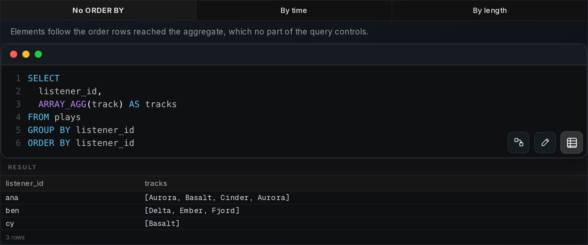

```sql
SELECT
  listener_id,
  ARRAY_AGG(track) AS tracks
FROM plays
GROUP BY listener_id
ORDER BY listener_id
```

**By time**

Each array is a listening session in sequence, earliest play first.

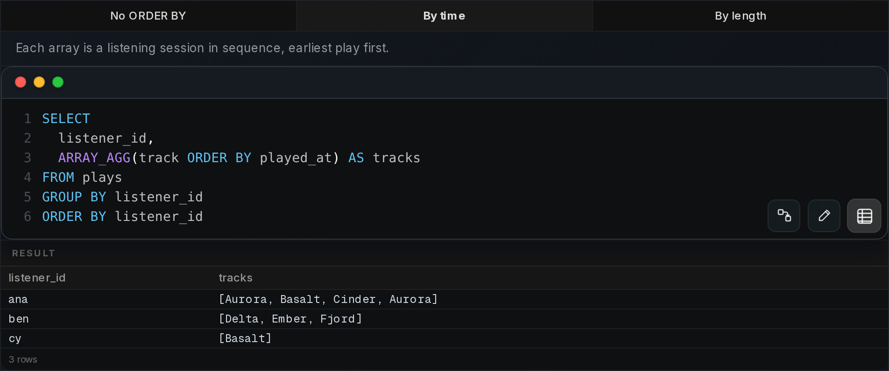

```sql
SELECT
  listener_id,
  ARRAY_AGG(track ORDER BY played_at) AS tracks
FROM plays
GROUP BY listener_id
ORDER BY listener_id
```

**By length**

Each array runs from the longest play to the shortest.

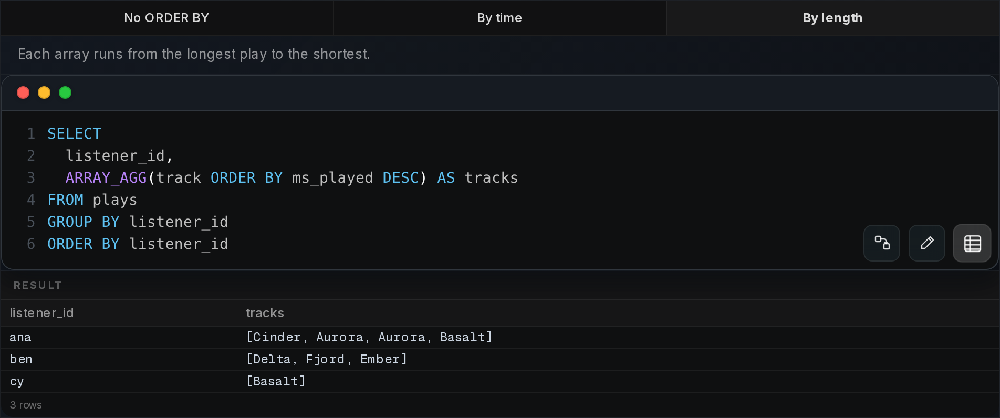

```sql
SELECT
  listener_id,
  ARRAY_AGG(track ORDER BY ms_played DESC) AS tracks
FROM plays
GROUP BY listener_id
ORDER BY listener_id
```

The By time version returns ana's morning as it happened: Aurora, Basalt, Cinder, then Aurora again. By length rearranges those 4 elements longest first: Cinder at 240000 ms, the 2 Aurora plays, then Basalt at 15000 ms. Across the 3 versions the groups and the row count stay the same, and so does each array's length; only positions inside each array change.


<br>

### Inner ORDER BY versus outer ORDER BY

A query can carry an ORDER BY in 2 places, and neither affects the other. The one inside the aggregate arranges elements within each array. The one at the end of the query arranges the output rows, as you learned with ORDER BY and LIMIT, and it runs last. Sorting rows by `listener_id` says nothing about the order of tracks inside each row, and sorting the tracks says nothing about which listener prints first.

| ✓ Inside the aggregate | ✗ At the end of the query |
| --- | --- |
| • Written as ARRAY_AGG(x ORDER BY y)<br><br>• Sorts the rows of each group separately<br><br>• Decides element positions inside each array<br><br>• Runs before the array is built | • Written as ORDER BY y after GROUP BY and HAVING<br><br>• Sorts the finished output rows<br><br>• Decides which group's row prints first<br><br>• Runs after SELECT, as the final sort |

**On the plays table, ben's plays are Delta at 310000 ms, Ember at 9000 ms and Fjord at 12000 ms. What's the first element of ben's array?**

```sql
SELECT
  listener_id,
  ARRAY_AGG(track ORDER BY ms_played) AS tracks
FROM plays
GROUP BY listener_id
ORDER BY listener_id DESC
```

- **A.** Delta, since ARRAY_AGG sorts by ms_played from largest to smallest
- **B.** Delta, since the outer DESC flips every array to longest first
- **C.** It varies between runs, because array elements have no fixed order
- **D.** Ember, his shortest play, since the inner ORDER BY sorts ascending

<details>
<summary>Solution</summary>

**D.** Ember, his shortest play, since the inner ORDER BY sorts ascending

Sorted by ms_played ascending, ben's array is Ember, Fjord, Delta. The outer DESC only reorders the 3 output rows.

**Why the others are wrong**

- **A.** An ORDER BY without DESC sorts ascending, inside an aggregate as anywhere else, so the largest value lands last.
- **B.** The outer ORDER BY sorts output rows, so it decides that cy prints before ben. It never touches array contents.
- **C.** That holds only without an ORDER BY inside the call. Here the values of ms_played are all different, so the order is fixed.

</details>


<br>

### Taking the first element

Once the order is fixed, a position means something. `ARRAY_AGG(track ORDER BY ms_played DESC)[1]` sorts each group longest first and keeps element 1, which is each listener's longest play. Array positions start at 1, so `[1]` is the first element.

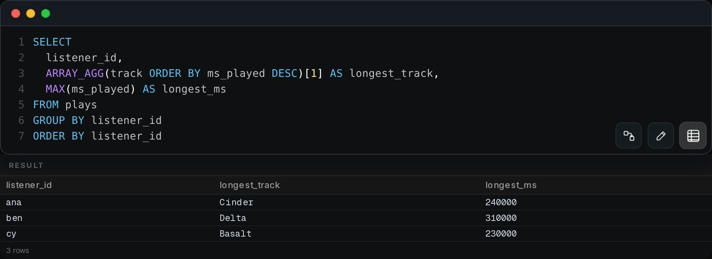

```sql
SELECT
  listener_id,
  ARRAY_AGG(track ORDER BY ms_played DESC)[1] AS longest_track,
  MAX(ms_played) AS longest_ms
FROM plays
GROUP BY listener_id
ORDER BY listener_id
```

*When you need only that single value, MAX_BY(track, ms_played) returns the track with the largest ms_played without building the array. Reach for the ARRAY_AGG form when you want several positions or the whole list.*


<br>

### Ties and parallel arrays

ORDER BY inside an aggregate is still a sort, and a sort leaves tied rows in no particular order. If 2 of ana's plays shared a `played_at`, either could land first, and today's run could disagree with tomorrow's. A second sort key such as `ORDER BY played_at, track` breaks the tie and makes the array come out the same on every run.

The same rule governs 2 arrays meant to line up. With `ARRAY_AGG(track ORDER BY played_at)` beside `ARRAY_AGG(ms_played ORDER BY played_at)`, position 2 of one and position 2 of the other describe the same play. Drop the ORDER BY from both and no rule guarantees that position 2 still refers to the same play in each.

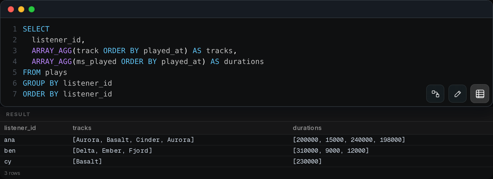

```sql
SELECT
  listener_id,
  ARRAY_AGG(track ORDER BY played_at) AS tracks,
  ARRAY_AGG(ms_played ORDER BY played_at) AS durations
FROM plays
GROUP BY listener_id
ORDER BY listener_id
```

> **TIP**
>
> For SUM, the order of the input cannot change the answer, and the same goes for COUNT and MAX: a total doesn't depend on the order it was added in. The modifier matters only for aggregates whose output has positions, such as ARRAY_AGG.


<br>

---

## COUNT_IF conditional counting

`COUNT_IF(condition)` evaluates a true-or-false expression on every row of the group and counts the rows where it came out true. `COUNT_IF(skipped)` counts skipped plays; `COUNT_IF(ms_played >= 30000)` counts plays that ran at least 30 seconds. Rows where the condition is false are not counted, and neither are rows where it's NULL, so only a definite true adds 1.


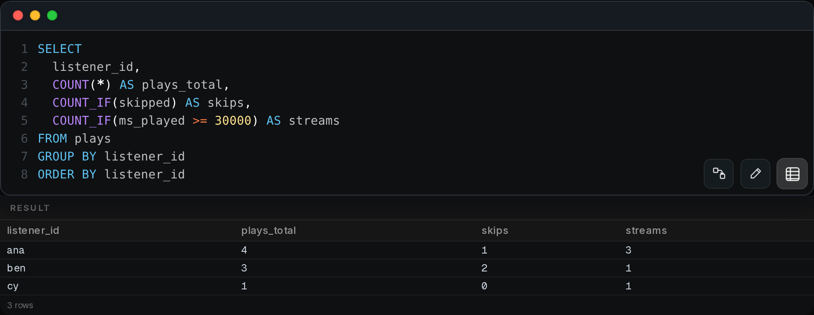

```sql
SELECT
  listener_id,
  COUNT(*) AS plays_total,
  COUNT_IF(skipped) AS skips,
  COUNT_IF(ms_played >= 30000) AS streams
FROM plays
GROUP BY listener_id
ORDER BY listener_id
```

One pass over the table produces 3 different counts per listener, each with its own condition, and every row is read once. Counting with WHERE would take a separate query per condition, because a WHERE clause trims the rows that all aggregates see; COUNT_IF keeps all 3 counts inside one GROUP BY. The last section shows a second one-pass route. ben has 3 plays, and only 1 of them counts as a stream: Ember and Fjord, his 2 short plays, both ran under 30000 ms, and he skipped both, which gives his skip count of 2.


<br>

### COUNT_IF versus WHERE

WHERE can count matching rows too, but it does so by removing the others before grouping. The difference shows up at zero. cy skipped nothing, so `WHERE skipped` removes every one of cy's rows, and a group with no rows produces no output row. COUNT_IF keeps cy's play in the group and reports 0.

**WHERE**

Rows are removed before grouping, so cy has no rows left and disappears from the result.

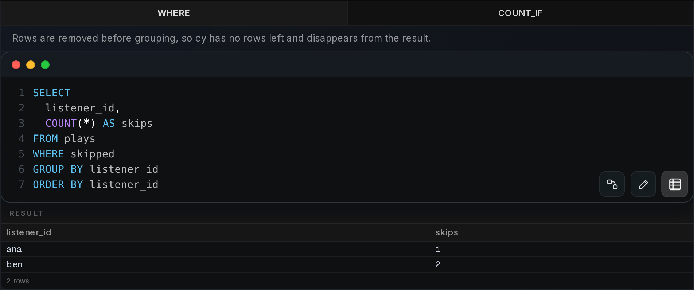

```sql
SELECT
  listener_id,
  COUNT(*) AS skips
FROM plays
WHERE skipped
GROUP BY listener_id
ORDER BY listener_id
```

**COUNT_IF**

Every listener keeps a group, so cy appears with 0 skips.

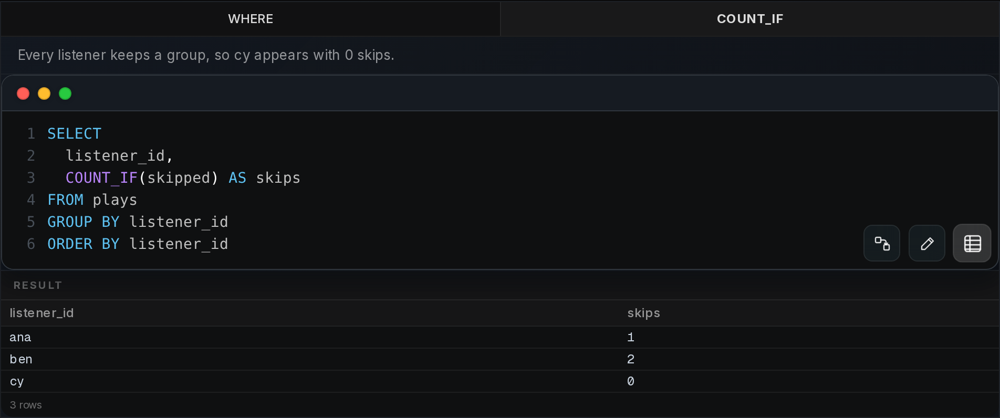

```sql
SELECT
  listener_id,
  COUNT_IF(skipped) AS skips
FROM plays
GROUP BY listener_id
ORDER BY listener_id
```

Pick by the question. 'How many skips did each skipping listener make?' wants WHERE, and the smaller input makes it cheaper. 'What is every listener's skip count?' wants COUNT_IF, because a dashboard that silently omits zero-skip listeners reads as though they do not exist. WHERE is the better fit when a single filter should apply to every aggregate in the query at once.


<br>

### Rates need a cast

A skip rate divides skips by plays. COUNT_IF and COUNT(\*) both return BIGINT, and dividing a BIGINT by a BIGINT performs integer division, which drops the fraction. ben's 2 skips over 3 plays come out as 0. CAST one side to DOUBLE before dividing and the rate keeps its fraction.

**What does this query return in skip_rate for ana, who has 1 skip in 4 plays?**

```sql
SELECT
  listener_id,
  COUNT_IF(skipped) / COUNT(*) AS skip_rate
FROM plays
GROUP BY listener_id
```

- **A.** 0.25, because dividing 2 counts yields a fraction automatically
- **B.** 0, because BIGINT divided by BIGINT drops the fraction
- **C.** 1, because integer division rounds 0.25 up to a whole number
- **D.** An error, because COUNT_IF cannot sit inside arithmetic

<details>
<summary>Solution</summary>

**B.** 0, because BIGINT divided by BIGINT drops the fraction

1 / 4 in integer arithmetic is 0. CAST(COUNT_IF(skipped) AS DOUBLE) / COUNT(*) returns 0.25.

**Why the others are wrong**

- **A.** Both counts are BIGINT, and BIGINT divided by BIGINT stays BIGINT, so the 0.25 is truncated.
- **C.** Integer division truncates toward zero; it never rounds up, so 0.25 becomes 0.
- **D.** COUNT_IF returns an ordinary BIGINT, so arithmetic and comparisons work on it as on any number.

</details>

Cast the numerator and the same division keeps its fraction: the query below returns 0.25 for ana, roughly 0.67 for ben, and 0.0 for cy, whose only play was never skipped.

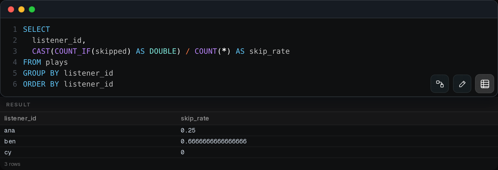

```sql
SELECT
  listener_id,
  CAST(COUNT_IF(skipped) AS DOUBLE) / COUNT(*) AS skip_rate
FROM plays
GROUP BY listener_id
ORDER BY listener_id
```


<br>

### Conditions inside HAVING

COUNT_IF is an aggregate, so it can sit in HAVING the way COUNT(\*) does. `HAVING COUNT_IF(skipped) >= 2` keeps listeners with at least 2 skips; on the sample that is ben alone. The condition inside COUNT_IF looks at single rows, and HAVING then compares the finished count, so a single expression filters at both levels.

> **TIP**
>
> COUNT_IF(c) gives the same number as `COUNT(*) FILTER (WHERE c)`, the standard SQL form that attaches a row condition to any aggregate. FILTER also works on SUM or AVG, for example `SUM(ms_played) FILTER (WHERE skipped)`; COUNT_IF is the shorter spelling for counting.


<br>

---

## CASE WHEN in aggregates

COUNT_IF counts. Most bucketed questions need more than a count: listening time per genre, the average length of full plays only, revenue split by channel. The general tool is a CASE expression inside the aggregate. CASE runs first and, for each row, turns the value into what the bucket should receive. The aggregate then does its usual work on whatever CASE handed it.

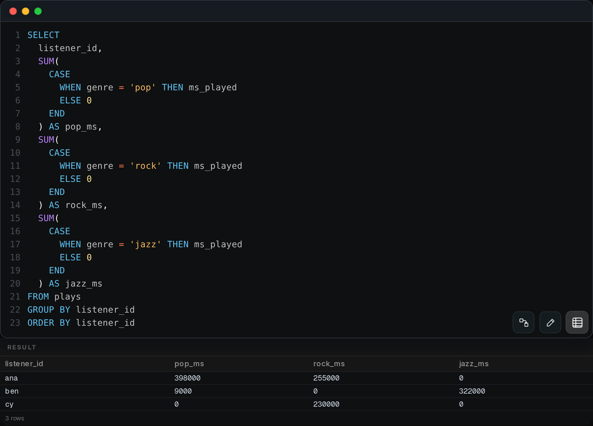

```sql
SELECT
  listener_id,
  SUM(
    CASE
      WHEN genre = 'pop' THEN ms_played
      ELSE 0
    END
  ) AS pop_ms,
  SUM(
    CASE
      WHEN genre = 'rock' THEN ms_played
      ELSE 0
    END
  ) AS rock_ms,
  SUM(
    CASE
      WHEN genre = 'jazz' THEN ms_played
      ELSE 0
    END
  ) AS jazz_ms
FROM plays
GROUP BY listener_id
ORDER BY listener_id
```

Each of the 3 SUMs sees all of a listener's rows. For `pop_ms`, a pop row contributes its `ms_played` and every other row contributes 0, so ana's pop column adds 200000 and 198000 into 398000 and ignores her rock plays. A single scan and a single GROUP BY have split each listener's total into 3 columns. This layout, values of a category turned into fixed columns, is called a pivot.


<br>

### ELSE 0 or no ELSE

A CASE without ELSE returns NULL for rows that match no branch, and SUM and AVG skip those NULLs, as do MIN and MAX. For SUM the 2 spellings agree whenever at least 1 row matches, since adding 0 changes nothing; if no row matches, ELSE 0 returns 0 and the bare CASE returns NULL. For AVG they split: ELSE 0 puts the non-matching rows into the denominator as zeros, while leaving ELSE out removes those rows from the average.

https://github.com/user-attachments/assets/61ce56c2-b3ba-44f2-b791-16f15f450206

Follow Eng through the animation. Its manager earns 70000 and its other engineer 90000, so `manager_payroll` adds 70000 and 0 and lands on 70000. For `avg_senior_salary` only the 7-year engineer passes `tenure_years >= 5`; the 3-year manager's CASE yields NULL, which AVG skips, so the result is 90000. Had the CASE ended in ELSE 0, AVG would have averaged 90000 with 0 and reported 45000, half of what Eng's only senior earns. In Sales both employees have 5 or more years, so its average is 65000 either way.

**A teammate wants each listener's number of skipped plays and writes the query below. What does skips hold for ana, who has 4 plays and 1 skip?**

```sql
SELECT
  listener_id,
  COUNT(CASE WHEN skipped THEN 1 ELSE 0 END) AS skips
FROM plays
GROUP BY listener_id
```

- **A.** 1, because the CASE returns 1 only for her single skipped play
- **B.** 0, because COUNT passes over the 0 values that CASE returns
- **C.** 4, because COUNT counts every non-NULL value and 0 is not NULL
- **D.** 3, because COUNT subtracts the rows where the CASE returned 0

<details>
<summary>Solution</summary>

**C.** 4, because COUNT counts every non-NULL value and 0 is not NULL

Every row hands COUNT either 1 or 0, so it counts all 4. To count skips, wrap this CASE in SUM instead. Dropping the ELSE also works, and so does COUNT_IF(skipped).

**Why the others are wrong**

- **A.** The CASE does return 1 once, but COUNT counts values that are present, and the 3 zeros are present too.
- **B.** COUNT skips NULLs only. A 0 is a real value, so it's counted like any other.
- **D.** COUNT never subtracts. It adds 1 for each non-NULL value, and all 4 values here are non-NULL.

</details>


<br>

### Buckets as rows or as columns

CASE can also sit in GROUP BY, where it decides which group a row joins instead of what it contributes. The same split, plays under 30 seconds against the rest, comes out as 2 rows that way, and as 2 columns when each CASE sits inside its own aggregate.

**As rows**

CASE labels each row, GROUP BY makes a group per label, and the output has a row per bucket.

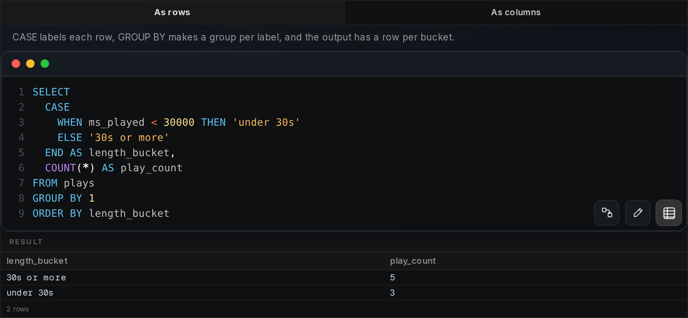

```sql
SELECT
  CASE
    WHEN ms_played < 30000 THEN 'under 30s'
    ELSE '30s or more'
  END AS length_bucket,
  COUNT(*) AS play_count
FROM plays
GROUP BY 1
ORDER BY length_bucket
```

**As columns**

Each SUM receives 1 or 0 from its own CASE, and the output is a single row with a column per bucket.

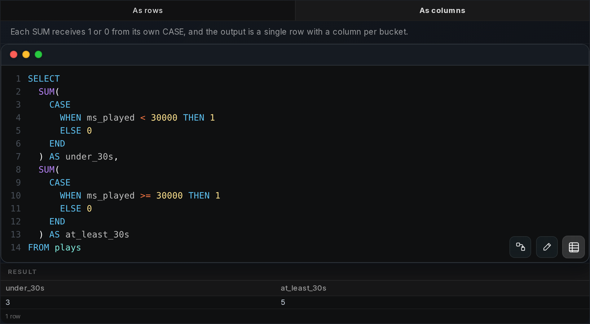

```sql
SELECT
  SUM(
    CASE
      WHEN ms_played < 30000 THEN 1
      ELSE 0
    END
  ) AS under_30s,
  SUM(
    CASE
      WHEN ms_played >= 30000 THEN 1
      ELSE 0
    END
  ) AS at_least_30s
FROM plays
```

| ✓ CASE in GROUP BY (rows) | ✗ CASE in the aggregate (columns) |
| --- | --- |
| • A row per bucket in the output<br><br>• Buckets are values, so 10 buckets still fit in 2 columns<br><br>• Each row lands in exactly 1 bucket: the first branch it matches<br><br>• Suits a chart or a further aggregation | • A column per bucket in the output<br><br>• Each bucket is a column you write by hand<br><br>• A row can count toward several overlapping buckets<br><br>• Suits a report row beside other per-listener figures |


<br>

### Collecting into a bucket

CASE also works inside the aggregates from the first sections, with a trap. `ARRAY_AGG(CASE WHEN skipped THEN track END)` hands the array a NULL for every unskipped play, because ARRAY_AGG keeps NULLs, so ana's array would hold Basalt plus 3 NULLs. The FILTER clause from the COUNT_IF section removes rows before the aggregate sees them, which is the shape you want for collecting.

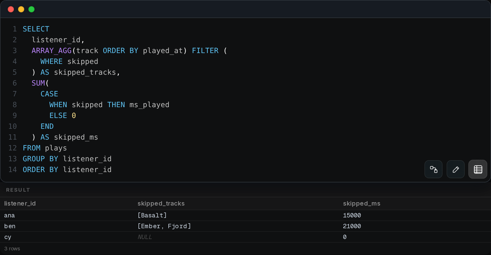

```sql
SELECT
  listener_id,
  ARRAY_AGG(track ORDER BY played_at) FILTER (
    WHERE skipped
  ) AS skipped_tracks,
  SUM(
    CASE
      WHEN skipped THEN ms_played
      ELSE 0
    END
  ) AS skipped_ms
FROM plays
GROUP BY listener_id
ORDER BY listener_id
```

ana's skipped list is Basalt, worth 15000 ms; ben's is Ember then Fjord, worth 21000 ms. cy skipped nothing, so the FILTER leaves ARRAY_AGG no rows and it returns NULL, while the SUM over CASE still reports 0 because every one of cy's rows handed it a 0.

| ✓ Do | ✗ Don't |
| --- | --- |
| • Write ELSE 0 inside SUM so a bucket with no matching rows reads 0<br><br>• Leave ELSE out inside AVG so non-matching rows stay out of the denominator<br><br>• Count a bucket with COUNT_IF or SUM(CASE WHEN ... THEN 1 ELSE 0 END)<br><br>• Name each bucket column after its condition, such as under_30s | • Don't wrap a CASE that ends in ELSE 0 in COUNT; it counts every row<br><br>• Don't add ELSE 0 to an AVG unless zeros belong in the average<br><br>• Don't write overlapping branches in a GROUP BY CASE; the first match wins<br><br>• Don't pivot categories that change weekly into columns; collect them with MAP_AGG |


<br>

---

## Putting It All Together

Back at Spotify, a Wrapped-style feed needs a row per listener carrying everything a set of story cards shows: their longest plays in order, a lookup of plays per genre, how many plays counted as streams, how many they skipped, and listening time split by genre. A single CTE and a GROUP BY listener_id over the year's plays can produce it: ARRAY_AGG(track ORDER BY ms_played DESC) for the ordered list, MAP_AGG over per-genre counts for the genre card, COUNT_IF(ms_played >= 30000) and COUNT_IF(skipped) for the counters, and SUM over CASE for the per-genre minutes.

- The genre lookup needs 2 GROUP BY levels: count per listener and genre in the CTE, then MAP_AGG per listener, so no genre key arrives twice.
- The counters group the same listener rows as the ordered list does, and so do the pivot columns, so one scan of the plays feeds every card.
- COUNT_IF keeps a listener with zero skips on the card at 0, where a WHERE skipped filter would remove that listener from the feed.
- The ORDER BY inside ARRAY_AGG decides which track is first on the card, while the outer ORDER BY only decides which listener's row comes first.
- The pivot columns end in ELSE 0 so an unplayed genre reads 0 minutes, while an average of full-play length leaves ELSE out to keep skips out of the denominator.


<br>

---

## Key Takeaways

- ARRAY_AGG folds a group into one array that keeps repeated values and NULLs; with DISTINCT inside the call, each value appears once.
- Without ORDER BY inside the call, element order follows row arrival and can change between runs; add a tiebreaker for a stable order.
- The ORDER BY inside an aggregate arranges elements, and the ORDER BY at the end arranges output rows; neither touches the other.
- MAP_AGG keeps one value per key, so aggregate first to make keys unique, or use MULTIMAP_AGG to keep every value.
- Read map values with element_at when a key can be missing; brackets stop the query on a missing key.
- COUNT_IF counts rows where the condition is true and keeps zero-count groups that WHERE would drop; CAST to DOUBLE before dividing.
- CASE inside an aggregate decides what each row contributes: ELSE 0 for sums and counts by SUM, no ELSE for averages.
