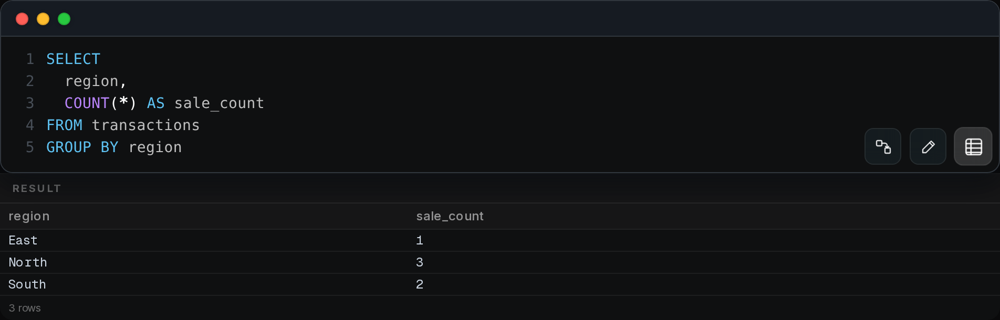
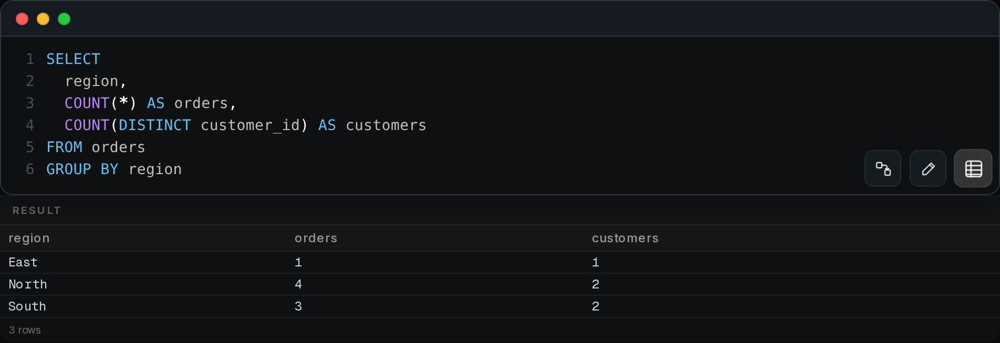
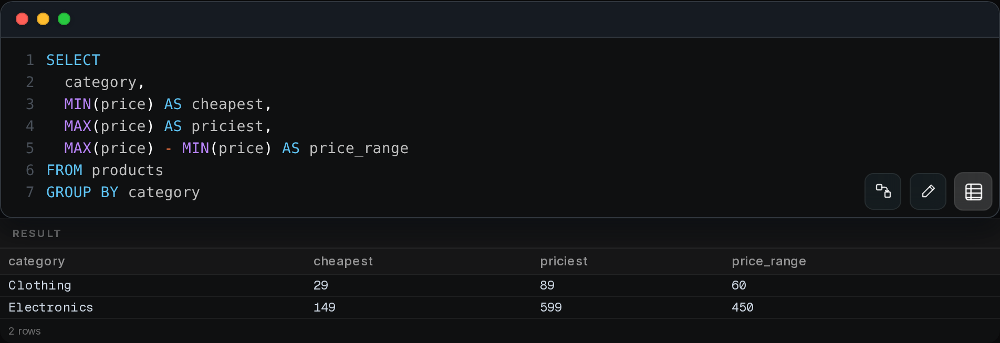

# Aggregating: Beginner

A regional manager asks how many sales each region closed this quarter. On a table of 6 rows a person counts by eye. On the hundreds of millions of rows a national retailer accumulates, nobody does, and the answer still has to be exactly 3 numbers, 1 per region. Aggregation is the part of SQL that produces them, starting from the clause that decides what a group is.


<br>

---

## GROUP BY for categorizing data

`GROUP BY` takes a column, reads its value on every row, and puts rows that share a value into the same group. The query then returns 1 row per group, and the only things that row can show are the grouping value itself and numbers computed over the whole group. The rows underneath do not go anywhere: the source table keeps every one of them, and the result is a second, shorter table built on top.


<br>

### 6 sales, 3 regions, 3 result rows

The `transactions` table below holds 6 sales. 3 of them are tagged North, 2 South and 1 East. A manager who wants a count per region is asking for 3 numbers, which means 3 rows, and `GROUP BY region` is the clause that decides those 3 rows exist.

https://github.com/user-attachments/assets/f839e5bf-1a67-4242-8369-2958b12d8bf2

Watch the order of events. The database reads all 6 rows first. It then sorts each row into a bucket labelled with its region value, so 3 buckets form: North holding sales 1, 3 and 5, South holding 2 and 4, East holding 6. Only after the buckets exist does `COUNT(*)` run, once per bucket, and that is where 3, 2 and 1 come from. Grouping is structural and happens first; the aggregate is arithmetic over whatever landed in each group.

The number of result rows equals the number of distinct values in the grouping column. A table of 10 million sales across 3 regions returns 3 rows. The same table grouped by `sale_id` returns 10 million rows, because every value is distinct and every group holds a single row. Knowing how many distinct values a column has tells you the shape of the result before the query runs.


<br>

### The rule every grouped query obeys

Every column in the `SELECT` list of a grouped query is either named in `GROUP BY` or wrapped in an aggregate function. There is no third option. The reason is a question the database cannot answer: the North group holds 3 rows with 3 different `sale_id` values, 1, 3 and 5. A result row for North has room for 1 value. Which one? Standard SQL refuses to guess and raises an error instead.

```sql
SELECT
  region,
  sale_id,
  COUNT(*) AS sale_count
FROM transactions
GROUP BY region
-- error: sale_id must appear in the GROUP BY clause or be used in an aggregate function
```

MySQL in its older default mode is the famous exception: it picks one of the 3 values and returns it without complaint, which is how a report can show a sale id next to a count and be wrong on every row. Treat the rule as absolute even where the engine is lenient. Two fixes exist: add `sale_id` to `GROUP BY`, which changes the grain to 1 row per sale, or wrap it in an aggregate such as `MIN(sale_id)`, which asks a question with 1 answer.


<br>

### Grouping by 2 columns

Adding a column to `GROUP BY` makes the groups finer. `GROUP BY region, channel` creates 1 group per distinct pair of values, so North web and North store become 2 separate rows. More grouping columns means more rows and smaller groups, down to the point where each group holds 1 row and the query stops summarizing anything. Run the query below as written, then change the grouping to `region, channel` and add `channel` to the `SELECT` list to watch the 3 rows become 5.



```sql
SELECT
  region,
  COUNT(*) AS sale_count
FROM transactions
GROUP BY region
```

The 5-row result has North twice, once for web with 2 sales and once for store with 1. Every grouping column has to be in `SELECT` for the result to be readable, and every `SELECT` column that is not aggregated has to be in the grouping, so the 2 lists are usually written to match. The combination of grouping columns is called the grain of the result: 1 row per region, or 1 row per region and channel.

**A report needs 1 row per region showing the region and how many sales it had. Which query runs on a standard SQL engine and returns exactly that?**

- **A.** SELECT region, COUNT(*) AS sale_count FROM transactions GROUP BY region
- **B.** SELECT region, amount, COUNT(*) AS sale_count FROM transactions GROUP BY region
- **C.** SELECT region, COUNT(*) AS sale_count FROM transactions GROUP BY region, channel
- **D.** SELECT DISTINCT region FROM transactions

<details>
<summary>Solution</summary>

**A.** SELECT region, COUNT(*) AS sale_count FROM transactions GROUP BY region

region is the grouping column and COUNT(*) is an aggregate, so every SELECT column is accounted for and the result has 1 row per region.

**Why the others are wrong**

- **B.** amount is in SELECT but neither grouped nor aggregated. The North group holds 3 amounts, and the engine cannot choose 1 of them.
- **C.** This runs, but it returns 1 row per region and channel pair, 5 rows for this table, so a region appears more than once.
- **D.** DISTINCT returns the 3 region values with no count beside them. It collapses rows like GROUP BY does but cannot compute anything per group.

</details>

> **TIP**
>
> `SELECT DISTINCT region` and `SELECT region FROM transactions GROUP BY region` return the same 3 rows. The difference is what else the query can do: a grouped query can put `COUNT`, `SUM` or any other aggregate next to the value, and `DISTINCT` cannot.


<br>

---

## COUNT variations (\*,col,DISTINCT)

`COUNT` comes in 3 forms and they answer 3 different questions. `COUNT(*)` counts rows in the group, whatever is in them. `COUNT(column)` counts rows where that column holds a value, skipping every `NULL`. `COUNT(DISTINCT column)` counts how many different values the column holds, with `NULL` ignored and each repeated value counted once. On a table with no nulls and no repeats all 3 return the same number, which is how the differences stay hidden until the day they matter.


<br>

### 5 customers, 3 email addresses

The `customers` table below has 5 rows. Alice, Carol and Eve have an email on file; Bob and Dave have `NULL` in that column, because the signup form made email optional. A query that counts customers and a query that counts emails look almost identical and return different numbers.

https://github.com/user-attachments/assets/8db28675-6335-4d84-8ea2-5950d64db140

`COUNT(*)` returns 5: it never looks inside a row, so a row with a missing email counts like any other. `COUNT(email)` returns 3, because the function examines the email value on each row and increments only when the value is present. `COUNT(1)` and `COUNT(customer_id)` would also return 5 here, the first because the constant 1 is never null and the second because a primary key is never null. The difference between 5 and 3 is 2 customers the marketing team cannot reach, and the gap between the 2 counts is a ready-made data quality metric.


<br>

### DISTINCT counts each value once

Add a `country` column to the same 5 customers: 3 live in the US and 2 in the UK. `COUNT(country)` returns 5, since every row has a country. `COUNT(DISTINCT country)` returns 2, because the function collects the set of values it has seen and counts the set. The 3 tabs below run the 3 forms over the identical table; switch between them and read the single number each one produces.

Every row counts, including the 2 customers with no email.

|  |  |
| --- | --- |
|  | SELECT |
|  | COUNT(\*) AS total_customers |
|  | FROM customers |

Result

| total_customers |
| --- |
| 5 |

1 row

`COUNT(DISTINCT email)` on this table returns 3, the same as `COUNT(email)`, because the 3 present emails are all different. If 2 customers shared an address the distinct count would drop to 2 while the plain count stayed at 3, and the distinct form is the one that answers how many inboxes a campaign actually reaches. Distinct counting is also the most expensive of the 3 forms, since the engine has to hold every value it has seen to know whether the next one is new; on a column with millions of values that memory cost is real, and the intermediate tier covers the approximate version that trades a little accuracy for a lot of memory.


<br>

### Counts per group

Each form combines with `GROUP BY`, and putting 2 of them side by side in one query is where the counts start explaining each other. The `orders` table below holds 8 orders placed by 4 customers across 3 regions. Counting orders per region measures volume; counting distinct customers per region measures reach, and the 2 numbers tell different stories about the same region.



```sql
SELECT
  region,
  COUNT(*) AS orders,
  COUNT(DISTINCT customer_id) AS customers
FROM orders
GROUP BY region
```

North shows 4 orders from 2 customers, and 3 of those 4 came from customer 101. South shows 3 orders from 2 customers, East 1 from 1. A manager reading only the first column sees North as the stronger region; the second column shows that North depends on 1 repeat buyer. Change `COUNT(DISTINCT customer_id)` to `COUNT(customer_id)` and the second column collapses back into a copy of the first, because every order has a customer and nothing is deduplicated.

> Which COUNT answers which question
>
> - How many orders were placed: `COUNT(*)`, 1 per row regardless of contents.
> - How many orders have a shipping date filled in: `COUNT(shipped_at)`, skipping the nulls.
> - How many different customers ordered: `COUNT(DISTINCT customer_id)`, each customer once.
> - How many orders are missing a shipping date: `COUNT(*) - COUNT(shipped_at)`.


<br>

---

## SUM and AVG calculations

`SUM` adds every non-null value of a column within a group and `AVG` divides that sum by the count of non-null values. Both take a numeric column or a numeric expression, both return 1 value per group, and both treat `NULL` the same way: the row is skipped as if it were absent. That shared rule is what makes `AVG` behave in ways that surprise people, which is why nulls get their own treatment below.


<br>

### A total per region

The 6 `transactions` from the first section carry amounts: North has 150, 175 and 190, South has 200 and 225, East has 160. A total per region needs the same `GROUP BY region` as the count did, with `SUM(amount)` in place of `COUNT(*)`. Watch each amount leave its row and land in its region's running total.

https://github.com/user-attachments/assets/9607fa4c-aab6-4082-9c14-996da99c6c25

North totals 515, South 425 and East 160, and 515 plus 425 plus 160 is 1,100, the grand total of the table. Dropping `GROUP BY` from the query returns that 1,100 as a single row, because with no grouping column the whole table is 1 group. A `SUM` that reads the wrong column is a common slip: `SUM(quantity)` is units moved and `SUM(amount)` is money, and the 2 can differ by a factor of 100 while both looking like plausible revenue.


<br>

### AVG is SUM divided by COUNT

`AVG(amount)` for North is 515 divided by 3, which is 171.67 after rounding. South is 425 divided by 2, which is 212.5, and East is 160 divided by 1. `AVG` carries out that division itself, so `SUM(amount) / COUNT(amount)` and `AVG(amount)` return the same value, with 1 caveat about integer columns below. The `employee_metrics` table in the next animation groups salaries by department: Engineering holds 120,000, 130,000 and 125,000, averaging 125,000; Sales holds 80,000 and 90,000, averaging 85,000; Marketing has 1 salary of 95,000, and the average of 1 value is that value.

https://github.com/user-attachments/assets/4cee7279-d7ee-45fa-8c83-16f2c0436542

An average of integers can lose its fraction. On an integer column, PostgreSQL's `AVG` returns a `numeric` with decimals, Trino's returns a `double` and MySQL's a `decimal`. The hand-written division `SUM(amount) / COUNT(*)` is still integer division on PostgreSQL and Trino, and it truncates 515 / 3 to 171. SQL Server truncates in `AVG` itself: its `AVG` over an `int` column returns an `int`, so `AVG(amount)` for North is 171 there too. Casting the argument gives 171.67 on every engine, written as `AVG(amount * 1.0)` or `AVG(CAST(amount AS decimal(10,2)))`. For the hand-written version, `SUM(amount) * 1.0 / COUNT(*)` does the same.


<br>

### What NULL does to SUM and AVG

The `bonuses` table below has 3 employees. Two received a bonus and 1 has `NULL`, meaning no bonus was recorded. The functions read the 3 rows differently from how a person would.

| employee | bonus |
| --- | --- |
| Ana | 1000 |
| Ben | 500 |
| Cal | NULL |

| SUM(bonus) | AVG(bonus) | COUNT(\*) | COUNT(bonus) |
| --- | --- | --- | --- |
| 1500 | 750 | 3 | 2 |

`SUM(bonus)` is 1,500, and `AVG(bonus)` is 750, because the average divides by `COUNT(bonus)`, which is 2, and Cal does not take part. If the business meaning of a missing bonus is zero, the correct average is 1,500 divided by 3, which is 500, and the query has to say so: `AVG(COALESCE(bonus, 0))` replaces each `NULL` with 0 before averaging. The 2 answers differ by 50 percent on 3 rows, so a report built on the default is reporting the average bonus among people who received one, which may or may not be the question asked. A group where every value is `NULL` gives `SUM` and `AVG` of `NULL`, never 0.


<br>

### Summing an expression

The argument to `SUM` can be arithmetic over several columns, computed per row before the adding starts. An `order_items` table storing `quantity` and `unit_price` has no revenue column, and `SUM(quantity * unit_price)` builds it: each row's quantity times its price, then the products added within the group. `SUM(quantity) * SUM(unit_price)` is a different and wrong number, since it multiplies 2 totals that were never meant to meet.

`SUM(profit)` and `AVG(profit)` in the same row let a reader spot the region whose high total comes from many small orders rather than a few large ones, the same volume-versus-size reading the 2 counts gave in the previous section.


<br>

---

## MIN and MAX for extremes

`MIN` returns the smallest value in a group and `MAX` the largest, skipping `NULL` like every other aggregate. They work on any type that has an ordering: numbers compare numerically, text compares alphabetically under the column's collation, and dates compare chronologically, so `MIN(hire_date)` is the earliest hire and `MAX(hire_date)` the most recent. Both return 1 value per group and nothing about the row it came from.


<br>

### The cheapest product in each category

The `products` table below lists 6 products, 3 in Electronics priced 299, 149 and 599, and 3 in Clothing priced 45, 89 and 29. Grouping by category and taking `MIN(price)` gives the floor of each category's range.

https://github.com/user-attachments/assets/113019f7-ec2c-4afd-b82f-fea75fa41e4c

Electronics bottoms out at 149 and Clothing at 29. The engine scans each group once, carrying the smallest value seen so far and replacing it whenever a smaller one appears, so `MIN` costs 1 comparison per row and no sorting. Swapping `MIN` for `MAX` in the same query gives the ceiling instead, 599 for Electronics and 89 for Clothing.

https://github.com/user-attachments/assets/72559550-7f9c-4246-aded-0ad337c3be3e

The 2 run together in 1 query without conflict, `MIN(price)` and `MAX(price)` side by side, and the gap between them is the category's price range. Electronics spans 149 to 599, a range of 450; Clothing spans 29 to 89, a range of 60. `MAX(price) - MIN(price) AS price_range` is legal because both sides are aggregates, so the expression has exactly 1 value per group.


<br>

### Dates and text have extremes too

A `launched` date on each product turns `MIN` and `MAX` into first and latest: `MIN(launched)` per category is the date the category started selling, and `MAX(launched)` is its newest product. Text works the same way through alphabetical order, which is useful for a stable pick (`MIN(product_id)` always returns the same id for a group) and otherwise rarely what a report wants. Run the query below, then replace `price` with `launched` in the first 2 aggregates and delete the range line to see the dates line up.



```sql
SELECT
  category,
  MIN(price) AS cheapest,
  MAX(price) AS priciest,
  MAX(price) - MIN(price) AS price_range
FROM products
GROUP BY category
```

With `launched` in place, Electronics runs from 2022-11-20 to 2023-08-01 and Clothing from 2022-06-30 to 2024-01-15. Dates stored as text in `YYYY-MM-DD` form sort correctly as text, which is why that format is the convention; a date stored as `15/01/2024` sorts by day first and `MIN` returns nonsense.


<br>

### MAX gives the value, never the row

The most common mistake with these 2 functions is asking them a question they cannot answer. `MAX(price)` for Electronics is 599. Which product is priced at 599? The query has grouped 3 rows into 1 and the product id went the same way `sale_id` went in the first section: it is neither grouped nor aggregated, so `SELECT category, product_id, MAX(price) FROM products GROUP BY category` is an error on standard engines and silently wrong on lenient ones. Getting the row that holds the maximum needs a second step, either a join back to the table on category and price or a window function, both of which belong to later lessons.

**A report should show, for each category, the name of its most expensive product. Which statement about MAX is correct?**

- **A.** MAX(price) returns the highest price per category, and a separate step is needed to find which product carries it.
- **B.** SELECT category, product_name, MAX(price) FROM products GROUP BY category returns the product name beside the highest price.
- **C.** MAX(product_name) returns the name of the most expensive product.
- **D.** Adding ORDER BY price DESC makes MAX remember the top row so its name can be selected.

<details>
<summary>Solution</summary>

**A.** MAX(price) returns the highest price per category, and a separate step is needed to find which product carries it.

An aggregate returns 1 value per group. The row that supplied the value is gone from the result, so matching the price back to a product takes a join or a window function.

**Why the others are wrong**

- **B.** product_name is neither in GROUP BY nor inside an aggregate, so the engine raises an error, or, in lenient MySQL modes, returns an arbitrary name that usually does not belong to the maximum.
- **C.** MAX over text returns the alphabetically last name in the group, which has nothing to do with price.
- **D.** ORDER BY runs after grouping and sorts the result rows; it cannot change which values an aggregate computes or restore a column the grouping removed.

</details>

*MIN and MAX on a 0/1 flag column are a quick way to ask whether any row in a group is flagged (MAX(is_flagged) = 1) or whether all of them are (MIN(is_flagged) = 1).*


<br>

---

## HAVING for filtered groups

`WHERE` and `HAVING` both filter, and they filter different things at different moments. `WHERE` runs before grouping and decides which rows are allowed into the groups at all. `HAVING` runs after the groups and their aggregates exist and decides which groups make it into the result. A condition on a raw column belongs in `WHERE`; a condition on an aggregate, such as a count above a threshold or a total below a target, can only be checked once the aggregate has been computed, and that is the work `HAVING` does.


<br>

### Regions with more than 3 orders

The `orders` table below holds 8 orders: 4 in North, 3 in South and 1 in East. A report that lists only regions with more than 3 orders groups by region, counts, and then keeps the groups whose count clears 3.

https://github.com/user-attachments/assets/33a7513a-6876-4536-8245-2a85ee905418

Three groups form, with counts 4, 3 and 1. `HAVING COUNT(*) > 3` tests each group's count: North passes with 4, South fails with exactly 3 because the comparison is strict, East fails with 1. The result is 1 row. Change the operator to `>=` and South joins it. `WHERE COUNT(*) > 3` in the same query is an error, because when `WHERE` runs no counting has happened yet; the groups it would need to count do not exist.


<br>

### The order the database evaluates clauses

A query is written as `SELECT`, `FROM`, `WHERE`, `GROUP BY`, `HAVING`, `ORDER BY`, and evaluated as `FROM`, `WHERE`, `GROUP BY`, `HAVING`, `SELECT`, `ORDER BY`. Two consequences follow. `WHERE` cannot see aggregates because they have not been computed when it runs. `HAVING` cannot see a column alias from `SELECT` in standard SQL, because `SELECT` runs after it. So `HAVING order_count > 3` fails on PostgreSQL, SQL Server and Trino, even though `HAVING COUNT(*) > 3` works on all three. MySQL and SQLite accept the alias as an extension. Repeating the aggregate expression inside `HAVING` is the portable spelling.

The animation below combines both filters. 5 orders carry a status: 4 are completed and South order 2 is pending. `WHERE status = 'completed'` removes the pending order before grouping, so South enters the grouping stage with 1 order and North with 3. `HAVING COUNT(*) > 2` then removes South. The sequence of the 2 filters matters: a `WHERE` that removes rows changes the counts that `HAVING` goes on to test.

https://github.com/user-attachments/assets/a6ea739b-94f9-4f6f-b839-94cd37727b58

The result is 1 row, North with 3 completed orders. Moving the status test out of `WHERE` and into `HAVING` is possible only in a form such as `HAVING SUM(CASE WHEN status = 'pending' THEN 1 ELSE 0 END) = 0`, which asks a different question (regions with no pending orders at all) and does more work, since every row reaches the grouping stage. Filtering rows as early as possible is cheaper and, more often than not, what the report means.


<br>

### Which filter to reach for

| ✓ WHERE | ✗ HAVING |
| --- | --- |
| • Runs before GROUP BY, on individual rows<br><br>• Tests raw columns: status = 'completed', amount > 100<br><br>• Shrinks the data the grouping has to process<br><br>• Cannot reference COUNT, SUM or any other aggregate | • Runs after GROUP BY, on finished groups<br><br>• Tests aggregates: COUNT(\*) > 2, SUM(amount) < 1000<br><br>• Removes whole groups from the result<br><br>• Can test a grouping column too, but WHERE does that cheaper |

A condition that could go in either place, such as `region = 'North'`, belongs in `WHERE`: the result is identical and the engine groups fewer rows.

Every grouped query in this lesson follows the same skeleton: rows in, `WHERE` trims them, `GROUP BY` sets the grain, aggregates compute 1 value per group, `HAVING` trims the groups. The habits below are the ones that keep that skeleton correct on a table too large to check by eye.

| ✓ Do | ✗ Don't |
| --- | --- |
| • Put row conditions in WHERE so fewer rows reach GROUP BY<br><br>• List every non-aggregated SELECT column in GROUP BY<br><br>• Pick COUNT(\*), COUNT(col) or COUNT(DISTINCT col) by the question being asked<br><br>• Decide what a NULL means before averaging a column that holds them<br><br>• Repeat the aggregate expression in HAVING instead of relying on a SELECT alias | • Write an aggregate inside WHERE; it runs before any group exists<br><br>• Expect MAX(price) to tell you which row holds that price<br><br>• Treat AVG as SUM divided by COUNT(\*) when the column has NULLs<br><br>• Group by a column that is distinct per row and expect a summary<br><br>• Assume COUNT(col) equals COUNT(\*) on a nullable column |


<br>

---

## Putting It All Together

A regional sales director at a mid-size retailer wants a monthly one-page summary: for each region, the number of completed orders, the number of distinct customers behind them, total and average order amount, and the largest single order, listing only regions that closed at least 50 completed orders in the month. The source is an orders table with 2 million rows.

- GROUP BY region sets the grain: 2 million rows become 1 row per region, and the only columns allowed beside region are aggregates.
- COUNT(\*) gives orders and COUNT(DISTINCT customer_id) gives customers; the gap between them shows how much each region depends on repeat buyers.
- SUM(amount) and AVG(amount) give total and typical order size, with AVG skipping any order whose amount was never recorded.
- MAX(amount) finds the largest order per region without identifying it; naming that order is a second query.
- WHERE status = 'completed' and the month filter run first so only completed orders are counted; HAVING COUNT(\*) >= 50 drops the small regions at the end.


<br>

---

## Key Takeaways

- GROUP BY builds 1 group per distinct value and returns 1 row per group; every SELECT column is either grouped or aggregated.
- COUNT(\*) counts rows, COUNT(col) counts non-null values, COUNT(DISTINCT col) counts unique values; they differ only when nulls or repeats exist.
- SUM and AVG skip NULLs, so AVG divides by the non-null count; replace NULL with 0 first when a missing value means zero.
- MIN and MAX return the extreme value of any ordered type, number, text or date, and never the row that carried it.
- WHERE filters rows before grouping and HAVING filters groups after; a condition on an aggregate can only live in HAVING.
