# Aggregating: Intermediate

Spotify Wrapped is in production and the artist team wants one number per artist: how many distinct listeners streamed them this year. The first query runs COUNT(DISTINCT user_id) over every stream of the year and is still running at lunch. A second analyst combines streams with the playlist table and the stream totals triple. This lesson is about why both happened, and what to run instead.


<br>

---

## Row-level vs aggregate behavior

There are 2 families of expression in a SELECT list, and the family decides how many rows come back. A row-level expression reads 1 row and returns 1 value for that row: `amount + 5`, `CAST(amount AS DECIMAL(10,2))`, a CASE expression. Feed it 6 rows and it hands back 6 rows. An aggregate reads a set of rows and returns 1 value for the whole set: `SUM(amount)`, `COUNT(*)`, `MAX(amount)`. Feed it the same 6 rows and it hands back 1 row.

| ✓ Row-level expression | ✗ Aggregate function |
| --- | --- |
| • Reads 1 row, returns 1 value<br><br>• Output row count equals input row count<br><br>• Runs during SELECT, after WHERE has filtered<br><br>• amount + 5, CAST, CASE | • Reads a set of rows, returns 1 value<br><br>• Output row count equals the number of groups<br><br>• Runs after GROUP BY and feeds HAVING<br><br>• SUM, COUNT, AVG, MIN, MAX |


<br>

### Where the collapse happens

GROUP BY sets how many rows survive: 1 per distinct combination of the grouped columns, which is why 6 orders from 3 customers group into 3 rows. With no GROUP BY, a single aggregate in the SELECT list collapses the whole table into exactly 1 row, even an empty table, where COUNT(\*) returns 0 on its 1 row. If a query has neither a GROUP BY nor an aggregate, no rows collapse and the row count is whatever WHERE let through. The 3 versions below run on the same 6 orders. Only the first keeps all 6, and the other 2 come back with 1 row and 3 rows.

**Row-level**

amount + 5 runs on each of the 6 orders, so 6 rows come back, 1 per order.

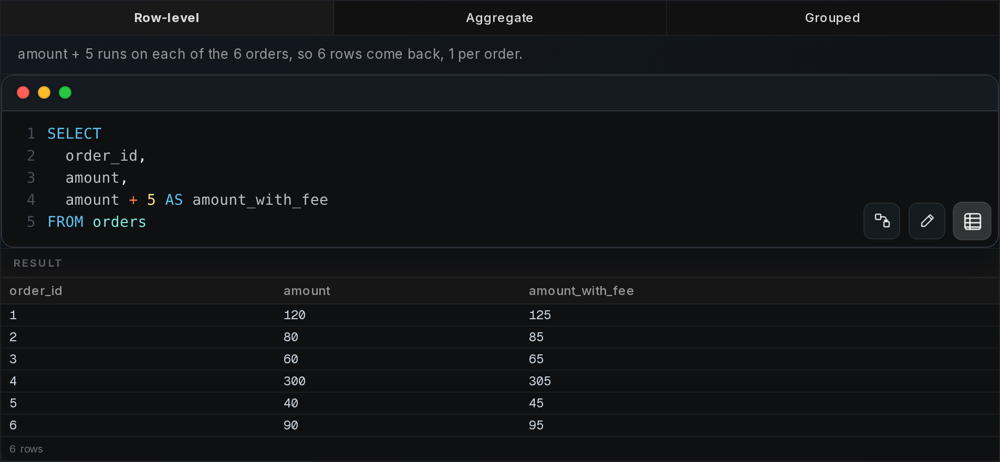

```sql
SELECT
  order_id,
  amount,
  amount + 5 AS amount_with_fee
FROM orders
```

**Aggregate**

COUNT and SUM fold all 6 orders into a single row: 6 orders worth 690.

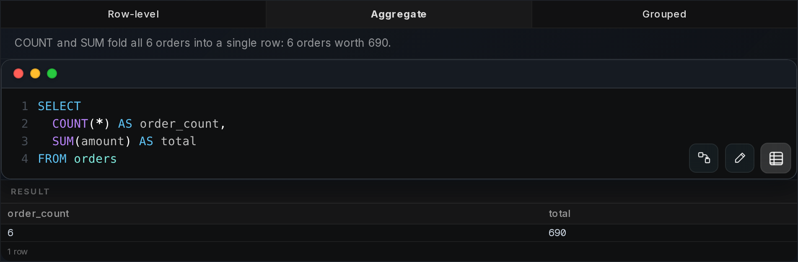

```sql
SELECT
  COUNT(*) AS order_count,
  SUM(amount) AS total
FROM orders
```

**Grouped**

GROUP BY customer_id folds the 6 orders into 3 rows, 1 per customer.

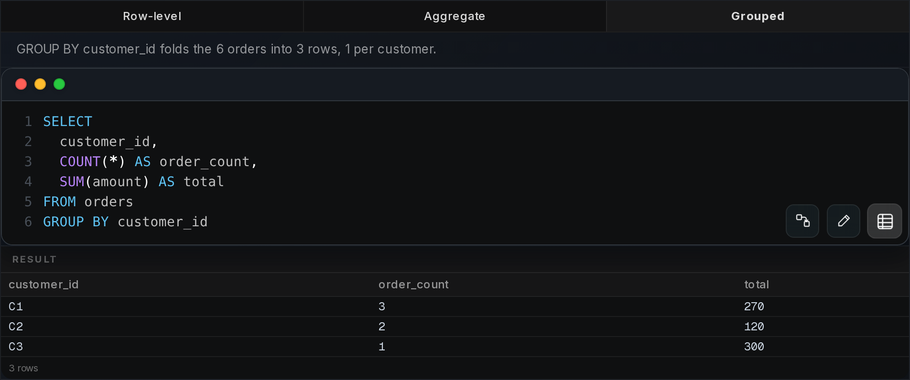

```sql
SELECT
  customer_id,
  COUNT(*) AS order_count,
  SUM(amount) AS total
FROM orders
GROUP BY customer_id
```


<br>

### Mixing the families

Once a query has an aggregate or a GROUP BY, every column in the SELECT list is either grouped or wrapped in an aggregate. The query below asks for SUM(amount) per customer but also selects the bare amount column next to customer_id. Customer C1 has 3 amounts, and the result row has room for 1 value. Nothing tells the engine whether to show 120 or 60 or 90, so it rejects the query before reading a row.

```sql
SELECT
  customer_id,
  amount,
  SUM(amount) AS total
FROM orders
GROUP BY customer_id
```

The engine will not pick a value for you, so you pick. If the question is about the group, wrap the column in the aggregate that answers it: MIN(amount) for the smallest order, MAX for the largest, COUNT(DISTINCT amount) for how many different sizes. The animation below faces the same choice with 2 managers per region and resolves it with MIN, which picks the alphabetically first name, and COUNT, which reports how many names were folded into it.

https://github.com/user-attachments/assets/a29659c2-05be-4244-a50a-ff2ca30c8037


<br>

### Row-level inside aggregate

The 2 families nest. An aggregate can wrap a row-level expression: `SUM(amount + 5)` adds 5 to each of the 6 amounts first, then folds the 6 results into 720. A row-level expression can wrap aggregates, `SUM(amount) / COUNT(*)`, because by then each side is a single value per group. What fails is a bare reference to a column that the collapse removed, which is the rejected query above.

> **TIP**
>
> To predict a query's row count, read it in execution order. WHERE sets the rows in play. A GROUP BY makes 1 row per group. No GROUP BY but an aggregate in SELECT makes exactly 1 row. Neither, and the row count after WHERE is the answer.

**How many rows does this query return on the 6-row orders table above?**

```sql
SELECT
  customer_id,
  MAX(amount) AS biggest
FROM orders
WHERE amount > 50
GROUP BY customer_id
```

- **A.** 5 rows, 1 per order that passes the WHERE filter
- **B.** 3 rows, 1 per customer that still has an order
- **C.** 1 row, because MAX is an aggregate function
- **D.** 6 rows, since WHERE runs after the aggregate

<details>
<summary>Solution</summary>

**B.** 3 rows, 1 per customer that still has an order

The filter removes only the 40 order from C2, and every customer still keeps at least 1 order, so 3 groups remain.

**Why the others are wrong**

- **A.** WHERE leaves 5 orders in play, but GROUP BY then folds them to 1 row per customer.
- **C.** An aggregate alone collapses to 1 row, but a GROUP BY is present, so the count is the number of groups.
- **D.** WHERE runs before GROUP BY in execution order and removes 1 order, so neither 6 nor that ordering is right.

</details>

Writing a grouped query runs the same reasoning in reverse. Start from the row the result needs: 1 row per product means the product column goes in GROUP BY and appears in SELECT as it is. Every other column has to arrive through an aggregate, so a number of sales becomes `COUNT(*)` and the largest single sale becomes `MAX` wrapped around the amount column.


<br>

---

## Understanding cardinality

A column's cardinality is how many distinct values it holds against how many rows the table has. In the 6-row orders table, order_id has 6 distinct values, so every row has one of its own: it's a key. customer_id has 3 distinct values across the same 6 rows, so each customer appears 2 times on average, and C1 appears 3 times. The row count and the distinct count are the whole measurement, and aggregates are how you take it.

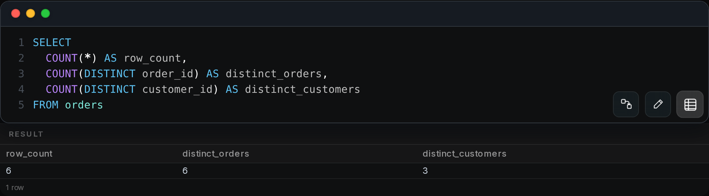

```sql
SELECT
  COUNT(*) AS row_count,
  COUNT(DISTINCT order_id) AS distinct_orders,
  COUNT(DISTINCT customer_id) AS distinct_customers
FROM orders
```

Read the result as ratios. row_count divided by distinct_orders is 1, so order_id is unique. row_count divided by distinct_customers is 2, so a customer has 2 orders on average, and an average of 2 means some have more. Finding which ones is the HAVING pattern from the beginner lesson, pointed at the key column.

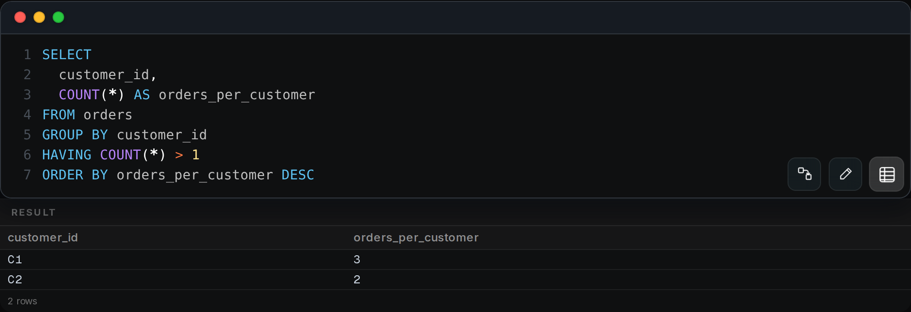

```sql
SELECT
  customer_id,
  COUNT(*) AS orders_per_customer
FROM orders
GROUP BY customer_id
HAVING COUNT(*) > 1
ORDER BY orders_per_customer DESC
```


<br>

### What cardinality does to a row count

Analysts combine tables by lining rows up on a shared column, and a later lesson covers the syntax for it, the join. The arithmetic of that pairing is what matters here, and cardinality decides it. Picture each order looking up its customer: for every order, the engine copies the matching customer row next to it. With 3 customers, each appearing once in customers, 6 orders become 6 paired rows, and C1's name is copied 3 times.

customers

| customer_id | name | city |
| --- | --- | --- |
| C1 | Ana | Berlin |
| C2 | Ben | Lisbon |
| C3 | Cara | Oslo |

orders

| order_id | customer_id | amount |
| --- | --- | --- |
| 1 | C1 | 120 |
| 2 | C2 | 80 |
| 3 | C1 | 60 |
| 4 | C3 | 300 |
| 5 | C2 | 40 |
| 6 | C1 | 90 |

| order_id | customer_id | name | amount |
| --- | --- | --- | --- |
| 1 | C1 | Ana | 120 |
| 2 | C2 | Ben | 80 |
| 3 | C1 | Ana | 60 |
| 4 | C3 | Cara | 300 |
| 5 | C2 | Ben | 40 |
| 6 | C1 | Ana | 90 |

Now suppose C1 moves from Berlin to Munich and someone loads a second C1 row into customers instead of updating the first. Each of C1's 3 orders now finds 2 customer rows and the pairing copies both. C1 contributes 3 times 2, which is 6 rows instead of 3, the whole result grows from 6 rows to 9, and SUM(amount) over it reports 960 instead of 690, because C1's 270 is counted twice. The orders table didn't change; the duplicate sat on the customers side, which was supposed to be unique, and it inflated every total that touched it. The intro's tripled stream totals follow the same rule with a 3 in place of the 2: each track sits on 3 playlists in the playlist table, so every stream of that track pairs with 3 playlist rows and is counted 3 times.

| customer rows for C1 | orders for C1 | paired rows for C1 | total rows | SUM(amount) |
| --- | --- | --- | --- | --- |
| 1 | 3 | 3 | 6 | 690 |
| 2 | 3 | 6 | 9 | 960 |

> The pairing rule, by cardinality class
>
> - 1:1: the key appears once on each side. Paired rows equal the rows on either side.
> - 1:N: the key appears once on one side and N times on the other. Paired rows equal the N side, so 1 row per order.
> - N:M: the key repeats on both sides. Each key yields N times M rows, and the result is larger than either table.
> - For every key value, paired rows equal its count on the left multiplied by its count on the right; the total is the sum over all keys.

> **TIP**
>
> Before combining 2 tables, run the cardinality check on the shared column of each. The side meant to be unique must return the same number for COUNT(\*) and COUNT(DISTINCT key). If it does not, the HAVING COUNT(\*) > 1 query names the offenders, and fixing them comes before any total you plan to report.

**A products table has 10,000 rows and 10,000 distinct product_id values. A sales table has 50,000 rows and 10,000 distinct product_id values. Each sale is paired with its product on product_id. How many rows does the pairing produce?**

- **A.** 10,000, 1 per product, because products is the unique side of the pairing
- **B.** 60,000, the rows of both tables added together into a single result
- **C.** 500,000,000, the product of the 2 row counts, as every pair is formed
- **D.** 50,000, 1 per sale, because each sale finds exactly 1 product row

<details>
<summary>Solution</summary>

**D.** 50,000, 1 per sale, because each sale finds exactly 1 product row

This is 1:N. For every product_id, 1 product row times its number of sales, summed over all products, is the number of sales.

**Why the others are wrong**

- **A.** The unique side doesn't set the count. Each product row is copied once per matching sale.
- **B.** Pairing multiplies counts per key rather than stacking tables; stacking is what UNION ALL does.
- **C.** That would need every sale to match every product. Pairing on a key matches only equal product_id values.

</details>

The duplicate detector is the cardinality check turned into a list. GROUP BY on the key makes 1 row per value, `COUNT(*)` says how many rows share that value, and the condition `COUNT(*) > 1` belongs in HAVING, because WHERE runs before the groups exist and has no count to compare. Sorting by the count puts the worst offenders at the top.


<br>

---

## APPROX_DISTINCT (HyperLogLog)

COUNT(DISTINCT user_id) over a year of streams has to remember every user id it has seen, so that the next occurrence of the same id adds nothing. The structure that remembers is a set of the ids themselves, and its size grows with the number of distinct ids: 500 million ids at 8 bytes each is 4 GB before any overhead, held in memory for the duration of the query. Group by artist and there's a set per artist. Spread the work over many machines and every set has to be shipped to one place and merged. That set is why the first Wrapped query was still going at lunch.


<br>

### Counting without remembering

APPROX_DISTINCT(user_id) replaces the set with a sketch whose size is fixed before the first row arrives, using the HyperLogLog method. Hash each value to a string of bits. Look at how many zeros the hash starts with. A hash that begins with 3 zeros shows up about once in every 8 values, and one that begins with 10 zeros about once in 1,024, because each extra leading zero halves the odds. So the longest run of leading zeros you have seen is a clue to how many distinct values have passed: see a run of 10 and about a thousand distinct values have gone by. A duplicate hashes to the identical bits, so it can never extend the run, which is how repeats are ignored without being stored.

| user_id | hash, first 8 bits | leading zeros |
| --- | --- | --- |
| u1 | 10110010 | 0 |
| u2 | 00101101 | 2 |
| u3 | 01110100 | 1 |
| u2 | 00101101 | 2 |
| u4 | 00011011 | 3 |

*Hashes shortened to 8 bits for the page. The longest run is 3, and the repeat of u2 changes nothing.*

A single longest run is a noisy clue: 1 lucky hash with 20 leading zeros would suggest a million values. HyperLogLog spreads the values across thousands of buckets, chosen by the first bits of the hash, keeps the longest run in each bucket as 1 small number, and combines the buckets with an average that damps the lucky ones. The buckets are the whole sketch. They cost a few kilobytes whether a thousand or a billion values pass through, 2 sketches from 2 machines merge by taking the larger run per bucket, and the error is predictable from the bucket count alone.

- **2.3%** — default standard error
- **0.4%** — lowest error you can request
- **26%** — highest error you can request

A standard error is a band, and around 2 estimates in 3 land inside it; almost all land within 3 bands. With the default on a true count of 50 million listeners, 2 runs in 3 return a figure within about 1.15 million of the truth, and a result off by more than 3.5 million would be rare. An optional second argument sets the band you will accept, and a smaller band costs a sketch with more buckets, still kilobytes, so tightening is cheap down to the lowest value the engine allows.

**Exact**

COUNT(DISTINCT) builds a set of user ids per artist and returns 4 listeners for Bolt, 3 for Aria and 2 for Cove.

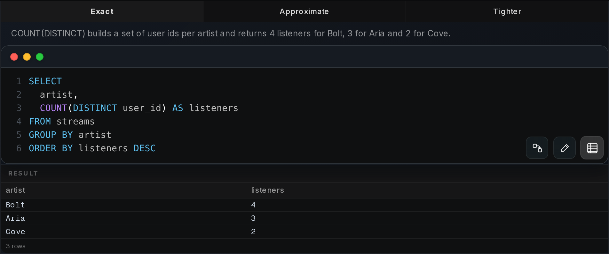

```sql
SELECT
  artist,
  COUNT(DISTINCT user_id) AS listeners
FROM streams
GROUP BY artist
ORDER BY listeners DESC
```

**Approximate**

APPROX_DISTINCT builds a sketch per artist instead; on 12 rows it lands on the same 4, 3 and 2.

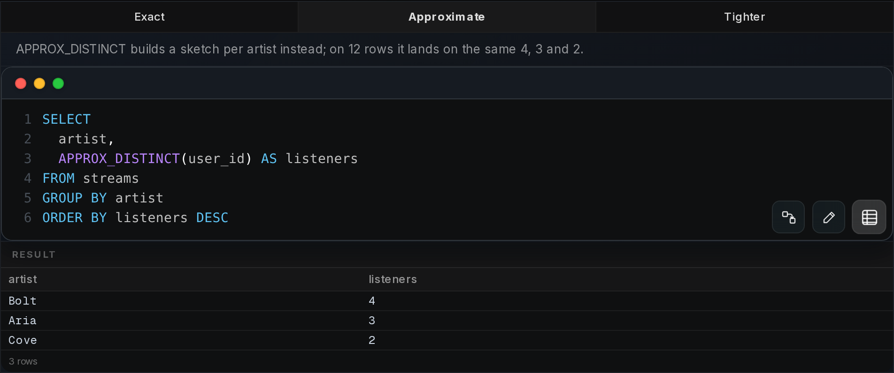

```sql
SELECT
  artist,
  APPROX_DISTINCT(user_id) AS listeners
FROM streams
GROUP BY artist
ORDER BY listeners DESC
```

**Tighter**

A second argument of 0.01 asks for a 1% standard error, which buys a larger sketch and the same answer here.

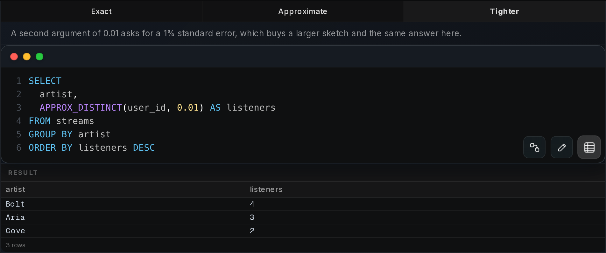

```sql
SELECT
  artist,
  APPROX_DISTINCT(user_id, 0.01) AS listeners
FROM streams
GROUP BY artist
ORDER BY listeners DESC
```

| ✓ Do | ✗ Don't |
| --- | --- |
| • Use APPROX_DISTINCT for any count you would round anyway, such as a dashboard trend line<br><br>• Keep the error argument constant across the queries you compare<br><br>• Report approximate figures as approximate: 48.9M, not 48,912,377 | • Reach for it on billing counts, or on any figure an audit or legal filing depends on<br><br>• Compare an approximate count against an exact one and read the gap as a change<br><br>• Expect a tighter error to come free: more buckets mean a bigger sketch per group |


**A daily dashboard reports monthly active users from about 2 billion events a day, and the figure moves by a few percent from day to day. Which count fits?**

- **A.** APPROX_DISTINCT(user_id) with the default error, since its band is narrower than the daily movement and the sketch keeps the query fast
- **B.** COUNT(DISTINCT user_id), since an approximate figure is never acceptable on a dashboard that leadership reads every morning
- **C.** APPROX_DISTINCT(user_id, 0.5), since a wide band makes the sketch as small as it can be and the query as fast as it can be
- **D.** COUNT(user_id), since it needs no set and no sketch and therefore runs fastest of all the options

<details>
<summary>Solution</summary>

**A.** APPROX_DISTINCT(user_id) with the default error, since its band is narrower than the daily movement and the sketch keeps the query fast

The default band on tens of millions of users is a fraction of the day-to-day change, so exactness would cost memory and time without changing a decision.

**Why the others are wrong**

- **B.** Exactness has a cost in memory and time, and a figure that moves by percents each day does not need the last digit.
- **C.** The error argument has an upper limit the engine enforces, and a band that wide would swallow the trend the dashboard exists to show.
- **D.** COUNT(user_id) counts events, so a user with 40 events counts 40 times; it answers a different question.

</details>

One query can carry both kinds of count side by side. `COUNT(*)` per group counts events and keeps only a running total; `APPROX_DISTINCT(user_id, e)` in the same SELECT list counts the people behind those events, with `e` written as a fraction, so 0.01 asks for a 1% standard error. Dividing the first by the second gives events per user.


<br>

---

## ORDER BY with aggregates

The engine builds groups before it sorts them. Execution starts with FROM and WHERE. GROUP BY and HAVING come next, then SELECT, and ORDER BY runs after SELECT with LIMIT last. By the time ORDER BY runs, each group is 1 row carrying its aggregates and the aliases the SELECT list gave them, so an aggregate is a sort key like any other column. The animation groups 6 orders by customer and computes a count and a total for each group before sorting the 3 groups by total. Predict the order before you play it: C3 has 1 order worth 300, C1 has 3 worth 270 together, C2 has 2 worth 120, so DESC puts C3 first and C2 last.

https://github.com/user-attachments/assets/22bd50b6-edd6-442b-a029-991a3aceec49


<br>

### 4 ways to name the sort key

You can sort by an alias, by the aggregate expression written again, by the position of the column in the SELECT list, or by an aggregate that the SELECT list doesn't show at all. All 4 produce the same order on the orders table. The alias reads best, the expression repeats itself but survives a renamed alias, the position breaks when someone reorders the SELECT list, and the unselected aggregate is for sorting by a figure you do not want to display.

**Alias**

ORDER BY the alias total_spent, which exists because SELECT runs before ORDER BY.

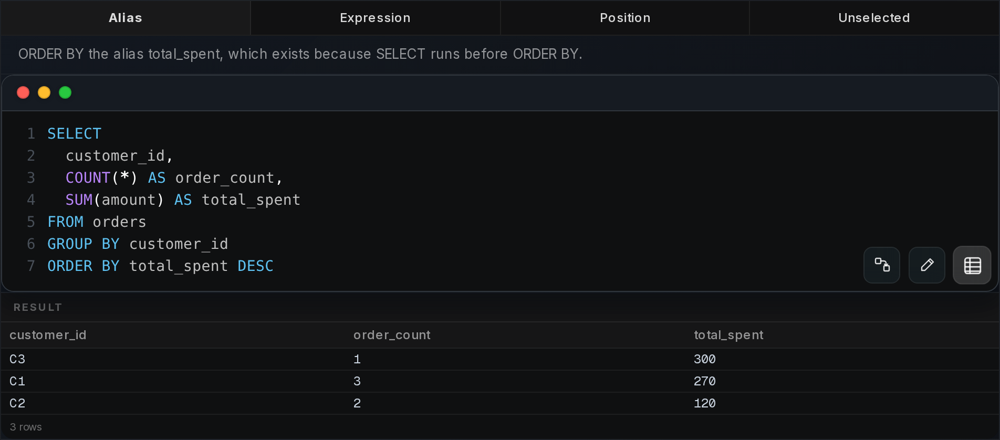

```sql
SELECT
  customer_id,
  COUNT(*) AS order_count,
  SUM(amount) AS total_spent
FROM orders
GROUP BY customer_id
ORDER BY total_spent DESC
```

**Expression**

ORDER BY SUM(amount) repeats the aggregate; the engine computes it once and reuses it.

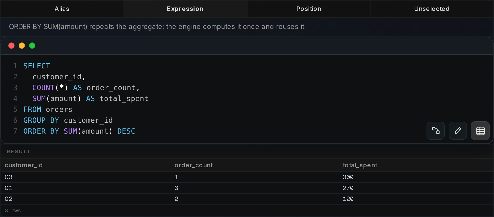

```sql
SELECT
  customer_id,
  COUNT(*) AS order_count,
  SUM(amount) AS total_spent
FROM orders
GROUP BY customer_id
ORDER BY SUM(amount) DESC
```

**Position**

ORDER BY 3 names the third selected column, total_spent, by its position.

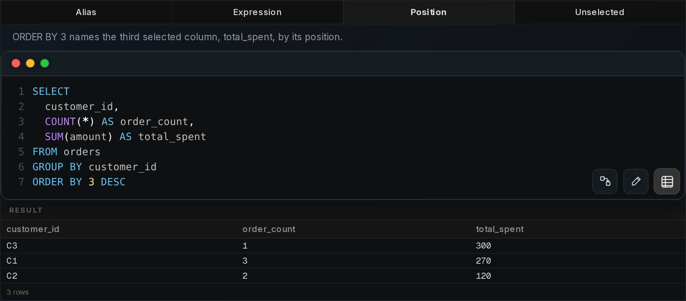

```sql
SELECT
  customer_id,
  COUNT(*) AS order_count,
  SUM(amount) AS total_spent
FROM orders
GROUP BY customer_id
ORDER BY 3 DESC
```

**Unselected**

ORDER BY SUM(amount) sorts by a total the result never shows: C3, C1, C2 with only their counts.

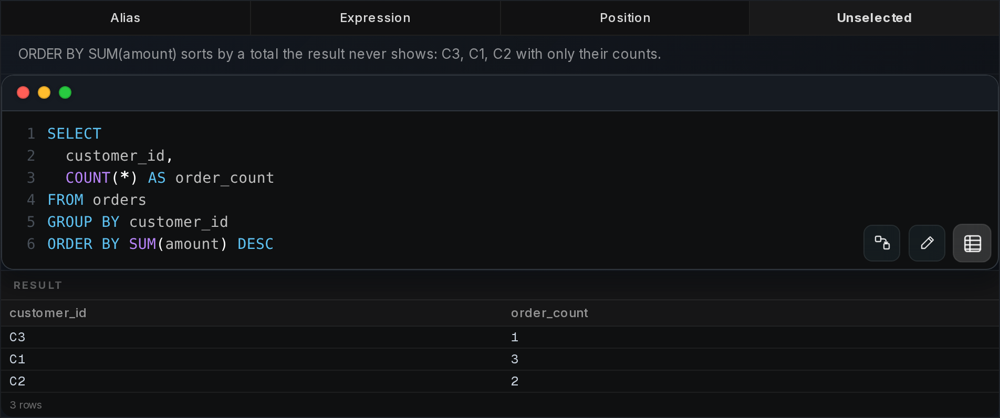

```sql
SELECT
  customer_id,
  COUNT(*) AS order_count
FROM orders
GROUP BY customer_id
ORDER BY SUM(amount) DESC
```

*Position numbers refer to the SELECT list of the same query, so adding a column before total_spent silently changes what ORDER BY 3 sorts by.*


<br>

### Top N and ties

Ranking groups usually ends in LIMIT. ORDER BY total_spent DESC LIMIT 2 returns the 2 biggest customers, C3 first. The rows LIMIT cuts are decided entirely by the sort, and SQL leaves the order of tied rows undefined. If C1 and C2 had both spent 270, the engine could return either one beside C3, and a rerun on the same data could return the other. Add a second sort key that can't tie, the group key itself, and the result is the same on every run.

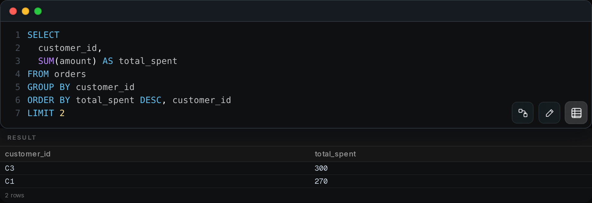

```sql
SELECT
  customer_id,
  SUM(amount) AS total_spent
FROM orders
GROUP BY customer_id
ORDER BY total_spent DESC, customer_id
LIMIT 2
```


<br>

### HAVING cannot see the alias

ORDER BY accepts the alias because SELECT has already run. HAVING runs before SELECT, so HAVING total_spent > 200 names a column that does not exist yet and the query is rejected. Inside HAVING, write the aggregate out, SUM(amount) > 200, and keep the alias for ORDER BY. The query below keeps C3 at 300 and C1 at 270 and drops C2.

```sql
SELECT
  customer_id,
  SUM(amount) AS total_spent
FROM orders
GROUP BY customer_id
HAVING SUM(amount) > 200
ORDER BY total_spent DESC
```

**Which customer_id is on the first row of this result?**

```sql
SELECT
  customer_id,
  COUNT(*) AS order_count
FROM orders
GROUP BY customer_id
HAVING SUM(amount) > 150
ORDER BY order_count
```

- **A.** C1, the customer with the most orders in the table
- **B.** C2, the customer with the lowest total spent
- **C.** C3, the only surviving customer with 1 order
- **D.** No row, because SUM(amount) is not in the SELECT list

<details>
<summary>Solution</summary>

**C.** C3, the only surviving customer with 1 order

HAVING keeps C1 at 270 and C3 at 300. ORDER BY order_count ascending puts C3's 1 order before C1's 3.

**Why the others are wrong**

- **A.** HAVING keeps C1 and C3, but the sort is ascending by order_count, so the customer with the fewest orders leads.
- **B.** C2's total of 120 fails HAVING SUM(amount) > 150, so C2 isn't in the result at all.
- **D.** HAVING and ORDER BY may use aggregates the SELECT list omits; the engine computes them for the group anyway.

</details>

A top-N query over groups uses every clause from this section, in a fixed order. SELECT names the group key and its aggregate, GROUP BY builds the groups, HAVING filters them with the aggregate written out, ORDER BY ranks them by the alias with the group key as tiebreaker, and LIMIT cuts the ranked list.


<br>

---

## APPROX_PERCENTILE at Scale

An average answers the question of what a typical request costs in total, and it answers it badly for anything with a long tail. Take 7 searches whose times climb from 95 ms through 120, 150, 160 and 180 to 210 before jumping to 2,400 ms. Their average is about 474 ms, a figure no search actually took, because 6 of the 7 finished under 211 ms and 1 took 2.4 seconds and dragged the mean up. A percentile answers a different question: p50 is the value that half the rows are at or below, p95 the value that 95% are at or below. Sorted, the 7 searches have a p50 of 160 ms, which is the 4th value. The slow one shows up where it belongs, at the top of the distribution.

| rank | latency_ms | share of rows at or below |
| --- | --- | --- |
| 1 | 95 | 14% |
| 2 | 120 | 29% |
| 3 | 150 | 43% |
| 4 | 160 | 57% |
| 5 | 180 | 71% |
| 6 | 210 | 86% |
| 7 | 2400 | 100% |

The exact way to get a percentile is to sort every value in the group and walk to the rank, which means holding every value. For a billion requests a day grouped by endpoint, that's a full sort of a billion numbers, with the memory to match. APPROX_PERCENTILE(latency_ms, 0.5) keeps a quantile sketch instead: a bounded summary of where values fall by rank, with the same rank-error bound at every percentile, that merges across machines and reads out any percentile at the end. The group can be 7 rows or 7 billion and the sketch stays the same size.

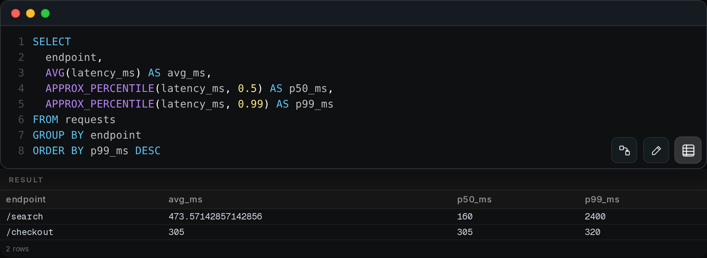

```sql
SELECT
  endpoint,
  AVG(latency_ms) AS avg_ms,
  APPROX_PERCENTILE(latency_ms, 0.5) AS p50_ms,
  APPROX_PERCENTILE(latency_ms, 0.99) AS p99_ms
FROM requests
GROUP BY endpoint
ORDER BY p99_ms DESC
```

Run it and read /search against /checkout. The 5 /checkout latencies sit between 290 and 320 ms. Its average and p50 agree at 305, and its p99 is 320, the top of a tight range. The /search average of about 474 ms sits above 6 of its 7 requests, its p50 is 160 ms, and its p99 lands on the 2,400 ms outlier. The averages said the 2 endpoints perform within a factor of 2 of each other. The percentiles say /checkout is steady and /search has a tail problem.


<br>

### What the accuracy argument promises

A third argument, APPROX_PERCENTILE(latency_ms, 0.99, 0.01), sets the accuracy, and the promise is about rank rather than milliseconds. With 0.01, the returned value's true position is within 1% of the rank you asked for: somewhere between the 98th and the 100th percentile. If latencies climb steeply in that last 2%, the millisecond gap can be large; if they are flat there, it's small. The default is 0.01, and lowering it, to 0.001 say, buys a finer sketch at the cost of memory per group. For p50 on a smooth distribution the default is more than enough. A spiky distribution read at p99.9 needs a lower value, checked against an exact sort on a sample.

| ✓ Average hides | ✗ Percentile shows |
| --- | --- |
| • 1 outlier moves it for everyone<br><br>• Says nothing about how many users were slow<br><br>• Cheap: 1 sum and 1 count per group | • p50 is a typical experience, p99 the worst 1%<br><br>• Tails stay visible however small they are<br><br>• Exact needs a full sort, approximate needs a fixed sketch |

**A p99 latency over 10 million requests uses APPROX_PERCENTILE(latency_ms, 0.99) with the default accuracy. What does the result guarantee?**

- **A.** The value is within 1% of the true p99 when measured in milliseconds
- **B.** The value's true rank lies between the 98th and the 100th percentile
- **C.** The result is exact because the group is large enough to fill the sketch
- **D.** The result is the average latency of the slowest 1% of the requests

<details>
<summary>Solution</summary>

**B.** The value's true rank lies between the 98th and the 100th percentile

Default accuracy 0.01 bounds the rank error at 1% of the rows in either direction, so the returned latency is one that between 98% and 100% of requests are at or below.

**Why the others are wrong**

- **A.** The accuracy bounds rank, not value. If latency jumps between the 98th and 100th percentile, the millisecond gap can be far more than 1%.
- **C.** The sketch is bounded, so a large group is where it approximates most; small groups are where it tends to return an actual value.
- **D.** A percentile is a single value at a rank, read from the sketch, with no averaging over the tail.

</details>

Several percentiles can come out of one pass over the rows. Each `APPROX_PERCENTILE` call takes the rank it reads as a fraction, 0.5 for the median and 0.95 for p95, and an optional accuracy as its third argument. Dashboards usually set p50 and p95 next to each other, because the gap between them shows how long the tail is.


<br>

---

## Putting It All Together

Spotify's artist dashboard for Wrapped shows every artist their distinct listeners for the year, their rank among all artists, and how long a typical stream of their tracks lasted. The team builds it from a year of stream events, each with a user_id, an artist_id, a track_id and a seconds_played, combined with an artist dimension table.

- Before combining streams with the artist table, the team checks that artist_id in the dimension returns the same COUNT(\*) and COUNT(DISTINCT), because a duplicated artist row would double that artist's streams.
- GROUP BY artist_id collapses billions of stream rows into 1 row per artist; seconds_played is wrapped in SUM and listeners in APPROX_DISTINCT, since a column that is neither grouped nor aggregated can't survive the collapse.
- APPROX_DISTINCT(user_id) replaces a set of hundreds of millions of ids per artist with a kilobyte sketch, and a 2.3% band on a listener count the dashboard rounds to millions changes no artist's story.
- ORDER BY listeners DESC, artist_id ranks the artists after the groups exist, and the tiebreaker keeps the rank stable across nightly runs.
- APPROX_PERCENTILE(seconds_played, 0.5) gives the median stream per artist, a per-stream figure; a per-listener figure would first sum seconds_played per user in a CTE, or a heavy listener's many streams would dominate it.


<br>

---

## Key Takeaways

- A row-level expression returns 1 value per row; an aggregate returns 1 value per group, and the first aggregate or GROUP BY in a query is where rows collapse.
- Cardinality is rows against distinct values. COUNT(\*) equal to COUNT(DISTINCT key) means unique, and a duplicate on the unique side multiplies every row that pairs with it.
- APPROX_DISTINCT trades a set of every value for a fixed-size HyperLogLog sketch, with a 2.3% standard error by default and a second argument to tighten it.
- ORDER BY runs after SELECT, so it can sort groups by an alias or a column position, and also by an expression or an aggregate the SELECT list never shows; HAVING can't use the alias.
- APPROX_PERCENTILE bounds rank error rather than value error: at the default accuracy of 0.01 a p99 sits somewhere between the 98th and 100th percentile.
- Tie-break every ORDER BY that feeds a LIMIT, or 2 runs can disagree at the cut line.
