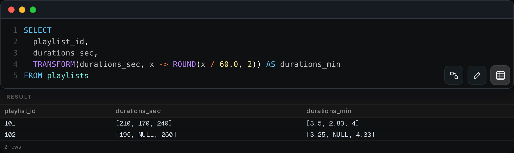
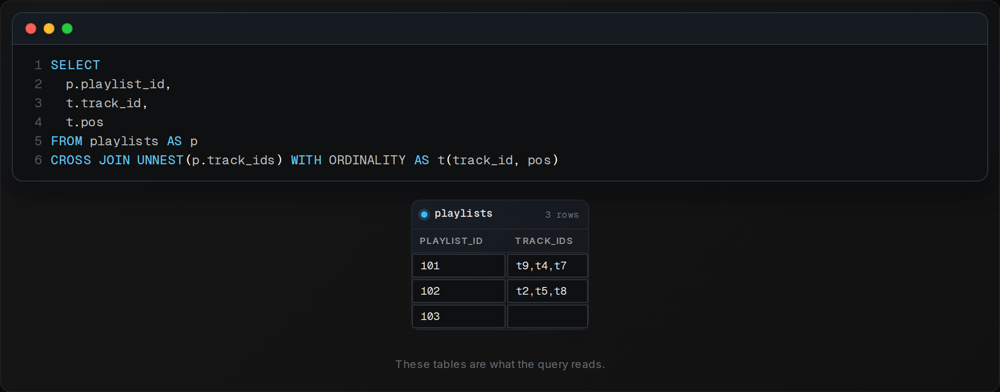
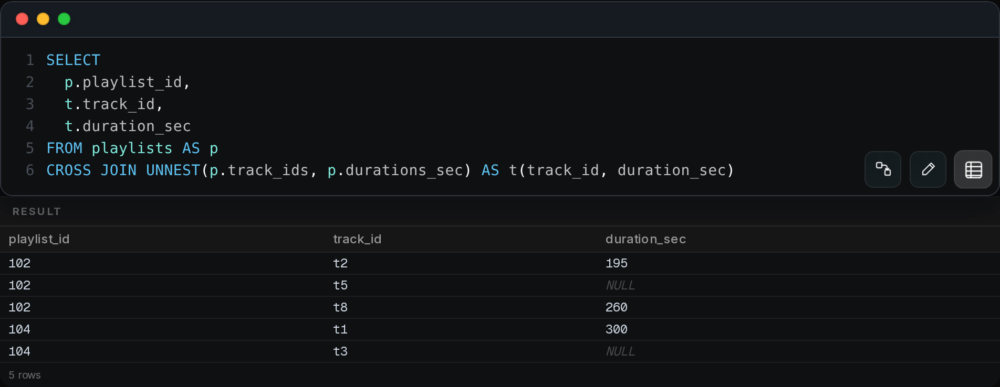
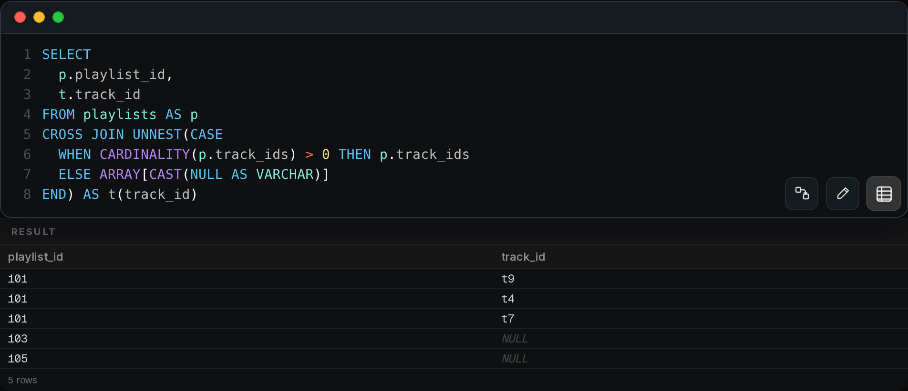
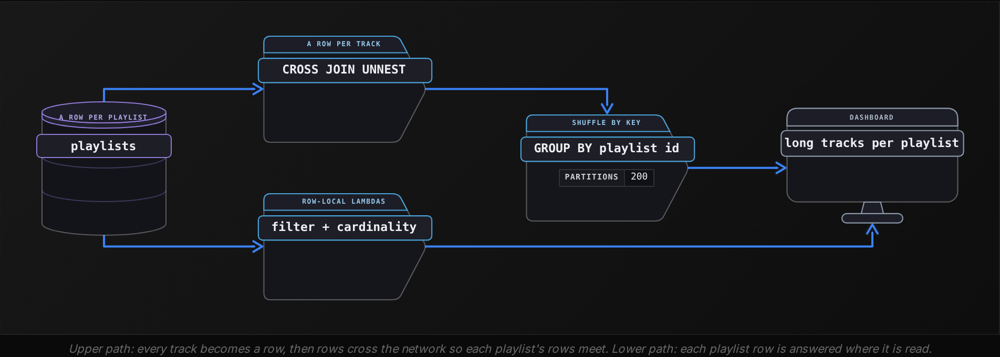

# Complex Data: Advanced

Two days before Spotify Wrapped ships, the playlist team wants a single figure per playlist: the minutes of music in tracks longer than 3 minutes. Each playlist row stores its track durations as an array. You can explode every playlist into a row per track and group it back together, or filter and sum each array where it sits. The choice decides how much data the query moves.


<br>

---

## TRANSFORM for Array Mapping

transform(array, x -> expression) returns a new array with an output element for every input element, in the same order. The part written x -> expression is a **lambda**: a small unnamed function that the engine calls once per element, with x standing for the element being visited. The query's row count never changes, because the work happens inside each row's array and creates or removes no rows.


<br>

### Anatomy of a lambda

| Piece | In x -> round(x / 60.0, 2) | What it does |
| --- | --- | --- |
| Parameter | `x` | Names the current element. Any identifier works: `sec`, `t`, `d`. |
| Arrow | `->` | Separates the parameter from the body. |
| Body | `round(x / 60.0, 2)` | Computes the output element. Its type sets the output array's type. |
| Captured column | none here | The body may read other columns of the same row, such as `gap_sec`. |

The body can also read other columns of the same row. `transform(durations_sec, x -> x + gap_sec)` adds that row's own gap to each of its tracks, so 2 playlists with different `gap_sec` values get different arrays from the same expression.

In the query below, durations arrive in seconds and the product team wants minutes. Playlist 102 has a track whose duration was never recorded, stored as NULL, so watch what happens to its slot.



```sql
SELECT
  playlist_id,
  durations_sec,
  TRANSFORM(durations_sec, x -> ROUND(x / 60.0, 2)) AS durations_min
FROM playlists
```

Playlist 101 comes back as 3.5, 2.83 and 4.0 minutes. Playlist 102 keeps all 3 slots, and its middle slot is NULL: `NULL / 60.0` is NULL, and `transform` stores whatever the body returns. The output array has exactly as many elements as the input array, every time.

> Where TRANSFORM earns its place
>
> - Unit conversion on measurement arrays: seconds to minutes, cents to dollars.
> - Cleaning tag arrays with `lower(trim(x))` before comparing them.
> - Changing element type with `CAST(x AS VARCHAR)` before joining the array into text.
> - Masking identifiers inside an array with a hash or a prefix.


<br>

### Edge cases worth predicting

| Input | Lambda | Result |
| --- | --- | --- |
| `ARRAY[1, 2, 3]` | `x -> x \* 10` | `[10, 20, 30]` |
| `ARRAY[1, NULL, 3]` | `x -> x \* 10` | `[10, NULL, 30]` |
| `ARRAY[1, NULL, 3]` | `x -> coalesce(x, 0) \* 10` | `[10, 0, 30]` |
| `ARRAY['a', 'b']` | `x -> upper(x)` | `['A', 'B']` |
| `ARRAY[1, 2]` | `x -> x > 1` | `[false, true]` |
| empty array | `x -> x \* 10` | `[]` |
| `NULL` | `x -> x \* 10` | `NULL` |

The last 2 rows separate an empty array from a NULL one. An empty array gives the lambda nothing to visit, so an empty array comes back. A NULL array also has nothing to visit, but the result is NULL, and the difference carries forward: `cardinality` returns 0 for the first and NULL for the second.


<br>

### Using an element's position

transform gives the lambda the value and nothing about where that value sits. When the output depends on position, pair the array with sequence(1, cardinality(track_ids)), which builds the array 1, 2, 3 up to the array's length, and walk both arrays together with zip_with(a, b, (x, i) -> ...). It calls its lambda once per position with an element from each array; when the arrays differ in length, the shorter one is padded with NULL.

```sql
SELECT
  playlist_id,
  ZIP_WITH(
    track_ids,
    SEQUENCE(1, CARDINALITY(track_ids)),
    (t, i) -> CAST(i AS VARCHAR) || '. ' || t
  ) AS numbered
FROM playlists
```

The result is `['1. t9', '2. t4', '3. t7']`: the numbers come from the sequence and the track ids from the array, matched slot by slot.

> **TIP**
>
> A lambda body accepts scalar functions and columns of the current row, and rejects subqueries and aggregate functions. To divide each element by the array's largest value, write `x -> x / array_max(durations_sec)`. Writing `max(x)` inside the body fails, because aggregates combine rows and a lambda runs within a single row.

**What does this query return in out?**

```sql
SELECT
  transform(ARRAY[4, NULL, 6], x -> coalesce(x, 1) * x) AS out
```

- **A.** [16, 1, 36], because coalesce turns the NULL into 1 first
- **B.** [16, NULL, 36], because the second x is still NULL
- **C.** [16, 36], because a NULL result removes its element
- **D.** NULL, because a NULL element makes the array NULL

<details>
<summary>Solution</summary>

**B.** [16, NULL, 36], because the second x is still NULL

The body runs once per element. For the middle element it computes 1 * NULL, which is NULL, and the slot stores that NULL.

**Why the others are wrong**

- **A.** coalesce covers only its own argument. The second x in the product is still NULL, and 1 times NULL is NULL.
- **C.** transform never changes an array's length. Removing elements is the job of filter, in the next section.
- **D.** Only a NULL input array gives a NULL result. A NULL element affects its own slot and nothing else.

</details>


<br>

---

## FILTER and REDUCE

filter(array, x -> condition) returns the elements whose condition is TRUE, in their original order. An element whose condition is FALSE is dropped, and so is an element whose condition is NULL: filter keeps an element only on a definite TRUE. The output can hold anywhere from 0 elements to all of them.

Here is the trace for playlist 102's durations under the condition `x > 180`:

| Element | x > 180 | Kept? |
| --- | --- | --- |
| 195 | TRUE | Yes |
| NULL | NULL | No |
| 260 | TRUE | Yes |

The result is `[195, 260]`. Playlist 102's missing duration disappears with no explicit NULL check, because `NULL > 180` is NULL and only TRUE keeps an element. That suits most filters, and it is the opposite of what `transform` did with the same element, where the NULL kept its slot.


<br>

### Yes-or-no questions about an array

When the question is whether any element qualifies, any_match(arr, x -> condition) returns a BOOLEAN directly, and all_match and none_match cover the other 2 shapes. All 3 follow three-valued logic: all_match returns NULL when no element fails the condition but at least one element makes it NULL. cardinality(filter(arr, x -> condition)) answers a neighbouring question, how many elements qualify, and returns a number for any non-NULL array.


<br>

### REDUCE carries a state through the array

reduce(array, initial_state, (s, x) -> next_state, s -> result) takes 4 arguments. The engine sets the state s to the initial value, then calls the middle lambda once per element, in order, with the current state and that element; whatever it returns becomes the new state. After the last element, the final lambda runs once and turns the state into the answer. The trace below is reduce(ARRAY[210, 170, 240], 0, (s, x) -> s + x, s -> s), playlist 101's durations.

| Step | x | s before | s after |
| --- | --- | --- | --- |
| start | none | none | 0 |
| 1 | 210 | 0 | 210 |
| 2 | 170 | 210 | 380 |
| 3 | 240 | 380 | 620 |
| finish | none | 620 | 620 |

The initial value fixes the state's type. Starting from `0` makes the state an integer, and every value the middle lambda returns must have that same type, which is why a running total of DOUBLE values starts from `CAST(0 AS DOUBLE)`.


<br>

### A single NULL poisons a running total

```sql
SELECT
  playlist_id,
  REDUCE(secs, 0, (s, x) -> s + x, s -> s) AS naive_total,
  REDUCE(secs, 0, (s, x) -> s + COALESCE(x, 0), s -> s) AS safe_total
FROM durations
```

Playlist 101 totals 620 both ways. Playlist 102's naive total is NULL: at step 2 the state becomes `195 + NULL`, which is NULL, and every later step adds to NULL. Applying `coalesce(x, 0)` inside the middle lambda keeps the state a number, and the safe total comes out at 455.


<br>

### FILTER feeds REDUCE

The functions compose. Filter first to choose which elements count, reduce what is left, and let the final lambda format the answer. Because the filter already removes the NULL, this reduce needs no coalesce.

```sql
SELECT
  playlist_id,
  REDUCE(
    FILTER(secs, x -> x > 180),
    0,
    (s, x) -> s + x,
    s -> ROUND(s / 60.0, 1)
  ) AS long_track_min
FROM durations
```

Playlist 101 keeps 210 and 240, 450 seconds, which the final lambda turns into 7.5 minutes. Playlist 102 keeps 195 and 260, 455 seconds, which rounds to 7.6 minutes.

> Which function answers which question
>
> - `transform`: the same number of elements, each one changed.
> - `filter`: fewer elements, each one unchanged.
> - `any_match`, `all_match`, `none_match`: a single BOOLEAN about the elements.
> - `reduce`: a single value built from all the elements, in order.

**What does this query return in all_long?**

```sql
SELECT
  all_match(ARRAY[210, NULL, 240], x -> x > 180) AS all_long
```

- **A.** TRUE, because the NULL element is skipped as filter skips it
- **B.** FALSE, because a NULL element cannot be greater than 180
- **C.** An error, because all_match rejects arrays holding NULL
- **D.** NULL, because no element fails and one element is unknown

<details>
<summary>Solution</summary>

**D.** NULL, because no element fails and one element is unknown

210 and 240 pass, and the middle element makes the condition NULL. With no definite failure and an unknown, all_match returns NULL.

**Why the others are wrong**

- **A.** filter drops NULL results while building an array. all_match must answer for every element, and one of them is unknown.
- **B.** NULL > 180 is NULL. all_match returns FALSE only when some element definitely fails the condition.
- **C.** NULL elements are allowed. They feed three-valued logic into the result and raise no error.

</details>


<br>

---

## UNNEST for Array Expansion

CROSS JOIN UNNEST(p.track_ids) AS t(track_id) pairs each playlist row with the elements of its own array, so a playlist holding 3 tracks becomes 3 rows that repeat its other columns. Adding WITH ORDINALITY appends a second output column that numbers the elements from 1, which keeps each element's position after it has left the array.



Playlists 101 and 102 each become 3 rows, numbered 1 to 3 in their original order. Playlist 103 holds an empty array, so it has nothing to pair with and is gone from the result, the way an INNER JOIN drops a row with no match. Three playlists go in and 6 rows come out.


<br>

### Predicting the row count

The output row count is the sum of the array lengths, so `cardinality` predicts it before the query runs. Picture 2 million playlists, each holding 50 tracks. Unnesting `track_ids` gives a row per track. Unnesting `track_ids` and `durations_sec` in 2 separate CROSS JOINs pairs every track with every duration of its playlist, 2,500 rows per playlist, and all but 50 of them are wrong pairings.

- **100M** — rows after a single UNNEST
- **5B** — rows after 2 separate UNNESTs

| Form | Output columns | Rows per input row |
| --- | --- | --- |
| `UNNEST(arr) AS t(x)` | `x` | `cardinality(arr)` |
| `UNNEST(arr) WITH ORDINALITY AS t(x, n)` | `x`, `n` | `cardinality(arr)` |
| `UNNEST(a, b) AS t(x, y)` | `x`, `y` | The longer of the 2 lengths |
| `UNNEST(m) AS t(k, v)` on a map | `k`, `v` | Number of map entries |
| Any form on an empty or NULL array | none | 0, so the row disappears |


<br>

### Several arrays in a single UNNEST

Listing 2 arrays inside a single UNNEST walks them in step: element 1 beside element 1, element 2 beside element 2. When one array is shorter, its missing slots come back as NULL, and the row count follows the longer array.



```sql
SELECT
  p.playlist_id,
  t.track_id,
  t.duration_sec
FROM playlists AS p
CROSS JOIN UNNEST(p.track_ids, p.durations_sec) AS t(track_id, duration_sec)
```

Playlist 104 lists 2 track ids but only 1 duration, so `t3` arrives with a NULL duration. Playlist 102's `t5` also shows NULL, from a duration that was recorded as NULL. The 2 NULLs look identical in the output; when the difference matters, compare `cardinality(track_ids)` with `cardinality(durations_sec)` before unnesting.


<br>

### Keeping rows whose array is empty

Dropping playlist 103 is correct when the question is about tracks and wrong when it is about playlists. A report of every playlist with its tracks must still list the empty and NULL ones. The fix hands UNNEST a single-element array holding NULL whenever the real array has nothing in it:



```sql
SELECT
  p.playlist_id,
  t.track_id
FROM playlists AS p
CROSS JOIN UNNEST(CASE
  WHEN CARDINALITY(p.track_ids) > 0 THEN p.track_ids
  ELSE ARRAY[CAST(NULL AS VARCHAR)]
END) AS t(track_id)
```

Playlist 101 still produces its 3 rows. Playlists 103 and 105 each produce a row with a NULL `track_id`. For playlist 105, `cardinality(NULL)` is NULL, the `WHEN` condition is not TRUE, and the `ELSE` branch supplies the placeholder. The `CAST` gives that NULL the VARCHAR type the real arrays have, so both branches return the same type.


<br>

### Rebuilding arrays after UNNEST

Rows produced by UNNEST fold back into an array per group with ARRAY_AGG. Order is the trap: the database promises no order for the rows of a group, so write ARRAY_AGG(t.track_id ORDER BY t.pos) with the ordinality column to get the original sequence back. The last section of this lesson weighs when that round trip is worth its cost.

**How many rows does this query return?**

```sql
WITH carts (cart_id, skus) AS (
  VALUES
    (1, ARRAY['a', 'b', 'c']),
    (2, CAST(ARRAY[] AS ARRAY(VARCHAR))),
    (3, ARRAY['d', 'e']),
    (4, CAST(NULL AS ARRAY(VARCHAR)))
)
SELECT
  c.cart_id,
  s.sku,
  s.n
FROM carts AS c
CROSS JOIN UNNEST(c.skus) WITH ORDINALITY AS s(sku, n)
```

- **A.** 5: cart 1 gives 3 rows, cart 3 gives 2, carts 2 and 4 give none
- **B.** 7: carts 2 and 4 each add a row holding a NULL sku
- **C.** 4: a row per cart, with each cart's skus gathered into it
- **D.** 6: cart 2's empty array adds a row, cart 4's NULL adds none

<details>
<summary>Solution</summary>

**A.** 5: cart 1 gives 3 rows, cart 3 gives 2, carts 2 and 4 give none

The row count is the sum of the array lengths. Empty and NULL arrays contribute 0 rows, and WITH ORDINALITY adds a column, never a row.

**Why the others are wrong**

- **B.** That placeholder row appears only when the query supplies an array holding NULL, as the CASE fix does. A bare CROSS JOIN UNNEST adds nothing.
- **C.** Gathering elements into a row is what ARRAY_AGG does. UNNEST goes the other way, spreading each element onto its own row.
- **D.** An empty array and a NULL array behave the same here: neither has an element to pair with, so both carts disappear.

</details>


<br>

---

## Advanced Map Operations

This section assumes the intermediate map toolkit. map_filter, transform_values and transform_keys take a 2-parameter lambda (k, v) -> ...; map_concat lets the later map win on a shared key; map_zip_with hands its lambda both values for every key. The table below is the reference. The work here is reshaping: turning parallel arrays into a map, reaching into arrays of records, and folding colliding keys into a map whose values are arrays.

| Function | Lambda returns | Result |
| --- | --- | --- |
| `transform_values(m, (k, v) -> ...)` | the new value | Same keys, new values |
| `transform_keys(m, (k, v) -> ...)` | the new key | New keys, same values; fails if 2 keys collide |
| `map_filter(m, (k, v) -> ...)` | a BOOLEAN | Only the entries where it is TRUE |
| `map_zip_with(m1, m2, (k, v1, v2) -> ...)` | the merged value | Every key from either map; a side without the key passes NULL |


<br>

### Parallel arrays into a map

Producers often ship related values as parallel arrays, such as track_ids and durations_sec, matched by position. Two functions turn that pair into a lookup keyed by id. zip(a, b) merges the arrays element by element into a single array of ROW values, each a small record holding one value from each array. map_from_entries reads an array of 2-field rows as key and value pairs and returns a map. The MAP(keys, values) constructor builds the same map from 2 plain arrays; the entries form also accepts rows built by transform or trimmed by filter first, which the records example below relies on.

| Step | Expression | Playlist 101's value |
| --- | --- | --- |
| Input | `track_ids`, `durations_sec` | `['t9', 't4', 't7']`, `[210, 170, 240]` |
| Pair | `zip(track_ids, durations_sec)` | `[ROW('t9', 210), ROW('t4', 170), ROW('t7', 240)]` |
| Map | `map_from_entries(...)` | `{t9: 210, t4: 170, t7: 240}` |
| Look up | `element_at(m, 't4')` | `170` |

```sql
SELECT
  playlist_id,
  MAP_FROM_ENTRIES(ZIP(track_ids, durations_sec)) AS sec_by_track,
  MAP_FILTER(
    MAP_FROM_ENTRIES(ZIP(track_ids, durations_sec)),
    (k, v) -> v > 180
  ) AS long_by_track
FROM playlists
```

Playlist 101's map holds 3 entries, and `long_by_track` keeps t9 and t7. Playlist 102's t5 keeps its NULL value in `sec_by_track`, since a map value may be NULL, and `map_filter` drops that entry because `NULL > 180` is not TRUE, leaving t2 and t8. Keys are stricter than values: a NULL key or a track id that appears twice fails the whole query, so check `cardinality(array_distinct(track_ids)) = cardinality(track_ids)` before building the map when a producer can repeat an id.


<br>

### Arrays of records

An array of ROW values is a list of records, the shape a session log takes when each play carries a track id and a duration together. Its type is written ARRAY(ROW(track_id VARCHAR, sec INTEGER)), and inside a lambda the current element is a record whose fields are read with a dot: r.track_id, r.sec. Every array function from the first 2 sections works on it. What changes from one function to the next is the type of the result, which follows what the lambda returns.

```sql
SELECT
  session_id,
  TRANSFORM(plays, r -> r.track_id) AS track_ids,
  FILTER(plays, r -> r.sec > 180) AS long_plays,
  MAP_FROM_ENTRIES(TRANSFORM(plays, r -> ROW(r.track_id, r.sec))) AS sec_by_track
FROM sessions
```

| Column | Type | Session s1 |
| --- | --- | --- |
| `plays` | `ARRAY(ROW(track_id VARCHAR, sec INTEGER))` | `[('t9', 210), ('t4', 170), ('t7', 240)]` |
| `track_ids` | `ARRAY(VARCHAR)` | `['t9', 't4', 't7']` |
| `long_plays` | `ARRAY(ROW(track_id VARCHAR, sec INTEGER))` | `[('t9', 210), ('t7', 240)]` |
| `sec_by_track` | `MAP(VARCHAR, INTEGER)` | `{t9: 210, t4: 170, t7: 240}` |

A `transform` with a field access pulls one field out of every record, so 3 records become an array of 3 strings. `filter` returns whole records, so `long_plays` keeps the row type and both fields of the 2 plays over 180 seconds. The last column rebuilds each record as an anonymous 2-field row and hands the array to `map_from_entries`: the same move as `zip`, with the pairing done by the lambda.

> **TIP**
>
> Payloads usually carry records as a JSON array of objects. `CAST(json_extract(payload, '$.plays') AS ARRAY(ROW(track_id VARCHAR, sec INTEGER)))` matches each object's keys to the row's field names, so the record type becomes the contract the payload is read against.


<br>

### Renaming keys without collisions

transform_keys(m, (k, v) -> lower(k)) fails on a map holding both 'Rock' and 'rock', because the result would put 2 entries under one key and a map allows each key once. Apps that disagree on capitalisation produce exactly this. The repair goes through rows: unnest the map into key and value columns, lower the key, and fold the entries back with multimap_agg, which collects every value for a key into an array. A transform_values with reduce then sums each array.

```sql
SELECT
  r.user_id,
  MULTIMAP_AGG(LOWER(g.genre), g.sec) AS grouped,
  TRANSFORM_VALUES(
    MULTIMAP_AGG(LOWER(g.genre), g.sec),
    (k, v) -> REDUCE(v, 0, (s, x) -> s + x, s -> s)
  ) AS genre_sec
FROM raw AS r
CROSS JOIN UNNEST(r.genre_sec) AS g(genre, sec)
GROUP BY r.user_id
```

`grouped` is the nested middle shape, a map from lowered genre to an array: `rock` holds 600 and 300, and `jazz` holds 120. The order inside each array carries no guarantee, which a sum ignores. The `reduce` in `genre_sec` folds each array to a number, rock 900 and jazz 120, so listener 9 comes back as a single row whose 3 raw entries have become 2 clean ones. A listener with an empty map would vanish at the UNNEST, the trade section 2 described.

**A producer repeats a track: track_ids is ['t2', 't5', 't2'] and durations_sec is [195, 140, 260]. What does map_from_entries(zip(track_ids, durations_sec)) return?**

- **A.** {t2: 260, t5: 140}, because the later entry overwrites t2
- **B.** {t2: 195, t5: 140}, because the first entry for t2 is kept
- **C.** {t2: [195, 260], t5: [140]}, because repeats gather into an array
- **D.** An error, because the key t2 appears twice in the entries

<details>
<summary>Solution</summary>

**D.** An error, because the key t2 appears twice in the entries

A map holds each key once, and map_from_entries raises a duplicate-key error instead of choosing. Check the ids with array_distinct first.

**Why the others are wrong**

- **A.** Overwriting a shared key is how map_concat combines 2 maps. A single array of entries with a repeated key has no winner.
- **B.** Building the map stops at the second t2 with an error, so no entry for t2 survives.
- **C.** Gathering every value for a key into an array is multimap_agg, an aggregate over rows. map_from_entries allows each key once.

</details>


<br>

---

## Real-World Patterns

Nested data in production arrives in volume, in loose formats and with holes. Three habits cover most of the trouble: answer inside the row before reaching for UNNEST, parse JSON into typed arrays defensively, and decide in advance what empty and NULL collections should produce.


<br>

### Row-local first, explode second



Both paths count, per playlist, the tracks longer than 180 seconds. The UNNEST path multiplies rows by the array length, then GROUP BY sends every row with the same `playlist_id` to the same worker, which in a distributed engine means writing those rows to the network and reading them back. The lambda path reads each playlist once and returns it once.

**lambdas**

Each playlist row is answered in place, and playlist 103's empty array returns 0.

```sql
SELECT
  playlist_id,
  CARDINALITY(FILTER(durations_sec, x -> x > 180)) AS long_tracks
FROM playlists
ORDER BY playlist_id
```

Result:

```
playlist_id | long_tracks
101 | 2
102 | 2
103 | 0
```

**unnest**

Rows are grouped back by playlist, and playlist 103 has no rows to group, so it is missing.

```sql
SELECT
  p.playlist_id,
  COUNT_IF(t.sec > 180) AS long_tracks
FROM playlists AS p
CROSS JOIN UNNEST(p.durations_sec) AS t(sec)
GROUP BY p.playlist_id
ORDER BY p.playlist_id
```

Result:

```
playlist_id | long_tracks
101 | 2
102 | 2
```

Playlists 101 and 102 show 2 long tracks in both versions. The row that vanishes from the second version is the dangerous part: any average, ratio or join built on it excludes every playlist with an empty array, and nothing in the output says so.

**A dashboard averages long_tracks over the rows it receives. What does it show when it reads the unnest version's result instead of the lambda version's?**

- **A.** 1.33, because both versions count 4 long tracks over 3 playlists
- **B.** NULL, because playlist 102's NULL duration makes its count NULL
- **C.** 2.0, because playlist 103 has no row and 4 is divided by 2
- **D.** 1.0, because the NULL duration adds a fourth row counted as 0

<details>
<summary>Solution</summary>

**C.** 2.0, because playlist 103 has no row and 4 is divided by 2

The lambda version averages 2, 2 and 0 to 1.33. The unnest version averages 2 and 2, inflating the figure by half.

**Why the others are wrong**

- **A.** The unnest result has only 2 rows. Playlist 103 never reaches the average, so the denominator is 2.
- **B.** count_if counts TRUE results only, so the NULL comparison adds nothing and playlist 102 still counts 2.
- **D.** The NULL duration is a row inside playlist 102's group. After GROUP BY there is a single output row per playlist.

</details>


<br>

### Parsing JSON payloads into typed arrays

Event pipelines often deliver arrays inside a JSON string. TRY_CAST(json_extract(payload, '$.skips') AS ARRAY(INTEGER)) turns the JSON array into a typed array, and returns NULL instead of failing the whole query when a producer sends something else. Once typed, the arrays work with every lambda in this lesson. Below, zip_with pairs each track with its skip flag and keeps the track id when the flag is 1, and filter removes the empty slots.

```sql
SELECT
  event_id,
  FILTER(
    ZIP_WITH(
      TRY_CAST(
        JSON_EXTRACT(payload, '$.track_ids')
        AS ARRAY(VARCHAR)
      ),
      TRY_CAST(JSON_EXTRACT(payload, '$.skips') AS ARRAY(INTEGER)),
      (t, s) -> IF(s = 1, t)
    ),
    t -> t IS NOT NULL
  ) AS skipped_tracks
FROM events
```

Event 1 returns `['t4', 't7']`. Event 2's producer sent the string `none` where an array belonged, so the cast gives NULL, `zip_with` over a NULL array gives NULL, and the event's result is NULL where a plain CAST would have stopped the job. Count those NULLs on a schedule with `COUNT_IF(skipped_tracks IS NULL)`; a sudden rise means a producer changed its format.


<br>

### Habits that prevent incidents

| ✓ Do | ✗ Don't |
| --- | --- |
| • Answer per-row questions with filter, transform and reduce before reaching for UNNEST<br><br>• Add WITH ORDINALITY whenever element order carries meaning<br><br>• Compare the cardinality of parallel arrays before unnesting them together<br><br>• Use TRY_CAST when turning JSON into arrays or maps | • Unnest 2 arrays in separate CROSS JOINs<br><br>• Let a NULL element turn a reduce total into NULL<br><br>• Trust ARRAY_AGG order without an ORDER BY inside the call<br><br>• Forget that CROSS JOIN UNNEST drops empty and NULL arrays |


<br>

### Capstone: long tracks by id

The final query combines the lesson: 2 parallel arrays, a pairing lambda, a filter and no UNNEST. For each playlist it returns the ids of tracks longer than 180 seconds as an array; on playlists 101 and 102 that is `['t9', 't7']` and `['t2', 't8']`.


<br>

---

## Putting It All Together

A team at Spotify builds a weekly listener digest from a table with a row per listener per day, each holding an array of track ids, a parallel array of seconds played, and a map from genre to seconds.

- zip_with and filter pick out the tracks played past 30 seconds without leaving the listener's row.
- reduce with coalesce totals seconds per day even when the player dropped a reading.
- Summing 7 daily genre maps is a cross-row job, so UNNEST of each map into genre and seconds, then SUM grouped by listener and genre, is the right tool there, and that UNNEST drops any listener whose 7 maps are all empty.
- map_filter trims genres under 10 minutes, and transform_values converts the rest to minutes for display.
- The digest starts from the listener table and LEFT JOINs the genre roll-up onto it, so a listener with no genres keeps a row with a NULL genre map, and the row-local per-day steps never dropped anyone.


<br>

---

## Key Takeaways

- transform keeps an array's length and order; a NULL element stays a NULL slot unless the body handles it.
- filter keeps only a definite TRUE, so it drops NULL elements, while reduce carries a state that a single NULL poisons without coalesce .
- CROSS JOIN UNNEST returns a row per element, drops empty and NULL arrays, and needs WITH ORDINALITY to remember order.
- zip with map_from_entries turns parallel arrays into a map, a lambda reads records with r . field , and multimap_agg folds colliding keys into arrays.
- Answer per-row questions inside the row; unnest only when elements must become rows to join or group across rows.
