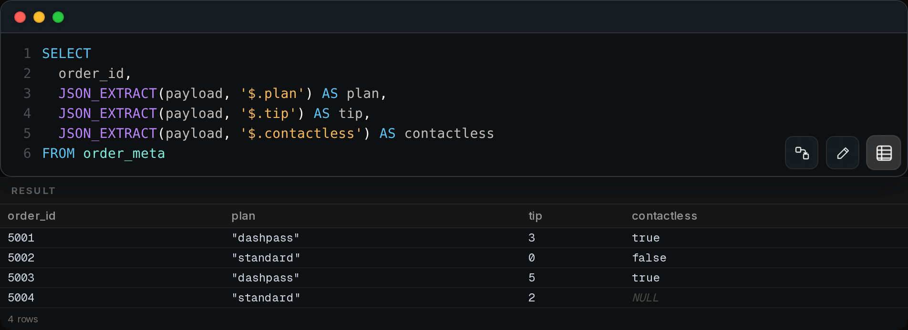
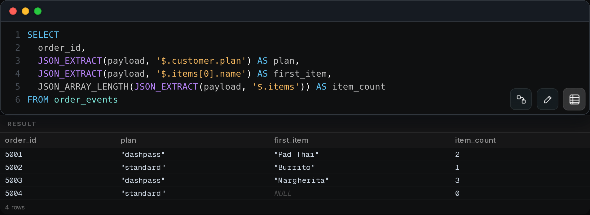
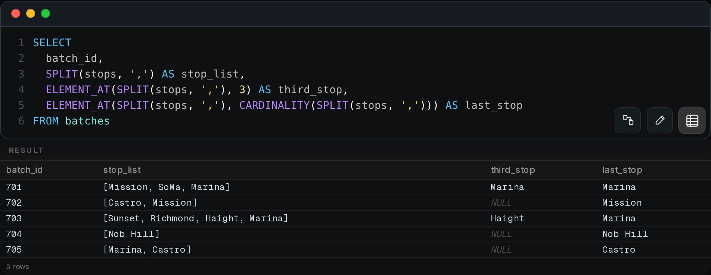
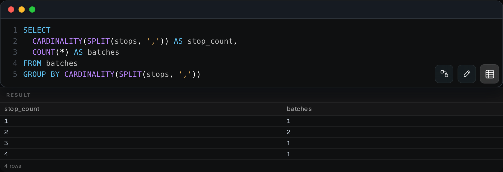
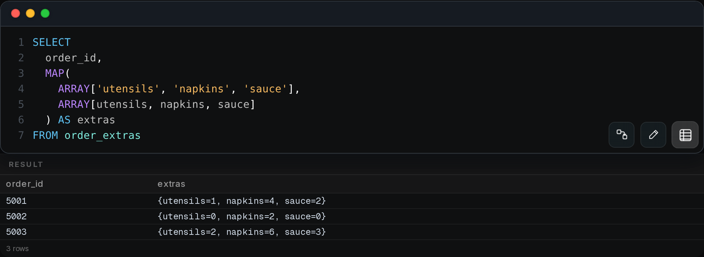
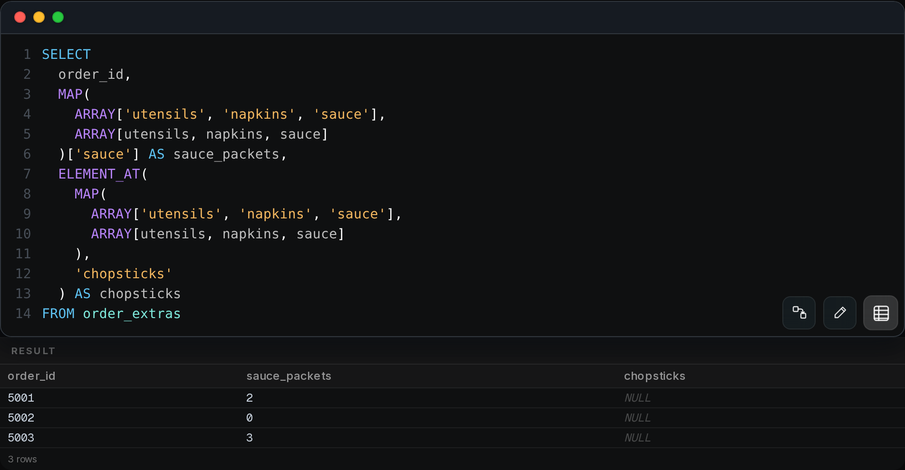
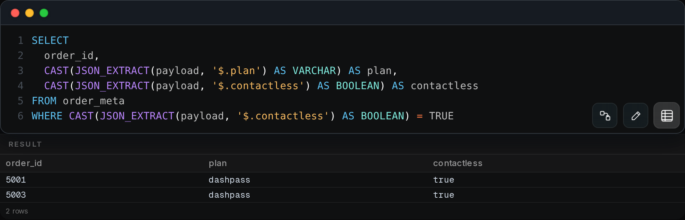
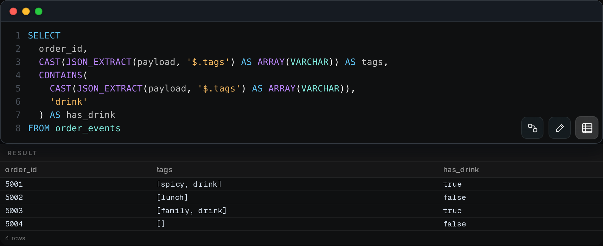
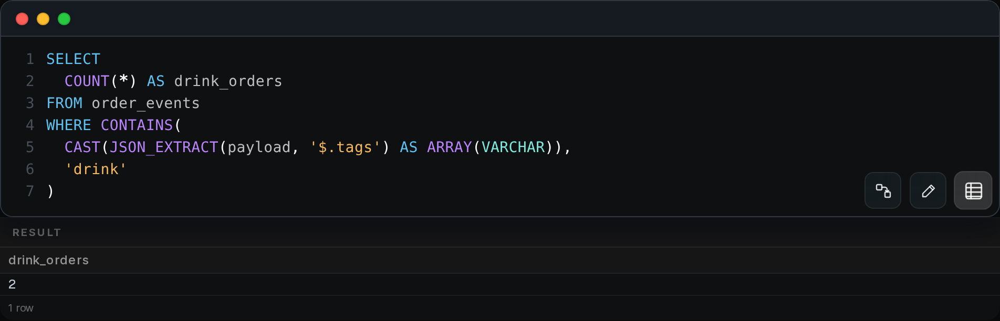

# Complex Data: Beginner

DoorDash's growth team wants to know how many of last week's orders included a drink. Each order reached the warehouse as one JSON blob holding a customer object, an items list, a tags list and a tip, and nobody ever built a drinks column. Whether the add-a-drink prompt ships depends on reading inside that single column, which is what this lesson teaches.


<br>

---

## JSON_EXTRACT()

### One column, many fields

A JSON column is a text column with structure inside it. The text follows the JSON format: an object is a set of key-value pairs inside curly braces, a list is a sequence of values inside square brackets, and each value is a string in double quotes, a number, `true`, `false`, or `null`. The `order_meta` table below holds a single order per row, and everything the app recorded about that order sits in the `payload` column.

| order_id | payload |
| --- | --- |
| 5001 | {"plan":"dashpass","tip":3,"contactless":true} |
| 5002 | {"plan":"standard","tip":0,"contactless":false} |
| 5003 | {"plan":"dashpass","tip":5,"contactless":true} |
| 5004 | {"plan":"standard","tip":2} |

Teams store events this way because the shape keeps changing. When the app adds a `scheduled_for` field next month, nobody alters the table; the new key appears inside `payload` on new rows and old rows carry on without it. Order 5004 already shows the pattern: its payload has no `contactless` key, because that order was placed before the option existed.


<br>

### Reaching in with a path

JSON_EXTRACT(column, path) reads a single value out of the JSON text. The path is a string that starts with $, which stands for the whole document, and .key steps into one key. So '$.plan' means the value stored under plan at the top level, and '$.tip' means the value under tip. Play the query below and watch each path land on its value in every row.

https://github.com/user-attachments/assets/c6368942-2ef6-4c92-9e8e-1783e13589b7

Row by row, the path `$.plan` finds `dashpass`, `standard`, `dashpass`, `standard`, and `$.tip` finds `3`, `0`, `5`, `2`. The plan values come out wrapped in double quotes while the tips do not. That difference is the central fact about this function: it returns a value of type JSON, a fragment of JSON text, so a JSON string keeps the quotes it had in the document and a JSON number stays bare.


<br>

### What comes back

Add a third extraction for the `contactless` key and run the query. Order 5004 has no such key, and the result for that row shows how the function handles absence.



```sql
SELECT
  order_id,
  JSON_EXTRACT(payload, '$.plan') AS plan,
  JSON_EXTRACT(payload, '$.tip') AS tip,
  JSON_EXTRACT(payload, '$.contactless') AS contactless
FROM order_meta
```

| order_id | plan | tip | contactless |
| --- | --- | --- | --- |
| 5001 | "dashpass" | 3 | true |
| 5002 | "standard" | 0 | false |
| 5003 | "dashpass" | 5 | true |
| 5004 | "standard" | 2 | NULL |

> Reading a JSON_EXTRACT result
>
> - `"dashpass"` with its quotes is a JSON string, text that still needs converting before SQL treats it as VARCHAR.
> - `3` with no quotes is a JSON number, and `true` with no quotes is a JSON boolean.
> - NULL means the path found nothing at all in that row, whatever the reason.

Order 5004 returns NULL for `contactless` because its payload lacks the key. The function raises no error for a missing key; it reports NULL and moves on, which is what you want when older events lack newer fields, and what you must remember when a typo in the path quietly returns NULL for every row.

> **TIP**
>
> Check the quotes before you trust a result. A value that comes back inside double quotes is JSON text, and the engine refuses to compare it with = to a VARCHAR. The CAST for Complex Types section shows the conversion that fixes this.

**Order 5002's payload is {"plan":"standard","tip":0,"contactless":false}. What does JSON_EXTRACT(payload, '$.tip') return for that row?**

- **A.** "0", a JSON string holding the digit
- **B.** 0, a JSON number with no quotes
- **C.** NULL, because a value of 0 counts as empty
- **D.** false, the value that follows tip in the text

<details>
<summary>Solution</summary>

**B.** 0, a JSON number with no quotes

The key exists and its value is the number 0, so the result is the JSON number 0, bare.

**Why the others are wrong**

- **A.** Quotes mark a JSON string. The document stores 0 as a bare number, so the result carries no quotes.
- **C.** NULL comes back only when the path finds no value. The key tip is present with a value of 0, which is a value like any other.
- **D.** Each path reads its own key. $.tip reads tip, and the contactless key plays no part.

</details>


<br>

### Spelling a path

The engine checks the form of every path when the query runs. A path opens with `$`, puts a dot before each key, and ends on a key. `'plan'` has no `$`, `'$plan'` has no dot, and `'$.plan.'` ends on a dot with nothing after it, so each one stops the query with an invalid-path error. Form is all it checks. Keys match letter for letter, including case, so `'$.Plan'` is well formed, runs, and comes back NULL for all 4 orders, because every document spells the key `plan`.

| path | result for order 5001 |
| --- | --- |
| '$.plan' | "dashpass" |
| '$.Plan' | NULL |
| '$' | the whole payload |
| '$plan' | error: invalid JSON path |


<br>

---

## JSON Extraction Patterns

### Objects inside objects

Production payloads nest. The `order_events` table carries the complete order: a `customer` object with its own keys, an `items` list where every element is an object, a `tags` list of strings, and the tip.

| order_id | payload |
| --- | --- |
| 5001 | {"customer":{"id":88,"plan":"dashpass"},"items":[{"name":"Pad Thai","qty":1},{"name":"Thai Iced Tea","qty":2}],"tags":["spicy","drink"],"tip":3} |
| 5002 | {"customer":{"id":91,"plan":"standard"},"items":[{"name":"Burrito","qty":2}],"tags":["lunch"],"tip":0} |
| 5003 | {"customer":{"id":88,"plan":"dashpass"},"items":[{"name":"Margherita","qty":1},{"name":"Garlic Knots","qty":1},{"name":"Lemonade","qty":1}],"tags":["family","drink"],"tip":5} |
| 5004 | {"customer":{"id":104,"plan":"standard"},"items":[],"tags":[],"tip":2} |

A path can step through several keys. '$.customer.plan' reads the top-level customer object, then the plan key inside it. Each dot is one step down, and the result is whatever sits at the end of the path: a string here, but a number, a list or another object are all possible.


<br>

### Lists and positions

Square brackets step into a list by position, and JSON paths count positions from 0. '$.items[0]' is the first element of the list and '$.items[1]' the second. Positions and keys chain: '$.items[0].name' reads the first item, then its name. To count the elements rather than read one, wrap the extracted list in JSON_ARRAY_LENGTH.



```sql
SELECT
  order_id,
  JSON_EXTRACT(payload, '$.customer.plan') AS plan,
  JSON_EXTRACT(payload, '$.items[0].name') AS first_item,
  JSON_ARRAY_LENGTH(JSON_EXTRACT(payload, '$.items')) AS item_count
FROM order_events
```

| order_id | plan | first_item | item_count |
| --- | --- | --- | --- |
| 5001 | "dashpass" | "Pad Thai" | 2 |
| 5002 | "standard" | "Burrito" | 1 |
| 5003 | "dashpass" | "Margherita" | 3 |
| 5004 | "standard" | NULL | 0 |

Order 5003 has 3 items and its first is Margherita. Order 5004 has an empty `items` list: the length is 0, and `$.items[0].name` returns NULL because there is no first item to step into. JSON_ARRAY_LENGTH returns a BIGINT rather than a JSON value, so `item_count` is ready for SUM, AVG or a HAVING filter with no conversion.


<br>

### Pulling out a whole branch

A path does not have to end on a scalar. Stop it on an object or a list and JSON_EXTRACT hands back that entire branch as JSON text. The second item of each order, `'$.items[1]'`, comes back as a complete object with its braces and quotes, or as NULL where the order has fewer than 2 items.

```sql
SELECT
  order_id,
  JSON_EXTRACT(payload, '$.items[1]') AS second_item,
  JSON_EXTRACT(payload, '$.tags') AS tags
FROM order_events
```

| order_id | second_item | tags |
| --- | --- | --- |
| 5001 | {"name":"Thai Iced Tea","qty":2} | ["spicy","drink"] |
| 5002 | NULL | ["lunch"] |
| 5003 | {"name":"Garlic Knots","qty":1} | ["family","drink"] |
| 5004 | NULL | [] |

Branch extraction is how you hand a sub-document to a later step. The `tags` value here is still JSON, a list drawn with its brackets and quoted strings; the CAST for Complex Types section turns it into a SQL array you can search with CONTAINS.


<br>

### Paths that find nothing

Three different mistakes produce the same quiet NULL: a key that does not exist, a position past the end of a list, and a typo in the path. `'$.customer.email'` returns NULL on every row because no order stores an email. `'$.items[5]'` returns NULL because no order has 6 items. `'$.custmer.plan'` returns NULL on every row as well, and nothing warns you. When a new extraction returns NULL everywhere, read the path letter by letter against one real payload before you blame the data.

> Checking a path by hand
>
> - Pick one row, copy its payload, and trace the path through it one step at a time.
> - Count list positions from 0: the third item is `[2]`, and `[3]` on a 3-item list returns NULL.
> - `JSON_SIZE(payload, '$.customer')` counts the keys in an object, 2 for every order here, and `JSON_SIZE(payload, '$.items')` counts list elements.

**For order 5001, whose items are [{"name":"Pad Thai","qty":1},{"name":"Thai Iced Tea","qty":2}], what does JSON_EXTRACT(payload, '$.items[2].qty') return?**

- **A.** 2, the quantity of the Thai Iced Tea
- **B.** 1, the quantity of the Pad Thai
- **C.** An error, because the list has 2 items
- **D.** NULL, because position 2 is past the end

<details>
<summary>Solution</summary>

**D.** NULL, because position 2 is past the end

Positions count from 0, so [2] asks for a third item. Order 5001 has 2, and a position past the end returns NULL.

**Why the others are wrong**

- **A.** That is $.items[1].qty. Position 1 is the second item because counting starts at 0.
- **B.** That is $.items[0].qty. Position 0 is the first item in a JSON path.
- **C.** A path past the end of a list raises nothing. It returns NULL, which is why a wrong path can go unnoticed.

</details>


<br>

### Tracing a path step by step

Reading a path left to right, one step at a time, is the surest way to predict what it returns. Here is `'$.items[1].name'` traced through order 5003, whose list holds Margherita, Garlic Knots and Lemonade.

| step | path so far | what it reaches |
| --- | --- | --- |
| 1 | $ | the whole order document |
| 2 | $.items | the list of 3 item objects |
| 3 | $.items[1] | {"name":"Garlic Knots","qty":1}, the second object |
| 4 | $.items[1].name | "Garlic Knots" |

Each step needs something to land on. Run the same path on order 5002, whose list holds only the Burrito, and step 3 finds no second object, so the whole path returns NULL. Swap `.name` for `.qty` at step 4 and order 5003 returns the bare number `1`.


<br>

---

## Arrays in SQL

### An ordered collection as a single value

An array is a SQL value that holds several elements of one type, in a fixed order, under a single column. Its type names the element type: `ARRAY(VARCHAR)` holds strings and `ARRAY(INTEGER)` holds whole numbers. Order is part of the value, so an array of Mission then SoMa differs from an array of SoMa then Mission. A delivery route is the natural case: the same 3 neighborhoods in a different order is a different drive.

You can write an array directly with the ARRAY[...] constructor, as in ARRAY['Mission', 'SoMa', 'Marina']. Most arrays in a warehouse come from data rather than literals, and the most common source is delimited text. SPLIT(text, delimiter) cuts a string at each delimiter and returns the pieces as an ARRAY(VARCHAR), in the order they appeared.

| batch_id | dasher | stops |
| --- | --- | --- |
| 701 | Priya | Mission,SoMa,Marina |
| 702 | Luis | Castro,Mission |
| 703 | Amara | Sunset,Richmond,Haight,Marina |
| 704 | Tomas | Nob Hill |
| 705 | Mei | Marina,Castro |

The `stops` column stores each batch's route as neighborhoods joined by commas. That is a string, so `LENGTH(stops)` counts characters and says nothing about how many stops a route has. Splitting it on the comma gives an array with one element per stop, in driving order.

https://github.com/user-attachments/assets/963700eb-986a-4c95-b40b-dc419917ce36

Batch 701 splits into 3 elements and the first is Mission. Batch 704 has no comma, so SPLIT returns an array of 1 element holding Nob Hill. The brackets after the array pick one position, and SQL arrays count positions from 1, so `[1]` is the first stop. A JSON path counts from 0, so the same bracket means a different thing depending on whether you are inside a path string or next to a SQL array.


<br>

### Reading one position

Asking for a position the array does not have raises an error that stops the whole query: `SPLIT(stops, ',')[3]` fails on batch 702, which has 2 stops. `ELEMENT_AT(array, position)` does the same lookup but returns NULL when the position is out of range, which makes it the right choice when routes differ in length. For the last element, hand ELEMENT_AT the array's own size: `CARDINALITY(array)` counts the elements, so `ELEMENT_AT(array, CARDINALITY(array))` lands on the last one whatever the length.



```sql
SELECT
  batch_id,
  SPLIT(stops, ',') AS stop_list,
  ELEMENT_AT(SPLIT(stops, ','), 3) AS third_stop,
  ELEMENT_AT(SPLIT(stops, ','), CARDINALITY(SPLIT(stops, ','))) AS last_stop
FROM batches
```

| batch_id | stop_list | third_stop | last_stop |
| --- | --- | --- | --- |
| 701 | [Mission, SoMa, Marina] | Marina | Marina |
| 702 | [Castro, Mission] | NULL | Mission |
| 703 | [Sunset, Richmond, Haight, Marina] | Haight | Marina |
| 704 | [Nob Hill] | NULL | Nob Hill |
| 705 | [Marina, Castro] | NULL | Castro |

Batches 702, 704 and 705 have no third stop, and ELEMENT_AT reports NULL for each instead of halting the query. The `last_stop` column is right for every row regardless of length, because each row's position comes from its own element count: 3 for batch 701, 1 for batch 704.

| ✓ stops[4] | ✗ ELEMENT_AT(stops, 4) |
| --- | --- |
| • Reads the element at position 4<br><br>• Raises an error when the array has fewer than 4 elements<br><br>• Fits data where every array has a known length | • Reads the element at position 4<br><br>• Returns NULL when the array has fewer than 4 elements<br><br>• Suits routes of different lengths, such as 1 to 4 stops |


<br>

### Asking about the whole array

CARDINALITY(array) returns the number of elements as a BIGINT, and CONTAINS(array, value) returns true when any element equals the value. Both return ordinary SQL types, so they slot into WHERE, GROUP BY and HAVING without any conversion.



```sql
SELECT
  CARDINALITY(SPLIT(stops, ',')) AS stop_count,
  COUNT(*) AS batches
FROM batches
GROUP BY CARDINALITY(SPLIT(stops, ','))
```

| stop_count | batches |
| --- | --- |
| 1 | 1 |
| 2 | 2 |
| 3 | 1 |
| 4 | 1 |

Two of the 5 batches run 2 stops, and the others run 1, 3 and 4. A WHERE clause can lean on CONTAINS the same way: `WHERE CONTAINS(SPLIT(stops, ','), 'Marina')` keeps batches 701, 703 and 705, the 3 routes that pass through the Marina, and drops the other 2.

**Batch 704 stores Nob Hill in stops, with no comma anywhere. What does ELEMENT_AT(SPLIT(stops, ','), 2) return for it?**

- **A.** NULL, because the array has 1 element
- **B.** Hill, the second word of the name
- **C.** Nob Hill, the only element there is
- **D.** An error, because position 2 is out of range

<details>
<summary>Solution</summary>

**A.** NULL, because the array has 1 element

With no comma to cut on, SPLIT returns a 1-element array holding the whole string. Position 2 is out of range, and ELEMENT_AT returns NULL rather than failing.

**Why the others are wrong**

- **B.** SPLIT cuts on the delimiter you give it, a comma here. The space inside Nob Hill is a different character, so the string stays in 1 piece.
- **C.** That is position 1. Position 2 asks for a second element the array does not have.
- **D.** The bracket form [2] would raise an error. ELEMENT_AT exists to return NULL in that case.

</details>


<br>

### Characters versus elements

Two habits carried over from strings and JSON paths trip people up here. `LENGTH` counts characters in a string, and `CARDINALITY` counts elements in an array, so on a route string they answer different questions. A SQL array also has no position 0: the first element is `[1]`, and `[0]` stops the query with an error saying SQL array indices start at 1. Batch 703 shows both.

| expression | batch 703 returns |
| --- | --- |
| LENGTH(stops) | 29 |
| CARDINALITY(SPLIT(stops, ',')) | 4 |
| SPLIT(stops, ',')[1] | Sunset |
| SPLIT(stops, ',')[0] | error: SQL array indices start at 1 |

The 29 counts every letter and all 3 commas in `Sunset,Richmond,Haight,Marina`; the 4 is the number of stops Amara drives.


<br>

---

## Maps in SQL

### Key-value pairs as a single value

A map holds pairs: each key appears once and points to one value. Its type names both halves, `MAP(VARCHAR, INTEGER)` for string keys with whole-number values. Where an array answers the question of what sits at position 3, a map answers what is stored under the key `sauce`. Keys carry the meaning, so you look things up by name and never count positions.

| order_id | utensils | napkins | sauce |
| --- | --- | --- | --- |
| 5001 | 1 | 4 | 2 |
| 5002 | 0 | 2 | 0 |
| 5003 | 2 | 6 | 3 |

The `order_extras` table records how many of each extra a customer requested, 1 column per extra. The restaurant team is about to add chopsticks, straws and extra ice to the list. Adding a column for every new extra means altering the table and every query on it each time. Packing the counts into a map keyed by the extra's name gives one `extras` value per order that grows by gaining keys.

MAP(keys, values) builds a map from 2 arrays of the same length: the first supplies the keys, the second the values, paired up by position. Here the keys array is a literal and the values array is built from the row's columns, so each row gets a map of its own counts.



```sql
SELECT
  order_id,
  MAP(
    ARRAY['utensils', 'napkins', 'sauce'],
    ARRAY[utensils, napkins, sauce]
  ) AS extras
FROM order_extras
```

| order_id | extras |
| --- | --- |
| 5001 | {utensils=1, napkins=4, sauce=2} |
| 5002 | {utensils=0, napkins=2, sauce=0} |
| 5003 | {utensils=2, napkins=6, sauce=3} |

The result prints each pair as `key=value` inside braces. Every row now holds one value of type `MAP(VARCHAR, INTEGER)`, and a fourth extra would be a fourth key inside that value, with no change to the column list.


<br>

### Looking up a key

Square brackets after a map take a key instead of a position. `extras['sauce']` returns the value stored under `sauce`. As with arrays, the bracket form raises an error if the key is absent, and `ELEMENT_AT(map, key)` returns NULL instead. Run both against a key that exists and one that does not.



```sql
SELECT
  order_id,
  MAP(
    ARRAY['utensils', 'napkins', 'sauce'],
    ARRAY[utensils, napkins, sauce]
  )['sauce'] AS sauce_packets,
  ELEMENT_AT(
    MAP(
      ARRAY['utensils', 'napkins', 'sauce'],
      ARRAY[utensils, napkins, sauce]
    ),
    'chopsticks'
  ) AS chopsticks
FROM order_extras
```

| order_id | sauce_packets | chopsticks |
| --- | --- | --- |
| 5001 | 2 | NULL |
| 5002 | 0 | NULL |
| 5003 | 3 | NULL |

Order 5002 requested 0 sauce packets, and 0 is a stored value, so the lookup returns 0. No order has a `chopsticks` key yet, so ELEMENT_AT returns NULL on every row. Writing `['chopsticks']` with brackets would stop the query with an error naming the missing key, which is the behavior you want during development and the one you avoid in a scheduled report.


<br>

### Keys, values and size

MAP_KEYS(map) returns the keys as an array, MAP_VALUES(map) returns the values as an array in the matching order, and CARDINALITY(map) counts the pairs. These are how you inspect a map whose keys you do not know in advance, such as an extras map after the team has added a few more.

```sql
SELECT
  order_id,
  MAP_KEYS(
    MAP(
      ARRAY['utensils', 'napkins', 'sauce'],
      ARRAY[utensils, napkins, sauce]
    )
  ) AS extra_names,
  CARDINALITY(
    MAP(
      ARRAY['utensils', 'napkins', 'sauce'],
      ARRAY[utensils, napkins, sauce]
    )
  ) AS extra_count
FROM order_extras
```

| order_id | extra_names | extra_count |
| --- | --- | --- |
| 5001 | [utensils, napkins, sauce] | 3 |
| 5002 | [utensils, napkins, sauce] | 3 |
| 5003 | [utensils, napkins, sauce] | 3 |

| ✓ Array | ✗ Map |
| --- | --- |
| • Same-typed values held in sequence<br><br>• Looked up by position, counting from 1<br><br>• CARDINALITY counts elements, CONTAINS searches them | • Unique keys, each with one value<br><br>• Looked up by key, order of pairs carries no meaning<br><br>• CARDINALITY counts pairs, MAP_KEYS lists the keys |

> **TIP**
>
> Reach for a map when the set of names can grow without a schema change, and for an array when position carries meaning. A route is an array because stop 2 follows stop 1. A bag of requested extras is a map because sauce before napkins means nothing.

**An order's extras map is {utensils=0, napkins=2, sauce=0}. Which expression returns NULL?**

- **A.** extras['utensils']
- **B.** CARDINALITY(extras)
- **C.** ELEMENT_AT(extras, 'straws')
- **D.** extras['straws']

<details>
<summary>Solution</summary>

**C.** ELEMENT_AT(extras, 'straws')

No straws key exists, and ELEMENT_AT reports a missing key as NULL.

**Why the others are wrong**

- **A.** The key exists with the value 0. A stored 0 is a value, and the lookup returns it.
- **B.** This counts the pairs in the map and returns 3.
- **D.** The bracket form raises an error for a missing key rather than returning NULL.

</details>


<br>

---

## CAST for Complex Types

### Why a JSON value needs converting

Every value JSON_EXTRACT returns is of type JSON, including the ones that look like text or numbers. The engine will not compare a JSON value with `=` to a VARCHAR literal, and will not add JSON numbers with SUM or average them with AVG. Grouping by an uncast JSON value does run, but the group labels keep their quotes, `"dashpass"` rather than `dashpass`, and stay JSON rather than text you can filter or join on. CAST to VARCHAR or INTEGER fixes all 3. The query below is the first thing most people try, and it fails.

```sql
SELECT
  order_id
FROM order_meta
WHERE JSON_EXTRACT(payload, '$.plan') = 'dashpass'
```


<br>

### Scalar casts

CAST to VARCHAR turns a JSON string into plain text and drops the quotes. CAST to INTEGER turns a JSON number into a whole number, CAST to BOOLEAN turns `true` or `false` into a SQL boolean, and both a missing value and a JSON `null` become SQL NULL through any cast.

| JSON value | CAST(... AS) | result |
| --- | --- | --- |
| "dashpass" | VARCHAR | dashpass |
| 3 | INTEGER | 3 |
| true | BOOLEAN | true |
| null | VARCHAR | NULL |
| NULL (path found nothing) | INTEGER | NULL |

With the plan cast to VARCHAR the engine can group by it, and with the tip cast to INTEGER, SUM can add it. The query below totals tips per plan over `order_meta`.

https://github.com/user-attachments/assets/add03717-21ab-4894-a395-cd64b3ca775c

The 2 dashpass orders tipped 3 and 5 for a total of 8; the 2 standard orders tipped 0 and 2 for a total of 2. Write the CAST expression in GROUP BY exactly as it appears in SELECT, because GROUP BY does not see the alias. The same cast unlocks WHERE: the next query keeps the contactless orders.



```sql
SELECT
  order_id,
  CAST(JSON_EXTRACT(payload, '$.plan') AS VARCHAR) AS plan,
  CAST(JSON_EXTRACT(payload, '$.contactless') AS BOOLEAN) AS contactless
FROM order_meta
WHERE CAST(JSON_EXTRACT(payload, '$.contactless') AS BOOLEAN) = TRUE
```

| order_id | plan | contactless |
| --- | --- | --- |
| 5001 | dashpass | true |
| 5003 | dashpass | true |

Order 5002 drops out because its value is false. Order 5004 drops out because its cast returns NULL, and NULL = true is neither true nor false under three-valued logic, so WHERE discards the row. Two rows survive, and the plan column now reads `dashpass` with no quotes.


<br>

### JSON lists become arrays

CAST to ARRAY(VARCHAR) turns a JSON list of strings into a SQL array, and from there everything in the arrays section applies. The question from the intro, how many orders included a drink, is a CONTAINS on the cast tags list.



```sql
SELECT
  order_id,
  CAST(JSON_EXTRACT(payload, '$.tags') AS ARRAY(VARCHAR)) AS tags,
  CONTAINS(
    CAST(JSON_EXTRACT(payload, '$.tags') AS ARRAY(VARCHAR)),
    'drink'
  ) AS has_drink
FROM order_events
```

| order_id | tags | has_drink |
| --- | --- | --- |
| 5001 | [spicy, drink] | true |
| 5002 | [lunch] | false |
| 5003 | [family, drink] | true |
| 5004 | [] | false |

The empty JSON list on order 5004 casts to an empty array, and CONTAINS on an empty array is false. Move the CONTAINS into WHERE and count the rows that pass to get the growth team's number.



```sql
SELECT
  COUNT(*) AS drink_orders
FROM order_events
WHERE CONTAINS(
  CAST(JSON_EXTRACT(payload, '$.tags') AS ARRAY(VARCHAR)),
  'drink'
)
```

Two of the 4 orders carried a drink, and nobody added a column to find out.


<br>

### JSON objects become maps

CAST to MAP(VARCHAR, VARCHAR) turns a JSON object into a map keyed by its field names. Every value is converted to the map's value type, so the customer id 88, a JSON number, becomes the text 88 here. Lookups then use the map bracket from the maps section, customer['plan'].

```sql
SELECT
  order_id,
  CAST(
    JSON_EXTRACT(payload, '$.customer')
    AS MAP(VARCHAR, VARCHAR)
  ) AS customer
FROM order_events
```

| order_id | customer |
| --- | --- |
| 5001 | {id=88, plan=dashpass} |
| 5002 | {id=91, plan=standard} |
| 5003 | {id=88, plan=dashpass} |
| 5004 | {id=104, plan=standard} |


<br>

### Text to JSON, and back

Casting text to JSON does something most people do not expect: `CAST(payload AS JSON)` wraps the entire string as one JSON string value, braces and all, rather than reading its structure. `JSON_PARSE(payload)` reads the structure and returns the document as a JSON value you can extract from. Going the other way, `JSON_FORMAT(json_value)` returns the JSON text as a VARCHAR, which is how you store an extracted branch back into a text column.

| ✓ CAST(text AS JSON) | ✗ JSON_PARSE(text) |
| --- | --- |
| • Treats the text as one string value<br><br>• '{"a":1}' becomes the JSON string "{\"a\":1}"<br><br>• A path such as $.a then finds nothing | • Reads the text as a JSON document<br><br>• '{"a":1}' becomes the JSON object {"a":1}<br><br>• A path such as $.a then finds 1 |

| ✓ Do | ✗ Don't |
| --- | --- |
| • CAST a JSON value to VARCHAR before comparing it in WHERE or grouping by it<br><br>• CAST a JSON number to INTEGER before SUM or AVG<br><br>• CAST a JSON list to ARRAY(VARCHAR) and search it with CONTAINS<br><br>• Use JSON_PARSE to turn stored text into a JSON document | • Compare a bare JSON_EXTRACT result to a string literal<br><br>• Expect CAST(text AS JSON) to read the structure inside the text<br><br>• Repeat a path in GROUP BY with a different spelling than SELECT |

**Order 5001's payload stores "plan":"dashpass". Which expression returns the VARCHAR value dashpass with no quotes around it?**

- **A.** JSON_EXTRACT(payload, '$.plan') on its own
- **B.** CAST(JSON_EXTRACT(payload, '$.plan') AS VARCHAR)
- **C.** CAST(payload AS VARCHAR) on the whole column
- **D.** CAST(JSON_EXTRACT(payload, '$.plan') AS JSON)

<details>
<summary>Solution</summary>

**B.** CAST(JSON_EXTRACT(payload, '$.plan') AS VARCHAR)

CAST to VARCHAR converts the JSON string to plain text and drops the quotes.

**Why the others are wrong**

- **A.** This returns the JSON value "dashpass", quotes included, which the engine cannot compare to a VARCHAR.
- **C.** The payload is already text, and this returns the entire document rather than one field.
- **D.** The value is already JSON, so this cast changes nothing and the quotes stay.

</details>


<br>

### What GROUP BY can read

Counting orders per plan puts the cast to work in GROUP BY, where 2 mistakes stop the query. GROUP BY reads the columns of the FROM table, so `GROUP BY plan` fails: `order_meta` has `order_id` and `payload`, and the alias `plan` exists only in the SELECT list. A GROUP BY expression that differs from the selected one fails too, because the selected plan is then neither grouped nor aggregated.

| GROUP BY | outcome |
| --- | --- |
| CAST(JSON_EXTRACT(payload, '$.plan') AS VARCHAR) | runs: groups dashpass and standard |
| plan | error: plan cannot be resolved |
| CAST(JSON_EXTRACT(payload, '$.tip') AS VARCHAR) | error: the selected plan is not grouped |


<br>

---

## Putting It All Together

A grocery delivery company stores every completed order as a JSON event holding a customer object, a list of product names, and a substitutions object that maps each requested product to the product the shopper picked instead. The fulfillment team asks how often shoppers substituted at least 1 item, split by membership plan.

- JSON_EXTRACT with the path $.customer.plan reaches the plan inside the nested customer object, and CAST to VARCHAR makes it a plain-text label GROUP BY can use.
- The substitutions object cast to MAP(VARCHAR, VARCHAR) gives one map per order, and CARDINALITY of that map counts how many items were swapped, 0 for orders with none.
- The list of product names cast to ARRAY(VARCHAR) and searched with CONTAINS answers which orders asked for a specific product, the same pattern that found the drink orders.
- ELEMENT_AT on the substitutions map keeps the query running for orders whose object lacks a given product, where a bracket lookup would stop it with an error.
- Grouping by the cast plan and dividing the number of orders whose substitutions map has a CARDINALITY above 0 by COUNT(\*) gives each plan's substitution rate, with no HAVING and no new column added to the event table.


<br>

---

## Key Takeaways

- JSON_EXTRACT(column, path) reads one value from JSON text: $ is the document, .key steps into a key, and [n] picks a list position counting from 0.
- The result is of type JSON, so strings keep their quotes, and a missing key, a position past the end or a typo in the path all return NULL with no error.
- An array is an ordered collection of one type whose positions count from 1; CARDINALITY counts elements, CONTAINS searches them, and ELEMENT_AT returns NULL where brackets would raise an error.
- A map holds unique keys with one value each; brackets look up a key, ELEMENT_AT tolerates a missing key, and MAP_KEYS and CARDINALITY describe a map whose keys you do not know.
- CAST turns a JSON value into VARCHAR, INTEGER, BOOLEAN, ARRAY or MAP so WHERE, GROUP BY and SUM can use it, and JSON_PARSE reads text as a document where CAST to JSON would wrap it as one string.
